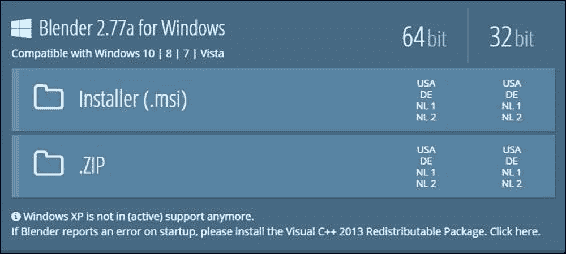
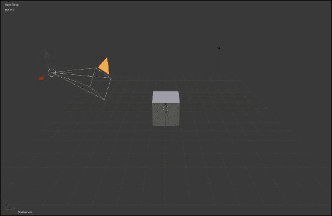
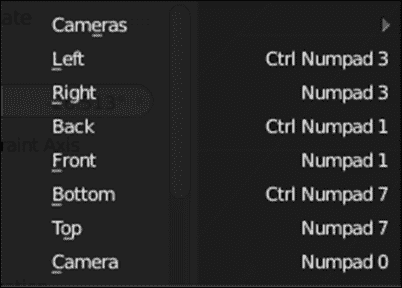
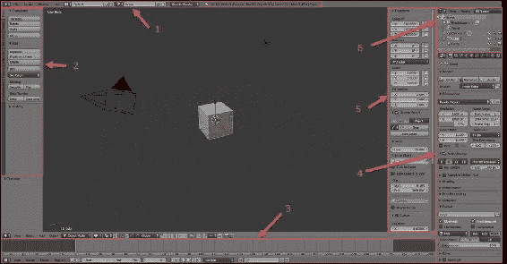

# 虚幻引擎 4 与 Blender 3D 游戏设计：融合强大的 UE4 与 Blender，构建引人入胜且完善的游戏环境

## 1. Unreal 老兄，我想让你认识一下 Blender

### 安装 Blender
### 探索界面
### 自定义设置
### 使用模式
### 进入我们的第一个项目
### 在 Unreal Engine 4 中开始工作
### 小结

## 2. 开始我们的第一个项目

### 使用内容浏览器开始构建关卡
### 使用不同类型的光源
### 使用触发器和蓝图添加交互元素
### 测试我们的关卡
### 小结

## 3. 是时候进行自定义了！

### 开始制作游戏资产
### 使用多边形建模的基本工具
### 如何使用 UV 映射及其重要性
### 为游戏资产展开 UV
### 基础纹理技术
### 小结

## 4. 将资产导入关卡

### 从 Blender 导出对象
### 什么是 FBX？
### 将对象导入 Unreal
### 设置并使用新的 3D 资产
### 小结

## 5. 让关卡更上一层楼

### 规划更复杂的关卡
### 使用白盒搭建关卡以便更好地创建资产
### 关卡设计原则
### 高级脚本技术
### 胜利条件
### 小结

## 6. 怪物资产——关卡完全需要一个这样的家伙

### 设计资产——灵感与概念艺术
### 高级工具：细分、刀切、桥接边循环等
#### 细分工具
#### 刀切工具
#### 桥接边循环工具
#### 三角化修改器工具
### 在 Blender 中使用多个形状
### 小结

## 7. 让我们盛装以待！

### 展开复杂对象
#### 标记接缝
#### 展开工具
#### 缝合
#### 平均岛缩放
#### 打包岛
### 使用智能 UV 投影
### 自定义标记接缝
#### 展开立方体
#### 展开圆柱体
### 使用不同贴图创建更逼真的外观
### 小结

## 8. 灯光、摄像机、动画！

### Blender 如何处理动画？
### 骨骼绑定与关键帧的使用
### 使用 Blender 的动画工具套件
### 小结

## 9. 砰砰——让它爆炸吧

### 创建类蓝图将所有内容串联起来
### 使用音效
### 使用粒子特效

## 索引

---

## 致谢

## 作者简介

**Justin Plowman** 是一位游戏设计师和教育工作者，现居美国。年幼时，他发现了自己对电子游戏的热爱，以及游戏给他人带来的快乐。2005 年，他开始教授高中生游戏开发，并乐于支持下一代开发者的梦想。他目前在西密歇根艺术与技术中心（[www.wmcat.org](http://www.wmcat.org)）教授弱势青少年游戏设计与开发；同时也在费里斯州立大学（[www.ferris.edu](http://www.ferris.edu)）的数字动画与游戏设计专业教授 Unreal Engine 开发。Justin 在教育领域使用 Unreal 技术已超过 10 年。闲暇时，他撰写与 Unreal 技术相关的各类学习教程，并通过关注近期行业新闻、学习教学与游戏开发的最佳实践来不断充实自己。可在 [`gamingbootcamp.wordpress.com/`](https://gamingbootcamp.wordpress.com/) 找到他。

撰写这本书对我来说是一段相当特别的旅程，因为它完全属于我从未预料到会做的事情范畴。然而，这确实是一次富有成效的经历，我无法对 *Packt Publishing* 的各位给予我的这个机会表达足够的感谢。我想感谢我的妻子 Jennifer，感谢她帮助我在漫长的写作和开发之夜中保持专注；也要感谢我的好朋友 Jacob Pollak，感谢他提供了令人惊叹的封面艺术。最重要的是，我要感谢伟大的 Unreal Engine 在线社区，多年来它在提升和培育我的技能方面发挥了关键作用。这本书代表了我回馈社区的愿望，希望它能鼓励社区内更多的设计师和开发者也这样做。谢谢大家！

## 审阅者简介

**Scott Hafner** 是一位拥有超过 10 年视频游戏行业经验的专业游戏设计师。在他的职业生涯中，Scott 曾担任制作人、游戏设计师和关卡设计师，涉足包括 MMO、第三人称射击游戏和 RPG 在内的多种平台和类型。

我想感谢我的妻子，感谢她对我的一切所为持续给予的鼓励和支持！

## 前言

### 本书内容

### 阅读本书的准备

### 适读人群

### 约定

### 读者反馈

### 客户支持

#### 下载本书的彩色图片

#### 勘误

#### 盗版

#### 提问

您知道吗？Packt 为每本出版的书籍都提供电子书版本，可供 PDF 和 ePub 文件下载？您可以在 [www.PacktPub.com](http://www.PacktPub.com) 升级到电子书版本，作为纸质书客户，您有权享受电子书副本的折扣。如需更多详情，请通过 `<customercare@packtpub.com>` 与我们联系。

在 [www.PacktPub.com](http://www.PacktPub.com)，您还可以阅读大量免费技术文章，注册各类免费通讯，并获得 Packt 图书和电子书的独家折扣与优惠。

`https://www2.packtpub.com/books/subscription/packtlib`

您是否需要即时解决 IT 疑难问题？PacktLib 是 Packt 的在线数字图书库。在这里，您可以搜索、访问并阅读 Packt 的全部图书库藏书。

## 为什么要订阅？

*   可在 Packt 出版的每本书中进行全文搜索
*   复制粘贴、打印和书签内容
*   按需访问，可通过 Web 浏览器访问

近年来独立游戏开发呈爆发式增长，许多开发者正在寻找强大且低成本的工具，以便将他们的梦想游戏推向市场。

Blender 是一款被全球开发者使用的强大开源 3D 软件包；它以易用性和活跃的社区而闻名。Unreal Engine 4 是由 Epic Games 打造的惊人 3A 游戏引擎，已成为众多大大小小游戏开发者的首选。

在本书中，我们将探讨如何利用 Blender 为 Unreal Engine 4 创建动态和静态游戏美术资源，以及如何将这些资源导入到我们自己的项目中。

### 本书内容涵盖

第 1 章，*Unreal, My Friend, I'd Like You to Meet Blender*（虚幻啊，我的朋友，我想让你认识一下 Blender），将指导您安装和设置 Blender 3D 软件包。我们将讨论 Blender 的界面和工具，并开始我们的第一个项目。

第 2 章，*Starting Our First Project*（开始我们的第一个项目），带我们进入 Unreal Engine 4，开始设计项目的第一个关卡。我们将回顾一些关卡设计基础，并搭建一个供未来游戏美术资源存在的游戏关卡。

第 3 章，*It's Time to Customize!*（是时候进行定制了！），将让我们在 Blender 中开始创建第一个游戏资源——用于货轮关卡的太空时代货箱。我们将介绍基本建模技术，并讨论游戏资源的 UV 展开和贴图流程。

第 4 章，*Getting the Assets to the Level*（将资源导入关卡），将讨论从 Blender 导出货箱并将其导入 Unreal 的流程，以便我们在货轮关卡中使用它。

第 5 章，*Taking This Level Up a Notch*（让关卡更上一层楼），将让我们从货轮转向构建空间站关卡，包含完整的脚本事件以丰富玩家的情感体验。我们将探讨蓝图中更高级的脚本技术，并准备关卡以接收更高级的游戏资源。

第 6 章，*Monster Assets – The Level Totally Needs One of These*（怪物资源——关卡完全需要一个这样的东西），将带我们完成创建更高级游戏资源——神器的设计流程。我们将了解更多 3D 建模工具，您将明白如何从多个组件构建游戏资源。

第 7 章，*Let's Dress to Impress!*（让我们盛装以赴！），将带我们完成构成神器的所有不同部件的 UV 展开过程。我们将了解 Blender 中一些高级 UV 工具。您还将学习如何利用 Substance Painter 创建令人惊叹的纹理和材质。

第 8 章，*Lights, Camera, Animation!*（灯光、摄像、动画！），带我们回到 Blender 为神器创建动画。我们将讨论将动画导入 Unreal Engine 4 的要求，以及在 Blender 中使用骨骼和绑定。

第 9 章，*Bang Bang – Let's Make It Explode*（砰砰——让它爆炸吧），以创建视频游戏爆炸效果（使用声音、粒子特效和飞散碎片）作为全书的结尾。我们将通过将游戏资源导入 Unreal Engine 4 并设置其爆炸来庆祝资源的完成！

### 阅读本书所需条件

阅读本书需要以下硬件和软件：

*   台式电脑或 Mac
*   Windows 7 64 位或 Mac OS X 10.10 或更高版本
*   四核 Intel 或 AMD 处理器，2.5 GHz 或更高
*   NVIDIA GeForce 470 GTX 或 AMD Radeon 6870 HD 系列显卡或更高版本
*   8 GB 内存
*   一个三键鼠标
*   Unreal Engine 4.9 或更高版本
*   Blender 2.76 Release Candidate 3 或更高版本
*   Substance Painter 1.7 30 天免费试用版或更高版本

本书提到的所有软件均免费，可从互联网下载。

### 适读人群

本书非常适合想要创建惊人的 3D 游戏环境，并利用 Blender 与 Unreal Engine 4 的强大功能相结合的 3D 艺术家和游戏设计师。掌握 3D 设计基础知识对于充分利用本书是必要的。有 Blender 使用经验会有帮助，但非必需。

### 约定

在本书中，您将看到多种文本样式，用于区分不同类型的信息。以下是这些样式的示例及其含义说明。

文本中的代码词、数据库表名、文件夹名称、文件名、文件扩展名、路径名、虚拟 URL、用户输入和 Twitter 账号显示如下："This can be found by typing `Input` `E` into the Find a Node search box."（可通过在“查找节点”搜索框中输入 `Input` `E` 来找到它。）

**新术语** 和 **重要单词** 以粗体显示。您在屏幕上看到的词汇（例如菜单或对话框中的内容）会在文本中以此形式显示："Click on the `Add Modifier` dropdown and select `Mirror`."（点击 `Add Modifier` 下拉菜单并选择 `Mirror`。）

#### Note

警告或重要提示会显示在这样的框中。

#### Tip

技巧和窍门会以这种形式显示。

### 读者反馈

我们始终欢迎读者的反馈。请告诉我们您对本书的看法——您喜欢或不喜欢的地方。读者反馈对我们很重要，因为它有助于我们开发出您真正能从中获益良多的书籍。

如需发送一般反馈，请发送电子邮件至 `<feedback@packtpub.com>`，并在邮件主题中注明书名。

如果您在某个主题上有专长，并有兴趣撰写或参与编写一本书，请参阅 [www.packtpub.com/authors](http://www.packtpub.com/authors) 上的作者指南。

### 客户支持

既然您已成为 Packt 图书的荣幸拥有者，我们准备了一系列内容帮助您最大程度地利用您的购买。

#### 下载本书的彩色图片

我们还提供一个包含本书所用截图/图表彩色图片的 PDF 文件。彩色图片将帮助您更好地理解输出结果的变化。您可以从 [`www.packtpub.com/sites/default/files/downloads/3DGameDesignwithUnrealEngine4andBlender_coloredImages.pdf`](https://www.packtpub.com/sites/default/files/downloads/3DGameDesignwithUnrealEngine4andBlender_coloredImages.pdf) 下载此文件。

#### 勘误表

### 勘误

虽然我们已尽一切努力确保内容的准确性，但错误难免发生。如果您在我们的书籍中发现错误——无论是文本还是代码——我们将不胜感激如果您能向我们报告。这样做可以让其他读者免受挫折，并帮助我们改进本书的后续版本。如果您发现任何勘误，请访问 [提交勘误页面](http://www.packtpub.com/submit-errata) 报告，选择您的书籍，点击 `Errata Submission Form` 链接，并填写错误详情。一旦您的勘误经核实，您的提交将被接受，勘误将上传到我们的网站，或添加到该书 `Errata` 部分的现有勘误列表中。

要查看之前提交的勘误，请访问 [Packt 支持页面](https://www.packtpub.com/books/content/support) 并在搜索字段中输入书名。所需信息将出现在 `Errata` 部分下。

### 盗版

互联网上的版权材料盗版是所有媒体持续面临的问题。Packt 非常重视版权和许可证的保护。如果您在互联网上以任何形式发现我们作品的非法副本，请立即向我们提供位置地址或网站名称，以便我们采取补救措施。

请通过 版权邮箱 联系我们，并附上涉嫌盗版材料的链接。

感谢您帮助保护我们的作者，以及我们为您带来有价值内容的能力。

### 问题

如果您对本书的任何方面有疑问，可以通过 问题邮箱 联系我们，我们将尽最大努力解决问题。

作为游戏开发者，我们都有自己的梦想游戏——那款让我们兴奋不已、历经多年仍萦绕心头的游戏。对一些人来说，这意味着等待另一位游戏开发者构建类似的东西，但他们的版本永远无法完全匹配我们自己的设想。对我们大多数人来说，想要看到这款游戏诞生并亲自游玩的渴望，成为了我们开启独立游戏开发生涯的催化剂。当我们构建梦想、将心血倾注于游戏开发时，我们仍希望能在当今的游戏市场与大厂竞争，但我们没有资金购买“3A”级游戏引擎和高端 3D 软件包的商业许可证。几年前，这一切因 `Unreal Engine` 等大型 3D 游戏引擎向独立开发者免费开放而改变。现在，小型开发者拥有了与大型开发者同等的高端工具访问权限。这些新游戏引擎赋予了我们构建梦想游戏的能力。然而，3D 艺术软件从未真正跟进。许多行业标准创作套件（如 `Autodesk 3ds Max`）仍要花费数千美元。这种情况在 2002 年随着 `Blender Foundation`（一个致力于支持 Blender 的非营利组织）的成立而改变。Blender 是一款开源 3D 创作软件，允许像我们这样的小型开发者在商业项目中使用自己的艺术作品，而无需预先投入巨资。我们终于可以创作梦想中的 3D 游戏，而无需为如何支付工具费用而焦虑。

这就是您来到这里的原因。也许您已经是使用最新版 `Unreal Engine 4` 的独立开发者，但仍只使用他人创建的游戏资产。也许您是一位完全的新手，脑海中充满了待创建的惊人数字景观。无论哪种情况，本书都适合您。在接下来的章节中，我们将探讨如何结合使用 Blender 和 `Unreal Engine 4` 为您的游戏创建自定义关卡和游戏内容。

在本章中，我们将涵盖以下主题：

*   安装 Blender
*   探索界面
*   自定义设置
*   使用模式
*   进入第一个项目
*   在 `Unreal Engine 4` 中开始

# 安装 Blender

我们开发旅程的第一步始于 [Blender 官网](http://www.blender.org)，即 `Blender Foundation` 的在线主页。在这里，您可以了解 Blender 的历史，与社区交流，访问培训视频等。我鼓励您有空时查看该网站，因为它提供了丰富的资源。例如，每当软件有重大更新时，也会发布一部动画短片。这些影片不仅娱乐性强，还展示了工具集的能力。

以下是下载 Blender 的步骤：

1.  访问 [Blender 官网](http://www.blender.org/)。
2.  点击右侧标记为 `Download Blender 2.76-rc3` 的按钮（撰写时的当前版本）：
    
    点击下载按钮获取最新版本的 Blender
3.  Blender 是跨平台软件。为您的操作系统选择 64 位或 32 位镜像。大多数情况下，您的计算机将是 64 位：
    
    点击离您最近且与您的操作系统对应的下载链接。大多数用户需要 64 位版本，但如果您的内存少于 8 GB，应使用 32 位版本
4.  下载完成后点击 `Installer`。
5.  按照安装提示操作。它们非常简单，不需要额外配置。

一切安装完成后，请运行程序。您将看到启动画面。现在让我们看看界面。

# 探索界面

运行 Blender 时，您会看到启动画面。左侧会列出您最近处理过的文件，以及一些快速链接，指向文档、网站等各种内容。点击启动画面两侧的空白区域可将其关闭。现在让我们看看默认场景。

Blender 默认在场景中提供三个基本对象：一个立方体、一盏灯和一台摄像机，如下截图所示：

我们的 Blender 默认设置。我们将对其进行更改以更好地配合 `Unreal 4` 工作

通过右键点击对象来选择任意一个。这会将其高亮显示为橙色。尝试右键点击场景中的其他对象：

我们可以通过按住中键（`MMB`）绕中心旋转视角。我们可以通过按住 `Shift` + `MMB` 平移视角，并使用鼠标滚轮或小键盘上的 `+` 和 `-` 进行缩放。最后，小键盘也可用于查看物体的特定角度。

现在让我们看看菜单：

Blender 界面

1.  **菜单栏**
2.  **工具面板**
3.  **动画时间轴**
4.  **属性**
5.  **场景属性**（如果未看到此菜单，请按 `N`）
6.  **场景大纲**

所有上述选项都有多种功能。我们将在此简要讨论，并在项目继续时深入探讨：

*   **菜单栏**：包含 `File`、`Render`、`Window`、`Help`、`Scene Layout` 下拉菜单、`Browse Scene` 下拉菜单和 `Render Engine` 下拉菜单选项。在大多数情况下，我们将使用 `File` 菜单来保存、加载、更改用户偏好设置、导出文件和退出程序。
*   **工具面板**：包含我们将用于编辑形状和塑造创作的大多数功能。
*   **动画时间轴**：我们稍后将使用它来管理动画游戏资产。
*   **属性**：我们将频繁使用此面板来编辑场景属性、添加修改器等。
*   **场景属性**：包含一些与场景中项目相关的特定功能，如缩放。

*   **场景大纲视图**：这是我们场景中每个对象的便捷列表，如果你在视觉上找不到特定对象时非常有用。虚幻引擎也有一个类似的功能。

信息量很大，对吧？相信我，多练习就会变容易。为了让事情更简单，让我们自定义一些设置。

# 自定义你的设置

如果不自定义一些设置，使用 Blender 会有点麻烦，特别是如果你有其他 3D 软件的使用经验。当我们开始在界面中移动视角时，你可能立刻就注意到了，如果你左键点击，会移动那个小靶心光标。这被称为 3D 游标，实际上在 Blender 中有很多用途，比如确定放置新 3D 形状的位置。现在，左键点击移动这个游标并不理想，而且当你尝试选择 3D 场景中的物体时，很容易忘记这个设置，但我们可以更改它。

点击屏幕左上角的**文件**，然后选择**用户偏好设置**。选择**输入**选项卡，沿着左侧向下查找，直到看到**选择方式**选项。你可以看到它当前设置为右键选择物体。让我们将其改为**左键**，使其更符合虚幻引擎 4 的操作习惯。这能避免你在两个程序之间切换时产生很多困惑。确保在做完更改后，点击左下角的**保存用户设置**按钮。第二个需要更改的设置涉及缩放。

下面的截图显示了 **Blender 用户偏好设置** 窗口：

设置鼠标选择使用左键

要更改下一个设置，我们要看看**属性**面板。窗口看起来大概像这样：

面板顶部有几个小标签。我们要找的是**场景**标签，由这个图标表示：

设置鼠标选择使用左键

此面板允许我们更改与场景相关的几个选项，例如缩放。虚幻引擎 4 默认使用厘米作为度量单位，所以我们要在这里匹配该设置。这将使我们的游戏资产能直接适配关卡，而无需在游戏引擎中缩放它们。请遵循以下步骤：

1.  将使用的单位从**无**更改为**公制**。
2.  将缩放比例改为 `0.01`。
3.  场景中已有的物体（如我们的立方体）不会缩放。如果有任何你想保留的物体，将其缩放 `100` 倍。这可以通过点击左侧的**缩放**按钮，输入 `100`，然后按 `Enter` 键来完成。
4.  这会导致物体开始穿透网格边缘。要修复此问题，我们按 `N` 打开**场景属性**栏，找到**视图**部分，然后是**裁剪**部分，最后将**结束**属性改为 `1km`。

### 提示

提示：通过**添加**菜单放入的某些物体可能不会被适当缩放。将这些物体缩放 100 倍可以解决该问题。

现在我们已经做了这些更改，通过**文件**菜单或按 `Ctrl` + `S` 保存你的文件。

# 使用模式

Blender 还有一个我们还没提到的菜单。这是位于 3D 视图底部的一个小菜单栏，看起来如下所示：

3D 视图底部的菜单栏。我们会经常用到它！

它包含**视图**、**选择**、**添加**和**物体**菜单。它还包含模式下拉菜单。我们将在本书中使用许多不同的模式，但我们将花费大部分时间在**编辑**模式中。此模式允许我们推拉基本形状来创建新模型。Blender 允许我们通过按 `Tab` 键在**物体**模式（默认模式）和**编辑**模式之间轻松切换。这只有在你场景中选中了一个可编辑的物体时才有效。你会注意到当你更改模式时，许多菜单都会发生变化。当我们在 第 3 章 *是时候自定义了！* 中创建第一个物体时，我们将进一步探索这一点。

### 提示

提示：看起来我似乎跳过了大量信息。Blender 的菜单包含的内容远超我能在本书一章中解释的范围，我不想用不必要的信息拖慢你的进度。如果你很好奇，可以看看 Gordon Fisher 所著的 *Blender 3D Basics Beginner's Guide*（第二版），以获取更完整的描述。
