# 开始我们的第一个项目

本书分为两个项目，我们将在 Blender 中创建自定义游戏资产，并将它们添加到在虚幻引擎 4 中构建的关卡中。第一个项目将是一个基础关卡，我在 10 年的教学经验中教过许多学生创建：两个由走廊连接的房间，带有一些楼梯、功能性的门和一个电梯。虽然关卡本身不复杂，但我们将从构思、原型到最终产品，走完整个设计流程。稍后在本书中，我们将使用这个相同的流程来设计一个更复杂的关卡。关卡本身将以科幻恐怖主题为设计思路。拥有一个主题将统一这两个关卡，并在设计自定义关卡资产时给我们一个可遵循的美术风格。

那么，如何从零开始设计关卡？我们的流程将遵循几个不同的步骤：

1.  所有美好的事物都始于纸上。艺术家用草图开始构思。建筑师有蓝图。关卡设计师用地图草图开始他们的关卡。我推荐使用方格纸。我们也将用草图开始我们的自定义游戏资产。
2.  在关卡编辑器中使用基本形状开始布局关卡。编写游戏流程脚本。测试关卡，看布局是否适合玩家。这被称为白盒测试，或搭建关卡框架。本质上这是一个关卡原型。
3.  一旦你的白盒关卡达到预期，利用搭建出的尺寸开始创建和添加游戏资产。这使我们能在 Blender 中制作尺寸正确、能正确填充关卡空间的资产。
4.  添加游戏资产，调整光照，并添加特效。
5.  不要忘记在每一步都进行游戏测试，并收集玩家的意见！

现在让我们在虚幻引擎 4 中启动项目。

# 在虚幻引擎 4 中开始工作

在开始使用虚幻引擎之前，请确保你已安装 **Epic Games Launcher**。可在 [`www.UnrealEngine.com/`](https://www.UnrealEngine.com/) 免费获取，点击页面右上角的 **Get Unreal** 按钮即可下载。系统会要求你创建一个账户，启动器运行时会询问该信息。

接下来，点击屏幕左侧的**库**按钮。在标记为**引擎版本**的部分，点击版本 4.9.2（撰写时的最新版本）上的**启动**。如果没有可见的引擎，选择**添加版本**并按提示操作：

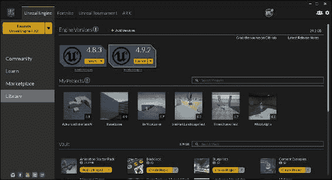

Epic Games Launcher。点击虚幻引擎标签下的库将显示你拥有的引擎版本以及当前项目

引擎加载完成后，将显示你正在处理的所有项目。对于这个项目，让我们创建一个新项目。点击顶部的**新建项目**标签，如下截图所示：

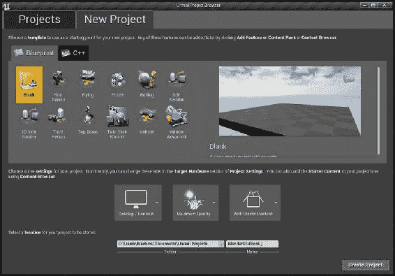

新建项目标签

此时，Unreal 为您提供了几个选择。引擎附带许多免费的入门项目，帮助您开始多种不同类型的项目。对于我们的项目，我们将使用 `First Person` 入门项目。确保 `Starter Content` 按钮显示为 `With Starter Content`，并为项目指定一个不含空格的唯一名称。准备就绪后，点击右下角的 `Create Project`。Unreal Engine 4 将加载，然后我们就可以开始制作关卡了。

# 总结

本章中，您了解了将用于实现关卡构想的工具。Blender 是一款免费开源的创作套件，支持整个资产开发流程。Blender 使用 `Python` 编程语言创建，灵活性足以在几乎任何机器上运行，且完全跨平台；可在 Windows、Mac 或 Linux 上运行。接着，您了解了将使用的设计流程，以及 Blender 和 Unreal Engine 4 如何融入其中。最后，您设置了 Unreal 以开始我们的第一个项目。进入下一章时，您将构建第一个关卡，它将容纳您的第一个原创游戏资产。您能感受到兴奋吗!?

## 规划您的关卡

现在到了令人兴奋的环节！在推进第一个项目的构建过程中，我们将使用上一章讨论的设计流程，从关卡草图开始。您可能会忍不住直接打开 Unreal 就开始干，对吧？既然我能构建梦寐以求的精彩关卡，为什么要花时间画图呢？好吧，理由如下。避免多次修改和在重做关卡部分上浪费昂贵时间的最佳方法是提前规划。确定关卡的设定、建筑、背景和故事。考虑一下在哪里放置故事线索和道具。让朋友、玩家和团队成员过目您的想法。融合收到的反馈，然后构建关卡。这相当于关卡设计师的“三思而后行”（原谚语为“量两次，切一次”）。

### 关卡草图

让我们看看我们的关卡草图：

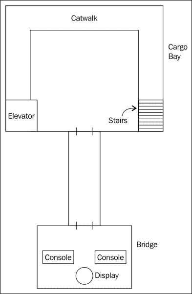

#### 关卡概览

这就是我们的第一个关卡。关卡本身相当基础。我们有两个由走廊连接的房间，还有一些通往二层的楼梯。完成基本布局后，我们可以在一侧添加一个货梯和供玩家互动的工作门。我尝试以小型货船的形式布局关卡，以契合我们科幻恐怖游戏的主题。该关卡将作为设定的介绍，也是将玩家带入我们稍后将构建的闹鬼空间站环境的一种方式。

### 本章主题

本章将涵盖以下主题：

*   使用 Unreal 的 `Content Browser` 构建关卡
*   使用不同类型的光源
*   使用 `Triggers` 和 `Blueprints` 添加交互元素
*   测试我们的关卡

# 使用内容浏览器开始构建关卡

请打开 `Epic Games Launcher`，并调出我们在上一章末尾创建的项目。Unreal Engine 4 相比引擎的上一版本是一次巨大的升级，因为它为用户提供了简单的拖放界面。这是通过界面中的两个重要面板实现的：`Modes` 面板和 `Content Browser`。这些界面部分允许关卡设计师将元素拖入关卡并放置在需要的位置。在这两者中，我们将最多地使用 `Content Browser`：

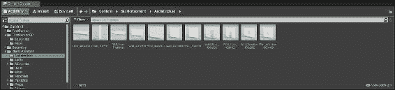

`Content Browser` 包含我们将使用的所有游戏资产。

`Content Browser` 存放了创作中可用的所有对象、声音、材质和粒子。这些资源被分类到文件夹中，这些文件夹反映了项目存储位置的文件结构。Unreal 这样做是为了在需要时方便移动项目文件。浏览器导航很简单。双击文件夹即可打开，而面板顶部显示的面包屑导航可以点击以返回之前的选择。我还喜欢开启来源面板；这使得导航和查找特定文件更容易。创建项目时，我们让 Unreal 包含 `Starter Content` 文件夹。该文件夹包含许多供我们入门的基础内容，例如各种基本形状、建筑部件、材质等。有了这些，我们可以开始对设计进行白盒搭建。

首先创建第一个房间：

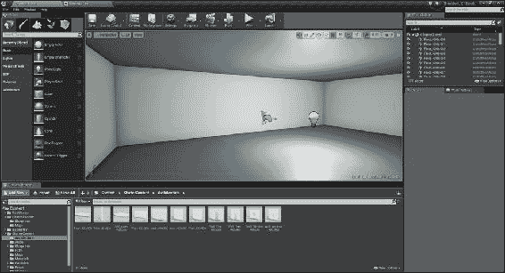

我们项目的第一个房间。

### 提示

提示：接下来，我们将开始在 Unreal 中构建关卡。本书假设读者具备使用 Unreal Engine 4 的基本知识。如果您在跟随操作时遇到问题，请查看 YouTube 上的 `UnrealEngine` 频道，那里有来自 Epic Games 的一些很棒的入门教程。网址为 <https://www.youtube.com/channel/UCBobmJyzsJ6Ll7UbfhI4iwQ/>.

要开始构建第一个房间，我们将利用 `Architecture` 文件夹中的资产。利用其中的地板、墙壁和门，我们将组装设计中的第一个房间：

1.  首先，在我们的项目中创建一个新关卡。点击顶部的 `File` 菜单，选择新建关卡。在出现的对话框中选择 `Empty Level`。

2.  新关卡什么都不包含。非常适合我们的太空之旅！放入一个 `Floor_400x400` 部件作为起点。这是通过从 `Content Browser` 点击拖拽部件到关卡中完成的。转到细节面板，确保其位置设置为 `x=0 y=0 z=0`。这将使对齐其他部件变得容易。

3.  复制地板五次。按住 `ALT` 并移动对象即可轻松创建副本。将它们排成 2x3 的矩形，形成一个大小合适的房间。

4.  接下来，获取一些墙壁。将一个 `Wall_400x300` 拖入关卡，放在您的一个地板部件上方：

    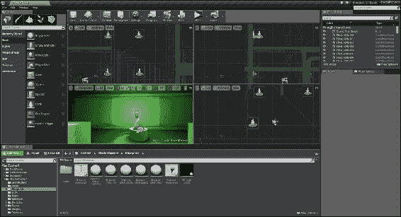

    有时我们使用四窗口视图来对齐静态网格体。

5.  我们将使用四视口视图来对齐墙壁部分。在视口的右上角，有一排图标控制着网格吸附、角度吸附、缩放吸附和相机速度等项目。那些图标的最右侧是一个最小化/最大化按钮。点击它以显示四个视口。利用其中两个视口，将墙壁部分与地板的一个角落对齐。

6.  复制墙壁部分，并使用 `Move` 和 `Rotate` 工具将空间封闭起来。

7.  最后，拿取地板部件将其作为屋顶，封闭空间以完成房间。

# 关卡构建演练

## 添加灯光和玩家起始点

此时，你肯定迫不及待想进入关卡，在新房间里跑一圈。然而，要测试我们的关卡，我们需要添加几样东西：灯光和玩家起始点。为了测试目的，让我们放入几个 `PointLights`。前往屏幕左侧的 `Modes`（模式）面板，将两个 `PointLights` 拖入你的房间。同样，使用四视口配置确保它们位于你想要的位置。其次，从同一面板拖入一个 `PlayerStart`。`PlayerStart` 从其中心伸出一支箭头。那指示了玩家生成时面朝的方向。始终尝试将 `PlayerStart` 指向你希望玩家最初前进的方向。这能确保玩家从一开始就投入游戏，并能以最小的困惑享受你的创作。最后，我们需要保存文件（使用 `File` 菜单或 `Ctrl` + `S`），并使用 `Build`（构建）按钮构建关卡。

### 提示：构建按钮

`Build` 按钮会烘焙灯光并最终确定所有关卡更改。这能让你最直观地了解灯光效果，也是测试游戏 AI 和其他功能的重要环节。在测试前构建关卡是个好习惯。

## 测试关卡

在构建过程中测试关卡是设计流程的重要组成部分。通过测试，你可以发现关卡是否存在缺陷或问题，并在情况变得过于复杂之前修复它们。要测试关卡，请按 `Play`（播放）按钮。这将在当前视口启动一个游戏会话，让你在关卡内跑动。如果你点击 `Play` 按钮旁边的小下拉箭头，将会看到打开其他类型游戏窗口的选项，例如 `New Editor Window`（新编辑器窗口）。能看到完整的游戏画面会很有帮助。现在测试关卡，确保所有东西都正确对齐。一旦你对第一个房间感到满意，让我们构建其余的设计：

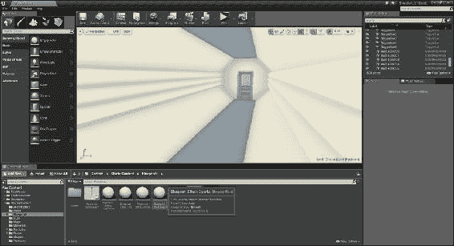

向灰盒关卡添加尽可能多的细节是个好习惯，这样你就能对最终设计的样子有个好印象。

## 构建走廊

现在让我们构建走廊。我们可以通过复制关卡中的现有部件轻松构建走廊。我还将展示如何在不删除的情况下替换关卡中的部件：

1. 选择第一个房间中的一个地板部件。复制它，并将其对齐到你想要放置通往走廊空间的门口的位置。

2. 进入 `Content Browser`（内容浏览器）并选择 `Wall_Door_400x300`。我们将用这个部件替换其中一个墙壁部分。现在在视口中选择你想要替换的墙壁部件。右键点击它，从菜单中选择 `Replace Selected Actors with Wall_Door_400x300`（用 Wall_Door_400x300 替换选中的 Actor）：

    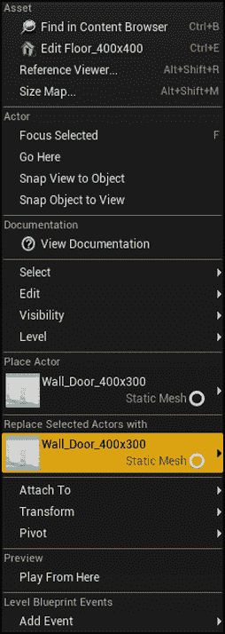

    用包含门的墙替换我们的墙壁静态网格体

    这将把现有的静态网格体替换为我们选中的那个，并加入一个尺寸完美的门口。

3. 再复制两次地板部分以延长走廊。别忘了确保所有部件都与现有地板正确对齐。

4. 复制一个墙壁部分并添加到走廊。再复制几次以封闭走廊的长度。

5. 最后，复制地板以创建天花板并封闭走廊，并在里面添加一盏灯。

### 提示：快速添加灯光

请记住，灯光可以像其他对象一样被复制。另一种快速添加 `PointLight` 的方法是按住 `L` 键，然后点击你想放置灯光的位置。

构建关卡并测试一下。如果走廊感觉不够长，再添加几个部分。一旦你对目前的关卡手感满意，保存文件。现在让我们添加最后一个房间：

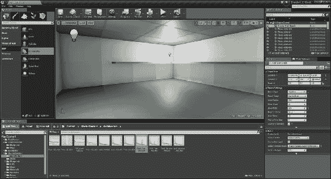

## 构建货舱

正在构建货舱

对于这个房间，我们将向设计中添加一些垂直元素。我们还将构建楼梯和电梯以到达上方的走道，开始吧：

1. 就像之前的添加一样，让我们从走廊复制一个地板部件并将其与门口对齐。这将是新房间的起点。这个房间将比上一个大，所以让我们在每个方向上各复制两次新地板部分，形成一排五个地板部件。

2. 现在按住 `Ctrl` 并点击每个部件，选择那一排的所有地板部件。复制这一行四次以创建我们的大房间：

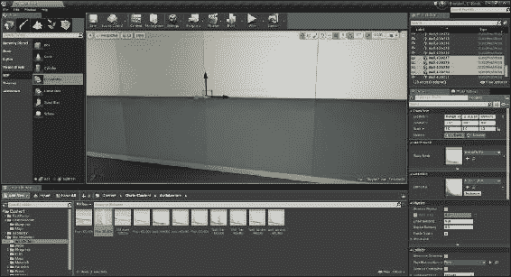

通过复制墙壁创建二层

3. 从走廊复制一个墙壁部分到我们的房间，并用它封闭整个空间，就像我们在走廊里做的那样。现在选择所有那些墙壁部件并复制它们。将这些部件放在原件顶部以创建二层：

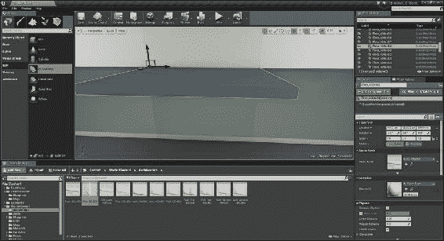

复制一楼部分用于天桥

4. 现在让我们为二楼创建天桥。向房间后方复制一个地板部件。将其与墙顶对齐。

5. 在 `Details`（细节）面板中，找到 `Scale`（缩放），在绿色框中输入 `0.7`。这将沿 `Y` 轴缩放地板部件，减小天桥的宽度：

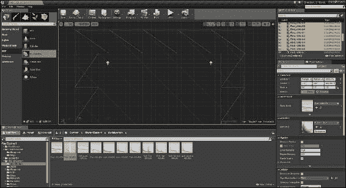

使用俯视图复制天桥地板部分

6. 沿着房间外侧复制走道部件，创建一个 U 形区域。这将为楼梯和电梯留出空间：

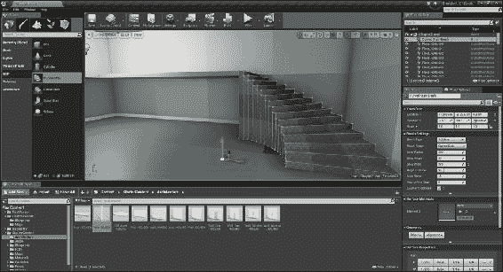

创建螺旋楼梯以便玩家进入二楼

7. 该做楼梯了！从模式面板的 `BSP` 菜单中添加一个 `Curved Staircase`（弧形楼梯）。将其与我们的角落对齐，以便连接走道。然而，默认楼梯高度不够。我们可以在 `Details` 面板中调整楼梯，通过修改 `Num Steps`（阶梯数量）选项来修复。我们可以通过调整 `Step Width`（阶梯宽度）选项来调整楼梯尺寸。适合我的设置是 `Num Steps`：`15` 和 `Step Width`：`275`。

8. 我们的最后一个功能是添加电梯所需的部件：

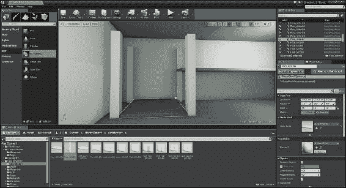

开始布局电梯组件

对于电梯，我复制了一个地板部件并将其移动到与上方走道对齐的位置。我上下移动几次以确保它合适，然后将其放在下降位置的地板上。我们将在本章后面为这个部件制作动画，使电梯运作。

9. 从 `Architecture`（建筑）文件夹获取一个 `Pillar_50x500` 部件并将它们围绕电梯排列，完成。

### 提示：设置默认地图

你是否断断续续地在这个关卡上工作，并希望默认打开这个关卡而不是示例？前往 `Edit`（编辑）菜单并选择 `Project Settings`（项目设置）。选择 `Maps & Modes`（地图与模式），将 `Game Default Map`（游戏默认地图）和 `Editor Starter Map`（编辑器启动地图）更改为你的关卡文件。

# 为关卡添加装饰元素

现在我们已经在关卡中设置了基本的关卡几何体，让我们思考一下还可以添加哪些更具装饰性的元素来帮助强化主题。科幻关卡有多种不同的风格。有些环境可能简洁明了，就像《星际迷航》宇宙中的那样。其他的可能更偏向工业风，到处都是管道和线缆，就像我们在《异形》系列中看到的那样。关卡的美学可以用来强化环境的主题并向玩家传达信息。在本例中，我们想要强化生存恐怖的氛围。为此，我将更多地倾向于工业风格。收集参考美术来帮助激发你的物品摆放灵感，可以帮助你获得正确的感觉，我强烈建议你在网上查看一些图片以获取优秀的范例。请记住，这些道具只是稍后可以创建的美术资源的占位符。准备好了吗？让我们开始制作第一个房间：

1.  前往 `Starter Content` 文件夹中的 `Shapes` 文件夹。该文件夹包含许多基本形状，将有助于近似表示可在 Blender 中为该关卡创建的不同道具。

2.  拿一个 `Shape_Cylinder` 并将其拖入房间。我设想这个第一个房间是我们小型货船的舰桥，而圆柱体可以作为飞船驾驶的平视显示器的全息投影仪。我在它上面添加了一个 `Shape_TriPyramid` 并将其缩小了一些，使其看起来更有科技感。

3.  添加几个 `Shape_Cube` 并缩放它们，使其看起来像控制台。这使我们能够近似实际要制作的 3D 模型的尺寸。

4.  使用 `Shape_Pipe`、`Shape_Pipe_90` 和 `Shape_Pipe_180` 部件，在房间周围添加一些管道以增加细节。在方形空间中，一个好的经验法则是向角落添加细节以掩盖房间是方形的事实。这会让空间更有趣并提供视觉多样性。

5.  使用 `Shape_Trim`、`Shape_Trim_90_In` 和 `Shape_Trim_90_out` 部件，在地板和墙壁相接的地方添加一些装饰条。完成后，选择所有装饰条部件，复制它们，并将它们翻转过来，以装饰墙壁与天花板相接的区域。

6.  `Props` 文件夹包含几个完成的部件供我们使用，这与我们稍后在本书中将使用 Blender 制作的部件类似。拿几把椅子添加到我们的舰桥上，靠近我们的“电脑控制台”占位符形状。

7.  再次使用 `Shape_Cube` 部件，为后墙和侧墙增加一些变化。

## 舰桥白模

这是我完成的舰桥白模：

*最终的舰桥白模*

## 货舱白模

这是我完成的货舱白模：

*货舱最终白模*

它开始让人感觉更像一个环境了吗？如果没有，再添加一些形状或道具，直到你的关卡感觉更自然。但是，不要过度。我们希望关卡中有一些物体来传达故事并让玩家沉浸在我们的环境中。我们不希望关卡过于拥挤，让人感觉笨重和杂乱。花些时间为走廊和第二个房间添加一些细节。在下一节中，我们将着眼于如何根据我们的主题为关卡打光。

# 使用不同类型的光照

在整个关卡中，我们一直在使用基础灯光，只是为了给我们的进行中的工作提供一些照明。在本节中，我们将把灯光转变为更符合我们主题且能向玩家传达主题的东西。适当的灯光对于使场景或环境显得可信非常重要。它可以让观众感到焦虑或恐惧，并营造紧张感。它可以传达危险或安全。在游戏中，它甚至可以成为一种游戏机制。在我们的场景中，我们将利用灯光来传达一种神秘感和一种张力，即可能有事情正在玩家视野之外发生。

要创造这种感觉，让我们思考一下可能需要什么。将角落沉浸在阴影中并限制玩家的视线，可以在很大程度上让他们觉得可能有东西正在视线之外潜伏着他们。使用不同颜色的灯光来表示危险和安全，可以向玩家传达这些信息，从而产生或缓解张力。就像我们之前收集网上的图片来帮助物品摆放一样，其他游戏的图片，尤其是现实生活中的图片，可以帮助你找出适合你关卡的正确灯光。Unreal 提供了几种不同类型的灯光来帮助我们实现这些目标。`PointLights` 是我们已经熟悉的一种灯光类型。它们从空间中的固定点向所有方向投射光线。接下来是 `SpotLights`。这些灯光以锥形向目标点投射光线。这可以用来突出环境中的特定事物。最后，我们有 `DirectionalLights` 和 `SkyLights`。这些是大型光源，可在整个关卡中创建统一的光照量。`DirectionalLights` 通常用于在室外环境中创建太阳或月亮。对于每种类型的灯光，`Details` 面板都提供了多个选项来调整强度、阴影、衰减和颜色。准备好为我们的环境添加一些情感了吗？

1.  让我们通过删除每个房间中除一盏灯以外的所有灯光来开始我们的灯光制作过程。这将使我们能够从非常基础的东西开始。别忘了在进行灯光更改后构建关卡。这允许 Unreal 处理阴影的变化，并让你准确地看到你的更改。

2.  选择靠近 `PlayerStart` 的灯光。我们小飞船的舰桥区域是玩家的起始位置，应该感觉至少比飞船的其他地方稍微安全一些：

    

    *为舰桥创建绿色灯光*

3.  将灯光的颜色改为淡绿色。这是通过选择灯光并点击 `Light Color` 选项来完成的。这将弹出一个色轮，允许你为灯光选择新颜色。

4.  在默认级别下，灯光对于我们的目的来说太亮了。在细节面板中，找到 `Intensity` 属性并输入一个较低的值。我将我的灯光设置为 `250`。

5.  灯光具有一个影响区域，由一个称为 `Attenuation` 的属性控制。这本质上是灯光从全功率衰减到零的半径。`Attenuation` 设置为 `0` 的灯光完全没有衰减，且处于全强度。我们希望灯光的亮度不超过电脑屏幕可能发出的亮度。让我们将其设置为 `250`。

6.  既然我们希望灯光发出的光线仅相当于电脑屏幕，那就把它移到我们的电脑控制台形状附近。

7.  如果我们看看灯光投射的阴影，它们非常生硬且边缘锐利。这完全不是我们在现实中会看到的样子。大多数灯光倾向于产生非常柔和和漫射的阴影，我们希望在这里模仿这一点。我们通过在 `Details` 面板中添加 `Source Radius` 来实现这一点。我的设置为 `150`：

    

    *舰桥上的最终灯光设置*

8.  现在我们已经完成了灯光的所有设置，让我们将灯光复制到另一个电脑控制台上方和全息显示器上方（金字塔形状上方）。

9.  下面的屏幕截图显示了货舱中的最终灯光设置：

    

    *货舱的最终灯光设置*

确保构建你的关卡并运行它，以检查你完全点亮的桥梁。一旦你满意了，将我们学到的一些相同技巧应用到走廊和第二个房间——我们的货舱。记住我们要营造的是紧张感和神秘感。既然这些区域位于我们的“安全”桥梁之外，我倾向于使用红光和黄光。现在让我们通过让门和电梯运作起来，为关卡添加一些有趣的交互元素。

# 使用触发器和蓝图添加交互元素

目前，我们的游戏关卡看起来已经相当不错了。我们给它添加了一些道具，让玩家感觉自己正徘徊在一艘小型货船的内部。通过灯光，我们向玩家传达了一种危险感和神秘感。完成这个关卡的最后一步将是添加一些基础的交互元素。为此我们将需要一个 `Blueprint`（蓝图）。

`Blueprint`（蓝图）是虚幻引擎内置的可视化脚本引擎，它允许美术人员和其他非程序员在完全不接触一行代码的情况下编程游戏机制和关卡事件。我多年的教学经验也发现，这是一个让你接触编程技巧的绝佳途径，因为 `Blueprint` 使用了许多相同的术语。为了我们的目的，我们将使用 `Blueprint` 来为我们的两扇门和电梯制作动画，以便玩家有一些交互元素可以玩弄：

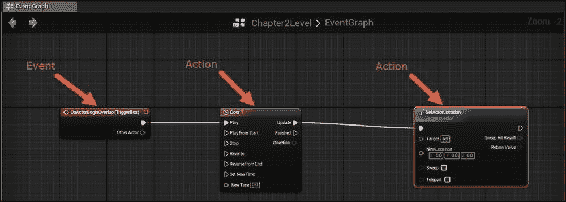

所有的 `Blueprint` 都有一个用于启动它们的 `Event`（事件），后面跟着一个或多个 `Action`（动作）。

作为关卡设计师，我们将使用的大多数基础编程都遵循相同的基本模式：一个 `Event` 导致若干个 `Action` 发生。例如，要让一扇门打开，事件可能是玩家走到门前，而动作则是将门动画移动到打开位置，然后在几秒钟后关闭。当我们构建 `Blueprint` 序列时，我们也将了解变量和数据类型。让我们开始制作门的序列吧：

1.  首先我们需要一个 `Trigger`（触发器）。这是一个游戏对象，用于检测其他对象（如玩家）是否进入了某个区域。它们有几种不同的形状，且尺寸几乎可以调整以适应任何情况。在这里，我们将从 `Modes`（模式）面板中获取一个 `Box Trigger`（盒子触发器）并将其放置在门的底部。这将触发播放我们动画的事件：
    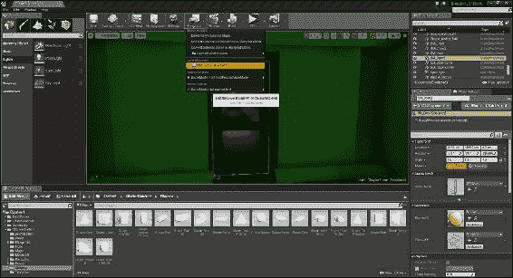

    通过 `Blueprints` 菜单打开 `Level Blueprint`（关卡蓝图）

2.  现在开始构建我们的序列。点击 `Blueprints` 按钮并选择 `Open Level Blueprint` 来打开 `Level Blueprint`。在 `Blueprint` 区域中导航的方法是：按住 `RMB`（右键），向某个方向拖动，并使用 `LMB`（左键）来选择事物：
    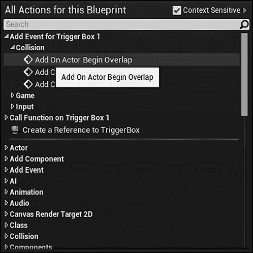

    创建第一个 `Event`

3.  回到关卡编辑器，确保你的 `Trigger` 已被选中。现在，在 `Blueprint` 窗口中，在空白处右键点击，然后点击 `Trigger Box 1`（你的数字可能不同）的 `Add Event`（添加事件）旁边的向下箭头。点击 `Collision`（碰撞）旁边的向下箭头并选择 `Add On Actor Begin Overlap`（添加 ActorBeginOverlap 事件）。当一个 `Actor`（我们的玩家）开始与 `Trigger` 重叠时，此事件将被触发。

4.  接下来我们需要一个 `Timeline`（时间轴）。这是一个节点，允许你为数值数据类型（如浮点数或向量）制作动画。在我们的例子中，我们将用它来为门的向量位置制作动画，使其看起来像在滑动。在事件旁边的空白处右键点击，一直向下滑到列表底部。选择 `Add Timeline`。你将有机会给它起一个唯一的名字。我将我的命名为 `Door1`，这不是很有描述性，但能将其与我们将创建的任何其他 `Timeline` 区分开：
    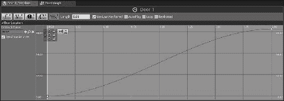

    创建 `Timeline` 动画曲线

5.  通过双击节点打开 `Timeline`。既然我们要为向量（三维空间中的一个点）制作动画，我们需要点击 `Timeline` 窗口左上角的 `V+` 按钮。你将看到三条彩色线，它们分别代表 `X`、`Y` 和 `Z` 轴。我们要做的是创建对应门的重要位置的关键帧：打开和关闭。但在添加关键帧之前，我们需要确保我们只在 `X` 轴上工作，因为那是我们将滑动门的方向。我们通过图表左上角 `Y` 和 `Z` 旁边的小锁图标来实现这一点。你可能也想通过点击它们旁边的眼睛图标来隐藏这些轴。

6.  在 `0` 附近，通过右键点击并选择 `Add Key` 向 `X` 轴添加一个关键帧。如果你没有正好在零点上，可以随意点击关键帧并将 Time 和 Value 都改为零。接下来，在 2 秒处添加另一个关键帧并将其值改为 `100`。我们是在告诉门沿正 `X` 轴方向滑动 100 个单位。最后，我们可以通过右键点击第一个关键帧并将 `Key Interpolation` 设置为 `Auto` 来使滑动更逼真。你可以通过点击 `Fit Horizontal` 和 `Fit Vertical` 箭头（靠近锁图标的地方）来查看完整的曲线，以检查你的成果：
    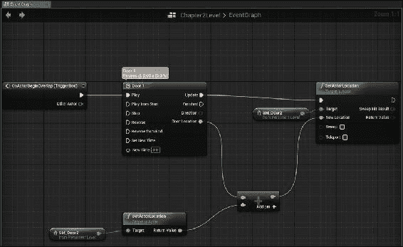

    为门制作动画的 `Blueprint`

7.  通过点击其标签页返回 `Event Graph`（事件图表）。现在我们需要利用我们的动画值让门移动。我们要找的节点叫做 `Set Actor Location`（设置 Actor 位置）。在 `Timeline` 附近右键点击，在 `Search`（搜索）框中输入这个名称。如果你在 `Windows` 菜单中启用了 `Palette`（调色板），也可以使用 `Find a Node`（查找节点）库。`Set Actor Location` 需要两条信息才能工作：`Target`（目标，即什么在移动）和新位置。现在，你可能想直接把 `Timeline` 的黄色输出连接到新位置，但这不一定行得通。我们需要考虑门现有的位置并加上我们的滑动量。为此我们需要获取门的位置。在关卡中点击门，然后在我们的 `Blueprint` 中右键点击。在搜索框中输入 `Get` `Actor` `Location`。我们还需要一个名为 `Vector + Vector` 的节点来为我们进行数学运算。像你在上一张图片中看到的那样连接所有节点：按住节点的输出（如彩色圆点或箭头）左键拖出一根“线”，插入到下一个节点的输入端。不用太担心这部分；虚幻引擎不允许你将一个节点插入到不接受该输入的另一个节点中。

8.  现在，我们的 Get 和 Set 节点仍然缺少一些东西。两个节点都没有目标，所以它们不知道引用哪个对象。为此，我们需要一个 `Name` 变量。这只是对关卡中存在的某物的引用。在关卡中，点击我们想要制作动画的门。现在在 `Blueprint` 中，在 `Set Actor Location` 节点旁边右键点击，选择 `Create a Reference` to `SM_Door2`（同样，你的数字可能不同）。现在，将该变量插入到我们节点的目标端。重复此过程，为 `Get Actor Location` 节点创建一个名称变量。

9.  该过程的最后一部分是回到关卡中，点击门，并在 `Details` 面板的 `Transform` 部分选择 `Movable`。这将允许你的门制作动画。现在构建关卡并测试一下。

10. 一切正常吗？太棒了！确保再次按照该流程为走廊另一端的第二扇门进行操作。

# 使用 Matinee 为电梯制作动画

1.  创建 `Matinee` 与创建 `Timeline` 略有不同。要开始使用 Matinee，请点击 `Matinee` 按钮并选择 `Add Matinee`。Unreal 会警告你 `Undo`/`Redo` 数据将被重置。继续点击 `Continue`，这将在你的关卡中创建一个 Matinee 对象。不用担心它的位置，这个东西可以在任何地方工作。点击该对象，并在 `Details` 面板中选择 `Open Matinee`。下面的截图展示了 `Matinee` 工具：

    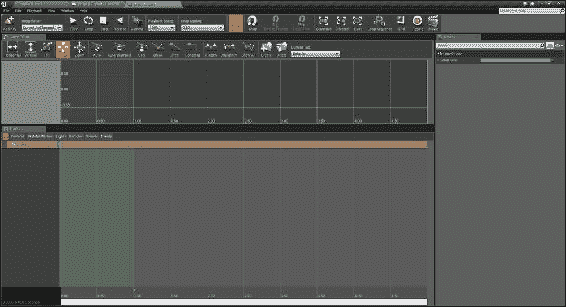

    使用 Matinee 工具

2.  回到关卡中，点击我们的电梯平台，并确保在 `Details` 面板中将其设置为 `Movable`。现在点回 `Matinee`。在 Matinee 界面的 `Tracks` 部分，我们将右键点击并从菜单中选择 `Create New Empty Group`。给它起一个唯一的名字，比如 `Elevator`。这将为我们想要为电梯制作动画的任何对象创建一个组。

3.  接下来，右键点击刚创建的组，选择 `Create New Movement Track`。这将创建实际的动画轨道，我们可以在其中添加关键帧：

    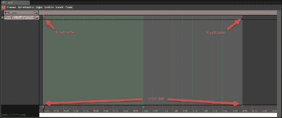

    Matinee 界面

4.  当你创建 `Movement` 轨道时，Unreal 会在 `0` 处创建你的第一个关键帧。这将是我们的下降位置。要为上升位置创建第二个关键帧，请点击 `Matinee` 界面左上角的 `Add Key` 按钮。右键点击该关键帧并选择 `Set Time`。在框中输入 `2` 并按 `Enter`。在第二个关键帧仍处于选中状态时，回到关卡中将电梯移动到上升位置。当我们看到一条从下降位置延伸到新上升位置的虚线生成时，就知道操作成功了。最后，通过抓取 Time Bar 底部靠近 `5` 处的红色标签并将其向下拖动到 `2`，来更改 `Matinee` 序列的总长度。完成后，关闭 `Matinee`：

    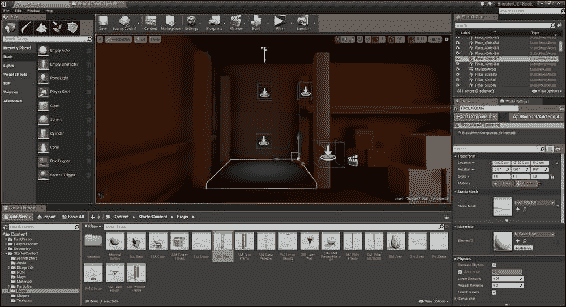

    完成的电梯

5.  此时，我们需要在关卡中放置一些按钮来控制电梯。前往 `Shapes` 文件夹，像以前一样，拿几个形状作为呼叫按钮。我使用了一个稍微缩小过的金字塔，以适应平台附近柱子和墙壁上的位置。我们还需要在每个按钮周围添加 `Box Triggers`，以创建一个激活区域，玩家必须进入该区域才能使用按钮：

    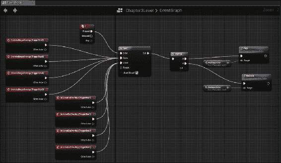

    电梯的蓝图

6.  所有按钮和 `Box Triggers` 就位后，是时候组装 `Blueprint` 序列了。在关卡中，选择我们将要使用的所有 Box Triggers。在 Blueprint 窗口中，右键点击并选择 `Add Event for Selected Actors`。这将允许你同时为所有 Trigger Boxes 创建 `On Actor Begin Overlap` 和 `On Actor End Overlap`。我们还需要搜索一个按下 `E` 键的输入事件。

7.  接下来我们需要一个 `Gate` 节点。这些节点允许你控制信息在序列中的流动。信息通过 `Enter` 输入进入 Gate，仅当 `Gate` 打开时才会继续传递。在我们的电梯控制中（见前图），按下 `E` 会将信息发送到 `Gate`，但只有当玩家站在电梯控制按钮旁边时，Gate 才会打开。

8.  在 `Gate` 节点之后，我们需要一个名为 `Flip Flop` 的节点。根据上一次执行的是哪个分支，该节点将执行 A 或 B。这将允许我们通过播放和反转 `Matinee` 来切换电梯的上下运动。

9.  现在我们要让序列 `Play` 和 `Reverse` Matinee。回到关卡中点击 `Matinee` 对象。回到 Blueprint 中右键点击，然后选择创建一个对 `Matinee Actor` 的引用。从 Matinee Actor 拖出连线并搜索 `Play` 和 `Reverse` 节点。将它们添加到 `Blueprint` 中。

10.  现在像图中那样连接 `Blueprint`，点击 `Compile` 按钮，然后测试关卡！

## 提示

学会阅读 `Blueprints` 的编程逻辑，在我们开始创建前所未有的事物时将大有裨益。对于我们的电梯 `Blueprint`，我们可以从 `Event` 开始，逐步梳理每个动作来理解它。例如，我们的电梯从按下 `E` 开始。`Gate` 检查玩家是否在按钮附近。如果在，电梯 `Matinee` 将根据上次的动作选择 `Play` 或 `Reverse`。从现有的 `Blueprint` 序列中学习是极好的练习！

## 测试我们的关卡

设计流程的下一步是与朋友、家人，以及最重要的是将要玩我们游戏的人一起试玩我们的原型关卡。试玩是设计流程中最重要但也最容易被忽视的步骤之一。许多游戏和关卡设计师急于推进最终设计，因此错过了那些未参与游戏设计和构建的人所能提供的宝贵反馈。重要的是要记住，虽然关卡对你来说很好玩，但其他人可能会觉得困惑或缺少关键功能。通过让玩家试玩原型来获取反馈，可以帮助我们发现那些我们作为设计师理所当然认为存在的事物。

如果这个关卡是为商业游戏准备的，我们会花一些时间与朋友和同事测试，并在此过程中融入反馈。灯光可能太暗，或者按钮太难找。我们可能会增加更多房间或谜题，使关卡更具挑战性。如果我们持续收到玩家不理解关卡存在理由的反馈，我们甚至可以推倒重来。试玩时要记住的重要一点是：玩家的反馈不是对你或你的想法的批评。从他们那里收集的信息旨在改进你的关卡并强化你的设计，所以永远不要错过收集这一重要数据的机会！

## 总结

在本章中，我们根据纸上草图的设计，完成了使用 `Unreal Engine 4` 构建关卡的过程。关卡本身很简单：两个房间通过走廊连接，包含门、楼梯和电梯。我们使用 `Starter Content` 文件夹中提供的一系列形状和道具来装饰空间，以契合科幻恐怖主题。我们还学习了如何在关卡中使用灯光来营造张力和传达氛围。通过 `Blueprints`，我们探索了关卡编程，为门和电梯制作了动画。最后，我们讨论了试玩的重要性，以及玩家的建设性批评只会让我们的关卡和游戏变得更好。在下一章中，我们将转向使用 `Blender`，根据白模阶段装饰飞船时使用的一些基本形状，为关卡创建一个道具。

你的关卡做得怎么样？

它感觉像一艘货船吗？

试玩者在玩的时候感觉如何？

