# 开始制作游戏资产

请记住，灰盒搭建关卡的目的之一是了解我们需要哪些道具及其相对尺寸。如果我们要将这个关卡完整地推进开发流程（完成本章后，请随意继续完成关卡），我们会用详细的自定义游戏资产替换掉每一个基础形状。不过，这有点超出了本书的范围。我们将构建一个基础道具，让你开始接触 `Blender`，并熟悉将自定义美术资源导入 Unreal 的流程。经过一些练习，你关卡构建能力的唯一限制将只有你的想象力！在本章中，我们将涵盖以下主题：

*   开始制作游戏资产
*   使用多边形建模的基本工具
*   如何使用 UV 映射及其重要性
*   为游戏资产展开 UV
*   基础贴图技术

## 勾勒我们的第一个资产

那么，在开始设计资产之前，我们要制作哪个资产？在灰盒阶段，我们使用了几个基础形状来代表潜在的游戏资产，这给了我们很多选择，比如全息投影仪、电脑控制台、管道、柱子或箱子。既然这很可能是你第一次尝试使用 `Blender`，我们将从为货船运输创建一个详细的箱子开始。箱子允许我们构建一个相当基础但仍能支持大量细节的物体。所以，拿一张方格纸，打开网页浏览器；是时候开始草拟了！

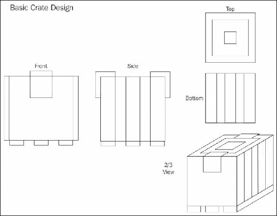

我的设计基于我在网上找到的几个不同科幻箱子的碎片，以及我从一些最喜欢的游戏和电影中记住的片段（科幻恰好是我最喜欢的类型之一）。箱子本身也被设计成有内部结构，这样我就可以在关卡中同时展示盖子打开和关闭的状态。这赋予了资产灵活性，让我能在许多不同场景中使用它，这是两个非常重要的设计考量。

### 提示

由于构建独特环境需要大量工作，资产复用在游戏设计和开发中非常重要。Unreal Marketplace 上许多可用的建筑套装都设计为模块化，以创建各种不同的场景。这种做法可以追溯到最早的游戏作品。在 NES 上的《超级马里奥兄弟》中，云和灌木丛是完全相同的游戏资产，只是颜色不同。

你可能注意到我绘制了箱子的几个不同视图。这让我们能从正面、侧面和背面查看物体，并设计出每个部分都有变化的物体。通过这样做，如果我们是设计创作者但不是在 3D 中构建资产的人，也能将设计传达给团队中的另一位美术师。

## 在 Blender 中设置文件

现在让我们在 `Blender` 中设置文件（还记得第 1 章的设置吗？）：

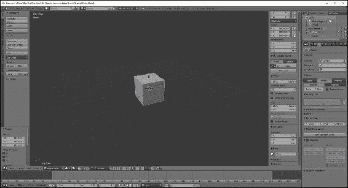

**设置缩放以匹配 Unreal 4**

1.  打开 `Blender`。
2.  在 `Properties` 面板的 `Scene` 部分，将单位制改为 `Metric`（公制）。
3.  将 `Scale`（缩放）改为 `0.01`。
4.  按 `N` 打开 `Scene Properties`（场景属性）面板，通过将 `View`（视图）下的 `Clip End`（剪切末端）属性改为 `1.0 km` 来修正网格。
5.  将初始立方体缩放 `100` 倍，因为我们将使用它。
6.  点击 `File`（文件）菜单并选择 `Save Startup File`（保存启动文件）。这会将我们的更改保存为默认设置，确保我们今后创建的所有文件都将具有这些设置。这将为我们节省未来的时间。

准备好 `Blender` 文件后，是时候开始构建我们的箱子了。

# 使用多边形建模的基本工具

我们将从最接近我们想要的最终形状的基础体开始构建箱子。在这种情况下，我们开始时的默认立方体非常合适。那么什么是基础体，为什么我们要从它开始呢？基础形状是你的基本形状，在 `Blender` 中包括：平面、立方体、圆、球体、圆柱体、圆锥体和环面。我们从这些形状开始，因为它们是我们所见一切的基本构建块。传统艺术家绘画时也从这些形状入手。如果你向外看，可以看到这些形状：电线杆是圆柱体，建筑物是立方体，等等。这也是 Unreal 给我们提供一个装满基础体的 Shapes（形状）文件夹来供我们灰盒搭建关卡的原因。

最容易学习的 3D 建模技术之一是多边形建模，简称多边建模。它涉及操作构成基础体的顶点、边和多边形，以创造出更复杂的东西。多边建模使用以下工具：

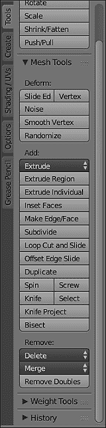

## 工具面板

### 挤出

**挤出**：此工具允许你向内推或向外拉一个多边面，在创建物体的新部分时非常有用：

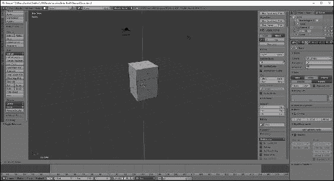

### 面内插

**面内插**：内插对于在物体内部创建细节很有用，例如在建筑物上创建窗户或门：

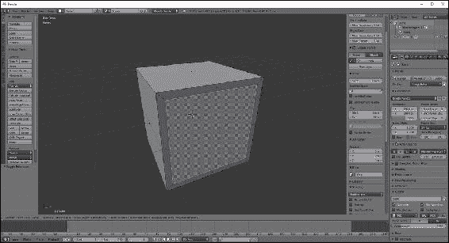

### 循环切割和滑动

**循环切割和滑动**：另一个添加细节的工具，它在物体上切割新的边循环。要添加的边循环数量可以通过鼠标滚轮调整：

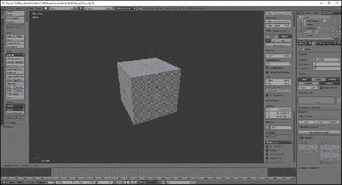

### 倒角

**倒角**：位于特殊菜单中（按 `W`），**倒角** 工具允许你圆滑边缘。要添加的额外边数量可以通过鼠标滚轮调整：

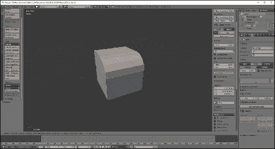

## 将立方体转变为箱子

是时候开始将我们的立方体转变为配得上我们关卡的东西了。首先我们需要确定箱子的基本形状：

1.  选择立方体并按 `Tab` 键。这将把你从 `Object`（物体）模式切换到 `Edit`（编辑）模式。`Object` 模式用于向场景添加新物体，并使用移动、旋转和缩放工具排列这些物体。`Edit` 模式允许你操作切换模式时所选物体的顶点、边和多边面：

    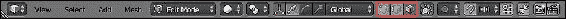

    选择模式按钮

2.  切换到多边面选择模式。选择模式按钮位于 3D 窗口底部：

    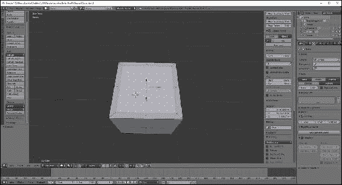

    对箱子顶部的面进行内插

3.  选择顶部的面并按 `I` 使用 `Inset`（内插）工具。内插该面以创建框架形状，就像我们草图里的那样。你也可以输入数值（我用了 `0.177`）并按 `Enter`。

4.  按 `E` 使用 `Extrude`（挤出）工具。向内推挤该面，给箱子顶部一个良好的边缘。

5.  我们要再次 `Inset`（内插）。再次内插该面以创建控制盒的空间。我用了 `0.523` 作为数值。现在挤出这个小面向上，创建控制盒：

    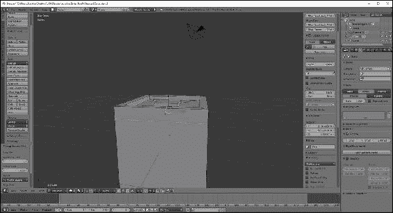

    使用循环切割和滑动创建更多细节

## 箱子建模步骤（6–15）

### 步骤 6：为接缝切割线条
现在我们需要切割线条，以创建盖子嵌合到箱子上的接缝位置。从左侧菜单点击 `Loop Cut and Slide`（循环切割和滑移）工具，或按 `Ctrl+R`。将鼠标移至箱子上方，直到出现一条紫色线条水平穿过下部区域。点击 `LMB`（左键）；这会将线条变为橙色，并允许你沿箱子上下滑动它。当它移动到我们想要的位置时再次点击。

### 步骤 7：使用倒角工具分割
使用 `Bevel`（倒角）工具分割这条新线条。按 `W` 并选择 `Bevel`。我将其分割了 `0.05`：

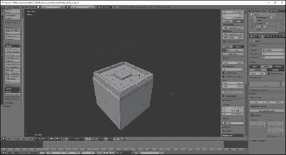

*使用缩放工具创建盖子接缝*

### 步骤 8：缩放盖子多边形
盖子还需一步：选择盖子外侧周围的四个多边形（按住 `Shift` 键可选择多个多边形），按 `S` 使用 `Scale`（缩放）工具将它们稍微缩小。

### 步骤 9：添加垂直循环切割
接下来我们将在侧面添加细节。沿 `Y` 轴（绿色轴），我们将使用 `Loop Cut and Slide`（循环切割和滑移）工具，在物体周围垂直切割四条线。

### 步骤 10：创建四条垂直线
移动鼠标以获得沿箱子垂直的紫色参考线，然后使用鼠标滚轮直到出现四条线。点击鼠标切割线条，然后在不移动鼠标的情况下再次点击以使它们保持居中：

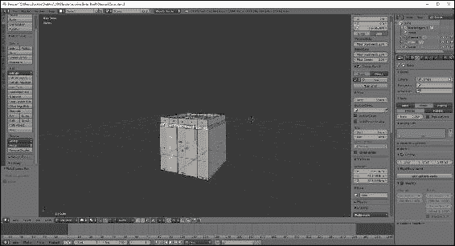

*挤出多边形以在箱子侧面添加一些凸起区域*

### 步骤 11：挤出侧面条带和底部滑轨
现在我们将选择一些新多边形，以创建箱子侧面的条带。使用 `Extrude Individual`（单独挤出）工具 `Extrude`（挤出）它们，并将其拉出到合适的大小。同时通过拉出两侧的外侧多边形和中间的多边形，`Extrude`（挤出）箱子底部的滑轨：

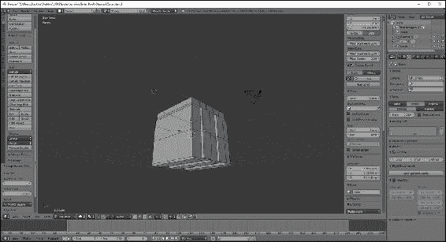

*创建锁扣*

### 步骤 12：添加锁扣边循环
让我们添加锁扣。使用 `Loop Cut and Slide`（循环切割和滑移）在箱子周围添加一条水平边循环。然后在箱子前面添加两条垂直边循环：

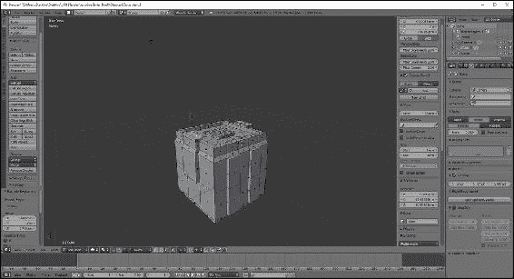

*完成锁扣*

### 步骤 13：挤出锁扣
完成锁扣是一个两步 `Extrude`（挤出）过程。选择图中所示的三个多边形并 `Extrude`（挤出）它们向外。然后选择锁扣顶部的两个多边形并 `Extrude`（挤出）它们：

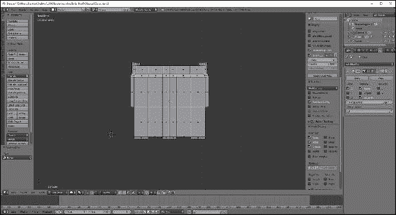

*使用镜像修改器创建对称*

### 步骤 14：将物体切半以进行镜像
现在为了确保所有东西都是均匀的，我们将使用 `Mirror`（镜像）修改器。使用 `Loop Cut and Slide`（循环切割和滑移）从前向后切割一条垂直线，将物体切成两半。接下来，按 `B` 进行框选，选择箱子的一半。按 `Delete` 键并选择 `Faces`（面）以删除箱子的一半。

### 步骤 15：应用镜像修改器
最后，通过点击 `Properties`（属性）面板中的扳手图标来打开 `Modifier`（修改器）菜单，添加 `Mirror`（镜像）修改器。点击 `Add Modifier`（添加修改器）下拉菜单并选择 `Mirror`。操作设置直到成功使物体恢复完整。一切设置好后，返回 `Object`（物体）模式，并在 `Modifier`（修改器）菜单中点击 `Apply`（应用）。修改器无法在 `Edit`（编辑）模式下添加。完成了！作为我们的第一个道具，这已经很不错了。它看起来可以装下任何东西，从食物到在黑暗中猎杀你的可怕变异基因怪物。

# 如何使用 UV 映射及其重要性

此时，我们已经确定了箱子的几何体或基本形状，但它看起来仍然不像我们在其他游戏中看到的物体。原因是纹理。为物体添加纹理将创建所有那些细节，使我们的游戏资产配得上我们构建的关卡。制作纹理并将其应用到物体上是一个两步过程。首先，我们需要告诉纹理如何表现，这需要 UV 贴图：

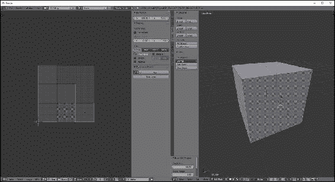

*使用基础立方体学习展开*

UV 贴图是一组坐标，告诉我们放置在游戏资产上的纹理贴图如何环绕物体。其原理是获取你的 3D 物体并将其展平，以便我们能以一种不会撕裂或拉伸纹理的方式将图像应用到外部。这使我们能够创建详细的纹理贴图，应用诸如刮擦边缘、锈斑、油漆颜色、可视屏幕等效果。没有它，Unreal 将不知道如何在游戏中为物体贴图。它也无法正确应用光照，因为 Unreal 使用 UV 贴图来应用光影：

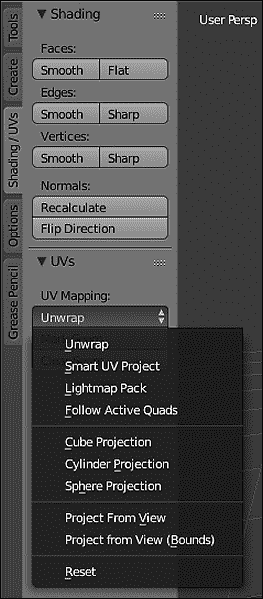

*UV 映射菜单*

那么我们在 Blender 中如何操作呢？该应用程序为我们提供了添加 UV 贴图的几种选项，其中一些比其他选项更适合我们创建的内容：

- **`Smart UV Project`（智能 UV 投影）**：适用于建筑和机械物体，`Smart UV Project` 根据几何体的角度变化创建自定义 UV 布局。它会尽力以合乎逻辑的方式布局所有内容，并可最大程度减少拉伸。该工具尝试合乎逻辑地布局，但可能需要稍微调整。
- **`Cube Projection`（立方体投影）**：立方体映射将物体分解为六个面并将它们投影到平面上。这会创建六个独立的 UV 岛，可以对其进行操作。
- **`Project From View`（从视图投影）**：根据所选内容和 3D 视图的角度创建 UV 贴图。例如，你可以选择物体左侧的所有多边形，为视口选择 `Left Side`（左视图）视图，然后使用此选项。
- **`Lightmap Pack`（光照贴图打包）**：Unreal 和其他游戏引擎在构建过程中使用光照贴图将阴影烘焙到物体上。`Lightmap Pack` 可以通过尽可能多地利用 UV 空间，创建更适合光照贴图的 UV 布局。这最大化了物体能承载的光照信息量，并将改善结果。

# 为游戏资产进行 UV 展开

UV 映射可能是一个困难的过程，但了解一些最佳实践可以帮助简化该过程：

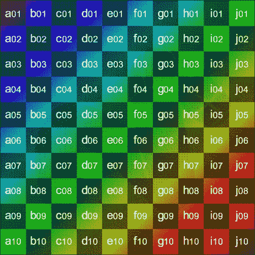

*UV 网格纹理贴图*

1.  **在过程中使用彩色 UV 网格纹理**：这可以通过在线图片搜索轻松找到，并可在 Blender 中作为材质应用到物体上。务必找到与你想要创建的纹理尺寸相同的图片，例如 `1024 x 1024` 或 `2048 x 2048`。我使用了一张 `2048 x 2048` 的图片。
2.  **最小化接缝和拉伸**：将 UV 贴图的接缝隐藏在硬边或玩家看不见的隐藏区域非常重要。幸运的是，像我们的箱子这样的硬表面物体比汽车、植物或动物等具有更多有机曲线的物体更容易展开。
3.  **保持 UV 元素方向一致**：在布局 UV 贴图时，使所有内容朝向相同方向将使布局和创建纹理贴图变得更加容易。如果纹理美术是团队中的另一位成员，这一点甚至更为重要。
4.  **小心不要浪费空间**：纹理贴图中浪费的空间越少，直接转化为纹理中像素密度的增加和整体质量的提升。
5.  **请记住，所有这些都需要练习才能掌握**。

现在让我们为箱子进行 UV 展开：

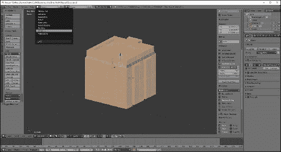

*使用场景布局下拉菜单将视口更改为 UV 编辑预设*

1.  选择箱子并进入 `Edit`（编辑）模式（如果你尚未进入）。同时确保你处于多边形选择模式。按两次 `A` 以选择箱子的所有多边形。
2.  在菜单栏中，转到 `Scene Layout`（场景布局）下拉菜单并选择 `UV Editing`（UV 编辑）。这将把视口分成两半。左侧是你的 UV 布局，目前为空白。右侧是你的物体。你仍然可以移动和旋转它，以便选择不同的多边形。

## UV 展开

3. 在 3D 视口（右侧），你会注意到 `Tools` 面板已变为 `Shading/UV` 工具。在 `UVs` 标题下有一个 `UV Mapping` 选项下拉菜单。这些选项是我们开始对物体进行 UV 展开的地方。全选所有多边形后，打开菜单并选择 `Smart UV Project` 选项：

   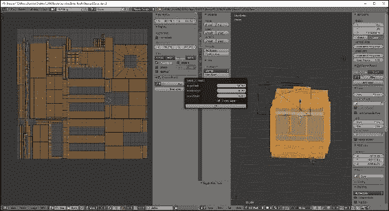

   使用 Smart UV Project 的基础 UV 布局

4. `Smart UV Project` 是 Blender 的自动展开工具。大多数 3D 创作套件都有类似工具，其输出结果会因物体复杂程度而异。对于像我们这样简单的箱子，效果相当不错。对于更有机的物体，或复杂的机械、建筑，可能很难获得理想结果。在 `Smart UV Project` 菜单中，我们将使用默认设置。点击 `Ok`，它就会展开你的物体。

5. `Smart UV Project` 将我们的物体压平并分离成了 UV 岛。UV 岛是物体的一部分。就我们的目的而言，Blender 分离物体的方式效果很好。如果我们制作更复杂的物体，可以将每个部分分离、分组使其更合理，甚至将一些部分缝合回去。稍后在本书创建更复杂物体时，这一步将变得必要。

6. 为了提高贴图质量，我们可以使用 `UV Layout` 视口底部 `UVs` 菜单中的 `Pack Islands` 选项。选择此选项将调整所有 UV 岛的大小，使其在不拉伸的前提下占据尽可能多的空间。

7. 既然我们在游戏引擎中工作，就需要第二个 UV 通道（或坐标集）来存储光照信息。要添加另一个 UV 通道，我们需要返回 `Scene Layout` 下拉菜单并选择 `Default`：

   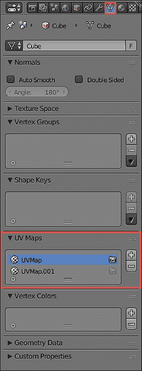

   创建第二个 UV 贴图通道

   在 `Properties` 面板中，点击 `Object Data` 图标。在 `UV Maps` 标题下，点击加号按钮以创建另一个 UV 通道。

8. 在这个第二个 UV 通道上，我们将添加光照贴图 UV。它们与用于纹理的 UV 布局不同，我们不关心所有部分是否缩放到相同数值。我们只关心它们占据尽可能多的空间以存储光影信息。Blender 的 `Lightmap Pack` 工具可以轻松完成此工作。返回 `Scene Layout` 下拉菜单中的 `UV Layout` 选项。`UV Layout` 视口右下角显示当前活动的 UV 通道。它会显示 `UVMap`。点击它并选择 `UVMap.001`。这是我们的新通道：

   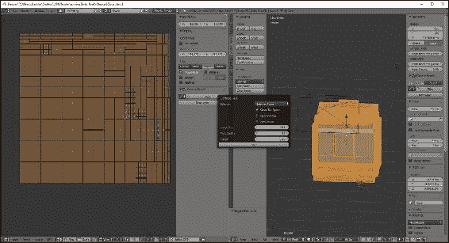

   使用 Lightmap Pack 工具创建虚幻 4 可用的光照贴图

9. 转到 3D 视口侧边的 `Tools` 面板，从 `UV Mapping` 菜单中选择 `Lightmap Pack`。默认选项也可以。点击 `Ok`。现在展开完成。返回 `Default` 屏幕布局：

   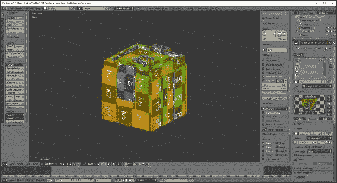

   将 UV 纹理网格作为贴图添加到箱子上

10. 为了测试 UV 布局，我们可以添加之前下载的彩色 UV 纹理网格。这能轻松显示纹理是否有拉伸。如果我们手动展开，这张贴图将帮助我们拼凑 UV 贴图，确保所有元素朝向一致并最小化拉伸。点击 `Properties` 面板工具栏上的 `Textures` 按钮。在菜单的第一部分，进入 `Type` 下拉菜单并选择 `Image or Movie`。这将打开菜单的 `Image` 部分，允许你点击 `Open` 按钮。导航到存储图像的位置并选择它。

11. 点击 `Properties` 面板工具栏中 `Texture` 图标旁边的图标。这是 `Materials` 面板。剩下的就是将材质 `Assign` 给物体。点击 `Select` 选项选择所有多边形，然后点击 `Assign`。这会将材质添加到物体上。它会根据我们的 UV 贴图拉伸覆盖在物体上。

12. 显然，我们不想在虚幻环境中放一个五颜六色的盒子。在下一节中，我们将讨论如何给盒子添加基础材质，以及创建细节纹理的其他技术。

## 基础纹理技术

正如我之前提到的，纹理能让游戏物体在关卡中脱颖而出。它们可用于添加各种我们没时间建模的元素，以及颜色、磨损和光照信息。给游戏物体制作纹理有很多方法。想利用虚幻材质的基础物体可直接在关卡中应用一个。Blender 通过其纹理绘制模式提供了程序内的绘图工具。最后，还有使用其他程序创建纹理的选项。我们的 UV 贴图可以导出到 `Adobe Photoshop` 或 `GIMP` 等程序，在那里我们可以使用颜色工具绘制纹理，或使用照片创建逼真效果。我也想谈谈几年前出现的一种新型工具。`Substance Painter` 是一款允许你直接在 3D 物体上绘制纹理的应用程序，很像 Blender 的纹理绘制模式，但它拥有专为数字娱乐行业打造的选项和工具：

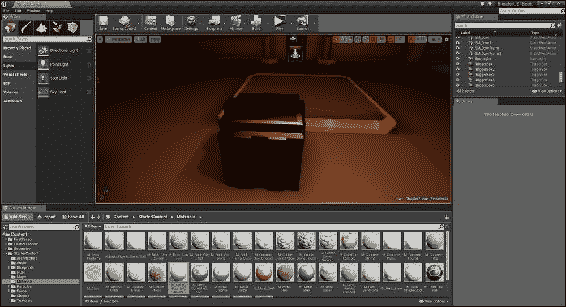

展示虚幻 4 中的新箱子

虚幻通过 `Starter Content` 文件夹提供了多种可用材质，既然我们的 UV 贴图会随物体一起导入，只需将材质拖放到箱子上即可。这些材质本身在箱子上看起来很棒，肯定能提供我们想要的关卡深度和特色。然而，既然材质不是专门为我们的箱子制作的，它们无法真正提供我们之前讨论的那些额外细节。下一章将物体导入虚幻时，我们将首先尝试这条路径：

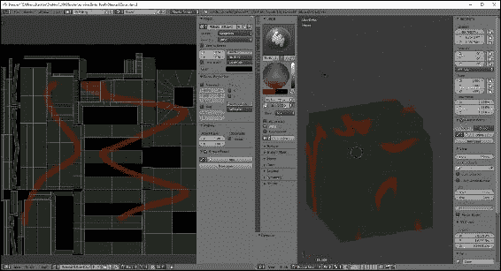

Blender 的纹理绘制模式

Blender 自带纹理绘制模式。此模式可用于在物体上绘制纯色和图像。生成的纹理随后可从程序导出并在虚幻中应用。使用此模式让我们无需其他程序即可为箱子创建纹理，但因为 Blender 不是专业的图形编辑程序，其提供的工具有限：

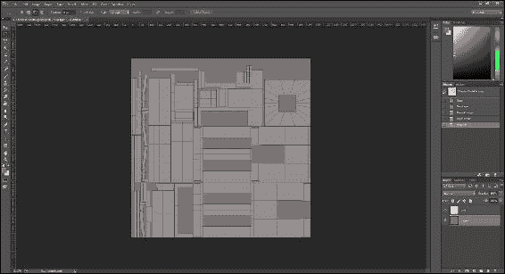

Adobe Photoshop 中显示的导出 UV 贴图

`Adobe Photoshop` 及其开源替代品 `GIMP` 是图形编辑程序，可用于多种数字绘图、照片编辑等。通过将 UV 贴图导入这些程序，我们可以使用其绘图工具创建详细纹理，随物体一起导入虚幻。多年来这一直是创建游戏纹理最常用的方法。`Adobe Photoshop` 可在 `http://www.adobe.com/products/photoshop.html` 申请 30 天试用订阅。`GIMP` 可在 `http://www.gimp.org` 下载：

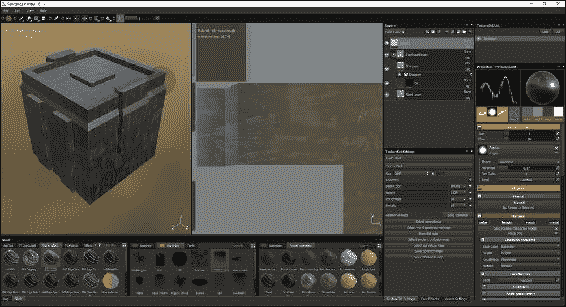

Allegorithmic Substance Painter 中的箱子

Allegorithmic Substance Painter，以及其他类似程序（如**Quixel**工具套件），是一款 3D 绘画程序，允许你实时将高级材质直接绘制到物体上。它拥有许多你在 Adobe Photoshop 或 GIMP 中看到的工具，例如遮罩区域和使用不同图案笔刷的能力，但已将它们完全适配于 3D 游戏艺术家的需求。Substance Painter 目前在 Unreal 游戏引擎中拥有完整支持，是在相对较短时间内创建高端、细节丰富材质的绝佳方式。请访问[`www.allegorithmic.com/products/substance-painter`](https://www.allegorithmic.com/products/substance-painter)了解 Substance Painter。

# 概要

在第 3 章，*是时候定制了！*中，我们介绍了如何使用设计流程设计一个完美适配我们货轮关卡的箱子。在纸上设计好游戏资产后，我们打开 Blender，使用多边形建模技术创建 3D 模型。在 Blender 中，我们使用了挤出、内插、循环切割和滑移、倒角等工具，将基本图元形状转变为细节丰富的游戏资产。完成箱子的基本几何体后，我们打开 Blender 的 UV 映射部分并创建了 UV 贴图。UV 贴图将处理下一章我们将添加到物体上的纹理，以及光照信息，以确保物体与关卡光照完美融合。最后，我们讨论了几种将材质应用到物体的不同方法，从在 Unreal 中直接应用预制材质，到在 Blender 中绘制物体，再到在 Photoshop 或 GIMP 中绘制详细纹理。我们还展望了 Substance Painter 带来的次世代贴图未来。在下一章，我们将从 Blender 导出物体并将其导入 Unreal，以便在关卡中使用。

在上一章中，我们使用白盒关卡确定哪个简单形状将首先转变为 3D 资产。决定将货舱中的立方体变成箱子后，我们使用 Blender 创建 3D 游戏资产并进行 UV 展开以供 Unreal 使用。但如何将其从 Blender 转移到 Unreal？为此，我们必须经历将物体从 Blender 导出为 FBX 文件并导入 Unreal 的过程。然后我们可以将新导入的静态网格体连接到材质，添加碰撞基元，并将其作为可用物体添加到关卡中。这个过程称为**美术管线**。在本章中，我们将涵盖以下主题：

*   从 Blender 导出我们的物体
*   什么是 FBX？
*   将我们的物体导入 Unreal
*   设置并使用我们的新 3D 游戏资产
