# 从 Blender 导出我们的物体

我们构思了创作。
我们绘制了箱子草图。
我们在 Blender 中建模并展开 UV。
Unreal 现在准备好接收我们的创作了。

在从 Blender 导出模型之前，我们可以做几件事以确保一切完美导出。Unreal 在导入物体时可能会很挑剔，只需几个步骤就能最大程度减少潜在问题。

让我们从应用缩放开始：

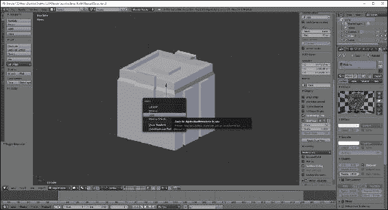

对我们的物体应用缩放

在设置场景的过程中，我们缩放了默认立方体，以便在构建箱子时将其作为起点。为确保导出过程中不出现问题，我们需要将缩放应用到物体上；这本质上是告诉 Blender 该物体不再处于缩放状态，而是真实的大小：

1.  确保你处于**Object**模式。
2.  按下`Ctrl+A`；这将打开**Apply**菜单。
3.  选择**Scale**。

应用缩放后，我们可以继续准备导出物体的下一个重要步骤：设置枢轴点：

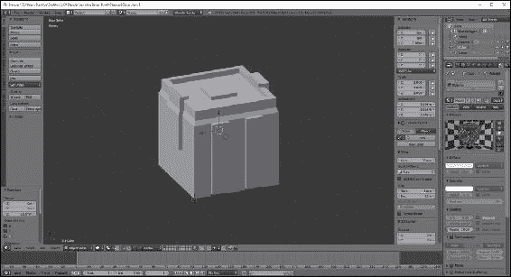

通过移动物体将原点置于箱子角落来设置枢轴点

当物体在 Unreal 中使用时，它有一个枢轴点，充当网格锚点以及缩放和旋转的参考点。创建游戏资产时，我们需要考虑它们将如何被使用。例如，墙壁需要与相邻墙壁对齐，因此我们要确保其尺寸均匀且枢轴点设在角落。对于灯具之类的物体，我们可能会将枢轴点放置使物体平贴墙面以便放置。对于我们的箱子，我们需要能够对齐物体使其与地面齐平。因此我们需要将枢轴移动到接触地面的物体角落。

那么 Unreal 如何决定物体枢轴点的位置？当物体导入 Unreal 时，软件会查看世界原点的位置（即建模软件网格系统中的**0**、**0**、**0**），并将枢轴点放在那里。在 Blender 中，该点默认设置为起始立方体的中心。我们想要更改枢轴点位置，使其位于地面且在物体的角落：

1.  按下`N`打开**Scene Properties**面板（如果尚未打开）。
2.  升高箱子使其位于网格平面上方。你可以在**Scene Properties**面板的**Transform**部分找到**Location:**进行精确设置。在那里你可以看到物体的**X**、**Y**、**Z**轴设为**0**、**0**、**0**。更改**Z**值，使箱子底部的滑轨与网格平面齐平。我的设置为`1.06m`。
3.  将**X**值改为`-1m`。
4.  将**Y**值改为`-1m`。

一切就绪！枢轴点将设置为箱子的底部角落。在导出之前，我们还需要在 Blender 中做一件事：决定箱子的哪一面是正面：

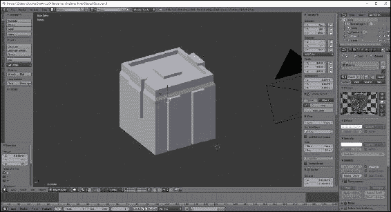

旋转箱子，使 Unreal 识别箱子的正面为正面

Unreal 通过检查物体哪一部分朝向正`X`轴方向来确定物体的正面。这对我们的箱子不太重要，但对角色、载具、武器等其他游戏资产非常重要。

通过在 Blender 中完成此步骤，我们可以节省导出后在 Unreal 中旋转物体的大量时间：

1.  回顾箱子草图，两侧有两个大锁扣，因此我们的物体需要旋转。
2.  按下`R`或从**Tools**面板选择旋转。
3.  按下`Z`锁定绕`Z`轴旋转。
4.  输入`90`并按下`Enter`。

一切就绪。我们应该不会在将物体导入 Unreal 时遇到问题。是时候将物体从 Blender 导出了。这通过`FBX Exporter`完成。

## 什么是 FBX？

那么 FBX 文件格式到底是什么？（我知道，这是你一直想问的问题。）FBX 是 Kaydara 公司于 1996 年为其动画程序 Filmbox 创建的文件扩展名。Kaydara 后来被 Autodesk 收购，该应用程序更名为 MotionBuilder。在软件开发商 Autodesk 旗下，该格式因多种原因成为游戏资产最流行的格式之一。首先，它能出色地导出几何体，并受到许多最流行 3D 应用程序的支持。其次，它能导出材质设置。例如，当你将 FBX 文件导入 Unreal 时，可以选择带入纹理和材质信息，从而节省时间。最后，它能导出动画信息。这在稍后的第 8 章，*灯光、摄影、动画！*中创建关卡动画资产时将变得重要。

FBX 的缺点之一是它是一种专有文件格式。Autodesk 通过其许多产品和一个软件开发工具包向公众提供该格式。基于此，Blender 社区的成员们已经能够创建一个导出工具，让我们能在项目中使用这种多功能的文件格式。让我们来看看 FBX 导出器。

## 将物体导入 Unreal

是时候从 Blender 导出我们的箱子了：

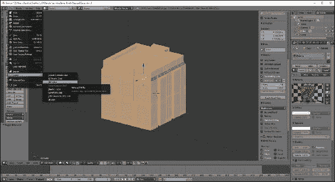

从“文件”菜单中选择导出

可以通过转到 `File` 菜单，然后选择 `Export`，并选择 `FBX` 作为所需的文件格式来找到导出选项：

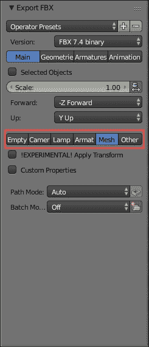

FBX 导出选项菜单。选择“Mesh”选项卡。

导出器有许多选项，其中有几个我们稍后会在涉及动画时用到。我们需要更改一些选项来导出我们的箱子：

1.  在导出器的主菜单中，选择 `Mesh`。这样，导出的唯一物体就是我们的箱子，而不会包括场景中的摄像机或灯光：

    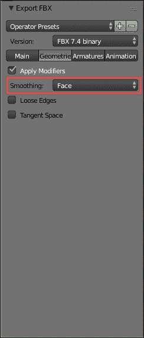

    在“Geometries”选项卡中将“Smoothing”选项设置为“Face”

2.  在 `Geometry` 菜单中，将 `Smoothing` 选项更改为 `Face`。Unreal 要求平滑组必须是任何导出物体的一部分，尽管我们并没有真正用它们来创建箱子。通过选择此选项，我们可以在导入 FBX 文件时避免任何错误消息。

3.  更改完这些设置后，将 FBX 文件保存在易于查找的位置。

接下来，我们将打开 Unreal 并将文件导入到我们的关卡中。一旦我们设置好几个选项，箱子就可以使用了。

## 设置并使用我们的新 3D 资产

现在我们有了 FBX 文件，需要将文件导入到 Unreal 的 `Content Browser` 中。Epic Games 使这个过程变得相对轻松。将文件导入游戏引擎后，它仍然需要两样东西。必须添加碰撞网格体，以确保玩家和其他游戏物体能与我们的新箱子正确碰撞。其次，我们必须为物体添加材质，使其具有视觉吸引力。

首先在 `Content Browser` 中导航到您想存放箱子的文件夹，然后点击 `Import` 按钮：

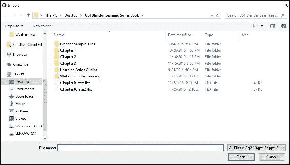

在文件浏览器中找到您的 FBX 文件。

1.  导航到您保存 FBX 文件的文件夹并点击 `Open`：

    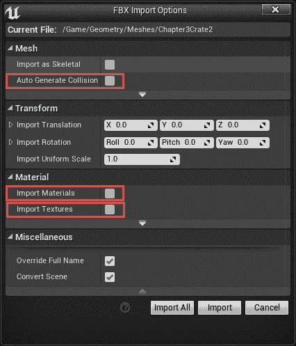

    Unreal 的 FBX 导入选项菜单

2.  这将打开 `FBX Import Options`。关闭 `Auto Generate Collision` 选项。虽然这将来可以节省时间，但我们将在成功导入文件后手动创建它。

3.  同时关闭 `Import Materials` 和 `Import Textures` 选项。如果您已在 3D 软件中创建了材质并希望随物体一起导入，可以使用这些选项。如果我们在此处使用它们，Unreal 会导入我们的彩色 UV 网格。

4.  更改完这些选项后，点击 `Import` 按钮。

一个显示我们箱子的浅蓝色图标应该会被添加到浏览器中。双击它将带我们进入 `Static Mesh` 编辑器。在这里，我们可以设置几个不同的选项，这些选项将影响我们在关卡中使用的每一个箱子副本：

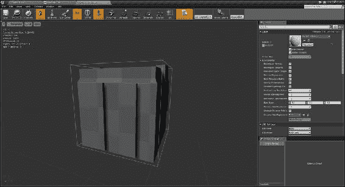

Unreal 4 中的静态网格体编辑器

我们将从添加碰撞基元开始。`Collisions` 真正是让电子游戏世界运转的关键，它是计算机判断玩家是否成功与另一个游戏物体交互的方式。作为玩家，我们经常在站在平台上向下看时看到碰撞。看起来似乎我们正漂浮在实际站立的物体上方。这是由于游戏编程实际上忽略了玩家看到的美术模型，仅使用对玩家不可见的简单碰撞基元来记录碰撞。就我们关卡构建者而言，碰撞将阻止玩家穿过箱子，并使他们能真正与其交互：

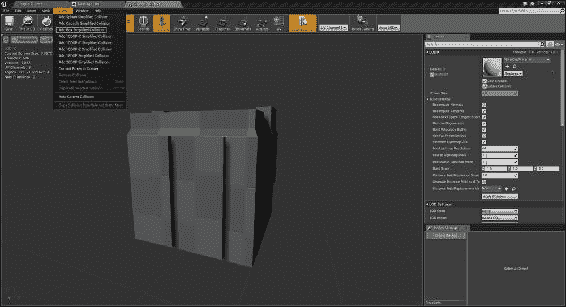

选择“Collision”菜单并选择“Add Simple Box Collision”

让我们看看如何为物体添加碰撞：

1.  确保视口顶部的 `Collision` 选项已开启。这将使我们创建的任何碰撞基元可见。

2.  点击屏幕顶部菜单栏中的 `Collision` 菜单选项。从这里我们要选择最适合我们需求的最简单形状。既然我们的箱子本质上就是一个盒子，我们将选择 `Add Simple Box Collision`。您现在应该会看到一个用绿色勾勒出的盒子包围着箱子。

接下来我们需要做的是为箱子选择一种材质。`Content Browser` 中可用的任何材质都可以使用：

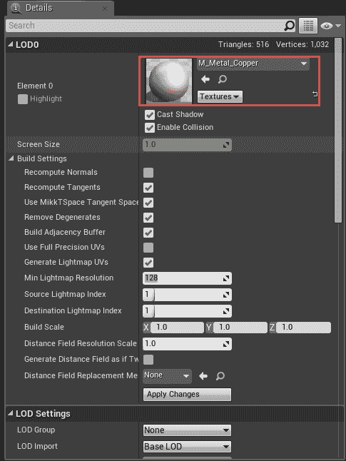

使用 Details 面板为盒子添加材质

1.  返回 `Content Browser` 并导航到 `Starter Content` 文件夹内的 `Materials` 文件夹。

2.  点击您想用于箱子的材质。我选择了 `M_Metal_Copper`。

3.  高亮显示材质后，返回 `Static Mesh` 编辑器，点击 `Details` 面板中 `LOD 0` 部分材质球旁边的小箭头。在 Unreal Engine 中，每当您看到这样的小箭头，点击它将允许您使用在 `Content Browser` 中选中的任何内容。

4.  您的材质将出现在箱子上。请随意尝试几个不同的选项，找到您认为最合适的一个。

对于本书后面我们将创建的下一个游戏资产，我们将使用自定义材质，真正让物体脱颖而出。一旦完成材质设置，只还有一个设置需要更改。Unreal 倾向于生成自己的 UV 通道来存储光照信息。然而，回在 第 3 章 *是时候自定义了！* 中，我们使用 Blender 的 Lightmap Pack 功能创建了自己的 UV，我们想告诉 Unreal 使用它，因为我们的要好得多：

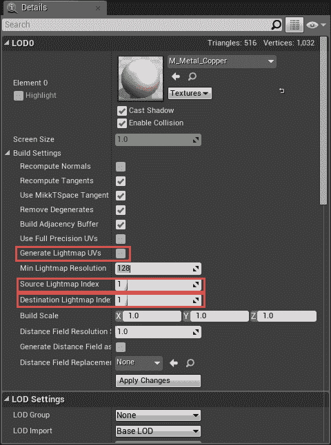

告诉 Unreal 使用我们在 Blender 中创建的 Lightmap

以下是如何为物体生成 Lightmap：

1.  在 `Details` 面板的 `LOD 0` 部分下，找到 `Generate Lightmap UVs` 选项并将其关闭。这告诉 Unreal 我们不想让它创建自己的 UV 通道来存储光照信息。

2.  找到 `Source Lightmap Index` 设置。这告诉 Unreal 在进行光照计算时使用哪个 UV 贴图。将此设置更改为 `1`。

3.  最后，转到 `Destination Lightmap Index` 并将其也更改为 `1`。这告诉 Unreal 在我们创建的 UV 通道上记录光照和阴影信息。

完成！我们的箱子已准备好使用：

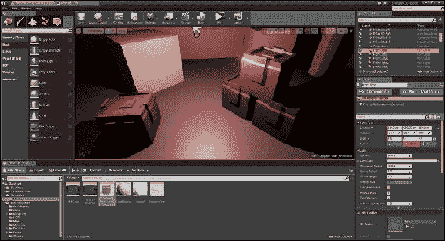

我们关卡中的最终箱子。恭喜！

花几分钟时间用我们的新游戏资产替换货舱中的几个立方体。为了真正增加一些变化，尝试将其中几个放大或缩小。一旦区域装饰得让您满意，请记得保存关卡并按下 `Build` 按钮。现在进入关卡看看这个空间吧！

## 总结

在本章中，我们了解了如何使用 FBX 文件格式将游戏资产从 Blender 导出并导入 Unreal 的过程。FBX 是游戏行业中使用的一种文件格式，因其不仅能存储物体几何体的信息，还能存储纹理、材质和动画信息而广受欢迎。我们从 Blender 导出了 FBX 文件，并使用内容浏览器将其导入 Unreal。导入后，该物体仍然需要碰撞网格体和材质。最后，我们成功将箱子放入关卡，并用全新的游戏资产替换了许多基础基元。恭喜你完成了游戏美术管线的首次完整流程！在开始下一关之前，花点时间看看是否还有其他想创建的游戏资产，为我们创建的货轮增加更多细节。在下一章中，飞船将带我们进入一个新关卡，玩家将面临新的危险，而你将面临新的设计挑战。让我们继续前进！

既然我们已经体验了 Unreal 的美术管线，让我们把关卡设计提升到一个新高度。在本章及后续章节中，我们将沿用之前的流程，但会融入更多元素，例如更多关卡脚本、胜利条件、动画游戏资产等。我们将进一步开发游戏故事，并通过关卡设计和环境选择向玩家传达信息。最终将呈现一个在货轮上开始构建的生存恐怖氛围基础上进一步发展的第二关。本章将涵盖以下主题：

*   规划更复杂的关卡
*   通过灰盒搭建关卡以优化资产创建
*   关卡设计原则
*   高级脚本技术
*   胜利与失败条件
