## 规划更复杂的关卡

在货轮关卡中，我们让玩家置身于一个科幻世界，一个神秘箱子成为了通往更大冒险的门户。进入第二关时，我们需要回答几个问题：

*   那艘货轮来自何处？
*   那个箱子提供了什么线索？
*   下一个拐角后潜伏着什么危险？

对我而言，答案源自我受到的娱乐作品影响。我是科幻小说的狂热读者，也喜欢 *H.P. Lovecraft* 等作家创作的智力恐怖小说。作为一名玩家，我喜欢《Dead Space》、《Mass Effect》和《FEAR》等游戏。因此，汲取这些灵感，我构思了箱子中装着从古老种族掠夺来的某件神器。这件神器以某种方式导致了我们货轮船员的失踪。然而，检查箱子后留下了一条线索：一位设在采矿空间站的进出口经纪人的名字，该空间站离玩家发现废弃货轮的地方不远。返回舰桥后，玩家将航向设定为该空间站。

万事开头难，我们将从纸上草图开始制作这一关：

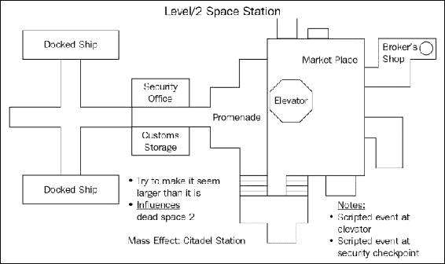

就像货轮一样，我们在纸上开始设计空间站。

对于空间站，我们的设计核心在于向玩家传达故事，并营造紧张且令人不安的氛围。就像他们抵达的货轮一样，空间站完全空无一人，没有任何其他人类生命迹象。然而，这为我们设计师提供了通过脚本事件讲述故事的绝佳机会。

观察地图，我们可以提前规划，指定不同区域作为增加玩家紧张感并引导玩家走向最终目标——市场中的经纪人摊位——的节点。既然我们想避免标识和文本提示等显而易见的线索，就可以在地图上指定一些区域用于脚本事件。这些是我们将使用 `Blueprints` 与玩家沟通并给出故事下一步线索的区域。在空间站中，这些可能是广播系统的自动播报（音频线索）、因损坏而坍塌的走廊段（使用触发粒子事件），或创建供玩家观赏且能突出下一目标的景观（利用关卡几何体）。让我们看看地图。玩家从着陆舱开始，必须通过气闸和安检。在这里，我们可以利用灯光、声音和一些粒子系统制造一场玩家必须逃离的故障。这绝非致命，但确实传达了一个信息：空间站没有工作人员，例行维护可能已经有一阵子没做了。接着，玩家步入一条观景长廊。这可能是一个机会，向玩家展示更大规模空间站的全景，并突出下方经纪人店铺的位置。这会让玩家明白他们需要找到通往市场的路，并让他们觉得关卡比可游玩区域大得多。然后玩家会前往电梯，但电梯也会故障，坠落至井底，迫使玩家走楼梯。当他们最终进入经纪人的摊位时，应该已经处于紧张状态，随时准备应对一切。请随意发挥，创建你对我们脚本事件的理解，甚至再添加几个。

现在让我们进入灰盒搭建阶段。

### 提示

在本章中，我将更多地探讨设计原则，将实际的灰盒搭建留给你，读者。在完成 第 2 章 *《Starting Our First Project》* 后，我觉得你已打下坚实基础，能够胜任关卡布局工作。

## 通过灰盒搭建关卡以优化资产创建

回到 第 2 章 *《Starting Our First Project》* 中，我们使用了一种称为灰盒搭建的方法来构建关卡模型。这样做有两个原因。首先，我们想为目标玩家群体创建一个简单的模型用于测试。其次，我们想搞清楚自定义游戏资产该做多大，以及放在哪里。通过这个过程，我们能快速得到一个可工作的原型。对于这一关，我们将做同样的事，但也会关注我们希望玩家去往何处以及如何到达。这意味着要使用 `blocking volumes`。

阻挡体积本质上是关卡中的隐形墙。设计师用它们确保玩家不会卡在关卡的某些部位，也不会直接跳过栏杆而错过重要的脚本事件。在我们的案例中，我们不希望玩家掉入空间站的停靠区，也不希望他们直接跳过观景长廊的栏杆。前者会导致卡住（我们只能杀死他们来解卡），后者会导致玩家跳过脚本电梯事件。通过使用阻挡体积，我们可以保证玩家获得流畅的游戏体验。

### 提示

重要的是要考虑何时何地使用阻挡体积，并节制地使用它们。我们都玩过这样的游戏：明明看起来可以进入的区域，却被隐形墙挡住了。我至今仍记得那种挫败感……

让我们添加一个阻挡体积，防止玩家直接翻越栏杆：

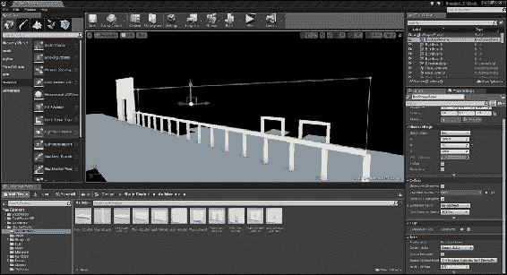

添加阻挡体积。

阻挡体积放入关卡的方式与 BSP 笔刷非常相似：

1.  在 Unreal 中，点击 `Modes`（模式）面板中的 `Volumes`（体积）选项卡。
2.  选择 `Blocking Volume`（阻挡体积）并将其拖入关卡。
3.  默认形状是一个盒子。让我们调整它以创建一个有效的屏障，防止玩家跳出观景长廊。在 `Details`（细节）面板的 `Brush`（笔刷）部分，将 `X` 改为 `1600`，`Y` 改为 `30`，`Z` 保持 `200` 不变。
4.  移动形状使其与栏杆顶部对齐。

## 使用阻挡体积和 BSP 进行白盒搭建

阻挡体积也可用作我们创建资产的碰撞网格体。例如，我们经常使用 `Architecture` 文件夹中的柱子资产来代表柱子或类似的从地板到天花板的构件。通过使用箱状的阻挡体积，我们可以让创建的任何自定义资产占据相同的空间，同时能够创建真正自定义的形状，例如由触手组成的柱子。

在白盒搭建期间，我们可以使用的另一种技术是配合 `BSP` 使用减法刷子来创建自定义形状。`BSP` 是我们熟悉的东西。当我们将一个箱子 `BSP` 刷子放入关卡时，它会创建一个箱子。这默认使用加法刷子，并在我们的关卡中创建该形状。`细节` 面板允许我们更改箱子的大致尺寸，但别无他法。

减法刷子则完全相反：

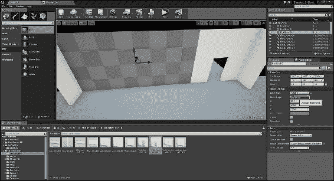

*在细节面板中将刷子从加法更改为减法*

减法刷子允许我们像使用饼干切割机一样使用刷子的形状来创建门洞、孔洞等。请记住，这仅适用于加法和减法 `BSP` 刷子。你无法使用减法刷子在静态网格体上切割孔洞。

### 使用减法 BSP 刷子创建窗户

让我们为安检站创建一个窗户：

1.  点击 `模式` 面板的 `BSP` 选项卡，将一个 `Box` 拖入关卡。在 `细节` 面板中，将 `X` 改为 `20`，`Y` 改为 `800`，以便覆盖两个墙体段的空间，将 `Z` 改为 `400` 以适应与墙体段相同的垂直空间。

2.  将新刷子放入安检站我们想要窗户的那个墙体段位置。

3.  从 `模式` 面板再拖入一个 `BSP` `Box`。对于这个刷子，我们将 `X` 设为 `30`，使其比墙体稍宽，`Y` 设为 `600`，`Z` 设为 `200`。

4.  最后，将 `刷子类型` 从 `加法` 改为 `减法`：

    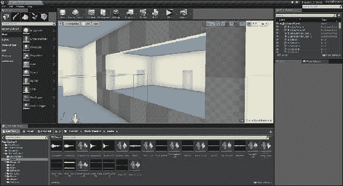

    *使用减法刷子的最终结果。现在我们有了一个窗户！*

5.  拖动这个刷子使其与墙体刷子相交。这应该会创建出我们想要的孔洞。请记住，如果你想复制这个刷子在关卡的其他地方使用，必须同时选中两个刷子才能获得正确的效果。

## 关卡设计原则

在构建游戏关卡时，了解如何使用工具很重要，但这并不是优秀关卡设计师所需知道的唯一事情。游戏关卡与玩家进行沟通，告诉他们关于故事和背景设定的信息，同时也传达目标、选项和其他游戏信息。我曾听过一位在游戏行业构建关卡多年的设计师做的一个精彩演讲。他提到，玩家应该能够在关闭游戏 HUD 的情况下导航关卡，仅依赖他们在关卡设计中发现的线索。为了让玩家能够做到这一点，关卡必须构建得清晰高效，利用清晰的视线和景观将玩家引导至最终目标。自从听到这个观点后，我尝试将这些理念融入我创建的每一个关卡中。

让我们谈谈其中的一些要点：

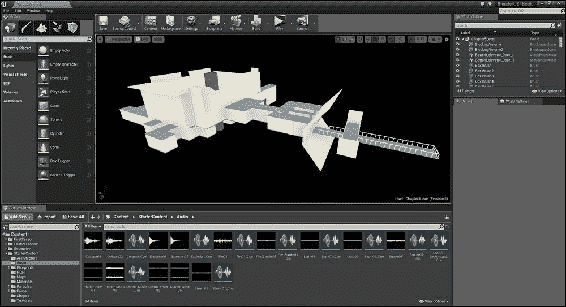

*我们空间站关卡的鸟瞰图*

构建清晰高效的关卡听起来很棒，但这到底意味着什么？一个清晰的关卡没有干扰元素，也没有服务于故事、环境或关卡目标没有任何实际用途的额外区域。玩家可能会觉得这些区域令人困惑，并花费时间寻找它们的重要性，而实际上根本没有。在设计和构建关卡时，始终要问自己关卡的每个部分是否增加了玩家体验，还只是为了增加关卡复杂度而存在的干扰项。效率也很重要。游戏设计有许多约束：硬件约束（如内存和处理速度）、预算约束、时间约束和生产约束。作为设计师，最大化利用资源以创造尽可能引人入胜的玩家体验非常重要。对于我们这样的小型游戏开发者，这可能意味着高效地利用时间，并找到在不牺牲质量的前提下偷工减料的方法：

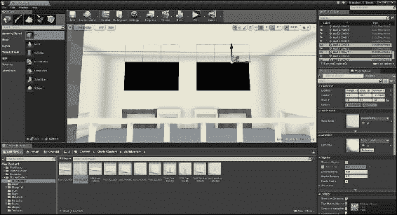

*俯瞰市场。我们能在窗外添加什么？*

构建关卡时，还必须考虑玩家在导航每个区域时所看到的内容。玩家的视线为他们提供了在我们设计的空间中导航的选项，我们可以利用它们引导玩家走过我们预定的路径。这将确保玩家按照我们设计的方式体验一切。在我们的空间站设计中，我们限制了玩家在关卡推进过程中能看到的路径。当他们进入空间站时，只知道一条通往安检站的路径，在那里他们体验我们的脚本事件。随后，他们获得了一条视线，引导他们看到外部环境和空间站市场的美丽景观。

在这里，他们可以自由地探索所见的一切：

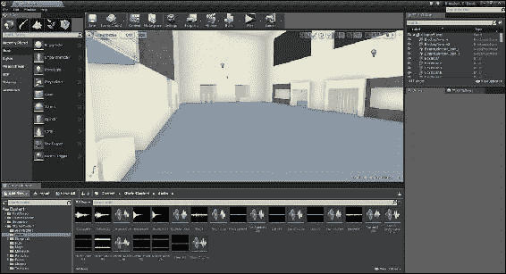

*探索市场。一个供玩家游玩的绝佳空间！*

玩家还被展示了关卡的最终目标——中介商店冒着烟的废墟，随时准备供他们随心所欲地探索。总之，视线是一种强大的工具，可以控制玩家的进度，向他们提供选项，并赋予他们到达关卡目标的能力。

最后再提醒一次：当你进行白盒搭建时，请记得让家人、朋友和目标受众为你试玩。他们的见解很宝贵，能增加你的游戏成功的几率！

## 高级脚本技术

随着关卡白盒搭建接近完成，是时候开始考虑那些脚本事件了。为关卡编写脚本事件可以极大地丰富任何关卡，可以简单到触发声音或粒子效果，也可以复杂到完全脚本化的过场动画或小游戏。虚幻引擎 4 赋予我们使用灵活的 `Blueprint` 系统以可视化方式编程这些序列的能力。我们在 第 2 章 *开始我们的第一个项目* 中已经为简单的门和电梯使用过 `Blueprint`。现在我们将在此基础上设计和编程灵活的脚本事件。

那么如何开始呢？设计脚本事件与我们之前构建的动画系统并无二致。每一个都始于一个事件，该事件导致几个不同的动作按顺序触发。诀窍在于能够理清逻辑顺序，以便获得玩家预期的效果。例如，普通的游戏爆炸包含几个不同的动作：

1.  等待目标对象受到伤害。
2.  一旦伤害达到一定数值，创建伤害半径并触发烟雾、火花、火焰和爆炸粒子发射器。
3.  播放爆炸声音！
4.  利用飞散的粒子作为掩护删除原始对象。
5.  在原位生成原始资产的损坏版本。

正如这里描述的爆炸一样，任何事件都可以分解为具体的事件并进行模拟。那么让我们思考一下安检站事件需要什么。我们需要让玩家感到受到威胁，并传达一种恐慌感。我认为我们可以通过尝试几种不同的方法来实现这一点，它们组合在一起将产生预期的效果。以下是一些不分先后顺序的想法：

*   灯光闪烁
*   房间充满烟雾
*   火花！
*   某种巨大的噪音
*   猛然关上门
*   猛然关上窗
*   着火！

### 提示

# 高级脚本技巧

## 头脑风暴与规划

使用便利贴进行头脑风暴是快速产生此类想法的绝佳方法。便利贴让想法变得可移动，以便您可以轻松地将它们按您选择的任何顺序进行组织。

现在有了几个很棒的想法！下一步是将它们按可编程的逻辑顺序排列。计算机无法执行我们未明确指示的任何操作，因此我们的指令必须非常清晰。以下只是我可能对指令进行排序的一个示例：

1.  为门窗添加关闭动画。
2.  发出某种巨大的噪音。
3.  触发烟雾发射器。
4.  触发火花发射器。
5.  给玩家播放某种线索，让他们知道该怎么做才能逃脱。

这看起来是个相当可靠的计划。下一步将是向我们的关卡添加那些额外元素。安检走廊的每个入口都需要一扇门，每扇窗户都需要一个百叶窗，依此类推。

## 构建门与百叶窗

### 构建第一扇安检门

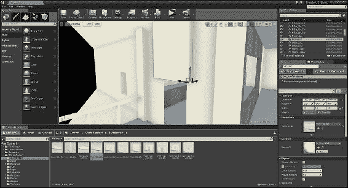

1.  对于那三扇猛然落下的安检门，我从 `Architecture`（建筑）文件夹中获取了一个 `Wall_400x200` 部件，并将 `X` 轴的 `Scale`（缩放）调整为 `0.4`，`Z` 轴调整为 `1.1`。然后我将它们分别重命名为 `Sec_Door1`、`Sec_Door2` 和 `Sec_Door3`。请记住也要将 `Mobility`（移动性）属性设置为 `Movable`（可移动）。
2.  我将每扇门定位在各自的门框上方，以便在事件期间能够猛然落下：

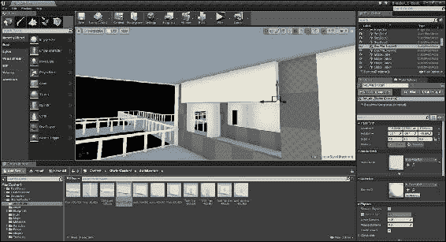

### 构建安检百叶窗

3.  对于那两个安检窗百叶窗，我使用了一个 `Wall_400x400` 部件，并将 `x` 轴的 `Scale` 属性调整为 `1.5`，`z` 轴调整为 `0.5`。我将它们的名称改为 `Sec_Win_Shutter1` 和 `Sec_Win_Shutter2` 以便于识别，并将它们的 `Mobility` 设置为 `Movable`。

## 添加细节

### 放置粒子发射器

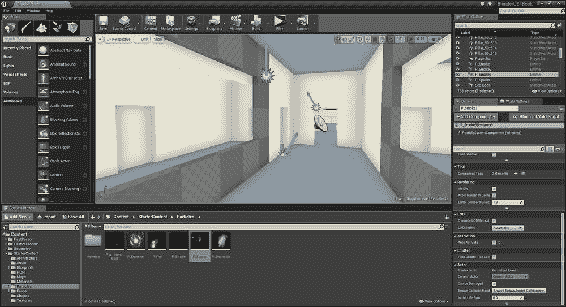

1.  粒子发射器是空间中发出光线、火花，甚至是静态网格体（如果我们愿意）的点。它们是使用 Unreal 的 Cascade 粒子编辑器创建的，尽管 `Starter Content`（初始内容）文件夹中的 `Particles`（粒子）子文件夹里有一些很棒的现成发射器可供我们使用。在这里，我在每扇门处使用了一个 `P_Smoke` 发射器，在左侧窗户附近使用了一个 `P_Sparks` 发射器。对于所有发射器，我在 `Details`（细节）面板中关闭了 `Auto Activate`（自动激活）选项，以便我们能控制它们何时触发。

这样的陷阱很棒，但我们仍然需要一些方法让玩家逃脱：

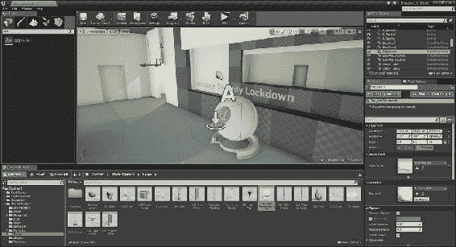

### 创建逃生路线

2.  过几秒钟后，让安检室的门发生故障并爆炸，让玩家能够到达安检覆盖按钮！我在门上方放置了几个 `Point Lights`（点光源），一个红色，一个绿色，用来指示门正在打开（在 `Details` 面板中关闭红光的 `Visible`（可见）属性），并使用 `Content Browser`（内容浏览器）`Props`（道具）文件夹中的 `Box Trigger`（盒子触发器）和 `SM_MatPreviewMesh_02` 构建了覆盖按钮。为了确保线索对玩家清晰明了，我在按钮上方放置了一个 `Text Render`（文本渲染）对象，显示 `Disengage Security Lockdown`（解除安检封锁）。

## 在关卡蓝图中编写事件脚本

所有部件就位后，我们准备开始编写事件脚本。点击视口上方的 `Blueprints`（蓝图）按钮并选择 `Open Level Blueprint`（打开关卡蓝图）来打开 `Level Blueprint`。对于这种程度的脚本编写，我们还将转到工具栏中的 `Window`（窗口）按钮并开启 `Palette`（调色板）窗口。这使我们能够访问可自定义的节点 `Favorites`（收藏夹）列表和 `Find a Node`（查找节点）搜索框，这是构建新蓝图序列时的绝佳工具：

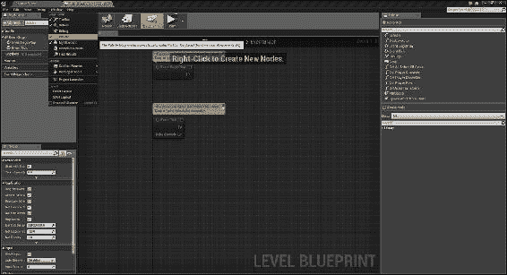

### 开始关卡蓝图

1.  选择蓝图区域中位于的两个默认节点并按 `Delete`（删除）。此序列不需要它们。

### 设置触发事件

2.  我们需要一个事件来启动我们的序列。回到关卡中，在安检处放置一个 `Box Trigger`，大约在走廊的中间位置。将其 `Box Extents`（盒子范围）属性设置得足够大，以至于玩家无法错过。这将使玩家在完全进入走廊后触发安检封锁。在 `Level Blueprint` 内部，`Right-click`（右键点击）并选择 `Add Event for Trigger Box`（为触发盒添加事件），选择 `Collision`（碰撞），然后选择 `Add OnActorBeginOverlap`（添加 OnActorBeginOverlap）。请记住，您的触发盒编号可能与我的不同：

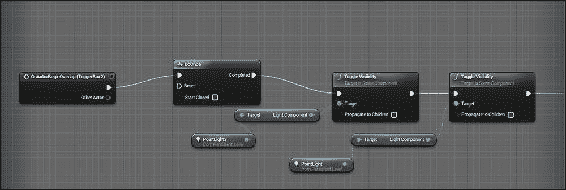

### 切换警示灯

3.  现在，我们需要改变警示灯的颜色。为此，我们将添加几个不同的节点。在 `Palette`（调色板）窗格的 `Find a Node` 部分的搜索框中，输入 `Do Once`（执行一次）。此节点的工作原理类似于一个闸门，确保其后的内容仅运行一次。在这里，我们用它来确保用于启动序列的触发器不会被触发多次。接下来，搜索 `Toggle Visibility`（切换可见性）节点。将两个该节点拖入蓝图并按图所示连接。这些节点的目标将是我们的红灯和绿灯。我们要确保显示我们想要的灯并隐藏不想要的灯：

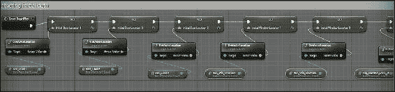

### 收集初始位置

4.  是时候让门窗猛然关闭了！这部分看起来有点复杂，但实际上就像我们在 第 2 章 *启动我们的第一个项目* 中所做的那样。我们将使用 `Timeline`（时间轴）同时关闭我们创建的所有安检门。首先我们需要做的是保存所有要制作动画的物体的初始位置。没有这一步，门窗会猛然落下，然后继续穿过地板！为了防止这种情况发生，我们从门的初始位置制作其位置动画。首先，创建一些向量变量来保存三扇安检门和两扇窗户的数据。接下来，我们将构建一个特殊的序列来处理收集这些数据。从 `Event BeginPlay`（BeginPlay 事件）事件开始，并将其连接到每个变量的 `Set`（设置）节点。然后将 `Get Actor Location`（获取演员位置）节点连接到每个 `Set` 节点，每个门和窗作为目标。这将获取每个部件的位置，然后将其设置为变量，以便我们在下一步中为其制作动画：

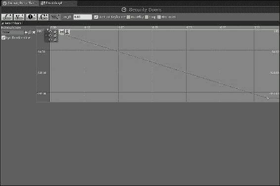

### 使用时间轴为门窗制作动画

5.  现在添加 `Timeline` 节点并双击打开它。我们想要使用 `Vector Track`（向量轨道）将门和窗百叶窗滑落到位。请记住，在 `Vector Track` 中，我们可以为所有三个移动轴制作动画，但这里我们只想使用 `Z` 轴，因此需要一些整理。按住 `Shift` 键并点击红线。这将在 `X` 轴上添加一个关键帧。现在点击新关键帧并将其拖出视野。对绿线做同样的操作，将 `Y` 轴拖出视野。这留给我们蓝线，即 `Z` 轴。在那里创建一个关键帧，并确保其时间和值均设置为 `0`。添加第二个关键帧并将时间设置为一个快速的值。我用了 `0.25`。将值设置为 `-210`。这将把它们滑落到位，阻挡玩家的逃生路线。在为 `Z` 轴创建关键帧后，您可以随意通过点击其他两个轴上的关键帧并按 `Delete` 键来删除它们。您也可以使用图表左上部分的按钮来锁定和隐藏这些轴。请务必勾选 `Last Keyframe`（最后一帧）复选框。这会告诉 `Timeline` 在序列的最后一个关键帧处停止。

## 使用 Set Actor Location 节点移动所有这些门和窗

6. **为了完成动画**，我们需要为每个需要动画的元素，将一个 `Set Actor Location` 节点连接到 `Timeline` 的 `Update` 部分。这些节点中的每一个都需要适当的目标以及一个要动画移动到的位置。就像在 第 2 章 *启动我们的第一个项目* 中一样，我们将使用变量获取每个元素的初始位置，并通过 `Vector + Vector` 节点将其与来自 `Timeline` 的 `Vector Track` 相加。按照图示设置每个节点。在底部附近，我使用了一个 `Reroute` 节点来创建所有通往 `Vector + Vector` 节点的连接。如果连线开始变得混乱，或者需要将一条连线分离为多根线以便多次使用，可以使用这些节点来重定向连线。`右键单击` 打开菜单，在底部附近找到 `Reroute` 节点：

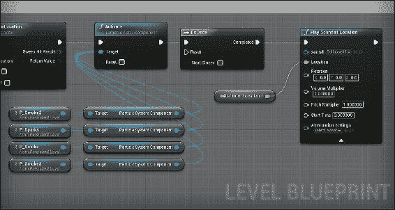

### 使用 Activate 节点激活所有粒子效果

7. **燃放烟花！** 是时候激活我们所有的粒子效果了。我们使用……你猜对了！一个 `Activate` 节点！使用 `Find a Node` 部分搜索此节点并将其拖入蓝图。目标将是每个粒子效果。可以通过返回关卡，按住 `Ctrl` 键同时选择每一个来轻松创建目标。回到蓝图中，`右键单击` 并选择 `Create Reference to 4 Selected Actors`。将它们插入 `Activate` 节点的 `Target` 将创建转换节点（显示 `Target` 和 `Particle System Components` 的那些节点）：

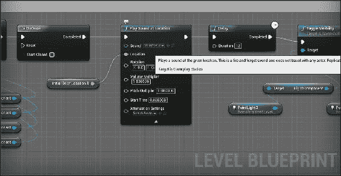

### 使用 Play Sound at Location 播放音效

8. **接下来我们将使用** `Play Sound at Location` 来播放我们的 `Sound Cue`。此节点非常直观，它会在我们确定的位置播放从 `Content Browser` 中选择的声音。找到此节点并将其连接到现有序列。对于我的声音，我从 `Starter Content` 文件夹的 `Audio` 部分选择了 `Collapse02`。对于位置，我使用了我们之前已存储在变量中的初始位置之一：

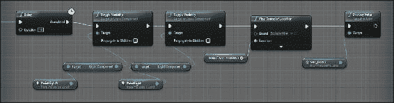

### 切换安保灯并销毁门

9. **我们已进入该序列的最后冲刺阶段。** 使用 `Delay` 节点，让我们销毁安保办公室的门并切换灯光。`Delay` 节点会在预定时间内停止序列的执行。试玩序列以感受你希望玩家等待多久。`Delay` 时间越长，产生的紧张感和恐慌感就越强！经过多次测试，我选择了 12 秒。更长显得太久，更短显得太快。接下来，再次在灯光上使用几个 `Toggle Visibility` 节点以恢复绿灯。这个视觉提示将让玩家知道下一步去哪里。为了给玩家一个听觉提示，在通往安保办公室的门的位置播放 `Explosion01` 声音。最后，从 `Find a Node` 部分获取一个 `Destroy` 节点。在游戏术语中，`Destroy` 只是 delete（删除）的一个花哨说法（我觉得听起来更好）。用它来删除那扇门：

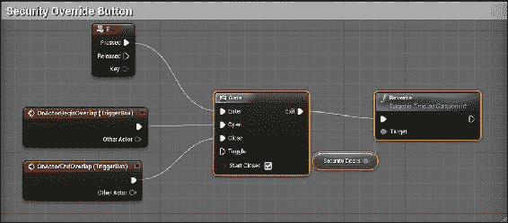

### 编程安保覆盖按钮

10. **最后，让我们为安保覆盖按钮编写程序。** 该事件实际上包含三个事件。前两个涉及我们创建的用于使按钮工作的触发器。选择关卡并创建一个 `OnActorBeginOverlap` 事件和一个 `OnActorEndOverlap` 事件。我们需要的最后一个事件是 `E` 键的键盘输入。可以通过在 `Find a Node` 搜索框中输入 `Input` `E` 来找到它。这些都将连线到一个 `Gate` 节点，就像我们在货船上的电梯所做的那样。这将要求玩家站在触发器内以打开 `Gate` 并使 `E` 键生效。要完成此序列，将 `Gate` 的 `Exit` 部分连线到 `Timeline Reverse` 节点。目标可以通过从 `Reverse` 的目标部分拖出连线，打开 `Class`，然后选择你的关卡，最后选择用于控制安保门和窗的 `Timeline` 来找到。

**测试时间！** 试玩关卡的这一部分，确保一切正常运作。感受戏剧张力！现在是编写电梯序列脚本的时候了。与安保检查站相比，这简单多了！

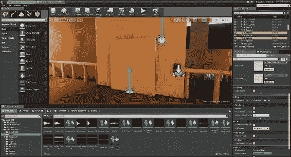

## 为电梯序列设置组件

电梯序列的工作方式很像安保检查站序列的缩短版。当玩家走进触发器时，为一扇电梯门制作动画，打开几个粒子发射器，并播放声音。让我们开始吧：

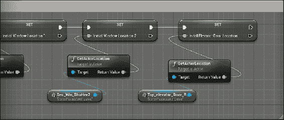

### 通过添加到关卡初始化序列来获取电梯门的初始位置

1. **既然我们将为此序列使用 `Timeline`**，创建一个向量变量来保存我们计划制作动画的门的初始位置，并使用与获取安保门初始位置相同的技术进行设置。

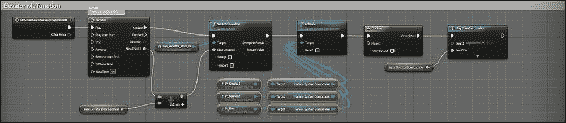

### 编写电梯序列脚本

按以下顺序连接节点：`OnActorBeginOverlap`、`Timeline`、`Set Actor Location`、`Activate`、`Do Once`、`Play Sound at Location`。

2. **启动此序列的事件是 `OnActorBeginOverlap`**，使用电梯按钮前的触发器。

3. **接下来，创建一个 `Timeline`** 来稍微移动其中一扇门，让玩家以为门在打开。

4. **使用 `Activate` 节点** 激活电梯门处的烟雾和火花。我还在电梯井底部添加了一个火焰发射器，并稍微打开了那里的门，让玩家看到一旦到达市场，他们可能会遭遇什么。

5. **然后我使用了 `Do Once` 和 `Play Sound at Location` 节点** 来播放爆炸声。`Do Once` 确保音频不会尝试循环播放从而破坏我们想要的体验。

**全部完成！** 测试序列以确保它具有你想要的情感效果。请随意调整不同的粒子效果、声音和时间，直到感觉适合你和你的测试玩家。在下一节中，我们将讨论胜利条件以及如何将我们的两个关卡连接在一起。

# 胜利条件

此时在本书中，我们有两个白盒关卡，每个关卡都包含起点和终点。我们还构建了一段将两者串联起来的叙事。在本节中，我将向你展示如何使用蓝图连接这两个关卡，并允许玩家通过调查货箱从货船关卡前往空间站关卡继续故事。最终，我们将拥有一个游戏演示的骨架，绝对可以通过额外的美术和玩法扩展成一个完整的游戏。

要连接这两个关卡，我们必须回到货船，为我们放置在那里的货箱添加一个触发事件，允许玩家调查它。此触发器将允许玩家加载空间站关卡以继续故事：

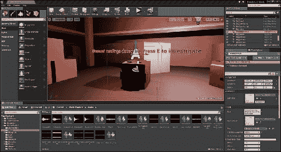

## 将货船关卡连接到空间站关卡

1. **打开货船关卡并添加两样东西：** 一个围绕我们创建的货箱的 `Box Trigger` 和一个显示“按 `E` 键进行调查”消息的 `Text Render`。

## 编程触发关卡转换的按钮

2. 打开**关卡** **蓝图**并找到一个区域开始我们的序列。点击关卡中的新**盒子触发器**并创建一个**OnActorBeginOverlap**事件和一个**OnActorEndOverlap**事件。还要在**调色板**面板中使用**查找节点**工具获取一个输入**E**事件：

3. 到现在，这个序列应该对你很熟悉了。将我们刚创建的事件连接到一个**门**节点，以创建一个仅当你在触发区域内时才起作用的事件。

4. 最后，添加**打开关卡**节点。可以使用**查找节点**搜索框找到它。此节点会将玩家传送到我们的新空间站关卡。在**关卡名称**字段中，输入空间站关卡的名称。确保输入的名称正确，否则该节点将无法工作。

现在试玩货船并调查来自箱子的异常读数。这应该会带你到空间站关卡的开始。如果这是一个完成的游戏，我们可能会有加载画面或一些音频在过场中解释故事。记住这样的想法！以后总有时间进行润色和改进。

一切是否感觉开始融会贯通了？

# 总结

在本章中，我们开始了白盒制作一个比之前大得多的关卡的过程，一个神秘的空间站，可能藏有货船船员失踪原因的线索。在原型阶段，我们还创建了两个脚本事件。第一个发生在从停机坪进来的安全检查站，旨在制造紧张感并增强空间站上出了问题的感觉。第二个是一个故障电梯，告诉玩家一定发生了什么事，确定的死亡可能就潜伏在拐角处。但玩家在进出口经纪人的店铺后面发现了什么？在下一章中，我们将回到 Blender 为这个问题设计答案，并为我们的关卡创建一个新的神秘复杂的游戏资产。

谜团继续！此时，玩家已经回到了我们空间站市场区的进出口经纪人店铺，但他们看到了什么？我们可以走几条不同的路线，比如跨维度传送门、先进军事装备，甚至某种神秘事物。我最喜欢的作家之一一直是*H.P. 洛夫克拉夫特*，一位 20 世纪初的恐怖小说作家。他的短篇小说常围绕禁忌知识、邪教、隐藏秘密和致疯恐怖等主题，并经常谈论来自星际之外的古老神祇。如果我们的勇敢英雄偶然发现了一个来自另一个世界的神器，与这样一个吞噬理智的无名星神有关联，会怎样？毫无疑问，繁忙空间站上的进口商可以通过向收藏家出售这种东西发大财。他为什么要关心附带的疯狂故事？那只会增加购买的诱惑力。在本章中，我们将涵盖以下主题：

*   设计我们的资产：灵感与概念艺术
*   进阶工具：细分、刀切、桥接边循环等
*   在 Blender 中使用多个形状
*   跟踪多边形和三角形数量的重要性
