# 设计我们的资产 – 灵感与概念艺术

正如我之前提到的，来自*H.P. 洛夫克拉夫特*短篇小说，特别是广受欢迎的克苏鲁神话体系中的故事，是我最喜欢的一些怪诞故事。在这些故事中，勇敢的调查员接触到源于疯狂的物体和生物，以及黑暗可怕神祇的仆从。以此为灵感，我们再次转向 Google 图片搜索更多启发性的文字和图像。快速搜索提供了有趣的想法。古老神祇在艺术中常被描绘为超凡脱俗。触手、尖叫的嘴、多只眼睛、不均匀的体格等被描绘出来，并与更多的人类元素混合。那么我们如何将这些想法融入到一个游戏资产的设计中，使其在遥远未来的空间站上看起来不突兀呢？

是时候绘制我们的概念草图了：

神器草图

我最初的想法是创建某种容器，像潘多拉魔盒，打开时释放出吞噬周围所有人的邪恶力量。与其做成像箱子或盒子那样方正，我决定创建一个更像蛋形的容器。它会立即在环境中脱颖而出并吸引玩家。神器应该能被打开，以便玩家可能意外释放内部的东西。设计在其开启机制中融入了一些蒸汽朋克元素，以致敬许多*H.P. 洛夫克拉夫特*作品所处的时代。最后，还有深海元素，如触手把手、带刺的螃蟹壳外观和全视之眼。这绝对能吸引玩家的注意力！

对于这个资产，我们必须考虑对象如何打开，因为我们将在 Blender 中为这些元素制作动画。在这个设计中，圆形元素转动并收回固定盖子的活塞，使顶部能够扭开。这些移动部件中的每一个都将被创建，从不同的基础形状开始。

为了确保它适合关卡内的空间，我们将创建一个接近我们使用的现有测试资产大小的资产：

测试资产的半径为 60，高度为 60

## 进阶工具：细分、刀切、桥接边循环等

当我们构建这个新资产时，有几个新工具我们需要了解，它们将使我们能够增加神器的细节层次。

现在让我们看看我们将要使用的一些新工具。

## 细分工具

**细分**工具是一个很棒的工具，可用于向模型的某个部分添加更多连接线和多边形以增加细节。通过选择要细分的线或多边形，然后点击**工具**面板中的**细分**工具来使用它。可以通过更改屏幕左下角的**切割数量**字段来调整连接数量：

使用细分工具

## 刀切工具

**刀切**工具可用于对物体几何体进行自由切割，非常适合在模型的小部分创建额外的艺术细节。开始使用时，点击**工具**面板中的**刀切**工具，或按*K*。光标将变成一把小刀。点击一次开始切割，然后每次想添加线上的点时点击一下。将鼠标悬停在现有顶点上会使光标变绿，允许你将新线与现有几何体连接。按*空格键*完成切割，或按*E*开始新的切割：

刀切工具非常适合添加细节

## 桥接边循环工具

**桥接边循环**工具是通过连接两条或更多边来创建新多边形的基本工具。我们在删除旧多边形后经常使用它，将几体重构为更实用的形状。使用方法：在**线**选择模式下选择线条，按*W*打开**特殊**菜单，然后选择**桥接边循环**：

桥接边循环非常适合填补形状中的孔洞

## 三角化修改器工具

# 在 Blender 中使用多种形状

我想提的最后一件事是我们在完成模型后将会用到的内容。当我们从 Blender 导出对象并将其导入 Unreal 时，游戏引擎会为了自己的目的将我们所有漂亮的多边形转换为三角形。在大多数情况下，这不会成为问题。Unreal 能够很好地处理我们简单的箱子。然而，对象越复杂，Unreal 在导入文件时搞砸它的几率就越大。我们可以在从 Blender 导出之前对对象进行三角化，来协助这一过程。添加 `Triangulate`（三角化）修改器是在 `Properties`（属性）面板的 `Modifier`（修改器）菜单中完成的。请记住，你必须处于 `Object`（物体）模式才能应用任何修改器：

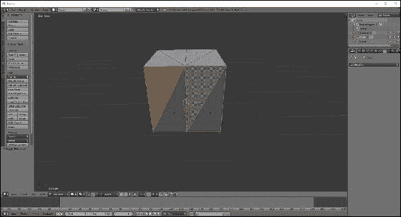

`Triangulate` 至关重要，因为大多数游戏引擎反正都要求游戏资产由三角形构成。

有了这些额外的工具，我们应该能够创建一个惊人的神器。是时候开始构建了！

### 提示

别忘了像我们在 第 3 章 *是时候进行自定义了！* 中所做的那样，使用适当的设置来设置你的文件。

现在，让我们从一个圆柱体开始：

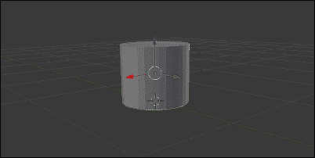

从圆柱体开始

让我们从对象的底部开始构建：

1.  如果场景中有初始对象，请将其删除。转到 3D 视口底部的 `Add`（添加）菜单，选择 `Mesh`（网格），然后从选项中选择 `Cylinder`（圆柱体）。在 `Tools`（工具）面板底部，你可以看到新创建的 `Cylinder` 的选项。将 `Sides`（侧面数）设置为 `24`（使用足以保持圆形的侧面数即可），将 `Radius`（半径）设置为 `60`，将 `Depth`（深度）设置为 `60`。请记住，这些数值是基于我们在 Unreal 中对白模道具进行的测量。

2.  现在移动我们新创建的对象，使其看起来像是放在握柄上。这将使我们的神器在 Unreal 中拥有一个良好的枢轴点：

    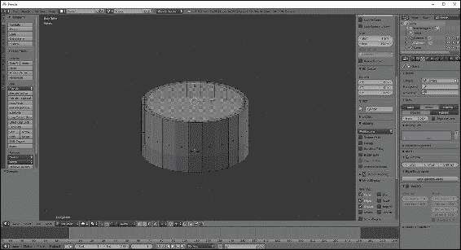

    内插顶部

3.  是时候开始塑造这个东西了。按 `Tab` 进入 `Edit`（编辑）模式。选择顶部多边形并使用 `Inset`（内插）工具开始赋予其内部结构。我将 `Inset` 值设置为约 `7.10`：

    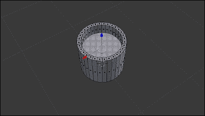

    使用挤出来创建神器的内部

4.  接下来，获取由 `Inset` 创建的新多边形并将其 `Extrude`（挤出）向下延伸至底座内部。不要太深；我们想营造出内部空间很大的错觉，但不想让多边形穿透底部。

5.  现在让我们稍微收窄底部。抓取圆柱体的底部多边形并将其 `Scale`（缩放）变小一点。小心不要让内部多边形戳穿侧面。我将其缩放了 `0.75` 倍。

6.  但等等！我们仍然需要一个平坦的部分来连接锁定机制和腿！我们可以通过在中间部分创建一个新的边循环并将其缩放向外来实现这一效果：

    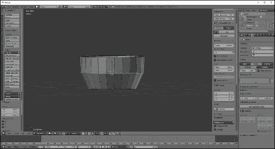

    为腿创建平坦部分

7.  将选择模式更改为 `Line`（边/线）模式，并选择中间周围的所有线。这可以通过按 `B` 进行框选，旋转视角，再进行一次框选，直到选择了所有线来实现。选中后，点击 `Tools` 面板中的 `Subdivide`（细分）工具。这将创建我们的新循环。现在选择构成该循环的所有线并向外 `Scale`（缩放），以再次使底座上部变平：

    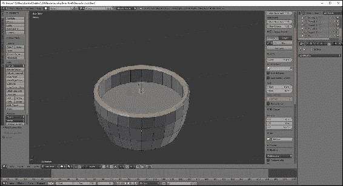

    倒角边缘

8.  让我们把它变圆润。与我们之前创建的箱子不同，我们现在创建的形状更加圆润和有机。选择构成神器顶部内外边缘的线。按 `W` 打开 `Specials`（特殊）菜单并选择 `Bevel`（倒角）。在边上使用 `Bevel` 会将其分割成两条边。通过在这两个边循环上使用它，我们可以为形状创建圆润的元素：

    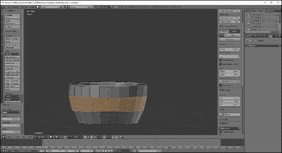

    再次倒角以使形状圆润

    使用 `Bevel` 时要小心，我们不希望形状翻转过来！

9.  再来一次 `Bevel`，这部分就算完成了。选择第 6 步中创建的边循环并给它一个 `Bevel`。这将使底部部分也获得良好的圆润形状。你现在得到的应该看起来像一个花盆的雏形，一个非常阴森的花盆。

10.  看看我们的草图，顶部部分看起来与底部相似。我们可以通过复制底部零件并将其翻转来节省一些时间：

    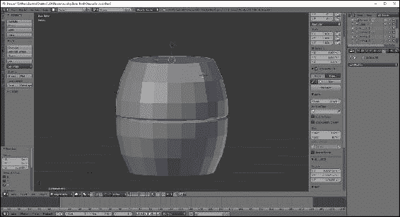

    复制底部以创建顶部的起始形状

11.  在 `Object` 模式下，选择底部零件并点击 `Duplicate`（复制），或按 `Shift` + `D`。这将创建一个副本，但它会开始向各个方向移动，而我们希望保持零件对齐。按 `Z` 将移动锁定在 `Z` 轴上，并将副本向上移动一点。现在使用 `Rotate`（旋转）工具并按 `X` 将旋转锁定在 `X` 轴周围。最后，输入 `180` 并按 `Enter` 将其翻转过来：

    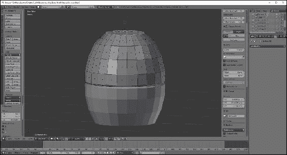

    拉长神器的顶部

12.  使顶部圆润将给我们带来想要的蛋形。抓取新盖子的顶部多边形并将其 `Extrude`（挤出）得更长一些。然后 `Scale`（缩放）新的顶部多边形使其变小一点。它将开始看起来更圆润。重复此步骤一两次，直到获得你想要的形状。

神器现在有了底部和顶部，开始看起来有点像我们的设计图了：

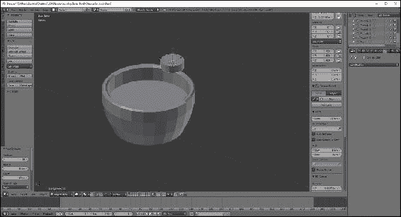

用圆柱体开始齿轮部分

在接下来的几个步骤中，我们将构建锁的第一部分，一个用爪子护身符的齿轮：

1.  我们需要一个基本形状来开始这个零件。由于齿轮本质上具有圆形、扁平的形状，圆柱体应该能很好地开启工作。在 `Object` 模式下，点击 3D 视口底部的 `Add` 菜单，选择 `Mesh`，并从列表中选择 `Cylinder`。我创建的圆柱体具有 `16` 个 `Vertices`（顶点）、`15cm` `Radius`（半径）和 `10cm` `Depth`（深度）。将其移动到模型上的位置并旋转 90 度，使其平贴在神器的底部。部分齿轮将位于神器内部。

2.  现在事情变得更复杂了，让我们使用 `Scene Outliner`（场景大纲视图）来命名对象并隐藏我们不正在处理的对象。点击神器的底部部分。你将在 `Scene Outliner` 中看到它被命名为 `Cylinder`，之后的一切都是 `Cylinder.001`，依此类推。如果我们双击名称，就可以将对象重命名为我们想要的任何名称。我将我的组件命名为 `Bottom`（底部）、`Top`（顶部）和 `Gear`（齿轮）。名称在这里不是**超级重要**，但你应该给它们起一些你能认出的名字。你可能还会注意到 `Scene Outliner` 中的每个对象旁边都有一个眼睛图标。点击这个眼睛会使其闭合，并在 3D 视口中隐藏该对象。这是在处理复杂游戏资产的不同部分时，防止其他零件碍事的好方法。

# 齿轮建模

**3.** 现在让我们做一个 `Inset`（内插）： 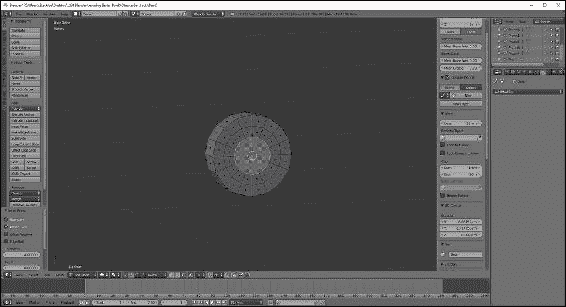

使用 `Inset` 为齿轮添加细节

**4.** 进入 `Edit`（编辑）模式，我们可以开始将这个圆柱体塑造成我们需要的齿轮。隐藏神器的顶部和底部部分，以便你只能看到我们正在处理的部分。选择前面的多边形并按 `I` 进行 `Inset`（内插）操作。我做了一个 `5cm` 的 `Inset`。然后我们将再次 `Inset` `5cm`。完成后，对背面的多边形做同样的操作： 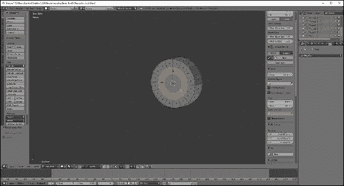

删除两侧中间的多边形环

**5.** 选择我们刚创建的中间多边形环并按 `Delete`（删除）。当询问删除什么时，从菜单中选择 `Faces`（面）。就像之前一样，对背面做同样的操作： 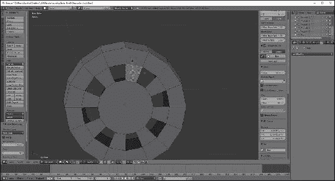

使用 `Bridge Edge Loops`（桥接边循环）创建更多细节

**6.** 是时候使用 `Bridge Edge Loops` 工具了！从 12 点钟位置开始，选择内侧多边形上的第一条边及其对应的外侧多边形上的边。按 `W` 并选择 `Bridge Edge Loops` 工具。看那个漂亮的新多边形！现在对圆周上每隔一条边做同样的操作。和之前一样，在齿轮的背面也做同样的操作。在下一步中，我们将构建齿轮的内部多边形：

### 提示

如果创建这些新多边形时出了问题，别担心。只需按 `Ctrl + Z` 撤销并重试！

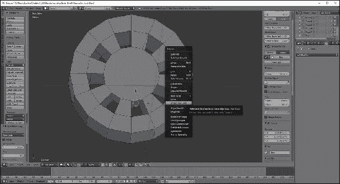

使用 `Bridge Edge Loops` 创建齿轮形状的内部部分

**7.** 为齿轮臂添加内部多边形是一个四步骤的过程。我们需要使用 `Bridge Edge Loops` 工具在每个孔中创建四个多边形以封闭部件内部： 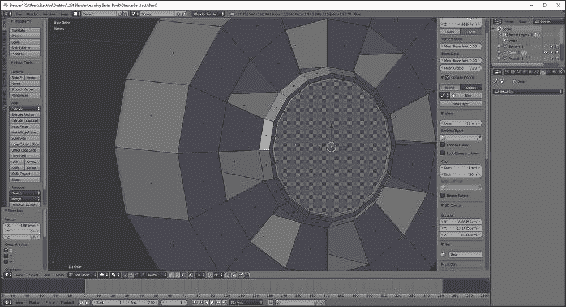

挤出并缩放以在齿轮中心创建更多细节

**8.** 齿轮中心旨在看起来像是托住一枚奖章或护身符，这是另一个分多步、少量进行的操作。选择齿轮正面的中心多边形并向外 `Extrude`（挤出）。接下来，将其 `Scale`（缩小）一点点，开始为将要嵌入的孔创建一个边缘： 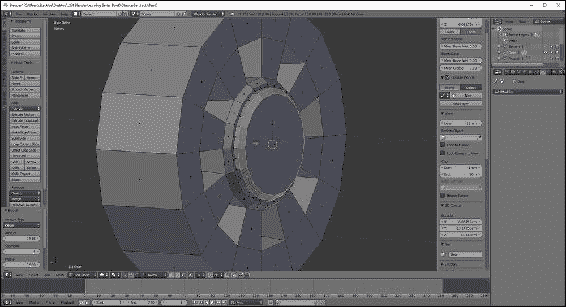

挤出并倒角中心以完成细节

**9.** 现在，对多边形进行 `Inset`（内插）以创建边缘的顶部。通过向内挤出多边形一点并 `Scaling`（缩小）它来创建边缘的其余部分。最后，向外 `Extrude`（挤出）并对多边形进行 `Bevel`（倒角）以完成形状： 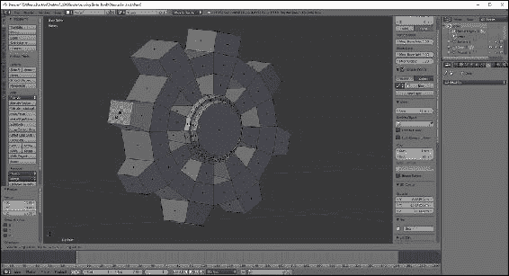

使用单独挤出添加齿轮齿

**10.** 没有齿的齿轮算什么？要创建齿，我们要 `Extrude`（挤出）齿轮外侧与内侧臂对齐的多边形。我们可以一次性选择所有多边形，并从 `Tools`（工具）面板中选择 `Extrude Individual`（单独挤出）。这允许我们挤出每个多边形，使齿轮齿大小一致。之后，只需将齿端的每个多边形 `Scale`（缩小）一点点。我将每个缩放了 `0.75`： 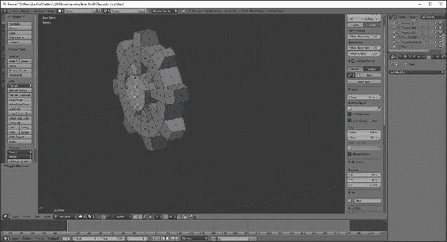

将背面多边形向外挤出一点，为齿轮连接神器创建位置

**11.** 到了最后润色的时候了！选择背面多边形并向外 `Extrude`（挤出）以创建一个齿轮可以旋转的柱子。这将为齿轮安装在神器底部创建一个良好的接触点。

为了打开，神器使用活塞来抬起盖子。设计要求在物体底部周围间隔放置七个活塞。我们在这里要偷个懒，只创建一个活塞，然后复制它来创建另外六个。

### 提示

关于 3D 建模，我学到两件大事。第一是聪明工作比努力工作更重要。第二是有时我们构建东西只是为了让它们看起来很酷！

既然活塞本身是圆的，我们再次从老朋友圆柱体开始。让我们开始吧！

# 活塞建模

**1.** 创建一个新圆柱体。我将我的设置为 `32` 个 `Vertices`（顶点），`3.75cm` `Radius`（半径），以及 `15cm` 的 `Depth`（深度）： 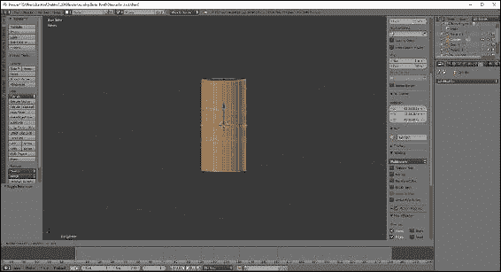

从圆柱体开始，使用 `Loop, Cut, and Slide`（循环切割滑移）添加两个新的边循环

**2.** 为了创建更宽的中间部分，选择所有中间的多边形并使用 `Loop, Cut, and Slide` 工具在中心周围添加两个新的边循环。再次点击以确认切割。现在点击 `Tools` 面板中 `Extrude` 下拉菜单并选择 `Region (Vertex Normals)`（区域（顶点法线））。这将使所有多边形从中心向外均匀挤出。

**3.** 让我们把底部弄圆。`Extrude`（挤出）活塞的底部多边形，然后对其使用 `Bevel`（倒角）工具。这应该会给我们一个漂亮的圆头： 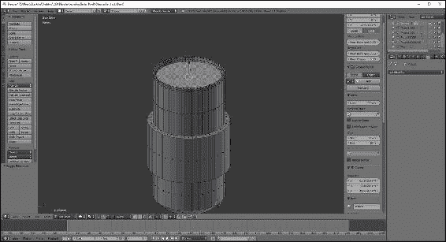

为活塞添加边缘

**4.** 为了增加细节，给活塞顶部加个边缘，就像我们对齿轮正面做的那样。将顶部多边形 `Extrude`（挤出）一点点，然后 `Inset`（内插）一点，最后将多边形 `Extrude`（挤出）回活塞内部： 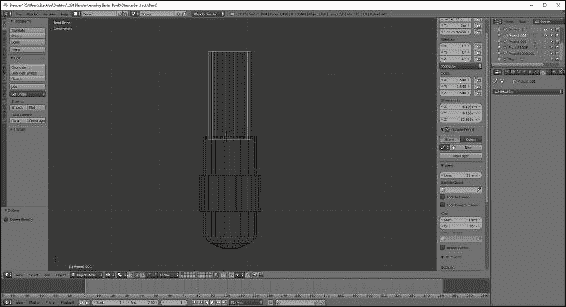

创建一个新圆柱体并定位它，使其看起来像是从底部活塞部件延伸出来的

**5.** 现在活塞必须伸展以将盖子抬得足够高，以便里面那个阴险的东西能出来。我们可以通过创建一个伸缩部分来抬起盖子来实现这一点。你可能会觉得这听起来很难，但记住，要聪明工作，别笨干。我们可以通过创建第二个圆柱体从第一部分延伸出来来创建这个部分。创建一个 `32` 个 `Vertices`（顶点），`3cm` `Radius`（半径），`13cm` `Depth`（深度）的圆柱体。将其与我们活塞的底部对齐。你可以按 `Z` 切换到线框视图以获得更好的视野。再次按 `Z` 返回实体视图： 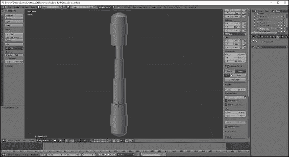

完成的活塞

**6.** 为了将其升得足够高，我们需要给活塞添加几个更多的部分。获取第一部分并 `Duplicate`（复制）它。然后向上移动以与最后一部分的顶部对齐。最后将其缩放至 `0.75`。要制作下一部分，重复上述步骤。你会得到三个部分，当它们向下移动时，会整齐地嵌套在一起。当我们为神器开合制作动画时，我们将展开和压缩这些部分，以产生它伸缩向外的错觉。

**7.** 为了完成活塞，`Duplicate`（复制）我们创建的第一个部分并使其成为顶部： 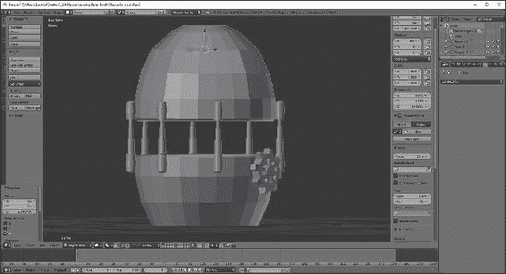

在神器周围复制活塞，使总共有七个

**8.** 所有活塞部件完成后，抓取你完成的活塞并在神器周围以等距间隔 `Duplicate`（复制）它，类似于图片中的样子。

活塞就做完了！只剩下最后一组主要部件需要完成了，在我看来它们是最有趣的：触手！设计要求触手用作手柄和腿，赋予神器一种异世界的感觉。为了制作这些怪诞的创造物，我们将使用 `Bezier Curve`（贝塞尔曲线）和一些修改器的组合，沿着路径复制一段触手。这还有一个额外的好处，就是让它们灵活且易于摆姿势。

进入下一步！触手从一个基本立方体开始：

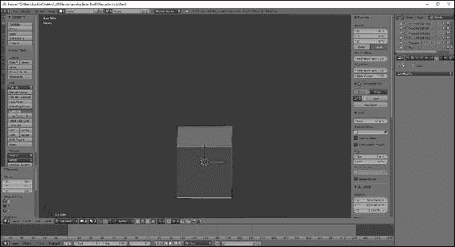

用立方体开始触手

触手时间到！让我们完成我们创作的最后一部分：

1. 首先创建一个**立方体**，其**半径**为`5cm`来开始制作触手；我知道它不是圆柱体，但请耐心听我解释。选择穿过立方体中心的四条线，然后点击**细分**将立方体切成两半。

2. 选择立方体右侧的所有多边形并删除它们。现在通过点击**属性**面板中的扳手图标来添加**镜像**修改器，以打开**修改器**菜单。点击**添加修改器**下拉菜单并选择**镜像**。与第 2 章《开始我们的第一个项目》不同，我们暂时保持其开启状态，然后再应用它：
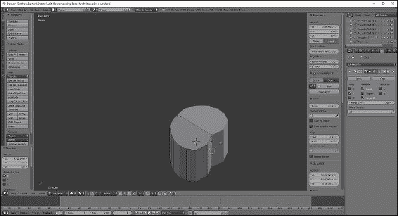

使用镜像修改器使立方体对称

3. 现在我们将通过倒角立方体的角来制作触手。使用**倒角**工具给各个角添加一些圆角，直到看起来更有机一些。你的可能和我的看起来略有不同，这没关系！我用了大约八到十次倒角。

4. 该应用**镜像**修改器了。返回物体模式并点击**应用**：
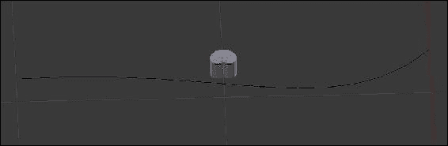

创建一条贝塞尔曲线。我们的触手片段将沿着曲线复制以创建最终形状

5. **贝塞尔曲线**是具有手柄的曲线，可以移动手柄来创建优雅的弯曲和曲线。这为我们的触手提供了结构。切换到**物体**模式，使用**添加**菜单，选择**曲线**，然后选择**贝塞尔**。使用**移动**和**旋转**工具将其移动到触手片段旁边。

6. 剩下的有趣部分都在**修改器**菜单中。在触手物体上添加一个**阵列**修改器。阵列允许我们创建物体的多个副本，通常呈形状或线条排列。在这种情况下，我们将用它沿着**贝塞尔曲线**创建更多触手段。在修改器中，将**适配类型**改为**适配曲线**，并在下一个框中选择**贝塞尔曲线**。还要勾选**合并**和**首尾**旁边的复选框；这将改善我们的结果。如果你的触手片段复制方向很奇怪，像我的一样，请更改**相对偏移**下的**X**、**Y**、**Z**数值，直到获得你想要的结果。

7. 为了完成触手，添加一个**曲线**修改器。在其设置的**物体**部分，选择我们的**贝塞尔曲线**。触手现在完成了！点击**贝塞尔曲线**并进入**编辑**模式。拉伸这两个点，你会看到触手随你移动它们而增长。在**场景属性**面板中，更改**变换**下的**半径**选项可以使触手末端变细。最后，如果你需要更多控制触手，选择**贝塞尔曲线**上的两个点并点击**细分**。这将添加另一个可移动的点，以便更好地弯曲和塑造你的形状：
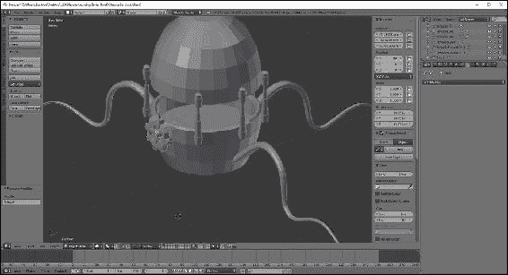

复制完成的触手，给神器加上腿！

8. 最后，使用你的触手创建神器的腿。将第一个**贝塞尔曲线**点移动到与我们的底部片段接触。然后将其他点移动成你想要的形状。我每条曲线用了四个点。记住，要复制一个触手，你需要同时复制触手片段和**贝塞尔曲线**。

看起来怎么样？如果你在调整**贝塞尔曲线**点时遇到问题，不要放弃！它们起初可能难以操作，但结果值得所有的麻烦：

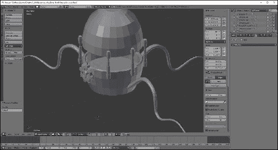

神器拥有超过 7,000 个三角面！

当我们为游戏资产添加这些精彩细节时，有几件事需要留意；幸运的是 Blender 会帮我们做。在 3D 视口顶部，Blender 会统计我们资产拥有的**面**（多边形）和**三角面**总数。这很重要，因为游戏引擎显示关卡时，资产的**三角面**越多，引擎工作就越吃力。目前，虚幻引擎中单个静态网格体的三角面限制是 10,000，那通常是角色或武器，即玩家会近距离观察的东西。我们有些片段的三角面数相当高。在下一章，我们将在 UV 展开之前，探讨优化神器每个片段的方法。

# 总结

在本章中，我们走过了设计和制作复杂游戏资产的艺术流程，心中有特定的叙事和背景。结果是神器，一种由被遗忘神祇的追随者创造的怪诞恐怖武器。该游戏资产使用多种形状，并考虑了功能和动画进行设计。作为设计的一部分，我们构建了齿轮和活塞，以及一些异世界的触手。这东西肯定是货船船员和我们空间站居民失踪的罪魁祸首。在下一章，我们将探讨 UV 展开如此复杂物体所需的步骤，为动画准备游戏资产并使其适配虚幻引擎。

神器已准备好释放其地狱般的力量！然而，凭借默认的灰色外观，它看起来并不怎么样。就像我们在第 3 章《是时候自定义了！》中所做的那样，我们需要对其进行 UV 展开，以便创建材质并将其带入虚幻引擎。与我们的箱子不同，神器是一个复杂得多的物体，由多个较小的物体组成。这将要求我们使用不同的技术来创建 UV 贴图，为此我们需要一些不同的工具。我们将不使用智能 UV 投影选项，而是使用自定义接缝来展平神器的不同部分。在本章中，我们将涵盖以下主题：

*   展开复杂物体
*   自定义接缝与展开工具
*   结合其他映射工具使用智能 UV 投影
*   结合使用不同类型的纹理贴图，以创建更逼真的外观
