# 展开复杂物体

回到第 3 章《是时候自定义了！》，我们学习了一种称为智能 UV 投影的简单 UV 展开技术，这是一种可以自动展开简单物体的工具。这个过程对我们的箱子效果很好，但箱子不过是一个稍微修改过的盒子。箱子几乎没有曲线，其三角面数仅达到 516。神器展开起来需要多费一些功夫。我们的新资产包含 42 个独立片段，拥有高达 54,000 个三角面。要展开这个庞大的游戏资产，我们需要应用几种新工具和技术。

## 标记接缝

接缝是**展开**工具在展开过程中切割物体以将其展平的线条：
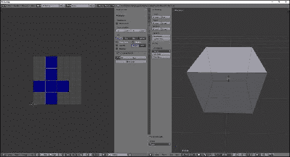

使用自定义接缝对基础立方体进行 UV 展开

使用**标记接缝**工具，我们可以控制哪些线成为接缝，从而完全控制该过程。我们还可以使用此工具将接缝隐藏在玩家看不到的地方。这可以是通常隐藏的区域、锐角或折痕处，以及我们使用的材质发生剧烈变化的区域。

## 展开工具
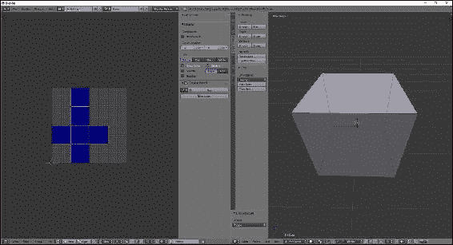

展开会告诉 Blender 将我们的物体压扁，在我们标记的自定义接缝处分割

制作好接缝后，我们需要告诉 Blender 将物体展平。这通过**基于角度的展开**工具，或简称为**展开**工具来完成。**展开**获取我们的接缝，将它们视为纸盒上的切口，然后将物体压扁。结果并不总是完美的。然而，Blender 还有其他几个工具可以修复这些小问题。

## 缝合
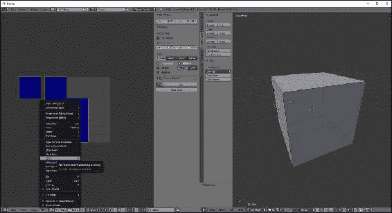

缝合允许我们修复展开工具可能产生的一些错误

# 缝合工具

有时在标记接缝并使用 `Unwrap` 工具时，我们可能希望在 `UV` 贴图中重新连接几个面，例如当我们在物体上放置材质后接缝看起来很明显，我们想要移动它时。`Stitch` 工具位于 `UV Unwrap` 窗口的 `UV` 菜单中。使用它是一个两步过程。将两个具有共享边的 `UV` 岛（`UV` 贴图中连接在一起的面的集合）移动得靠近后，我们可以通过在 `UV` 贴图中点击一条边，观察另一个橙色高亮出现在何处，来检查两个面是否有共享边。如果你点击一条边，另一条也会高亮；这两条边可以被缝合。对齐边缘后，前往 `UV` 菜单选择 `Stitch`，或按 `V` 键。工具激活后，我们有几个选项。`Tab` 键切换我们是处于边缘模式还是顶点模式进行缝合。`S` 键开启或关闭 `Snap` 模式。吸附会将第一个选中的 `UV` 岛吸附到第二个选中的岛上。我们也可以选择在中点缝合岛，通过按 `M` 开启 `Midpoint` 选项。最后，按 `I` 键将交换缝合过程中哪个岛会移动。设置好后，按 `Enter` 将完成缝合。

# 平均岛缩放

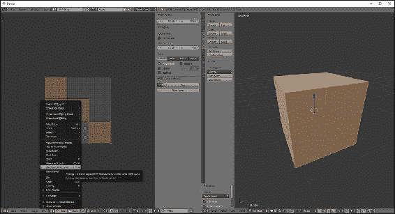

`Average Island Scale` 位于 `UV` 菜单中。

有时在展开复杂物体时，展开过程会创建与地图其余部分比例不协调的 `UV` 岛。`Average Island Scale` 可以恢复 `UV` 岛的均匀缩放，从而最小化纹理区域的拉伸和模糊。只需选择想要平均的 `UV` 岛，在 `UV Unwrap` 窗口底部选择 `UVs` 菜单，然后选择 `Average Island Scaling` 或按 `Ctrl+A`。

# 打包岛

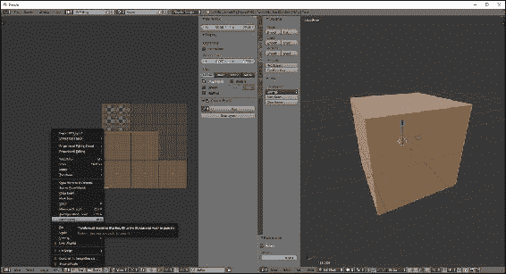

`Pack Islands` 将尝试排列和缩放你的 `UV` 岛以获得最佳结果。

一旦我们排列好所有 `UV` 岛，就可以使用 `Pack Islands` 工具，Blender 会自动排列和缩放它们以最佳适应 `UV` 空间。这是一个完成 `UV` 贴图并充分利用 Blender `UV` 空间的绝佳工具。我们将在流程结束时使用它以尝试获得最佳结果。

# 使用智能 UV 投影

在开始展开神器的每个部件之前，我想再次提到智能 UV 展开器。还记得我们在 第 3 章 *是时候自定义了！* 中使用 `Smart UV Project` 为我们的箱子提供基本 `UV` 贴图吗。这个工具非常适合基本形状，在我们展开更复杂物体的过程中仍有一席之地：

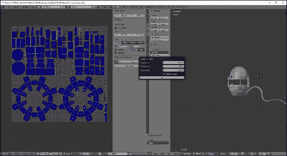

智能 UV 投影在我们扩展的工具箱中仍占有一席之地。

由于我们的神器包含 42 个不同部件，`Smart UV Project` 很可能能为其中一些提供优秀的展开方案。然后，使用 `Pack Islands` 和 `Average Island Scale` 等工具，我们可以将那些用 `Smart UV Project` 展开的物体添加到我们的整体 `UV` 贴图中。

# 自定义标记接缝

让我们看看如何有效使用接缝。请记住，`Unwrap` 工具本质上会将你的物体展平以进行贴图，沿着我们标记为接缝的线进行分割和展平。对于立方体和圆柱体等不同基础形状，有一些最佳实践需要注意。了解这些标准展开方法可以帮助我们在以后遇到更复杂的形状（如触手）时应对。

## 展开立方体

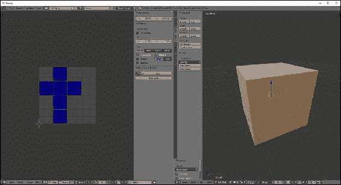

熟能生巧！立方体和其他基础形状是磨练 UV 展开技巧的好方法。

展开立方体时，重要的是尽量减少使用的接缝数量。这就是为什么我们以十字形展开，顶面在中心。让我们试试！

1. 前往 `Scene Layout` 下拉菜单，从列表中选择 `UV Editing`。
2. 选择场景中的默认立方体并进入 `Edit` 模式。从屏幕底部的选择模式中选择 `Line selection` 并找到顶面。这将是我们添加接缝时的参考点。
3. 找到前面。可以通过按小键盘 `1` 或从 `View` 菜单选择 `Front` 来实现。这将是我们展开时的第二个参考点：
   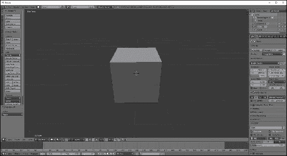
   选择前面的两条边并标记为接缝。
4. 是时候创建第一批接缝了。现在我们知道顶面和前面的位置，让我们在那里添加前两条接缝。选择上图所示的两条边，点击 `Tools` 面板中的 `Shading / UVs` 选项卡，然后点击 `Mark Seams` 按钮。这会将线变红。
5. 现在标记背面的另外两条垂直边。这将创建我们想要的十字布局。
6. 最后，我们要将底面与除前面以外的所有面分离。选择连接底面与侧面和背面的三条边。将它们标记为接缝。
7. 让我们 `Unwrap`！点击面选择模式并按 `A` 选择立方体的所有面。现在按 `U` 键并从菜单中选择 `Unwrap`。你的 `UV` 贴图应该像我们展开的立方体一样。

### 提示

在 `UV Layout` 视图中开启 `Stretch` 选项会将选中物体的 `UV` 岛着色为蓝色，使其更易查看。开启 `Keep UV and Edit mode mesh selections in sync` 也会有帮助。

## 展开圆柱体

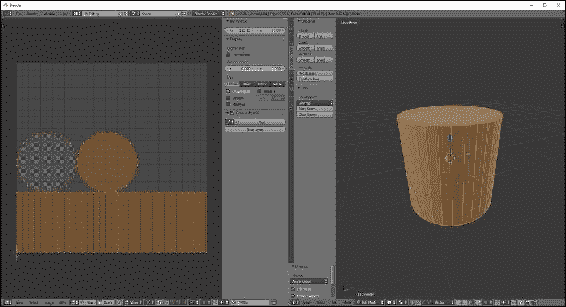

一个展开的圆柱体。神器的 42 个形状中有许多将与此类似。

展开圆柱体甚至比展开立方体更容易。要展开这种基础形状，在顶面和底面周围创建接缝，然后创建一条从上到下的接缝。试试看，结果是否与上图类似。这有点像给汤罐头贴标签。

### 提示

想要更多 UV 展开练习？学习展开 `Add` 菜单 `Mesh` 部分中的所有基础体是个好练习！

一旦我们掌握了基本基础体的展开，就该开始逐个攻克神器了！

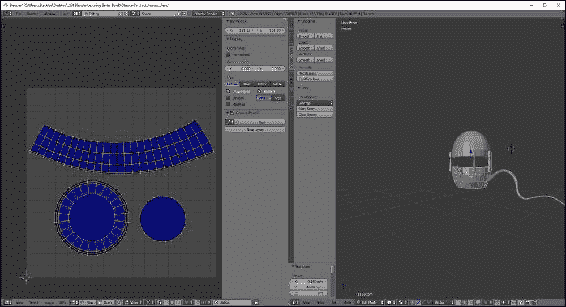

展开底部的结果。

让我们从底部开始：

1. 在 `Object` 模式下，选择神器的底部并按 `Shift+H`。这将通过隐藏未选中的所有内容来隔离我们的选择。接下来，前往 `Scene Layout` 下拉框并选择 `UV Layout`。这将把屏幕分成两个大视口：一个用于操作物体，另一个用于处理 `UV` 贴图：
   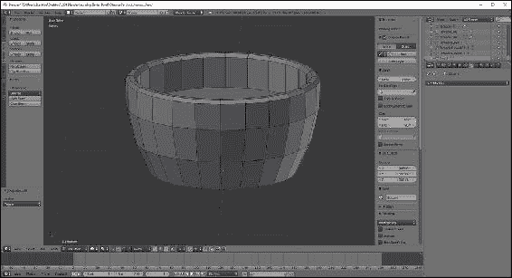
   在神器底部标记接缝。

   ### 提示

   你可以通过在 `Object` 模式下选择模型的一部分并按 `Shift+H` 来隔离它。要再次显示所有内容，请使用 `Alt+H`。

2. 是时候切一些接缝了。展开我们创作的这个部分与展开圆柱体并无二致。让我们先创建接缝以分离内部。通过选择 `Line` 模式，点击边循环的第一条线，按住 `Alt` 键，然后选择环的第二条线来选择顶部边循环。这将为你选择整个循环。现在前往工具面板并选择 `Shading/UVs` 选项卡。现在点击 `Mark Seam`。这会将你选中的边循环高亮为红色，让你知道 Blender 将在你的 `UV` 展开中使用此循环作为接缝。
3. 现在重复该过程以选择底面周围的边并将其也变为接缝。

## 解包神器零件

### 底部零件

4. 最后，通过选择一条垂直线上的边来完成该过程，该垂直线从顶部标记的边环向下延伸到底部边环。将其也标记为缝合线，就像我们展开圆柱体时所做的那样。

5. 该进行 `Unwrap`（展开）操作了！将你的 `Screen Layout`（屏幕布局）设置为 `UV Editing`（UV 编辑）。现在关闭 `Face select`（面选择）模式并按 `A` 选择所有面。最后，按 `U` 并从菜单中选择 `Unwrap`。查看结果，看看它们是否与之前显示的 UV 贴图相似。

底部完成了！不难吧？我们会发现神器的许多零件展开的方式与立方体和圆柱体非常相似。这为每个零件提供了一个简单的起点，省去了摸索如何开始的麻烦：

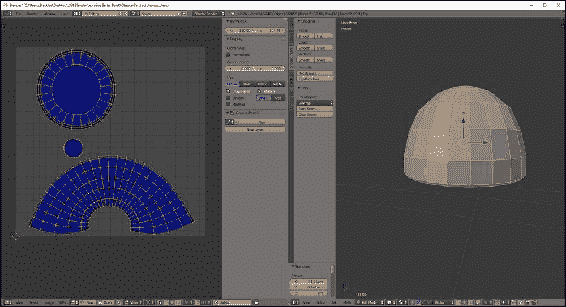

### 顶部零件

顶部展开的结果

顶部应该就像底部零件一样：

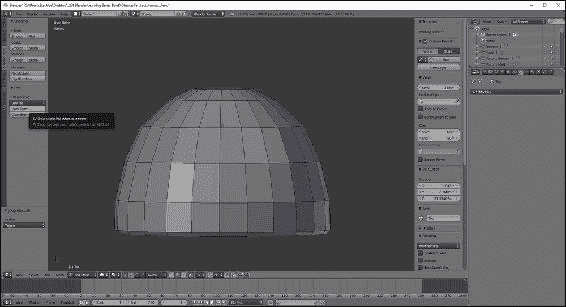

缝合线的标记方式就像底部部分一样，这类似于展开一个圆柱体基元

让我们直接开始吧：

1. 抓取顶部多边形周围的边环，并将其标记为 `Unwrap` 工具的缝合线。

2. 选择顶部和底部零件相接处周围的一个底部边环，并将其也标记为缝合线。

3. 创建一条垂直缝合线来连接另外两条缝合线，类似于我们为底部零件所做的操作。

4. 最后，选择所有面并再次使用 `Unwrap` 工具。结果应该与底部的非常相似。

### 齿轮

现在我们已经展开了顶部和底部零件，让我们换个思路来看看齿轮（switch gears，双关语，意为“换挡/换思路”）：

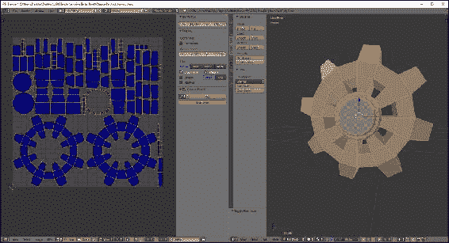

我们将使用 `Smart UV Project` 来展开齿轮部分

对于这个零件，我们将使用 `Smart UV Project`（智能 UV 投影）。

1. 在 `Object`（物体）模式下，选择齿轮并进入 `Edit`（编辑）模式。确保你的选择模式设置为 `Face`（面）选择，然后按 `A` 选择所有面。

2. 按 `U` 打开 `Unwrap` 菜单并选择 `Smart UV Project`。你的结果应该看起来类似于前面的截图。

### 活塞

这只剩下最后两组物体了，活塞和触手。两者的过程将是相似的。我们将删除除一个以外的所有物体并为其制作 UV 贴图。当我们再次复制已映射的部分来替换被删除的零件时，它们将保留我们所有的 UV 映射。这才是聪明的工作方式！

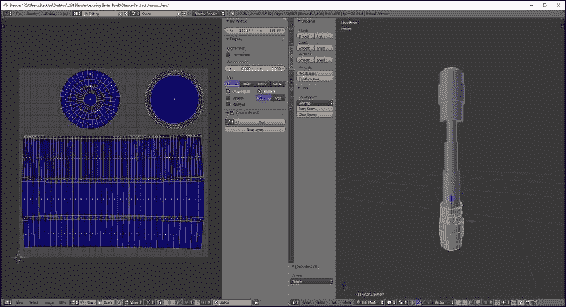

展开活塞的底部部分

现在来看看活塞：

1. 选择你想要展开的那组活塞零件，并删除所有其他的。我们稍后会替换它们：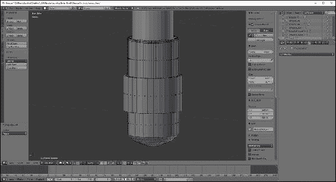

    展开方式就像圆柱体一样！

2. 从活塞的底部零件开始。它的 UV 贴图将类似于圆柱体。从顶部开始，选择侧面和顶部相接处的顶部边环，并将其标记为缝合线。

3. 接下来，选择底部开始向外弯曲离开侧面之前的那个边环，并将其标记为缝合线。

4. 最后，打开 `Unwrap` 菜单并选择 `Unwrap`！

5. 现在，删除活塞的顶部并复制底部，因为顶部只是底部的副本。

6. 这一部分涵盖几个步骤。对于每个较小的中间部分，它们只是简单的圆柱体，并使用我们在本章前面提到的方法进行展开。展开所有三个圆柱体部分：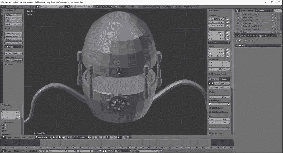

    复制活塞零件，就像我们之前做的那样

7. 所有零件展开后，在 `Object` 模式下选择所有活塞零件并复制它们，以替换我们删除的活塞。恭喜！我们现在已经展开了七个活塞！

### 触手

最后，让我们看看展开触手需要什么：

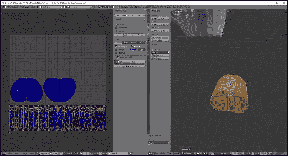

触手的展开。别害怕！

虽然它看起来可能很复杂，但它与圆柱体并没有太大区别。不过，在展开之前我们需要做一些准备工作：

1. 选择一个触手零件并删除其他的。我们将展开一个并复制它：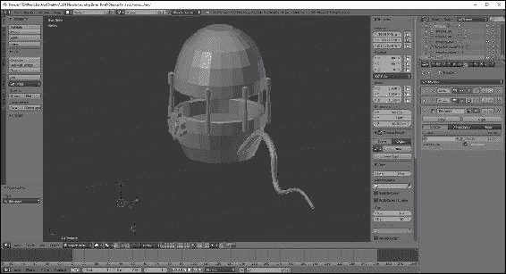

    删除除一个以外的所有触手

2. 我们将使用 `Decimate`（抽稀）修改器来减少触手上的三角形数量。在属性面板中选择 `Modifier`（修改器）菜单（小扳手图标）。点击 `Add Modifier`（添加修改器）下拉菜单并从选项中选择 `Decimate`。在 `Decimate` 修改器本身中，开启 `Triangulate`（三角化）选项。UE4 反正会对其进行三角化，所以为什么不让 `Decimate` 先开始呢。使用 `Decimate` 的目标是找到一个比率，在保持物体整体形状的同时，降低构成物体的三角形数量。现在，点击并拖动 `Ratio`（比率）选项。我们将通过将比率降低到 `.70` 和 `.80` 之间来 `Decimate` 我们的触手。这将移除约 20-30% 的三角形，并使整个触手更易于 UE4 处理。一旦你找到了一个看起来不错的比率，点击 `Apply`（应用）：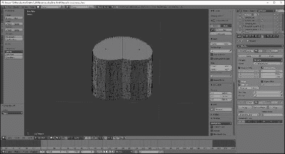

    在触手上标记缝合线。同样，它非常类似于圆柱体。

3. 令人惊讶的是，展开我们的触手不像展开圆柱体那样不同，我们将以大致相同的方式对待它。首先，通过点击 `Modifier` 菜单中每个修改器上的眼睛图标，关闭我们放在触手上的修改器。然后，选择顶部和底部多边形周围的边环并将它们设为缝合线。最后，创建一条垂直缝合线来连接这两条缝合线，按 `U` 调出 `Unwrap` 菜单，并选择 `Unwrap`。

我们的每个零件现在都已展开并准备就绪！回到 第 3 章，*是时候自定义了！* 我们将形状从 Blender 导出为 `.FBX` 文件，然后将其导入 Unreal。这一次，我们将了解制作一流材质所涉及的不同类型的纹理贴图，并使用 Allegorithmic 的 Substance Painter 创造出一些壮观的效果。

# 使用不同的贴图创建更逼真的外观

Unreal Engine 4 中的材质由几种不同的纹理协同工作组成，以提供逼真的结果。通常，游戏资产的材质至少有两到三种不同的纹理贴图，它们通过不同的数学节点进行操作。这些贴图通常是 `Diffuse map`（漫反射贴图/基础色贴图）、`Specular map`（高光贴图）和 `Normal map`（法线贴图）：

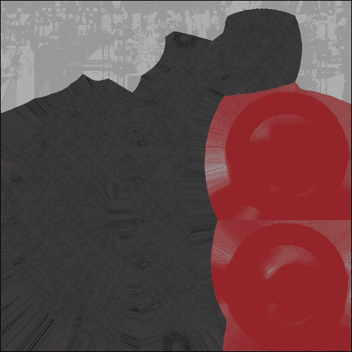

神器的着色由漫反射贴图决定

### 漫反射贴图

漫反射贴图是我们绘制在物体上的基本颜色。Unreal 在 `Material Editor`（材质编辑器）中将这些纹理作为物体的 `Base Color`（基础颜色）接受。这些贴图通常包含直接绘制在物体 UV 副本上的颜色和图案信息，例如在 Photoshop 等程序中。简单来说，这种贴图包含了物体的表面颜色。

### 高光贴图

接下来是高光贴图：

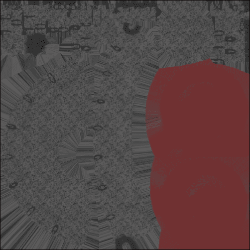

高光贴图控制光线照射到表面时的行为

高光贴图控制表面看起来有多亮或多暗淡，可以手绘或从不同的程序（如 Autodesk Mudbox）导出。这些贴图是让物体的某些部分看起来像被打磨或清洁过的绝佳方式。查看高光贴图时，贴图中较亮的区域是玩家将看到亮面的地方，而较暗的区域将显得暗淡。

### 法线贴图

最后是法线贴图：

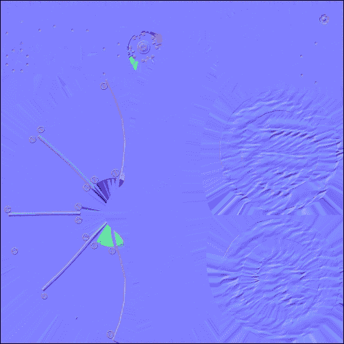

法线贴图可以在不增加三角形数量的情况下伪造一些细节

# 法线贴图与 PBR 贴图工作流

## 理解法线贴图与 PBR

法线贴图存储了游戏资产高模版本的详细信息，随后可用于在同一游戏资产的低模版本上创建细节。这些详细信息存储在三个颜色通道中——红、绿、蓝，每个颜色对应三维空间中的不同轴向。这些信息随后用于模拟深度，能让游戏资产看起来比实际更加细致。

如今，生成这类纹理贴图的方法有很多。漫反射贴图和高光贴图可以使用 Photoshop 和 GIMP 等程序绘制在游戏资产 UV 的副本上。法线贴图通常需要使用单独的程序创建，例如免费的 Xnormal。然而，还有一种贴图技术正迅速流行起来。该过程称为**基于物理的渲染**，旨在利用漫反射贴图、高光贴图、粗糙度值和金属度值来模拟光线的真实行为，这与传统方法形成对比。过去游戏美术需要猜测光线如何与他们的游戏角色和物体交互，而 PBR 允许他们在游戏资产上绘制材质，由计算机模拟光照。结果往往更加准确，且在大多数光照情况下表现良好。PBR 最流行的工具之一是 Allegorithmic 的 Substance Painter。

## 修复触手几何体（重拓扑）

在处理 Substance Painter 之前，我们的模型有一个问题需要修复。当我们在触手上使用 `Decimate` 工具时，可能会产生一些难看的几何体，这对我们的三角形面数没有任何好处：

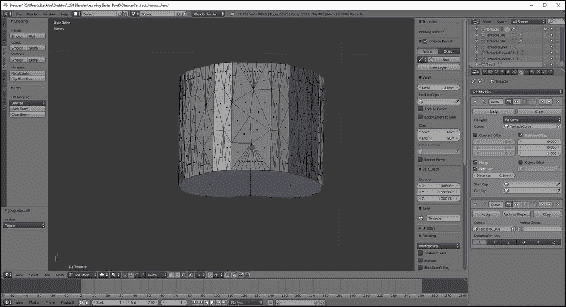

**是时候简化触手的几何体了**

这里有很多我们根本不需要的线条！这个过程称为重拓扑，简称重拓，简单来说就是回到物体上简化几何体，同时保持原始形状。让我们直接开始吧：

1. 选择触手并按 `Shift` + `H` 隔离它，然后再进入 `Edit` 模式。

2. 在 `Properties` 面板的 `Modifier` 菜单中，通过点击各自菜单中的眼睛图标，关闭 `Array` 和 `Curve` 两个修改器：

   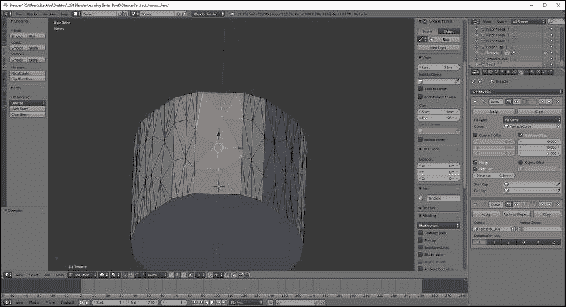

   *选择许多内部线条并溶解它们*

3. 观察几何体，有几条线我们可以移除，同时保持基本形状。选择所有类似于上图所示选择的线条。按 `X` 或 `Delete` 键并选择 `Dissolve` Edges。这将完全移除边及其对应的顶点：

   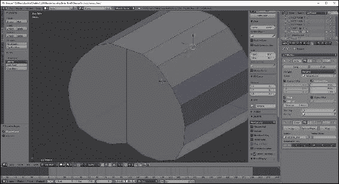

   *好了！清理完毕。*

4. 对触手的每个主要面重复此过程，直到获得清晰简单的几何体！不用担心 UV 贴图，它已随我们的更改自动更新。

5. 最后，回到 `Object` 模式并重新启用修改器；我们还需要它们。我们需要将两个修改器都 `Apply` 到模型上，但顺序很重要。先应用 `Array` 修改器，再应用 `Curve` 修改器。最后，我们可以删除用作形状引导的 `Tentacle Curve`。它不再需要了。

## 为 Substance Painter 准备 UV 贴图

现在清理完毕，让我们看看如何使用 Substance Painter 为 Artifact 创建有趣的材质：

### 提示

Substance Painter 提供 30 天免费试用，可在 `https://www.allegorithmic.com/products/substance-painter` 下载。

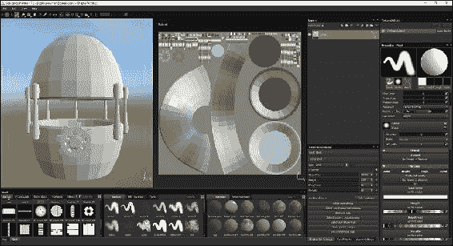

*Substance Painter 中的 Artifact*

Substance Painter 将允许我们直接在 Artifact 上绘制颜色和细节，并根据结果创建所需的所有必要纹理贴图。该过程需要几个步骤：

1. 首先，我们将在 Blender 中调整 UV 贴图以准备导出。
2. 其次，我们将从 Blender 导出 FBX 文件并用它创建 Substance Painter 项目。
3. 第三，我们将在 Artifact 上绘制细节。
4. 第四，我们将添加颜色。
5. 最后，我们将从 Substance Painter 导出纹理贴图以在 Unreal 4 中使用。

这看起来是个漫长的过程，但结果绝对值得花时间。

为了让 Artifact 能在 Substance Painter 中工作，我们需要将所有部件合并并调整 UV 贴图：

1. 将所有对象合并是一个相当直接的过程。在 `Scene Outliner` 中，点击列表顶部的第一个部件，然后按住 `Shift` 键选择列表中的其他部件，确保跳过触手。我们将单独为该部件制作纹理。

2. 选中所有对象后，按 `Ctrl` + `J`。这将把它们合并为一个对象，并将所有 UV 贴图合并为一个。

3. 转到 `Screen Layout` 下拉菜单并选择 `UV Layout` 选项。选择我们新合并的 Artifact 并选择其所有面。我们的贴图将变得杂乱，所有展开的 UV 都开始重叠：

   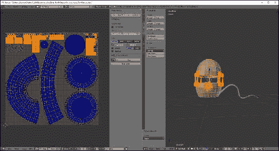

   *将 UV 岛排列成一个大的 UV 贴图*

4. 现在转到 `UV` 菜单并选择 `Average Island Scale`。这应该会调整所有 UV 岛的相对缩放。接下来，从 `UV` 菜单选择 `Pack Islands` 将它们全部打包到一对一的 UV 空间中。我们的结果应该类似于前面的截图：

   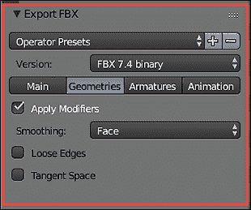

   *将 Smoothing 选项设置为 Face*

好了，一切准备就绪可以导出。选中 Artifact，转到 `File` 菜单导出 FBX。确保在 `Export FBX` 选项中选择 `Selected Objects`。另外，转到该菜单的 `Geometries` 部分，将 `Smoothing` 下拉菜单改为 `Face`。导出！

### 提示

下一节需要 Substance Painter 的 30 天试用版以及他们在 YouTube 上的 Substance Painter 初学者贴图课程的演示文件。演示文件可在 `https://s3.amazonaws.com/alg-releases/public_releases/tutorials/scifi_crate/scifiCrate.zip` 下载。我强烈推荐这门课程，因为它能让你很好地入门 Substance Painter 和基于物理的渲染。

## Substance Painter 工作流

是时候打开 Substance Painter 了！对于有 Photoshop 经验的人来说，界面看起来和感觉都很相似。花几分钟探索一下信息面板。如果你觉得把它们放在别处会更好，可以像在 Unreal 中一样重新排列面板。只需抓住想移动的面板拖到新位置即可。

随着我们深入，我们不会涵盖 Substance Painter 的每个功能。我只会重点介绍完成 Artifact 所需的功能。如果你想了解更多，我强烈建议利用他们在 YouTube 上的免费教程。

我们需要做的第一件事是创建一个项目并导入 FBX 文件：

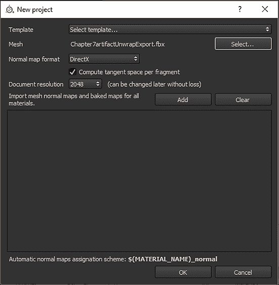

*将 FBX 文件导入 Substance Painter*

1. 转到屏幕左上角选择 `File` 菜单。然后选择 `New`。将项目设置与前面截图中的设置匹配。点击窗口中的 `Select` 按钮将允许我们为项目选择 FBX 文件。

## 为制品添加细节

2. 现在我们已经设置好项目了，继续保存它。就像 Unreal Engine 4 一样，Substance Painter 是一个复杂的程序，会占用大量计算机资源。这可能导致它有时变得不稳定并崩溃。请记得经常保存！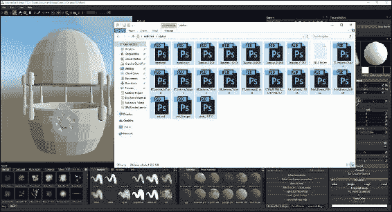

    从 Sci Fi Crate（科幻箱子）教程的 **Alphas** 文件夹导入所有 PSD 文件

3. 让我们将一些额外工具导入程序。找到你保存 Sci Fi Crate 教程资源的位置并解压文件。在 **Alphas** 文件夹中，我们会找到几个新的 Alpha，Substance Painter 可以将它们用作细节笔刷。选择文件夹中的所有 PSD 文件，并将它们拖拽到屏幕底部 **Shelf（货架）** 窗口中的 **Alphas** 选项卡。这会将它们添加到项目中供我们使用：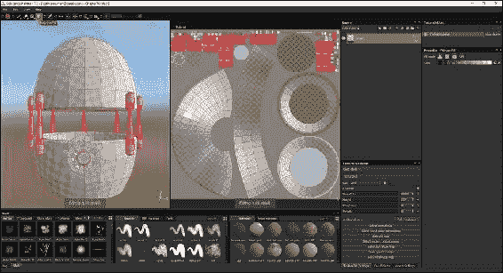

    创建蒙版，以便我们只为制品的特定部分上色

4. 是时候开始添加细节了。Substance Painter 通过改变物体的 **Height（高度）**、**Color（颜色）**、**Roughness（粗糙度）** 和 **Metallic（金属度）** 属性来添加细节和颜色，而无需增加任何新几何体。我们将为制品添加新特征，例如腐蚀、接缝、铆钉等。这些细节将被添加到法线贴图中，以便我们随后在 Unreal 中使用。开始之前，让我们先遮盖住想要处理的区域。按 *T* 切换到 **Quick Mask（快速蒙版）** 模式。现在点击屏幕左上角菜单栏中的 **Polygon Fill（多边形填充）**。这将允许我们通过给多边形上色来遮盖想要处理的区域。在最右侧的 **Properties（属性）** 面板中，将 **Color（颜色）** 滑块全部向左拖动。我们想要将想要保护的区域涂成黑色。剩下的白色区域将会被我们要使用的工具编辑：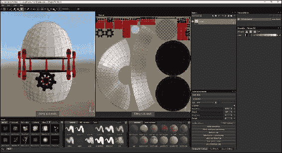

    遮盖除顶部和底部以外的所有部分

5. 在 **Properties（属性）** 面板中选择 **UV** 按钮。这将允许我们填充整个 UV 岛。点击制品顶部和底部区域的外层外壳。接下来，按住 *Ctrl* 并使用*鼠标左键*旋转 3D 视图，以便选择位于顶部和底部的大多边形。如果制品滑出视野，使用 *Ctrl* + *鼠标中键* 移动相机。选中那些多边形后，按 *I* 键反选。现在我们可以在不接触其他部分的情况下为外部添加细节。完成遮盖后，点击菜单栏中的画笔图标返回绘画模式，并按 *T* 停止编辑 **Quick Mask（快速蒙版）** 并开始使用它：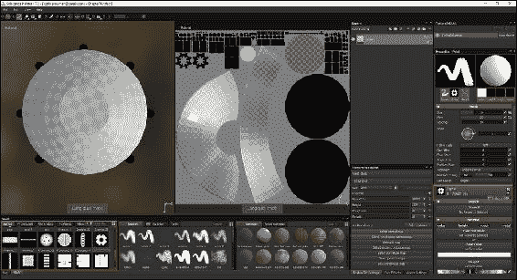

    让我们为最顶部添加一些细节

6. 在 **Alphas（Alpha）** 面板中，选择 **RT\_Industr\_019** alpha 并将其拖拽到 **Properties（属性）** 面板中的 **Alpha** 选项。在 **Properties（属性）** 面板的 **Alphas** 选项下方是 **Material（材质）** 部分。点击 **Color（颜色）**、**Rough（粗糙度）** 和 **Metal（金属度）** 的按钮将它们关闭。我们只想让这些初始细节影响 **Height（高度）** 通道。（如果看不到选项，请点击 **Layers（图层）** 面板中的 **Layer 1** 图层。）旋转相机以便看到制品的顶部多边形。你可以通过按住 *Alt*，然后按住 *Shift*，最后使用*鼠标左键*将视图旋转到顶部，以获得精确的俯视图。视图应该会吸附到俯视图。将光标移至顶部多边形的中心，按住 *Ctrl* + *鼠标右键* 并拖动以调整工具大小以适应该面。在 **Properties（属性）** 面板的 **Material（材质）** 部分找到 **Height（高度）** 滑块。此滑块通过 -1 到 1 之间的值控制细节是凸出于制品表面还是切入内部。-1 会像饼干切割机一样在物体上切出凹槽。1 会在物体顶部添加细节。将滑块完全向右拖动将其值设为 1，将笔刷与顶部对齐，然后点击。如果不满意结果，撤销并重试：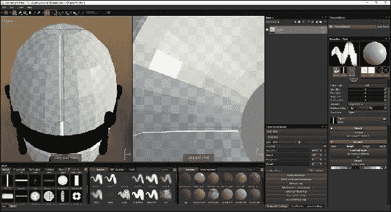

    添加接缝可以让制品看起来更真实。对称工具能让你的工作时间减半。

7. 为了节省时间，我们将开启工具栏中的 **Symmetry（对称）** 选项。开启 **Symmetry（对称）** 并使用右侧的按钮调整 **Mirror（镜像）** 轴。这里我使用的是 **Mirror Z（镜像 Z）**。

8. 回到 **Alphas（Alpha）** 面板，选择 **Bevel（倒角）** alpha 并将其拖入 **Properties（属性）** 面板。此 alpha 创建的接缝类似于两块金属板拼接的地方。接下来，将 **Height（高度）** 滑块拖至负值范围。我将其完全向左拖动至 `-1`。使用 *Ctrl* + *鼠标右键* 将工具大小调整得稍小一些，然后点击一次*鼠标左键*开始绘制接缝。按住 *Shift* 键允许我们从上次点击的位置创建一条直线。按住 *Shift* 并拉伸虚线，直到笔刷遇到我们的顶部细节。现在点击*鼠标左键*将从起点到物体顶部创建一条直线接缝。由于我们使用了 **Symmetry（对称）**，它也会为我们在背面创建一条接缝。

9. 现在将 **Mirror（镜像）** 轴切回 *X*，并在制品侧面创建另一条接缝，类似于我们在正面和背面所做的：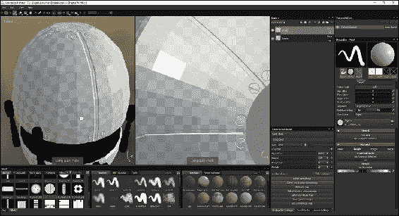

    铆钉让制品看起来像是由金属板制成的

10. 让我们添加一些铆钉！在 **Layers（图层）** 面板中点击 **+** 按钮创建一个新图层，然后双击图层名称将其重命名为 Rivets（铆钉）。我们可能还想将 **Layer 1** 重命名为 **Seams（接缝）**。请记住命名很重要！将我们使用的 alpha 更改为 **RT\_Industr\_010**，调整笔刷大小，开始在新“金属板”角落附近放置铆钉。记得使用 **Mirror X（镜像 X）** 和 **Mirror Z（镜像 Z）** 对称轴选项来简化流程。

11. 根据需要为制品的顶部和底部区域添加任意数量的铆钉和接缝，使其个性化并独一无二。只需记住，每当你想创建一组新的细节时，就使用一个新图层。

12. 现在按 *T* 返回编辑 **Quick Mask（快速蒙版）**，再按 *I* 再次反选蒙版。现在为 **Gear（齿轮）** 和 **Pistons（活塞）** 添加细节，就像我们为制品外壳所做的那样。

13. 最后，让我们在 **Layers（图层）** 面板中点击小文件夹按钮创建一个文件夹。将其命名为 Height Info（高度信息），然后将每个图层拖入其中。这样我们就能保持一切井井有条。

## 应用智能材质

制品看起来怎么样？使用这个神奇的工具，我们已经为原本可能有点枯燥的模型添加了一些很棒的细节。然而，我们仍然需要添加一些颜色，真正让这个游戏资产大放异彩！为了简化流程，我们将利用 Substance Painter 的智能材质——预设材质和设置的集合，它们非常适合节省我们的时间。当我们将这些与蒙版结合时，就能将这些外观出色的材质应用到制品的特定部位。

我们将使用智能材质在短时间内赋予制品一种阴险的外观。让我们开始吧！

1. 点击切换到 **Smart Materials（智能材质）** 选项卡，向下滚动找到 **Steel dark stained（深色染色钢铁）** 材质。点击该材质并将其拖拽到 **Layers（图层）** 面板中。这会将材质应用到整个游戏资产上：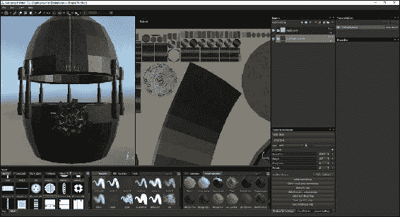

    应用深色染色钢铁材质

## 材质绘制进阶步骤

2.  现在找到 `Silver Armor` 材质并将其拖入 `Layer` 面板。确保它在图层堆栈中位于 `Steel dark stained` 之上。

3.  右键点击 `Silver Armor`，从菜单中选择 `Add White Mask`。

4.  回到工具栏，开启 `Polygon Fill` 工具。就像我们使用 `Quick Mask` 时一样，将 `Properties` 面板中的 `Color` 滑块完全向左滑动，然后点击 `UV` 按钮。现在选择 Artifact 顶部和底部零件的外侧壳体。同时也选择底部多边形。这将允许底层的钢铁图层透过 `Silver Armor` 图层显示出来。结果是齿轮和活塞现在是银色的，而外壳仍保持阴暗的金属色：
    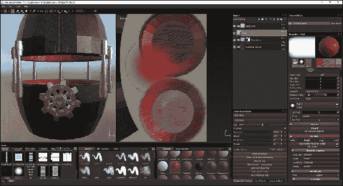

### 使用 Satin 通用材质为 Artifact 内部上色

5.  还剩最后一个部分！我们要给 Artifact 内部添加缎面材质。在图层堆栈中，Smart Materials 上方创建一个新图层并命名为 `Satin`。按 `T` 创建 `Quick Mask`，遮罩掉除 Artifact 内部以外的所有部分。在 `Shelf` 的 `Materials` 选项卡中，向下滚动并选择 `Satin Generic` 材质。接下来，将 alpha 设置为 `Shape`。最后，在视图的 UV 布局侧，点击并拖动画笔绘制 Artifact 内部面。这会将材质直接绘制到 UV 贴图上，其工作方式与在模型上绘画完全相同。

我们的材质制作完成了！是时候将这些很棒的纹理贴图从 Substance Painter 导出，为 Unreal 4 做好准备。

## 烘焙与导出纹理

1.  我们从烘焙 `Normal` 贴图开始。点击 `TextureSet Settings` 面板中的 `Bake Textures` 按钮。关闭除 `Normal` 以外的所有选项。保持所有选项为默认值，点击窗口底部附近的 `Bake Textures`。我们现在应该能在 `Additional Maps` 列表中看到新增的法线贴图：
    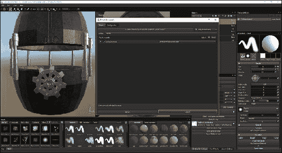

### 打开 Export Textures 菜单

2.  接下来，点击 `File` 菜单并选择 `Export Textures`。点击 `Configurations` 选项卡。这里列出了几个不同的预设，根据我们的游戏资产接下来要去向哪里而定。虽然有 `Unreal Engine 4` 选项，但我们要点击窗口顶部附近的 `+` 来创建自己的预设。双击新预设并将其命名为 `Normal`。

3.  这个预设将仅用于导出法线贴图，不包含我们暂时不需要的其他贴图。在窗口的 `Output Maps` 部分，点击 `RGB` 按钮为法线贴图创建一个 RGB 通道。接下来，将窗口 `Converted Maps` 部分的 `Normal DirectX` 选项拖拽到我们刚创建的新通道中的 `RGB` 选项上。该通道将输出我们的法线贴图。最后，给该通道命名为 `Normal`。

4.  回到 `Export Textures` 菜单，切回 `Export` 选项卡。将 `Config` 下拉菜单改为我们新建的 `Normals` 选项，点击窗口底部的 `Export` 按钮。几秒后，我们应该会收到导出成功完成的消息。点击 `Open Folder` 选项以导航到我们的新法线贴图：
    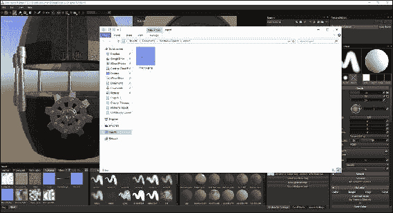

### 使用生成的 Normal map 测试 Artifact 是否保留了高度信息

5.  我们的法线贴图包含了存储在 `Height` 通道中的所有细节信息。在 `Shelf` 中，切换到 `Textures` 选项卡。现在打开包含新法线贴图的文件夹，将贴图拖入 `Textures` 选项卡。最后，点击 `TextureSet Settings` 面板 `Additional Maps` 部分的 `Normal Map`，从选项中选择我们的新法线贴图。我们可以通过前往 `Layers` 面板并关闭 `Height Info` 文件夹来测试。如果所有细节都保留下来了，我们就万事大吉了！

6.  接着，回到 `Bake Textures` 菜单，关闭除 `Ambient Occlusion` 以外的所有选项。这种贴图能增强游戏资产凹槽和缝隙中的阴影，Unreal 4 可以利用它。

7.  最后一次导出。前往 `File` 菜单再次选择 `Export Textures`。从菜单中选择 `Unreal Engine 4 (Packed)`。最后，点击 `Export` 按钮！

我们终于完成了这个东西的贴图制作！现在你已经对 Substance Painter 的工作流程有了很好的感觉，我鼓励你再为触手跑一遍这个流程。Substance Painter 有一些逼真皮肤的有趣选项，可能非常适合为我们资产的这部分带来诡异恐怖的感觉。

# 总结

哇，真是一段精彩的旅程！在本章中，我们探索了不同的 UV 展开技术，并将它们应用到神器的不同部分。然后我们将游戏资产的所有不同部件连接在一起，创建了一个统一的 UV 贴图。有了 UV 贴图，我们将神器导入 Substance Painter，这是一款利用**基于物理的渲染**（PBR）技术创建逼真材质解决方案的贴图绘制程序。在这个复杂的程序中，我们直接在神器部件上绘制新细节，并为它们涂上了一层令人惊叹的漆面，以增强神器的**邪恶外观**。在下一章中，我们将探索为神器制作动画的方法，并在**虚幻引擎 4** 中组装这个邪恶物体的最终版本。

神器已经走过了漫长的道路。最初只是绘图纸上的一个想法，现在已经变成了一个完整的 3D 模型，并带有纹理。然而，我们还没有完成让这个被遗忘的遗物完全复活的工作。如果你还记得这个游戏资产的原始设计，神器必须能在玩家触碰时打开，使他们无意中成为其毁灭目的的帮凶。为此，我们需要动画！Blender 拥有一套完整的动画工具，完全胜任这项工作。使用关键帧，我们将创建一个简单的打开动画，并准备将神器导出到我们的空间站关卡中。在本章中，我们将涵盖以下主题：

*   Blender 如何处理动画？
*   绑定与使用关键帧
*   使用 Blender 的动画工具套件
