# Blender 如何处理动画？

你可能还记得在 第 2 章，*启动我们的第一个项目* 中，我们简要涉及了关键帧，那些我们用来为物体制作动画的时间记录点。Blender 使用的工具与在 UE4 中使用 `Timeline` 和 `Matinee` 非常相似，所以让我们花一点时间建立在这些知识之上。请记住，关键帧代表动画中时间上的重要位置。就我们的门而言，就是打开和关闭的位置。对于电梯，就是上升和下降的位置。

这些关键帧帮助虚幻引擎和 Blender 创建所谓的 `Tweens`（补间动画）——即主要关键点之间所有那些细微的移动。连同关键帧一起，30 个关键帧组成一秒的动画。在兔八哥、飞毛腿鸟和《摩登原始人》的全盛时期，动画工作室有高级动画师，他们创建所有关键帧。然后将这些交给初级动画师手工绘制所有补间帧。这个过程曾经非常漫长且劳动密集。现在我们有计算机为我们计算所有中间帧，这个过程可以非常轻松地完成。

那么关键帧可以记录什么呢？

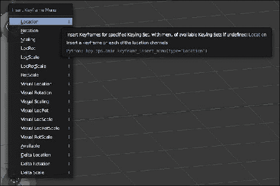

### 插入关键帧菜单

乍一看，`Insert Keyframe Menu`（插入关键帧菜单）给我们提供了几个选项。然而，仔细观察后我们可以发现，所有选项都是同三样东西的变体：`Location`（位置）、`Rotation`（旋转）和 `Scale`（缩放）。`Location` 将是我们使用最多的选项，用于记录各个活塞部件在移动神器盖子时的位置。我们也将使用 `Rotation` 来旋转齿轮，作为锁定机制的一部分。

在动画制作过程中，还有一种技巧能让我们的生活轻松许多。Dummy 对象（虚拟对象），或 Blender 称为的 `Empty`（空物体），是一种简单的对象，导出场景时不计入场景内，但在制作动画时能提供巨大帮助。可以把它们想象成木偶上的线。没人会看见它们，但它们会让控制动画变得容易得多。

让我们看看 `Empty` 菜单：

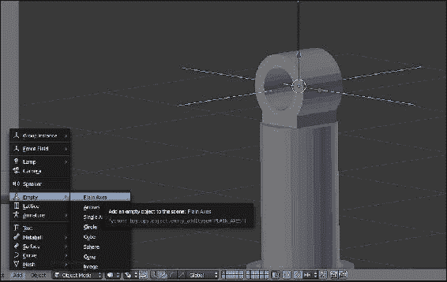

`Empty` 可用于简化动画制作。

`Empty` 对象有多种形状，从上图所示的简单坐标轴，到箭头、球体，甚至圆锥体。我们想要制作动画的场景中的对象可以链接到这些对象上，这样我们只需移动 `Empty`，本质上就是创建了一个控制柄。它们也可用作动画约束的目标。

# 绑定与使用关键帧

现在我们已经清楚需要哪些工具了，让我们来谈谈创建关键帧！

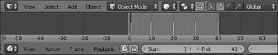

`Timeline`（时间轴）用于添加关键帧，方式类似于 Unreal 4 中的时间轴。

与 Unreal 4 类似，我们创建的关键帧将显示在 `Timeline` 中。该区域位于 `3D viewport`（3D 视口）正下方。关键帧显示为简单的黄线，我们查看的时间范围可通过鼠标滚轮调整。

现在让我们从一个基础立方体开始创建一些关键帧：

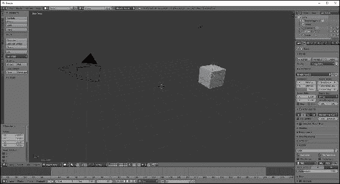

一个滑动盒子的简单动画。

要制作立方体移动的简单动画，我们需要创建两个关键帧：

1.  选中立方体，按 `I` 打开 `Insert Keyframe Menu`，从列表顶部选择 `Location`，创建第一个关键帧。
2.  现在将 `Timeline` 窗口中的时间滑块滑动到第 `30` 帧。可以通过在 `Timeline` 靠近 30 的位置右键点击，然后按住按钮沿 `Timeline` 拖动来完成。图中高亮显示的框表示当前活动帧。
3.  接下来，在 `3D viewport` 中将立方体向任意你喜欢的方向滑动。最后，按 `I` 并从菜单中选择 `Location`，就像我们为第一个关键帧所做的那样。
4.  通过在 `Timeline` 上按住右键并拖动活动帧在 `1` 和 `30` 之间滑动来测试动画。我们应该能看到立方体在我们记录的两个位置之间滑动。

恭喜，我们刚刚为立方体制作了动画！现在让我们看看如何修改或删除可能稍微偏离的关键帧：

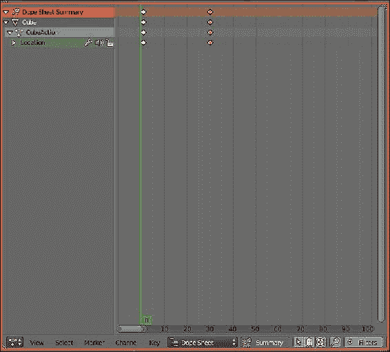

介绍 `Dope Sheet`（动作编辑器/逐帧编辑器）。

有时在创建关键帧时，我们可能会在不想放的地方放下一个，或者可能需要调整动画的时间使其感觉更自然。`Dope Sheet`（上一张截图中高亮显示的区域）允许我们用相对简单的控制来移动、复制和删除关键帧。

要移动关键帧，选择想要移动的关键帧。然后点击并拖动关键帧到新的时间位置。最后，再次点击 `LMB`（左键）以确定新的时间位置。

这里我们可以看到 `Dope Sheet` 的实际操作：

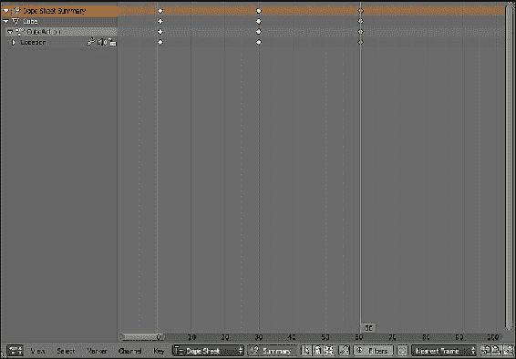

复制关键帧在动画必须以开始的精确位置结束时非常有用。

要复制关键帧，选择想要复制的关键帧并按 `Ctrl + C`。现在右键点击并拖动时间滑块到新的期望时间。最后，按 `Ctrl + V` 粘贴关键帧。这是创建旋转或其他循环动画的绝佳技巧，因为在这些动画中物体必须精确地回到起始位置。

是时候将所学应用到我们的神器上了。

为了给我们的部件制作动画，我们需要将其分解为几个不同的部分。基本上，如果它会动，它就必须是一个独立的部件。现在你可能会问自己，*等等。那我们为什么早前把它做成一个整体？* 为了 UV 展开的目的，我们必须让神器作为一个整体。当我们从整体中分离出部件时，它们仍然是我们制作的 UV 贴图的一部分。当我们把整个东西导入 Unreal 时，我们创建的材质仍会将那些很棒的纹理应用到神器的每一个部件上。

让我们从分离顶部开始：

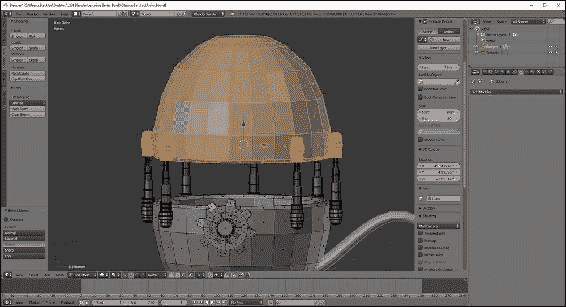

选择顶部和顶部活塞部分。

1.  选择盖子外侧的一个面并按 `L`；这应该会选择组成盖子外侧的所有面。
2.  接下来，按住 `Shift` 键选择盖子内侧的一个面。这会将该面添加到当前选择集中。按 `L` 选择盖子内侧的所有面。
3.  现在选择最顶部的面。

    现在我们将活塞添加到选择中：

    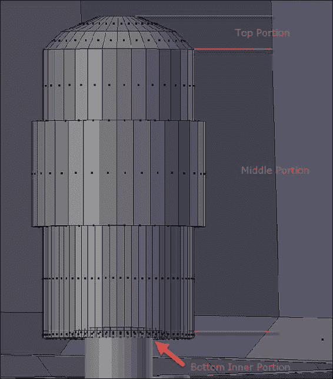

    活塞的分解图。这将用于将正确的部件绑定到正确的骨骼。

4.  最后，按住 `Shift`，选择一个活塞顶部区域的多边形并按 `L`。每个活塞顶部由三个不同部分组成：顶部、中部和底部内侧部分。确保在每个部分中 `Shift` 选择一个面并按 `L` 以选择该部分的所有面。
5.  按 `P` 打开 `Separation`（分离）菜单并选择 `Selection`（选中部分）。这将把我们选中的面分离为一个新部件。记得在 `Scene Outliner`（场景大纲视图）中将其重命名为容易记住的名字，比如 `Top`。

现在我们分离了顶部。对底部和齿轮重复该过程。如果你选择一个面，按 `L`，没反应，就选旁边的面再试一次。另外，按 `Z` 会开启线框模式。这将允许你穿过物体选择面。务必通过点击面中心的小黑点来选择那些面。

是时候解决那些中间活塞部件了！我们的攻略计划是将它们分离成三层，因为我们将在动画中一起移动它们。底部那组部件是一层，中间那组是另一层，依此类推：

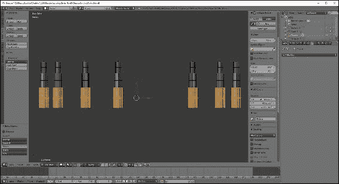

为了动画制作，有必要将活塞分解为多个部件。

### 提示

记住你可以在 `Object`（物体）模式下使用 `Shift + H` 来隐藏未选中的所有东西！

具体操作如下：

1.  选择你的活塞部件并使用 `Shift + H` 隐藏神器的其余部分。
2.  进入 `Edit`（编辑）模式，像上一张截图那样选择每组活塞的底部部分。
3.  按 `P` 并从菜单中选择 `Selection`。在 `Scene Outliner` 中将该层重命名为 `Pistons.Bottom`。
4.  通过点击 `Scene Outliner` 中其名称旁边的眼睛图标来隐藏它们。这将使后续过程容易得多。
5.  对中间层重复此过程。这将为你留下分离好的顶层。

如果一切顺利，你的 `Scene Outliner` 应该看起来像这样：

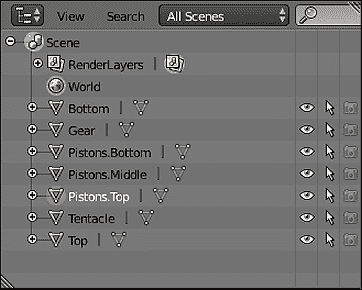

我们将用于动画的神器的所有不同部分。

# 绑定神器

在所有部件分离完毕后，在开始制作动画前还有一步需要完成。因为我们要创建一个包含动画的静态网格体，神器将作为 `skeletal mesh`（骨骼网格体）导入 Unreal。骨骼网格体由两部分组成：静态网格体对象本身，以及一套用于操控网格体的骨骼系统。这意味着神器需要骨骼！

为了给神器制作动画，每个会移动的部件都需要一根骨骼。这些骨骼将连接到一根单独的骨骼上，Unreal 会将其识别为根骨骼。然后我们将对骨骼进行动画制作，而不是直接操作网格体本身。

## 添加骨骼

### 第一根骨骼

我们将从单根骨骼开始：

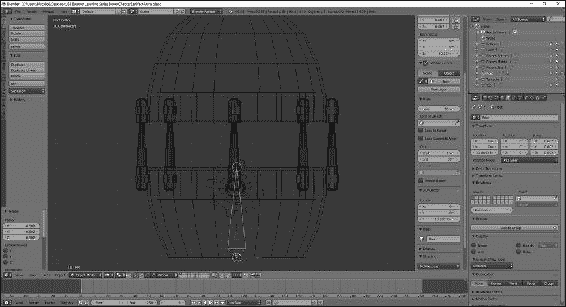

添加第一根骨骼

具体操作步骤如下：

1.  首先，我们需要将 3D 游标移动到底部区域的中心。选中神器的底部并按下 `Shift` + `S` 打开 `Snap`（吸附）菜单。选择 `Cursor to Selected`（游标到选中项）以将 3D 游标移至正确位置。

2.  现在前往 `Add`（添加）菜单，选择 `Armature`（骨架），并添加一个 `Single Bone`（单根骨骼）。Blender 会将其直接添加在部件的底部中心。缩放骨骼，使其仅与神器的底部区域对齐，类似于你在上一个截图中看到的效果。按下 `Z` 键切换到线框模式查看可能会有所帮助。

3.  选中新骨骼并进入 `Edit`（编辑）模式：

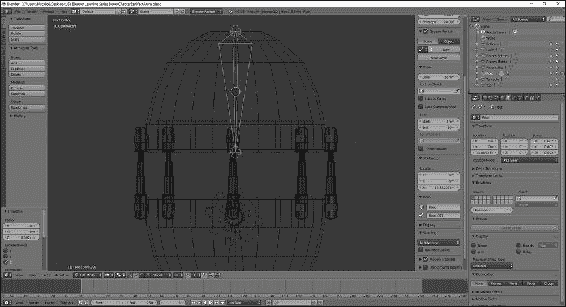

添加控制顶部的骨骼

### 额外的骨骼

4.  现在我们处于 `Edit` 模式，就 Unreal 而言，我们为神器的 `Armature` 添加的任何骨骼都将连接到第一根骨骼。这一点很重要，因为 Unreal 每个骨骼网格体只允许有一个骨架。点击 `Add` 菜单并选择 `Single Bone`。这会向场景中添加一根新骨骼。使用移动箭头，沿 `Z` 轴向上拖动新骨骼，使其具有一定高度。

5.  点击新骨骼的中心将其高亮，并将其移动到神器顶部区域内的合适位置。这根骨骼将控制盖子在开启时的上下移动。尝试将其对齐，使其看起来与图片中的类似。由于我们已将 3D 游标移至神器中心，所有骨骼都应完美居中。这在制作动画时将非常重要：

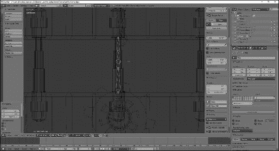

这三根骨骼将控制活塞

6.  该添加三根骨骼来控制活塞部件了。就像创建上一根骨骼一样，为活塞的每一层创建一根控制骨骼。记得将它们调整到与所控制部件相似的大小，并按截图所示对齐：

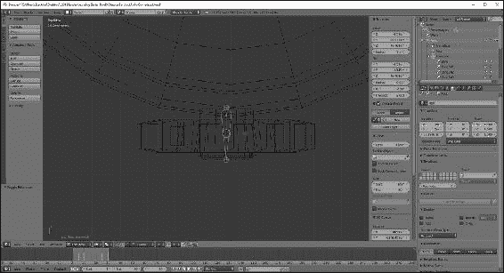

添加控制齿轮的骨骼

7.  最后一根骨骼！创建一根小骨骼来控制齿轮。创建完成后，将其移至合适位置，然后旋转 90 度使其平躺。这根骨骼将通过旋转来产生齿轮转动的效果。

## 将骨骼绑定到网格体

创建完所有骨骼后，我们现在必须将它们与神器的各个部分连接起来，以便移动骨骼时能带动其绑定的部件。在 Blender 中，这个过程称为 `Parenting`（父子绑定/设为父级）。我们还将接触一个专用于骨架的新模式：`Pose Mode`（姿态模式）！

## 姿态模式

要进入 `Pose Mode`，选中你的 Armature 并前往模式下拉菜单：

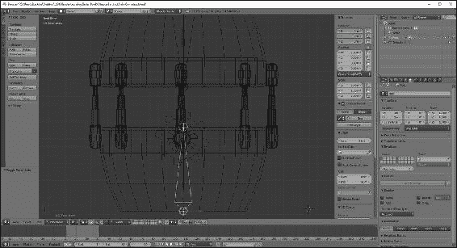

选中一根骨骼并从模式下拉菜单中选择 Pose Mode 以进入姿态模式

在那里，选择 `Pose Mode`。在此模式下，我们可以将 3D 模型的各部分绑定到新骨骼上，然后为它们设置关键帧，以创建神器开启的动画：

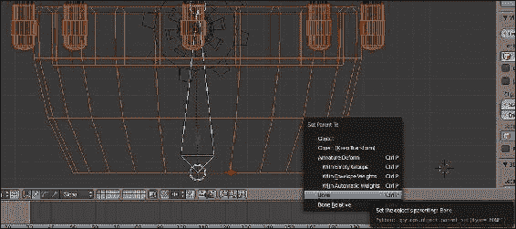

按下 `Ctrl` + `P` 打开“设置父级”菜单，然后选择 Bone（骨骼）。这会将底部区域绑定到其对应的骨骼

Blender 使 `Parenting` 过程变得快速简便：

1.  选择我们想要绑定的部件。我们从底部区域开始。

2.  按住 `Shift` 键，选择你想要绑定到神器底部的骨骼。在本例中，这是我们创建的第一根骨骼。

3.  按下 `Ctrl` + `P`；这将打开 `Set Parenting To`（设置父级为）菜单。选择 `Bone` 选项。

4.  最后，通过选择骨骼并向任意方向滑动它，测试该骨骼是否已连接到底部部件。神器的底部应随之滑动。按下 `Ctrl` + `Z` 将其恢复到原始位置。

对每根骨骼重复此过程，将它们绑定到各自对应的部件。完成 `Parenting` 过程后，我们就可以开始制作动画了！

# 为神器制作动画

是时候让神器“活”过来了！优秀的动画能为任何物体注入角色魅力与生命力。许多初学者动画师从迪士尼动画师 `Ollie Johnston` 和 `Frank Thomas` 最初撰写的 `12 Basic Principles of Animation`（动画十二大基本原则）入手，我强烈建议你去了解一下。我们将为神器制作基础的机械动画。活塞将移动，齿轮将旋转。不过，我鼓励你阅读基础知识，并在后续实践中应用所学。

就像我们之前用立方体练习时那样，我们将创建一些关键帧，但这次我们将移动创建的骨骼，而不是神器的部件本身。结果将是一个游戏资产，我们可以在 Unreal 中触发其开启：

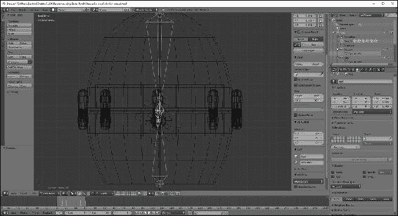

通过场景大纲视图中的 Armature 组操控骨骼

## 设置关键帧

使用 `Pose` 模式，让我们将神器移至关闭位置：

1.  为了方便操作，在 `Scene Outliner`（场景大纲视图）中选中你的 Armature，然后点击小 `+` 图标。这将列出所有绑定到你 Armature 的当前特性。查看 `Pose` 选项。对于我们创建的每根骨骼，都有一个小骨骼图标，我们可以点击它来选中或取消选中特定骨骼。随着工作的推进，这将非常方便。

2.  使用 `Scene Outliner`，依次选择每根骨骼并将它们向下移动，直到神器闭合。最好在 `Front`（前视图）视角下进行。

3.  一切闭合后，是时候记录我们的第一个关键帧了。选中所有骨骼，按下 `I` 打开 `Insert Keyframe Menu`（插入关键帧菜单），然后选择 `Location`（位置）选项。这将在第 1 帧记录神器每个部件的初始位置。在 Unreal 中，这将用作我们的参考姿势或起始姿势：

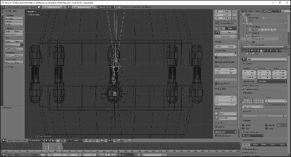

为活塞伸展制作动画

## 为活塞制作动画

4.  现在将屏幕底部 `Timeline`（时间轴）上的时间滑块移动到第 `10` 帧。接下来，取消选中控制底部区域的骨骼。移动其他骨骼向上，直到活塞的底部区域完全伸展。按下 `I` 记录骨骼的新位置：

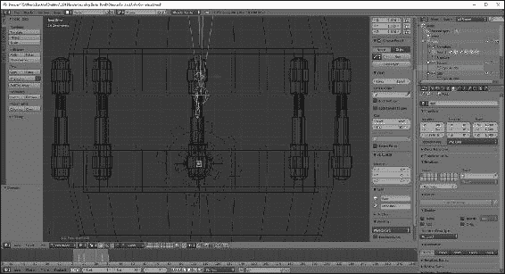

伸展活塞的每一节并创建关键帧

5.  将时间滑块移动到第 `20` 帧，取消选中控制活塞底层的骨骼。移动剩余骨骼向上，直到活塞的中间层完全伸展。按下 `I` 记录骨骼的新位置：

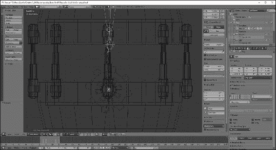

活塞完全伸展

6.  最后一次移动！将时间滑块移动到第 `30` 帧，取消选中控制活塞中间层的骨骼。移动剩余骨骼向上，直到活塞的顶层完全伸展。按下 `I` 记录骨骼的新位置。

7.  在我们的关键帧之间来回拖动时间滑块，观看神器的开启与闭合。一边看一边发出些怪兽般的咆哮声吧。

8. 活塞开始工作后，让我们给齿轮添加一些旋转。将时间滑块拖至第 `5` 帧，按 `R` 键旋转控制它的骨骼 `45` 度，输入 `45`，然后按 `Enter` 键。按 `I` 键并从菜单中选择 `Rotation` 选项。将时间滑块拖至第 `10` 帧并重复操作。重复此过程，直到为齿轮骨骼记录了新的旋转关键帧，间隔为五帧。

9. 在整个动画范围内来回拖动时间滑块，测试效果如何。

# 总结

我们刚刚让神器“活”了过来！在游戏术语中，神器打开需要 1 秒钟。如果你希望该过程耗时更长或更短，请随意在 Dope Sheet（动作编辑器）中调整关键帧。如果我们想营造紧张和恐惧的氛围，更长的时间可能更合适。如果我们想让玩家感到惊讶，或给他们留下很少的反应时间，更短的时间可能效果更好。凭直觉调整关键帧，以满足游戏需求。同样可以使用此过程为触手制作动画，赋予我们的资产更多“邪恶”的生命力！

在本章中，我们探讨了使用 Blender 内置工具制作动画的过程。我们学习了如何使用关键帧，以及如何使用 Dope Sheet 调整这些关键帧。最后，我们为神器创建了一个骨骼装备，并利用它制作了玩家在 Unreal 中遇到神器时的打开动画。在下一章中，我们将把所有内容导入 Unreal 并组装到一起。然后我们将让玩家炸毁神器，以此完美收官！

旅程走到了尽头。我们一起开始了创建一个相当不错的游戏创意的过程。我们从一个基础关卡开始，归根结底，它只是两个由走廊连接的房间，里面放着一个简单的箱子。从卑微的起点出发，我们的游戏不断成长，我们的技能也随之提升。我们简单的货轮将玩家引向一个更大的空间站关卡。该关卡包含推动故事发展的脚本事件，以及一个外观出色且会动的游戏资产。然而，我们还没有结束。我们如何终结这段旅程？把东西炸飞，就是这样！

## 章节主题

*   使用类蓝图将所有内容整合在一起
*   使用音效创建爆炸
*   添加粒子特效
