# 创建类蓝图以整合所有内容

我们从任何类型的数字破坏的第一步开始：创建。在过去的几章中，我们创造了一个令人不安的古老科技产品。神器作为另一个时代早已被遗忘的恐怖武器屹立不倒，不知为何被一种未知力量带了出来。但我们知道真相。那种未知力量就是我们，我们即将导入所有必要资源，在空间站甲板上实现神器。玩家们小心了！

看看最终效果：

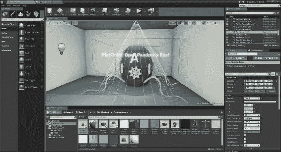

开始之前，我们需要导入神器主体、触手以及来自 `Substance Painter` 的所有贴图。让我们先导出神器的主体。

1. 在 Blender 中，打开包含完整神器的文件。FBX 文件格式允许我们在一个文件中同时导出完成的 3D 模型和我们创建的动画。
2. 仅选择神器。由于它现在绑定到了我们创建的骨架上，骨骼和几何体应该已经成为一个整体。
3. 现在按 `Alt` + `S` 重置游戏资产的缩放。这样做可以确保我们将神器导入 Unreal 时不会出现任何奇怪的缩放问题。
4. 转到 `File`（文件）菜单并选择 `Export`（导出）。选择 `FBX` 作为文件格式。
5. 在导出菜单的第一个选项卡上，勾选 `Selected Objects`（选中物体）复选框。这将确保我们只导出神器，而不是触手。
6. 在 `Geometries`（几何体）选项卡上，将 `Smoothing`（平滑）选项更改为 `Faces`（面）。
7. 为文件命名并点击 `Export`（导出）！

好了，我们现在有了神器的最新版本，已导出为 FBX。既然在本书的学习过程中我们已经导出过几次东西了，你觉得你已经掌握这个流程了吗？试着对触手重复一遍这个过程。

### 提示

完成本书所有练习后，不要只把它放在书架上。书中描述了各种不同的流程，它是一本极佳的参考书！

该启动 Unreal 了。打开游戏引擎并加载我们的空间站关卡。距离我们上次查看它已经有一段时间了，我毫不怀疑你可能已经想到了想要添加的改进和新板块。别忘了它们！暂时先放一边。一旦我们把游戏资产放进去并让它们爆炸，你将有大把时间添加内容。

开始导入到 Unreal！

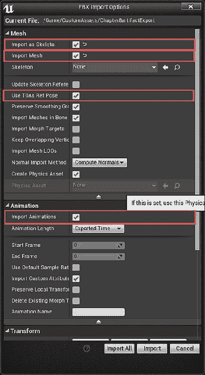

导入骨骼网格体与静态网格体略有不同。

1. 在开始导入资源之前，让我们创建一个文件夹来存放自定义资产。在 `Content Browser`（内容浏览器）中点击 `Content`（内容）文件夹，然后右键点击它。在出现的菜单顶部，选择 `New Folder`（新建文件夹）并将其命名为 `CustomAssets`。非常重要的一点：不要使用空格或特殊字符（下划线除外）。
2. 选中我们新建的文件夹并点击 `Import`（导入）。选择 `Artifact FBX` 文件。
3. 在 `Import`（导入）菜单顶部，确保选中了 `Import as Skeletal`（作为骨骼导入）和 `Import Mesh`（导入网格体）。现在点击该区域底部的小箭头以打开高级选项。最后，勾选复选框，告诉 Unreal 使用 `To As Reference Pose`（作为参考姿势）。`Reference Pose`（参考姿势）是与骨骼网格体关联的任何动画的起点。
4. 接下来，查看菜单的 `Animation`（动画）部分。开启 `Import Animations`（导入动画），告诉 Unreal 导入我们为神器制作的打开动画。
5. 完成所有这些后，点击 `Import`（导入）！

Unreal 将为神器创建一个 `Skeletal Mesh`（骨骼网格体）、一个 `Animation`（动画）、一个 `Physics Asset`（物理资产）和一个 `Skeleton`（骨架）资产。这些部分共同构成了一个功能完整的骨骼网格体，可在我们的游戏中使用。

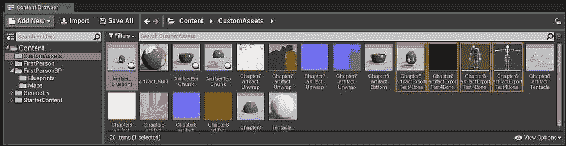

花点时间对触手重复该过程，同样要小心，确保从 Blender 中仅导出选中的物体。接下来，我们需要导入所有来自 Substance Painter 的贴图：

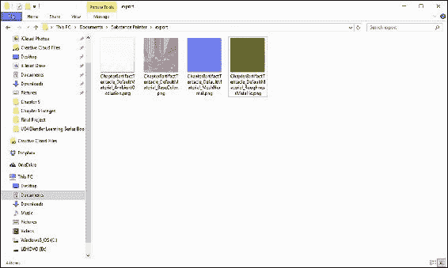

Substance Painter 将导出的贴图存储在 `Documents\\Substance Painter\\export` 中。

在 第 6 章 *怪物资产——关卡完全需要一个* 的最后部分，我们为神器导出了几张贴图，它们应该仍在 `Export` 文件夹中：

1. 找到 `Substance Painter` 的 `Export` 文件夹。默认情况下，它位于 `Documents` 文件夹下，然后是 `Substance Painter`，最后是 `Export`。
2. 返回 Unreal，然后从电脑任务栏打开 `Export` 文件夹。点击并拖动我们需要的每一张贴图到 `Content Browser` 中。Unreal 会自动导入它们。
3. 是时候将它们全部设置为可用的材质了！在 `Content Browser` 中右键点击，从菜单的 `Create Basic Asset`（创建基础资产）部分选择 `Material`（材质）。将材质命名为 `Artifact_MAT`。这将打开一个 `Material Editor`（材质编辑器）窗口：

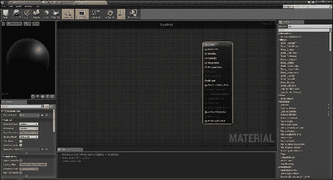

# 在虚幻引擎中使用材质和类蓝图

## 材质编辑器

`Material Editor`（材质编辑器）的工作方式类似于在 `Blueprint`（蓝图）中编程，并使用相似的节点结构。中心的大节点代表最终结果。

### 提示

为电子游戏创建材质和着色器本身就是一种艺术形式。这里我将从基础角度谈论创建材质，但我建议你查阅虚幻文档，打开 `Starter Content`（初学者内容）文件夹中的一些现有材质，并开始探索这个功能高度多样化的工具。

## 向材质添加纹理

4. 因此我们需要将纹理添加到新材质中。向任何材质添加纹理贴图的一个简单方法是，从 `Content Browser`（内容浏览器）中点击并拖拽它们进入 `Material Editor`（材质编辑器）。这将创建一个名为 `Texture Sample`（纹理采样）的节点，该节点可以插入主材质节点上的不同插槽。

5. 现在将每个贴图插入。从每个 `Texture Sample`（纹理采样）右侧的白色连接点拖出一根连线，连接到主材质节点上相应的插槽。`Metallic`（金属度）和 `Roughness`（粗糙度）纹理采样将插入主节点上的两个插槽。

6. 让我们预览结果。回到 `Content Browser`（内容浏览器），选择 `Artifact`（神器）。然后，在 `Material Editor`（材质编辑器）的 `Preview Window`（预览窗口）中，选择最右侧的小按钮，即 **Set the Preview Mesh based on the current Content Browser selection**（根据当前内容浏览器选择设置预览网格体）。

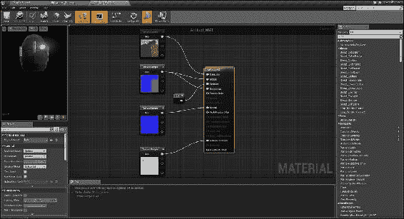

我们导入的四张贴图中的每一张都在主材质节点上有一个对应的插槽。

7. 材质出来有点太亮了。材质发出的大量高光称为镜面高光，由主材质节点上的 `Specular`（镜面反射）连接控制。如果我们查阅文档，可以看到该节点部分接受 `0` 到 `1` 之间的值。我们该如何做呢？`Material Editor`（材质编辑器）有一个 `Constant`（常量）节点，允许我们输入一个数字，然后将其插入到我们可能需要的任何地方。这非常完美！在 `Material Editor`（材质编辑器）右侧的 `Palette`（调色板）搜索框中搜索 `Constant`（常量）。将其拖入到其他节点所在的区域，然后前往 `Details`（详情）面板。在 `Value`（值）字段中，尝试 `0` 到 `1` 之间的不同值并预览结果。我最终使用了 `0.1`。保存你的更改。

是时候在我们的神器上试一试了！

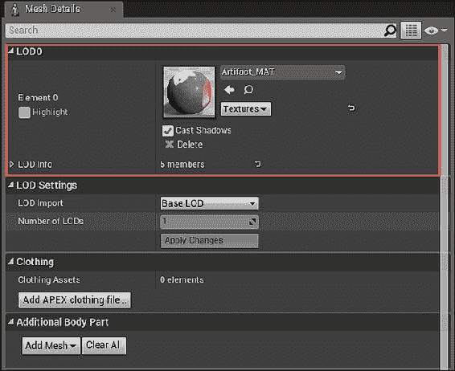

在 `Skeletal Mesh`（骨骼网格体）编辑器中，在 `Mesh Details`（网格体详情）面板将我们的新材质分配给神器。

8. 双击 `Skeletal Mesh`（骨骼网格体）以打开 `Skeletal Mesh`（骨骼网格体）编辑器窗口。在左侧，寻找菜单的 `LOD0` 部分。此部分有一个添加材质的选项（我在前面的图片中已将其高亮显示）。回到内容浏览器并选择我们的 `Artifact_MAT` 材质。现在选择 `LOD0` 框中的小箭头，将选择应用到神器上。

效果如何？太亮了？还是不够亮？请随意调整材质节点中的 `Constant`（常量）节点，直到你获得想要的结果。当你满意后，对触手重复该过程。我们将把它作为静态网格体导入（因为它没有任何动画），并使用我们在 `Substance Painter` 中创建的纹理贴图为它创建一个材质。

## 使用类蓝图进行最终组装

现在我们将使用 `Class Blueprint`（类蓝图）进行最终组装。

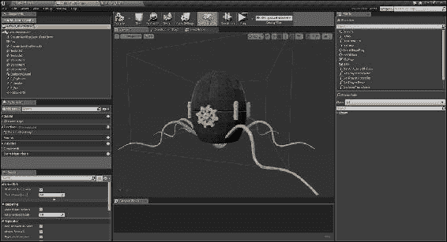

### 神器类蓝图

类蓝图是一种独立的蓝图形式，它允许我们将美术资源与编程结合在一个易于使用且最重要的是可复用的包中。例如，玩家角色就是一个类蓝图，因为它将玩家角色的 `Skeletal Mesh`（骨骼网格体）与蓝图代码结合在一起，帮助玩家四处移动：

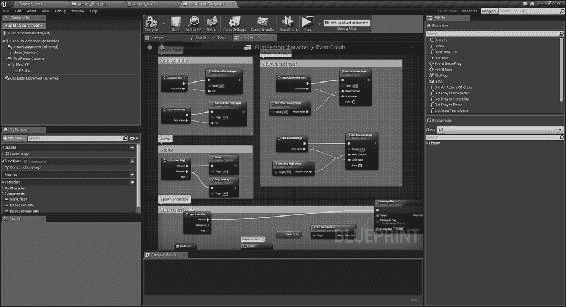

第一人称角色是类蓝图的一个绝佳例子。

那么我们如何以及何时使用类蓝图，而不是直接将代码放在关卡蓝图中？关卡蓝图非常适合特定于该关卡的任何内容。这类内容包括以熔岩为基础的关卡中的火山，或太空站关卡背景中的飞船。类蓝图非常适合构建独立且可重复的对象，例如门、敌人或道具。这些类型的物品会被频繁使用，并在游戏的多个关卡中都有其位置。

## 为神器创建类蓝图

让我们为神器创建一个类蓝图：

1. 点击 `Blueprints`（蓝图）按钮并选择 `New Empty Blueprints`（新建空蓝图）选项卡。这将打开 `Pick Parent Class`（选择父类）菜单。既然我们要创建一个道具，而不是玩家需要直接控制的东西，请选择 `Actor Parent Class`（Actor 父类）。

2. 下一个屏幕会要求我们为新类命名并选择保存位置。我选择将其保存在我的 `CustomAssets`（自定义资产）文件夹中，并将其命名为 `Artifact_Blueprint`。

3. 欢迎来到 `Class Blueprint`（类蓝图）编辑器：

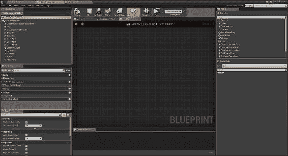

类蓝图编辑器拥有虚幻引擎内其他编辑器通用的几个面板。

4. 与虚幻引擎内的其他编辑器窗口类似，`Class Blueprint`（类蓝图）编辑器既有 `Details`（详情）面板，也有 `Palette`（调色板）。但是，有一个面板是我们新接触的。`Components`（组件）面板包含构成类蓝图的美术类型列表。这些组件是构成整个对象的各个部分。对于我们的神器，这将包括主体本身、任意数量的触手和一个碰撞箱。可以添加的其他组件包括粒子发射器、音频，甚至灯光。

5. 让我们添加 `Artifact`（神器）。在 `Components`（组件）部分，点击 `Add Component`（添加组件）按钮，并从下拉列表中选择 `Skeletal Mesh`（骨骼网格体）。你可以在 `Common`（常用）部分找到它。这会向视口和 `Components`（组件）列表添加一个空白的 `Skeletal Mesh`（骨骼网格体）。选中它，查看 `Details`（详情）面板。在 `Mesh`（网格体）部分有一个区域用于分配你希望它成为的骨骼网格体。回到 `Content Browser`（内容浏览器），选择 `Artifact`（神器）。最后，回到 `Blueprint Editor`（蓝图编辑器）的 `Details`（详情）面板，点击 `Skeletal Mesh`（骨骼网格体）选项旁边的小箭头以分配 `Artifact`（神器）。它现在应该出现在视口中。

6. 回到 `Components`（组件）列表。让我们添加一个 `Box Collision`（盒子碰撞）。点击 `Add Component`（添加组件），并从菜单的 `Collision`（碰撞）部分选择 `Box Collision`（盒子碰撞）：

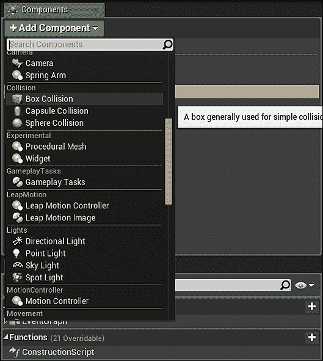

选择添加组件按钮并从下拉菜单中选择盒子碰撞。

7. 点击它，并在 `Details`（详情）面板中增加 `Box Extents`（盒子范围）到允许玩家进入其范围内的大小。我对 *x*、*y* 和 *z* 都使用了 `180`。

8. 重复最后几个步骤，使用 `Add Component`（添加组件）菜单将触手添加到神器上。我们将使用 `Static Mesh`（静态网格体）选项。设计需要三个，但如果你喜欢可以添加更多。

9. 是时候给这个类蓝图添加一点编程逻辑了。我们希望玩家能走到神器前，按下 `E` 键将其打开。

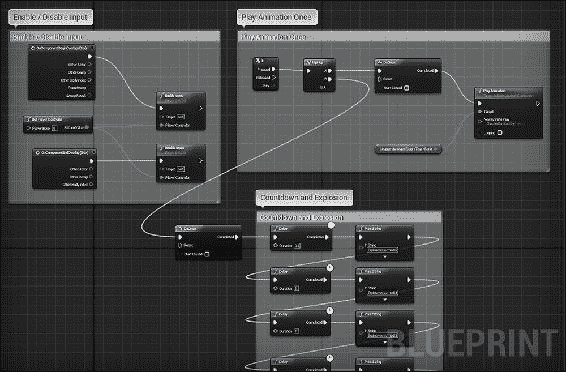

### 编程神器

# 制品交互与爆炸设置

## 步骤 10–13：制品开启机制

### 步骤 10：使用盒体碰撞启用/禁用输入

当我们在第 2 章《开始我们的第一个项目》中为电梯创建类似类型的控制时，我们使用了 `Gate` 节点来控制蓝图中信息的流向。然而，`Gate` 节点在类蓝图中的工作方式并不相同，因此我们需要一种略微不同的方法。该过程的第一步是使用 `Enable Input`（启用输入）和 `Disable Input`（禁用输入）节点，以允许玩家在进入我们的盒体碰撞体积时使用输入键。使用位于 `Palette`（调色板）面板中的搜索框，获取一个 `Enable Input` 和一个 `Disable Input`。现在我们需要添加触发事件。点击 `My Blueprint`（我的蓝图）面板中 `Variable`（变量）部分下的 `Box`（盒体）变量。这会更改 `Details`（详情）面板，以显示可为此组件创建的所有 `Events`（事件）列表。点击 `OnComponentBeginOverlap`（组件开始重叠）和 `OnComponentEndOverlap`（组件结束重叠）事件旁边的 `+` 按钮。将 `OnComponentBeginOverlap` 事件连接到 `Enable Input` 节点，将 `OnComponentEndOverlap` 事件连接到 `Disable Input` 节点。

### 步骤 11：创建 E 键事件

接下来，通过搜索并从 `Palette`（调色板）拖入，创建一个玩家按下 `E` 键的事件。

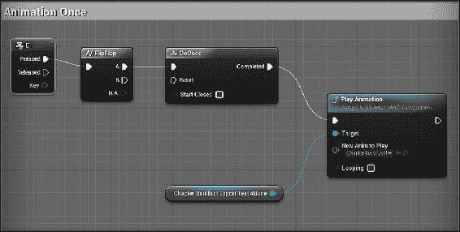

*创建打开制品的切换开关*

### 步骤 12：添加 Do Once 和 Play Animation 节点

为此，我们将添加一个 `Do Once`（执行一次）节点。该节点的工作原理类似于 `Gate`，它限制网络中信息的流向，但它确实允许动作在关闭前发生一次。这将使玩家可以按 `E` 打开制品，但动画只播放一次。没有它，玩家可以想按多少次 `E` 就按多少次，反复播放动画。这玩一会儿挺有趣的，因为看起来像张嘴试图吃掉你，但这不是我们的初衷（我可能花了一些时间反复按它并歇斯底里地大笑）。`Do Once` 可以在 `Palette`（调色板）中轻松找到。最后，我们将需要一个 `Play Animation`（播放动画）节点。有两个版本，所以请务必从搜索结果的 `Skeletal Mesh`（骨骼网格体）部分获取此节点，以便其目标为 `Skeletal Mesh Component`（骨骼网格体组件）。将输入 `E` 事件连接到 `Do Once` 节点，再将 `Do Once` 节点连接到 `Play Animation`。

### 步骤 13：设置动画目标和剪辑

还有一件事就能完成这个序列。我们需要在 `Play Animation` 节点上设置要播放的目标和动画。因此目标将是我们的 `Skeletal Mesh`（骨骼网格体）组件。点击 `Components`（组件）列表中的 `Artifact`（制品）组件，将其拖入 `Blueprint`（蓝图）窗口，并将其插入到我们的 `Play Animation` 的 `Target`（目标）引脚上。最后，点击 `Play Animation` 节点上 `New Anim to Play`（要播放的新动画）选项下的下拉菜单，选择制品打开的动画。大功告成！

让我们保存所有文件并测试一下。将 `Artifact` 拖入我们的空间站，并将其放置在进出口经纪人的商店里。构建关卡，然后放入并测试。它打开了吗？需要更多触手吗？调试并改进它，直到它完全符合你的要求。

## 使用音效

现在我们在关卡中已经有了制品、触手和动画在工作，我们可以就此停手并宣布完成，对吧？我们可以，但给玩家一个机会反击占领我们空间站的黑暗力量，不是更有趣吗？让我们把那个制品炸飞！

在直接动手之前，我们需要稍作规划。这将帮助我们理清蓝图序列的编程逻辑，并规划如何构建爆炸。那么，一个很棒的游戏爆炸效果需要什么？首先必须有声音。没有扎实的爆炸音效，任何尝试都会显得平淡无奇。我们还需要火焰、烟雾和碎片才能真正让它大放异彩。必须有某种触发事件，例如时间、玩家交互或伤害。最后，大致的事件顺序可能是：事件、声音、爆炸粒子、烟雾粒子、删除物体、碎片粒子。这样，烟雾、爆炸和碎片粒子效果就会在我们删除爆炸资产时进行遮挡。幸运的是，Unreal 的 `Starter Content`（初学者内容）文件夹里有其中的大部分素材！

让我们开始在类蓝图中为爆炸做准备，添加音效并设置它们在我们需要时触发。

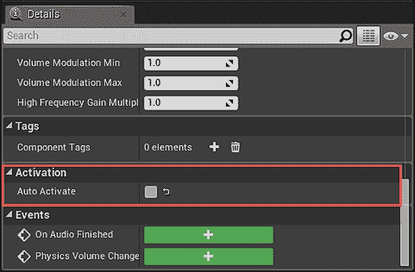

*在详情面板中关闭自动激活*

### 提示

声音可以用与导入其他资产相同的方式导入 Unreal。如果你觉得 `Starter Content` 的声音不适合你的爆炸，请随意搜索 `Royalty Free`（免版税）声音。这些声音可以在你的项目中免费或支付少量一次性费用后使用。`Royalty Free` 意味着除了最初的付款外，无需再支付任何费用。

### 添加音频组件

1.  向类蓝图添加声音类似于添加任何其他类型的 `component`（组件），并能为我们的爆炸增添真实的深度。在 `Class Blueprint`（类蓝图）编辑器中，点击 `Add Component`（添加组件）按钮并从列表中选择 `Audio`（音频）。接下来，选中音频组件，前往 `Details`（详情）面板并找到 `Sound`（声音）选项。在这里，你会找到一个字段，我们可以通过在 `Content Browser`（内容浏览器）中选择 `Sound Wave`（声波）或 `Sound Cue`（声音提示）然后点击小箭头来分配它。或者，你可以在点击 `Add Component` 按钮之前选择想要使用的声音，Unreal 会添加选定的声音。让我们把这个设为 `Explosion Cue`（爆炸提示）。为了确保它只在我们想要的时候触发，选中它并前往 `Details` 面板。找到 `Auto Activate`（自动激活）选项并将其关闭。

    ### 提示

    `Sound Wave`（声波）和 `Sound Cue`（声音提示）的区别非常类似于纹理和材质的区别。`Sound Wave` 连同一些特殊的蓝图节点组成了 `Sound Cue`。双击 `Explosion Cue` 看看吧！

### 编程倒计时时钟

2.  是时候为制品的编程添加一点内容了！我知道，大家对这部分都很兴奋。让我们为爆炸增加一点乐趣，加个倒计时。

    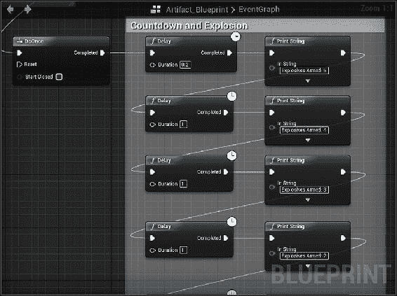

    *为爆炸编程倒计时*

### 实现 Flip Flop 逻辑

3.  我们将使用 `Flip Flop`（翻转）节点，从按下 `E` 键的事件分支出此功能。

    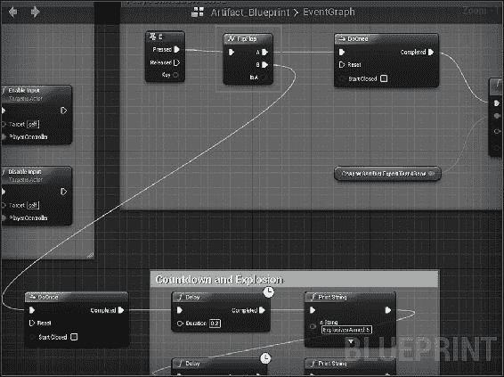

    *将倒计时连接到我们之前创建的 Flip Flop 的 B 分支*

4.  回到第 2 章《开始我们的第一个项目》，我们使用 `Flip Flop` 节点控制货梯。本质上，该节点会先执行分支 `A`，然后执行分支 `B`，在两者之间交替。我们将用它来让 `E` 键先打开制品，然后允许玩家放置炸弹并开始倒计时。前往 `Palette`（调色板）面板中的搜索框，搜索 `Flip Flop`，并将一个拖入 `Blueprint`（蓝图）窗口。断开 `E` 事件与 `Do Once` 节点之间的连接，并按上图所示进行连接。

### 设置 Print String 倒计时

5.  让我们创建倒计时。对于此功能，我们将使用 `Print String`（打印字符串）节点在触发爆炸声音前打印出 5 秒倒计时。

    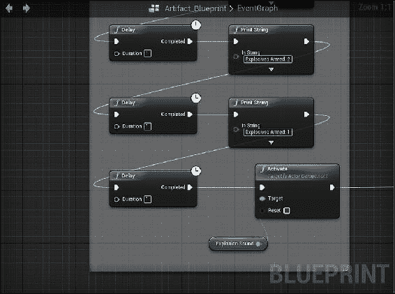

    *在倒计时中编程 Print String 节点*

6. 首先，我们需要一个 `Delay` 节点和一个 `Print String` 节点。这两个节点都可以通过 `Palette` 面板中的搜索框找到。对于 `Delay` 节点，保持 `Duration` 为 `0.2` 即可。将 `Print String` 节点上的 `In String` 选项更改为 `Explosives Armed: 5`。按住左键拖动选择这两个节点并复制/粘贴它们。在这些新节点上，将 `Delay` 节点的 `Duration` 改为 `1.0`，将 `Print String` 节点的 `In String` 改为 `Explosives Armed: 4`。重复该过程三次以完成倒计时。序列中的最后一个节点是 `Activate` 节点。由于我们在 `Explosion Cue` 上关闭了 `Auto Activate` 选项，该节点将激活组件并播放声音。现在所有部件都在 `Blueprint` 窗口中，像前面的图片那样将它们连接起来。

7. 保存并编译我们的类 Blueprint。保存关卡并按下 `Play` 进行测试！

现在我们的音效已经生效，完成爆炸效果只需几步。不过，在这个 Blueprint 中还有许多其他使用声音的机会。例如，我们可以为 Artifact 添加开启音效，或在其开启时播放一些诡异的音乐。多尝试一下，看看如何利用声音进一步增强氛围！

# 使用粒子效果

我们爆炸的声音效果已经就绪，Artifact 也准备好被摧毁了！为了完成爆炸效果，我们需要一些粒子效果。我们在第 5 章 *Taking This Level Up a Notch* 中使用过各种粒子效果，来增强安检点和电梯处的脚本事件。在这里，我们将使用爆炸、火焰和烟雾来增强销毁效果，并在删除 Artifact 的不同组件时进行遮挡。让我们来看看：

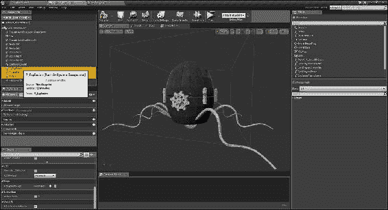

在组件列表中添加一个爆炸粒子、一个火焰粒子和一个烟雾粒子。务必关闭 `Auto Activate`！

在我们已经相当丰富的组件列表中，我们将添加爆炸、火焰和烟雾粒子发射器。像添加声音那样添加每个发射器，然后选中每一个，在 `Details` 面板中禁用 `Auto Activate` 选项。稍后我们将使用 Blueprint 节点 `Activate` 将它们重新开启。

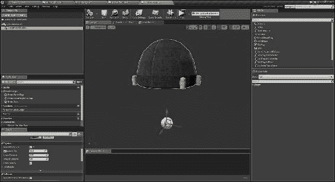

为 Artifact 的顶部和底部碎片创建两个单独的类 Blueprint。我们将在爆炸中将它们用作碎片。

让这次爆炸真正精彩的最后一个必要元素是添加飞散的碎块！当固体物体爆炸时，其部分碎片往往会向四面八方飞散。我们将通过让 Blueprint 生成启用了物理模拟的 Artifact 底部和顶部版本来模拟这一点，它们会四处飞散，并在 Artifact 的其余部分被销毁后留在关卡中：

1. 这要求我们回到 `Blender`，将 `Top` 和 `Bottom` 作为单独的 FBX 文件导出。打开我们的 `Blender` 文件并选择 Artifact 的 `Top`。转到 `File` 菜单并进入 `FBX Export` 界面。开启 `Selected Objects` 选项，以便仅导出 `Top`。此外，转到 `Geometries` 选项卡并将 `Smoothing` 选项更改为 `Face`。给它起个独特的名字并导出！对 `Bottom` 碎片重复此操作，准备将它们导入 Unreal。

2. 将两个新的 FBX 文件作为静态网格体导入 Unreal，并将我们的 Artifact 材质应用到它们上。你会注意到，即使我们没有导入完整模型，材质依然完美工作。这是因为每个碎片的 UV 贴图仍然相同，无论我们使用完整的 Artifact 还是仅使用其部分。

3. 创建两个新的类 Blueprint。通过点击 `Blueprint` 按钮，选择 `New Empty Blueprint Class`，并选择 `Actor` 作为 `Parent Class`，为每个新的静态网格体创建一个类 `Blueprint`。我将它们命名为 `ArtifactTopChunk` 和 `ArtifactBotChunk`。

4. 在每个 Blueprint 中，添加相应的静态网格体作为组件。直接添加即可；无需移动它。这样，当我们使用 Blueprint 生成它们时，它们就会处于我们所需的确切位置。

5. 现在我们需要对它们的 `Details` 进行一些更改。 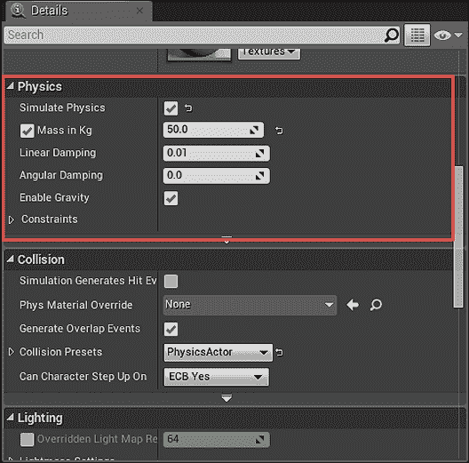

   为飞散的碎片应用物理模拟。

6. 对于每个新 Blueprint，点击组件并在 `Details` 面板中找到 `Physics` 部分。首先，开启 `Simulate Physics`。这将允许我们的物体弹跳并受重力和外力影响。接下来，开启 `Mass in Kg`。通常，Unreal 会根据物体在关卡中的大小计算其质量。我们的两个碎片质量都在 500 kg 左右，不太适合作为飞散的碎片。开启 `Mass in Kg` 允许我们覆盖 Unreal 的估算值，并填入我们希望的重量值。我用了 `50` kg，但你可以随意使用任何值。稍后随时可以调整。务必对 `Top` 和 `Bottom` Artifact 碎片都执行此操作。

是时候完成 Artifact 的毁灭了。回到 Artifact 类 Blueprint，还有一个 `Component` 需要添加到我们的设置中。为了让 `Top` 和 `Bottom` 碎片飞散，我们将使用 `Radial Impulse` 组件来模拟爆炸冲击力。通过 `Add Component` 菜单添加 `Radial Impulse`，并在 `Details` 面板中找到 `Radial Force Component` 部分。冲击力影响的半径在视口中显示为一个浅蓝色球体。增加 `Radius` 属性的大小，直到它覆盖整个 Artifact。我用了 `250`。同样在 `Details` 面板中，找到 `Impulse` 部分并增加 `Impulse Strength`。我用了 `2000`。最后，确保开启 `Impulse Vel Change` 选项。此选项确保 2000 单位的力直接作为速度变化施加。这将保证将我们的碎片抛得很远，甚至可能抛到玩家身上！

是时候进行最后的编程了！让我们看看：

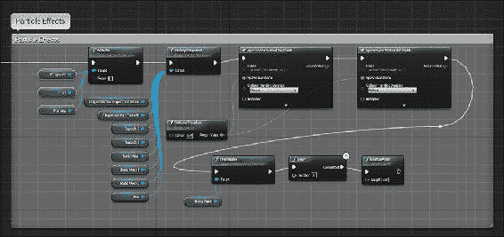

激活爆炸、火焰和烟雾粒子，然后销毁网格体部分。然后我们将使用两个 `Spawn Actor From Class` 节点生成 `Top` 和 `Bottom` 碎片。最后，触发 `Radial Impulse` 观看它们弹跳！

这一最后部分内容不多。我们将在倒计时部分末尾使用第二个 `Activate` 节点来激活所有粒子效果。然后使用 `Destroy Component` 节点移除爆炸中会被销毁的组件。接下来，我们将使用两个 `Spawn Actor From Class` 节点生成两个碎片，最后使用 `Fire Impulse` 节点将它们从爆炸中心抛出。最后，我们将 `Delay` 4 秒，然后使用 `Destroy Actor` 清理整个场景。首先使用 `Palette` 中的搜索框获取 `Activate` 节点。将其放在倒计时序列的末尾，并将其连接到我们用于播放声音提示的 `Activate` 节点。`Activate` 节点需要一个或多个 `Targets` 来知道开启什么。从 `Components` 面板抓取 `P_Explosion`、`P_Smoke` 和 `P_Fire` 组件并将它们拖入 Blueprint。将这些连接到 `Activate` 节点上的 `Target` 节点。

接下来是 `Destroy Component` 节点。我们将使用此节点删除爆炸中会被销毁的所有东西。将其连接到我们的 `Activate` 节点，并将其 `Targets` 设置为 `Artifact`、`collision box` 和所有 `tentacles`。

轮到 `Spawn Actor From Class` 了！这个很棒的节点允许我们使用 Blueprint 生成其他类 Blueprint，但比 `Activate` 或 `Destroy Component` 需要更多参数。

# 完成神器爆炸效果

## 爆炸序列设置

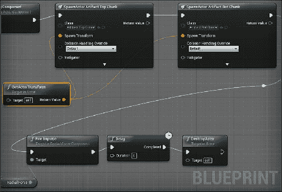

别忘了告诉 `Spawn Actor From Class` 节点使用我们的顶部和底部碎片类 `Blueprint`。

将 `Spawn Actor From Class` 节点放在 `Destroy Component` 节点旁边并连接它们。我们需要告诉它的第一件事是生成什么类。点击下拉框并选择底部 `Artifact` 碎片。它需要知道的第二件事是在哪里生成。这可以通过将一个 `Get Actor Transform` 节点（在 `Palette` 的搜索框中找到）插入 `Spawn Transform` 选项来完成。现在我们准备好生成了！重复此步骤为顶部 `Artifact` 碎片设置一个 `Spawn Actor From Class` 节点。

现在触发那个 `Radial Impulse`，使其成为真正的爆炸！

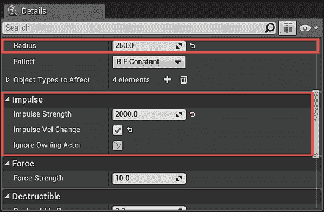

对 `Fire Impulse` 节点使用这些设置。

我们需要使用的节点是 `Fire Impulse`。该节点唯一需要的是一个 `Target`。从 `Components` 面板获取我们的 `Radial Impulse` 组件并将其插入。

为了收尾，我们只需要做一些清理工作。在此序列的末尾，添加一个 `Delay` 和一个 `Destroy Actor` 节点。`Delay` 将设置为 `4.0` 秒，以给声音留出播放时间，`Destroy Actor` 将以 `Self` 作为 `Target`。这将从关卡中移除所有类 `Blueprint`。然而，它会留下爆炸的碎片。尽管我们使用类 `Blueprint` 生成它们，但它们是独立的 Actor，当类 `Blueprint` 的其余部分自我删除时，它们不会被删除。

确保序列按顺序连接并测试它。你应该会得到一个令人满意的爆炸，将 `Artifact` 的碎片四处抛散。如果玩家太近，甚至会将他们向后抛出！

制作爆炸非常有趣，并且可以为任何体验增加一些动作感，但如果你享受构建这个序列的过程，不必止步于此。尝试添加更多爆炸粒子效果，或添加触手作为碎片以增加效果。

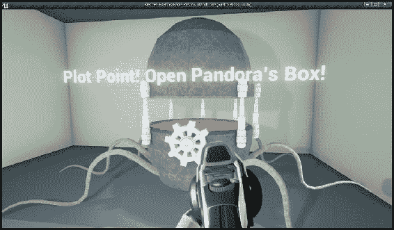

最终结果！希望你们玩得和我一样开心！

这难道不令人奇妙地满足吗？！为电子游戏构建一些惊人的东西，然后让玩家将其炸毁，这其中总有种独特的感觉。现在我们的游戏资产已正确设置，我们可以将其放入空间站关卡中，并将其作为目标来推动游戏玩法向前发展。在本章中，我们介绍了将我们完全贴图和动画化的 `Artifact` 引入 `Unreal` 并设置它在关卡中看起来很棒的过程。我们使用类 `Blueprint` 设置来组装零件，并创建了一种让玩家与其交互的方式，使其打开。然后我们添加了一些额外的组件和编程，允许玩家开始倒计时，并在火焰、烟雾和飞散碎片的绚丽表现中炸毁我们的游戏资产。

就这样，我们完成了！恭喜你读完这本书！你创建了一个很棒的游戏框架，可以在此基础上扩展，创造出一些惊人且独一无二的东西。你有两个白盒关卡，可以用在 Blender 中创建的自定义艺术填充。你有两个游戏资产，可以进一步定制以适应你游戏的特定需求。我强烈建议你妥善完成这些关卡，并继续练习和打磨你的技能。成为你想成为的游戏设计师或游戏艺术家，我真心期待未来能玩到你独特的游戏！

坚持下去，继续创作游戏吧！
