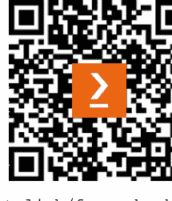

# Fusion 360 3D 打印：增材制造设计，并提升你的仿真和打印准备技能

我将本书献给我家人。我全心全意爱你们。致我的妻子 Marlene，你一直是我的冠军和最大的支持者，不仅在撰写本书期间，而且在我们共同的人生旅程中。致我的儿子 Kerem 和 Koray，感谢你们在无数次晚餐对话中倾听我谈论 3D 打印，并感谢你们关于下一步要 3D 打印什么的所有想法。致我的父母 Bijen 和 Suat。感谢你们无尽的支持、爱和灵感。

## 前言

我与 Sualp Ozel 相识并共事近七年，作为设计仿真和增材制造领域的领先专家之一，每当我需要了解该领域的最新发展和应用时，他都是我的首选。在本书中，Sualp 带您踏上从增材制造设计、结构仿真和打印准备到工艺仿真和工作流自动化的学习之旅。

第一部分将让您熟悉 Fusion 360 的基础知识，从如何打开新文件或将现有模型上传到 Fusion 软件进行存储。Sualp 演示了如何使用 Fusion 检查和修复损坏的网格文件，以及如何编辑模型以便使用各种 3D 打印技术有效进行 3D 打印。该部分还涵盖了如何将 Fusion 的自动化建模、拓扑优化和应力仿真功能结合使用，以生成满足性能和制造标准的实用零件。

本书还涵盖了零件的掏空和晶格化，以及您可以创建轻量化且节省材料的模型的不同方式，以及如何将它们导出到常见的切片软件，如 Cura、PreForm 和 Prusa Slicer。

在第三部分中，您将了解 Fusion 360 的 *Manufacture* 工作区的所有内容，如何将其用作原生切片器来为零件准备 3D 打印。从如何有效地使用 Fusion 选择打印机和打印设置，在构建体积内排列和定向零件，创建基于特定打印机需求的支持结构。

最后一部分全部关于金属打印和自动化，Sualp 凭借多年的经验和专业知识解释了金属粉末床熔融打印的独特要求，如何创建高效的支持结构以及模拟打印过程以检测潜在的构建失败并补偿热变形。

了解这些关键领域可以节省数小时的工程时间和失败打印的费用。在整本书中，Sualp 提供了您所需的一切，以使用 Fusion 360 的强大功能学习从设计到 3D 打印的整个工作流程，内容清晰易读，适合刚开始 3D 打印之旅的人，以及准备采用最先进的设计和仿真工具的人。

Duann Scott

3MF Consortium 执行董事

教学助理，MIT xPRO

Bits to Atoms 和 CDFAM 计算设计研讨会系列创始人

## 贡献者

## 关于作者

**Sualp Ozel** 是一名专业工程师，也是 Autodesk Inc. 的高级产品经理。Sualp 拥有 15 年的经验，基于市场需求规划路线图，及时对现有产品进行改进并推出新产品，同时满足市场对质量的期望和要求。自 2016 年以来，他管理着 Autodesk 的增材制造软件产品组合，包括 Fusion 360、Netfabb、Netfabb Local Simulation 和 Within Medical。Sualp 自 2014 年以来一直担任卡内基梅隆大学的兼职讲师，在机械工程系教授 *Introduction to CAD and CAE tools* 课程。

*我感谢在这段旅程中支持我的人们。*

*感谢 Anthony Graves 确保我拥有最好的 HP Z2 工作站，以便我能够无缝地使用 Autodesk Fusion 工作。*

*感谢 Pavel Pelčák 和 Prusa 研究组织为我在撰写本书时提供 FFF 和 SLA 3D 打印机和材料的使用权限。*

*我还要感谢所有参与 Autodesk Fusion 360 的人。没有他们的工作和承诺，设计与制造社区不会发展到今天的水平。*

## 前言

随着 3D 打印变得主流，具备制造知识的 **计算机辅助设计 (CAD)** 用户的需求正在增长。您可能已经注意到，围绕自动化建模、生成式设计和增材制造的新功能现在已在 Autodesk Fusion 360 中可用。如果您有兴趣学习如何从这些工具中受益并使用 Fusion 提高您的设计和 3D 打印技能，那么本书适合您。

在本書中，您将学习如何在 Fusion 中打开 CAD 和网格文件、修复和编辑它们，并为 3D 打印做好准备。在打印准备的背景下，您将了解打印设置、支撑结构和零件定向。本书还将介绍 Fusion 用于增材制造的各种偏好设置。在后续章节中，您将学习如何根据打印技术选择正确的定向并创建适当的支撑结构，并模拟打印过程以检测和补救与金属粉末床熔融工艺相关的常见打印故障。本书还将介绍如何根据打印技术安排零件。到本书结束时，您将熟悉利用模板和脚本来自动化打印准备方面的常见任务。

到本书结束时，您将获得使用 Fusion 360 进行增材制造所需的所有知识。

## 本书适合谁

如果您是一名每天使用 Autodesk Fusion 360 的设计师，并希望学习如何 3D 打印您的设计，或者如果您有兴趣创建功能性且轻量化的打印件，那么本书适合您。Fusion 的中级用户将受益于将本书作为 **增材制造设计 (DFAM)** 和打印准备的参考资料。

理想情况下，在开始阅读本书之前，您需要对 Fusion 的设计功能有初步的了解。能够创建基本设计并知道如何使用 Fusion 打开现有的 CAD 或网格文件，将使您充分利用本书。

## 本书涵盖内容

*第 1 章，打开、检查和修复 CAD 和网格文件，* 解释了为了 3D 打印一个物体，您需要一个 3D 模型或该模型的切片版本，通常称为 G 代码文件。您并不总是需要自己在 CAD 软件中设计物体。有各种网站可以下载实体模型或网格文件。从设计到 3D 打印，通常需要切片软件。但在对从网上下载的模型进行切片之前，最好确保模型没有错误并且尺寸适合您的打印机。在本章中，我们将使用 Autodesk Fusion 打开来自第三方来源的 CAD 和网格文件，检查错误，并在必要时修复它们。

*第 2 章，以 DFAM 原则为指导编辑 CAD/网格文件，* 介绍了 Fusion 如何在不捕获设计历史的情况下使用。 在本章中，我们将介绍如何在打开非原生 CAD 文件后启用捕获设计历史。您将学习如何基于一组 DFAM 原则编辑在 Fusion 360 中打开的 CAD 文件。本章还将探讨如何直接编辑网格文件。本章将通过展示如何将网格文件转换为用于制造编辑的实体对象而结束。

*第 3 章，创建轻质零件，以及使用仿真识别和修复潜在故障，* 讨论了增材制造的主要优势之一，即能够创建轻质零件。Autodesk Fusion 的 *设计* 工作区中的自动化建模功能和 *仿真* 工作区中的形状优化分析类型是设计师创建外观有机轻质组件的绝佳工具。在本章中，我们将展示如何创建此类组件。我们还将使用线性静态应力对它们进行仿真，以检测我们的 3D 打印设计可能遇到的故障，并通过有针对性的建模修改来补救这些问题。

*第 4 章，通过中空和点阵零件减少材料和能源使用，* 解释了使用 **熔融长丝制造** (FFF) 3D 打印机制造大体积组件时，我们可以通过在周边周围使用多条轮廓线结合稀疏填充，使其坚固且轻质。然而，同样的技术不适用于其他 3D 打印技术，如立体光刻、多喷嘴熔融或选择性激光烧结。使用这些技术创建原型零件时，设计师必须主动思考如何制作轻质零件以减少材料和能源使用。设计师可以使用的一种方法是打印前对零件进行中空和点阵处理，以模仿使用轮廓和填充产生的效果。设计师还必须在后处理阶段包含排水孔以及用于树脂或粉末逸出的塞子。在本章中，我们将介绍 Fusion 用于创建此类设计的各种工具。

*第 5 章，对模型进行三角剖分并将网格文件导出到第三方切片软件，* 解释了 Autodesk Fusion 具有内置切片器（将在后续章节中介绍）；然而，Fusion 的切片器不支持市场上所有的 3D 打印机。某些 3D 打印机具有专有的切片软件。在某些组织中，软件管理员可能要求制造工程师使用特定的切片软件。或者您可能只想使用您已熟悉的切片软件。在这种情况下，在阅读完本书的前四章后，您可能希望将模型导出到您首选的切片器。在本章中，我们将介绍您可以将 Fusion 模型导出到您首选切片器的各种方法。

第6章，介绍用于打印准备的制造工作区，解释了当设计师创建零件装配体时，他们并不期望该装配体的所有零件都会被3D打印。任何被指定为3D打印的零件在制造前可能需要进行修改。对单个零件进行3D打印的更改并跟踪这些更改可能很棘手。Autodesk Fusion 提供了多种方法来应对此类挑战。对于希望在外部管理装配设计与制造设计之间关系的用户来说，派生工作流程是理想的解决方案。对于希望在单个 Fusion 设计中管理这种关系的用户来说，制造模型是最佳选择。在本章中，我们将介绍如何使用这两种工作流程，并突出每种方法的优点和缺点，同时展示您可能希望为3D打印进行的常见设计更改示例。

第7章，创建您的第一个增材设置，描述了在 Autodesk Fusion 中，3D打印的关键第一步是创建增材制造设置。这个简单而强大的对话框包括选择3D打印机及其相关打印设置的选择。了解机器和打印设置库的工作原理以及如何使用您的3D打印机和打印设置自定义这些库，将大大减少您从设计到打印零件所需的时间。在本章中，我们还将重点介绍与3D打印相关的各种 Fusion 360 首选项，这将改善您的体验并为您节省时间。

第8章，排列和定向组件，教您无论是打印单个组件还是同时打印数百个组件，将它们排列在构建体积内并根据预期结果定向它们都是获得成功打印的重要考虑因素。本章将介绍各种3D打印技术以及如何为每种技术最佳地排列和定向组件。本章将重点介绍如何手动平移和定向组件。我们还将展示如何根据给定标准自动定向零件并排列它们，例如最小化构建高度或找到会导致支撑结构体积最小的定向。

第9章，打印设置，解释了，一旦确定了给定组件的打印方向和位置，您就可以简单地切片模型并生成工具路径将其发送到3D打印机。在某些情况下，可能需要编辑默认打印设置以更改打印过程的某些方面。例如，您可能希望添加裙边或底边以改善打印床粘附。您可能希望降低填充密度或增加轮廓数。在某些情况下，您可能希望对打印的不同部分使用不同的打印设置。本章将探讨所有这些可能性以及更多内容。

第10章，支撑结构，教您大多数主流增材制造技术都需要为具有悬垂表面的组件部分生成和打印支撑结构。本章重点介绍了可用于FFF和SLA/DLP打印的杆状和体积支撑结构，以及它们如何根据打印技术而有所不同。您还将了解底板支撑类型以及它如何与带垫的杆支撑一起用于SLA/DLP打印。

第11章，切片模型和模拟工具路径，描述了，一旦我们希望打印的所有组件都已排列、定向并得到适当的支撑，就该生成增材工具路径了。然后，我们可以逐层可视化切片以及挤出机和/或激光的移动。在 Autodesk Fusion 中生成增材工具路径是一个一键式解决方案，但建议查看工具路径模拟以了解我们选择的打印设置是否会产生预期结果。本章将重点介绍如何创建增材工具路径并对其进行模拟。

第12章，使用金属打印机进行3D打印，解释了如何利用 Fusion 360 及其扩展程序为金属粉末床熔融机器创建增材设置。希望设置金属打印的 Fusion 360 用户需要特别注意其零件的位置和方向，这基于某些机器参数，例如匀粉刀和气流方向。此外，金属打印需要独特的支撑结构以最大限度地减少材料浪费、缩短打印时间并最大限度地减少后处理工作。本章将涉及基于匀粉刀的零件定向以及金属3D打印的独特支撑结构设置。

第13章，模拟 MPBF 工艺，告诉您金属粉末是一种昂贵的3D打印材料。因此，金属3D打印中的任何错误或打印失败都是代价高昂的。拥有增材构建扩展访问权限的 Fusion 360 用户可以模拟其金属粉末床熔融打印过程，以检测和纠正常见的打印失败模式，例如零件变形和匀粉刀干涉。本章将重点介绍如何执行此类分析并做出必要的更改以避免常见的打印失败模式。

第14章，自动化重复性任务，重点介绍了如何自动化 Fusion 的各个方面，以最大限度地减少我们与软件的交互来创建增材设置并生成工具路径。如果您计划定期使用 Fusion 360 进行增材制造，本章适合您。我们将首先通过向您介绍 Fusion 360 应用商店来重点介绍 Fusion 生态系统中的现有自动化。接下来，我们将重点介绍如何自定义 Fusion 的机器和打印设置库以创建可在创建设置时使用的完全定义的机器。然后，您将学习如何为各种操作自定义输入，例如自动定向研究、零件排列和支撑结构生成。我们还将演示如何将这些输入保存为用户默认值。接下来，我们将创建并保存模板，这些模板将多个操作组合到一个可以重复用于后续增材设置的文件中。我们将以重点介绍如何通过创建 Python 脚本来利用 Fusion 的编程功能来自动化生成增材设置、定向零件、在构建板内排列它们并模拟增材工具路径的整个过程结束本章。

## 从本书中获得最大收益

| 书中涵盖的软件/硬件 | 操作系统要求 |
|---|---|
| Autodesk Fusion 360 | Windows 和 macOS |
| Autodesk Netfabb | |
| PrusaSlicer, Formlabs PreForm, and UltiMaker Cura | |

## 下载示例项目文件

您可以从 GitHub 在 https://github.com/PacktPublishing/3D-Printing-with-Fusion-360 下载本书的示例项目文件。如果代码有更新，它将在 GitHub 仓库中更新。

我们还有来自我们丰富的图书和视频目录的其他代码包，可在 https://github.com/PacktPublishing/ 获取。快来看看吧！

## 使用的约定

本书在整个过程中使用了多种文本约定。

正文中的代码：表示正文中的代码词、数据库表名、文件夹名、文件名、文件扩展名、路径名、虚拟 URL、用户输入和 Twitter 账号。以下是示例：我们可以使用 Insert Mesh 命令并将 Clip_broken.STL 文件插入到我们活动的 Fusion 360 设计文档中。

粗体：表示新术语、重要单词或您在屏幕上看到的单词。例如，菜单或对话框中的单词以粗体显示。以下是示例：在对网格体进行居中和接地处理之外，我们还可以使用画布内操纵器（箭头和旋转工具）或 INSERT MESH 对话框内的数值输入部分来重新定位网格体，直到满意为止。

提示或重要说明
显示如下。

## 联系我们

来自我们读者的反馈总是受欢迎的。

**总体反馈：** 如果您对本书的任何方面有疑问，请发送电子邮件至 `customercare@packtpub.com`，并在邮件主题中提及书名。

**勘误：** 尽管我们已尽一切努力确保内容的准确性，但错误难免。如果您在本書中发现错误，我们将不胜感激您向我们报告。请访问 `www.packtpub.com/support/errata` 并填写表格。

**盗版：** 如果您在互联网上发现我们作品的任何形式的非法副本，我们将不胜感激您提供其位置地址或网站名称。请通过 `copyright@packt.com` 联系我们，并附上材料的链接。

**如果您有兴趣成为作者：** 如果您在某个领域具有专业知识，并且有兴趣撰写或为一本书做出贡献，请访问 `authors.packtpub.com`。

## 分享您的想法

一旦您阅读了 *使用 Fusion 360 进行 3D 打印*，我们很乐意听取您的想法！请点击此处直接前往本书在亚马逊的评论页面并分享您的反馈。

您的评论对我们和技术社区都很重要，并将帮助我们确保提供优质的内容。

## 下载本书的免费 PDF 副本

感谢您购买本书！

您喜欢随时阅读但无法随身携带印刷书籍吗？您的电子书购买与您选择的设备不兼容吗？

不用担心，现在每本 Packt 书籍都免费提供该书的无 DRM PDF 版本。

在任何地方、任何地点、使用任何设备阅读。直接从您喜爱的专业技术书籍中搜索、复制和粘贴代码到您的应用程序中。

福利还不止于此，您可以每天通过收件箱独家获取折扣、通讯和优质免费内容。

按照以下简单步骤获取福利：

https://packt.link/free-ebook/9781803246642

- 1. 扫描二维码或访问下面的链接：
- 2. 提交您的购买证明。
- 3. 就这样！我们会直接将您的免费 PDF 和其他福利发送到您的电子邮件。
