## 打开、检查和修复 CAD 和网格文件

欢迎阅读本书《使用 Fusion 360 进行 3D 打印》。Fusion 360 是一款使用参数化或直接建模方法创建和编辑设计的绝佳工具。借助自动化建模、生成式设计和拓扑优化技术，Fusion 360 用户现在拥有多种用于增材制造设计的 方法。本书将为您提供使用 Fusion 360 制造设计的必要步骤，使用常见的 3D 打印技术，例如熔融沉积成型、立体光刻、选择性激光烧结、粘结剂喷射和金属粉末床熔融。您还将获得有关如何设置 Fusion 360 的宝贵技巧和窍门，这将使您能够为 3D 打印需求充分利用该软件。

Fusion 360 是一款基于云的 3D 建模、**计算机辅助设计 (CAD)**、**计算机辅助制造 (CAM)**、**计算机辅助工程 (CAE)** 和 **印刷电路板 (PCB)** 设计软件平台，用于专业产品设计和制造 (https://www.autodesk.com/products/fusion-360/overview)。

它适用于 Windows 和 macOS，并为 Android 和 iOS 提供简化版应用程序。Fusion 360 的首次发布可追溯到 2013 年，正值 3D 打印开始普及的时期。在 2010 年代，创客社区迅速采用 Fusion 360 进行设计和制造。

在制造 3D 打印设计时，网格 (STL) 文件是早期 3D 打印切片软件唯一接受的输入文件类型。随着创客社区使用 STL 文件在 thingiverse.com 等网页上公开创建和分享设计，可 3D 打印的设计数量呈指数级增长。不幸的是，STL 文件格式存在许多问题和限制。为了解决这些问题，3D 打印社区需要可靠且易于使用的软件。

Fusion 360 一直包含处理 CAD 和网格文件的功能，使其成为 3D 打印的绝佳工具。然而，Fusion 360 的网格功能作为技术预览提供，需要在 Fusion 360 首选项中启用。Autodesk —— Fusion 360 的母公司 —— 定期为 Fusion 360 发布新更新。在 Fusion 360 的 2021 年 7 月更新中，Autodesk 对网格工作流程进行了重大更改，将网格工作区从技术预览的一部分提升为 Fusion 360 设计工作区的一部分。

今天，您可以使用 Fusion 360 打开、检查和修复可以从众多第三方来源下载的网格文件。

在本章中，我们将首先通过向您介绍 Fusion Team 和 Fusion 360 用户界面，来看各种将 CAD/网格数据带入 Fusion 360 的方法。我们将介绍如何创建项目和文件夹以更好地组织数据。接下来，我们将展示将 STL、OBJ 和 3MF 等网格文件插入 Fusion 360 的多种方法。我们将以检查插入 Fusion 360 的网格数据是否存在潜在缺陷并自动和手动修复这些缺陷结束本章。

在本章中，我们将涵盖以下主题：

- CAD 模型和网格文件的打开和上传工作流程
- STL、OBJ 和 3MF 文件的网格插入工作流程
- 检查网格体并修复它们

到本章结束时，您将学会如何在 Fusion 360 中打开使用其他工具创建的模型。您将学会如何在 Fusion 360 中插入网格文件。您还将了解如何使用自动和手动方法检查和修复网格文件。

### 技术要求

本书中涵盖的大多数主题适用于 Fusion 360 的所有许可级别（个人/业余、初创、教育和商业）。然而，本书还将涵盖个人/业余使用许可不可用的高级功能。此类高级功能将被标识为个人使用不可用，以及需要访问扩展程序。

Fusion 360 具有以下系统特定要求：

- **Apple® macOS:**
  - macOS 13 Ventura – 版本 2.0.15289 或更新
  - macOS 12 Monterey
  - macOS 11 Big Sur
- **Microsoft Windows:**
  - Windows 11
  - Windows 10（64 位）– 版本 1809 或更新
- **CPU、内存和磁盘空间要求：**
  - 基于 x86 的 64 位处理器（例如 Intel Core i 和 AMD Ryzen 系列），4 核，1.7 GHz 或更高；不支持 32 位。Apple silicon 处理器需要 Rosetta 2。
  - 4 GB RAM 和 8.5 GB 存储空间。

**重要说明**
详细的系统要求列表可在以下位置找到：https://knowledge.autodesk.com/support/fusion-360/learn-explore/caas/sfdcarticles/sfdcarticles/System-requirements-for-Autodesk-Fusion-360.html。

本章的课程文件可在以下位置找到：https://github.com/PacktPublishing/3D-Printing-with-Fusion-360。

### CAD 模型和网格文件的打开和上传工作流程

Fusion 360 是一款基于云的 CAD/CAM/CAE 和 PCB 设计工具。您可以创建新设计或打开在其他工具中创建并保存为 CAD 或网格文件的设计。在本节中，我们将介绍您可以在 Fusion 360 中打开由其他软件创建的模型的所有方法，以便我们可以开始为 3D 打印做好准备。

由于 Fusion 360 是基于云的软件，因此内置了云存储和数据共享功能。作为 Fusion 360 用户，您可以自动访问名为 Fusion Team 的基于云的数据存储和管理工具。该工具还允许您通过提供权限、版本控制、标记和评论工具来管理您的 Fusion 用户团队。根据 Autodesk 知识网络文章，Fusion 360 用户自动获得 Fusion 360 数据的无限存储空间和非 Fusion 文档的 500 GB 数据存储空间。这是一个足以应对任何项目的慷慨存储量。

**重要说明**
有关云数据存储如何工作 的更多信息，您可以参考 https://knowledge.autodesk.com/support/fusion-360/learn-explore/caas/sfdcarticles/sfdcarticles/How-big-is-the-cloud-storage-for-Fusion.html 上的这篇文章。

在创建 Autodesk 帐户并获得 Fusion 360 访问权限后，无论您的许可级别如何，您都可以登录到您的 Fusion Team 帐户（https://myhub.autodesk360.com/）并开始您的 Fusion 360 数据管理之旅。

如果您是个人用户，则无需担心更改团队。然而，如果您为拥有多个 Fusion 360 用户的组织工作，您的组织可能已有多个团队

set up. 例如，每个用户可能拥有自己的团队。您可以通过选择屏幕右上角的个人资料图标来切换活动团队，如以下屏幕截图所示：

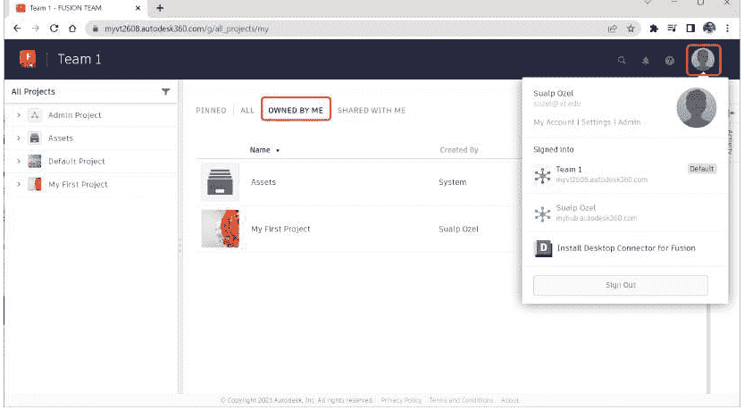

图 1.1 – 应用了“由我拥有”筛选器的我的 Fusion TEAM 视图

图 1.1 显示了我在 Google Chrome 浏览器上的 Fusion TEAM 视图，其中项目列表应用了“由我拥有”筛选器。如果我隶属于拥有多个团队的组织，我会选择右上角的个人资料图标并更改我的活动团队，以便参与存储在另一个团队中心中的项目。图 1.1 还显示，默认情况下，我拥有两项内容 – Assets 和 My First Project。

在图 1.2 中，您可以看到通过选择 My First Project 并展开项目详细信息，我们可以编辑项目名称和图像，并管理可以贡献和查看此项目内容的成员：

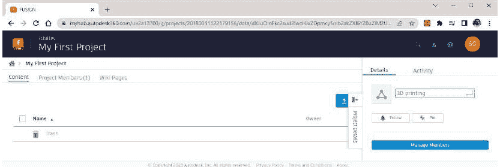

图 1.2 – 您可以在项目详细信息屏幕上重命名项目

一旦项目有了我们认可的名称（在图 1.2 中，我将项目重命名为 3D printing），我们就可以查看可用于将设计和其他文档上传到 Fusion Team 和 Fusion 360 的各种方法。

我们用于将设计和文档上传到 Fusion Team 的第一个选项就在创建的项目本身内。如图 1.3 所示，我们位于名为 3D printing 的项目中，可以选择蓝色的 **Upload** 按钮以查看我们上传内容的各种选项，例如 **File**、**Folder**、**Assembly** 和 **From Dropbox**。如果我们从该下拉菜单中选择 **File**，就可以将本地存储中存储的任何文件直接上传到 **Fusion TEAM** 上的活动项目。如果我们上传的文件包含网格或 CAD 几何体（例如 **STL**、**STEP**、**SAT**、**Inventor** 或 **Solidworks**），我们将能够在 Fusion 360 中打开这些设计以进行进一步编辑和制造。如果它们是非 CAD 文件（例如 Microsoft Word 文档或 PDF 文件），我们无法在 Fusion 360 中原生访问它们，但仍可以在我们的互联网浏览器或移动应用程序中查看它们。

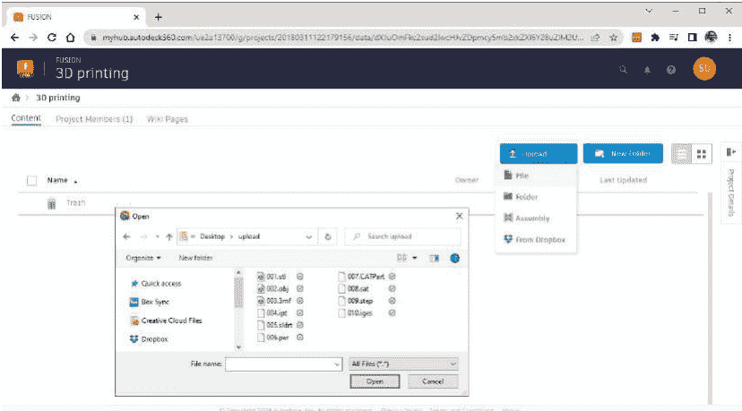

图 1.3 – 将本地文件上传到 Fusion TEAM 上的 3D printing 项目

如果您习惯使用传统的桌面 CAD 软件，使用 FUSION TEAM 将文件上传到 Fusion 项目可能没有您熟悉的直观工作流程。然而，这是一种快速将与项目相关的多个文件上传到您的 Autodesk 云存储的实用方法。

如果您寻求更传统的打开 CAD 或网格文件的工作流程，您需要将 Fusion 360 安装在计算机上。您可以从以下链接下载并安装 Fusion 360：https://www.autodesk.com/content/autodesk/global/en/products/fusion-360/trial-intake。

一旦 Fusion 360 安装并启动，您可以访问文件下拉菜单并选择打开。执行此操作后，您将看到打开对话框。如图 1.4 所示，在此对话框中选择“从我的计算机打开...”选项，您将能够从支持的网格和 CAD 文件类型列表中进行选择，如图 1.5 所示：

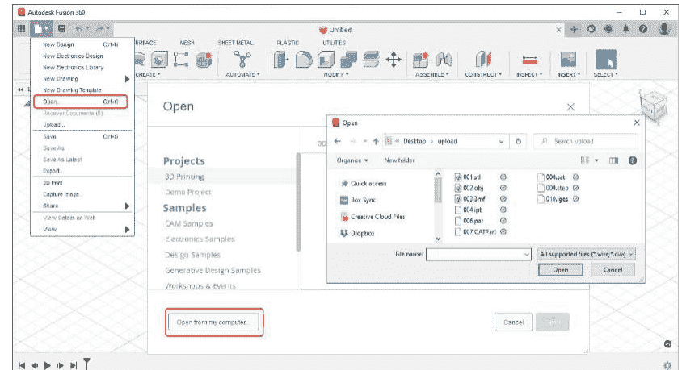

图 1.4 – 文件 | 打开... 工作流程允许您从计算机打开 CAD 和网格文件

在此对话框中，您将有选项打开 Fusion 360 支持的任何网格或 CAD 文件类型。由于 Autodesk 会定期更新 Fusion 360，因此您无需担心无法访问最新的 CAD 翻译器：

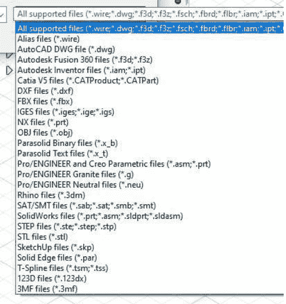

图 1.5 – Fusion 360 可打开的可用 CAD 和 MESH 文件类型列表

这是一种快速打开单个文件的绝佳选择，但此选项也有几个缺点：

- 使用此方法一次只能打开一个文件。
- 使用此方法打开 CAD 文件后，您将进入直接建模模式。如果您想捕获设计历史记录，则需要使用浏览器手动打开设计历史记录。设计历史记录和直接建模方法的建模将在第 2 章中详细介绍。
- 打开 STL/OBJ 文件时，您没有机会设置单位或零件放置。

总之，如果您尝试打开 STL 或 OBJ 文件，我不推荐此选项。但是，如果您打开 CAD 文件（例如 STEP 或 SAT）或 3MF 文件，这是一个快速简便的选项，您可能想要使用。不要忘记，如果您想在时间轴中存储编辑内容，请手动打开捕获设计历史记录，如图 1.6 所示：

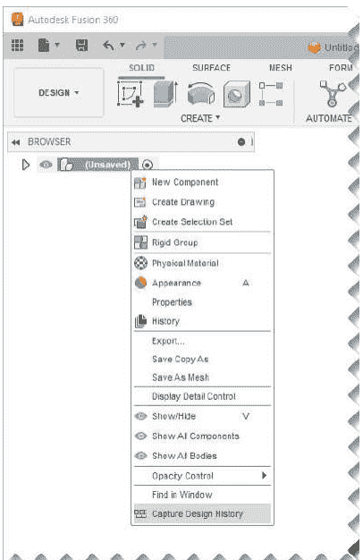

图 1.6 - 在执行文件 | 打开... 工作流程后，通过浏览器打开捕获设计历史记录

打开 CAD 和网格文件时，另一个可用的选项位于 Fusion 360 的数据面板中。您可以选择位于界面左上角的“显示数据面板”图标来访问数据面板窗口，如图 1.7 所示。

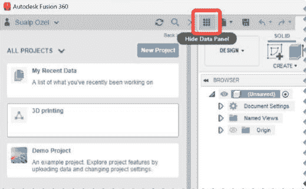

图 1.7 - 显示/隐藏数据面板

一旦数据面板可见，您可以导航到要上传设计数据的团队和项目。进入适当的项目后，您可以创建新文件夹以进一步组织您的设计和文档。一旦进入所需项目/文件夹位置，您可以使用图 1.8 所示的上传按钮，并选择或将文件拖放到屏幕上的上传对话框中。两种选项都允许您将多个 CAD 或网格文件上传到指定的团队/项目/文件夹位置。请注意，每个上传的文件都将成为其自己的 Fusion 设计文档。

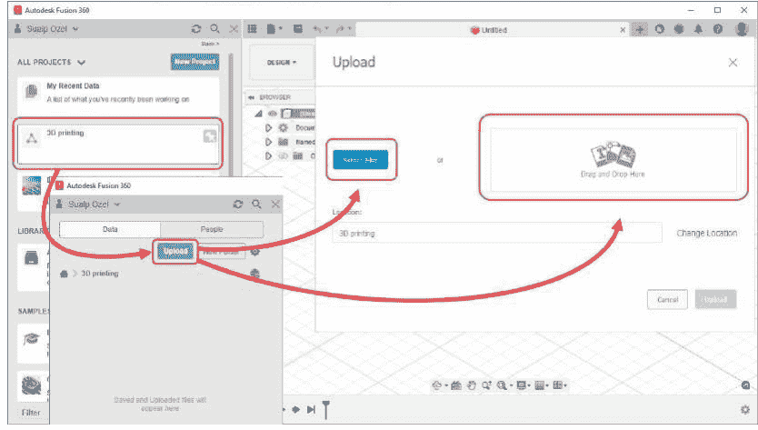

图 1.8 – 使用数据面板将多个网格和 CAD 文档上传到 Fusion 360

这是一种将多个 CAD 模型上传到 Fusion 360 的绝佳选择。然而，就像之前的选项一样，如果您想在时间轴中存储编辑内容，您必须打开捕获设计历史记录，如图 1.6 所示。并且与之前的选项一样，我不推荐使用此方法打开 STL 或 OBJ 文件，因为它在导入过程中不会让您最初控制零件放置的单位。

另一个鲜为人知但非常有用的选项基于 Fusion 360 移动应用程序。如果您有移动设备，您可以从相关应用商店下载 Fusion 360 应用，并可以浏览和上传存储在手机或平板电脑上的 CAD 或网格文件，如图 1.9 所示：

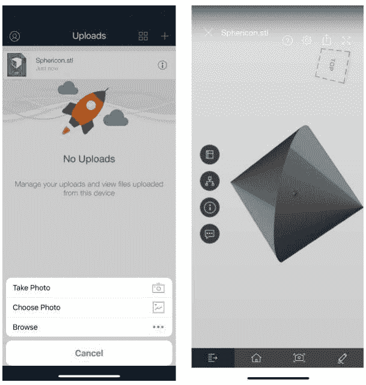

图 1.9 – 在移动设备上上传 STL 文件到 Fusion Team 后的视图

如果您在收到 CAD 或网格文件时没有计算机可用，此方法特别有用。在这种情况下，您可以快速将设计上传到您的 Fusion Team/项目/文件夹，以便您和您的团队成员可以立即开始处理设计。就像之前的方法一样，如果您想在时间轴中存储编辑内容，此方法也要求您在 Fusion 360 的浏览器中手动打开捕获设计历史记录，如图 1.6 所示。

> **重要提示**
> 
> 如果您将 STL/OBJ 文件上传到 Fusion Team 或 Fusion 360 应用，在 Fusion 360 中打开后，您必须检查单位和网格体的位置，以确保其与原始设计意图相符。Fusion 在从没有单位的网格文件类型创建 Fusion 360 设计文档时，使用厘米作为默认单位系统。
> 
> 例如，假设一个 STL 文件代表直径为 10 毫米的球体。由于 STL 文件不包含单位数据，如果我们使用图 1.8 所示的上传工作流程将此 STL 上传到 Fusion Team，则 resulting Fusion 360 设计文档将是一个直径为 10 厘米的球体。

现在我们已经了解了打开和上传 CAD 和网格文件的各种方法，是时候开始关注特定于网格体的[content]
set up. 例如，每个用户可能拥有自己的团队。您可以通过选择屏幕右上角的个人资料图标来切换活动团队，如以下屏幕截图所示：

图 1.1 – 应用了“由我拥有”筛选器的我的 Fusion TEAM 视图

图 1.1 显示了我在 Google Chrome 浏览器上的 Fusion TEAM 视图，其中项目列表应用了“由我拥有”筛选器。如果我隶属于拥有多个团队的组织，我会选择右上角的个人资料图标并更改我的活动团队，以便参与存储在另一个团队中心中的项目。图 1.1 还显示，默认情况下，我拥有两项内容 – Assets 和 My First Project。

在图 1.2 中，您可以看到通过选择 My First Project 并展开项目详细信息，我们可以编辑项目名称和图像，并管理可以贡献和查看此项目内容的成员：

图 1.2 – 您可以在项目详细信息屏幕上重命名项目

一旦项目有了我们认可的名称（在图 1.2 中，我将项目重命名为 3D printing），我们就可以查看可用于将设计和其他文档上传到 Fusion Team 和 Fusion 360 的各种方法。

我们用于将设计和文档上传到 Fusion Team 的第一个选项就在创建的项目本身内。如图 1.3 所示，我们位于名为 3D printing 的项目中，可以选择蓝色的 **Upload** 按钮以查看我们上传内容的各种选项，例如 **File**、**Folder**、**Assembly** 和 **From Dropbox**。如果我们从该下拉菜单中选择 **File**，就可以将本地存储中存储的任何文件直接上传到 **Fusion TEAM** 上的活动项目。如果我们上传的文件包含网格或 CAD 几何体（例如 **STL**、**STEP**、**SAT**、**Inventor** 或 **Solidworks**），我们将能够在 Fusion 360 中打开这些设计以进行进一步编辑和制造。如果它们是非 CAD 文件（例如 Microsoft Word 文档或 PDF 文件），我们无法在 Fusion 360 中原生访问它们，但仍可以在我们的互联网浏览器或移动应用程序中查看它们。

图 1.3 – 将本地文件上传到 Fusion TEAM 上的 3D printing 项目

如果您习惯使用传统的桌面 CAD 软件，使用 FUSION TEAM 将文件上传到 Fusion 项目可能没有您熟悉的直观工作流程。然而，这是一种快速将与项目相关的多个文件上传到您的 Autodesk 云存储的实用方法。

如果您寻求更传统的打开 CAD 或网格文件的工作流程，您需要将 Fusion 360 安装在计算机上。您可以从以下链接下载并安装 Fusion 360：https://www.autodesk.com/content/autodesk/global/en/products/fusion-360/trial-intake。

一旦 Fusion 360 安装并启动，您可以访问文件下拉菜单并选择打开。执行此操作后，您将看到打开对话框。如图 1.4 所示，在此对话框中选择“从我的计算机打开...”选项，您将能够从支持的网格和 CAD 文件类型列表中进行选择，如图 1.5 所示：

图 1.4 – 文件 | 打开... 工作流程允许您从计算机打开 CAD 和网格文件

在此对话框中，您将有选项打开 Fusion 360 支持的任何网格或 CAD 文件类型。由于 Autodesk 会定期更新 Fusion 360，因此您无需担心无法访问最新的 CAD 翻译器：

图 1.5 – Fusion 360 可打开的可用 CAD 和 MESH 文件类型列表

这是一种快速打开单个文件的绝佳选择，但此选项也有几个缺点：

- 使用此方法一次只能打开一个文件。
- 使用此方法打开 CAD 文件后，您将进入直接建模模式。如果您想捕获设计历史记录，则需要使用浏览器手动打开设计历史记录。设计历史记录和直接建模方法的建模将在第 2 章中详细介绍。
- 打开 STL/OBJ 文件时，您没有机会设置单位或零件放置。

总之，如果您尝试打开 STL 或 OBJ 文件，我不推荐此选项。但是，如果您打开 CAD 文件（例如 STEP 或 SAT）或 3MF 文件，这是一个快速简便的选项，您可能想要使用。不要忘记，如果您想在时间轴中存储编辑内容，请手动打开捕获设计历史记录，如图 1.6 所示：

图 1.6 - 在执行文件 | 打开... 工作流程后，通过浏览器打开捕获设计历史记录

打开 CAD 和网格文件时，另一个可用的选项位于 Fusion 360 的数据面板中。您可以选择位于界面左上角的“显示数据面板”图标来访问数据面板窗口，如图 1.7 所示。

图 1.7 - 显示/隐藏数据面板

一旦数据面板可见，您可以导航到要上传设计数据的团队和项目。进入适当的项目后，您可以创建新文件夹以进一步组织您的设计和文档。一旦进入所需项目/文件夹位置，您可以使用图 1.8 所示的上传按钮，并选择或将文件拖放到屏幕上的上传对话框中。两种选项都允许您将多个 CAD 或网格文件上传到指定的团队/项目/文件夹位置。请注意，每个上传的文件都将成为其自己的 Fusion 设计文档。

图 1.8 – 使用数据面板将多个网格和 CAD 文档上传到 Fusion 360

这是一种将多个 CAD 模型上传到 Fusion 360 的绝佳选择。然而，就像之前的选项一样，如果您想在时间轴中存储编辑内容，您必须打开捕获设计历史记录，如图 1.6 所示。并且与之前的选项一样，我不推荐使用此方法打开 STL 或 OBJ 文件，因为它在导入过程中不会让您最初控制零件放置的单位。

另一个鲜为人知但非常有用的选项基于 Fusion 360 移动应用程序。如果您有移动设备，您可以从相关应用商店下载 Fusion 360 应用，并可以浏览和上传存储在手机或平板电脑上的 CAD 或网格文件，如图 1.9 所示：

图 1.9 – 在移动设备上上传 STL 文件到 Fusion Team 后的视图

如果您在收到 CAD 或网格文件时没有计算机可用，此方法特别有用。在这种情况下，您可以快速将设计上传到您的 Fusion Team/项目/文件夹，以便您和您的团队成员可以立即开始处理设计。就像之前的方法一样，此方法也要求您在 Fusion 360 的浏览器中手动打开捕获设计历史记录，如果您想在时间轴中存储编辑内容，如图 1.6 所示。

> **重要提示**
> 
> 如果您将 STL/OBJ 文件上传到 Fusion Team 或 Fusion 360 应用，在 Fusion 360 中打开后，您必须检查单位和网格体的位置，以确保其与原始设计意图相符。Fusion 在从没有单位的网格文件类型创建 Fusion 360 设计文档时，使用厘米作为默认单位系统。
> 
> 例如，假设一个 STL 文件代表直径为 10 毫米的球体。由于 STL 文件不包含单位数据，如果我们使用图 1.8 所示的上传工作流程将此 STL 上传到 Fusion Team，则 resulting Fusion 360 设计文档将是一个直径为 10 厘米的球体。

现在我们已经了解了打开和上传 CAD 和网格文件的各种方法，是时候开始关注特定于网格体的

## 插入网格工作流程（STL、OBJ 和 3MF 文件）

即使我们可以将网格文件上传到 Fusion Team 并在上传完成后直接在 Fusion 360 中打开它们，我在打开网格文件时个人更喜欢位于 **DESIGN** 工作区 | **Mesh** 选项卡 | **CREATE** 面板中的 **Insert Mesh** 命令。使用 **Insert Mesh** 命令，您可以将一个或多个网格体插入到活动的 Fusion 360 设计中。您无需在插入网格文件之前将设计保存为 Fusion 360 文档。这是一个重要的区别，因为类似的工作流程用于插入所有 Fusion 360 体/组件，该工作流程依赖于位于 **DESIGN | Solid, Surface, Mesh, Sheet Metal, and Plastic | Insert Derive** 中的 **Insert Derive** 函数（如图 1.10 所示），要求在将外部引用的 Fusion 360 设计插入活动设计之前先保存 Fusion 360 设计：

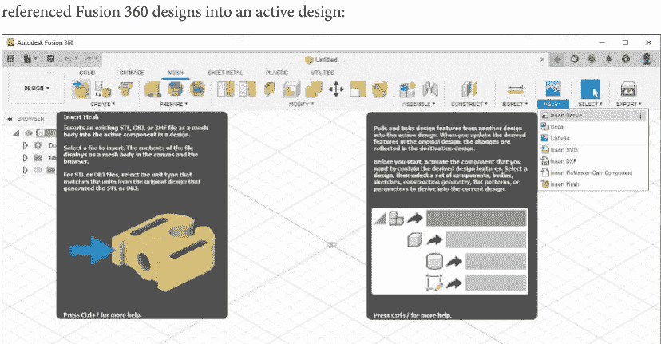

图 1.10 – 插入网格与插入派生

如果您插入单个网格（STL 或 OBJ）文件，您将在插入时有能力编辑该网格文件的位置和单位。如果您导入多个网格（STL 或 OBJ）文件，您在插入操作期间编辑的位置和单位数据将同时适用于您同时插入的所有文件。正因为如此，我更喜欢单独插入网格文件，以便我可以逐一目视检查它们并分别编辑它们的位置和单位，特别是如果我插入由不同设计师创建的网格文件，因为他们可能使用了不同的单位系统和坐标系统。

现在，让我们重点关注 **插入网格** 命令及其一些选项。对于本次练习，我们将插入 CLIP.STL 文件。启动 **插入网格** 命令并选择 STL 文件后，您将看到 **插入网格** 对话框，其中包含更改单位和重新定位零件的选项。**翻转上方向** 按钮将零件绕 X 轴旋转 90 度。**居中** 按钮通过将插入网格的包围盒中心参照到活动组件的原点来移动插入的网格。**移至地面** 按钮平移网格体，使其最低点接触地面平面。在图 1.11 中，地面平面是 *XY* 平面：

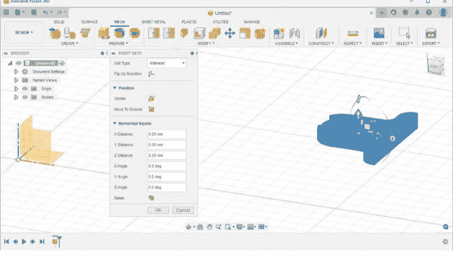

图 1.11 – 插入网格 对话框

除了对齐和接地网格体之外，我们还可以使用画布内的操纵器（箭头和旋转工具）或 **插入网格** 对话框内的数值输入部分来重新定位网格体，直到满意为止。我们始终可以使用 **重置** 按钮撤消操作。

在本示例中，让我们首先使用 **居中** 命令，然后使用 **移至地面** 命令，并按下 **确定**。

> **重要说明**
> 默认模型方向可在 Fusion 360 的 **首选项** 对话框的 **常规** 部分中设置。本书将对所有示例均采用 *Z 向上* 方向。
> 
> 每个新设计的默认单位可在 Fusion 360 的 **首选项** 对话框的 **默认单位** 部分的 **设计** 子部分中设置。本书将对所有新设计均采用毫米作为默认单位。
> 
> 设计历史的默认状态可在 Fusion 360 的 **首选项** 对话框的 **常规** 部分的 **设计** 子部分中设置。本书将对所有新设计均采用 **捕获设计历史**（参数化建模）。

这些首选项均可在图 1.12 中看到：

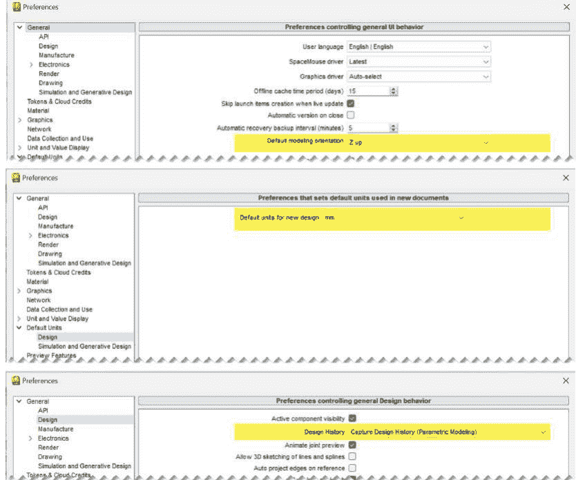

图 1.12 – Fusion 360 首选项对话框内的各个部分

完成插入此 STL 文件后，我们将在时间线中留下添加的基础网格特征，并且位于 XY 平面上的网格体将以原点为中心，如图 1.13 所示：

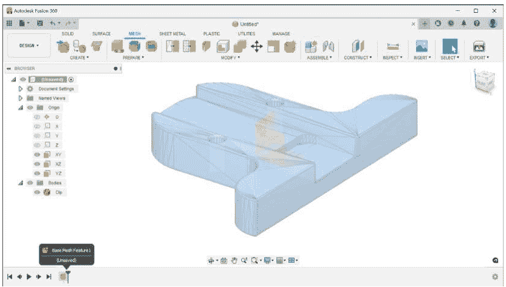

图 1.13 – 插入网格 命令已完成

与 `STL` 文件不同，`3MF` 和 `OBJ` 文件也可以包含颜色信息。现在，让我们使用相同的 **插入网格** 命令将 `CLIP.3MF` 文件插入到新的设计文件中。在 Fusion 360 中，我们可以通过选择打开的 Fusion 设计文档列表右侧的 + 图标来创建新的设计文件。插入 3MF 文件后，Fusion 360 会以每个面组独特的颜色显示网格体。面组通常是代表网格体上的特征或区域的面集合。此 3MF 文件由单个面组组成。因此，插入此文件到 Fusion 360 后，我们将在所有面上看到单一颜色。我们可以通过在 **检查** 面板中使用 **显示网格面组** 命令切换面组可视化，来可视化 3MF 和 OBJ 文件中包含的颜色信息，如图 1.14 所示：

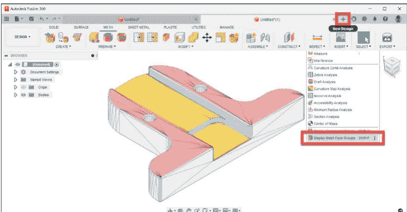

图 1.14 – 3MF 和 OBJ 文件可以包含颜色

## 重要说明

如图所示 1.15 所示，必须在 Fusion 的首选项对话框 | 常规 部分 | 材料 子部分中取消选中“应用不同的外观”复选框，才能使用前面所述的插入网格工作流程显示在 Fusion 360 中打开的 3MF 或 OBJ 文件中包含的颜色信息。

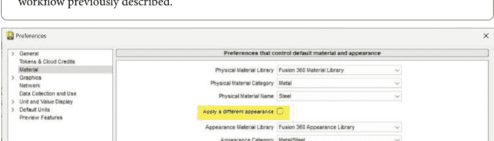

图 1.15 – Fusion 360 首选项对话框中的材料子部分

在本节中，我们了解了插入 STL、OBJ 和 3MF 等网格文件的各种方法。我们还介绍了如何在插入工作流程中设置单位和重新定位网格体。此外，我们还介绍了如何可视化这些文件的颜色/纹理数据。

现在，是时候开始关注针对我们插入的网格体进行潜在问题检查和修复的特定工作流程了。在下一节中，我们将学习如何利用网格选项卡内的自动检查和修复功能，并开始探索在自动修复不足时如何手动修复网格体。

## 检查网格体并修复它们

STL 是一种简单的文件格式，在 3D 打印中被广泛使用。自 1987 年发明以来，几乎所有 2D 和 3D 设计软件都能够创建 STL 文件。由于其简单性、悠久的历史和广泛的可用性，现有的大多数 STL 文件都包含错误，通常需要在用于制造之前进行修复。

在本节中，我们将学习如何检查插入 Fusion 360 的网格体，以及如何使用自动和手动修复技术修复损坏的 STL 文件，以便为 3D 打印做好准备。

为了演示我们用于检查和修复网格体的各种方法，我们将使用名为 Clip_Broken.STL 的 STL 文件。让我们开始创建一个新的 Fusion 360 设计，如图 1.14 所示。

现在，我们可以使用插入网格命令并将 Clip_broken.STL 文件插入到活动的 Fusion 360 设计文档中。就像上一个示例一样，让我们依次在插入网格对话框中使用居中和移至地面功能，将零件平移到更靠近原点并位于 XY 平面上方。现在，我们可以查看刚刚插入的网格体的详细信息。

Fusion 360 会自动检查所有插入的网格体，并在任何有问题的网格体旁边显示警告图标。如图 1.16 所示，如果您在浏览器中展开主体列表，您将看到一个名为 Clip_Broken 的网格体，并在其旁边看到一个警告图标。如果将鼠标悬停在警告图标上，您将看到有关该网格体的以下信息：

- **网格未封闭。**
- **网格未定向。**
- **网格没有正体积。**

当我们看到此类信息时，通常需要在继续 3D 打印文件之前采取修复措施：

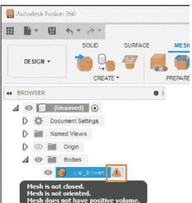

图 1.16 – 有问题的网格体旁边的警告图标

检查有问题的网格体的另一个有用工具是 **属性** 对话框。如果您选择一个网格体，右键单击并选择 **属性**，您可以看到有关该网格体的详细信息，如 *图 1.17* 所示。

在本示例中，您可以看到此网格体没有质量或体积，即使它已被自动分配了具有密度的物理材料（**钢**）。这也是该网格体未封闭体积的另一个迹象。请参考 *图 1.15*，其中显示了 Fusion 360 **首选项** 对话框中 **材料** 子部分内自动材料分配背后的逻辑。

## 重要说明

在 3D 打印中，用于描述正确封闭体积的体的常用术语是 *水密*。在尝试 3D 打印物体时，具有水密体是理想的特性。然而，物体不是水密的并不意味着它不可 3D 打印。在金属粉末床熔融 3D 打印中，支撑结构通常由表面（而非水密体）组成。我们将在 *第 12 章* 中更详细地介绍这一主题。

如果您展开 **网格** 子标题，您将看到此网格体有两个壳。壳是由相互连接的三角形（有时是四边形）的集合。如果网格体由多个壳组成，通常表明构成网格体的三角形的连续性已断裂。

有时，网格体可以有多个壳仍然有效。例如，想象一个空心球。在这种情况下，您将有一个代表球体外部的壳，另一个代表内部边界的壳。

如果您展开网格分析子部分，您将看到此网格体未封闭、未定向且没有正体积：

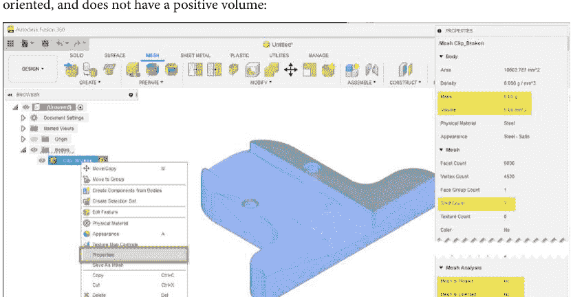

图 1.17 – 属性 对话框显示相关的网格分析信息

现在我们明白我们手头有一个有问题的网格体，我们可以关闭属性对话框，并在网格选项卡 | 准备 面板的功能区中选择修复图标。

Fusion 360 有四种自动修复类型。让我们首先选择关闭孔洞修复类型，该类型可修复翻转的三角形并关闭孔洞。如果我们在修复对话框中激活预览复选框并展开详细分析，我们可以编辑滑块以查看所选修复类型对我们希望修复的体的影响。图 1.18 显示此修复类型将自动修复零件，使其可用于 3D 打印，但对结果进行目视检查看起来杂乱无章，许多三角形相互重叠。

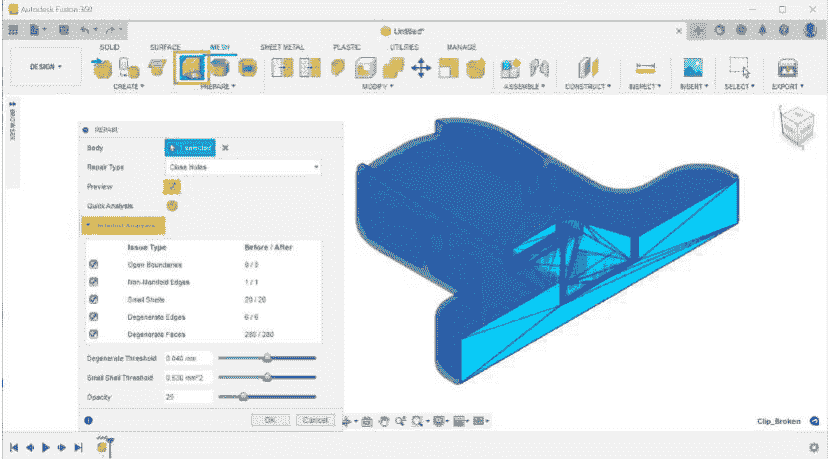

图 1.18 – 关闭孔洞修复类型及其对该部件的影响

即使这次自动修复的结果被报告为成功，始终建议进行目视检查并查看网格体属性的详细信息。图 1.19 显示了执行 Close Holes 修复类型后 Clip_Broken 网格体的 **PROPERTIES** 对话框。这里可以看到，该网格由 66 个壳组成。这是一个意外的结果，部件的目视检查显示出有问题的区域，如红色椭圆所示。该部件沿 XZ 平面对称，但自动修复关闭了一个孔，而不是创建期望的沉头孔类型结果：

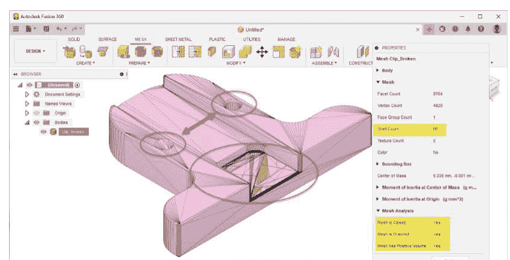

图 1.19 – **PROPERTIES** 对话框显示修复后网格体的结果

现在，让我们使用 Edit Feature 命令对刚刚执行的修复操作进行编辑，通过从 Fusion 360 用户界面底部的时间轴中选择它并右键单击它，如图 1.20 所示。这次，我们可以将修复类型更改为 Stitch and Remove。此修复操作包括先前修复类型执行的所有修复，并且 stitch triangles 会移除重复三角形、退化面以及微小壳。使用此修复类型需要稍长的时间，但结果看起来好得多。如图 1.20 所示，我们不再看到大红色椭圆突出显示区域中杂乱的网格。然而，我们仍然存在沉头孔期望结果缺失的相同问题：

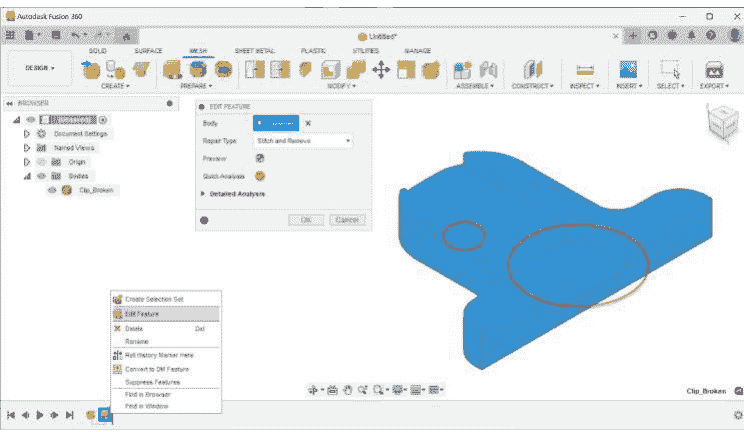

图 1.20 – Stitch and Remove 修复类型及其对该部件的影响

在进入下一个修复类型之前，让我们通过添加一个 **section analysis** 更仔细地查看我们的部件。要添加剖面分析，必须使用位于 **INSPECT** 面板中的 **Section Analysis** 命令。在选择切割平面为 XZ 平面并翻转我们想要剖切的段后，我们可以很容易地看到该网格代表一个被掏空的对象，如图 1.21 所示。通过剖面分析查看我们的部件，可以更好地理解为什么我们在 **PROPERTIES** 对话框中看到壳计数为二：

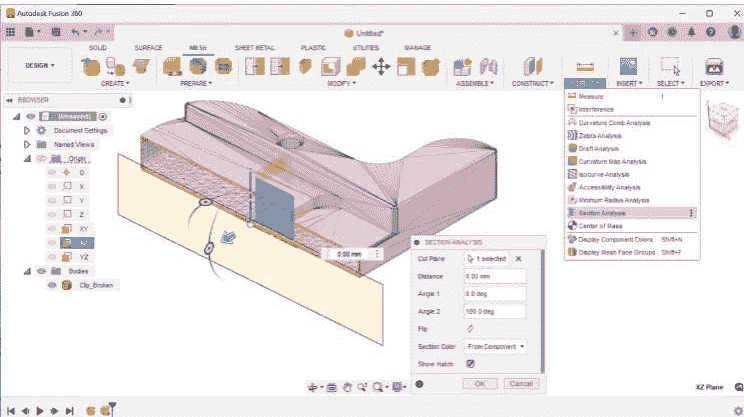

图 1.21 – 剖面分析显示该网格体是一个空心物体

当剖面分析可见时，如浏览器中 **Section1** 旁边的灰色眼睛图标所示，我们可以从时间轴编辑我们的修复并使用第三种修复类型，称为 **Wrap**。此修复类型与 **Stitch and Remove** 做出相同的修复并包裹网格体的表面，移除所有内部结构。如 *图 1.22* 所示，此修复类型的结果移除了部件内部的次级壳，使我们的实体成为一个实心物体。在本例中，我们的目标并不是对该部件做出如此大的改变。因此，我们将再编辑一次修复，然后进入 *第四* 个选项。然而，在某些情况下内部壳也需要进行重大修复，此修复类型可以轻松移除属于内部壳的三角形，从而加快网格修复步骤：

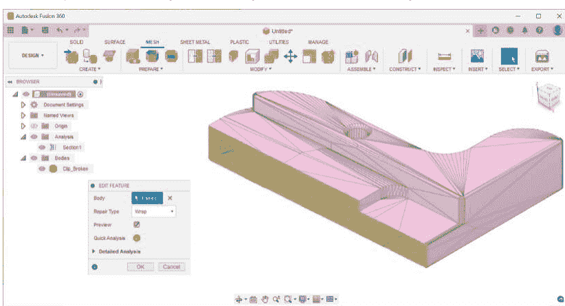

图 1.22 – Wrap 修复类型及其对该部件的影响，带剖面分析视图

第四种也是最后一种修复类型称为 **Rebuild**。有多种重建类型可用，在 *图 1.23* 中，你可以看到使用平均网格密度的快速重建类型的结果。此修复类型重建网格体，并且根据你的密度输入是最慢的修复类型。它可作为自动修复部件时的最后手段。然而，该修复类型的网格结果具有较高的三角形数量，并且该修复类型在捕捉尖锐边缘周围细节方面做得不太理想。

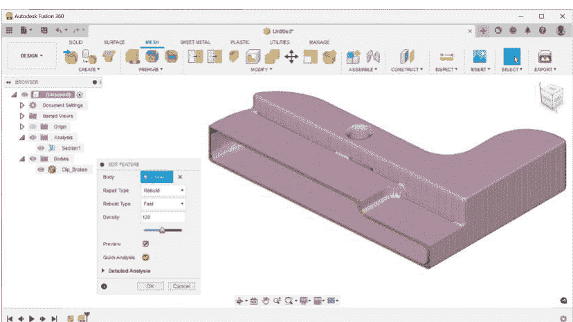

图 1.23 – Rebuild 修复类型及其对该部件的影响，带剖面分析视图

现在我们已经涵盖了全部四种修复类型，让我们编辑一个修复操作，重新使用 **Stitch and Remove** 修复类型，因为其结果对该部件来说是最理想的。该修复类型也是 Fusion 360 推荐的默认修复类型。

没有任何修复类型能够检测并修复沉头孔周围缺失的表面。看起来我们必须执行一些手动网格编辑操作来修复此问题。让我们首先使用位于 **MODIFY** 面板中的 **Plane Cut** 功能将部件切成两半。**Clip_Broken** 网格体是我们将选择的切割对象，切割平面将是 **XZ** 平面。我们将使用 **Trim** 类型移除不需要的部分，并使用 **Minimal** 填充类型将剩余的网格体变为密封对象。

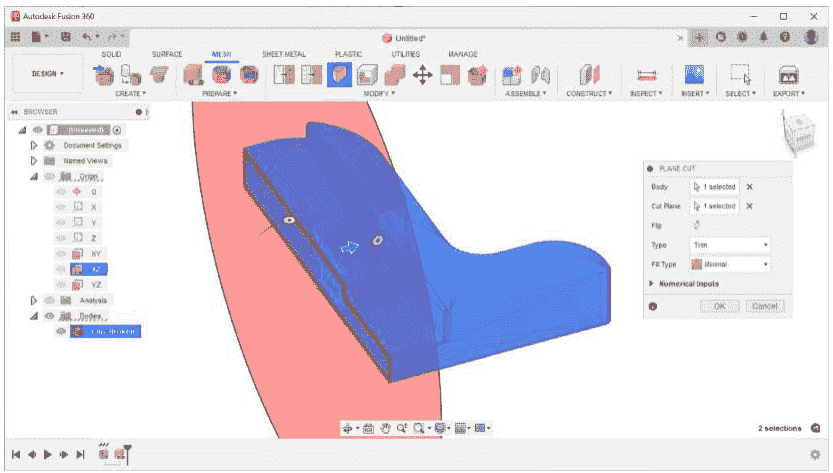

图 1.24 – 使用 Plane Cut 工具修剪网格体

一旦我们将网格体切成两半，我们必须从网格体创建一个组件以便镜像它。图 1.25 显示了如何从修剪后的网格体创建组件——通过在浏览器中右键单击它并选择 Create Components from Bodies 选项。

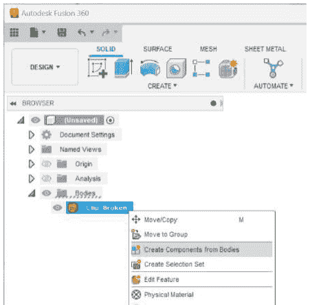

图 1.25 – 从修剪后的网格体创建新组件

一旦有了组件，我们可以切换到 SOLID 选项卡。我们可以从 CREATE 面板下选择 Mirror 命令。一旦 MIRROR 对话框可见，我们必须将对象类型更改为 Components 并选择新创建的组件进行镜像。我们的镜像平面再次为 XZ 平面。镜像操作的结果可在图 1.26 中看到：

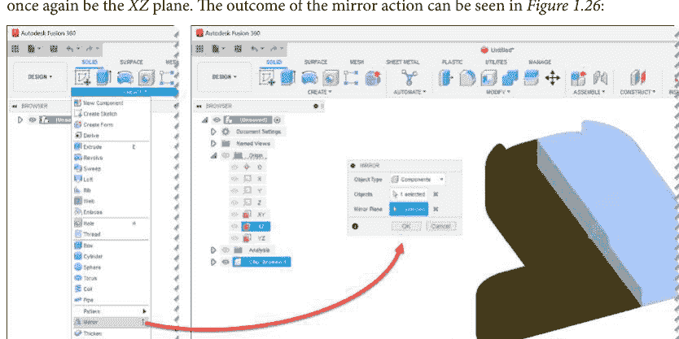

图 1.26 – 镜像组件

镜像组件后，我们将得到两个组件中的两个网格体。是时候将它们合并为单个统一组件了。为此，让我们返回到 MESH 选项卡并使用 MODIFY 面板中的 combine 命令。我们必须选择目标体和工具体，即来自两个组件的 Clip_Broken 网格体。我们将使用 join 操作，创建新组件并保留工具。这将确保如果需要，我们将来可以轻松比较结果和输入。图 1.27 显示了将两个网格体合并以制作新组件所需的输入：

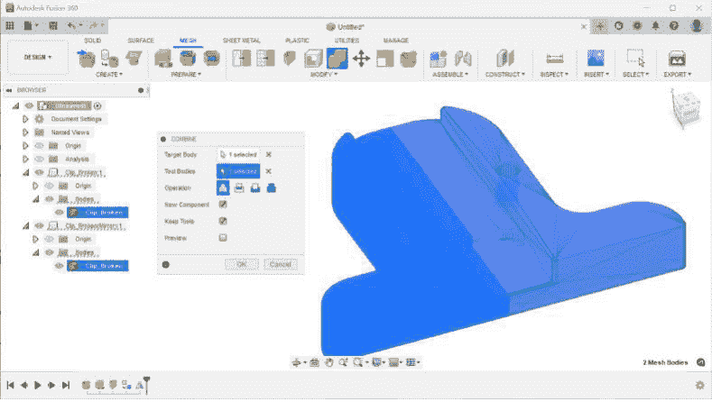

图 1.27 – 合并网格体以制作新组件

合并操作的结果是在浏览器中名为 Component3 的新组件中的完全修复的实体。图 1.28 显示了此新组件，同时隐藏了剖面分析以及第一个和第二个组件：

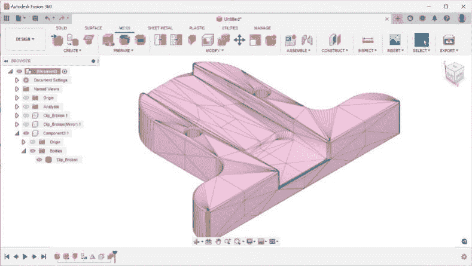

图 1.28 – Component3，一个完全修复的网格

如果我们打开剖面分析的可见性，我们可以快速看到我们修复的网格体仍然具有中空横截面并且可以进行 3D 打印，如图 1.29 所示：

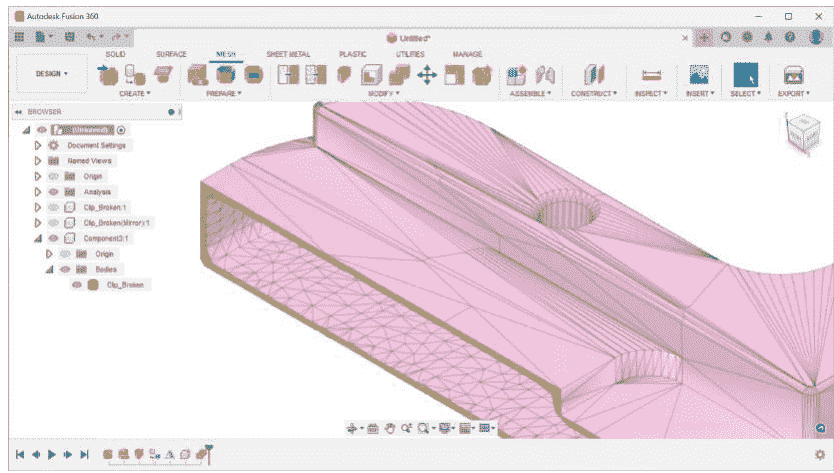

图 1.29 – 修复后网格体的剖面分析视图

作为最后的 sanity 检查，查看修复后网格体的属性始终是一个好主意，以确保我们拥有闭合且定向的网格且具有正体积。我们所有操作的时间线都记录在浏览器左下角的设计历史中，如图 1.30 所示。你可以随时重放这些步骤，提醒自己是如何修复此网格的。

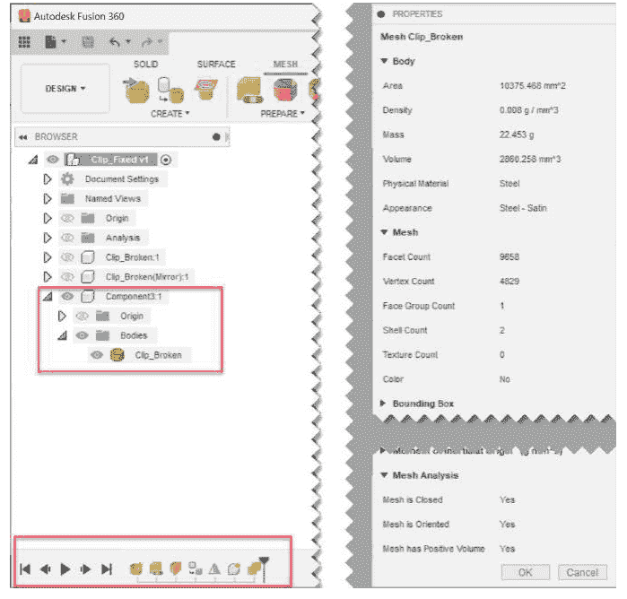

图 1.30 – 修复后网格的属性和修复操作时间线

本章的 Git 仓库还包含一个名为 Clip_fixed.f3d 的 Fusion 360 文件，你可以直接在 Fusion 360 中打开它以重放时间线，如果你在本示例中遇到任何问题。

## Summary

在本章中，我们了解了在 Fusion 360 中打开 CAD 和网格文件的各种方式，范围从使用 **File | Open...** 工作流程到从网页浏览器或 Fusion 360 桌面和移动应用程序将文件上传到 Fusion Team。

我们还介绍了如何将网格文件插入活动设计中，如何设置单位，以及如何定位这些部件。我们强调了如何渲染和着色某些网格文件包含的数据。我们讨论了如何检查有问题的网格体。我们还通过一个示例介绍了使用自动和手动修复步骤，例如修剪网格体和镜像组件，以完全修复严重损坏的网格文件。

利用本章学到的技能，你现在可以自信地打开、检查和修复大多数使用 Fusion 360 的网格文件。

在下一章中，我们将介绍为什么以及如何选择参数化建模与直接建模。我们还将介绍如何自动检测导入到 Fusion 360 的模型特征，以及如何根据增材制造设计原则编辑这些特征。
