## 秉持 DFAM 原则编辑 CAD/网格文件

欢迎阅读 *第 2 章*。本章将介绍如何在秉持各种 **增材制造设计** (**DFAM**) 原则的前提下编辑 CAD/网格模型。我们将首先介绍如何开关设计历史。我们将演示使用参数化建模与直接建模时的流程差异。然后，我们将演示如何自动检测导入的 CAD 模型的特征。随后，我们将介绍如何基于 DFAM 原则编辑 CAD 和网格体。最后，我们将展示如何将网格文件转换为可进一步用于制造修改的实体。

本章将涵盖以下主题：

- 使用 Fusion 360 的设计历史介绍
- 识别 CAD 特征并编辑它们
- 在 Fusion 360 中原生处理网格文件

到本章结束时，你将学会如何在 Fusion 360 中使用参数化和直接建模工作流程处理模型。你将能够自动识别 CAD 特征并编辑它们。你还将了解如何使用增材制造设计原则编辑从其他来源导入的 CAD/网格几何体。

### 技术要求

本章涵盖的大多数主题适用于 Fusion 360 的所有许可级别（个人/爱好、初创企业、教育和商业）。然而，本书还将介绍个人/爱好使用许可不可用的高级功能。此类高级功能将根据情况标识为 *不适用于个人使用且需要扩展访问*。

本章的练习文件可在以下位置找到： https://github.com/PacktPublishing/3D-Printing-with-Fusion-360.

### 使用 Fusion 360 了解设计历史

在第 1 章中，我们简要介绍了 Fusion 360 如何捕获模型更改的设计历史。在本章中，我们将更深入地探讨这一主题，并展示捕获设计历史（参数化建模）与不捕获设计历史（直接建模）的利弊。

在 Fusion 360 的上下文中，参数化建模是一种基于特征和约束的方法。你添加到模型中的所有特征都会随时间被记录，任何对特定特征的更改都会在时间线中向下传播并影响后续特征，最终影响设计的最终结果。这使得参数化建模成为基于规则创建设计替代方案的强大工具。

相比之下，直接建模是一种你添加到模型中的特征并非全部存储或可编辑的方法。直接建模特征的子集可以编辑。然而，这些特征不会与你在编辑的特征之前或之后添加的任何特征交互。这使得直接建模成为快速对设计进行大幅更改的非常灵活的工具。使用直接建模，你不必担心由于 CAD 软件中模型的原始设计方式而可能导致的问题。

在生成新设计时，Fusion 360 依赖于首选项对话框中设计历史选项中指定的设置，如图 2.1 所示，以确定设计将使用参数化建模还是直接建模方法。

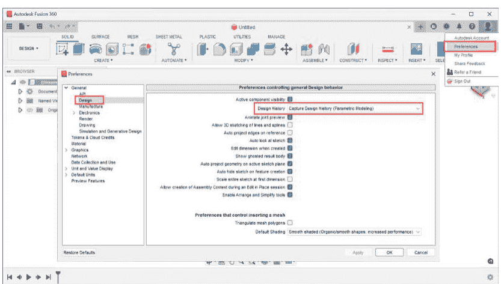

图 2.1 – Fusion 360 捕获设计历史的偏好设置

在处理现有的 Fusion 360 设计时，我们也可以随时改变主意，在任何时间使用直接建模代替参数化建模。我们有两种方法可以从参数化建模切换到直接建模。第一种切换方式是右键单击浏览器中的第一个项目并选择 **不捕获设计历史**。第二种切换方式是选择 Fusion 360 时间线右上角的齿轮图标，然后从可用选项列表中选择 **不捕获设计历史**。这两种方法均显示在图 2.2 中。

**重要提示**
如果你不小心从参数化建模切换到直接建模，你始终可以撤销操作（Ctrl + Z）并恢复时间线。

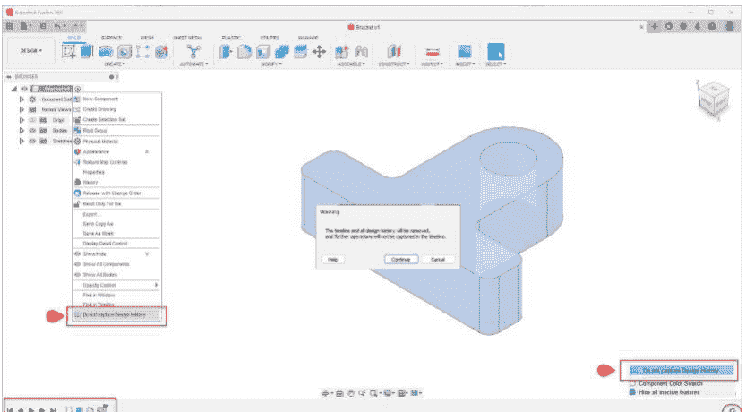

图 2.2 – 将参数化模型更改为直接模型

无论你使用哪种方法，从参数化建模切换到直接建模时，你的特征时间线将被丢失，时间线栏将不可见，并且你将失去用于创建设计的特征之间的约束和引用。图 2.3 显示了从参数化建模切换到直接建模的影响。请注意左侧图底部有一个时间线栏。时间线栏显示了使用参数化建模方法创建此零件的方式。所有列出的特征都具有生成时使用的尺寸和引用。

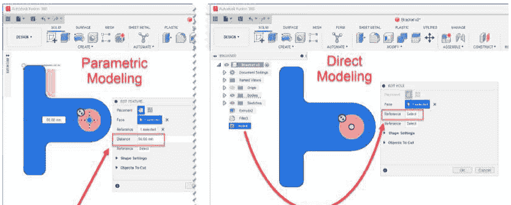

图 2.3 – 从参数化建模切换到直接建模的影响

切换到直接建模方法后，时间线栏丢失。模型现在有一系列可选择的特征；其中一些（例如 **倒角** 和 **孔**）甚至可编辑。然而，如果你编辑此类特征，你会发现引用不会与特征一起保存。每次后续编辑时，你都可以重新定义这些引用。换句话说，特征不受约束，即使在明确定义后也可以自由移动。

### 参数化建模

Fusion 360 有几个功能组件只有在参数化建模模式下才可访问。最明显的是你可以定义、使用和编辑控制特征输入的参数。*图 2.4* 显示了命名和用户定义的参数列表如何用于此模型的创建。如果你对组件和/或装配进行大幅更改，可能需要使用 **全部计算** 命令来解决时间线中的任何问题。就像 **更改参数** 命令一样，**全部计算** 命令也只有在参数化建模范式下工作时才可用。两个命令都可以在 **修改** 面板中找到，如 *图 2.4* 所示。

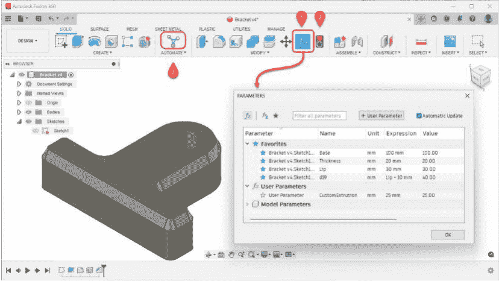

图 2.4 – 更改参数、全部计算和自动化建模命令

另一个属于 Fusion 360 参数化建模工具集独有的关键功能是 **自动化建模**，位于 **自动化** 选项卡中，如 *图 2.4* 所示。**自动化建模** 将 Fusion 360 设计中的不连续面连接起来并创建多个可供选择的替代体/组件。我们将在 *第 3 章* 中详细介绍 **自动化建模**。

有三个简化功能（**简化**、**移除面** 和 **替换为基本体**），你只能在参数化建模模式下使用。但在直接建模模式下，你可以使用替代命令来实现类似结果。在参数化建模中，你可以从 **修改** 面板 | **简化** 滑出菜单中访问这三个功能，如 *图 2.5* 所示。

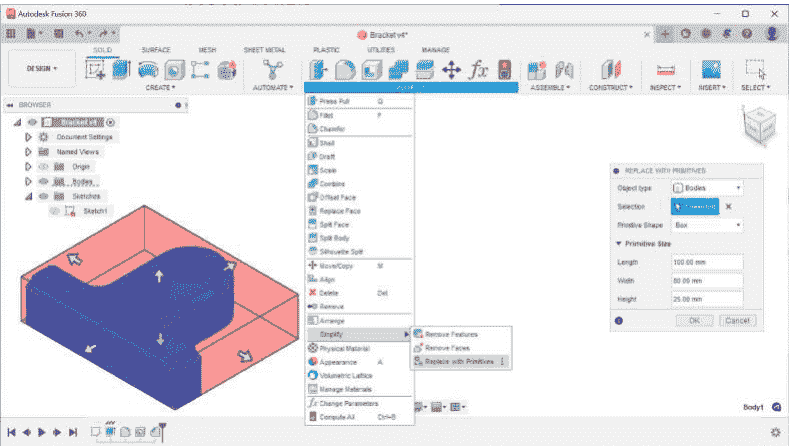

图 2.5 – 参数化建模方法可用的简化功能

与大多数其他参数化建模功能不同，这三个功能一旦使用就不可编辑。如果你使用它们，就必须回滚时间线或从时间线中删除该特征以撤销其效果，如图 2.6 所示：

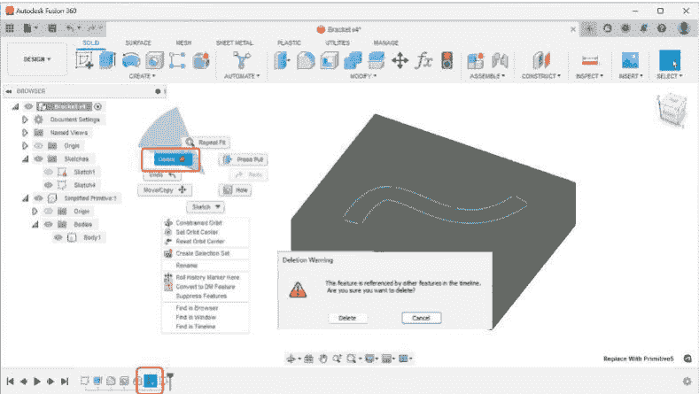

图 2.6 – 删除被草图引用的替换为基本体特征

每当你在参数化建模模式下并在时间线的中间删除特征（或实体或组件）时，就有破坏时间线连续性的风险。如果你删除时间线中被其他项目作为引用使用的项目，你将留下缺失引用警告。在图 2.7 所示的示例中，一旦 **Replace with Primitives** 特征从时间线中删除，我们就会在 **Sketch** 特征的时间线图标上看到黄色高亮，该特征使用了现在已删除的简化原始体的顶面。

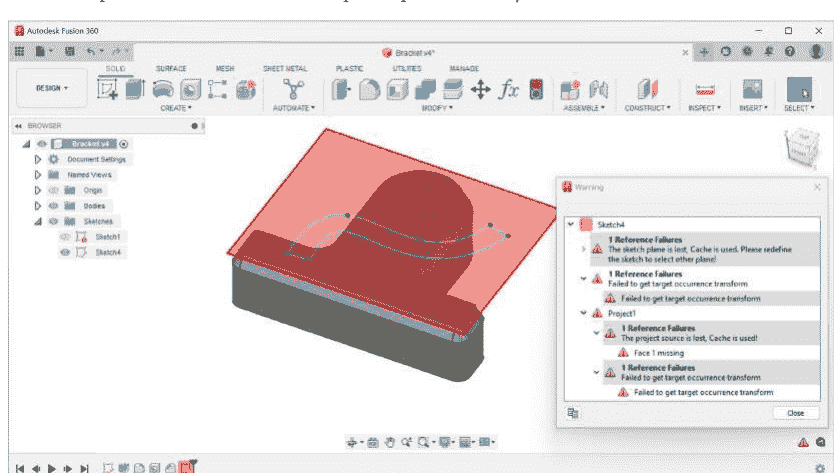

图 2.7 – 删除被引用的特征后时间线中的引用失败警告

拥有带有引用失败警告信息的组件通常不是理想的结果，因为我们可能无法重放时间线或有效计算所有更改。具有此类警告的特征需要额外的工作来重新建立丢失的引用。因此，你可能选择完全避免使用这三个特征。如图 2.8 所示，你可以在 Fusion 360 的 **Preferences** 中禁用 **Arrange and Simplify tools**，方法是导航到 **General** 下拉菜单 | **Design** 子部分。

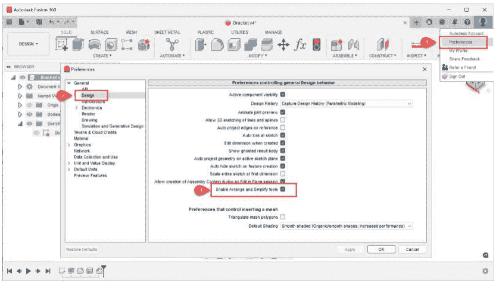

图 2.8 – 在 Fusion 360 的首选项中启用/禁用简化工具

正如我们刚才所说明的，在参数化建模模式下使用 Delete 命令可能会产生不可预见的后果。你可以使用两种替代 Delete 命令的方法来消除实体中不需要的特征。它们是 Suppress Features 命令和 Remove 命令。两者都独特于参数化建模，并且是我个人在不破坏时间线的情况下从 Fusion 360 设计文档中排除特征和模型的首选方式。

如图 2.9 所示，Remove 命令会消除实体和组件，可以通过选择其输入并使用右键菜单访问。图 2.9 还显示了 Suppress Features 命令，该命令允许我们从模型中排除特征，可以通过从时间线中选择其输入并使用右键菜单访问。

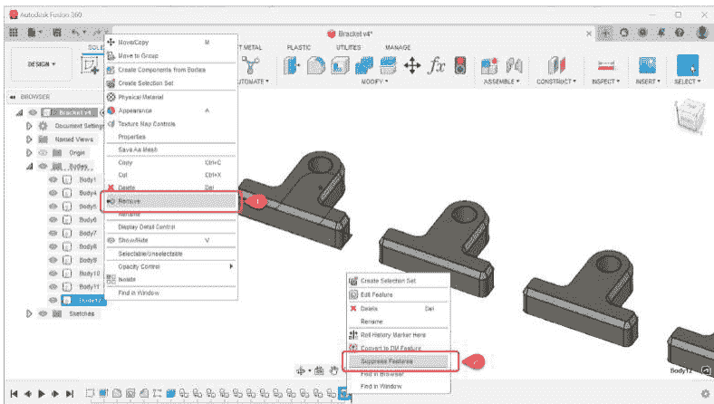

图 2.9 – Remove 命令和 Suppress Features

参数化建模的最终独特功能集需要访问 Product Design 扩展。Fusion 360 为试用用户、教育用户、初创用户和商业用户提供多个扩展。扩展不可用于免费、个人或业余爱好用户。根据你的订阅类型，你可以在 Extensions 对话框中获得对扩展的访问权限，如图 2.10 所示。

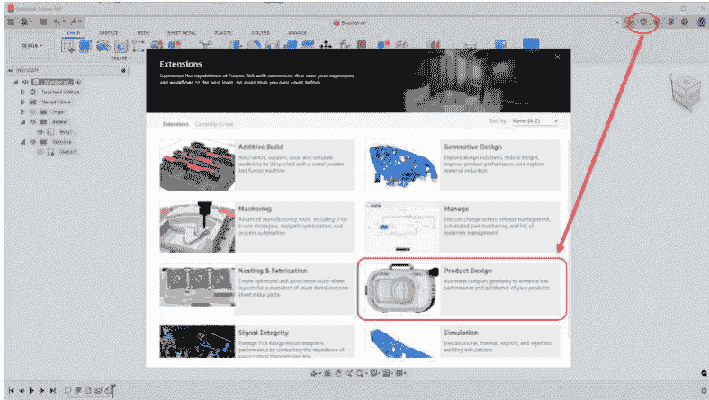

图 2.10 – Extensions 对话框和 Product Design 扩展访问

一旦你获得对 **Product Design** 扩展的访问权限，你就可以在塑料选项卡的设置面板中为组件分配和编辑塑料规则。如 *图 2.11* 所示，为给定组件分配塑料规则会自动在 Fusion 360 的参数表中添加一些参数，这些参数控制诸如 **Thickness**、**Draft Angle**、**Nominal Radius** 和 **Knife Edge Threshold** 等设置。

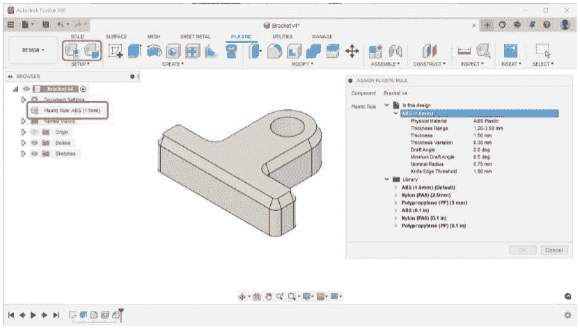

图 2.11 – 为组件分配塑料规则

在为给定组件分配塑料规则后，你添加到该组件的任何塑料特征都会自动利用塑料规则设置的参数。在 *图 2.12* 中，我们可以看到带有添加的肋的我们设计的壳版本。**Web** 特征并不独特于参数化建模。但它目前正在使用名为 **Feature Values** 的预设，该预设会自动分配名为 **T** 的参数用于 **thickness** 和 **DA** 用于 **draft angle**。它还使用基于厚度参数的方程来计算倒圆半径。所有这些参数和特征预设都基于我们在上一步中分配的塑料规则。因此，这些建模技术都依赖于使用参数化建模方法。

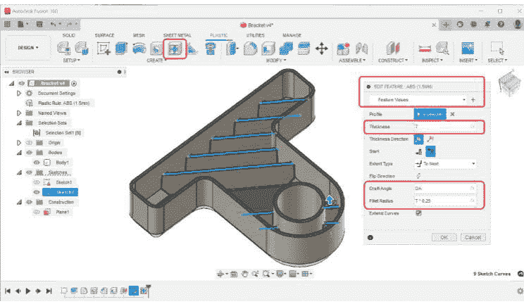

图 2.12 – 使用塑料规则创建/编辑 Web 特征

我想要重点介绍的最终特征是独特于参数化建模方法的 **Geometric Pattern**。你可以从 **CREATE | Pattern** 滑出菜单访问 **Geometric Pattern**。图 2.13 显示了将几何图案应用于模型上的面的结果。使用此功能，你可以轻松地参数化创建建模表面纹理。就像塑料规则和特征预设一样，**Geometric Pattern** 也需要访问 Product Design 扩展。

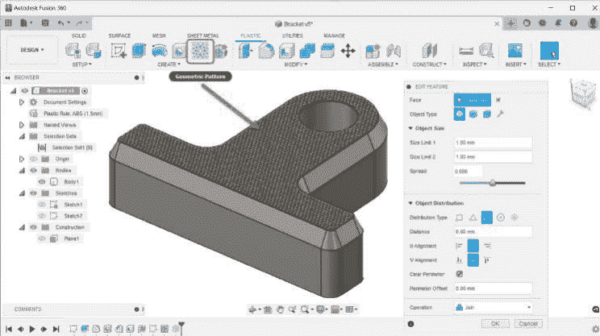

图 2.13 – 创建/编辑几何图案

## 直接建模

Fusion 360 有几个功能部件只有在你处于直接建模模式时才可访问。其中一些功能特定于处理网格实体。一些与处理实体和曲面实体相关，一些与在装配中处理组件相关。

让我们开始介绍网格特定功能。第一个特定于直接建模的网格功能是 **CREATE FACE GROUP**，位于 **MESH** 选项卡 | **PREPARE** 面板下。使用 **CREATE FACE GROUP**，你可以选择单个三角形或一组三角形并将它们分配给新的面组。创建面组对于在增材制造工作流程中下游选择它们以创建支撑结构或尝试将网格实体转换为实体对象时至关重要。即使 Fusion 360 具有自动生成面组的工具，在处理复杂的插入网格时，对创建面组进行手动控制仍然是一项重要的功能。你可以将此功能用作直接建模的一部分。

> **重要说明**
> 在参数化建模中，你需要利用 **DIRECT EDIT** 功能才能手动创建面组。我们在本小节中强调的所有网格特定功能都可以通过在参数化建模中引入相同的直接编辑功能来访问。

下一个特定于直接建模的网格特定功能是 **ERASE AND FILL**。此命令位于 **MODIFY** 面板下，允许你删除并替换网格实体上的一个或多个面，以手动填充孔洞和修复区域。使用此命令时，我还建议打开 **MESH SELECTION PALETTE**，以便你可以使用不同的选择类型，例如画笔或自由形式选择。如果你使用油漆选择，你还可以控制刷子大小。**Mesh Palette** 可从 **SELECT** 面板访问，如 *图 2.14* 所示。

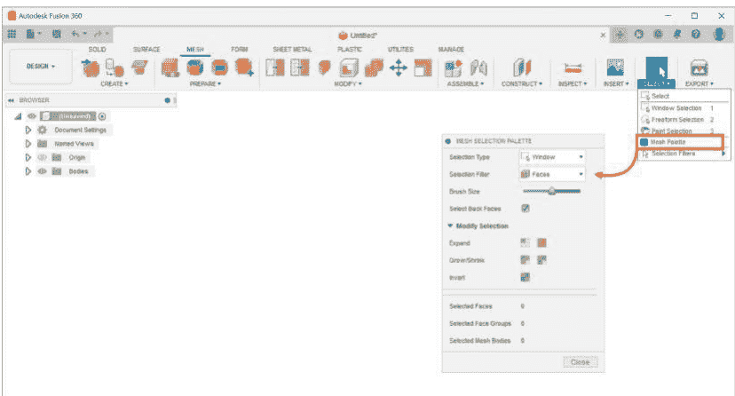

图 2.14 – 网格选择调色板和网格选择工具

现在，让我们开始关注特定于实体和曲面实体且独特于直接建模的特征。我们将重点介绍的第一个特征通常适用于使用面片方法从网格实体转换而来的实体和曲面实体。我们将在本章后面讨论在 Fusion 360 中原生处理网格文件时介绍如何将网格实体转换为实体实体。一旦网格实体使用面片方法转换为实体实体，它将具有大量曲面，这将使设计难以处理，因为其文件大小和模型复杂性。通常，最好简化此类模型，以便进一步编辑它们或在装配中使用它们。在这种情况下，我们可以依赖 MERGE 功能，该功能位于 SURFACE 选项卡 | MODIFY 下拉菜单中。此功能将允许你将实体或曲面实体内的两个或多个面合并为单个面。如果激活 Select Chain 复选框，你只需双击单个面，Fusion 360 就会自动选择与你选择的面相连且共面的所有面，如图 2.15 所示。

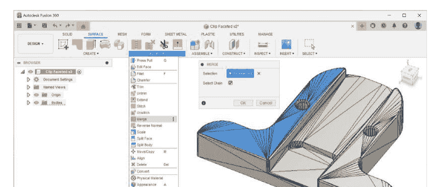

图 2.15 – 合并平面面以创建单个面

在 **MERGE** 对话框中按下 **OK** 后，所有选定的分面面将被替换为单个面，从而降低模型复杂度和文件大小。然而，需要注意的是，如果你选择多个不共面的面，例如构成倒圆角的面，结果将是一个面，它并不是对预期特征的真实表示，而更像是所需结果的波浪状版本。如 *图 2.16* 所示，你可以使用各种检查工具，例如 **Zebra Analysis**，轻松地双重检查 **MERGE** 特征的结果。该工具显示光线如何反射离开给定表面，以显示给定表面上的曲率变化。在 *图 2.16* 中，你可以轻松看到左侧原始 CAD 实体模型上的条纹与右侧分面版本上的条纹之间的差异，后者利用 **MERGE** 特征将倒圆角周围的多个面合并为一个。

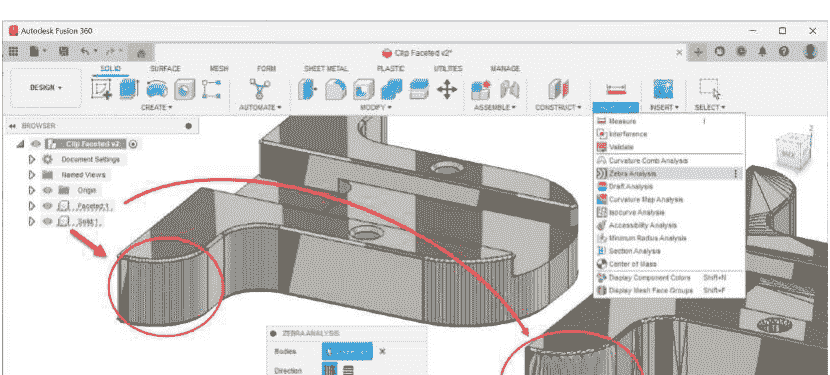

图 2.16 – 使用斑马纹分析检查合并的面

下一个我们将重点介绍的特征是 **Fluid Volume**。此命令以及我们接下来将介绍的 **Find Features** 命令位于 **SOLID** 选项卡 | **CREATE** 面板中，如 *图 2.17* 所示。

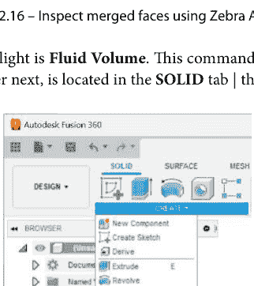

图 2.17 – 查找特征和流体体积命令

你可以根据正在处理的实体体的类型创建内部或外部流体体积。图 2.18 显示了如何为棋子创建外部体积。创建外部流体体积后，如果你使用剖面分析检查模型，你会注意到新创建的外部体积包围着国际象棋兵，并且不会干扰导入的 CAD 实体。使用此技术，你可以快速创建可用于 3D 打印模具的模型。你可以使用此新创建的组件作为创建型芯的起点。在此示例中，期望的结果是国际象棋兵。因此，我们首先创建型腔。稍后，我们可以根据模具的分离方式将此新组件一分为二。在 3D 打印之前，我们可以稍后添加浇口杯和浇道。第 2 章的 GitHub 仓库包含一个 CHESSPAWN.STEP 文件，供你尝试使用此直接建模功能。还提供了带有两个带连接销的拔模、浇口杯和浇道的模具的成品版本（CHESSPAWNMOLD.STEP）。

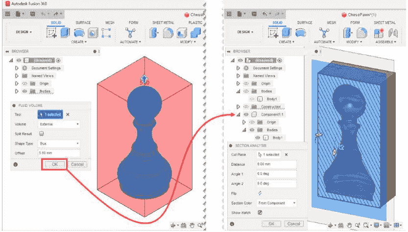

图 2.18 – 为组件创建外部流体体积

在某些情况下，我们可能拥有模具本身的 CAD 文件，并希望逆向工程零件并进行更改，以确保其符合我们的要求，例如尺寸或美观。在这种情况下，我们可以轻松使用 Fluid Volume 工具并创建内部体积。图 2.19 显示了如何为具有两个实体拔模且封盖表面位于浇口杯顶部的模具创建内部流体体积。

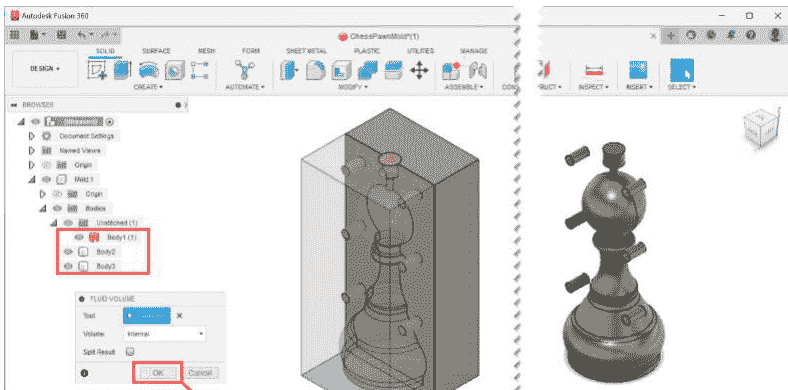

图 2.19 – 为组件创建内部流体体积

请注意，在这种情况下，你将得到一个包含七个体的新组件。Fluid Volume 命令中的内部体积选项会填充所有可能的空腔，包括销钉和孔之间的公差。如果你不需要那些额外的实体，可以选择、右键单击并删除它们，如图 2.20 的左半部分所示。同样，使用矩形选择工具，你可以选择构成浇口杯和浇道的所有表面，右键单击并删除它们，如图 2.20 的右侧所示。

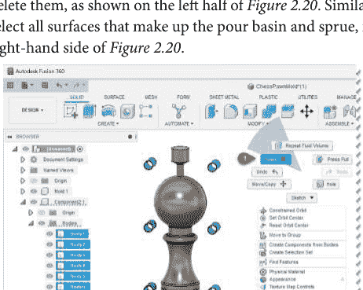

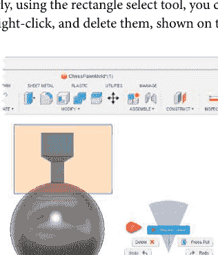

图 2.20 – 选择并删除实体和面

## 重要说明

你可能已经注意到，使用直接建模可以创建的外部流体体积与我们在与参数化建模相关的上一小节中介绍的 simplify 命令之间的相似性。这两个特征之间的底层功能是相同的。然而，正如之前讨论的那样，SIMPLIFY 特征并非完全参数化，因此在参数化建模中使用时可能会出现问题。

下一个功能是直接建模在处理导入的 CAD 几何体时独有的功能，也是我在 Fusion 360 中最喜欢的功能之一。它被称为 FIND FEATURES，位于 SOLID 选项卡 | CREATE 面板中。它允许你选择面、实体或组件并自动识别关键特征，例如倒圆角、孔、倒角和阵列。使用 find features 命令并识别出关键特征（例如倒圆角）后，它将以其指定名称显示在 Fusion 360 的浏览器中。你将能够选择该特征，右键单击并编辑它。根据特征的位置，你可以轻松更改给定特征的尺寸或完全删除它。我们将在下一节介绍如何更有效地使用此命令。

直接建模顾名思义并不是创建和编辑几何体的参数化方法。许多建模工具，例如倒圆角、孔和阵列，在创建与编辑期间的行为不同。你添加到实体模型上的任何特征都使用与参数化建模中的对应功能完全相同的用户界面。倒圆角特征是这一点的绝佳示例。在图 2.21 中，我们展示了将倒圆角应用于多个边的过程。

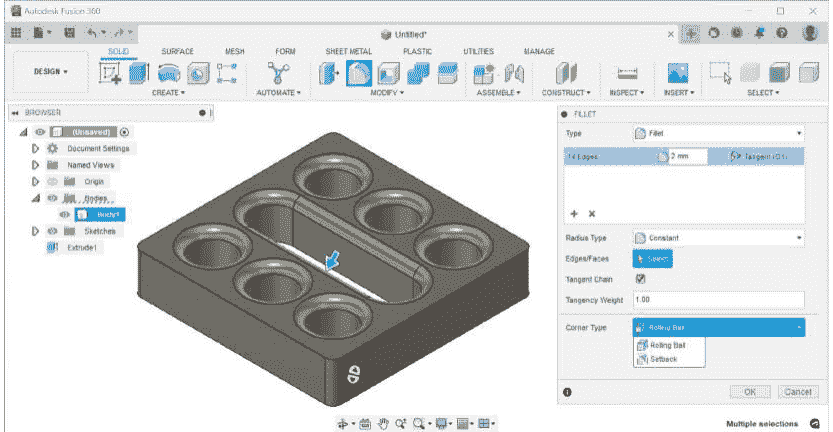

图 2.21 – 在直接建模中创建倒圆角特征

添加特征后，我们可以编辑该特征。然而，如图 2.22 所示，**EDIT FILLET** 对话框与创建对话框非常不同，并且选项有限。创建与编辑之间的这种差异既是直接建模的超能力，也是其阿喀琉斯之踵，具体取决于你希望如何建模与如何编辑模型。

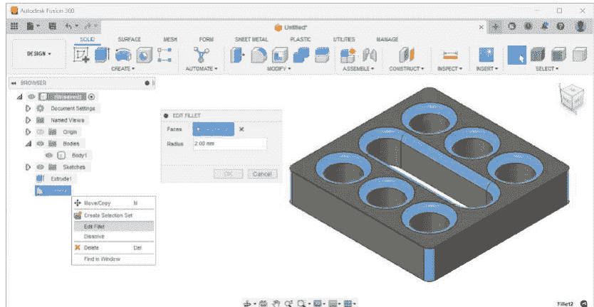

图 2.22 – 在直接建模中编辑倒圆角特征

我想要为直接建模重点介绍的最后一组特征与在装配上下文中处理组件有关。在装配建模中，我们希望复制给定组件并粘贴以制作副本，以便我们可以 3D 打印相同零件的多个副本。我们可以使用多种方法复制组件。我们可以通过右键单击组件并选择 **Copy** 命令来选择组件，然后重复该过程并选择 **Paste** 命令。我们可以使用多个 **Pattern** 工具之一创建所选组件的多个实例。或者，我们可以简单地从数据面板将给定组件多次插入到现有设计中。如果我们使用直接建模，我们可以使复制的组件成为独立的。为此，选择其中一个副本，右键单击它并选择 **Make Independent**，如图 2.23 所示。

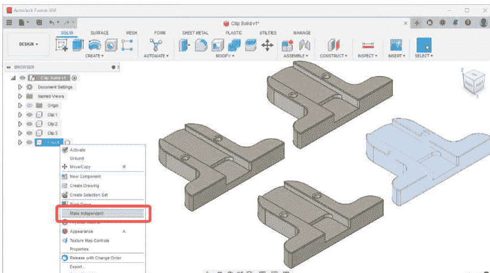

图 2.23 – 使复制的组件与其父组件独立

通过切断其与源组件的链接并使其独立，我们对原始组件所做的任何更改都不会传播到副本。同样，我们对复制组件所做的任何更改都不会影响原始组件。

在参数化建模中，如果你想实现类似的结果，只能使用复制组件粘贴新组件选项。或者，你可以在将组件插入设计后使用 Break Link 选项，如图 2.24 所示。使用位于 SOLID 选项卡 | CREATE 面板 | PATTERN 弹出菜单中的三种阵列方法之一（矩形阵列、沿路径阵列或圆形阵列）复制组件后，没有使其组件独立的方法：

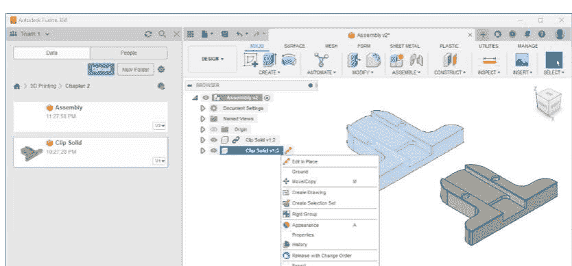

图 2.24 – 断开插入组件的链接

在本节中，我们介绍了如何使用直接建模以及参数化建模。我们强调了参数化建模和直接建模各自独有的各种功能。我们还强调了这些独特功能与其对应功能之间的一些相似之处。在下一节中，我们将更详细地研究识别 CAD 特征并编辑它们，这是在本节中介绍的直接建模的独特功能。

## 识别 CAD 特征并编辑它们

前一节中，我们简要介绍了 find features 命令，这是直接建模独有的功能。在本节中，我们将更深入地探讨这一功能并突出其优势和不足。我们还将利用该功能配合示例数据集，以便根据 DFAM 原则编辑我们导入的 CAD 文件。

随着 3D 打印变得越来越主流，我们需要类别来指代基于其类别的特定 3D 打印机组。在撰写本文时，增材制造有七个类别：

- 材料挤出
- 液槽光聚合
- 黏结剂喷射
- 材料喷射
- 粉末床熔融
- 直接能量沉积
- 薄片层压

存在多种材料挤出方法，但可能最常见的是 **熔融长丝制造 (FFF)**。随着 3D 打印的一些早期专利在 2002 年后开始到期，FFF 技术正在经历民主化。如今，任何人都可以从常见的购物网站（如 www.amazon.com）购买用于家庭使用的 FFF 3D 打印机。液槽光聚合技术也经历了类似的民主化过程。我们现在可以购买 **立体光刻 (SLA)/数字光处理 (DLP)** 3D 打印机用于家庭使用。

然而，即使粉末床熔融技术周围的一些早期专利在 2016 年左右开始到期，粉末床熔融 3D 打印机仍未针对家庭使用进行制造或营销。这种情况可能会继续存在，因为粉末床熔融技术要求用户拥有更大的操作空间，并且根据打印材料的种类需要更好的通风和防火安全措施。此外，由于粉末床熔融涉及使用粉末，材料的小颗粒在后处理过程中可能构成安全隐患，并且需要额外的 **个人防护装备 (PPE)**。

无论我们选择哪种硬件进行 3D 打印，如果我们想增材制造我们的设计，就必须遵循几项准则和设计规则。这些规则不是一成不变的，会根据各种参数而变化。它们可能会根据我们将使用的 3D 打印机类型、我们将使用的打印材料类型，甚至制造商或特定打印机而变化。为了有效利用本章中学到的信息，您需要知道您正在为哪种 3D 打印类别/打印机设计。有多个资源列出了 3D 打印的常用设计规则。Hubs.com 就是其中一个可利用的资源。图 2.25 显示了 https://www.hubs.com/get/3d-printing-design-rules/ 上发布的 3D 打印设计规则。

## 3D 打印设计规则

|  | 受支持的壁 | 未受支持的壁 | 支撑与悬垂 | 浮雕与雕刻细节 | 水平桥 | 孔 | 连接/移动部件 | 排气孔 | 最小特征 | 销直径 | 公差 |
|---|---|---|---|---|---|---|---|---|---|---|---|
|  | 与打印件其余部分至少在两边相连的壁。 | 未受支持的壁与打印件其余部分在少于两边相连。 | 墙壁在无需支撑的情况下可以打印的最大角度。 | 模型上高于或低于模型表面的特征。 | 技术在无需支撑的情况下可以打印的跨度。 | 技术可以成功完全打印孔的最小直径。 | 两个移动或连接部件之间的推荐间隙。 | 允许移除成型材料的排气孔的最小直径。 | 确保特征不会打印失败的推荐最小尺寸。 | 可以打印的销的最小直径。 | 特定技术的预期公差（尺寸精度）。 |
| 熔融沉积建模 | 0.8 mm | 0.8 mm | 45° | 0.6 mm 宽 & 2 mm 高 | 10 mm | Ø2 mm | 0.5 mm | — | 2 mm | 3 mm | ±0.8% (lower limit ±0.5 mm) |
| 立体光刻 | 0.5 mm | 1 mm | 始终需要支撑 | 0.4 mm 宽 & 高 | — | Ø0.5 mm | 0.5 mm | 4 mm | 0.2 mm | 0.5 mm | ±0.8% (lower limit ±0.1 mm) |
| 选择性激光烧结 | 0.7 mm | — | — | 1 mm 宽 & 高 | — | Ø1.5 mm | 移动部件 0.3 mm & 连接 0.1 mm | 5 mm | 0.8 mm | 0.8 mm | ±0.2% (lower limit ±0.3 mm) |
| 材料喷射 | 1 mm | 1 mm | 始终需要支撑 | 0.5 mm 宽 & 高 | — | Ø0.5 mm | 0.2 mm | — | 0.5 mm | 0.5 mm | ±0.1 mm |
| 黏结剂喷射 | 2 mm | 3 mm | — | 0.5 mm 宽 & 高 | — | Ø1.5 mm |  | 5 mm | 2 mm | 2 mm | ±0.2 mm for metal & ±0.5 mm for sand |
| 直接金属激光烧结 | 0.4 mm | 0.5 mm | 始终需要支撑 | 0.2 mm 宽 & 高 | 2 mm | Ø1.5 mm | — | 5 mm | 0.6 mm | 1 mm | ±0.1 mm |

图 2.25 – 一套 3D 打印设计规则

正如我们在图 2.25 中看到的，不同技术有不同的要求。例如，如果我们设计零件使用选择性激光烧结打印，我们就不必关心悬垂角度。这一类 3D 打印机可以在任何方向打印物体，而不必担心创建支撑结构，因为正在 3D 打印的零件已得到下方粉末的充分支撑。然而，当我们具有相对于水平面小于 45 度的悬垂角度特征时，使用 FFF 打印机进行 3D 打印时需要生成支撑结构。图 2.26 演示了当我们在制造工作区时，如何根据悬垂角度在 Fusion 360 中创建不同风格的支撑结构。我们将在第 10 章更详细地介绍这一主题。

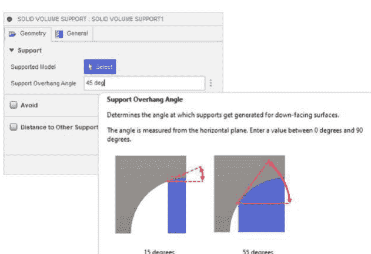

图 2.26 – 基于悬垂角度的朝下表面支撑结构

诸如浮雕和雕刻细节、孔的最小直径、排气孔要求和预期公差等设计规则在我们为 3D 打印设计和准备模型的方式中发挥着重要作用。如果我们从头创建自己的模型，我们可以注意如何设计它们以尽量避免 3D 打印时出现问题。然而，如果我们使用其他设计师创建的模型，并且只是将它们导入 Fusion 360，我们将需要检查模型的创建方式，并在考虑到增材制造原则的情况下根据需要对其进行编辑。

现在，让我们通过一个示例来打开 CAD 文件并使用 Fusion 360 中的原生工具检查它。稍后在示例中，让 Fusion 360 识别并移除一些不适合 3D 打印的小特征，并添加新特征来自定义设计。

我们将通过打开 Chapter2-Example1.STEP 文件开始练习。如我们在第 1 章中所述，您可以使用 File | Open 菜单在 Fusion 360 中打开 CAD 文件，或将文件上传到您想要的 Fusion 团队/项目/文件夹，然后双击它以在 Fusion 360 的画布中打开它，如图 2.27 所示。

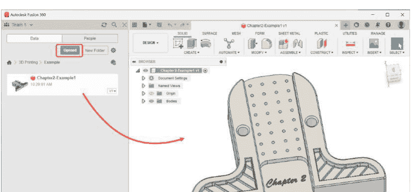

图 2.27 – 示例文件已上传并显示在 Fusion 360 的画布上

现在模型已在 Fusion 360 中，让我们先对其进行视觉检查。该模型有 2 个大孔、32 个小孔、2 个带网状结构的口袋、雕刻文字以及许多小的倒圆角和倒角。它看起来 32 个小孔似乎呈图案排列，但目前很难确定。

让我们开始使用 Fusion 360 直接建模环境中的一些特征识别工具，并专注于该设计中的孔。如图 2.28 所示，在启动 Find features 命令、选择 BODY1 作为输入并取消选中 Hole 和 Rectangular pattern 特征以外的所有特征后，我们会发现 2 个大孔和 32 个小孔作为 2 个单独的矩形图案。看起来我们的视觉假设是正确的，小孔确实有图案，但它不是单一的连续图案，而是 2 种不同的图案。

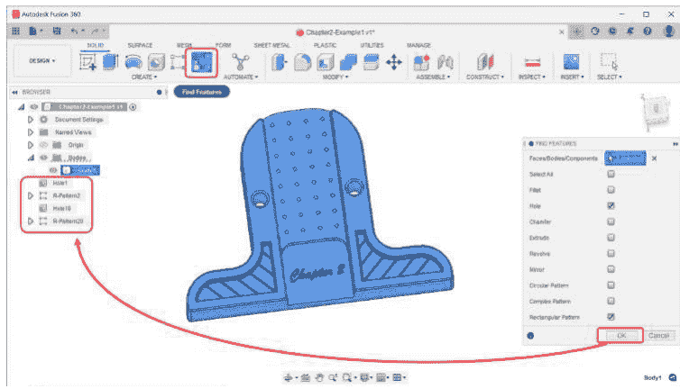

图 2.28 – 使用查找特征命令查找孔和图案

现在，让我们研究孔的尺寸。如果我们从浏览器中选择 Hole1，右键单击并选择编辑孔，如图 2.29 所示，我们将能够检查并在需要时更改此孔的所有尺寸。由于此孔列出的尺寸高于 FFF 可打印孔的最小尺寸，因此我们不会进行任何更改。我们只需单击取消并开始关注小孔。

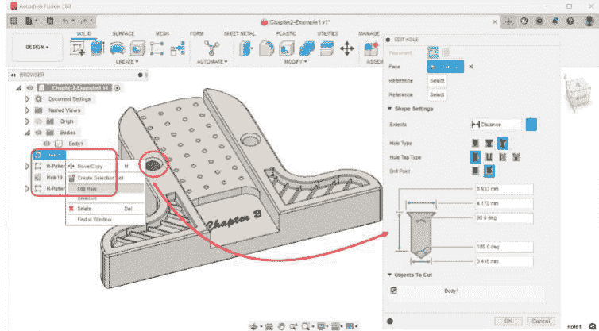

图 2.29 – 编辑 Hole1 并查看其尺寸

现在，让我们看一个较小的孔。通过选择其中一个小孔的边缘，我们可以在画布右下角快速看到其直径信息，如图 2.30 所示。

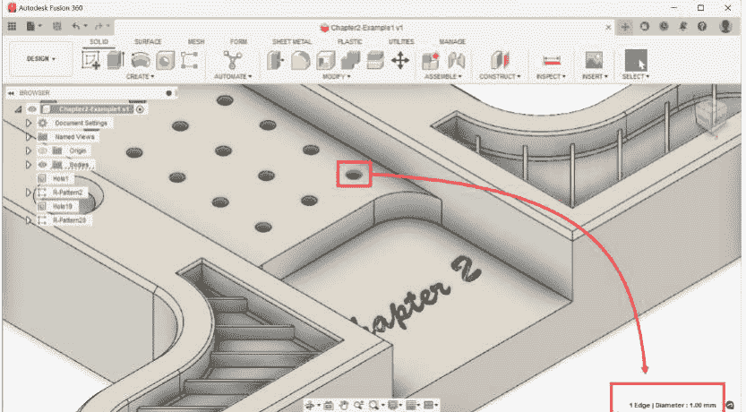

图 2.30 – 选择圆形边缘以查看其直径

此调查告诉我们，所有小孔的直径均为 1 mm，这小于我们的 FFF 打印机可能打印的尺寸。因此，我们可以简单地删除这些孔，如果绝对必要，可以在 3D 打印完成后钻孔。要删除全部 32 个孔，我们有几种选择。我们可以调整视图，使其从 View cube = TOP 查看模型，使用矩形选择选择所有面，然后右键单击并删除。此方法已在图 2.20 的右半部分演示。或者，如图 2.31 所示，我们可以从树中选择两个矩形图案，右键单击并删除它们，这将删除属于这些图案的所有孔。

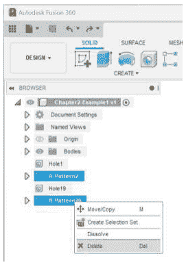

图 2.31 – 在浏览器中选择并删除矩形图案

我们接下来可能想要关注的特征是雕刻。看起来此文件中包含浮雕文字。有多种方法可以去除浮雕文字。与过去选择面并删除它们的方式类似，我们可以删除与浮雕特征相关的所有面。然而，选择多个复杂面，例如本示例中的面，可能并不直接。在这种情况下，我们可能希望采用不同的方法。让我们先通过转到 SURFACE 选项卡并在创建面板中访问修补命令来创建一个新的修补面。我们将选择希望修补面覆盖的六条边。此操作，如图 2.32 所示，将创建一个新的曲面体。

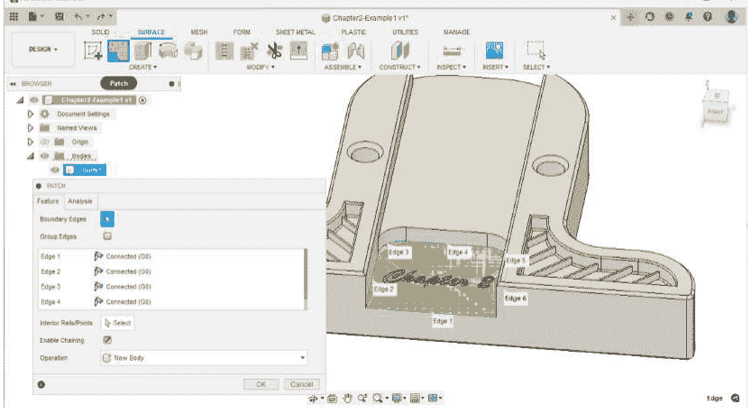

图 2.32 – 使用修补命令创建新的曲面

一旦创建了新的曲面体，我们就可以利用边界填充命令，该命令可在创建面板下的 **SURFACE** 和 **SOLID** 选项卡中访问。使用边界填充命令，如图 2.33 所示，我们可以选择我们的实体和曲面体作为工具，并使用矩形选择封装我们希望包含的所有单元。

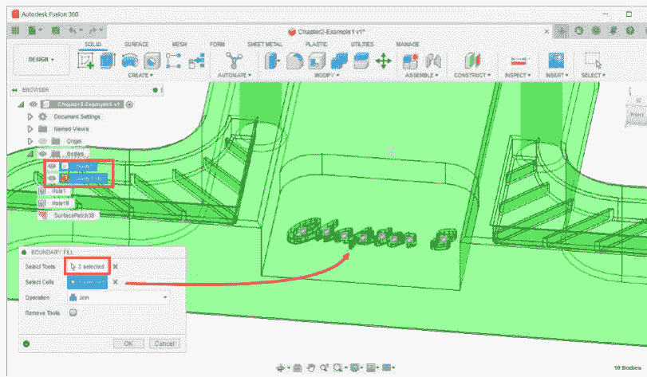

图 2.33 – 使用边界填充命令去除雕刻

边界填充命令与流体体积命令类似，因为它会创建新的实体。但此命令还允许我们将这些新的实体体与现有的实体体连接。一旦边界填充命令完成，我们将消除雕刻。我们不再需要创建的曲面修补或曲面体，这意味着我们可以从浏览器中选择并删除它，如图 2.34 所示。

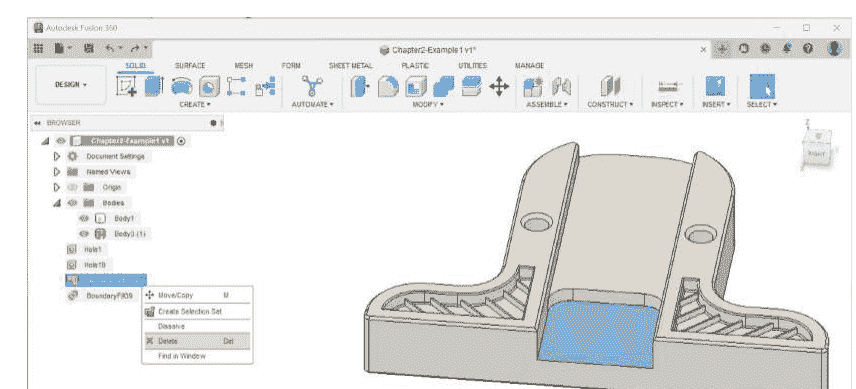

图 2.34 – 删除不再需要的曲面修补

接下来，我们可以继续检测模型中的其他特征。让我们返回查找特征命令，选择主体，并查找所有倒角。通过系统地选择要查找的特征，我们可以在不影响模型中其他特征的情况下修改或删除它们。如图 2.35 所示，在查找特征命令中选择倒角后，Fusion 360 将找到与模型关联的单个倒角特征。我们可以简单地从浏览器中选择并删除它以消除此小特征。

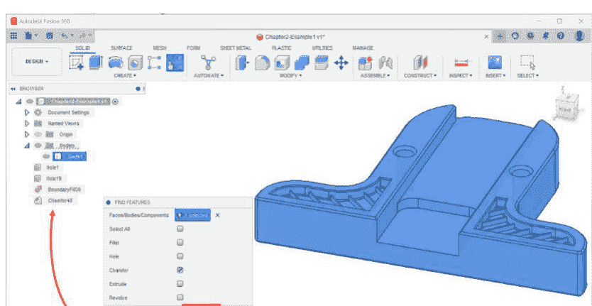

图 2.35 – 使用查找特征命令查找倒角

接下来，我们可以重复相同的过程并查找同一主体内的所有倒圆角。一旦 Fusion 检测到所有倒圆角，我们可以在浏览器中逐一点击它们，以确定它们在画布上的位置。在本例中，**Fillet42** 表示槽/织带区域内的微小倒圆角。我们可以简单地从浏览器中选择 **Fillet42**，如图 2.36 所示，右键单击并在其尺寸低于 3D 打印机处理能力时删除它。

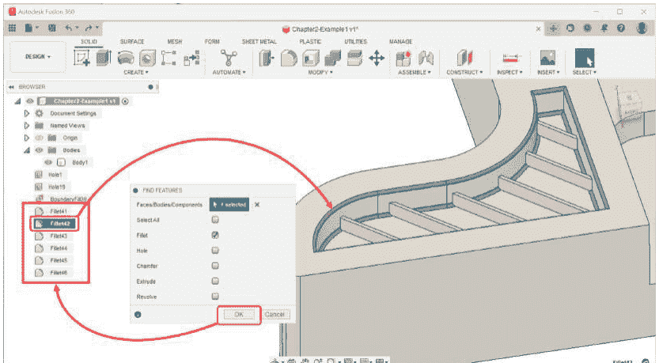

图 2.36 – 使用查找特征命令检测倒圆角特征

在本节中，我们介绍了 3D 打印的设计规则概念，以及它们如何根据 3D 打印技术、材料甚至特定打印机而变化。然后，我们在导入的 CAD 几何体上使用 Fusion 360 的直接建模工具来检测、检查、编辑和删除不适合我们需求的特征。

重要的是要记住 Fusion 360 是一个功能齐全的 CAD 软件包，允许您向导入的 CAD 几何体添加新特征。例如，如果您想添加新的 pockets、孔、倒圆角或倒角，您就可以使用 SOLID 选项卡中 CREATE 和 MODIFY 面板内的功能简单地添加它们。

在下一节中，我们将以类似的方式处理网格文件，并直接使用 Fusion 360 编辑它们以准备 3D 打印。

## 在 Fusion 360 中原生处理网格文件

在上一节中，我们讨论了如何打开 CAD 文件并编辑它们以进行 3D 打印。在本节中，我们将插入网格文件并学习如何以各种方式处理它们。

将网格文件插入 Fusion 360 后，我们有三种方法可以处理这些模型。我们可以按以下方式编辑插入的网格体：

- 作为网格体
- 转换为实体体之后
- 通过将其重新创建为实体体

### 将插入的网格体作为网格体进行编辑

Fusion 360 中的网格功能适用于参数化和直接建模方法。在处理网格文件时，有几个原因我们可能希望简单地将它们保留为网格体以准备 3D 打印。使用网格体，我们可以进行快速操作，例如使用 SCALE MESH 放大或缩小网格体，使用 PLANE CUT 将网格体切成两半，使用 SHELL 使网格体中空，以及使用 COMBINE 将网格体与其他网格体组合或移除。

所有这些操作都可在 MESH 选项卡 | MODIFY 面板中使用，如图 2.37 所示。

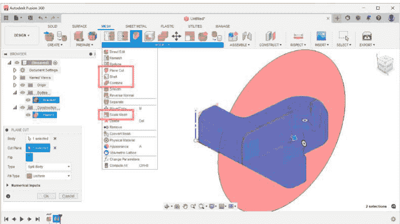

图 2.37 – 使用平面切割功能在 Fusion 360 中编辑网格体

由于网格体是 Fusion 360 的原生体类型，如果您有权访问产品设计扩展，您还可以将网格体用作体积晶格化的输入。我们将在第 4 章更详细地介绍我们用于晶格化的各种选项。

如果您选择网格体并将其设为组件，如图 2.38 所示，您可以执行额外的打印准备活动，例如镜像包含网格体的组件。

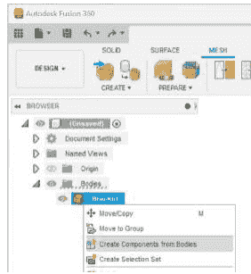

图 2.38 – 从网格体创建组件

一旦网格体包含在组件中，您就可以使用该组件作为输入对象类型创建各种图案，如图 2.39 所示。

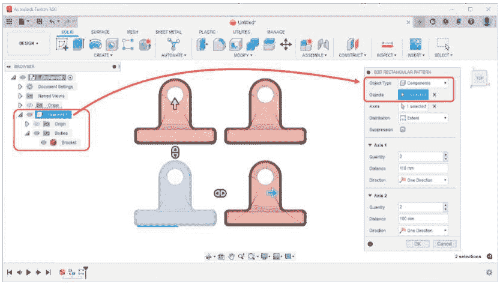

图 2.39 – 使用网格体对组件进行图案化

与 SCALE、PLANE CUT 和 SHELL 命令不同，MESH 选项卡 | MODIFY 面板中的 COMBINE 命令需要多个体输入。COMBINE 命令允许您连接、切割、合并或相交多个网格体。图 2.40 显示了如何分三步在插入的网格体内创建新的孔特征。第一步是使用实体建模技术创建圆柱体。在第二步中，我们将该圆柱体转换为网格体 using

镶嵌命令，如以下图所示。最后一步是使用带切割操作的组合命令将镶嵌的圆柱体从支架中移除。

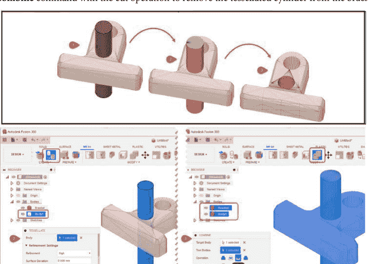

图 2.40 – 在网格体上使用组合-切割功能创建孔

## 将插入的网格体转换为实体体后进行编辑

即使以原生状态处理网格体是快速操作整个体并添加或移除某些特征的方法，除非我们使用的是实体体，否则无法创建所有必要的特征。在这种情况下，我们可能需要将网格体转换为实体体。

自动将网格体转换为实体体时，Fusion 360 提供三种选项：

- 阶梯面（所有用户均可用）
- 棱柱面（个人版不可用）
- 有机面（个人版不可用且需要访问产品设计扩展）

在本章中，我们将仅重点介绍阶梯面和棱柱面选项。有机面选项将在第 3 章中更详细地介绍，在那一章中我们将使用 Fusion 360 的仿真功能生成有机网格体。

将网格体转换为实体体的 **FACETED** 方法将简单地把体类型从网格更改为实体。在图 2.41 中，我们可以看到将网格体转换为阶梯面实体体所需的步骤。转换完成后，我们可以选择实体体上的任意平面面，并使用键盘上的 *Delete* 键或删除命令将其删除，该命令可以通过右键单击或通过快捷方式访问，我们可以通过按键盘上的 *S* 来搜索它们。图 2.41 还显示了如何快速将给定对象的平面面全部转换为干净曲面，并稍后将这些曲面用于实体建模操作，例如添加其他体或创建孔。然而，阶梯面选项无法自动将非平面形状转换为干净曲面。要实现这一点，您需要第二个选项，即 **PRISMATIC**。

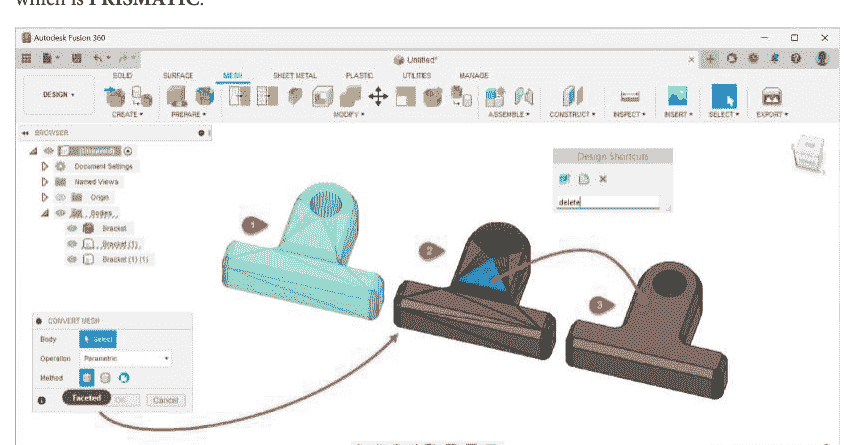

图 2.41 – 将网格体转换为阶梯面实体体并删除平面面

要使用棱柱面方法将网格体转换为实体体，Fusion 360 有一个关键前提条件。在使用棱柱面转换之前，您需要定义面组。Fusion 360 在 **MESH** 选项卡 | **PREPARE** 面板下提供自动面组检测。使用快速或精确方法，并在必要时编辑这些方法设置，您可以让 Fusion 360 通过位于 **INSPECT** 面板下的显示网格面组命令，以唯一颜色显示每个面组。精确方法通常能给出最佳结果，如图 2.42 所示。

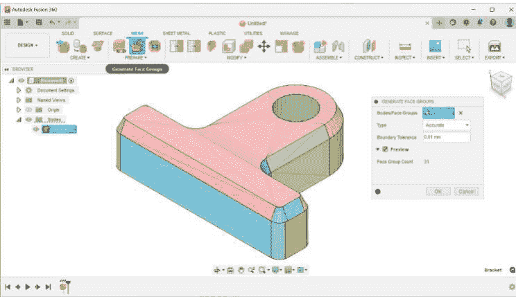

图 2.42 – 生成面组命令结果的预览

在某些情况下，您可能需要做额外的工作才能获得所需的面组结果。您可以先在参数化模式下合并面组，或访问直接编辑模式手动创建面组。一旦拥有所有所需的面组，您就可以利用图 2.43 所示的 PRISMATIC 转换方法，将网格体转换为实体体。此时，您就可以添加任何新特征，包括圆角和倒角等复杂形状。

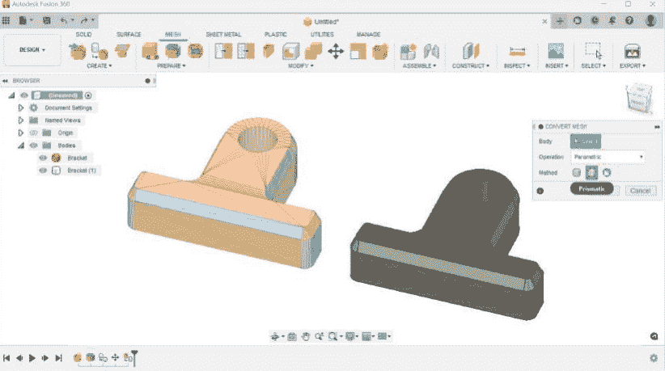

图 2.43 – 棱柱面网格转换的结果

## 通过重新创建将插入的网格体编辑为实体体

尽管将网格体转换为实体体是确保我们可以使用 Fusion 360 中包含的所有实体修改功能对其进行编辑的最佳方式，但对于非常复杂的模型，网格转换可能不成功。在这种情况下，我们可以将插入的网格体作为参考并创建草图。之后，我们可以利用这些草图中的轮廓作为 EXTRUDE、REVOLVE、SWEEP 或 LOFT 命令的输入，以创建所需的实体结果。这是将网格体转换为实体体最复杂的方法，但它是工具箱中强大的工具。让我们使用相同的数据集来演示此工作流程。

在插入网格并将其移至地面后，我们可以利用位于 MESH 选项卡 | CREATE 面板中的 CREATE MESH SECTION SKETCH 命令。选择体后，Fusion 会自动选择一个剖面。剖面可能不是我们创建草图所需的剖面。在本例中，我们希望创建平行于 XY 平面的草图。我们可以点击 Section Plane 旁边的选择按钮。这将显示全局平面和全局轴。我们将选择 XY 平面，并使用屏幕上的操纵器将其向上移动 10 毫米。这将为我们提供网格剖面草图的预览，如图 2.44 所示。

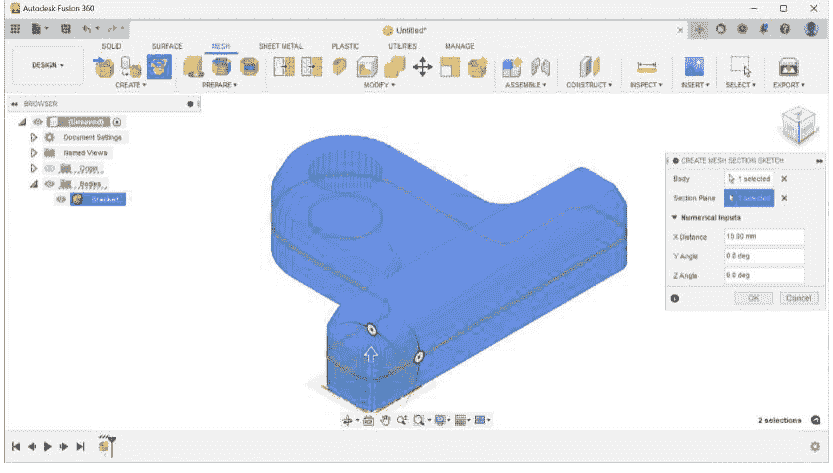

图 2.44 -- 网格剖面草图预览

接下来，我们可以在浏览器中选择 Sketch 1，右键单击并编辑它。在本例中，我们将利用位于 SKETCH 选项卡 | CREATE 面板中的 FIT CURVES TO MESH SECTION 命令。使用各种 Fit Curve Type 选项，我们可以选择网格剖面草图的一部分并创建网格线、圆弧、圆和样条线，如图 2.45 所示。

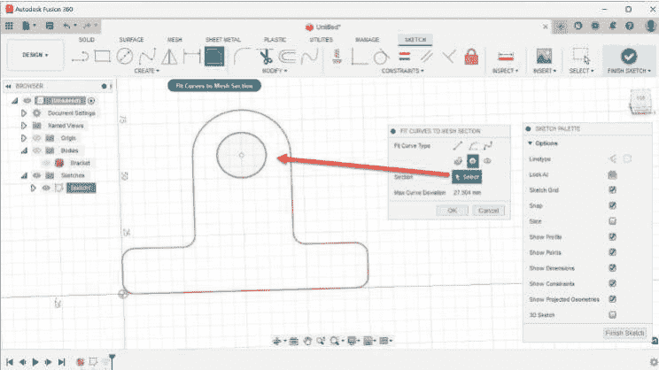

图 2.45 – 使用 FIT CURVES TO MESH SECTION 命令创建圆形轮廓

完成草图几何体的创建后，我们可以使用双向方向的挤出命令来加厚此轮廓。在挤出轮廓之前，我们可以利用位于 INSPECT 面板中的 measure 命令来确定此零件应有多厚。在本例中，我们的零件总共 25 毫米，因此我们将在一个方向挤出 15 毫米，在另一个方向挤出 10 毫米，如图 2.46 所示。

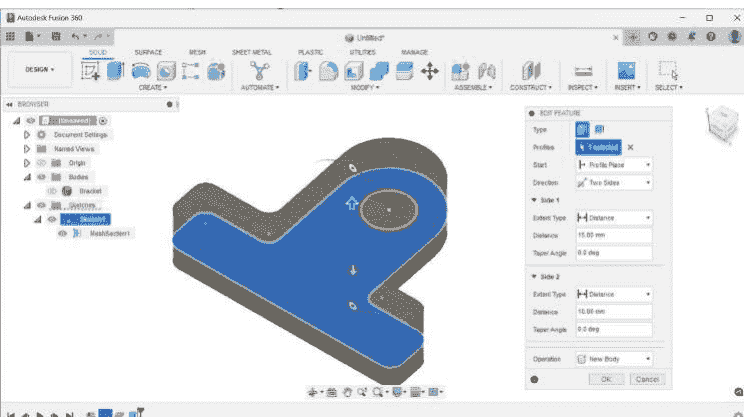

图 2.46 – 使用挤出命令将草图轮廓变为实体体

接下来，我们可以开始关注倒角特征，该特征应复制到此零件顶边缘周围。我们可以先利用位于 INSPECT 面板中的 MEASURE 命令来了解我们试图复制的倒角特征所构成的 XYZ 增量。如图 2.47 所示，此零件具有双面倒角。在一个方向上为 3 毫米，在另一个方向上为 6 毫米。

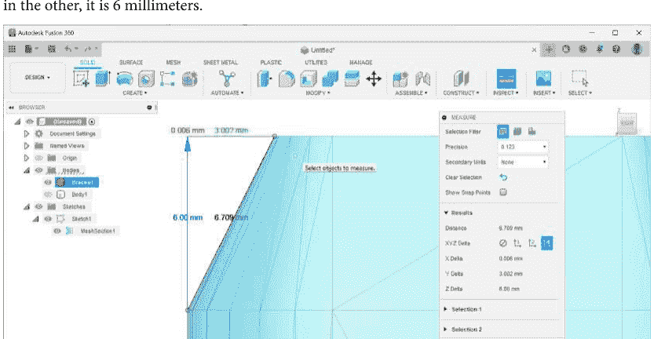

图 2.47 – 测量网格以确定倒角尺寸

现在我们知道了网格体所具有的倒角尺寸，我们就可以为实体体添加倒角特征。只需激活位于 MODIFY 面板下的 CHAMFER 特征，选择顶表面周边所有 14 条边，将倒角类型更改为 TWO DISTANCE，并将相应值输入对话框中，如图 2.48 所示。

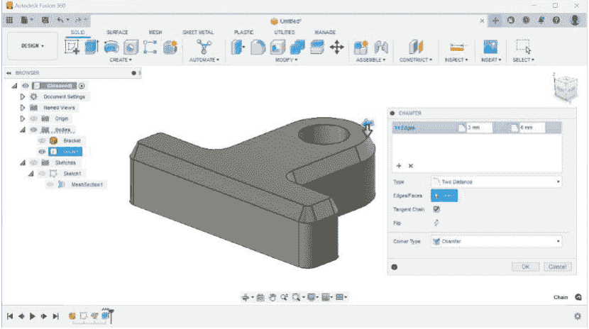

图 2.48 – 使用倒角特征为周边添加双距离倒角

现在我们已经创建了网格剖面草图，利用它创建了草图轮廓，挤出了这些轮廓并添加了必要的倒角，我们已完全逆向工程了此零件，该零件始于插入的网格体，终于实体体。此工作流程比我们重点介绍的之前工作流程需要更多步骤，但如果我们试图逆向工程的零件无法使用其他方法重建，则非常有用。

## 总结

在本章中，我们介绍了如何在考虑各种 **增材制造设计（DFAM）** 原则的情况下编辑 CAD/网格模型。我们重点介绍了如何打开/关闭设计历史。我们演示了使用参数化建模与直接建模时工作流程的差异。然后我们学习了如何自动检测导入 CAD 模型的特征。我们还介绍了如何基于 DFAM 原则编辑 CAD 和网格体。我们以介绍几种将网格文件转换为可进一步用于制造修改的实体体的方法结束本章。

在下一章中，我们将介绍可在 Fusion 360 的设计工作区中使用自动化建模以及仿真工作区中使用形状优化来在考虑 DFAM 原则的情况下减轻零件重量的几种技术。我们还将学习如何利用仿真来识别潜在的性能故障并做出设计更改以应对它们。

