## 使用仿真创建轻量化零件，并识别和修复潜在失效

欢迎阅读第 3 章。增材制造的主要优势之一是能够创建轻量化零件。本章中，我们将介绍 Fusion 360 中用于轻量化零件并创建可 3D 打印的有机构造外观模型的各种工具。我们将首先介绍如何利用设计工作区中的自动化建模功能来生成设计替代方案。我们将讨论自动化建模与生成式设计之间的差异。接下来，我们将利用仿真工作区中的形状优化来创建轻量化且结构高效的组件。我们将通过展示如何对创建的组件进行仿真来结束本章，以检查、检测和修复 3D 打印组件中常见的失效。

本章将涵盖以下主题：

- 开始使用自动化建模
- 形状优化
- 结构仿真以检测和修复常见失效

到本章结束时，您将学会如何使用自动化建模创建有机形状。您将能够使用形状优化创建结构高效的组件。您还将了解如何使用线性静应力检测应力集中，并通过有根据的设计更改将其消除。

### 技术要求

本章涵盖的所有主题均可供 Startup 和 Educational Fusion 360 许可证类型使用。如果您拥有商业版 Fusion 360 许可证，则要进行形状优化研究，您还需要访问 Simulation extension (https://www.autodesk.com/products/Fusion-360/simulation-extension)，或您可以使用 Autodesk Flex tokens 来求解形状优化研究 (https://www.autodesk.com/benefits/flex)。

尽管本章不会进行生成式设计研究，如果您拥有商业版 Fusion 360 许可证并希望进行生成式设计研究，您将需要访问 Generative Design extension (https://www.autodesk.com/products/Fusion-360/generative-design-extension)，或您可以使用 Autodesk Flex tokens 来求解生成式设计研究 (https://www.autodesk.com/buying/flex?term=1-YEAR&tab=flex)。

Autodesk 为所有商业用户提供 Simulation extension 和 Generative Design extension 的 14 天试用。您可以在 Fusion 360 的 Extensions 对话框中激活试用。

Automated Modeling、Generative Design 以及之前提到的任何仿真（Shape Optimization 和 Linear Static Stress）均不适用于 Fusion 360 的 Personal/hobby 许可证。

本章的练习文件可在以下位置找到：https://github.com/PacktPublishing/3D-Printing-with-Fusion-360。

## 开始使用自动化建模

在之前的章节中，我们介绍了如何使用参数化建模和直接建模来对现有设计进行更改。使用实体和网格建模技术，我们创建了孔、口袋和掏空零件，这些都是轻量化零件的有用方法。

Fusion 360 设计工作区中的 Automated Modeling 功能是设计师创建有机外观轻量化组件的绝佳工具。在本节中，我们将重点介绍使用这种生成技术创建新模型。选择设计替代方案后，我们将修改结果的体积。稍后，我们将手动编辑有机形状以进一步轻量化设计。

自动化建模可在 DESIGN 工作区的 SOLID 选项卡的 AUTOMATE 面板中使用。使用自动化建模，用户可以在想要连接的几何体之间生成设计替代方案。此功能要求至少选择两个面作为输入面。它还允许用户选择不应创建模型的区域。使用此命令时，Fusion 360 将生成六个设计替代方案。然后您可以探索最符合您需求的设计。三个设计替代方案使用所选面之间的平滑连接创建。其余三个使用尖锐连接创建。现在，让我们使用示例数据集探索此功能，并逐步了解设计师在项目工作中可能遵循的迭代过程。

图 3.1 显示了一个麦克风组件和支架。该模型由多个具有各自名称的实体组成，我们将在本节中以这些名称引用它们。

让我们想象我们是一名设计师，负责为此麦克风支架设计新的 **Connection-left** 和 **Connection-right** 实体版本。这些实体最初是使用 Fusion 360 中的 **LOFT** 命令创建的，并在图 3.1 中以绿色显示。这些连接臂将底座连接到 **Mount-right** 和 **Mount left**，在同一图中以黄色表示：

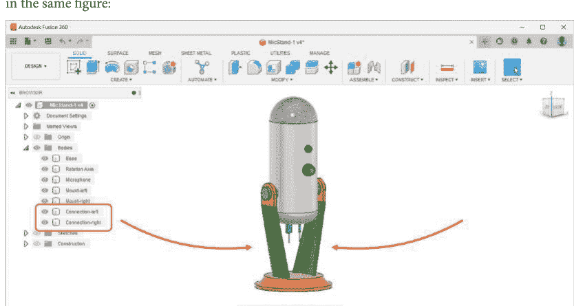

图 3.1 – 具有连接臂独特实体的麦克风支架设计

使用此 Fusion 360 设计中已有的实体，我们可以通过关闭名为 **Connection-left** 和 **Connection-right** 的实体的可见性来开始此探索。然后，我们可以在 **AUTOMATE** 面板中访问 **Automated Modeling** 命令。

接下来，我们可以选择要连接以创建新几何体的四个面，并选择 **Generate Shapes**，如图 3.2 所示。请注意，此图是通过将所有可见实体的不透明度降低到 50% 捕获的，以便更好地显示四个选定面。

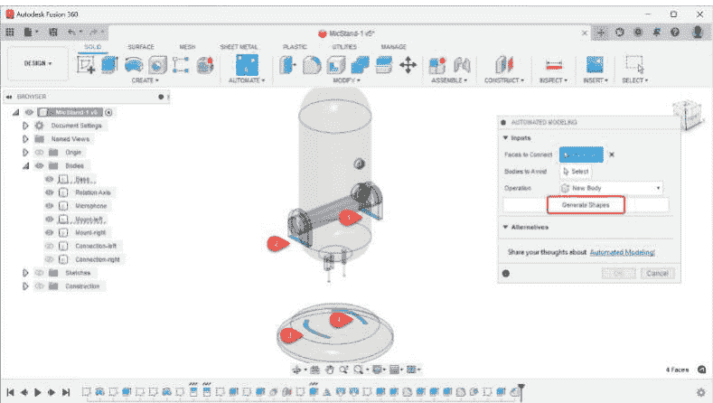

图 3.2 – 在自动化建模中选择要连接的面

一旦生成所有设计替代方案，它们旁边会出现绿色复选标记，我们可以探索结果。如图 3.3 所示，AUTOMATED MODELING 对话框显示六个设计替代方案。当我们选择每个替代方案时，该几何体的预览将在画布上显示。

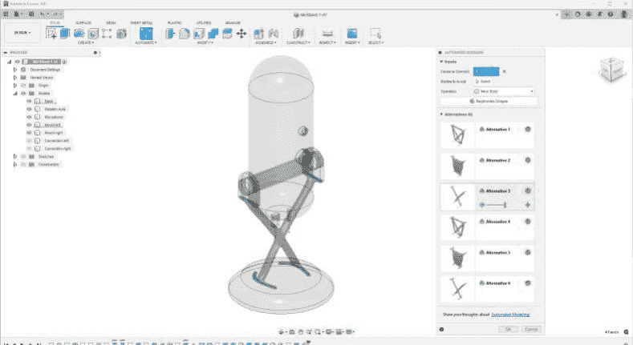

图 3.3 – 自动化建模生成六个设计替代方案

如果仔细观察，您会注意到前三个替代方案的图标包含一个紫色表单体和其下方的透明对象。接下来的三个设计替代方案具有紫色表单体、蓝色实体体以及其下方的透明对象。图 3.4 显示了前三个替代方案与接下来三个替代方案图标的特写。这种图标上的细微差异指的是生成设计替代方案的连接类型。没有灰色实体体的替代方案创建平滑连接。具有灰色实体体的替代方案创建尖锐连接。

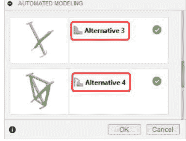

图 3.4 – 不同图标代表设计替代方案连接类型的变化

每个设计替代方案还提供一个体积滑块。使用此体积滑块，我们可以生成具有不同体积的结果预览。图 3.5 显示了为 Alternative 2 设计选择最小体积（左）与最大体积（右）之间的差异。

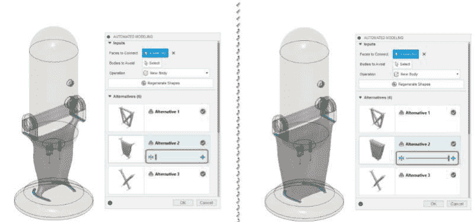

图 3.5 – 修改体积滑块后的体积差异

调查所有设计替代方案，假设我们最喜欢 **Alternative 6**。在将体积滑块调整至最小后，我们可以按 **OK** 并将结果生成为新实体。此新实体将被添加到树中。*图 3.6* 显示名为 **Body30** 的新实体已添加到实体列表中，并且名为 **AutomatedModeling3** 的新组已添加到时间轴中：

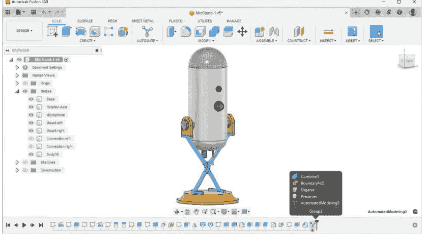

图 3.6 – 选择 Alternative 6 并生成实体

初看之下，结果看起来很有希望。然而，经过快速检查，我们可以看到我们犯了一个错误，结果侵入了电源和耳机线将连接到麦克风的位置。为了获得精确的答案，我们可以利用位于 **INSPECT** 面板中的干涉检测工具，如 *图 3.7* 所示。在选择名为 **Microphone** 和 **Body30** 的实体并计算它们之间的干涉后，我们可以看到这两个实体之间存在超过 1,000 mm^3 的干涉：

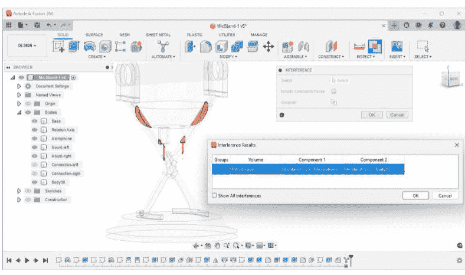

Figure 3.7 – 麦克风与有机连接臂之间的干涉

为了解决这种干涉并创建不会干扰麦克风的形状，让我们继续从时间轴中抑制 AutomatedModeling3 特性并创建一个新的自动化建模特性。这次，除了选择要连接的四个面外，我们还将选择两个要避免的实体：Rotation Axis 和 Microphone，并选中 Opacity 复选框，使要避免的实体变为透明。此自动化建模的新设置可在图 3.8 中看到。

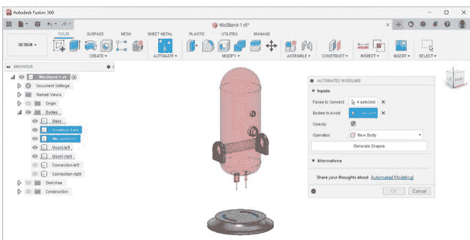

Figure 3.8 – 带有几个要避免实体的新自动化建模设置

生成新形状后，我们现在可以看到六个可供选择的新设计替代方案。根据 Fusion 360 的说法，它们都避免了与麦克风和建模电缆的干涉。在检查结果后，让我们选择 **Alternative 4** 并将其体积滑块调整到最小，然后选择 **OK** 以生成新的实体，如 *Figure 3.9* 所示：

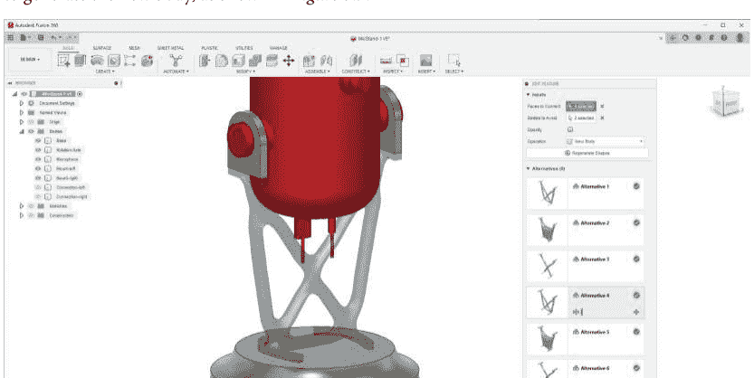

Figure 3.9 – 避免干扰麦克风的六个新设计替代方案

如 *Figure 3.10* 所示，我们现在在 **BROWSER** 面板中有一个名为 **Body46** 的新实体，并且可以看到时间轴中已添加了一个新的自动化建模特性。仔细检查后，我们可以看到新实体没有与电缆发生干涉。然而，这是通过从新生成的形状中移除麦克风和电缆来实现的。该新实体在理论上满足我们的目标；然而，在实际使用中，我们需要在电缆与连接臂之间留出更大的间隙，以便我们能够插拔这些电线：

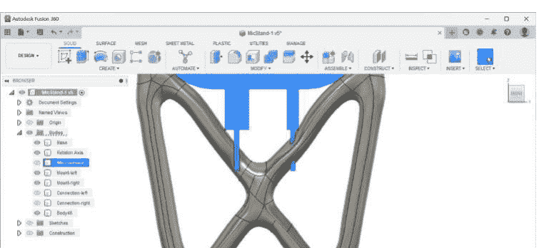

Figure 3.10 – 自动化建模第二次迭代的结果

为了实现麦克风与新连接臂之间更大间隙的这一新目标，我们需要创建新的几何体。Fusion 360 可用于沿 XZ 轴创建新草图，我们可以投影麦克风的轮廓，并在需要时对其进行偏移以创建额外的公差区域。稍后，我们可以使用创建的轮廓并使用 REVOLVE 命令创建 130 度旋转，如图 3.11 所示：

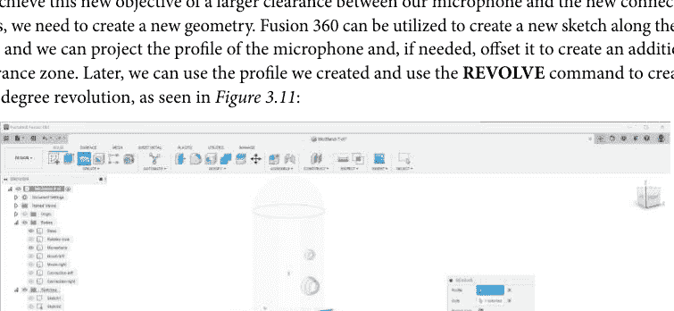

Figure 3.11 – 基于麦克风轮廓使用 REVOLVE 命令创建新实体

一旦我们生成这个新实体，我们就可以重命名它。在此示例中，我将新实体重命名为 Avoid Zone。现在，我们已准备好进行第三次也是最后一次自动化建模特性。让我们继续抑制之前的自动化建模特性并最后一次激活自动化建模。在选择相同的四个面进行连接后，我们现在可以选择新创建的 **Avoid Zone** 作为要避免实体的输入。最终自动化建模的新设置可在 *Figure 3.12* 中看到：

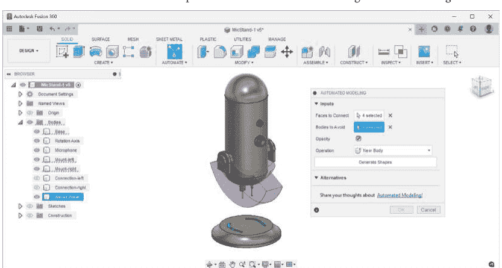

Figure 3.12 – 带有新创建的 Avoid Zone 的自动化建模最终设置

生成新形状后，我们现在可以看到六个可供选择的新设计替代方案。如果我们选择 **Alternative 6** 并使用最小体积，我们将得到可在 *Figure 3.13* 中看到的模型预览：

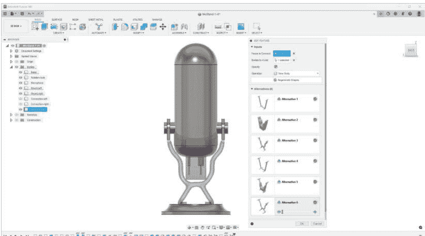

Figure 3.13 – 最终自动化建模设置的 Alternative 6

总是建议仔细查看结果并确保其满足我们的设计目标，并且输出几何形状在几何上令人满意。如 *Figure 3.14* 所示，Fusion 360 利用 T splines 创建了新的实体来创建形状，使用边界填充命令将表面形状转换为实体对象，最后使用组合特征切割操作从输出形状中移除要避免的实体。这种组合切割的最终操作在我们原本外观有机的几何形状中创建了两个缺口。我们可以轻松地更改组合特征并移除四个工具实体之一（在本例中为 **Avoid Zone**）以消除这两个缺口。

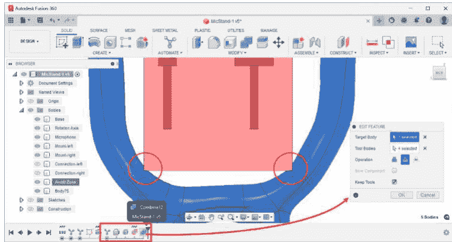

Figure 3.14 – 自动化建模创建了一组可单独编辑的特征

通过此最终编辑，我们创建了一个设计替代方案，它既符合我们的要求，又与原始设计相比有很大不同。但与原始设计相比，这个设计是否更轻？即使我们在生成时没有明确输入关于减轻零件重量的标准，我们在为每个选定的设计替代方案选择时始终选择最小体积。让我们更仔细地查看原始零件及其属性。如图 3.15 所示，名为 **Original Connection** 的组件的体积为 41,843 立方毫米。请注意，要访问 **PROPERTIES** 对话框，我们首先创建了一个新组件并将名为 **Connection-left** 和 **Connection-right** 的实体移入此新组件。之后，我们右键单击并选择 **Properties** 以访问 **PROPERTIES** 对话框。

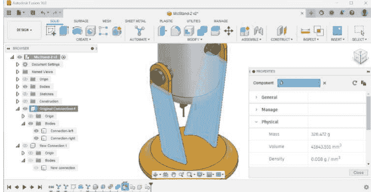

Figure 3.15 – 原始设计的质量和体积属性

如果你重复相同的步骤，创建一个新组件并将新的连接实体移入此新组件，我们可以查看其属性并看到该新组件的体积为 16,591 立方毫米。这意味着新设计的体积和质量大约为原始设计的 40%。图 3.16 显示了使用自动化建模创建的新连接实体的属性。

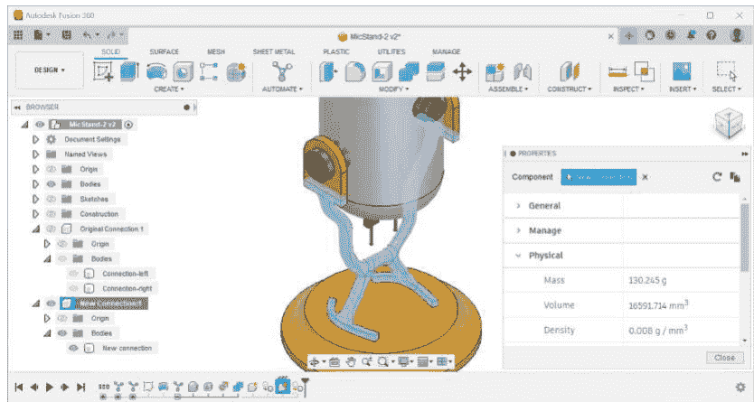

Figure 3.16 – 新设计的质量和体积属性

尽管自动化建模为我们提供了有机外观和轻量化设计，但我们并不能确定这种几何形状在实际环境中的表现如何。为了验证我们的模型能否承受麦克风重量在各种位置相关的载荷，我们必须构建原型并进行测试或执行仿真。我们本可以使用的另一种工具来生成有机且轻量化的设计是生成式设计。生成式设计是 Fusion 360 内的一个独立工作区，需要类似的连接面和障碍几何体的输入。使用生成式设计，您还可以输入载荷和边界条件来模拟连接臂将承受的力。此外，生成式设计允许用户选择希望用于生产输出几何体的制造模型。诸如增材制造、减材制造（2.5 axis、3 axis 或 5 axis milling machines）以及 2 axis cutting 和 Die casting 等选项都可以考虑。生成式设计还要求您在创建满足要求的设计时选择应考虑的材料。如图 3.17 所示，您可以根据满足特定设计目标的制造方法和材料生成数十个甚至数百个结果。

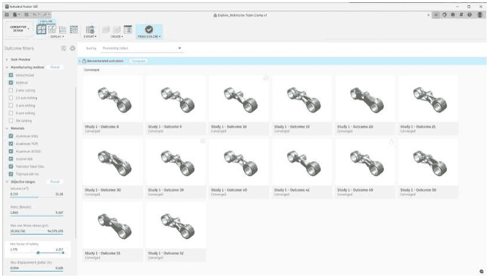

Figure 3.17 – 满足设计标准的摩托车组件的生成式设计结果

无论我们选择何种方法来生成有机且轻量化的几何形状，进行最终仿真以确保这些计算机生成的形状满足我们的性能标准始终是良好的实践。

在本节中，我们介绍了如何应用自动化建模来生成外观有机的形状。我们通过自动化建模进行了迭代设计过程，并更新了设计标准以满足特定目标。我们以麦克风支架为例，并将原始设计与最终设计进行比较，以确保结果是更轻量化的版本。在下一节中，我们将使用 Shape Optimization 仿真方法遵循类似的示例，以确保我们创建的设计考虑了性能标准。

## 利用形状优化

在上一节中，我们介绍了如何使用自动化建模来生成有机且轻量化的设计。在本节中，我们将介绍基于性能的建模，并学习如何利用 Shape Optimization 生成类似的结果。

Shape Optimization 是 Fusion 360 的 SIMULATION 工作区中可用的分析类型。使用 Shape Optimization，工程师可以根据预定的性能标准创建轻量化设计。然而，需要注意的是，形状优化研究的结果实际上并不反映载荷产生的应力。因此，我们应始终使用额外的仿真（例如静态应力研究）来验证新设计。在本节中，我们将重点关注

关于使用形状优化仿真技术创建新模型。在选择设计方案后，我们将把结果合并到原始设计中，既作为网格体也作为实体体，并讨论每种方法的优点和缺点。

要进行形状优化研究，至少需要选择一个**目标体**以安全地去除材料。我们还必须为该体指定材料。最后，我们需要施加作用于该体的约束和结构载荷。

载荷可以通过简单地选择面并施加力或压力来应用。或者，我们可以将载荷添加到与目标体接触的其他组件的面、边或角点上。只要我们在装配中正确定义接触条件，目标体就会基于这些载荷进行优化。我们还可以选择次要体，并让 Fusion 360 自动计算其质心，并基于其重量将载荷作为远程载荷施加到目标体上。

形状优化还允许我们基于常见的形状（如盒子、圆柱体或球体）创建保留区域。**保留区域**允许我们指定某个区域不进行优化。例如，如果我们想保留一个将用作螺栓连接界面的孔，我们可以选中它并将其指定为保留区域，以便形状优化不会从模型的该段去除材料。在形状优化中，我们还可以要求 Fusion 360 提供对称的输出。在这种情况下，我们必须定义一个对称平面，以便结果符合该对称条件。形状优化研究中最重要的一部分是优化标准。Fusion 360 允许我们在最小化目标体质量的同时最大化其刚度。在某些仿真中，使用形状优化最小化质量可能会导致设计出现大量槽和支架。在这种情况下，Fusion 360 还允许我们控制任何网状设计输出的最小构件尺寸。

现在，让我们使用相同的数据集探索此功能，并逐步介绍设计师在使用形状优化处理此项目时可能遵循的示例流程。

图 3.18 以黄色显示了本章前一节中介绍的麦克风支架的底座和安装支架。使用 Fusion 360 的草图工具，我们可以在两个安装支架底部创建一个矩形，并在底座顶部创建一个圆形。然后，我们可以利用**LOFT**命令并在这两个草图轮廓之间创建一个实体体。此新体将成为我们形状优化目标体的基础。让我们将此体重命名为 `Shape to optimize`：

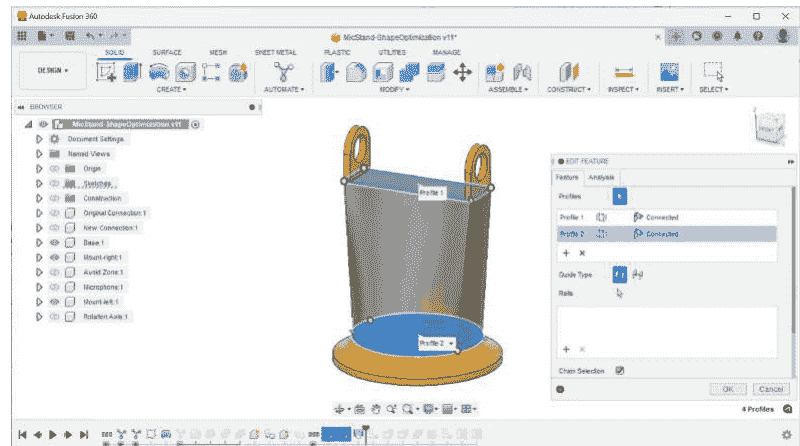

图 3.18 – 在底座和安装支架之间使用 LOFT 命令创建新体

接下来，我们将利用本章前一节中创建的名为 Avoid Zone 的体。让我们首先选择该体的外部面，如图 3.19 中蓝色所示，并将其偏移 7.5 毫米，以便从一开始就拥有更大的避让区域：

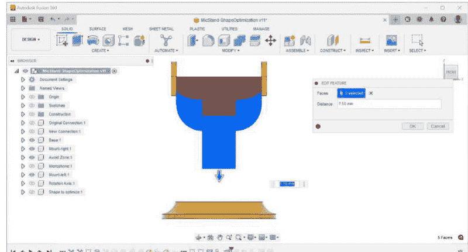

图 3.19 – 使用偏移面命令创建更大的体

接下来，我们可以在 MODIFY 面板中使用 COMBINE 功能并从 Shape to optimize 体中移除 Avoid Zone 体，如图 3.20 所示。这将确保麦克风和两根电缆沿 X 轴舒适旋转时有足够的空间。

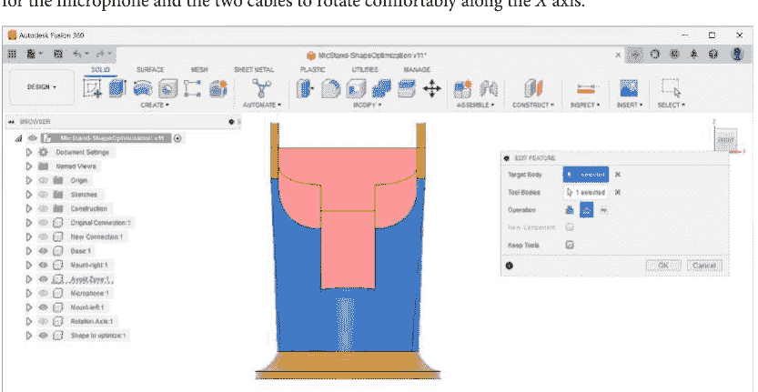

图 3.20 – 创建形状优化的目标体

接下来，我们将从 DESIGN 工作区切换到 SIMULATION 工作区并创建一个新的形状优化研究。在创建形状优化研究期间，我们还可以编辑其设置并选择较小的网格尺寸（Model-based Size 中为 3%），如图 3.21 所示。使用较小的百分比会产生更精细的网格，求解时间更长，但结果更好。

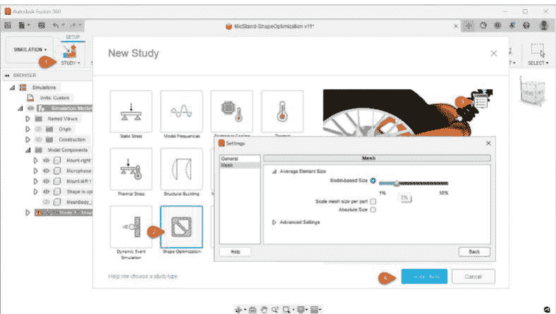

图 3.21 – 创建网格优化研究并自定义网格设置

创建形状优化研究后，我们仍需要进一步编辑模型，以便准备求解仿真。为此，我们可以进入 SIMPLIFY 环境，该环境可通过选择 SIMULATION 工作区、SETUP 选项卡和 SIMPLIFY 面板访问。一旦进入 SIMPLIFY 环境，我们可以选择形状优化研究不需要的所有体，右键单击并将其删除，如图 3.22 所示：

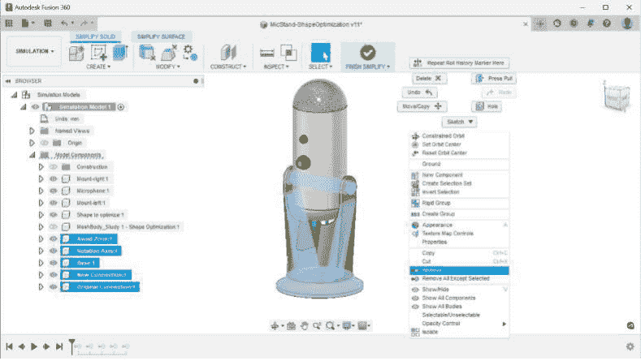

图 3.22 – 在 SIMPLIFY 环境中删除不必要的体

一旦只剩下将参与形状优化研究的所有体，就该定义所有必要的输入了。我们可以首先将名为**Shape to optimize**的体指定为**目标体**。接下来，我们可以选择麦克风并将其转换为点质量，该质量将作用于目标体的顶部两个表面。接下来，我们需要设置研究材料。在本例中，我从 Fusion 360 的增材材料库中选择了**Aluminium AISI10Mg**。

接下来，我们需要分配载荷条件。如图 3.23 所示，我们需要在三个不同的载荷工况中定义载荷。载荷工况 1 将反映麦克风处于垂直位置并对支架施加向下力的情况。载荷工况 2 和 3 分别表示麦克风向前和向后倾斜。在载荷工况 2 和 3 中，我们还需要施加一个力矩，以模拟麦克风对支架施加的载荷，因为其质心将沿 Y 轴远离安装支架。所有三个载荷工况还需要在底座板的底部施加固定边界条件。

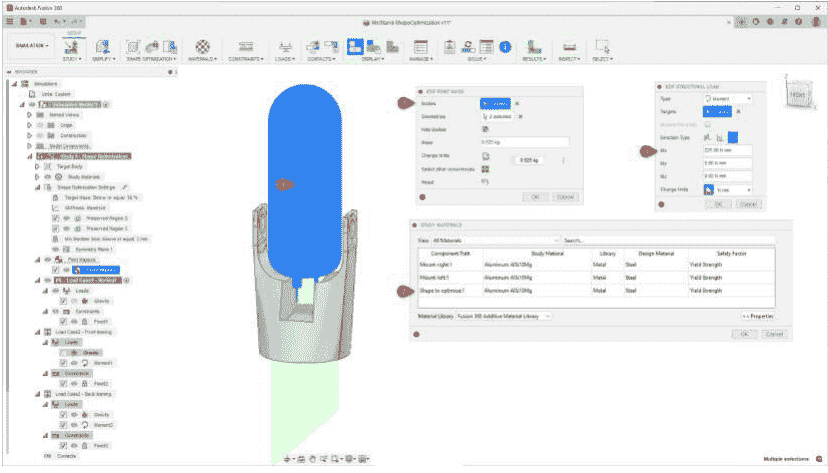

图 3.23 – 麦克风支架形状优化的材料定义和载荷条件

一旦载荷和边界条件设置完毕，我们就可以继续指定某些体为保留区域。在本例中，我们将使用名为**Mount-right**和**Mount-left**的体，并基于它们创建两个盒状保留区域，如图 3.24 所示。我们还可以沿 Global YZ 平面创建一个对称平面，并要求最终形状对称。在此形状优化研究中，我们希望将初始形状的质量减少 70%，并在最大化刚度的同时达到 30% 或更低的目标质量。我们还将最小构件尺寸定义为 3 毫米或更大，作为形状优化标准的全局约束。

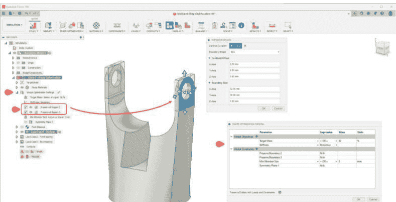

图 3.24 – 保留区域和形状优化标准

求解形状优化研究后，我们将进入**SIMULATION**工作区内的**RESULTS**环境，如图 3.25 所示。图例允许我们操作优化后的形状。使用图例中的滑块，我们可以将结果调整为更薄或更厚，但默认结果将是 30% 的目标质量。在**RESULT TOOLS**面板中，如果选择**PROMOTE**命令，我们将有选项将形状优化的结果作为新体提升到**DESIGN**工作区。

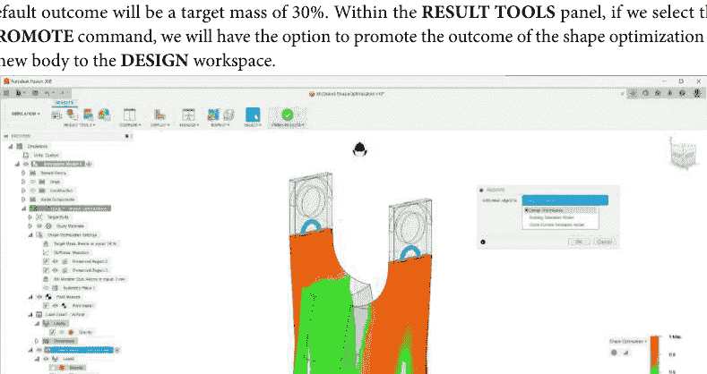

图 3.25 – 形状优化研究的结果

从**SIMULATION**工作区提升的体将在**DESIGN**工作区作为新的网格体可用。如图 3.26 所示，此新网格体将具有一个引用形状优化研究的唯一名称。

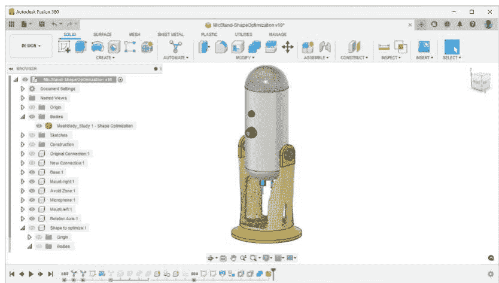

图 3.26 – 形状优化提升设计工作区的网格结果

一旦网格结果被提升到**DESIGN**工作区，我们就有三种选择来使用此新模型。我们的第一个选项是保持网格体为网格体，并直接 3D 打印它。我们的下一个选项是尝试使用我们在第 2 章中介绍的各种基于网格截面的草图和实体体创建功能来逆向工程此网格体。我们的第三个选项是尝试将网格体转换为实体体。

如果我们想追求第三个选项，我们需要访问**Organic**网格转换方法，因为形状优化的结果往往具有有机特性。您可以通过选择**DESIGN**工作区中的**MESH**选项卡，然后选择**MODIFY**面板来访问**CONVERT MESH**命令。**Organic**方法，如图 3.27 所示，可供拥有产品设计扩展的用户使用。

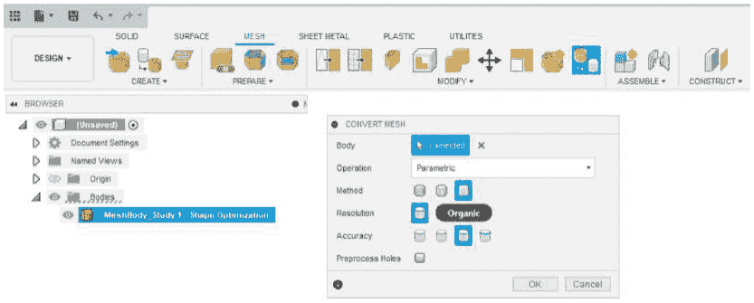

Figure 3.27 – 使用 Organic 方法的 CONVERT MESH 命令

根据我们选择的分辨率和精度，我们可以使用 Organic 网格转换将此网格体转换为实体对象。Figure 3.28 显示了此类结果的示例。

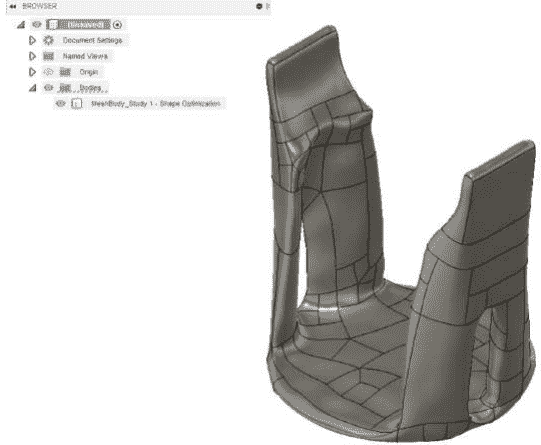

Figure 3.28 – 使用 Organic 方法将网格转换为实体的结果

为了完成我们的设计，我们需要最后一次使用 **COMBINE** 命令，并统一代表底座、安装支架以及目标体形状优化结果的多个实体，如 *图 3.29* 所示。

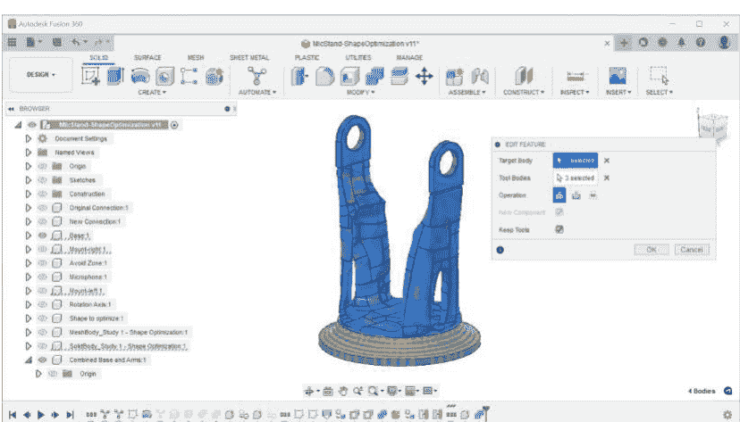

Figure 3.29 – 合并多个实体以制作单个麦克风支架

如果我们选择了第一个选项，我们本可以将形状优化结果保留为网格体，并仅对左右两侧的底座和安装支架进行网格化。然后，我们可以将全部四个实体作为网格对象进行合并，从而获得类似的结果。然而，如果我们使用了基于网格的工作流程并将最终设计制作成网格对象，即使我们能够 3D 打印最终设计，也无法在 Fusion 360 中使用线性静应力对其进行仿真。这是因为 Fusion 360 要求对象为实体体才能进行仿真。*图 3.30* 显示了我们从四个不同角度看到的最终设计。在这个完成版本中，我还将所有不必要的组件移入名为 **Extras** 的新子装配中并关闭了其可见性。

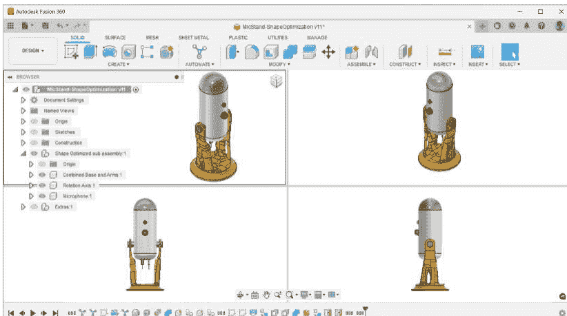

Figure 3.30 – 形状优化麦克风支架的结果

在本节中，我们介绍了形状优化的概念以及它如何用于创建有机且轻量化的几何形状。我们通过示例介绍了如何为形状优化创建目标体以及如何设置仿真研究。在进行研究后，我们将结果提升到 **DESIGN** 工作区，并将结果与现有实体合并以创建最终形状。

在下一节中，我们将进行线性静应力仿真，以查看自动化建模的结果是否能够承受工作载荷，以及我们是否需要进行设计调整以消除日常使用中的潜在失效。

## 用于检测和修复常见失效的结构仿真

在前几节中，我们使用自动化设计和形状优化创建了多个设计替代方案。在本节中，我们将介绍如何对其中一种设计替代方案进行仿真，以检查其在工作条件下是否能够承受载荷。我们还将查看我们选择的材料是否基于载荷是合适的，并尝试其他材料。我们还将尝试检测和修复常见的失效点，例如应力集中。

让我们开始通过新建一个设计并以新名称保存它。一旦我们有了新的 Fusion 360 设计文档，使用 **SOLID** 选项卡的 **INSERT** 面板中的 **Insert Derive** 命令，我们可以从其他 Fusion 360 设计文档中插入实体和组件，如 *图 3.31* 所示。在此示例中，我们将从之前使用自动化设计创建的一个麦克风支架设计中插入多个实体。一旦我们将四个关键实体（Base、Mount-left、Mount-right 和 New connection）插入到此设计中，我们可以利用 MODIFY 面板中的 COMBINE 命令。我们还可以在 MODIFY 面板的 PHYSICAL MATERIAL 功能中为此设计分配材料。我们可以选择与前几节中相同的增材铝 AlSi10Mg 材料作为我们第一次仿真研究的材料。

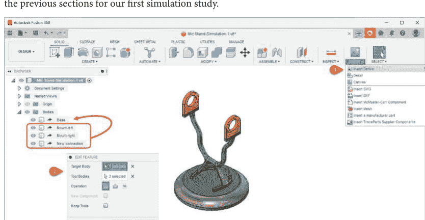

Figure 3.31 – 使用 Insert Derive 和 COMBINE 命令将多个实体合并为一个

现在我们已将合并的实体置于单个组件中，我们就可以开始设置仿真了。我们需要做的第一件事是从 DESIGN 工作区切换到 SIMULATION 工作区并创建一个新的 Static Stress 研究。在此研究中，我们需要创建三个载荷工况，类似于我们在上一节中为形状优化研究设置的设置。在这些载荷工况中的每一个中，我们都需要分配与形状优化研究中创建的相同的载荷和边界条件。

第一个载荷工况将帮助我们仿真麦克风处于垂直位置的情况。我们为此载荷工况选择的载荷将是作用于设计中 Mount-left 和 Mount-right 部分圆柱形孔的两个轴承载荷。

载荷工况 2 和 3 将代表麦克风处于前倾和后倾位置，就像我们在上一节中为形状优化研究设置的设置一样。对于全部三个载荷工况，我们将在底座底部分配一个固定边界条件。接下来，我们将为研究分配材料。我们将在仿真研究中使用与设计材料相同的材料，如 Figure 3.32 所示。

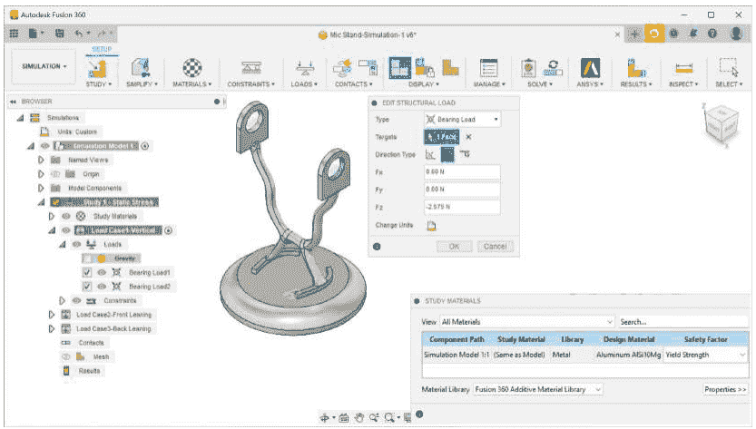

Figure 3.32 – 线性静力模拟的轴承载荷和研究材料

一旦我们分配了所有载荷和边界条件，我们就可以进行此仿真研究。我们可以从 **SETUP** 选项卡的 **Solve** 面板开始求解。

> **重要提示**
> 
> 为了运行静应力仿真，您需要试用版、商业版、教育版或初创版许可证。个人许可证无法访问仿真功能：https://www.autodesk.com/products/fusion-360/personal。

一旦静应力分析的结果可用，Fusion 360 将从 **SIMULATION** 工作区的 **SETUP** 选项卡切换到 **RESULT** 选项卡。您将能够查看仿真结果并更改为各种结果类型。默认情况下，Fusion 360 显示安全系数结果。如 Figure 3.33 所示，如果您使用图例旁边的下拉菜单将结果类型切换为 **Stress**，您可以看到该零件在每个载荷工况下会经历的 **Von Mises** 应力。

> **重要提示**
> 
> Von Mises 应力是从六个应力张量（XX、YY、ZZ、XY、YZ 和 ZX）计算等效应力值的一种被普遍接受的方法。它并不代表给定零件所经历的真实应力，但它是我们可以用来计算给定零件的安全系数并确定由延性材料（如金属）制成的零件在特定载荷条件下是否会屈服或断裂的方法之一。

在此示例中，我们将重点关注载荷工况 2，即麦克风处于前倾位置的情况。如果您使用 **INSPECT** 面板中的 **Show Min/Max** 命令打开最小值和最大值探针，您可以看到该零件上最高应力发生的位置。

看起来我们在该零件底部附近有机形状与棱柱形形状相遇的地方存在高应力。即使应力结果较低，安全系数结果较高，最大应力显示的位置仍令人担忧，并且可能成为潜在的失效点，具体取决于我们打印此对象的材料和/或我们选择的 3D 打印方法。

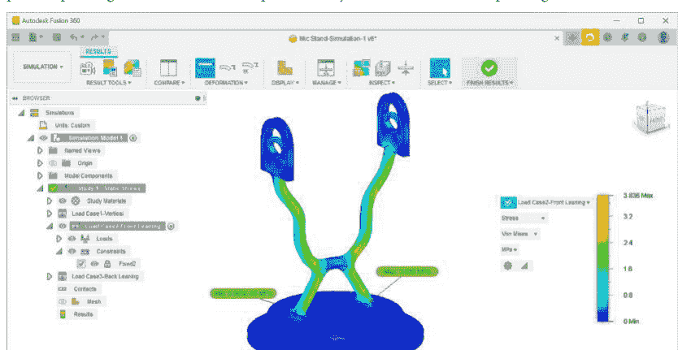

Figure 3.33 – 初始模拟的线性静应力结果

为了进一步探讨这个想法，让我们复制 **Study 1** 并创建 **Study 2**。在 **Study 2 - Static stress** 中，我们将选择不同的材料，但对全部三个载荷工况保持所有载荷和边界条件不变。使用 Fusion 360 中的研究复制工作流程进行多次研究是能够更改材料的主要优势之一。

在 **Study 1** 中，我们选择了铝作为材料；在 **Study 2** 中，让我们将研究材料更改为 **PA 12**，这是一种塑料材料，可以使用 HP MultiJet Fusion 3D 打印机打印。*图 3.34* 显示了该材料的物理和热材料属性。

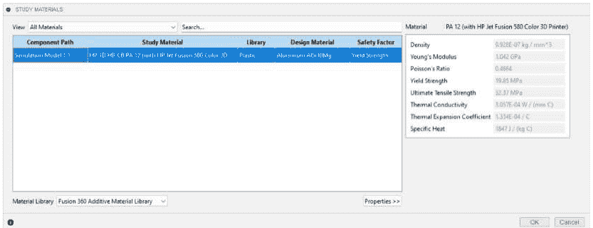

## 图 3.34 – HP Jet Fusion 580 打印的 PA 12 的物理和热性能

进行第二次研究后，我们可以将 **Study 1** 的结果与 **Study 2** 进行比较。利用 Fusion 360 的 **COMPARE** 功能，我们可以将布局拆分为多布局视图，如 *图 3.35* 所示。

在此图中，我们可以看到左侧的两张图像来自使用了铝作为材料的 **Study 1**。右侧的两张图像来自使用 PA 12 作为材料的 **Study 2**。顶部两张图像显示安全系数结果。底部两张图像显示工况 2 的应力结果。尽管两种仿真中的应力结果相对较小，但使用塑料材料而非铝时，安全系数从 8+ 下降到 5.3。

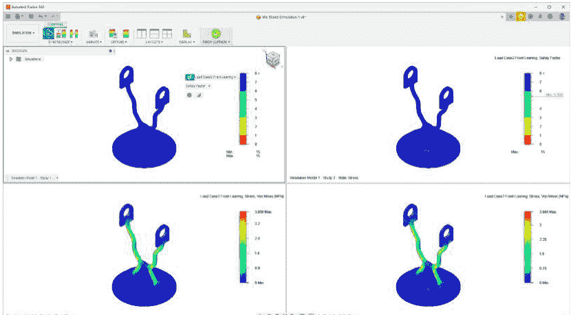

## 图 3.35 – 比较使用不同材料的两次仿真结果

仔细检查后，高应力位于与之前相同的位置。如前所述，这里存在应力集中的可能性。应力集中是指模型中应力倾向于上升的区域，无论我们使用何种网格尺寸来模拟模型都如此。它可能是由局部载荷（如点载荷）或几何形状的突然变化引起的。如果模型中存在应力集中，在运行期间可能会导致断裂点。如果可能，始终建议更改载荷条件或几何形状以消除应力集中区域。

让我们看看是否可以通过设计更改来解决这个问题。要进行设计更改，我们必须返回到 **DESIGN** 工作区。为了不丢失前两次研究的仿真结果，让我们以新名称保存设计。在本例中，我选择将我的设计命名为 `Mic Stand-simulation 2`。

图 3.36 显示了有机腿与棱柱特征相遇区域的放大视图。消除应力集中的一种方法是添加倒圆角。如果我们尝试在当前条件下向几何体添加倒圆角，由于当前形状的复杂性，Fusion 360 无法在所选边上创建倒圆角。

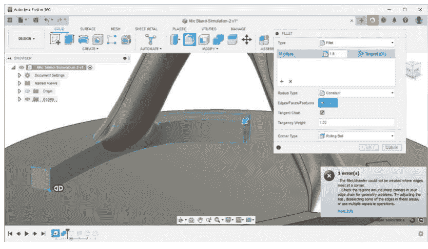

图 3.36 – 问题区域倒圆角创建过程中的错误

在使用 **边界表示**（**BREP**）建模的 CAD 软件中，倒圆角或倒角创建过程中可能会出现此类错误。每当我们遇到此类错误时，可能需要想出不同的解决方案来更改设计，以便解决应力集中问题并在边之间创建平滑过渡。在本例中，我选择构建一个新的棱柱体。我们可以通过在底座顶部创建新草图并使用距现有棱柱形状 5 毫米的偏移来实现，如图 3.37 所示。

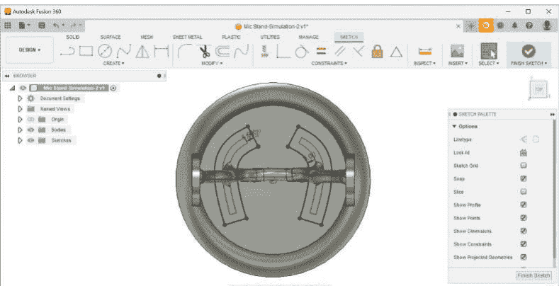

图 3.37 – 根据棱柱形状偏移绘制两个新轮廓

我们可以通过选择这些新轮廓来拉伸两个新形状。这将是连接到我们有机支架的新棱柱底座。为了减轻重量，我们可以用锥度角创建拉伸。在本例中，我们将利用 20 度锥度角作为拉伸特征的一部分，如图 3.38 所示。

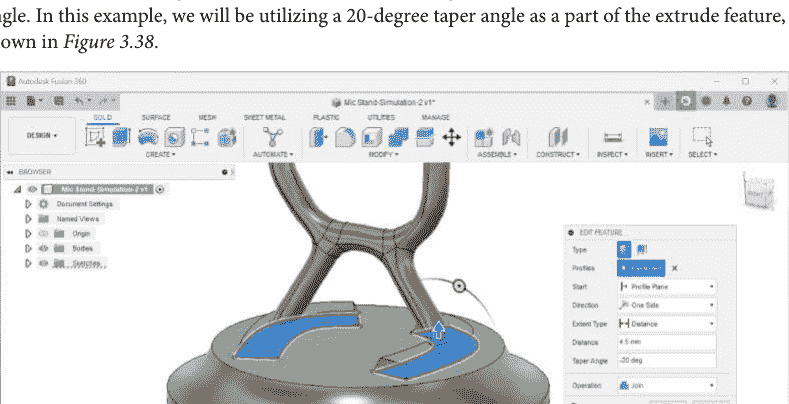

图 3.38 – 使用锥度角拉伸两个新的棱柱形状

一旦我们有了新的棱柱底座，我们可以选择底座与有机形状相遇的所有面和/或边，并使用位于 MODIFY 面板中的 FILLET 命令创建新的过渡。在本例中，我们将添加一个 1.5 毫米半径的倒圆角，如图 3.39 所示：

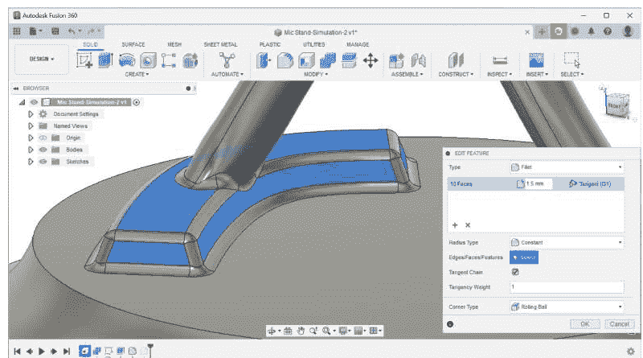

图 3.39 – 对棱柱底座和有机支架应用倒圆角特征

在我们专注于添加倒圆角的同时，在左右安装区域底部的尖角处添加两个倒圆角也是一个好主意。如图 3.40 所示，如果采用较大的倒圆角半径，我们可以减轻重量并使设计更安全。

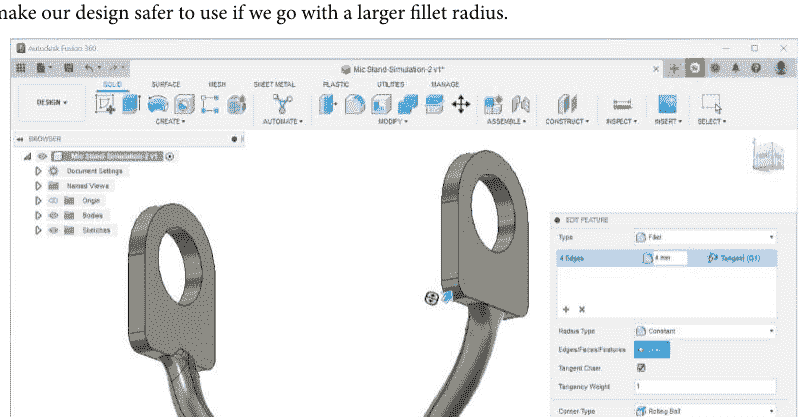

图 3.40 – 对安装支架应用 4 mm 倒圆角

现在我们已对模型进行了所有必要的更改，可以切换到 **SIMULATION** 工作区。确认选择了正确的 PA 12 材料后，我们可以重新运行静态应力研究。此新研究在此新的 Fusion 360 设计中求解，显示出更均衡的应力分布，如图 3.41 所示。它不再在有机支架与棱柱底座相遇处具有最高应力点。与之前的设计/仿真相比，其最高应力值也有所降低。

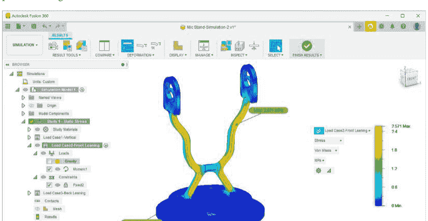

图 3.41 – 消除应力集中后的设计更改应力结果

经过这三次仿真，我们可以确信，我们的麦克风支架不仅能够承受日常使用，而且在 3D 打印后不会存在可能导致随时间推移发生断裂的潜在薄弱点。

需要注意的是，我们使用各向同性材料模型假设对这些零件进行了仿真。Fusion 360 的增材材料库中的材料，如金属、粉末和树脂，其物理性能基于 3D 打印和测试。对于像 PA 12 这样表现出各向异性行为的材料，Fusion 360 使用构建方向力学性能并遵循各向同性材料行为假设。有关每种材料和 3D 打印技术的更多详细信息，请参阅所仿真材料的规格表 – 例如，https://h20195.www2.hp.com/v2/getpdf.aspx/4AA7-1533ENA.pdf。

总之，我们可以通过多种方式减轻零件重量。Fusion 360 提供了多种易于使用的轻量化现有零件以及创建新设计的方法。

## 摘要

在本章中，我们使用自动化建模创建了有机且轻量化的模型。自动化建模为我们提供了六种设计备选方案可供选择，一旦我们选择其中一种，就能够修改其体积并创建有机轻量化设计备选方案。接下来，我们设计了起始形状并使用形状优化，根据载荷和边界条件对目标形状进行轻量化。

然而，这两种方法都没有基于应力结果创建形状。为了确保我们选择的备选设计能够承受运行载荷条件下发生的应力，我们进行了静态应力研究。我们的初始仿真指出，我们的材料选择对于我们的需求来说太强了。在将材料从金属改为塑料后，我们意识到我们的设计仍然能很好地满足其预期用途。然而，我们也识别出了应力集中区域，并进行了最后一次设计更改以消除应力集中，从而最大程度地减少潜在的未来失效点。

使用类似的工作流程，您可以确保创建轻量化且合规的设计，这些设计不仅能够承受运行条件，而且在现场使用寿命长。在下一章中，我们将重点介绍如何使用各种中空和点阵方法进一步减轻设计重量，以减少材料和能源消耗。
