## 通过中空和点阵零件来减少材料和能源使用

欢迎阅读第 4 章。正如我们在上一章中提到的，增材制造的一个关键优势是能够创建轻量化零件。在本章中，我们将介绍 Fusion 360 中用于中空笨重零件并在中空部分应用点阵结构以创建轻量化版本的几种工具，这些版本可以使用更少的材料和能源进行 3D 打印。

我们将首先讨论各种 3D 打印技术以及如何根据技术对零件进行中空。之后，我们将重点介绍创建排水孔，以便使用树脂或粉末 3D 打印的零件在打印过程完成后可以被移除。最后，我们将讨论我们用于创建点阵的各种工具。

在本章中，我们将涵盖以下主题：

- 中空零件
- 创建排水孔
- 创建实体和体积点阵

到本章结束时，您将学会如何中空实体和网格体。您将能够建模排水孔，并且将很好地理解如何创建点阵形状以填充中空组件内部。

### 技术要求

本章涵盖的所有主题都可供启动版和教育版 Fusion 360 许可证类型使用。如果您拥有 Fusion 360 的商业许可证，则为了创建和修改体积

晶格，您还需要访问 Product Design 扩展（https://www.autodesk.com/products/fusion-360/product-design-extension）。

Autodesk 为 Product Design 扩展提供 14 天试用。您可以在 Fusion 360 的扩展对话框中激活试用。

Product Design 扩展访问不适用于 Fusion 360 的个人/业余许可证。

本章的课程文件可在以下位置找到：https://github.com/PacktPublishing/3D-Printing-with-Fusion-360。

## 中空零件

在之前的章节中，我们介绍了如何导入和编辑由实体和网格体组成的现有设计。我们还利用了形状优化和自动化建模，让 Fusion 360 生成轻量化的设计替代方案。然后，我们对这些几何体进行仿真，以查看生成的模型是否能够承受工作载荷。在所有这些活动中，我们的主要目标是创建可进行 3D 打印的模型。

我们可以使用 3D 打印来制造最终使用零件，以及在采用其他制造方法进行大规模生产之前快速创建原型。无论我们出于何种原因选择 3D 打印作为制造方法，我们都希望能够快速高效地生产物理模型。

如第 2 章所述，市面上有多种 3D 打印技术可供选择。每种 3D 打印技术都有独特的设计要求，以高效地生产物理模型。当您打印不需要结构强度的零件时，中空模型可以成为节省时间和材料的好方法。

使用熔融沉积制造（FFF）3D 打印机制造大体积部件时，通常的做法是利用多条轮廓线使零件坚固。在 FFF 中，通常还使用填充密度在 15% 到 30% 之间的填充图案，以保持零件轻量化。这种相同的切片技术并不能直接适用于其他 3D 打印技术，例如立体光刻（SLA）、多喷头熔融（Multi Jet Fusion）或选择性激光烧结（SLS）。使用这些技术创建原型零件时，设计人员必须主动思考如何减轻零件重量以减少材料和能源使用。

在本节中，我们将重点介绍如何为立体光刻、多喷头熔融和选择性激光烧结等 3D 打印技术中空零件。在大多数情况下，将零件掏空可以节省大量材料，而不必将整个零件作为 100% 实心物体打印。中空零件还可以提高树脂基打印机（立体光刻和数字光处理（DLP））的打印成功率，因为它减轻了打印零件的重量并降低了构建平台上的应力，从而使零件在打印过程中不会从构建平台上脱落。

在中空零件的同时，我们还必须确保壁厚足够大，以满足所选的打印工艺，以便我们的零件能够成功制造，并且在预期使用过程中不会断裂。

在处理实体模型时，Fusion 360 提供了两种中空零件的方法。两种方法都可以通过相同的 SHELL 命令访问。Shell 命令位于 DESIGN 工作区 | SOLID 选项卡 | MODIFY 面板中，如图 4.1 所示。

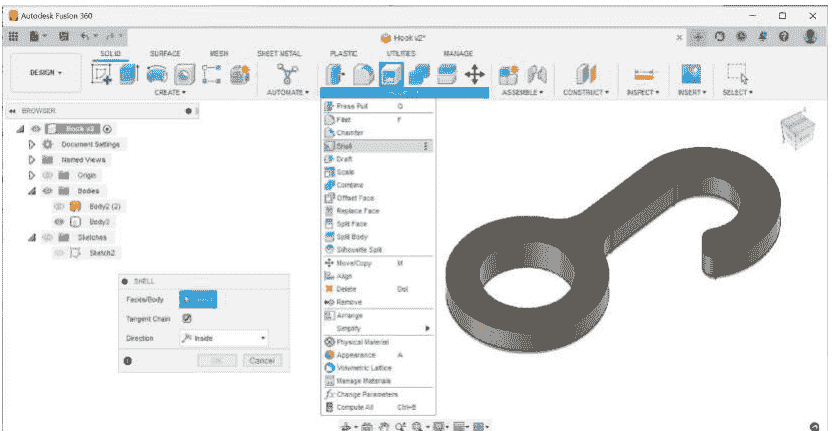

Figure 4.1 – 在 SOLID 选项卡内访问 shell 命令

Fusion 360 的 SHELL 功能非常多功能。它允许您选择面或体作为输入。如果您选择一个面然后指定厚度，所选面将被移除，您将得到该体的中空版本，如图 4.2 所示。SHELL 对话框还允许您选择多个面。通过按住 Shift 键，您可以多选面，shell 命令将类似地移除这些面。

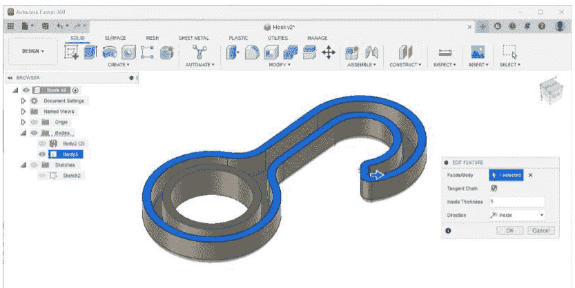

Figure 4.2 – 选择单个面将实体转换为中空版本

使用 SHELL 命令的另一种方法是选择体而不是面。访问 SHELL 对话框后，您可以简单地从浏览器中选择要进行壳处理的体。或者，您也可以从画布中选择要进行壳处理的体。如果您想使用画布，有几种选择体的方法。一个选项是将选择优先级更改为选择体优先级。做出该更改后，您可以简单地指向并选择要进行壳处理的体，如图 4.3 所示。另一个选项是访问选择过滤器下拉菜单，并确保仅选中 Bodies，这将允许将 Shell 选择方法限制为体。

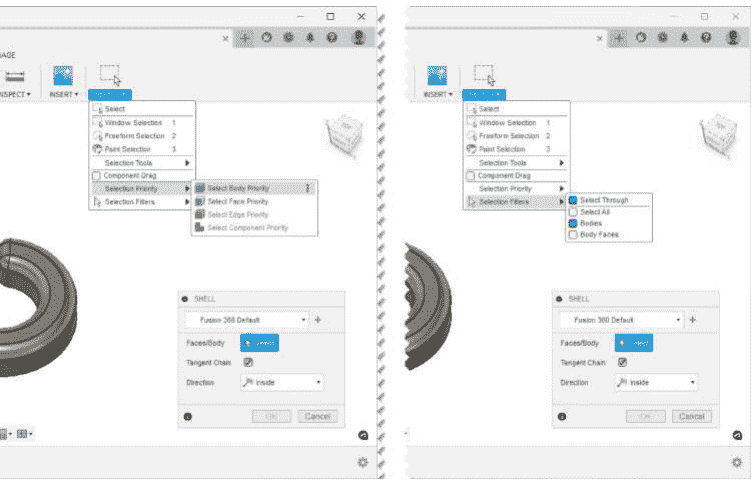

Figure 4.3 – 使用画布选择要进行壳处理的体

一旦您在体上执行 shell 命令，通常不会看到模型外观的任何视觉差异。您可能希望以几种方式检查模型，以更好地了解壳处理后的结果。第一种方法是将视觉样式简单更改为带隐藏边缘的着色或带隐藏边缘的线框，如图 4.4 所示。这两种视觉样式都会通过在模型内部显示额外的边缘来表明模型已被壳处理。

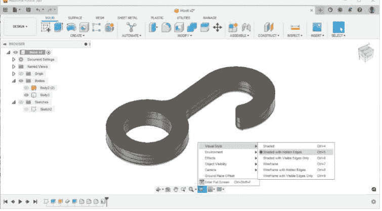

Figure 4.4 – 更改视觉样式

如果您不想将视觉样式从默认的仅显示可见边缘的着色更改，您可能希望使用截面分析。您可以从 SOLID 选项卡 | INSPECT 面板访问截面分析。选择切割平面后，截面分析命令允许您沿其法线方向平移该平面，以显示组件的切片视图。您还可以翻转切割方向，以便按需查看零件内部。图 4.5 显示了该零件的截面分析视图。您还会注意到截面分析在浏览器中的 Analysis 文件夹内添加了一个名为 Section1 的项目。我们可以通过切换可见性图标来控制所有截面分析以及我们添加到模型中的其他分析的可见性。

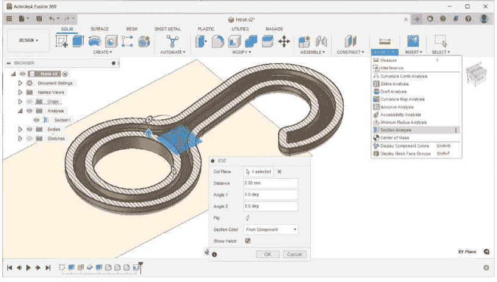

Figure 4.5 – 应用截面分析以可视化 shell 命令的结果

如果我们正在处理网格对象，我们也可以创建中空版本。MESH 选项卡 | MODIFY 面板中的 shell 命令允许我们选择体，输入厚度并创建该对象的中空版本。与 SOLID 选项卡中可用的 SHELL 命令不同，MESH 选项卡中的 SHELL 命令不允许选择面。这意味着我们无法使用 MESH 选项卡中的 SHELL 命令创建相同的形状。然而，在 SOLID 选项卡中的 shell 命令无法创建所需结果的情况下，您可以对实体进行 tessellation 并创建其网格版本。之后，您可以尝试 MESH 选项卡中的 shell 命令，如图 4.6 所示。

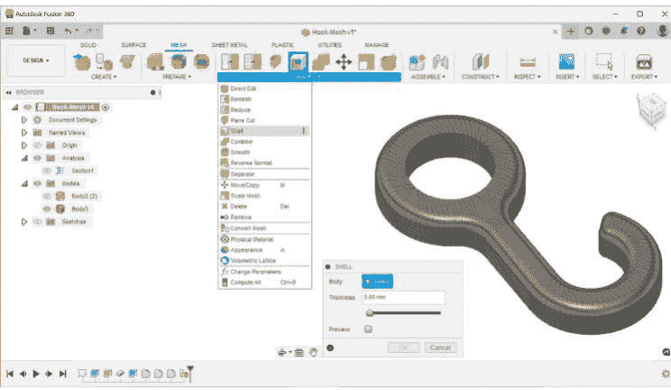

Figure 4.6 – 使用 MESH 选项卡中的 shell 命令中空体

一旦我们获得了网格体的中空版本，我们可以通过将视觉样式更改为带隐藏边缘的着色，或通过应用截面分析来查看结果，类似于我们在图 4.5 中对实体添加截面分析的方式。当我们向网格体添加截面分析时，我们将看不到阴影视图。相反，我们将看到网格体的三角形沿切割平面被截面，如图 4.7 所示。

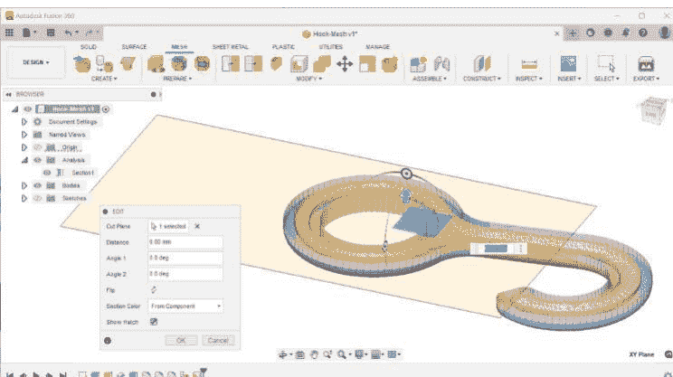

Figure 4.7 – 中空网格体的截面分析视图

在本节中，我们重点介绍了如何在实体和网格体上使用 shell 命令。我们介绍了如何通过移除一个或多个面来对实体进行壳处理，以及保持体完整并简单地掏空模型内部体积。使用特定于网格的 shell 命令，我们在网格体上重复了该过程。在每次壳操作后，我们学习了如何通过更改可视化设置以及添加截面分析来可视化 resulting 壳处理后的体，以在适当时查看内部表面和切割平面上的阴影。

在下一节中，我们将介绍如何在中空模型中添加排水孔的位置和方式，以便在 3D 打印此类模型期间和之后移除可能被困在内部的任何原材料。

## 创建排水孔

3D 打印中空零件后，我们需要在后处理阶段排出或移除所有被困的粉末/树脂。这就是为什么我们需要在设计阶段包含排水孔的原因。排水孔的直径取决于我们使用的 3D 打印技术以及我们使用的打印材料的粘度。例如，如果您使用的是基于激光的树脂打印机（SLA），您的树脂通常比 DLP 打印机树脂更粘稠。某些树脂也可用于 DLP 和 SLA 打印机。树脂越粘稠，排水孔的直径就需要越大。

表 4.1 显示了来自不同来源的两种粘度不同的树脂。根据制造商的说法，第二种树脂兼容 SLA 和 DLP 打印机：

| 树脂 | 25°C 时的粘度 |
|---|---|
| Prusa Orange Tough: https://www.prusa3d.com/product/prusament-resin-tough-prusa-orange-1kg-2/#downloads | 180-280 centipoise |
| Liqcreate Strong-X: https://www.liqcreate.com/product/strong-x/#technical | 550 centipoise |

Table 4.1 – 用于 SLA 和 DLP 打印的树脂及其粘度

使用 SLA 3D 打印技术可以创建的最小孔径为 0.5 毫米，如 Hubs.com 上 3D 打印设计规则所述，如第 2 章图 2.25 所示。同一图表还显示 SLS 工艺的孔最小直径为 1.5 毫米。然而，通常的做法是为 DLP 打印机引入至少两个直径 2 毫米的排水孔，为 SLA 打印机引入三个或更多直径 3.5 毫米的排水孔。同样，对于 SLS 打印机，建议至少使用两个直径 3.5 毫米的排水孔以获得最佳效果。请记住，增加更多更大的排水孔总能更轻松地从内部空腔中移除未烧结粉末以及未固化树脂。

排水孔的放置也需要考虑。另一个需要排水孔的原因，特别是在基于树脂的打印机上，是消除杯状效应。杯状效应发生在我们 3D 打印一层并且打印床在树脂中上下移动时，产生压力

在封闭的容积内。添加排水孔以释放可能发生吸盘效应的地方的压力，将有助于我们的打印成功，消除支撑结构失效，并消除层移问题。

现在我们已经介绍了为什么需要排水孔以及它们应该有多大，让我们讨论一下通常应该将它们放置在哪里。在树脂打印中，最好将排水孔放置在尽可能靠近打印机成型平台的位置，具体取决于为零件选择的打印方向。这意味着我们在设计排水孔之前必须先为 3D 打印定向模型。我们将在第 8 章详细介绍组件的定向。一旦我们选择了方向，我们就可以在模型底部表面靠近成型平台的位置放置排水孔。这将确保在树脂打印机的打印过程中，我们的空心模型内部不会积压压力。我们对于 SLS 打印机没有同样的排水孔放置问题，因为打印过程中吸盘效应和压力积聚通常不是问题。这意味着只要远离关键表面，我们就可以将它们放置在模型上的任何位置。

现在让我们演示如何使用 Fusion 360 创建排水孔。图 4.8 显示了我们在上一节中处理的同一个挂钩模型，已经定向为使用 SLA/DLP 打印机打印。为了更好地可视化零件相对于成型平台的方向，我还添加了一个沿 XY 平面的构造平面。此外，零件的不透明度已降低至 50%，以显示零件已被掏空。

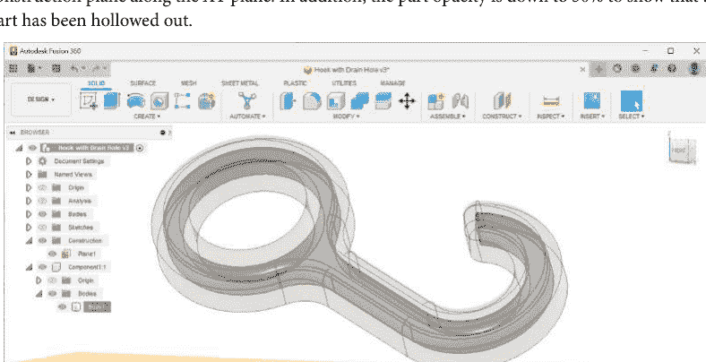

图 4.8 – 用于树脂 3D 打印的定向空心挂钩模型

对于这个零件，我们至少需要两个直径 2 毫米的孔。这些孔的最佳放置位置是在挂钩底部组件的背面，如图 4.9 所示。由于该模型允许创建更大的孔，我将两个孔的孔径均选为 3 毫米。

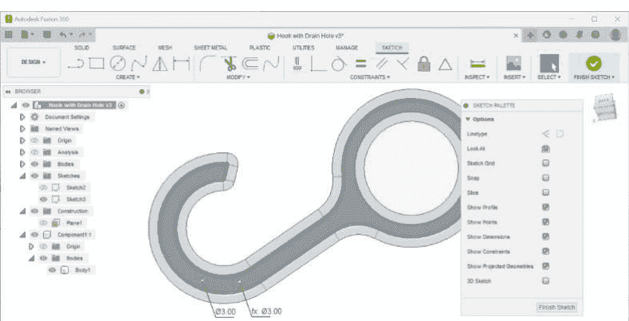

图 4.9 – 创建草图并绘制两个圆

完成草图后，我们可以使用 **EXTRUDE** 命令或 **HOLE** 命令创建排水孔。在图 4.10 中，您可以看到如何使用 **HOLE** 命令创建排水孔，并对孔的大小、深度和形状进行详细控制。

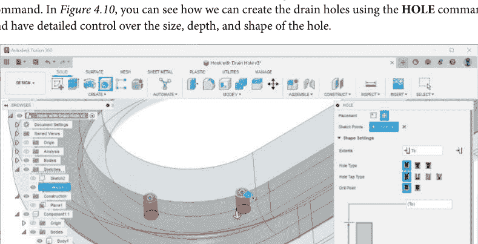

图 4.10 – 使用 HOLE 命令创建两个排水孔

创建孔后，我们可以添加 **SECTION ANALYSIS**，如 *图 4.11* 所示。在创建剖面分析期间，如果我们从 **BROWSER** 中的 Origin 节点选择 XY 平面作为切割平面，将其在正 Z 方向偏移约 22 毫米，并翻转剖面视图，我们可以看到零件底部并观察到我们已创建了两个小孔，树脂在 3D 打印过程中可以通过这些孔排出：

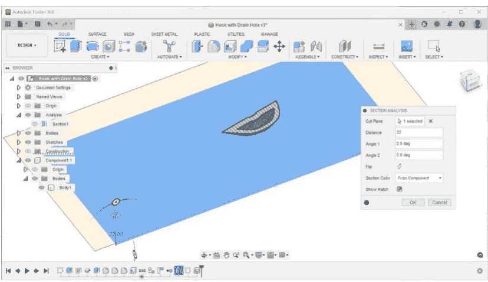

图 4.11 – 剖面分析显示两个排水孔

为基于网格的模型创建排水孔与为实体模型创建排水孔类似。在打开网格体、将其掏空并旋转到我们希望进行 3D 打印的方向后，我们必须访问位于 **MESH** 选项卡 | **MODIFY** 面板内的 **DIRECT EDIT** 命令，如 *图 4.12* 所示：

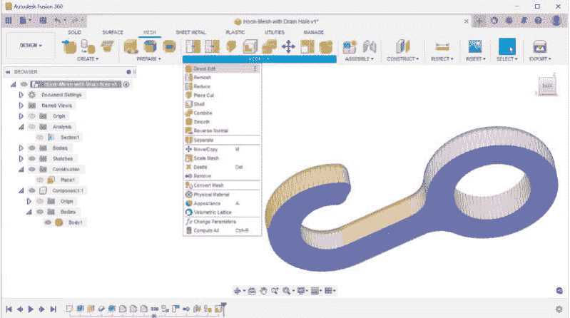

图 4.12 – 利用网格体的直接编辑模式

一旦进入 DIRECT MESH EDITING 选项卡，我们就可以使用 CONSTRUCT 面板中的功能通过三个点创建平面。我们稍后将利用此构造平面创建草图，以便我们知道孔的位置。

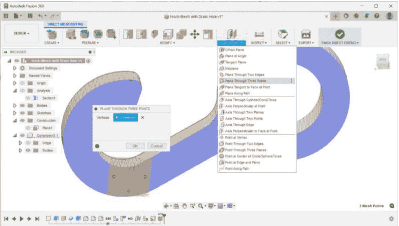

图 4.13 – 在网格体上创建构造平面

构造平面创建后，我们可以在功能区中选择 **FINISH DIRECT EDITING** 命令，这将使我们返回到 Fusion 360 的参数化设计模式。现在我们准备创建草图。我们可以访问 **SOLID** 选项卡 | **CREATE** 面板中的 **SKETCH** 命令。一旦进入 **SKETCH** 选项卡，我们需要创建多个圆来表示排水孔。图 4.14 演示了两个相距 20 毫米、直径为 3 毫米的圆。完成草图后，我们可以在功能区中选择 **FINISH SKETCH** 命令：

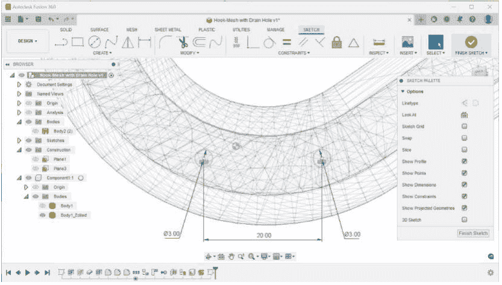

图 4.14 – 在草图环境中创建两个圆

现在，我们准备挤出这两个轮廓并创建两个圆柱体。使用位于 **SOLID** 选项卡 | **CREATE** 面板中的 **EXTRUDE** 命令，我们可以选择新创建的圆形轮廓并将其挤出，使其略高于零件的厚度。在上一节中，当我们掏空这个零件时，我们将壁厚设计为 5 毫米。因此，创建 10 毫米的挤出对于我们的孔来说应该足够了。

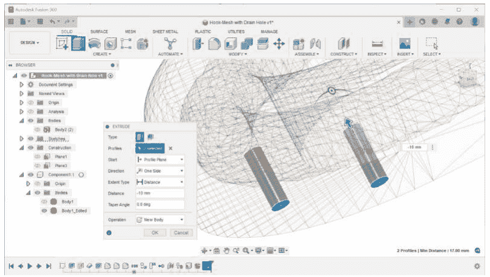

图 4.15 – 挤出圆形轮廓以制作代表排水孔的圆柱体

在 *第 2 章* 中，我们详细讨论了如何使用 Fusion 360 处理 CAD 和网格文件。我们在该章节中介绍的工作流程之一是将实体模型 tessellate 以将其转换为网格体，以便与其他网格体结合起来。这正是我们接下来要做的。让我们开始使用位于 **MESH** 选项卡 | **CREATE** 面板中的 **TESSELLATE** 命令，对这两个新的圆柱实体体进行操作。

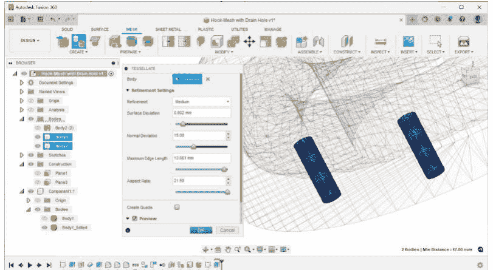

图 4.16 – 对两个圆柱实体体进行 Tessellate

一旦我们将实体体转换为网格体，使用位于 MESH 选项卡 | MODIFY 面板中的 COMBINE 功能，我们可以选择 REMOVE 操作并将其从直接编辑的 tessellated 挂钩体中移除，如图 4.17 所示：

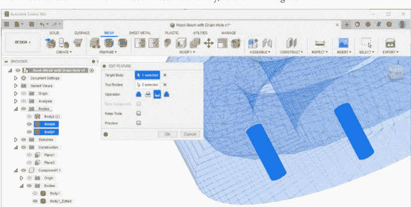

图 4.17 – 使用 Combine 命令从挂钩中移除两个圆柱体

正如我们对实体体添加剖面分析以显示排水孔一样，我们可以沿 XY 平面对网格体应用剖面分析并将其在正 Z 方向上上移 22 毫米以显示排水孔：

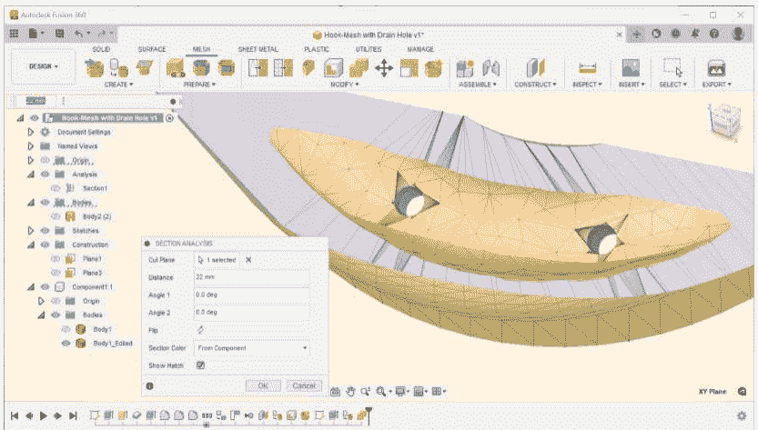

图 4.18 – 剖面分析以显示网格体内的排水孔

在本节中，我们介绍了如何在为树脂打印正确定向后，使用实体体和网格体添加排水孔。相同的原理也适用于为使用其他 3D 打印技术（如 SLS 或 Multi Jet Fusion）的几何体添加排水孔。

## 创建内部晶格结构

在之前的章节中，我们介绍了可以掏空实体或网格体的各种方法。我们演示了如何添加排水孔，以便在零件 3D 打印后可以清除任何被困的粉末或树脂。我们掏空零件的主要目标是使其轻量化，以便在打印零件时不会浪费材料和能源。

每当我们创建空心物体时，我们还应注意这些零件是否能够自支撑进行 3D 打印，这取决于我们选择的 3D 打印技术。你会记得从之前的章节中，如果我们使用 SLS 进行 3D 打印，我们不需要支撑结构。然而，如果你使用基于树脂的打印机（如 SLA 或 DLP）进行 3D 打印，模型上具有超过临界角度的悬垂部分将需要支撑结构。我们通常认为支撑结构是在零件外部打印的材料，以便在打印过程中支撑我们的零件。类似的概念也适用于我们掏空的零件。如果我们掏空一个零件，我们本质上是在创建内部表面，这些内部表面也可能需要支撑结构，以便我们的零件能够使用树脂打印机成功打印。在本节中，我们将讨论如何创建这些内部支撑结构。

在掏空零件后创建一个内部支撑结构的一种方法是创建晶格。Fusion 360 提供了多种创建内部晶格的工作流程。在本节中，我们将具体讨论如何创建体积型、基于网格的和实体晶格。在 *第 10 章* 中，我们将更详细地介绍如何在制造工作区的上下文中创建支撑结构。在同一章中，我们还将把这些支撑结构应用于零件的外表面，以及根据需要应用于内表面。毕竟，将支撑结构应用于零件的内表面与添加内部晶格的目的相同。

让我们从体积晶格开始探索晶格生成。Fusion 360 在访问产品设计扩展后允许用户创建体积晶格。我们已在 *第 2 章* 和 *第 3 章* 中介绍过如何在将有机网格体转换为实体对象的上下文中使用产品设计扩展。在本章中，我们将利用产品设计扩展的另一个关键功能，**体积晶格**。**体积晶格**可在 **实体**、**网格** 和 **塑料** 选项卡的 **修改** 面板内使用，如图 4.19 所示。

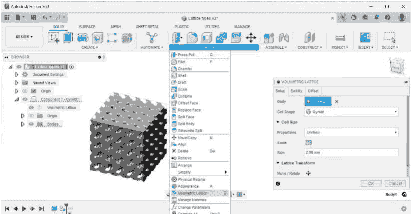

图 4.19 – 将均匀的陀螺晶格应用于实体

**体积晶格** 命令可更改实体或网格体以创建模型的体积表示。使用此命令，您可以在体的边界内快速添加内部晶格结构。图 4.19 显示了将单元尺寸为 2 毫米的陀螺晶格应用于边长为 10 毫米的盒子的情况。在某些情况下，我们可能希望控制给定单元的尺寸以在特定方向上拉伸晶格。**体积晶格** 命令具有将单元尺寸的比例从均匀更改为非均匀的选项。图 4.20 显示了非均匀单元尺寸，其中晶格单元的 X 和 Y 方向为 3 毫米，但晶格单元在 Z 方向被拉伸并设置为 5 毫米：

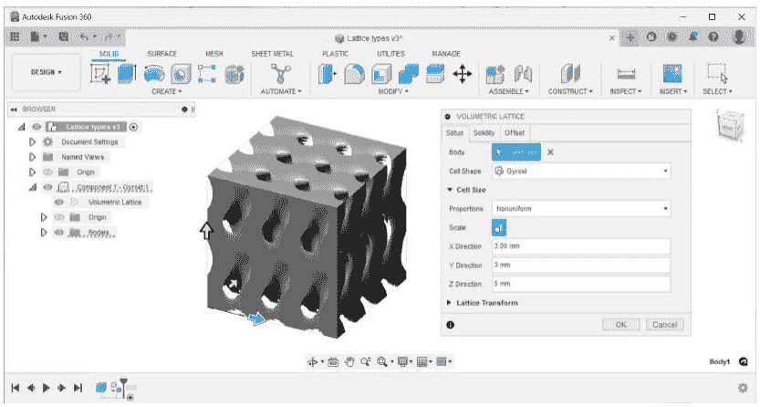

图 4.20 – 晶格单元在 Z 方向上被拉伸，非均匀单元尺寸

根据我们选择的单元形状和零件的方向，我们可能需要考虑定向和/或平移晶格单元，以便可以在无需自身支撑的情况下进行打印。对于此类情况，**体积晶格** 对话框允许我们通过定位和定向参考单元来转换晶格，如图 4.21 所示：

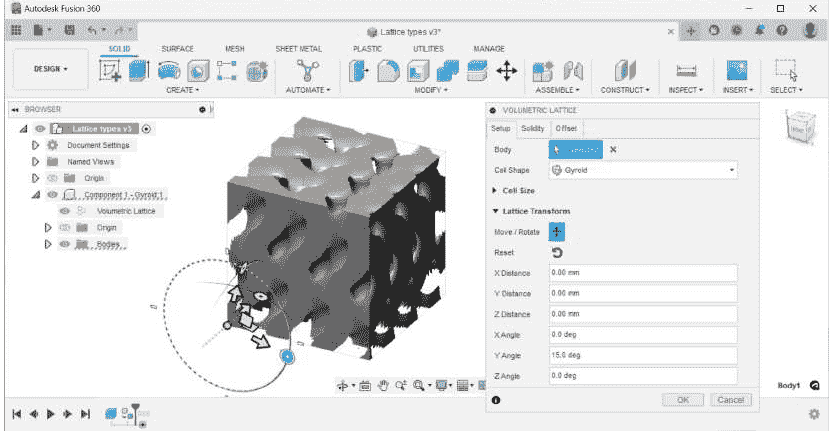

图 4.21 – 将陀螺单元形状沿 Y 轴旋转 15 度

**体积晶格** 对话框由三个选项卡组成。**设置** 选项卡允许我们选择一个体并应用单元形状，将我们的实体或网格体转换为体积模型。选择体后，它会自动应用陀螺单元形状，因为这是默认的晶格类型。但是，我们可以通过简单地展开下拉菜单并切换到不同的单元形状来选择不同的单元形状，例如图 4.22 中所示的 **十字** 形状。

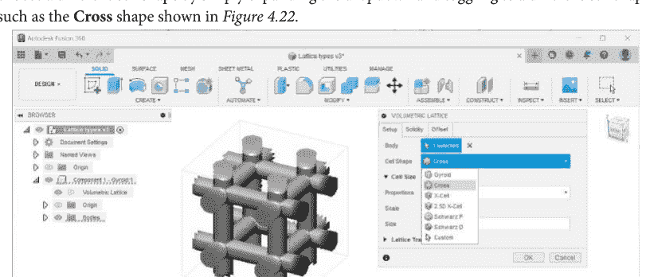

图 4.22 – 在体积晶格对话框中更改单元形状

Fusion 360 中的 **体积晶格** 对话框有六种默认单元形状。将所有这些形状应用于边长为 10 的盒子，单元尺寸为 10，实体率为 0.4 的结果可在图 4.23 中看到：

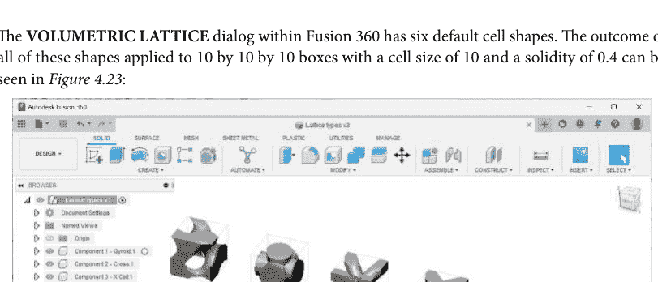

图 4.23 – 体积晶格中每个单元形状的结果形状

由于陀螺形状是 3D 打印中常见的形状，我们将在本节的其余部分继续使用它。当我们切换到实体率 选项卡时，体积晶格 对话框为我们提供了修改应用于参考体的晶格的实体率的选项。实体率输入范围为 0 到 1。实体率为 0 表示我们将没有材料，而实体率为 1 指的是完全致密的材料分布：

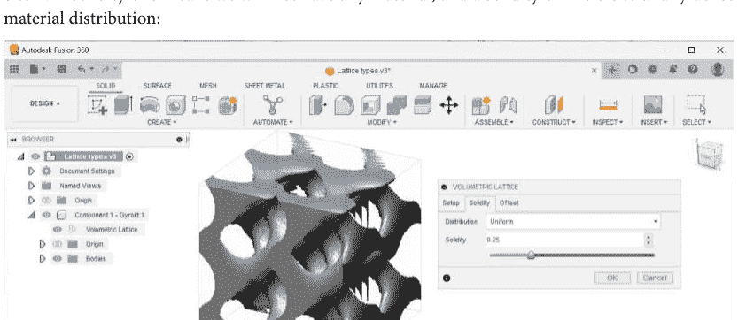

图 4.24 – 均匀修改体积晶格的实体率

我们还可以控制实体率沿路径的变化。在将分布类型更改为沿路径渐变后，我们可以选择一条边或草图线。体积晶格 对话框将自动检测所选对象的起点和终点，并为我们提供在起点和终点位置之间控制实体率的选项，如图 4.25 所示。

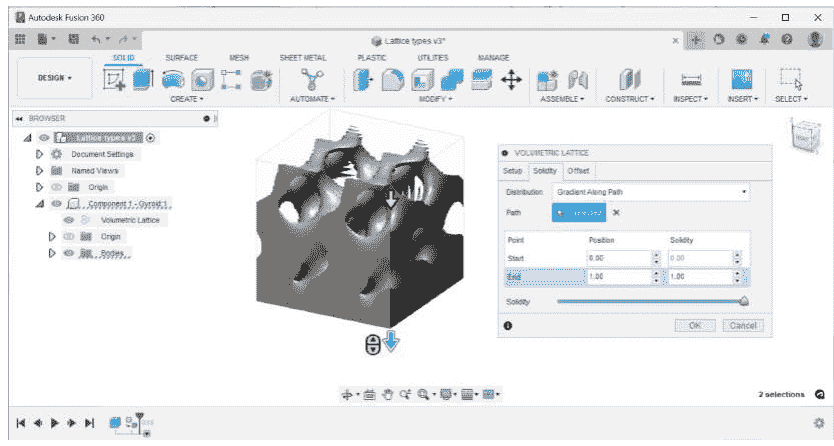

图 4.25 – 沿包围体的边缘变化晶格的实体率

**体积晶格** 对话框的最后一个选项卡称为 **偏移**。在此选项卡中，我们可以选择一个或多个几何输入，例如面或边，并分配厚度和实体率。*图 4.26* 显示了选择立方体的正面朝向面并分配厚度为 2 毫米、实体率为 1 后的结果。 resulting 体积模型代表正面朝向面上的 2 毫米厚蒙皮，然后是陀螺晶格。

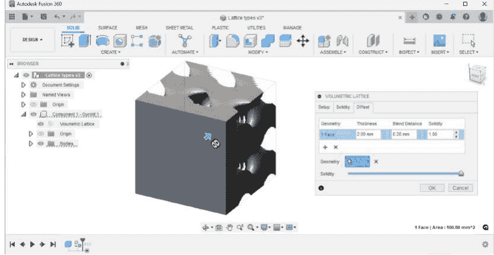

图 4.26 – 为偏移面分配厚度

到目前为止，我们主要利用体积晶格功能将实体转换为晶格表示。有了偏移 选项卡，我们引入了创建蒙皮的概念。如果需要，我们可以返回到实体率 选项卡并输入实体率为 0，这反过来会从模型的晶格部分移除所有材料。如果我们采取此操作，我们将只剩下使用偏移 选项卡应用的蒙皮，如图 4.27 所示：

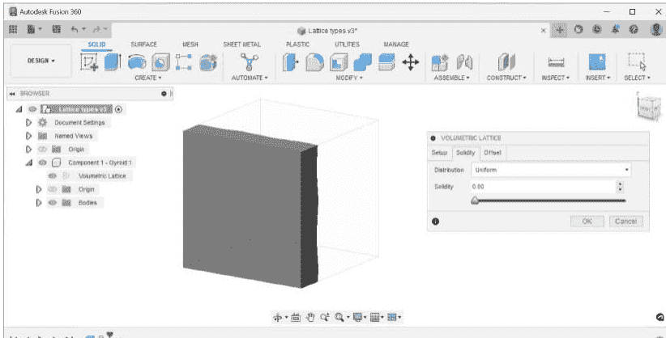

图 4.27 – 具有单个偏移面的 0 实体率晶格的结果

我们可以更进一步，将偏移应用于该实体立方体的所有六个面。如图 4.28 所示，此类操作将创建一个厚度为 2 毫米的中空盒子。每当我们掏空一个体时，很难可视化，因为外部面阻碍我们看到物体内部。正如我们在前一小节中利用剖面分析一样，我们可以简单地转到 INSPECT 面板并沿 XZ 平面添加一个剖面分析，并将其偏移一定距离，以查看此体积体的内部是什么样子的。

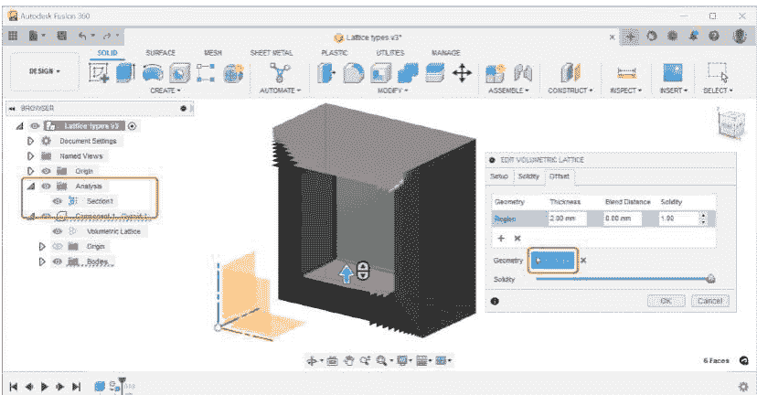

图 4.28 – 中空体积体的剖面分析视图

正如我们在前一小节中介绍的，每当我们掏空一个体时，添加排液孔很重要，以便在 3D 打印后可以移除 trapped 树脂或粉末。如果您利用体积晶格来掏空一个体，您可以简单地创建草图，制作一个圆，并使用 HOLE 命令创建排液孔。在图 4.29 中，您可以看到添加了一个直径为 2 毫米的排液孔。

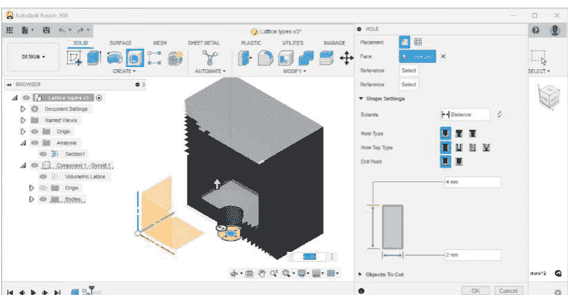

图 4.29 – 具有排液孔的中空体积体的剖面视图

由于本小节的主要目标是应用晶格，让我们返回浏览器中的 **体积晶格**，右键单击并编辑它，如图 4.30 所示。当我们编辑体积晶格时，我们可以访问 **实体率** 选项卡并将实体率从 0 增加到 0.2，从而为此已经具有排液孔的零件同时应用蒙皮和晶格：

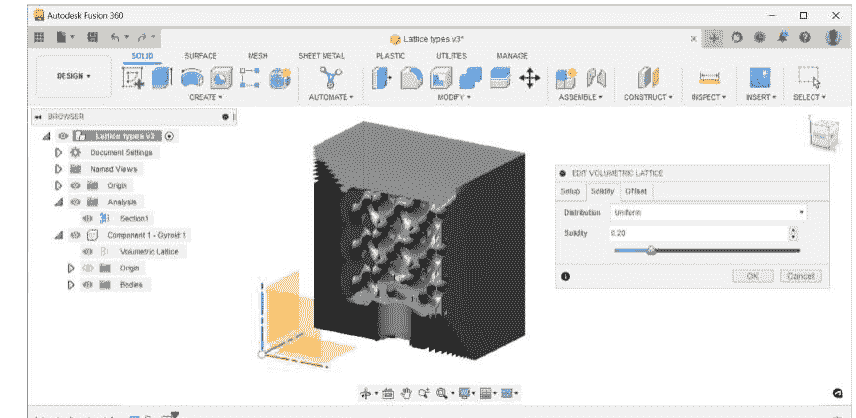

图 4.30 – 壳化并晶格化的体积模型

一旦我们完成设计，Fusion 360 为 3D 打印体积模型提供了两种方法。第一种方法是切换到制造工作区，使用适当的 3D 打印机创建增材制造设置，并在 Fusion 360 中原生切片体积模型以进行 3D 打印。第二种方法是创建网格体，以便我们可以将其导出到第三方切片软件。要将体积体转换为网格体，我们必须从浏览器中选择它并右键单击。如图 4.31 所示，选择 **创建网格** 选项后，我们将能够创建体积体的网格表示：

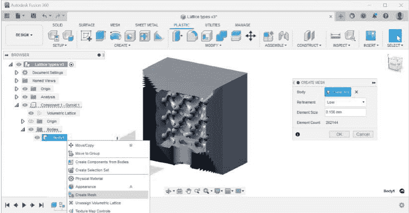

图 4.31 – 从体积体创建新的网格体

生成的网格可以使用我们在第 2 章中介绍的所有原生网格工具进行编辑和可视化。在图 4.32 中，我们可以看到应用了截面分析的生成的网格体，以显示内部晶格和排水孔。

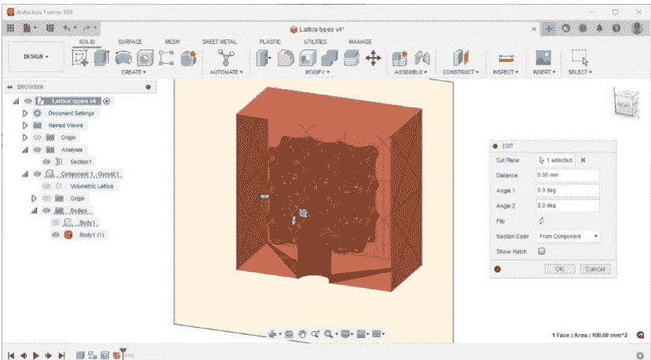

图 4.32 – 从体积模型创建的网格体的截面分析视图

现在是时候从体积晶格中可用的默认单元形状转向自定义形状和实体晶格了。由于 Fusion 360 是一款参数化 CAD 工具，我们可以快速生成草图、曲面或实体体，然后将其用作体积晶格中自定义单元类型的输入。图 4.33 显示了使用沿距离拉伸的草绘圆圈重建的十字单元形状，并使用圆形图案重复图案化两次以创建三个体，然后将它们组合成一个单体晶格单元。

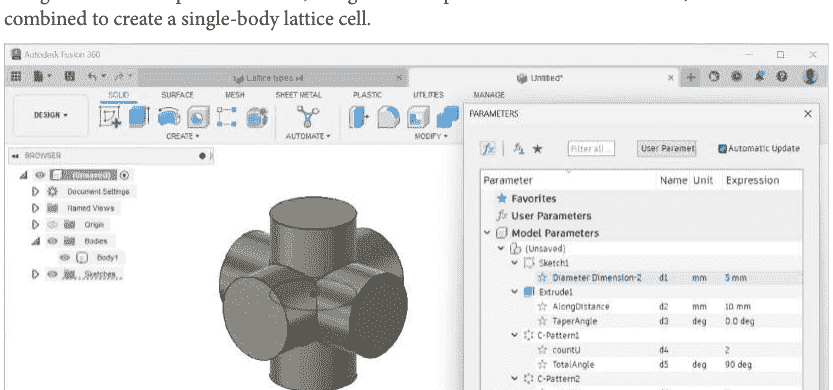

图 4.33 – 单个单元的实体建模

现在自定义单元设计完成后，我们可以在 VOLUMETRIC LATTICE 对话框中将此单元形状应用于不同的体。图 4.34 显示了将我们的自定义单元应用于 10 毫米 x 10 毫米 x 10 毫米的盒子：

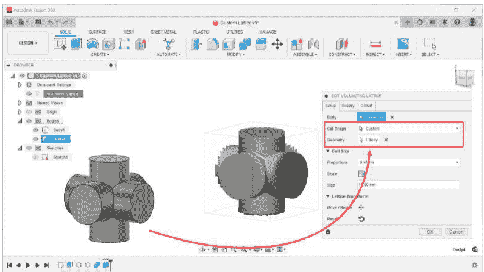

图 4.34 – 在体积晶格中将实体体用作自定义单元

使用自定义晶格作为体积晶格的输入单元形状时，我们必须记住 Fusion 360 是一款参数化 CAD 工具，我们对用作自定义晶格输入的体所做的任何更改都将对体积模型产生下游影响，如图 4.35 所示。

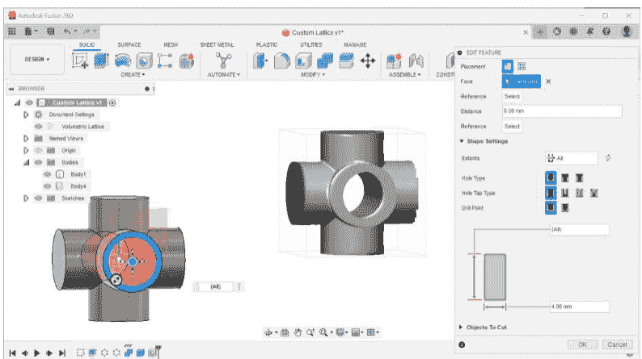

图 4.35 – 修改自定义单元实体体的即时影响

现在我们已经介绍了使用体积晶格的所有细节，我们可以将其应用于我们在前一小节中设计和修改的零件。您可以参考提供的名为 `Hook with drain hole and lattice` 的文件，以查看将具有 10 毫米单元尺寸的 gyroid 晶格应用于钩子的全部 23 个面并设置 5 毫米厚度的偏移后的结果：

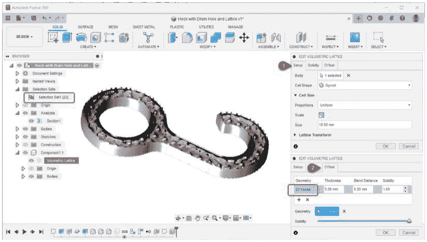

图 4.36 – 钩子模型的体积版本的截面视图

正如我们之前概述的，如果我们想将此模型从 Fusion 360 导出以使用第三方切片软件进行切片，我们必须创建网格。选择体并右键单击后，我们只需选择 **创建网格** 并在结果对话框中点击 **确定**。完成后，我们将能够在截面视图中可视化我们模型的网格结果，如 *图 4.37* 所示。

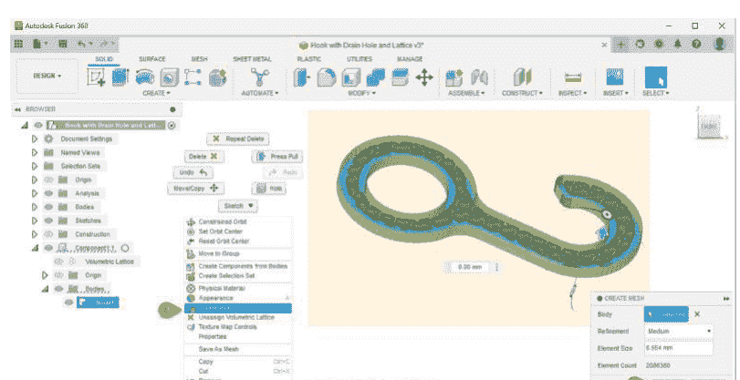

图 4.37 – 钩子模型网格版本的截面视图

本小节中我们将介绍的最后一种晶格类型是实体晶格。为了创建实体晶格示例，我们将使用如图 4.33 所示创建的十字形状。使用 Fusion 360 的矩形图案工具，我们可以轻松地为此形状在 X 和 Y 方向创建 5 x 5 矩阵，如图 4.38 所示：

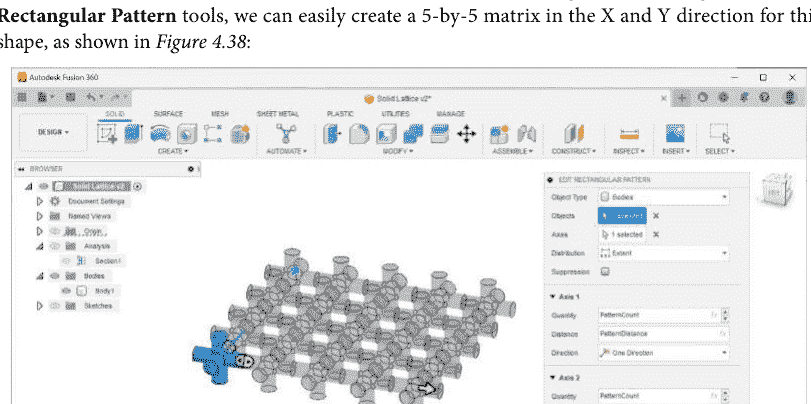

图 4.38 – 在实体体上使用矩形图案

一旦我们有了实体晶格的平面版本，我们就可以简单地利用 **沿路径图案** 命令沿 Z 轴创建多个副本。使用图案命令并选择实体体作为输入将导致该相同体的多个副本。在本例中，由于这是一个 5 x 5 x 5 矩阵，我们最终将得到 125 个体。我们可以简单地使用位于 **实体** 选项卡的 **修改** 面板中的 **合并** 命令，并创建一个单一实体体来表示晶格形状。

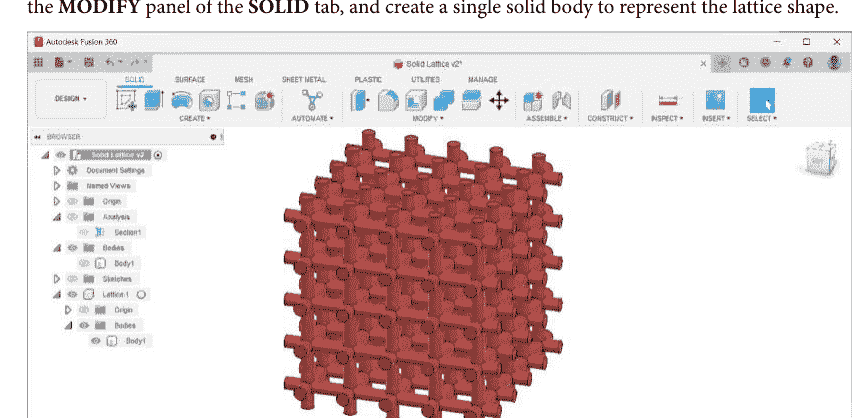

图 4.39 – 代表晶格的单一实体体

然后我们可以将此晶格形状与我们试图掏空并形成晶格的实体体的壳版本进行组合和相交，如图 4.40 所示：

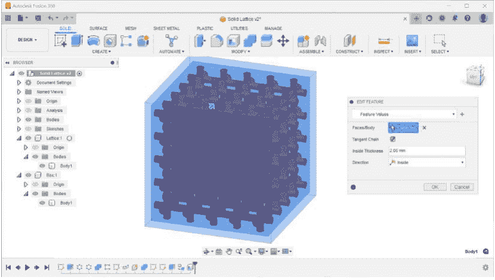

图 4.40 – 掏空的盒子和内部晶格

如果我们对零件应用截面分析，我们可以轻松可视化掏空物体和零件腔体内的晶格的结果，如图 4.41 所示。使用此方法，我们可以通过使用前面讨论过的实体建模技术添加必要的排水孔来完成零件：

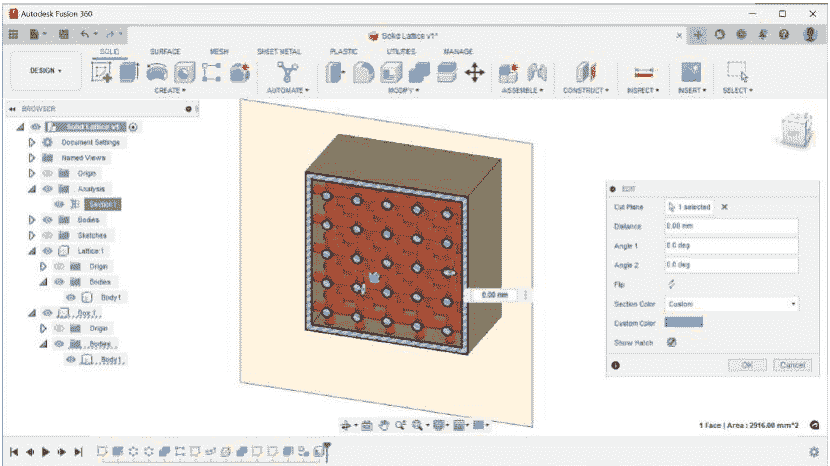

图 4.41 – 掏空盒子和内部晶格的截面视图

将晶格创建为实体对象非常有益，因为我们在参数化建模中作为实体几何建模的设计可以稍后根据需要轻松编辑。实体晶格也可以导出为 CAD 文件，例如 STEP、SAT 和 IGES。此外，如果您想模拟具有晶格结构的零件的性能，Fusion 360 只能在我们的模型由实体组成时执行此类模拟。体积晶格无法使用 Fusion 360 进行模拟。然而，创建实体晶格需要大量计算资源并且可能很麻烦。使用 **体积晶格** 对话框为给定零件创建晶格和壳化更为直接，并且可以有效地用于 3D 打印零件，如果我们不需要模拟它们，这通常是使用树脂打印制造原型零件的情况。

## Summary

在本章中，我们介绍了如何使用实体建模、网格建模和体积建模技术掏空实体体和网格体。我们演示了掏空实体体的两种方法。第一种方法是通过选择一个或多个面并从实体对象中移除这些面，以创建剩余体的外壳。第二种方法我们只是简单地掏空了实体体的内部。我们强调了如何通过更改可视化以及添加截面分析来可视化掏空实体体的影响。

本章后面，我们强调了如何向壳化物体添加排水孔以去除 3D 打印时 trapped 的粉末或树脂。我们解释了排水孔的大小和位置以及所需的排水孔数量如何取决于 3D 打印技术。我们演示了如何为 **立体光刻 (SLA)** 和 **数字光处理 (DLP)** 打印机添加排水孔以去除未固化树脂。我们介绍了根据树脂粘度和 3D 打印技术所需的不同尺寸排水孔。我们还强调了排水孔的放置位置，以便我们能有效去除树脂并消除杯状效应，这可能导致打印过程中零件失效。我们还提到了排水孔的放置如何取决于 3D 打印的零件方向。

我们通过展示如何向零件添加体积晶格和实体晶格结束了本章。我们想要掏空体的主要原因之一是使其轻量化并在 3D 打印过程中节省材料和能源。然而，并非所有技术都能在不需要支撑结构的情况下 3D 打印空心物体。在本章的最后一小节中，我们介绍了可以创建内部晶格的各种方法，这些晶格可作为打印 SLA 和 DLP 打印机掏空物体的支撑结构。我们讨论了如何使用 Fusion 360 中的单个命令完成掏空体并添加体积晶格。我们以讨论体积晶格和实体晶格之间的差异以及实体晶格如何用于进行有限元分析模拟以查看 3D 打印零件是否能承受工作条件结束本章。

使用这些技术，我们可以快速轻松地减少使用树脂或塑料粉末基打印机打印具有大截面的零件所需的材料量。这标志着我们对增材制造设计概念讨论的结束。

在下一章中，我们将从讨论设计转向突出如何制造这些设计，通过查看如何将 Fusion 360 中创建的模型导出到第三方切片软件。

