## 三角化模型并将网格文件导出到第三方切片器

欢迎来到第 5 章！在之前的章节中，我们讨论了在 Fusion 360 中打开 CAD 文件和网格文件、检查错误并修复它们。我们还介绍了如何在设计增材制造原则的指导下编辑 CAD 和网格文件。我们强调了如何使用自动化建模和形状优化来减轻部件重量并对其进行仿真，以确保它们能够承受操作载荷和边界条件。我们还介绍了如何使用中空和晶格化方法减轻部件重量，以减少所需的材料和能源量。在本章中，我们将重点介绍如何将这些模型从 Fusion 360 转移到第三方切片器。

Autodesk Fusion 360 已内置切片器，我们将在第 7 章开始深入介绍。在本章中，我们将演示如何将模型从 Fusion 360 导出到其他第三方切片器进行 3D 打印。今天市场上已有数百家 3D 打印硬件公司。您可能听说过其中一些常见的公司，例如 UltiMaker、Prusa、Formlabs、EOS、Renishaw、Stratasys 和 Nikon。一些 3D 打印机对第三方打印准备解决方案开放，允许诸如 Fusion 360 之类的软件对模型进行切片并创建 3D 打印的刀具路径。与此同时，其他打印机则要求用户使用专有切片器。无论您使用何种硬件进行 3D 打印模型，了解如何将模型从 Fusion 360 导出都是一个好主意，以防您需要在其他地方使用它们。

每个切片器都是独一无二的，并且为其支持的 3D 打印机提供了专用工作流程。大多数，如果不是全部，3D 打印切片器都使用常见的网格文件，例如 STL 或 OBJ 文件格式。最近，许多免费使用的切片器，例如 Prusa Research 的 PrusaSlicer、UltiMaker 的 Cura 和 Formlabs 的 PreForm 开始接受 3MF 文件格式。

免费使用的 3D 打印切片器读取来自 Fusion 360、Inventor 或 SolidWorks 等 CAD 软件的实体几何结构的情况较少见。然而，某些切片器的付费版本（例如 Ultimaker Professional – https://ultimaker.com/software/ultimaker-professional/ – Fusion 360 和 Autodesk Netfabb Premium – https://www.autodesk.com/products/netfabb/overview）具有读取通用实体模型文件格式（如 STEP 或 SAT）以及来自各种 CAD 软件的原生 CAD 文件的能力。

Fusion 360 具有内置切片器，我们将在第 7 章至第 12 章中重点介绍。然而，Fusion 360 的切片器不支持市场上所有 3D 打印机。正如我们开始时提到的，某些 3D 打印机具有专有的切片软件。在某些组织中，软件协调员可能会决定制造工程师可以使用哪种切片软件，或者您可能只想使用您已经熟悉的切片软件。在这种情况下，在创建模型并为 3D 打印技术进行修改后，我们已在本书第 1 章至第 4 章中介绍过如何操作，您可能希望将模型导出到您首选的切片器。在本章中，我们将介绍您可以用哪些各种方法将 Fusion 360 模型导出到您首选的切片器。

我们将从讨论各种网格文件及其在 3D 打印中的用途开始本章。接下来，我们将重点介绍如何在 Fusion 360 中创建网格文件。我们将以展示如何将几何体导出为网格文件结束本章，并重点介绍如何通过直接将网格文件发送到所需的 3D 打印实用程序来简化 Fusion 360 与第三方切片器之间的工作流程。

在本章中，我们将涵盖以下主要主题：

- 常见的网格文件格式及其差异
- 三角化，非 Fusion 360 切片器 3D 打印的关键步骤
- 导出网格文件或将模型发送到切片器

到本章结束时，您将了解为什么我们需要对某些类型的模型进行网格化才能进行 3D 打印。您还将更好地了解常见网格文件格式之间的差异以及每个网格文件可以包含的信息类型。您将能够在 Fusion 360 中将实体或体积晶格体转换为网格体，并且您将很好地了解如何直接将网格体从 Fusion 360 导出到切片器。

### 技术要求

本章涵盖的所有主题都可供 Startup、Educational Fusion 360 许可证类型使用。如果您拥有 Fusion 360 的商业许可证，为了创建体积晶格并/或将其转换为网格体，您还需要访问 Product Design 扩展（https://www.autodesk.com/products/fusion-360/product-design-extension）。

Autodesk 为 Product Design 扩展提供 14 天试用期。您可以在 Fusion 360 内的 Extensions 对话框中激活试用期。

Fusion 360 的个人/业余许可证无法访问 Product Design 扩展。

本章的练习文件可在以下位置找到：https://github.com/PacktPublishing/3D-Printing-with-Fusion-360。

### 常见的网格文件格式及其差异

在计算机辅助设计和建模中，网格是由顶点和边组成的集合，用于定义物体的形状。如果我们处理的是 2D 设计，我们最终会得到一组线条。如果我们对物体进行 3D 建模，我们可以使用由顶点和边组成的 polygon 来表示形状。polygon 最简单的形式是三角形。三角形代表一个面，当多个面通过公共边组合在一起时，我们可以建模任何几何形状。每当模型使用一组 polygon 表示时，就被称为网格模型。从核心来看，网格模型可以用所有顶点的坐标和每个顶点的标识符来表示。您还需要一个连接两个顶点的边列表。最后，您需要一个由三个或更多边组成的面列表。由于网格文件的定义简单，市面上存在数十种网格文件格式。

### STL 格式

最知名且使用最广泛的网格文件格式是 STL。它也是最古老且限制最多的格式。STL 文件格式由 3D Systems 创建，用于其 1987 年的首台商用 3D 打印机。STL 既有二进制也有 ASCII 文件格式。二进制版本更常见，因为它更紧凑。ASCII 版本是一组面和构成这些面的顶点，可以使用标准文本编辑器应用程序（如 Notepad）读取：

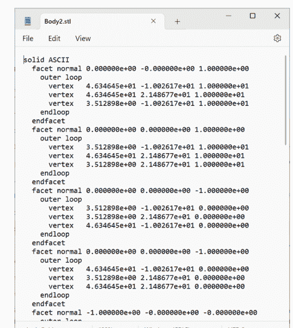

图 5.1 – 在记事本中查看的 ASCII 格式的 STL 文件

STL 文件格式不包含单位、颜色或纹理等关键信息。多年来，随着 3D 打印变得更普及且彩色 3D 打印机问世，人们对具有颜色和纹理信息的新文件格式的需求日益增长，即 OBJ 格式。

### OBJ 格式

在 3D 打印中，OBJ 文件格式是 STL 之后最常见的格式，因为它包含颜色和纹理信息。然而，OBJ 文件格式也不包含单位，即使它可能在注释行中包含单位信息。

### 3MF 格式

为了解决 STL 和 OBJ 文件格式的所有不足，并为增材制造行业未来可能的改进提供解决方案路径，一个联盟成立并创立了 3MF 文件格式。3MF 文件格式包含有关单位、颜色、纹理、材料、元数据、版权信息、体积建模数据、梁数据、切片数据以及通过多种扩展实现的文件安全性的信息。

有许多设计和制造软件在不同程度上支持 3MF 文件格式。您可以在 3MF 联盟网页的兼容性部分了解每个增材制造软件如何导入或导出 3MF 文件以及导入/导出工作流程中支持的具体功能：https://3mf.io/compatibility-matrix/。

Fusion 360 可以导入包含单位、颜色和纹理数据的 3MF 文件，我们已在第 1 章中介绍过。Fusion 360 可以导出网格数据或对实体/曲面模型进行三角化并将其导出为 3MF 文件。我们将在下一节详细介绍导出工作流程。

### 三角化，非 Fusion 360 切片器 3D 打印的关键步骤

正如我们在本章介绍中所了解的，3D 打印有许多切片器。尽管某些切片器可以接受来自 CAD 软件的实体模型，但通常情况下，您需要在将模型发送到首选切片器之前对其进行三角化并将其转换为网格模型。Fusion 360 可以使用位于 CREATE 面板中 MESH 选项卡内的 TESSELLATE 命令将实体和曲面模型转换为网格体。

### 三角化实体体

TESSELLATE 命令有多个选项可控制网格结果的外观。选择要三角化的体或组件后，您可以使用 Refinement Settings 下拉菜单更改三角化网格体的质量。默认的细化选项为中等，但我建议使用高，以获得更精细的网格结果，尤其是在周围

曲面。你选择的细分选项会根据所选几何体控制 **Surface Deviation** 和 **Normal Deviation** 的输入值。此外，你还可以降低 **Maximum Edge Length** 的输入值，这会创建更小的线段，以及 **Aspect Ratio**，这会创建具有更均匀三角形外观的网格体。tessellate 对话框中的 **Preview** 复选框会为你提供网格化结果的视觉表示，以及网格体将拥有的三角形数量的数值计数。

*图 5.2* 显示了实体体与其相同体的网格版本预览的并排可视化：

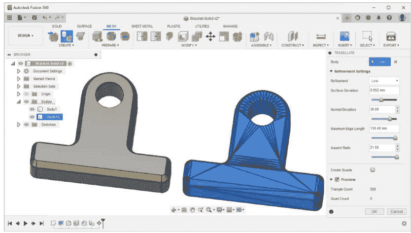

图 5.2 – 将实体体三角化以将其转换为网格体

一旦实体体被三角化，它将被消耗到新的网格体中，该网格体在浏览器中也会被标记为新的图标。在三角化实体体时，实体体的每个面都将在网格体中成为一个唯一的面组。如果你想可视化网格体的面组，可以在 **INSPECT** 面板中切换 **Display Mesh Face Groups** 选项，如 *图 5.3* 所示。

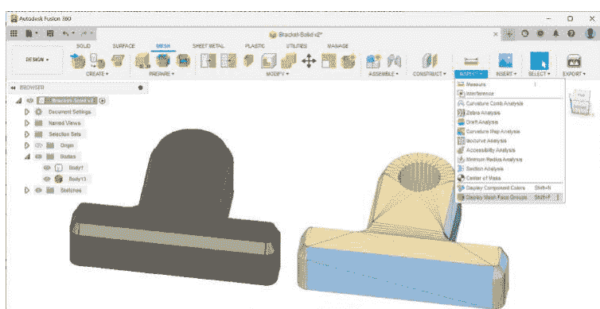

图 5.3 – 三角化实体体后可以可视化网格面组

另一个需要在导出到第三方切片机之前对体进行三角化的原因示例，可以针对具有体积晶格定义的体进行演示，我们将在下一节看到。

## 使用体积晶格三角化体

正如你可能还记得的，我们在第 4 章中介绍了体积晶格。图 5.4 显示了我们在本章中处理的支架，具有石膏单元形状的晶格和围绕大多数外表面周围的蒙皮。

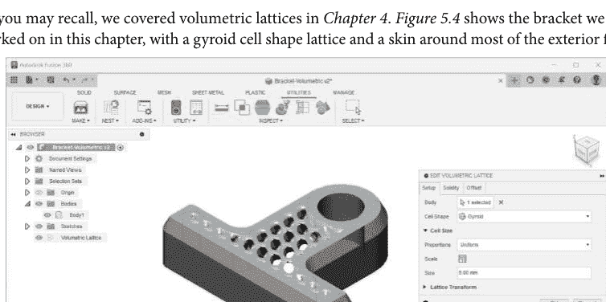

图 5.4 – 具有体积晶格的支架

在尝试使用传统导出方法导出在 Fusion 360 中创建的具有体积晶格的模型时，例如位于 **MAKE** 面板的 **UTILITIES** 选项卡中的 **3D PRINT** 命令，我们可以看到 Fusion 360 无法在导出工作流程中生成网格结果。如图 5.5 所示，当输入体包含体积晶格时，网格预览不可用，并且三角形数量为 0。

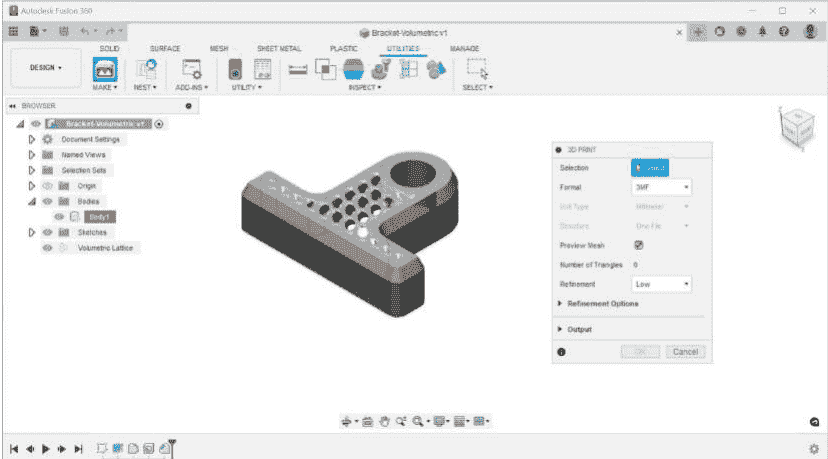

图 5.5 – 尝试导出具有体积晶格的体

在这种情况下，我们需要在导出之前将体积模型转换为三角化版本。Fusion 360 具有将具有体积晶格数据的体转换为网格的专用工作流程。我们不能使用位于 **CREATE** 面板的 **MESH** 选项卡中的 **TESSELLATE** 命令。

为了三角化具有体积晶格数据的体，在 **BROWSER** 窗口中右键单击所需体并从弹出菜单中选择 **Create Mesh**，如 图 5.6 所示。然后，我们可以编辑 **Refinement** 选项，并在选择 **OK** 后，Fusion 360 将创建一个新的网格体并隐藏具有体积晶格的原始实体体。

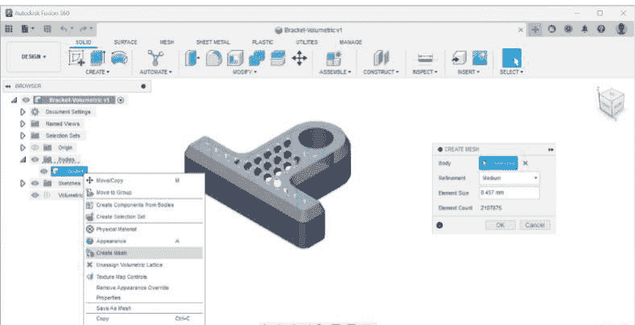

图 5.6 - 选择体积晶格体并创建网格体

一旦网格体创建完成，我们可以简单地从 BROWSER 窗口中选择它，右键单击并从弹出菜单中选择 PROPERTIES，并观察诸如 Facet Count、Vertex Count 和 Center of Mass 等信息。我们还可以获得有关网格质量的信息，例如它是否封闭体积以及所有三角形是否正确定向，如图 5.7 所示。

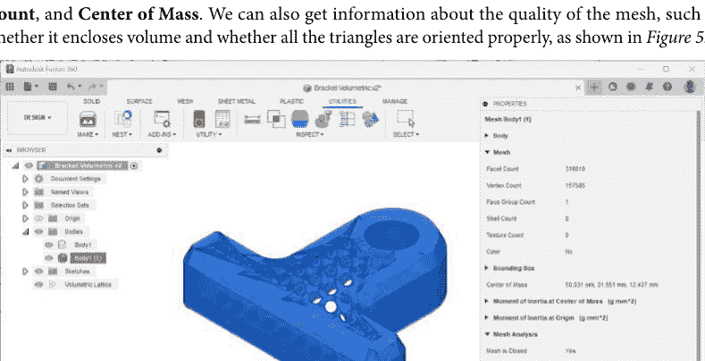

图 5.7 – 从体积晶格体创建的网格体的属性

在本节中，我们介绍了如何三角化实体体以及具有体积晶格数据的体。我们提到了在导出到第三方切片机之前需要三角化体的原因，因为具有体积晶格数据的模型不能直接作为 3MF 文件导出到第三方切片机。在下一节中，我们将重点介绍如何将实体和网格数据发送到第三方切片机。

## 导出网格文件或将模型发送到切片机

从设计工作区将模型从 Fusion 360 传输到第三方切片机的流程与三角化模型非常相似。不是使用 **MESH** 选项卡来三角化模型，我们可以简单地使用位于 **MAKE** 面板的 **UTILITIES** 选项卡中的 **3D PRINT** 命令。**3D PRINT** 对话框允许我们选择一个要从 Fusion 360 导出对象。该选择可以是实体体、曲面体或网格体，或包含一个或多个这些体的组件。

## 直接向第三方切片机导出模型

如 *图 5.8* 所示，通过选择一个体并选择相关的细分选项，我们可以在 **3D PRINT** 对话框中预览网格结果。就像在 **TESSELLATE** 命令中一样，我们可以编辑 **Refinement Options** 以获得导出过程所需的质量。

**3D PRINT** 对话框有几个独特的选项，我们接下来会介绍。第一个是 **Format** 下拉菜单。使用 **Format** 菜单，我们可以选择将模型导出为 STL、OBJ 或 3MF 文件。如果我们选择 STL 或 OBJ 文件，我们还可以在导出过程中缩放模型。

在 Fusion 360 中创建的模型始终包含单位。如果我们有一个模型，其中某个边的尺寸为 1,000 毫米，在使用毫米单位类型以 STL 或 OBJ 文件格式导出时，我们将得到一个网格文件，该文件将表示同一边为 1,000，因为 STL 和 OBJ 文件没有单位系统。如果我们在导出过程中在 **3D PRINT** 对话框中将单位类型更改为厘米，结果文件将列出同一边为 100。这意味着当我们选择厘米作为单位类型时，Fusion 360 会将模型按 0.1 的因子缩放。

> **注意**
> 使用 **3D PRINT** 对话框将模型导出为 STL 或 OBJ 文件时，适用以下缩放系数：毫米 = 1，厘米 = 0.1，米 = 0.001，英寸 = 0.03937，英尺 = 0.003281。

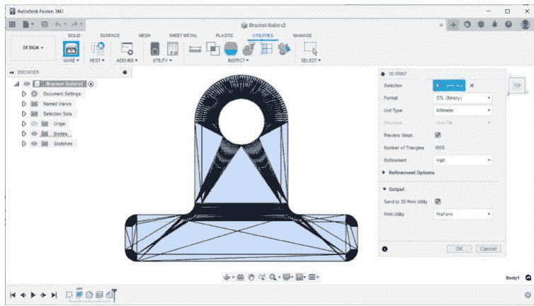

图 5.8 – 用于将模型导出为 STL 文件的 3D PRINT 对话框

3D PRINT 对话框还可以自动启动打印实用程序并在该软件中打开新生成的 STL、OBJ 或 3MF 文件。图 5.8 显示了创建 STL 文件并将其发送到 Formlabs 的 PreForm 软件的示例。在 3D PRINT 对话框中选择 OK 后，PreForm 将启动，并且 STL 文件将被加载到最后使用的打印机设置中作为新作业，如图 5.9 所示。

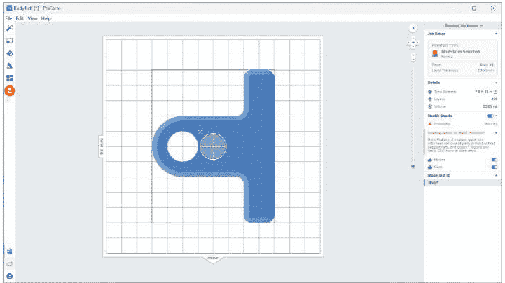

图 5.9 – Formlabs PreForm 软件中的 STL 文件

使用 3D PRINT 对话框时，我们不限于选择单个体。我们还可以选择整个装配作为输入，并使用 STL、OBJ 或 3MF 格式导出，如图 5.10 所示。

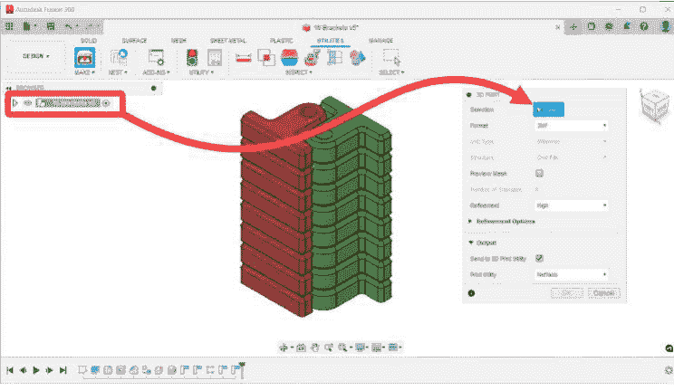

图 5.10 – 以装配形式排列的零件 3D 导出到 Autodesk Netfabb

在图 5.10 中，我们选择将全部 16 个组件传输到名为 Autodesk Netfabb 的 3D 打印实用程序，使用 3MF 作为文件格式。如图 5.11 所示，一旦 Autodesk Netfabb 启动并且所有零件都加载到其浏览器中，我们可以看到全部 16 个零件的名称都已传输到 Netfabb。Fusion 360 中的零件排列也通过相同的命令传输到 Netfabb。这是因为我们选择了 3MF 作为导出文件格式，其中包含所有这些信息以及更多信息。

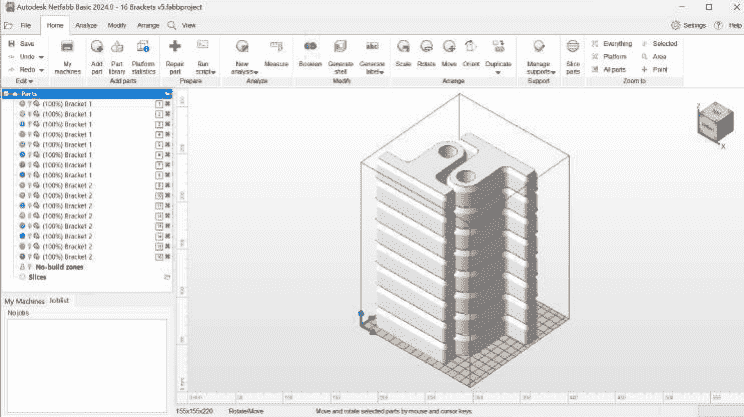

图 5.11 – Netfabb 中的组件名称和零件排列

在“使用体积晶格三角化体”小节中，我们演示了如何将具有体积晶格数据的体转换为三角化网格对象。图 5.12 显示了同一个网格体作为 3MF 文件被传输到名为 PreForm 的第三方 3D 打印实用程序。无论我们是导出网格体还是将其传输到 3D 打印实用程序，3D PRINT 对话框都会自动隐藏不相关的选项，例如 Preview Mesh、Number of Triangles 和 Refinement，因为这些设置仅在将实体体导出为网格对象时适用。

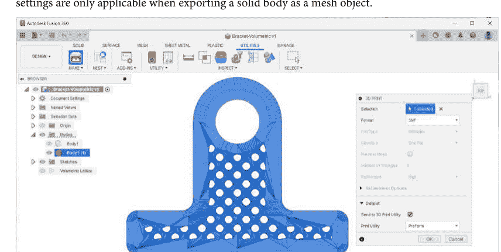

图 5.12 – 三角化网格体被用作导出到 PreForm 的输入

无论我们是将实体体还是网格体发送到 3D 打印实用程序，结果都非常相似。在图 5.12 的示例中，我们将网格体作为 3MF 文件发送到 PreForm，Formlabs PreForm 软件将启动，并且 3MF 文件将在应用程序中打开，如图 5.13 所示：

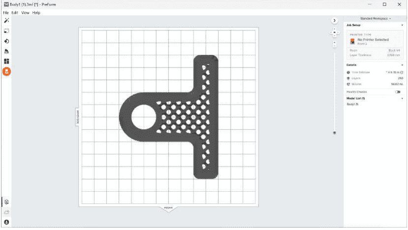

图 5.13 – 从 Fusion 360 发送到 PreForm 的 3MF 文件

**3D PRINT** 对话框的打印实用程序输出选项将根据您计算机上安装的软件而有所不同。

## 直接导出到非 Fusion 360 切片器

到目前为止，我们已演示了如何将模型发送到 PreForm 和 Netfabb，这两者都是明确可用的选项，前提是您已为 **Print Utility** 下拉菜单安装了这些软件选项。如果您使用的是在 **Print Utility** 下拉菜单中不可用的切片器，您可以选择 **Custom** 选项，并在选择 **Application** 选项旁边的文件夹图标后可访问的 **Open** 对话框中指向您选择的切片器的可执行文件。图 5.14 显示了如何选择自定义打印实用程序并将 `prusa-slicer.exe` 指定为应用程序。

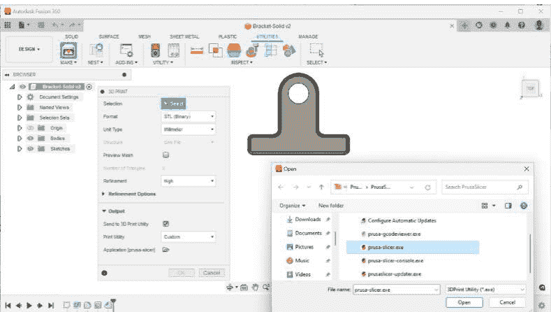

图 5.14 – 在 3D PRINT 对话框中选择自定义打印实用程序可执行文件

在将应用程序指定为 PrusaSlicer 并在 3D PRINT 对话框中选择确定后，我们可以将实体或网格体以 STL、OBJ 或 3MF 文件的形式传输到此切片器。图 5.15 显示了使用 3D PRINT 对话框将 STL 文件从 Fusion 360 传输到 PrusaSlicer 的结果。

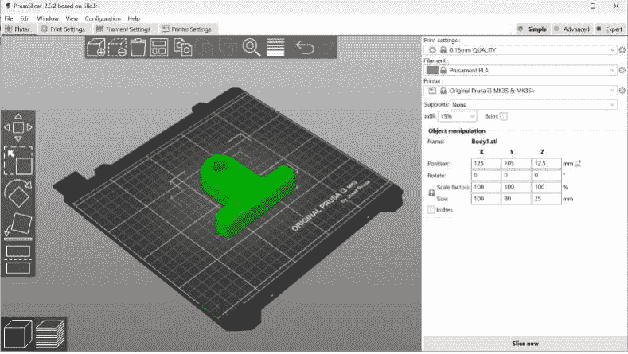

图 5.15 – 从 Fusion 360 发送到 PrusaSlicer 的 STL 文件

在某些情况下，我们可能不想将模型发送到 3D 打印实用程序，而是将其导出为网格文件。图 5.16 显示了如何利用 3D PRINT 对话框将模型从 Fusion 360 导出为 STL 文件。要实现此目的，我们只需取消选中发送到 3D 打印实用程序复选框并选择确定即可。

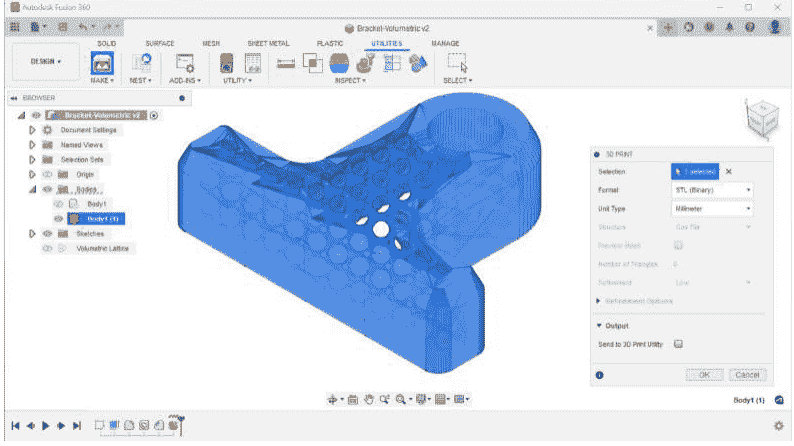

图 5.16 – 从 Fusion 360 导出 STL 文件

在 3D PRINT 对话框中按下确定后，我们将看到保存为对话框，如图 5.17 所示。

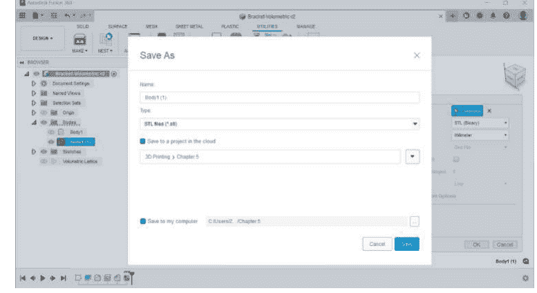

图 5.17 – 将 STL 文件保存到本地硬盘和项目中

使用此标准对话框，我们可以将所有文件作为 STL、OBJ 或 3MF 文件导出到计算机和/或 Fusion Team 中的项目。

## 从 Fusion 360 导出模型

Fusion 360 提供了多种将模型导出为网格体的选项。其中一种选项是使用文件下拉菜单并利用导出命令。一旦导出对话框可见，您可以更改文件扩展名为所需的网格类型，Fusion 360 将按此方式导出模型。

> 注意
> 如果您使用 文件 | 导出 选项，您无法控制网格质量。

我首选的导出模型为网格文件的方法是，在浏览器或画布中选择主体或组件，右键单击所选内容，然后选择保存为网格选项，如图 5.18 所示。 resulting SAVE AS MESH 对话框与本节中我们介绍的 3D PRINT 对话框非常相似，只有一个关键区别。SAVE AS MESH 对话框还允许您选择导出结构设置。

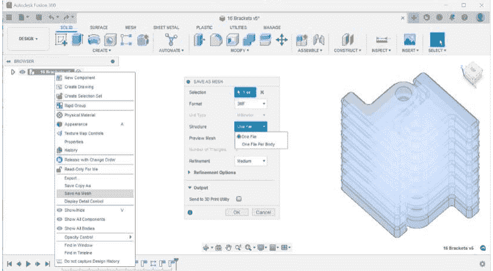

图 5.18 – SAVE AS MESH 命令可以控制文件结构

如果您导出多个组件，可以选择将它们保存为单个文件或每个主体一个唯一文件。根据您的需求，使用此单个对话框将多个组件导出为唯一文件可以为您节省大量时间并自动化文件导出工作流程。

## 摘要

本章中，我们讨论了主体如何表示为网格对象，以及网格文件格式的通用文件规范。我们介绍了 STL 文件格式，并讨论了其在单位、颜色和纹理方面的局限性。我们简要介绍了 OBJ 文件格式包含颜色和纹理信息但缺乏单位信息的情况。我们介绍了 3MF 文件格式，并参考了 3MF 文件格式的各种扩展，用于定义不仅是几何和单位，还包括颜色、纹理、梁定义和体积数据。我们还讨论了如何在 Fusion 360 中对实体主体和具有体积晶格数据的实体进行三角化。我们以强调从 Fusion 360 导出几何为网格数据的各种方式结束本章。

我们演示了如何直接将模型导出到第三方切片器，例如 Formlabs PreForm 和 Autodesk Netfabb，以及其他切片器，例如 PrusaSlicer，这些切片器不一定在 Fusion 360 的 **3D PRINT** 对话框的原生导出选项列表中。最后，我们演示了如何将模型从 Fusion 360 导出为单个文件或每个主体一个文件以自动化导出流程。

使用这些技术，我们可以轻松地将模型作为网格体导出到首选的切片器，以便快速 3D 打印零件。

在下一章中，我们将从讨论第三方切片器过渡，并开始介绍 Fusion 360 的 **MANUFACTURE** 工作区用于打印准备，以便将此工作区用作原生切片器。
