## 介绍用于打印准备的制造工作区

欢迎来到第 6 章。在之前的章节中，我们讨论了使用 Fusion 360 处理各种文件类型。我们向您展示了如何检查和修复有问题的网格模型。我们还涉及了如何以增材制造原则为出发点设计零件。我们介绍了如何使用诸如晶格化等各种技术使用轻质零件，并对其进行模拟以确保其在工作条件下能够正常运行。我们还介绍了如何对模型进行三角化以便导出到其他切片器。在本章中，我们将重点介绍如何更有效地使用 Fusion 360 来操作模型以进行打印准备。

到目前为止，我们处理的大多数模型都是单个零件。在 3D 打印前修改零件的原因有很多。我们可能希望放大或缩小零件以打印不同尺寸。我们可能希望在构建平台上定向和排列零件，并在一次打印中打印同一零件的多个副本。如前几章所述，我们可能希望根据其方向对零件进行中空和晶格化并添加排水孔。我们可能希望添加或修改某些特征，以便零件无需支撑结构即可打印或更有效地粘附到构建板上。同样，如果我们正在处理装配体，我们可能只想打印该装配体中的少数几个零件。自然地，这些零件在 3D 打印机构建板上的位置和方向与最初设计和定向的方式不同。出于这些原因和其他原因，我们需要为 3D 打印设计一个新版本。在第 5 章中，在将模型导出到第三方切片器后，我们在切片器中创建并保存的文件就是那个新版本。在本章中，我们将探讨 Fusion 360 使我们能够为 3D 打印专门创建设计新版本的各种方式。

保持在 Fusion 360 中为制造创建设计新版本的主要好处是，Fusion 360 保持了给定模型的已设计版本与待制造版本之间的关联性。这意味着如果我们决定对上游的原始设计进行更改，我们的下游制造模型将自动相应更新。

Fusion 360 允许您在保持关联性的同时创建制造模型有两种方式。第一种方法是创建一个全新的 Fusion 360 设计并利用插入功能从其他设计导入组件。第二种方法是利用 **MANUFACTURE** 工作区中的制造模型功能。在本章中，我们将详细介绍这两种工作流程，并突出每种方法的优点和缺点，同时展示在 3D 打印前我们可能想要进行的设计更改的常见示例。

在本章中，我们将涵盖以下主题：

- 使用 derive 工作流管理打印准备的模型更改
- 为 3D 打印创建制造模型
- 3D 打印的常见零件修改

在第一节结束时，您将学会如何利用 Fusion 360 创建新模型并从其他设计收集组件以便为 3D 打印做准备。在下一节中，您将了解如何访问 **MANUFACTURE** 工作区并创建制造模型。到本章结束时，您将掌握如何在原始设计文档中上游进行设计更改以及它们如何向下传播到制造模型。您还将了解对制造模型进行的下游更改不会向上游传播到原始设计。

### 技术要求

本章涵盖的大多数主题可供个人、试用、商业、初创和教育版 Fusion 360 许可证类型使用。某些 Fusion 360 命令，例如 **ARRANGE**，在个人许可证类型下不可用。在某些功能在个人许可证类型下不可用的示例中，将提供替代功能，以便您可以继续练习。

如果您拥有 Fusion 360 的商业许可证，要创建体积晶格，您还需要访问产品设计扩展 (`https://www.autodesk.com/products/Fusion-360/product-design-extension`)。

Autodesk 为产品设计扩展提供 14 天试用期。您可以在 Fusion 360 的 **EXTENSIONS** 对话框中激活试用期。

产品设计扩展访问不适用于 Fusion 360 的个人/爱好许可证。

本章的练习文件可在以下位置找到： `https://github.com/PacktPublishing/3D-Printing-with-Fusion-360`。

## 使用 Derive 工作流程管理打印准备的模型更改

如果您使用过第三方切片软件（例如 Cura、PrusaSlicer 或 PreForm），您可能熟悉在启动此类软件时，它们通常会提供一个空的工作区，您可以在其中插入要 3D 打印的零件。每当我们想将 Fusion 360 用作切片软件时，可以通过创建新设计并以新名称保存来遵循类似的工作流程。保存设计后，我们可以将其用作空工作区，从 Fusion Team 中的其他项目或文件夹中汇总实体和组件以准备 3D 打印。图 6.1 显示了在将 Fusion 360 设计以名称 `Example A` 保存后，如何使用位于 **SOLID** 选项卡的 **INSERT** 面板中的 **Insert Derive** 功能：

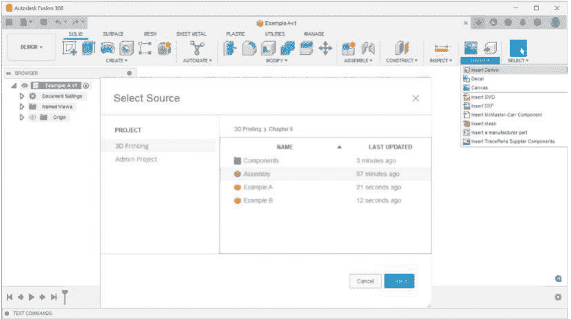

图 6.1 – 选择要插入到已保存的 Fusion 360 设计中的源模型

为了演示此功能，我们将使用名为 `Assembly` 的 Fusion 360 设计。选择源模型后，Fusion 360 将在新标签页中打开该模型并显示 **DERIVE** 对话框，如图 6.2 所示。在此阶段，我们可以选择希望从源文件派生到目标文件的对象。在本例中，我们将使用浏览器选择多个组件，如同一张图所示。或者，我们也可以选择使用画布。请注意，Fusion 360 在 **DERIVE** 对话框中使用的默认选择方法会选择实体而不是组件。如果您想选择一个组件，可以按住并单击鼠标左键，这将弹出一个包含两个标签页 **Depth** 和 **Parents** 的次级对话框，如图 6.2 所示。如果您进入 **Parents** 标签页，您将能够选择所选实体所属的组件并将其添加到 **DERIVE** 对话框中。**DERIVE** 对话框还有几个需要强调的附加选项。第一个是 **Place Objects At Origin** 复选框。选择此选项并完成派生功能后，Fusion 360 将把所有选定的组件移动到新 Fusion 360 设计文档的全局原点。这非常有用，因为装配体中的某个零件可能远离原点，在将其插入新文档后，如果它距离其他组件数百或数千毫米，您可能无法轻松地将其可视化。**DERIVE** 对话框中的下一个有用选项是可以引入构成派生组件的参数。图 6.2 显示，我们可以在新 Fusion 360 设计中派生组件时选择 **Favorites** 或构成该组件的所有参数：

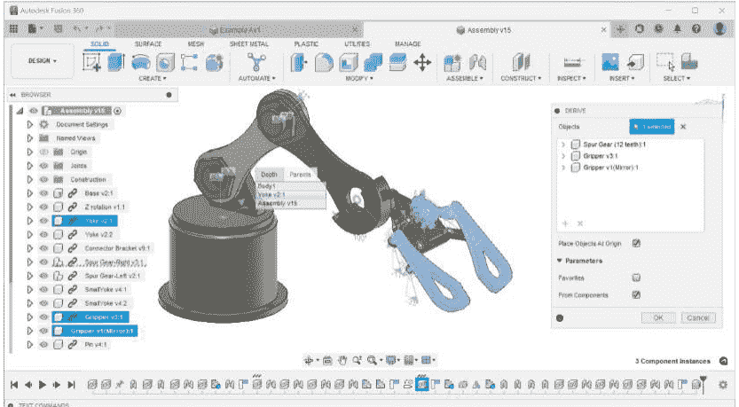

图 6.2 – 从源装配体中选择多个组件

在完成所有选择并在 **DERIVE** 对话框中按下 OK 按钮后，Fusion 360 将关闭源模型并在我们的目标设计（名为 Example A）中显示所有插入的组件，如图 6.3 所示。请注意，所有组件都是通过时间线中的单个 Derive 功能插入的。您还会注意到所有四个组件都重叠在一起，因为我们在 **DERIVE** 命令中使用了 **Place Objects At Origin** 选项。这将所有组件移动到新 Fusion 360 设计的中心附近。使用 **SOLID** 选项卡中的 **Display Component Colors**（可在 **INSPECT** 面板中找到），我们可以为每个组件赋予独特的颜色：

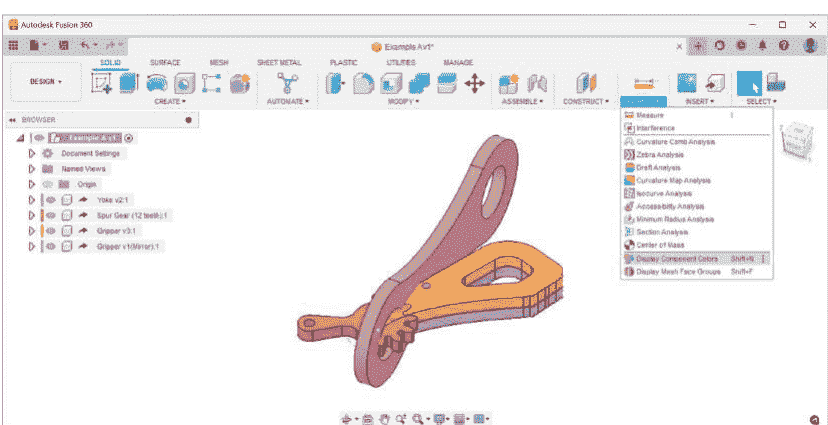

图 6.3 – 将多个组件从其他设计插入到新设计中

如有需要，我们可以重复 **Insert Derive** 命令并将来自其他 Fusion 360 设计文档的组件添加到此设计中。一旦完成插入工作流程，如果在 **DERIVE** 对话框中使用 **Place Object At Origin** 选项，所有组件很可能会相互相交。为了整理所有插入的组件，我们可以使用位于 **SOLID** 选项卡的 **MODIFY** 面板中的 **ARRANGE**、**ALIGN** 或 **MOVE** 命令。

### 重要说明

请注意，**ARRANGE** 功能不适用于 Fusion 360 的个人/免费许可证。如果您拥有个人/免费许可证，可以使用 **ALIGN** 或 **MOVE** 命令而不是 **ARRANGE** 命令来定向和放置组件。

图 6.4 显示了使用 **ARRANGE** 命令的结果，将所有四个组件嵌套在 XY 平面上，用于一个长 210 mm、宽 210 mm 的虚拟 3D 打印机平台，同时保持组件彼此相距 10 mm，并距离成型平台边缘 10 mm。**ARRANGE** 命令还会自动定向所选组件，使给定组件的最大面朝向成型平台。在本例中，我们使用浏览器选择了组件，因此可以让 Fusion 360 自动定向组件。或者，我们可以使用画布选择组件，在 **ARRANGE** 命令中选择特定的平面面。使用此方法时，**ARRANGE** 命令会根据需要重新定向零件，并使所选表面朝上或朝下，具体取决于 **Object Selected by Face** 选项的选择：

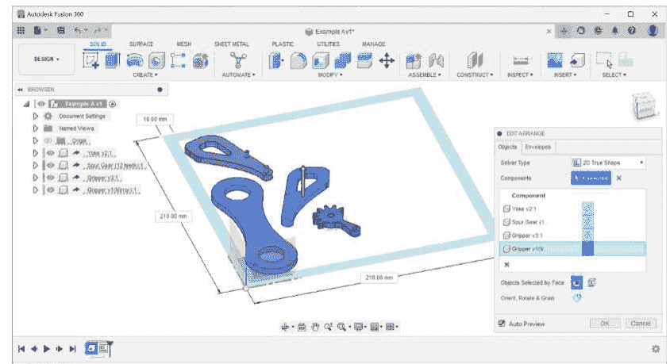

图 6.4 – 在 XY 平面上排列组件

现在我们已将四个组件按所需方向排列在 XY 平面上，我们可以稍微谈谈如何修改这些组件，以及如何向我们的构建中添加新组件。为了使可视化更轻松，我们可以在 XY 平面中引入一个新的草图，并构建一个代表成型平台的矩形。在本例中，由于我们为成型平台宽 210 毫米、长 210 毫米的打印机整理组件，我们可以利用 Fusion 360 中的草图工具制作这样的矩形并使其可见，以便在添加新零件或修改现有零件时提供帮助。3D 打印中常见的零件修改之一是使用 SCALE 命令。SCALE 命令位于 SOLID 选项卡的 MODIFY 面板中，允许我们选择实体或组件并对其进行均匀或非均匀缩放。图 6.5 显示了三个零件缩放到原始尺寸 75% 的预览。由于我们不需要缩放这些零件，我们将在 SCALE 对话框中单击 Cancel 并继续下一步：

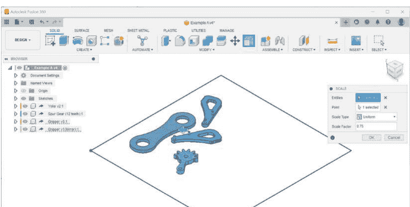

图 6.5 – 在 3D 打印机成型平台上下文中缩放组件

3D 打印前另一个常见的修改是掏空和镂空。图 6.6 显示了如何简单地选择位于 SOLID 选项卡的 MODIFY 面板中的 SHELL 命令，以选择名为 Yoke 的组件的两个面来创建掏空版本：

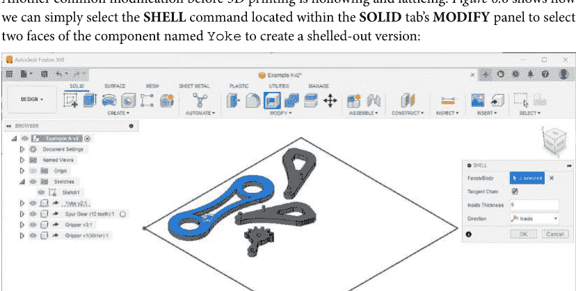

图 6.6 – 在 3D 打印机成型平台上下文中修改组件

另一个可以从 Fusion 360 的设计工作区受益的例子是选择一个组件并创建副本，以便我们可以打印同一组件的多个副本。图 6.7 显示了如何选择名为 Spur Gear 的零件并沿 X 和 Y 轴创建 3x3 矩形阵列，共九个组件，并抑制会与另一个零件干涉的一个组件，从而创建总共八个 Spur Gear 组件：

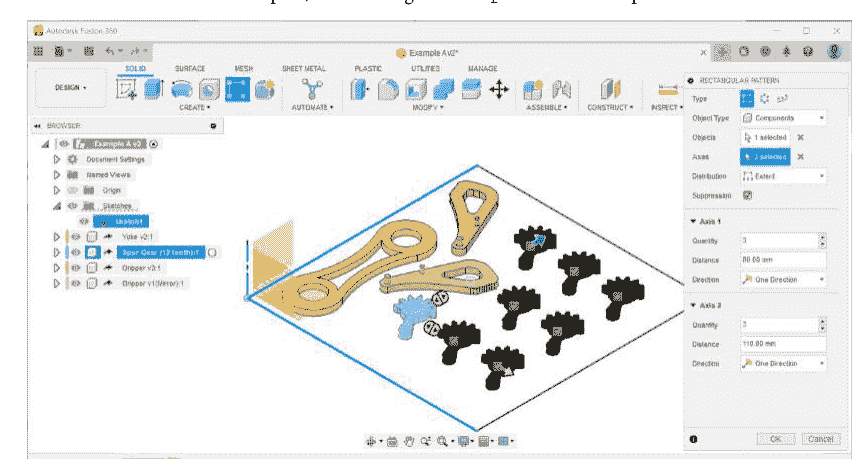

图 6.7 – 在 3D 打印机成型平台上下文中创建矩形阵列

使用新的 Fusion 360 设计文档进行定向零件、缩放它们或掏空它们等更改的主要好处是，此类更改仅影响我们正在工作的文档，而不影响源组件。更好地理解这一点的一种方法是查看名为 Assembly 的文档。如图 6.8 所示，即使我们在 Example A 制造文档中使用 SHELL 命令对 Yoke 组件进行了操作并创建了七个 Spur Gear 组件副本，我们的源 Fusion 360 设计文档也没有发生变化：

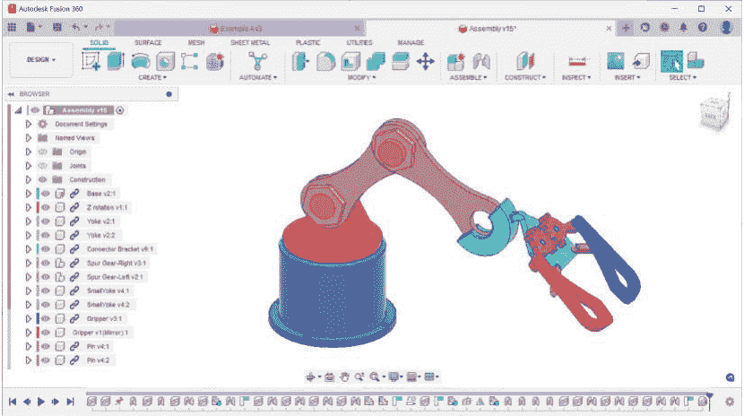

图 6.8 – 原始装配保持不变

如果设计标准有任何变化，设计师仍然可以更改原始设计。他们可以在名为 Assembly 的 Fusion 360 设计文档中进行此操作，或在源组件本身中进行。图 6.9 显示了如何从时间线中选择多个特征并抑制它们以消除 Gripper 源组件中的孔：

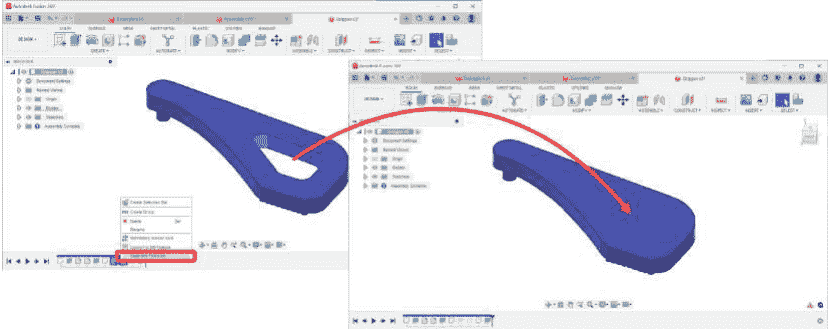

图 6.9 – 抑制特征以修改源组件

保存对源组件的此更改后，如果我们切换标签并查看 Assembly Fusion 设计，我们将看到一条警告消息，告知我们构成此装配的源组件之一已更新。按下浏览器中的“获取最新”命令后，我们的装配模型将更新，如图 6.10 所示，并且 Gripper 组件的最新版本将可见且无孔：

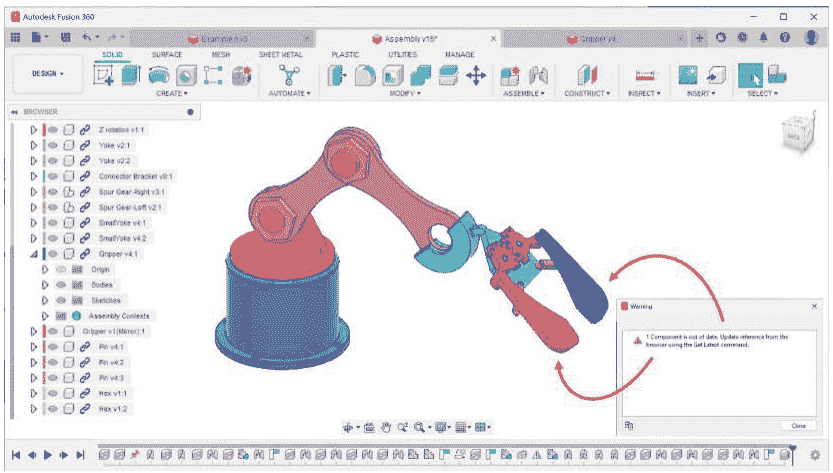

图 6.10 – 警告消息指示源组件已更新

保存装配文档中源组件的最新版本后，如果我们将焦点切换到 Example A Fusion 设计，我们将看到五个警告标志，如图 6.11 所示。这些警告标志告知我们此 Fusion 360 设计中的一个或多个组件已过时，我们应获取它们的最新版本：

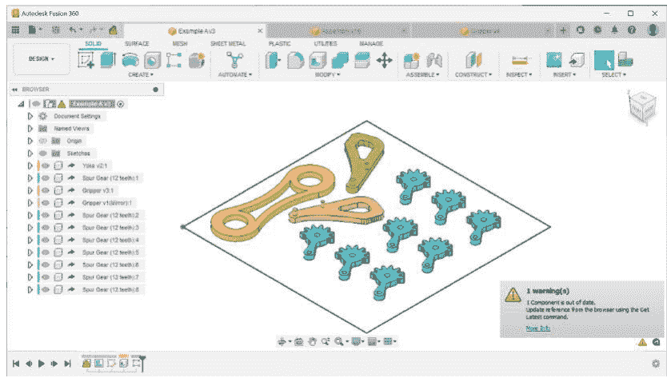

图 6.11 – 警告标志表示组件已过时

在浏览器中双击警告图标更新引用后，所有警告标志都会消失，并且 Gripper 组件的两个实例都将被更新，使其成为没有孔的实体对象，如图 6.12 所示：

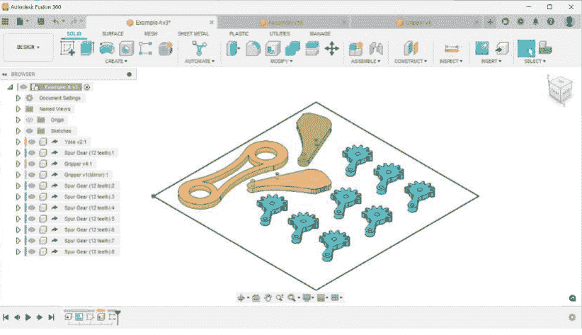

图 6.12 – 警告已解决，所有组件均已更新

在本节中，我们讨论了如何使用空的 Fusion 360 设计文档作为制造模型，在其中我们可以插入来自其他 Fusion 360 设计的组件，并使用 Fusion 360 中 **MODIFY** 面板提供的功能重新定向和排列它们。我们还演示了对制造模型所做的更改不会影响源组件。然而，我们对源组件所做的任何更改都会向下传递并影响我们的制造模型。在下一节中，我们将从 Fusion 360 的设计工作区切换到制造工作区，并在该工作区中创建新组件并编辑现有组件。

## 创建用于 3D 打印的制造模型

在上一节中，我们讨论了如何利用 **DERIVE** 功能将来自不同来源的组件聚合到新的 Fusion 360 设计文档中并管理这些组件以进行 3D 打印。在本节中，我们将介绍如何在同一 Fusion 360 设计文档内为 3D 打印准备模型。

在 *第 3 章* 中，我们演示了如何使用工作区切换菜单从 **DESIGN** 工作区更改为 **SIMULATION** 工作区。在本章中，我们将在 **DESIGN** 和 **MANUFACTURE** 工作区之间切换。为了向您展示如何在同一 Fusion 360 设计文档内创建新的制造模型，我们将使用名为 Example B 的新设计文档。如 *图 6.13* 所示，我们可以通过单击 Fusion 360 左上角的 **DESIGN** 下拉菜单来访问工作区切换器。在本节中，我们将使用 **MANUFACTURE** 工作区：

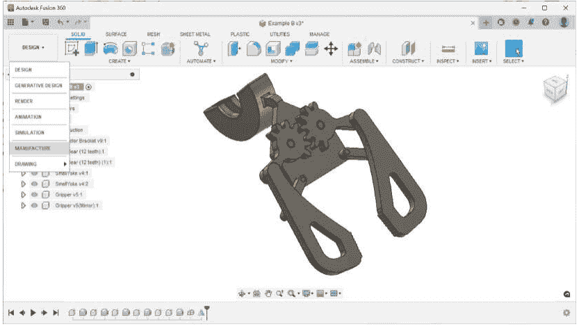

图 6.13 – 从 DESIGN 工作区切换到 MANUFACTURE 工作区

一旦进入 MANUFACTURE 工作区，我们将看到用于不同制造设置的一组新的功能区选项卡，例如 MILLING、TURNING、ADDITIVE、INSPECTION 和 FABRICATION。本章将重点关注 ADDITIVE 选项卡。选择 ADDITIVE 选项卡后，我们还将在功能区中看到多个新的面板。从 DESIGN 切换到 MANUFACTURE 工作区会自动创建 Fusion 360 设计的新版本，类似于 Insert Derive 功能在不同设计文档中创建新版本的方式。此新的驱动副本可以在浏览器中的 MODELS 选项卡下找到。在 MANUFACTURE 工作区内对模型所做的任何更改，例如在 3D 打印机构建体积的上下文中移动其位置，都不会影响 DESIGN 工作区中的模型。然而，我们对驱动模型可以做的更改是有限的。这就是为什么我们可能想要创建一个新的制造模型，以便我们可以像在 DESIGN 工作区中修改那样编辑几何形状。

使用 MANUFACTURE 工作区中的制造模型与使用上一节中介绍的 Insert Derive 功能自行创建的制造模型之间的一个关键区别是，Insert Derive 功能允许我们将 CAD 参数带入新设计。我们在 MANUFACTURE 工作区中创建的制造模型不会携带模型参数。因此，我们将无法使用构建模型的这些参数来编辑模型。当我们在 MANUFACTURE 工作区中编辑制造模型时，我们必须创建新的草图和特征，这些草图和特征独立于用于创建原始设计的特征和参数。

在 ADDITIVE 选项卡的 SETUP 面板中，我们可以创建新的制造模型，如图 6.14 所示。此操作会创建一个名为 Manufacturing Model 1 的新制造模型，并在浏览器中的制造模型列表下显示它：

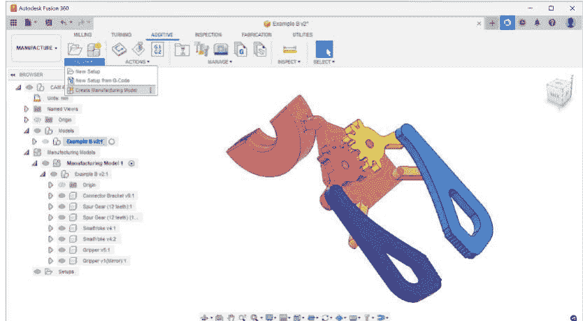

图 6.14 – 在 MANUFACTURE 工作区内创建新的制造模型

在下一章中，我们将创建增材设置，以便在 3D 打印机的上下文中排列和定向我们的零件。在本章中，我们将重点关注编辑制造模型以对其进行轻微修改。要修改设计中的组件，我们只需右键单击制造模型并选择 **Edit Manufacturing Model**，如 *图 6.15* 所示。

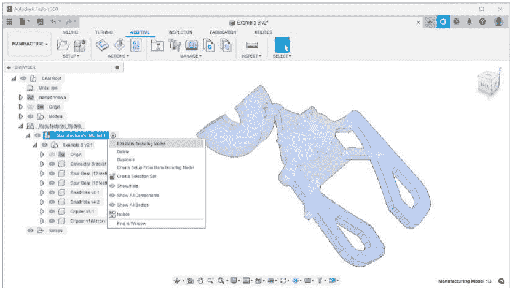

图 6.15 – 编辑制造模型

当我们编辑制造模型时，我们仍将处于 Fusion 360 的 **MANUFACTURE** 工作区。然而 Fusion 360 的功能区将更新，我们将看到在 Fusion 360 的 **DESIGN** 工作区中常见的选项卡，例如 **SOLID**、**SURFACE**、**MESH** 和 **PLASTIC**。浏览器也将针对与制造模型相关的项目进行定制，并且不会显示 Setups 文件夹下列出的任何增材或减材设置。如 *图 6.16* 所示，我们可以创建草图和轮廓以向原始设计添加或移除材料：

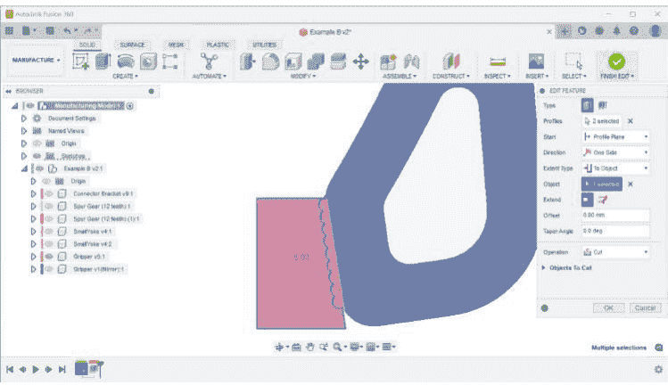

图 6.16 – 在 MANUFACTURE 工作区内进行设计更改

在此示例中，我们选择通过绘制轮廓并对源体使用 Extrude: Cut 操作来从 Gripper v5 组件中移除半圆形图案。如图 6.14 所示，尽管 Gripper v5 和 Gripper v1 (Mirror) 组件是在 DESIGN 工作区中使用 MIRROR 特征创建的，但更新其中一个不会自动更新另一个，因为镜像组件不是原始组件的第二个实例；而是独立组件：

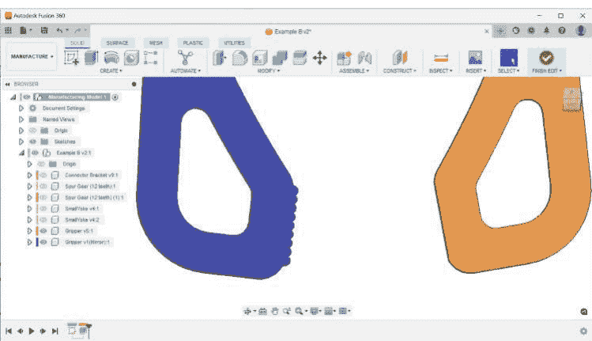

图 6.17 – 设计更改对镜像组件的影响

如果我们切换回 **DESIGN** 工作区，如 *图 6.18* 所示，我们将看不到源组件的任何更改。在 **MANUFACTURE** 工作区内对制造模型所做的更改仅影响该特定制造模型，不会影响原始设计或任何其他后续制造模型：

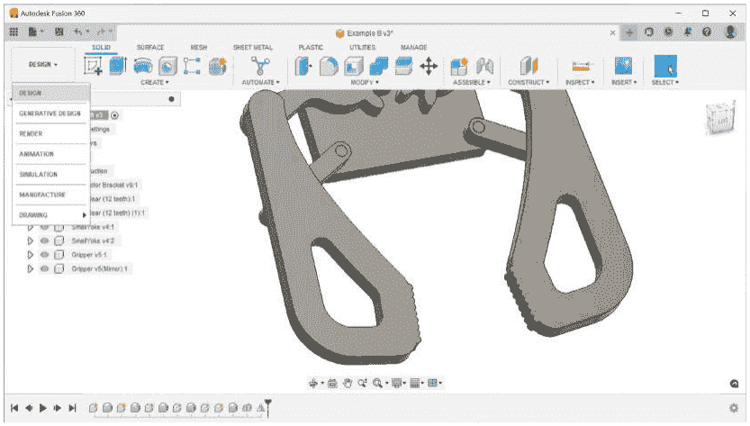

图 6.18 – 编辑后的制造模型对设计的影响

我们可以利用这一点来创建多个制造模型，并在单个 Fusion 360 设计文档中保存同一模型的多个版本。使用此工作流程的常见原因是为混合制造场景中可能需要使用的每种制造方法创建组件的独特版本。在某些情况下，我们可能希望使用特定的一组特征 3D 打印模型，检查结果，并使用表面精加工或钻孔等减材操作来完成制造过程以实现预期结果。在这种情况下，我们可能会为增材制造设置创建 **Manufacturing Model 1**，为减材制造设置创建 **Manufacturing Model 2**，并为检测设置创建 **Manufacturing Model 3**。

使用 **DERIVE** 工作流程与在 **MANUFACTURE** 工作区内创建制造模型并在该工作区内编辑模型之间的另一个关键区别在于数据管理：

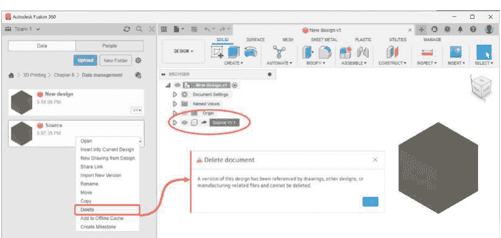

图 6.19 – 删除在其他设计中使用的文档

如果我们在 **DESIGN** 工作区中有一个模型，在创建并编辑一个或多个制造模型之后，我们可以删除原始的 Fusion 360 设计文档，并且所有相关的制造数据将被删除。

如果我们利用 DERIVE 功能并将来自其他 Fusion 360 设计的组件插入到新的 Fusion 360 设计文档中，则无法删除源文档。要删除源文档，我们有几种选择。首先，我们可以删除新的设计文档，然后删除源文档。或者，在新设计中，我们可以解除源文档与新设计之间的链接，然后删除源文档，前提是新设计文档中没有包含对源文档引用的先前保存版本。我们的最后一个选项是将源文档从其当前的 Fusion 360 项目移动到一个新的项目中，在该项目中我们收集并管理未来希望删除的所有项目。一旦我们准备好删除该项目中的所有内容，我们就可以使用 Fusion 的 TEAM 功能将其归档，然后删除它。如果我们不使用这三个选项中的一个，在尝试删除源 Fusion 360 设计文档时将被阻止，并会看到一条警告消息，告知源文档被其他 Fusion 360 设计引用，如图 6.19 所示。

## 3D 打印的通用零件修改

您可能想要修改模型以进行 3D 打印的原因有很多。如果零件太大，无法放入 3D 打印机的工作体积中，您可能需要将其切割成多个较小的零件，以便制造。您可能还希望为每个零件添加销钉和孔，以便切割的零件在打印后能够轻松对齐并组合在一起。您可能希望更改某些特征的尺寸，例如孔或口袋，以添加少量公差，以便这些特征与其它物体配合的表面在零件制造后具有所需的间隙。您可能需要移除打印机可能无法打印的小特征，或添加诸如倒角之类的特征以平滑尖锐边缘。您可能会重新排列并调整零件的方向，以最大程度地减少 3D 打印过程中对支撑结构的需要。一旦零件处于所需方向，您可能希望将其掏空以实现轻量化，并加入内部晶格以增加刚性并消除在掏空体内创建支撑结构的需要。

在本节中，我们将重点介绍您可以在 Fusion 360 中使用的几种常见零件修改方法。如前几节所述，您可以通过两种方式进行制造相关的零件修改：您可以创建一个新的 Fusion 设计并插入您希望修改的模型，或您可以切换到 **MANUFACTURE** 工作区，创建一个新的制造模型并对其进行编辑。在本节中，我们将直接在 **MANUFACTURE** 工作区中演示所有修改，以便将所有更改保留在单个 Fusion 360 文档中。为了演示一些常见的零件修改方法，我们将使用 `Example C` 零件，其可在图 6.20 中看到。如我们所见，在从 **DESIGN** 工作区切换到 **MANUFACTURE** 工作区后，我们将创建一个制造模型来编辑几何体。在此示例中，我们将使用位于 **SETUP** 面板 **ADDITIVE** 选项卡中的 **Create Manufacturing Model** 命令创建四个制造模型：

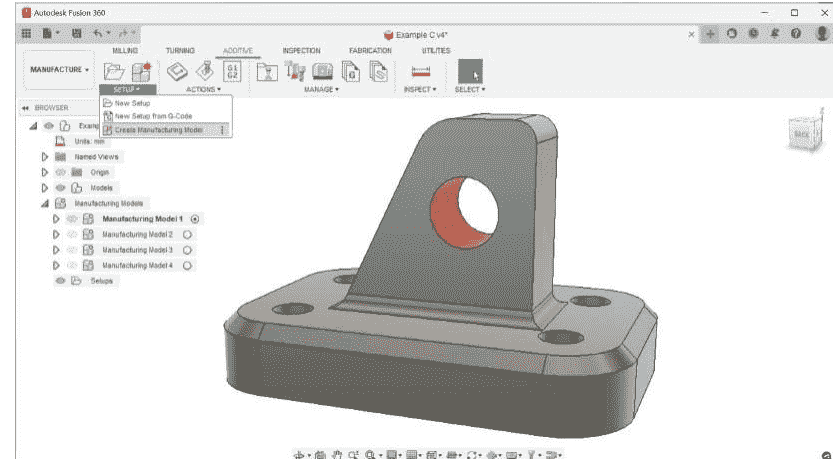

图 6.20 – 基于原始设计创建四个制造模型

一旦创建了全部四个制造模型，我们将通过右键单击它并选择 **EDIT** 来激活 **Manufacturing Model 1**。在这个第一个制造模型中，我们将演示如何创建两个将在不同制造过程中使用的组件。

我们的示例模型已经处于适合 3D 打印的正确方向。然而，沿 Y 轴的大孔在没有支撑结构的情况下无法按我们期望的规格准确 3D 打印。在这种情况下，如果我们不想使用支撑结构，我们有几个选择。

我们可以复制原始组件并修改孔，使其可以在没有支撑结构的情况下进行 3D 打印。然后，我们可以将 3D 打印的零件用作毛坯材料，并使用原始组件作为参考来创建铣削设置中的钻孔操作并生产成品设计。让我们使用 Fusion 360 逐步完成此过程，通过使用位于 **SOLID** 选项卡的 **MODIFY** 面板中的 **Move/Copy** 命令复制原始组件，如 *图 6.21* 所示。选择我们希望复制的组件后，我们必须勾选 **Create Copy** 复选框并单击 **OK**：

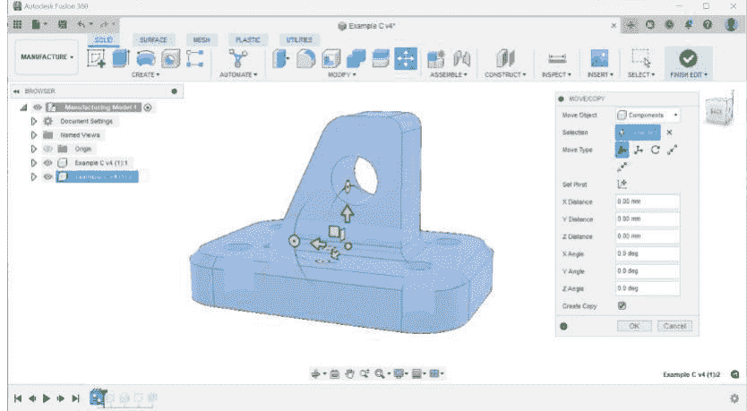

图 6.21 – 在编辑 Manufacturing Model 1 时创建重复组件

一旦我们有了两个组件，我们可能希望重命名第二个组件以更好地组织我们的设计。在此示例中，我选择将第二个组件命名为 Copy，如 *图 6.22* 所示。

接下来，我们必须创建一个草图以便修改孔。要开始草图，我们可以选择位于 **SOLID** 选项卡的 **CREATE** 面板中的 **CREATE SKETCH** 命令并选择 XZ 平面上的一个面。一旦进入草图环境，我们可以投影孔的轮廓并创建一个 45°-45°-90° 直角三角形，如 *图 6.21* 所示。我们创建 45 度角的原因是大多数 3D 打印机可以在高达 45 度悬垂角度的情况下制造零件而无需支撑结构。我们将在 *第 10 章* 中更详细地介绍这一主题：

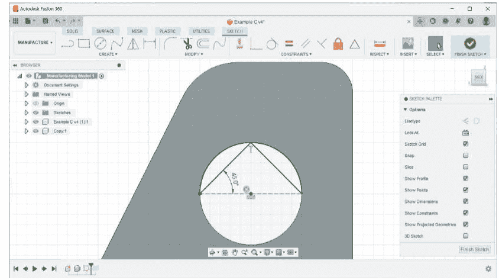

图 6.22 – 在孔内绘制轮廓

一旦我们创建了所需的轮廓，我们可以使用位于 **SOLID** 选项卡的 **CREATE** 面板中的 **EXTRUDE** 功能。我们将选择三角形和圆的上半部分之间的两个轮廓。如 *图 6.23* 所示，在将这些轮廓从孔的一侧挤压到另一侧后，我们将得到一个可以在没有支撑结构的情况下进行 3D 打印的组件。然而，这个新设计中的孔形状与预期结果不同。因此，在 3D 打印 Copy 组件后，我们必须创建一个铣削设置。在这里，我们必须使用 3D 打印的组件作为毛坯，并使用存储在名为 `Example C` 的原始组件中的几何体钻孔：

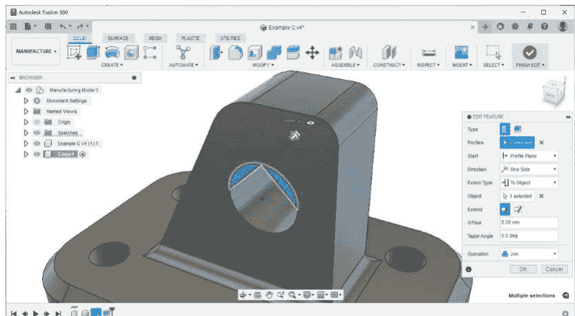

图 6.23 – 向孔中添加材料以便无需支撑即可打印

我们还有另一个替代方案，即使孔稍大一些，以便我们可以打印组件而无需支撑结构或二次铣削操作。为了演示此工作流程，让我们通过右键单击它并选择 **EDIT** 来激活 **Manufacturing Model 2**，如图 6.24 所示。我们将在 **Manufacturing Model 1** 中工作的同一面上创建一个新草图。在这种情况下，我们还将创建一个圆以匹配原始孔的投影几何体，并创建两条与水平面成 45 度的线，并使用相切约束将它们连接到圆上，如图 6.24 所示：

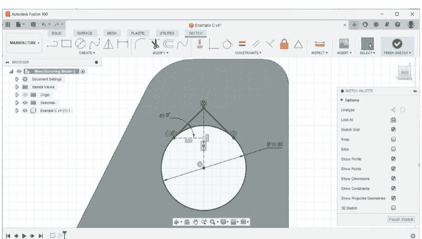

图 6.24 – 编辑 Manufacturing Model 2

完成草图后，我们可以使用 EXTRUDE 功能并从原始组件中移除我们创建的新轮廓。此操作将创建一个更大的孔，该孔在 3D 打印时仍可容纳销钉通过。然而，与我们在进行此修改之前所拥有的版本不同，此零件现在可以在无需支撑结构的情况下进行 3D 打印：

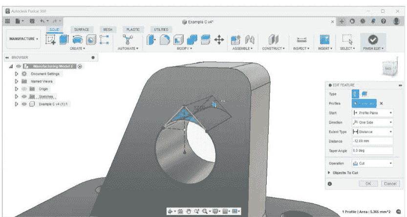

图 6.25 – 从孔中移除材料以便无需支撑即可打印

为了进一步举例说明，让我们切换到 **制造模型 3**，如 *图 6.26* 所示。我们将再次编辑制造模型，并在前两个制造模型中已操作的同一面上创建草图。在此制造模型中，我们将重复在 **制造模型 2** 中执行过的相同步骤，以创建圆以及与水平轴呈 45 度角的两条线和圆的切线。此外，我们将在三角形轮廓内在圆上方创建一个矩形：

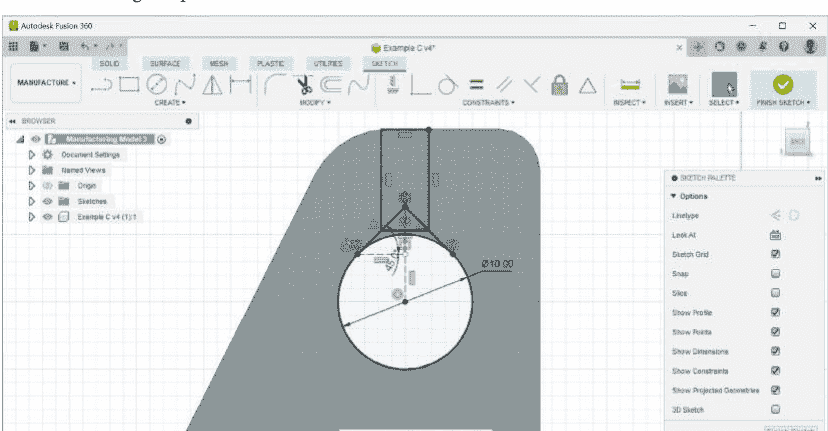

图 6.26 – 编辑制造模型 3

利用这些矩形和三角形轮廓，我们可以使用 **EXTRUDE** 功能创建另一个切口，如 *图 6.27* 所示。我们创建的新形状不仅可以在无需支撑结构的情况下进行 3D 打印，还可以容纳直径略大于孔的销钉。这可能是可取的，因为我们的 3D 打印几何形状可能无法达到所需的公差，或者我们可能有一个略大于 3D 打印孔的销钉。我们切出的槽允许 3D 打印零件沿 *X轴* 略微扩张，但也会提供回弹力以固定销钉：

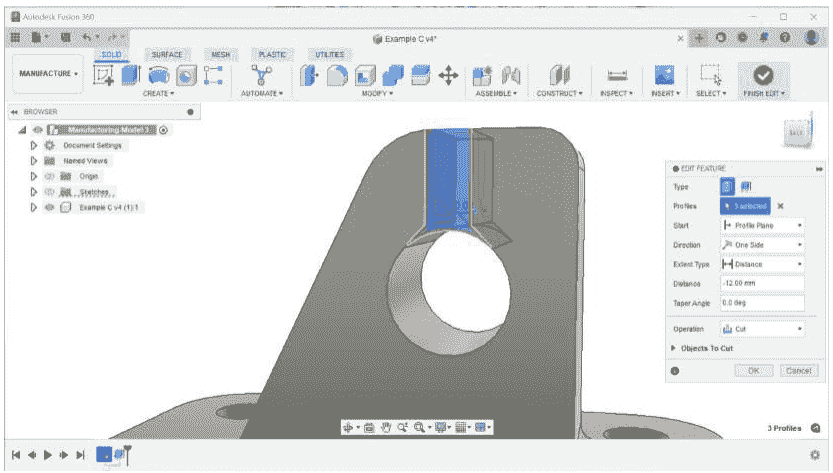

图 6.27 – 为紧密配合添加槽并从孔中去除材料

接下来，我们将演示第四个也是最后一个零件修改。与前三个制造模型不同，在 **制造模型 4** 中，我们将关注沿 Z 轴的四个小孔。这些孔可以在无需支撑结构的情况下打印，因为其方向已与 3D 打印机的层线对齐。

设想一种场景，我们希望为这些孔添加槽特征，使其能够像我们使用 **制造模型 3** 演示的那样固定高公差销钉，但我们不希望从零件上创建大面积切口以最大限度地减少对其刚性和美观性的影响。在这种情况下，我们可以利用 Fusion 360 中的额外草图功能为 3D 打印创建独特的定制槽。*图 6.28* 显示了我们从顶视图看的模型，同时我们在 XY 平面上创建草图编辑 **制造模型 4**。利用孔的投影，我们可以确定其中心点并创建矩形切除区域，以及 90 度 **Center Point Arc Slot**：

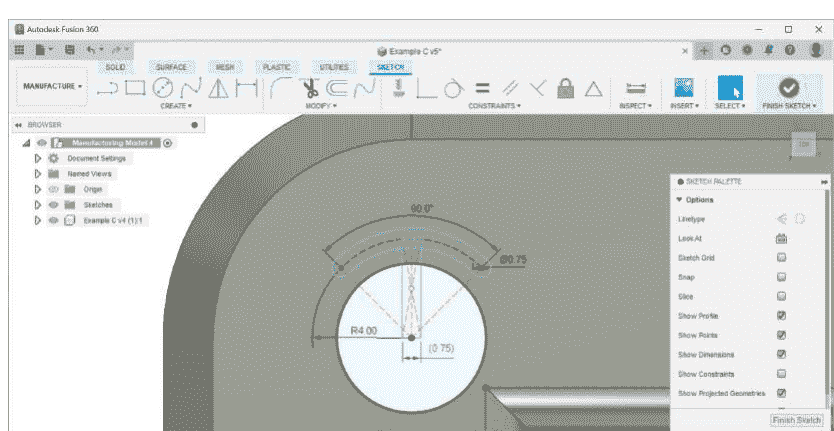

图 6.28 – 编辑制造模型 4 以添加圆弧槽和通道

一旦我们在一个孔上设计了切除轮廓，我们就可以在草图环境中使用 Mirror 命令并沿 X 和 Y 轴镜像我们的草图线，如图 6.29 所示。使用位于 SOLID 选项卡 CREATE 面板中的 EXTRUDE 命令，我们可以选择已草绘的轮廓并将其从实体体中移除：

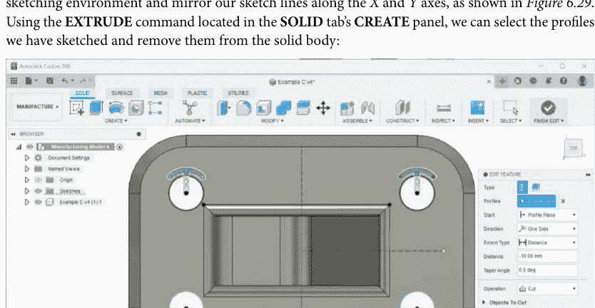

图 6.29 – 从所有小孔中去除材料

作为最后的润色，我们可以选择孔与槽之间的两个面，并使用位于 SOLID 选项卡 MODIFY 面板中的 **FILLET** 功能创建倒角。在创建倒角时，我们可以输入倒角半径或使用 Full Round Fillet 类型。我们可以对所有四个孔重复相同的过程并为八个面创建倒角，如图 6.30 所示：

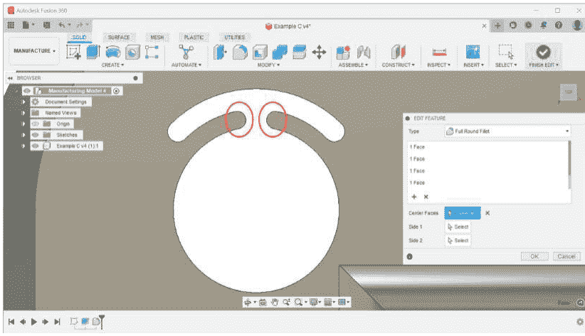

图 6.30 – 添加全圆倒角以改善打印床粘附

根据我们选择使用的特征修改组合，我们将得到一个具有制造过程中所需零件编辑的制造模型。这些编辑不会影响原始设计，但会存储在其各自的制造模型中。

## 摘要

本章我们讨论了为制造目的修改零件。我们首先讨论了如何在 Fusion 360 中使用 Insert Derive 工作流程来管理 3D 打印的模型更改。我们利用此工作流程从多个 Fusion 360 设计中汇总组件，并进行影响下游制造过程但不影响上游设计文档的更改。我们讨论了此工作流程的好处，因为它允许我们将来自多个来源的设计及其参数带入单个制造文档。我们还强调了使用此工作流程会阻止我们删除源组件，只要这些组件在制造文档中被引用。

接下来，我们介绍了 MANUFACTURE 工作区概念以及如何创建制造模型。我们演示了如何在同一文档的制造模型中修改零件。我们强调了此工作流程的主要好处是能够将所有相关数据存储在包含 Fusion 360 设计的同一文档中。我们还强调了与此工作流程相关的主要缺点，即我们无法轻松地从其他 Fusion 360 设计中汇总组件。

我们通过专注于编辑同一组件的多个制造模型时的零件修改结束了本章。我们演示了可以对零件进行的四种修改，以在无需支撑结构的情况下打印常见特征，例如孔，同时保持孔与其中容纳的销钉之间的紧密公差。

现在我们已接近本章结束，您已掌握创建制造模型所需的所有知识，无论是在同一 Fusion 360 设计文档内还是在新文档中以修改零件用于 3D 打印。使用这些技术，您可以为设计和装配需求以及制造需求编辑模型，并将设计和制造的更改保持分离但相互连接。在下一章中，我们将学习如何创建我们的第一个增材制造设置。
