## 创建您的第一个增材制造设置

欢迎阅读第 7 章。在之前的章节中，我们介绍了如何为 3D 打印创建和修改模型。现在，我们可以开始介绍如何使用 Fusion 360 设置 3D 打印。在走到 3D 打印机旁按下打印之前，我们需要在切片软件上以数字方式定义流程，本章中该软件为 Fusion 360。3D 打印使用 Fusion 360 可以简单到按下单个按钮，如果我们先花时间定义关键信息，例如将使用哪台打印机以及使用哪种材料打印。在本章中，我们将更深入地探讨如何有效地使用 Fusion 360，以便了解机器和打印设置库如何协同工作帮助我们创建增材制造设置，从而将数字设计转变为增材制造。

在 Fusion 360 中，3D 打印的关键第一步是创建增材制造设置。此简单而强大的对话框包含多个输入，用于选择我们的 3D 打印机、所需材料以及该材料的打印设置。了解如何使用 Fusion 的库并创建包含我们的 3D 打印机和打印设置的自定义库将使我们获益匪浅。本章中，我们还将介绍与 3D 打印相关的各种 Fusion 360 首选项，这将改善您的体验并节省您的时间。

本章将涵盖以下主题：
- Fusion 360 用于 3D 打印的首选项和设置
- 机器选择和创建增材制造设置
- 打印设置和创建增材制造设置

在第一部分结束时，您将知道如何查找和利用与 3D 打印相关的各种 Fusion 360 首选项。在下一节中，您将学习如何在 Fusion 360 包含的各种机器库中数字定位您的特定 3D 打印机。到本章结束时，您将知道如何从 Fusion 360 的库复制、编辑和管理您的 3D 打印机和打印设置到您自己的库。此外，您将学会如何将打印机和打印设置分配给增材制造设置。您还将接触到基于不同 3D 打印策略的各种打印设置，并学习如何编辑它们。

### 技术要求

本章涵盖的所有主题都可供个人、试用版、商业版、初创版和教育版 Fusion 360 许可证类型使用。

某些 Fusion 360 增材制造机，例如金属粉末床熔融（MPBF）3D 打印机，在获得访问 Additive Build Extension 权限之前不可用。与所有其他 Fusion 360 扩展一样，Additive Build Extension 不适用于个人使用。由于本章不会涉及金属 3D 打印的特定主题，您应该能够毫无问题地跟随本章中的所有示例。

如果您拥有 Fusion 360 的商业许可证，您还需要访问 Additive Build Extension（https://www.autodesk.com/products/Fusion-360/additive-build-extension）才能使用 MPBF 机器创建增材设置。

Autodesk 为所有 Fusion 360 商业用户提供 Additive Build Extension 的 14 天试用期。您可以在 Fusion 360 的扩展对话框中激活试用期。

本章的练习文件可在以下位置找到：https://github.com/PacktPublishing/3D-Printing-with-Fusion-360。

## Fusion 360 用于 3D 打印的首选项和设置

Fusion 360 是一款功能丰富的计算机辅助设计、仿真和制造软件。因此，它具有众多可根据特定工作流程自定义的首选项和设置。在本书中，我们主要关注使用 Fusion 360 进行增材制造。我们在第 1 章中已经涉及了一些基本首选项，例如如何设置默认单位以及捕获设计历史与使用直接建模进行设计的能力。在本章中，我们将更深入地探讨所有设置和首选项，以及一些可用于改进增材制造工作流程的预览功能。

我们可以通过在用户界面右上角选择头像图标来访问首选项对话框，如图 7.1 所示，从而开始简化我们对 Fusion 360 进行增材制造的使用。首选项对话框左侧有一个浏览器。通过选择第一个条目，名为 General，我们可以访问控制通用用户界面行为的首选项。图 7.1 显示了如何将默认建模方向设置为 Z 向上，这我们在第 1 章中已详细讲解过：

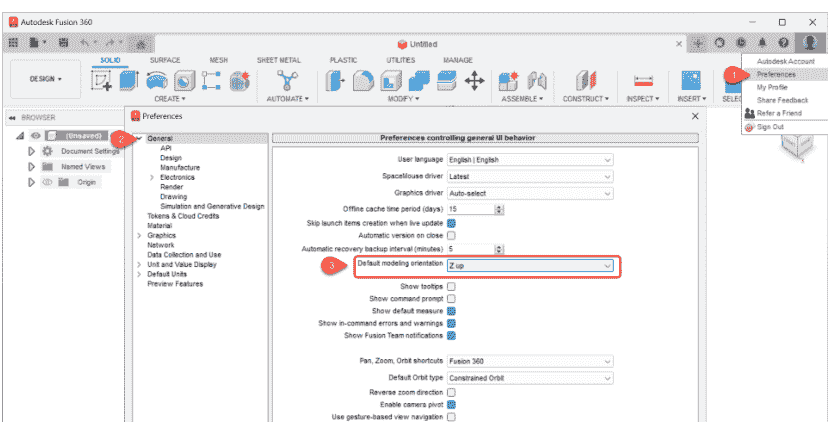

图 7.1 – 使用首选项对话框设置默认模型方向

在 **Preferences** 对话框内的 **General** 下拉菜单下，如果我们切换到名为 **Manufacture** 的项目，即可访问控制 **Manufacture** 工作区内用户界面行为的首选项。正如您可能还记得，我们在 *第 6 章* 中介绍了 **Manufacture** 工作区，并使用它通过制造模型进行模型修改。图 7.2 显示了如何使用 **Enable Cloud Libraries** 将 3D 打印机和打印设置等内容保存并选择到活动的 Fusion Team 中。我们还可以设置用户界面，使每次访问 **Manufacture** 工作区时自动跳转到 **ADDITIVE** 选项卡。如果我们在控制 **Manufacture** 工作区行为的首选项中向下滚动，还可以看到与增材制造相关的设置，例如在创建功能或增材设置时可自动生成支撑、自动方向和增材刀具路径的选项。我们不会更改这三个选项的默认设置，因为默认首选项对增材制造效果良好。将来，随着您对 Fusion 360 的自定义，您可能需要参考这些设置并根据需要进行修改。例如，如果您始终打印不需要支撑结构的零件，可以激活 **Generate Additive Toolpath on Setup creation**，Fusion 360 将自动创建切片和刀具路径，而无需等待您的明确指令：

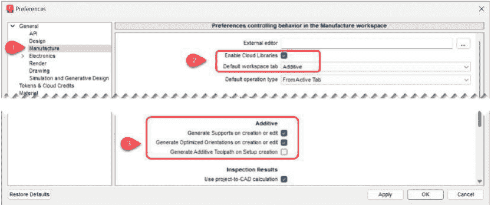

图 7.2 – Fusion 360 特定于 Manufacture 工作区的首选项

我想要强调的另一个重要首选项可以在 **Preferences** 对话框的 **API** 部分找到。在脚本和编程的首选项中，Fusion 360 显示 **Default Path for Scripts and Add-Ins**，如 *图 7.3* 所示。本章中我们不会更改此路径。然而，查看此路径可以清楚地表明 Fusion 360 将自定义资源（如机器文件、打印设置文件和后处理文件）保存的位置。如 *图 7.3* 中突出显示的那样，您保存到本地文件夹中的任何机器或打印设置文件都会自动存储在用户配置文件中的 `AppData\Roaming\Autodesk\` 文件夹内的适当子文件夹中，例如 `machines` 或 `PrintSettings`。

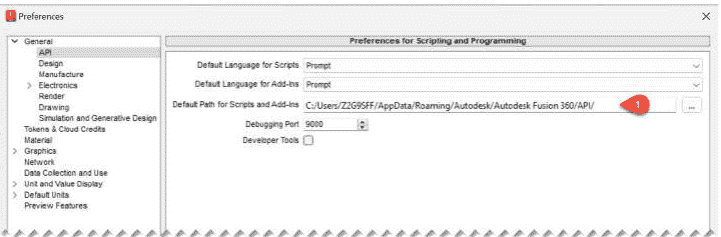

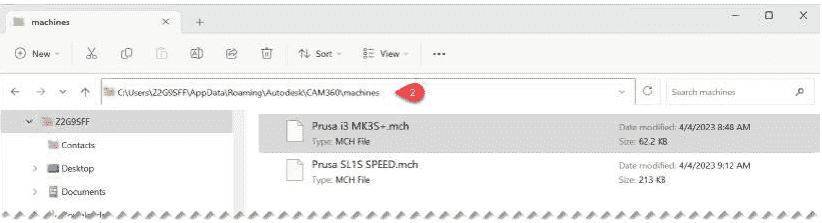

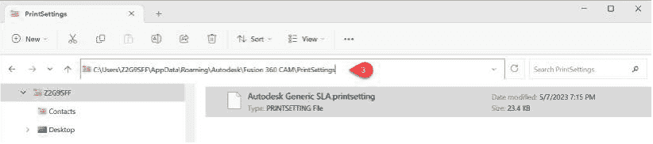

图 7.3 – 默认脚本和插件路径指示 Fusion 360 保存机器和打印设置文件的位置

我想要强调的最后一个首选项可在首选项对话框的预览功能部分访问。如图 7.4 所示，通过使用此选项，我们可以看到一个“尝试预览功能”的首选项对话框。如果我们将筛选器设置为 Manufacture，就可以在它们成为常规发布的一部分之前打开 Fusion 360 为其用户提供的多个预发布功能。

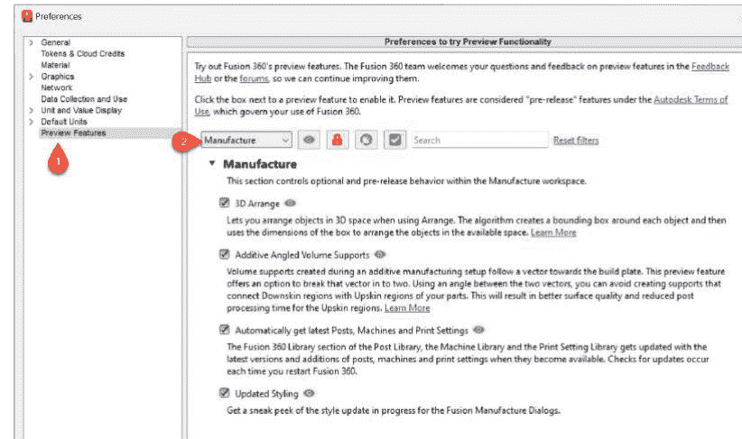

图 7.4 – 首选项对话框中的制造相关预览功能

一旦我们设置了所有首选项，如前几幅图所示，我们可以选择“确定”并继续修改 Manufacture 工作区的设置。为了对 Manufacture 工作区进行更改，我们只需打开一个新的 Fusion 360 设计文档，并使用位于 Fusion 360 用户界面左上角的工作区切换器切换到 Manufacture 工作区。当我们在 Manufacture 工作区时，使用位于画布底部中央的导航栏，我们可以更改设置，例如显示效果，并关闭地面平面，如图 7.5 所示。我们可能想要关闭地面平面的原因是，有时地面平面可能位于 3D 打印机构建平台的上方或下方，并可能造成拥挤的显示，在我们处理增材设置时阻挡视线。

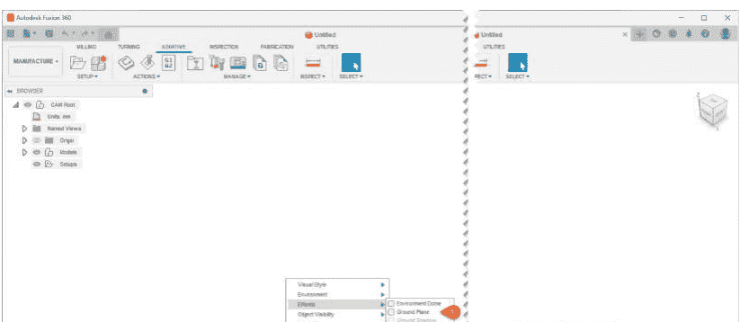

图 7.5 – Manufacture 工作区的显示和可见性相关设置

我建议在处理增材设置时更改的另一个设置是可见性同步。我建议使用图 7.5 所示的 **Manufacture** 工作区内 Fusion 360 用户界面底部的导航栏设置 **Sync visibility with active setup**。当此设置处于活动状态时，Fusion 360 将自动隐藏不参与活动增材设置的组件。

在本节中，我们介绍了各种设置和首选项，这些设置和首选项将在使用 Fusion 360 的 **Manufacture** 工作区创建和处理增材设置时提供帮助。在下一节中，我们将重点介绍创建增材设置并为该设置选择 3D 打印机。

## 机器选择和创建增材设置

现在我们已经为增材制造自定义了 Fusion 360，是时候使用 **Manufacture** 工作区并创建我们的第一个增材设置了。要创建增材设置，我们首先需要做的是选择我们的 3D 打印机。在本节中，我们将重点介绍从 Fusion 360 的机器库中选择 3D 打印机。Fusion 360 在 https://cam.autodesk.com/machineslist 上线托管其增材、减材和检测机器的机器库。如果我们的 3D 打印机不存在于 Fusion 360 的在线库中，我们将不得不手动创建它。本节不会介绍创建自定义 3D 打印机的过程。

图 7.6 显示了在网页浏览器上显示的 Fusion 360 在线机器库。该网页配备了搜索字段，允许我们输入正在搜索的机器的名称或名称的一部分。网页还提供了两个下拉字段来帮助我们筛选结果。第一个筛选器允许我们根据技术（如增材、铣削、车削等）筛选结果。第二个筛选器在图 7.6 中以展开状态显示，允许我们根据制造商筛选结果。一旦您找到要与 Fusion 360 一起使用的特定 3D 打印机，您可以按下 下载 按钮，然后您将可以在计算机的 Downloads 文件夹中访问 *.MCH 文件：

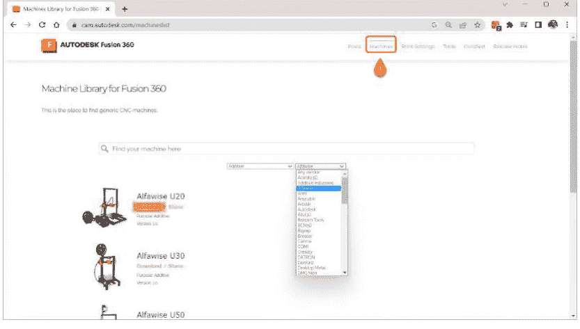

图 7.6 – 根据制造商筛选 Fusion 360 的增材机器

访问机器库的另一种方式是通过创建制造设置。要创建增材制造设置，您可以打开任何 Fusion 360 设计文档并切换到 Manufacture 工作区。由于我们在上一节中将首选项设置为在使用 Manufacture 工作区时默认打开 ADDITIVE 选项卡，因此我们将自动位于 ADDITIVE 选项卡中。在 SETUP 面板中选择 New Setup 命令后，Fusion 360 将根据原始设计自动创建制造模型，并显示如图 7.7 所示的 SETUP 对话框。SETUP 对话框由两个选项卡组成：Setup 和 Post Process。在 Setup 选项卡中，我们必须做的第一件事是为即将创建的增材操作选择机器：

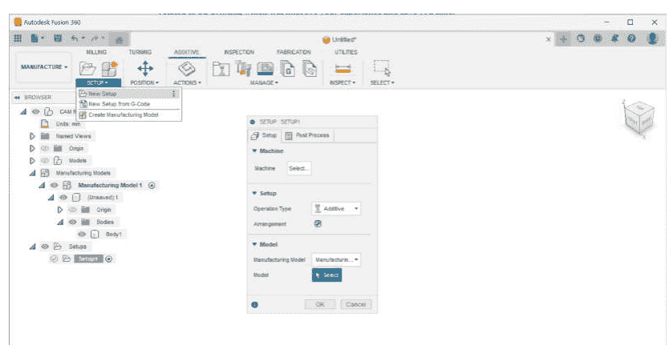

图 7.7 – 使用 SETUP 对话框创建增材设置

在 **设置** 对话框中按下机器选择的 **选择...** 按钮后，将显示 Fusion 360 的机器库。机器库由三列组成。左侧的第一列是用于搜索机器的各种位置的浏览器。中间列显示我们可以选择的各种机器。最右侧的列允许我们根据功能和技术筛选机器，并显示所选机器的信息。**机器库** 对话框顶部左侧还设有搜索栏。如图 7.8 所示，我们可以在 **机器库** 对话框中看到 Fusion 360 机器库在网络上托管的所有机器。如果我们展开名为 **Fusion 360 库** 的列表，我们将看到 **Fusion 360 库** 包含机器的所有机器供应商。在图 7.8 中，我们还可以看到 Fusion 360 库中 Alphawise 的五种不同的 **熔融长丝制造 (FFF)** 打印机：

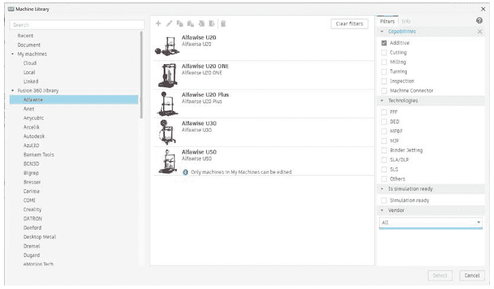

图 7.8 – Fusion 360 的机器库已按增材筛选

使用机器库左上角的搜索栏，我们还可以搜索特定机器。在 *图 7.9* 中，在搜索字段中输入 MK3 后，我们可以看到来自机器供应商 Prusa Research 的三台 FFF 打印机。我们可以选择希望用于增材设置的特定打印机，在 **机器库** 对话框右下角按下 **选择**，然后继续进行 **打印设置** 选择。

另外，如 *图 7.9* 所示，在选择打印机后，我们可以右键单击并复制它，以便将其粘贴到 **我的机器** 内的多个位置之一，例如 **云端**、**本地** 和 **链接**。

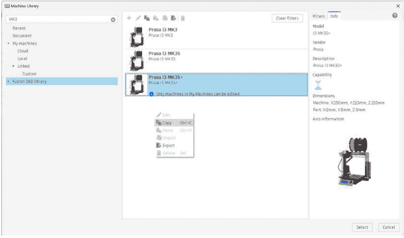

图 7.9 – 在机器库中搜索特定打印机并复制

请记住，我们在浏览器中 **我的机器** 部分下看到 **云端** 作为选项的原因是，在上一小节中，我们已启用 **云端** 库，如 *图 7.2* 所示。在 *图 7.3* 中，我们还强调了本地机器在计算机上保存的位置。但是，到目前为止，我们尚未介绍 **链接** 库。因此，让我们更仔细地了解一下 **链接** 库。如 *图 7.10* 所示，我们可以通过选择 **链接** 库、右键单击它并选择要链接的文件夹来使用 **链接** 库。这将允许我们选择计算机上的特定文件夹来存储与该库关联的所有文件：

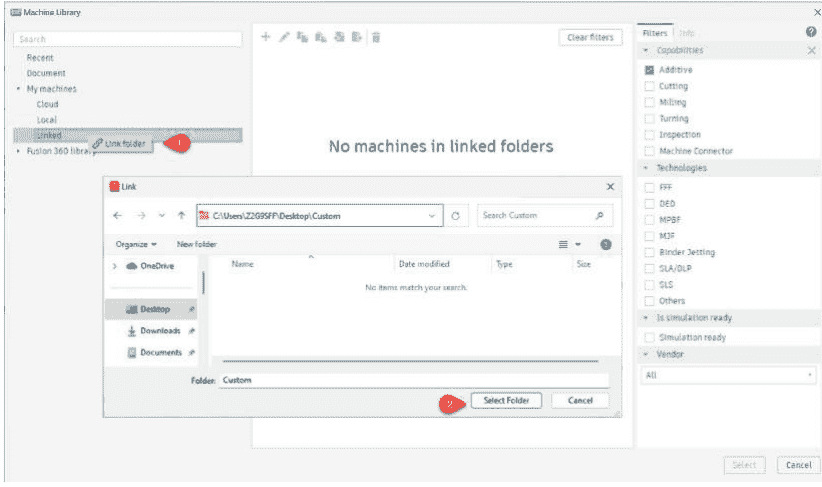

图 7.10 – 链接本地文件夹以保存机器文件

一旦我们拥有已链接的文件夹，该文件夹中存在的所有机器都将在机器库对话框中显示。如果我们的链接文件夹中没有任何机器，我们可以简单地从其他位置（如 Fusion 360 库）复制并粘贴机器，如图 7.11 所示：

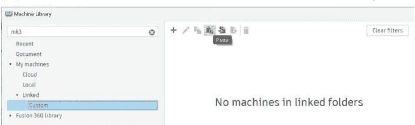

图 7.11 – 将之前复制的机器粘贴到链接文件夹中

在链接文件夹中粘贴所选机器后，我们还可以检查以确保所选机器位于我们的链接文件夹中。我们可以通过使用 Windows Explorer 或 Mac Finder 并导航到所选文件夹来完成此操作。图 7.12 显示，在将 Prusa i3 MK3S+ 机器从 Fusion 360 库复制并粘贴到我们的链接文件夹后，它在机器库中显示在链接自定义文件夹下，并且 Windows Explorer 中的同一文件夹现在包含一个名为 Prusa i3 MK3S+.mch 的新文件：

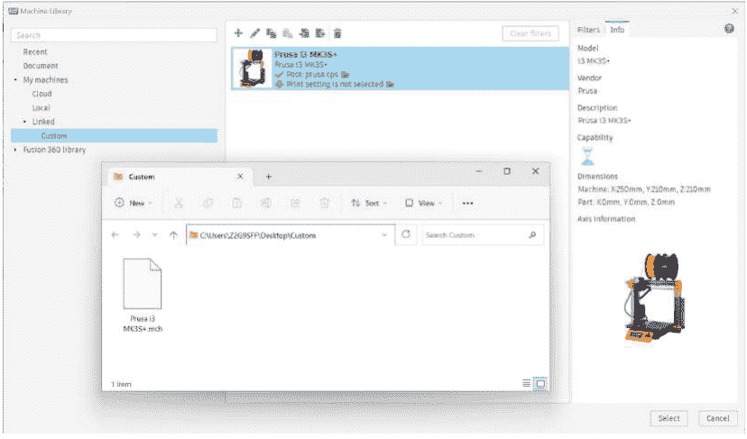

图 7.12 – 粘贴新机器后链接文件夹已更新

如果我们将之前复制的机器粘贴到 **我的机器** 部分下名为 **云端** 的文件夹中，这些机器将被保存到我们当前 Fusion Team 的资源部分中。如 *图 7.13* 所示，我们可以通过进入 **资源** 文件夹然后导航到名为 **CAMMachines** 的文件夹来定位 *.mch 文件。在此位置，我们将能够找到 Prusa i3 MK3S+.mch 文件：

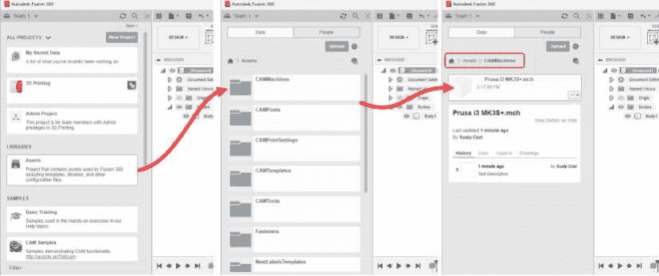

图 7.13 – 在资源文件夹中定位云端机器库

如果您可以使用 Fusion 360 的 Home 选项卡体验，除了在数据面板中定位资源文件夹外，您还可以在 Home 选项卡中看到它，如图 7.14 所示。在左上角选择 Home 图标后，您将能够看到当前团队可以访问的项目。资源文件夹将在项目中可用，并且 CAMMachines 文件夹将存储您在云端库中保存的机器：

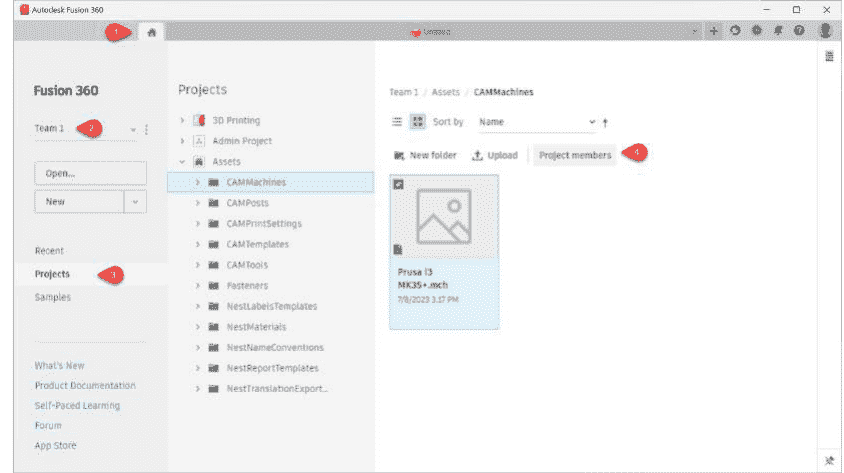

图 7.14 – 在 Home 选项卡中定位云端机器库

本地库和链接库与云端库之间的主要区别与协作有关。您保存到云端库的库项，例如机器、打印设置、工具和后处理程序，都可以供当前团队中的每个项目成员访问。这意味着如果您的团队中有五名用户，他们都将对您保存到云端库的所有资源具有读写权限。图 7.14 还显示了所有可能资源的全列表，从各种库到模板和材料。

在本节中，我们介绍了在增材设置期间选择机器以及管理机器库。在下一节中，我们将讨论如何对打印设置执行相同的操作，并查看与不同增材技术相关的不同打印设置。

## 打印设置和创建增材设置

我们可以利用 **打印设置** 库来查找并下载 Autodesk 为所有类型的 3D 打印机提供的最新打印设置，就像我们在上一节中使用基于网络的 **机器库** 一样。Autodesk 在 https://cam.autodesk.com/printsettingslist 托管 Fusion 360 的 **打印设置** 库。启动网页后，我们可以使用搜索栏查找所需的打印设置，或使用 3D 打印技术和机器供应商的筛选器缩小此网页上提供的庞大打印设置列表。一旦我们找到所需的打印设置，如 *图 7.15* 所示，我们就可以使用 **下载** 按钮将其简单下载到计算机：

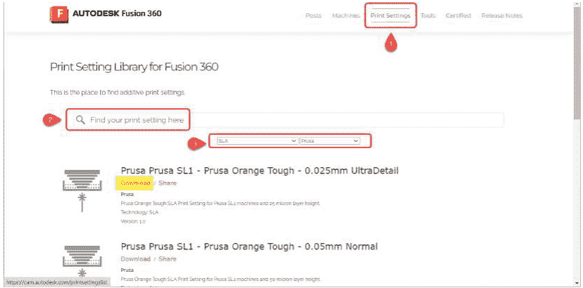

图 7.15 – Fusion 360 在网络上的打印设置库

我们也可以在创建增材设置期间访问 Fusion 360 的整个 **打印设置** 库。在上一节中选择机器后，我们可以在 **设置** 对话框中按下 **打印设置** 按钮，并从 Fusion 360 打印设置库中的可用选项中进行选择。与我们从 Fusion 360 库复制并粘贴机器到我们的 **链接** 文件夹的方式类似，我们可以从 Fusion 360 **打印设置** 网页或 Fusion 360 库复制并粘贴打印设置。从网络下载打印设置后，我们可以将其导入到我们的 **本地**、**云端** 或 **链接** 打印设置库中，并在增材设置期间从首选库中选择该打印设置，如 *图 7.16* 所示：

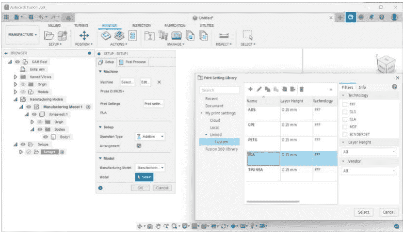

图 7.16 – 从 Fusion 360 的打印设置库中选择打印设置

一旦我们在 **我的打印设置** 下的文件夹中保存了打印设置，例如图 7.17 中所示的 **链接 | 自定义** 文件夹，我们就可以通过选择它、右键单击它并进行编辑来修改该打印设置。编辑仅在机器或打印设置保存到 **Fusion 360 库** 的 **我的机器** 或 **我的打印设置** 子部分后才可用：

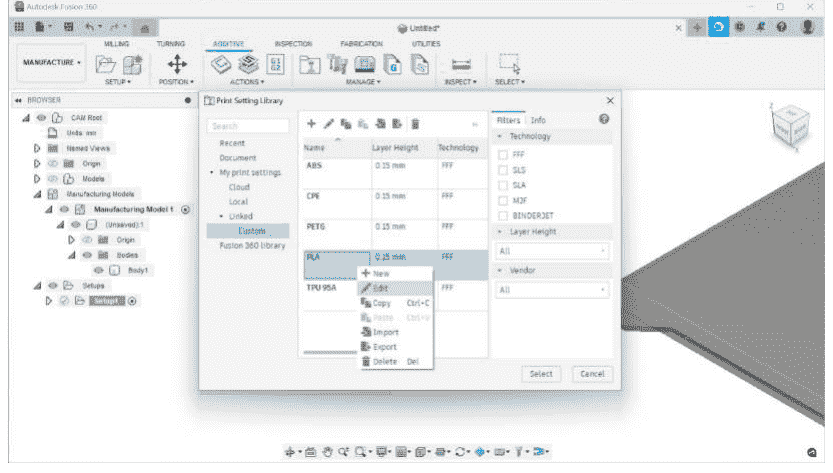

图 7.17 – 编辑位于我的打印设置下的打印设置

按下自定义打印设置的编辑命令后会显示打印设置编辑器，这将允许我们根据自己的偏好自定义所有信息。图 7.18 显示了 FFF 打印设置的一个典型打印设置。该打印设置恰好是使用 PLA 材料在单挤出机 FFF 打印机上打印的默认打印设置。打印设置编辑器由两列组成。在左侧，我们可以看到诸如信息、常规和主体预设等标题。在主体预设下，我们默认有两个标题：常规和坚固。常规恰好是主体预设的默认设置，如文本左侧带勾选标记的齿轮图标所示。我们将在第 8 章中更详细地介绍与主体预设的交互以及为每个组件分配打印设置：

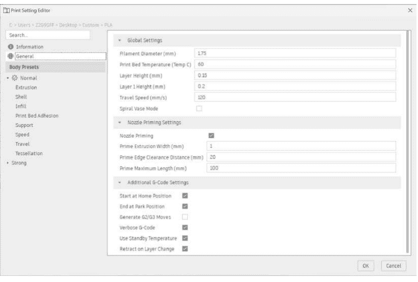

图 7.18 – 自定义 FFF 机器的 PLA 打印设置

在主体预设部分中，在常规主体预设内，有多个子部分，例如挤出、外壳和填充。图 7.19 显示了常规主体预设的填充子部分的输入字段。使用此条目，我们可以将填充图案从默认的 Gyroid 选项自定义为不同的填充图案。或者，如果需要，我们可以将填充密度从 25% 改为 100%，使其成为完全致密的打印：

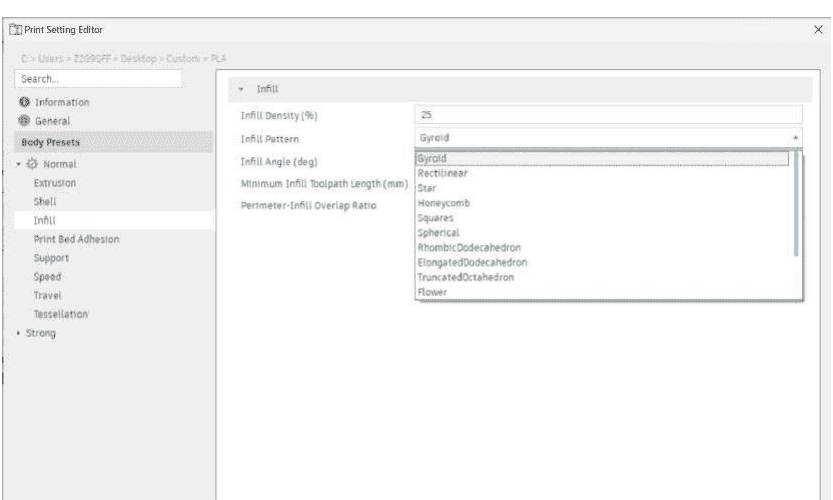

图 7.19 – 修改 FFF 打印设置的填充输入

另一个常见的 **主体预设** 设置需要修改的是 **打印床粘附**。图 7.20 显示了 **常规** 主体预设的 **打印床粘附**。正如图中所示，**打印床粘附** 已启用，并且 **打印床粘附类型** 默认设置为 **裙边**。您可以将 **打印床粘附类型** 改为 **底边** 或 **支撑平台** 并根据在此对话框中选择的粘附类型修改相关输入：

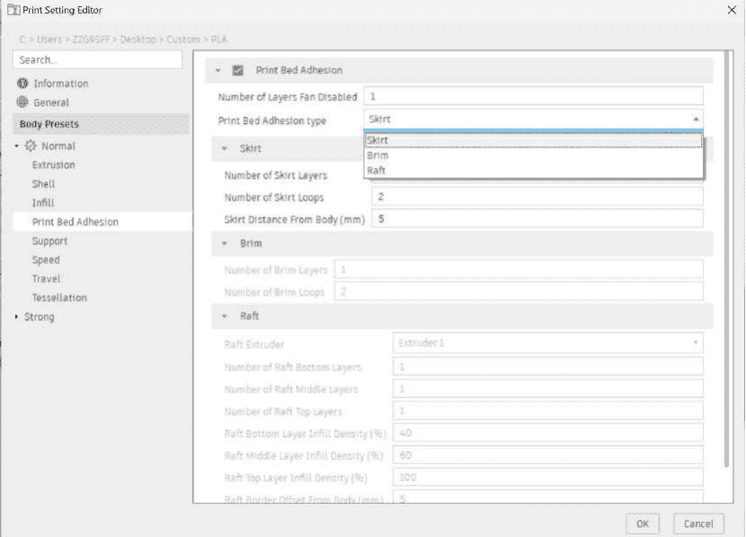

图 7.20 – 自定义 FFF 打印设置的打印床粘附输入

打印设置编辑器还允许我们使用位于对话框左上角的搜索栏按名称搜索给定的输入字段。图 7.21 显示了搜索短语 number of perimeters 的结果。此条目对此打印设置存在两次，如图所示。第一个条目用于常规主体预设，第二个条目用于坚固主体预设。在可用选项列表中选择 Number of Perimeters (Normal) 后，用户界面会自动切换到常规主体预设的外壳选择，并用下方的一条蓝色线突出显示周长数条目字段。如果我们将鼠标悬停在输入字段上，我们还可以看到此条目的工具提示，其内容为 Number of perimeter beads around each layer：

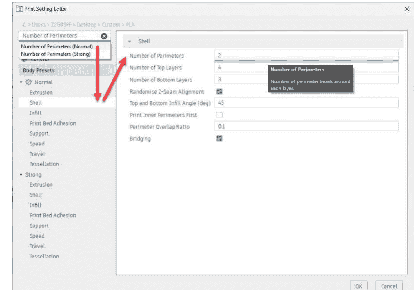

图 7.21 – 使用搜索栏在打印设置编辑器中查找和添加要修改的输入

到目前为止，我们主要关注 FFF 的打印设置和机器。然而，Fusion 360 支持为除 FFF 打印机之外的打印机创建增材设置。如果我们在创建增材设置时选择了一台使用 **光固化 (SLA)** 的 3D 打印机，那么在按下 **打印设置** 按钮后，我们将能够选择适合我们刚刚选择的打印机类型的打印设置。图 7.22 显示了名为 **Prusa Orange Tough - 0.05mm Normal** 的打印设置的 **打印设置编辑器** 的外观，这是一种可以在 Prusa SL1 打印机上打印的树脂，而 Prusa SL1 打印机是一种 SLA 3D 打印机。正如您所见，此打印设置的可用选项列表与我们为 FFF 打印机编辑的 PLA 打印设置非常不同。两者之间存在相似之处，例如层厚输入。然而，对于基于树脂的打印机，我们可以编辑其他信息，例如曝光时间，这些信息可以在 **打印设置编辑器** 中控制：

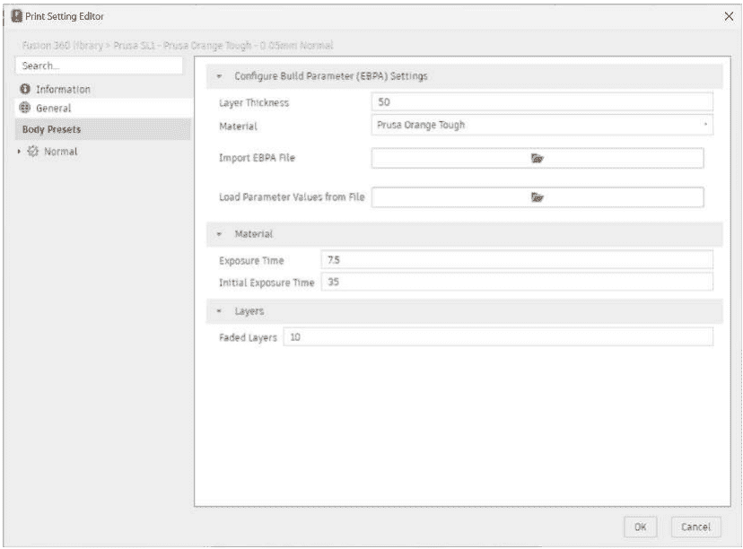

图 7.22 – 用于在 Prusa SL1 打印机上打印的 Prusa Orange Tough 树脂的打印设置编辑器

并非所有 SLA 打印机的打印设置都相同，它们的外观可能会根据机器制造商的规格和机器所需的切片文件而有所不同。图 7.23 显示了一个通用的 SLA 打印机的良好示例，该打印机使用包含 SLC（切片）文件的 ZIP 文件。您可以在从机器库中选择通用 SLA 打印机后访问此打印设置。编辑此打印设置时，您可以自定义层厚，并控制是否要为零件和支撑创建唯一文件以及如何命名每个文件：

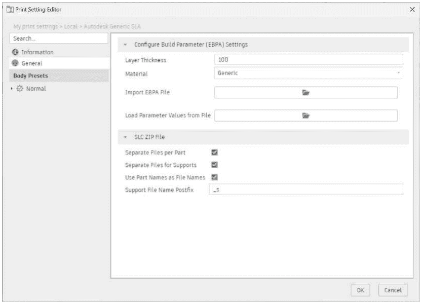

图 7.23 – 通用 SLA 打印机的打印设置编辑器

尽管 DLP 和 SLA 打印机都使用树脂作为 3D 打印的原材料，但它们使用不同的技术来打印该树脂，这类打印机的打印设置也反映了这种技术差异。在从机器库中选择 Autodesk 通用 DLP 打印机后，您将能够选择 Autodesk 通用 DLP 作为打印设置。如果您按 *图 7.24* 所示编辑该打印设置，您将看到另一个可以修改的独特打印设置列表。与 FFF 和 SLA 打印设置类似，您可以控制 DLP 打印设置的层厚。然而，与其他技术不同，DLP 打印机通常使用图像文件来打印每一层。在此打印设置中，您可以在导出过程中自定义图像大小、图像质量以及与每个图像文件 (* .png) 相关的命名。在对模型进行切片并导出图像文件之前，您需要确保编辑此打印设置的 **大小 X** 和 **大小 Y** 字段，以匹配您特定 DLP 打印机的可打印成型区域尺寸：

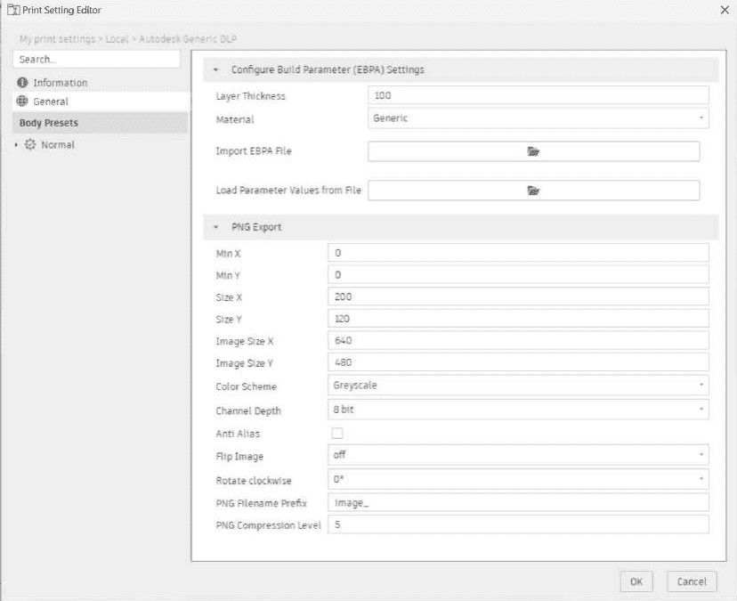

图 7.24 – 通用 DLP 打印机的打印设置编辑器

尽管本章我们不关注使用 MPBF 技术的 3D 打印机，但我也想借此机会展示该技术的打印设置是什么样的。如本章前面所述，除非您拥有增材制造扩展，否则您无法将 MPBF 3D 打印机作为增材设置的一部分进行选择。但是，如果您想跟随操作并复制图 7.25 中所示的工作流程以更好地了解与 MPBF 相关的打印设置，您只需从 Fusion 360 的在线库中找到一个 MPBF 打印设置并下载即可。一旦您拥有 MPBF 打印设置的本地副本，您就可以将其导入到您的本地或云库之一，如我们在上一节中所述。您不需要在创建增材设置期间执行此操作。您可以在任何选项卡中制造工作区的 MANAGE 面板内访问所有与制造相关的库。

图 7.25 显示了编辑 Autodesk 通用 MPBF 100 微米打印设置时打印设置编辑器的情况。此打印设置与我们迄今为止演示的所有其他打印设置一样，允许我们修改层厚。此外，我们可以在材料下拉菜单中指定金属粉末，这将在下游产生影响，当我们希望将此打印设置用于工艺仿真时，这将在第 13 章中更详细地介绍。我们还对激光在熔合模型不同部分的粉末时所遵循的路径有额外的控制，例如其上表面、下表面和支撑。Autodesk 通用 MPBF 3D 打印机以及此打印设置允许创建多种切片文件类型，例如 SLC 和 Gcode。因此，打印设置还包含各种控制这些文件如何创建和命名的选项：

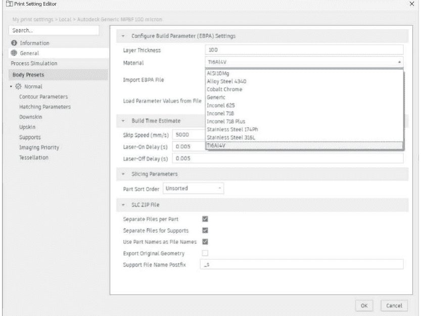

图 7.25 – 通用 MPBF 打印机的打印设置编辑器

现在我们已经介绍了不同增材技术的各种打印设置，让我们通过创建第一个增材设置来将我们所学的一切付诸实践。为了演示这一点，我们将使用我们在第 6 章中创建的名为 Spur Gear 的模型。我们特意使用此几何形状，因为它已经定向为具有一个与 X-Y 平面接触的平面。

打开 Fusion 360 中的设计后，我们可以使用工作区切换器切换到 Manufacture 工作区。在 ADDITIVE 选项卡中，我们可以点击 SETUP 面板中的 New Setup。在 SETUP 对话框的 Setup 选项卡中，点击 Machine 输入旁边的 Select... 命令，并从 Fusion 360 库中选择 Prusa i3 MK3S+ 作为我们的机器。使用 Print Setting 选择器，让我们选择 PLA 作为我们的 Print Setting。使用对话框底部的模型选择器，我们可以在画布中双击 Spur Gear，或从 Manufacturing Model 1 中的浏览器中选择 Spur Gear 组件，如图 7.26 所示。

完成与机器、打印设置和模型相关的所有选择后，我们已完成了此增材制造设置的输入。迄今为止我们尚未强调的另一项关键信息是安排零件在构建体积内的位置。默认情况下，增材操作的 SETUP 对话框会自动勾选 Arrangement 复选框：

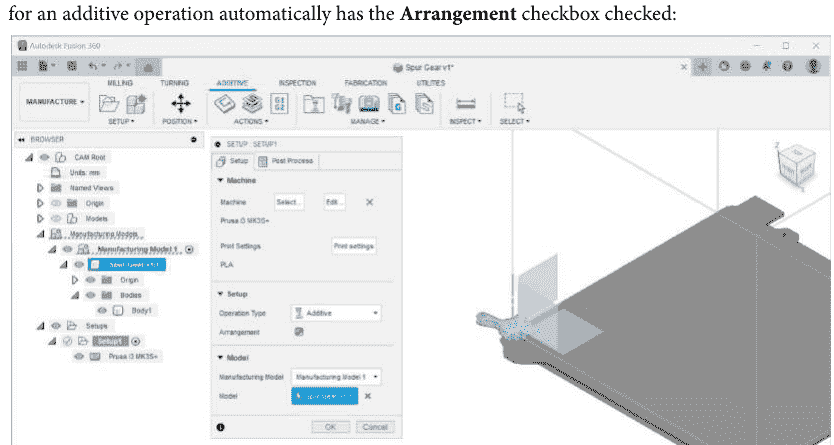

图 7.26 – 单个组件的增材设置输入已完成

在 SETUP 对话框中选择 OK 后，Fusion 360 将在画布中自动显示我们所选打印机的构建体积并创建 Setup 1。功能区用户界面随后会略有变化，我们将在 ADDITIVE 选项卡下的功能区中看到新的图标出现。如果将图 7.27 中的功能区与前一幅图进行比较，您将看到 POSITION 面板下出现一些新图标，并且会出现一个名为 SUPPORTS 的新面板。一旦创建增材设置，Fusion 360 将显示一个名为 ADDITIVE ARRANGE 的新对话框。我们将在下一章详细讨论在构建体积内排列零件的问题。但就本示例而言，让我们继续在 ADDITIVE ARRANGE 对话框中按下 OK，这将自动在此打印机的构建区域内排列该组件：

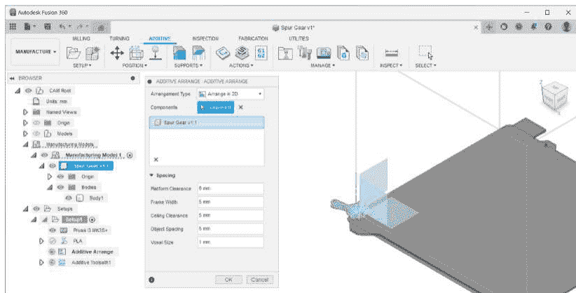

图 7.27 – 在增材设置中利用 ADDITIVE ARRANGE

排列完成后，我们的零件将接触构建板，因为排列期间平台间隙输入为 0。**ADDITIVE ARRANGE** 操作会自动将所有选定组件放置在构建平台的中心周围。在 **ADDITIVE ARRANGE** 对话框中按下 **OK** 后，Fusion 360 将执行必要的计算并将零件移动到构建平台的中心：

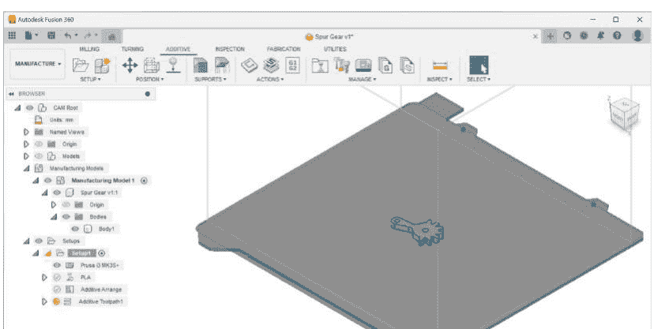

图 7.28 – 我们的第一个增材设置现已完成

执行 **ADDITIVE ARRANGE** 还会在浏览器中添加一个名为 **ADDITIVE ARRANGE** 的新条目，未来如有需要可以对其进行编辑或重新生成。使用此功能，我们可以在给定打印机的构建区域内排列一个或多个组件。由于这是一台 FFF 打印机，排列类型默认设置为以 2D 方式排列组件。如果我们要使用 **selective laser sintering (SLS)**、**Multi Jet Fusion (MJF)** 打印机或粘结剂喷射打印机创建增材设置，我们也可以使用 3D 排列类型并自动在所选 3D 打印机的构建体积内组织零件。

完成这最后一步后，我们使用 FFF 打印机完成的第一个 Fusion 360 增材设置就完成了。

## Summary

在本章中，我们主要关注 Fusion 360 的设置和首选项，以及如何自定义它们以使我们的增材制造工作流程无缝。我们已更改了控制 Fusion 360 显示行为的设置以及与进入 **Manufacture** 工作区时自动切换到 **ADDITIVE** 选项卡相关的功能。

我们还启用了某些审阅功能以利用被视为预发布的功能。在自定义设置和首选项之后，我们学习了制造相关的库，例如机器库和 **Print Settings** 库。我们探索了 Autodesk 在网上托管的 3D 打印机和 Print Settings 在线库。我们演示了如何从网上下载机器、打印设置，并在 Fusion 360 用户界面中使用它们，通过将它们本地保存为链接库和云保存库，这些库可供我们所有团队成员访问。

我们强调了不同 3D 打印技术打印设置的相似性和差异，例如 FFF、SLA、DLP 和 MPBF。我们通过为单个组件创建第一个增材设置，将我们所有新获得的知识付诸实践。通过本章所学的一切，在创建制造设置、选择要打印的组件以及在 Fusion 360 中生成增材设置时，您应该感到自信。

在下一章中，我们将把零件排列的概念更进一步，重点关注在我们 3D 打印机的构建体积内排列和定向多个组件。
