## Arranging and Orienting Components

欢迎来到第 8 章。在之前的章节中，我们重点介绍了如何从头开始设计以及如何修改现有设计以进行 3D 打印。在第 7 章结束时，在选择打印机和打印设置后，我们创建了第一个增材制造设置以 3D 打印单个组件。在本章中，我们将在此基础上创建针对不同制造技术、一个或多个组件的增材设置，并探索 Fusion 360 中用于定位这些组件的不同工具。

无论您一次打印单个组件还是数百个组件，如何在构建体积内排列它们并根据预期结果对其进行定向都是获得成功打印的重要考虑因素。本章将介绍各种 3D 打印技术以及如何为每种技术最佳排列和定向组件。在本章中，我们将重点介绍如何手动平移和定向组件。我们还将展示如何根据给定标准自动定向零件并排列它们，例如最小化构建高度或找到会导致支撑结构体积最小的定向。

在本章中，我们将涵盖以下主题：

- Positioning components manually
- Orienting components automatically
- Arranging components automatically

在第一个部分结束时，您将学会如何在打印机的构建体积内手动定位组件。在本节中，您还将学习各种技术，以便有效地平移和旋转零件，使其位于打印机的构建板上方并平放在您选择的表面上。在第二个部分结束时，您将学会如何对给定零件进行定向研究，以及如何根据 3D 打印技术以及打印机的功能和限制来选择打印零件的定向。在本章结束时，您将学会如何在打印机的 3D 构建体积内自动排列组件。此外，您还能够检查设置并执行基本统计数据，以找到零件在打印机构建体积内的排列密度。

### Technical requirements

本章涵盖的所有主题均可供个人、试用、商业、初创和教育版 Fusion 360 许可证类型使用。

某些 Fusion 360 增材机器，例如 **Metal Powderbed Fusion (MPBF)** 3D 打印机，在获得 Additive Build 扩展访问权限之前不可用。与所有其他 Fusion 360 扩展一样，Additive Build 扩展不能与个人许可证一起使用。由于本章不会涵盖特定于金属 3D 打印的主题，您应该能够毫无问题地跟随本章中的所有示例。

如果您拥有 Fusion 360 的商业许可证，要使用 MPBF 机器创建增材设置，您还需要访问 Additive Build 扩展 (https://www.autodesk.com/products/Fusion-360/additive-build-extension)。

Autodesk 为所有 Fusion 360 商业用户提供 Additive Build 扩展的 14 天试用期。您可以在 Fusion 360 的扩展对话框中激活试用期。

本章的课程文件可在以下位置找到：https://github.com/PacktPublishing/3D-Printing-with-Fusion-360

### Positioning Components Manually

在为 3D 打印准备零件时，我们在切片软件中使用的主要功能之一是定位组件。Fusion 360 提供了多个工具，可用于在 3D 打印机的构建体积内平移和定向零件。本节中我们重点介绍的第一个方法是使用 **Move Components** 命令，该命令位于 **MANUFACTURE** 工作区中 **ADDITIVE** 选项卡的 **POSITION** 面板内。为了演示如何使用此功能，我们将使用 Prusa i3 MK3S+ 3D 打印机和 PLA 打印设置创建一个新的增材设置。

本章中的第一个增材制造设置将使用名为 Component 6 和 Component 15 的两个组件，这些组件位于名为 Spark Max Motor Controller 的装配体中。我们将使用位于 **MANUFACTURE** 工作区中 **ADDITIVE** 选项卡的 **SETUP** 面板里的 **NEW SETUP** 命令来创建此增材制造设置，如上一章所示。在创建设置期间，我们将取消选中 **Arrangement** 复选框，这将使我们能够完全控制每个组件的位置。我们将在本章的最后一节讨论激活此复选框时启动的自动排列功能的使用方法。

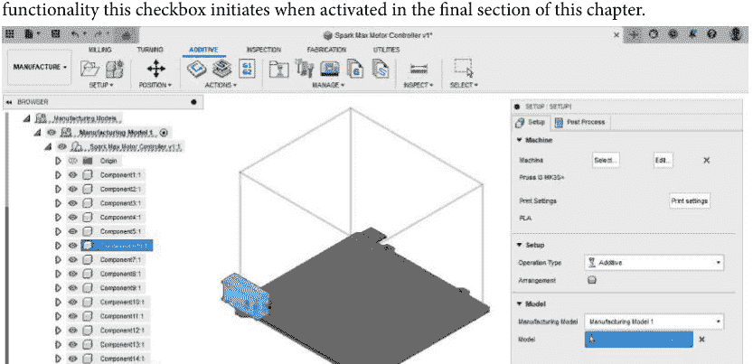

Figure 8.1 – 使用两个组件创建增材制造设置

在创建增材制造设置时，Fusion 360 会自动关闭不参与增材制造设置的组件的可见性，并显示我们所选打印机的成型平台和成型体积，以及将参与此增材制造设置的两个组件。如 Figure 8.1 所示，由于我们在创建设置期间取消了排列复选框，这两个组件不会自动移动到成型体积中。相反，它们保持原位，这意味着我们必须手动将它们移动到成型体积中。

在增材制造设置中定位零件时，我们有几个选项。第一个选项是使用位于 **ADDITIVE** 选项卡的 **POSITION** 面板中的 **MOVE COMPONENTS** 命令。激活后，**MOVE COMPONENTS** 对话框允许我们选择一个或多个组件，并在活动设置中平移和/或旋转它们。此操作会移动组件并在其新位置内捕获它们在活动设置中使用的制造模型。Figure 8.2 显示了所选组件如何在 X、Y 和 Z 轴上分别平移 100 毫米、100 毫米和 60 毫米。

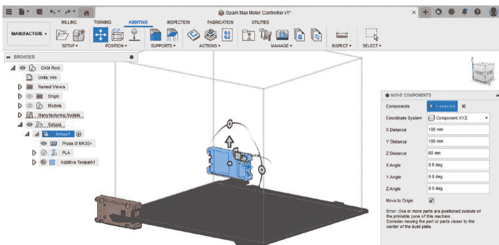

Figure 8.2 – 使用 MOVE COMPONENTS 对话框在成型体积内定位零件

Figure 8.2 还显示，在移动第一个组件后，我们仍然有第二个组件，它并未完全位于打印机成型体积内。这样的组件会在边缘周围显示红色高亮，表示这些零件位于机器可打印区域之外。Fusion 360 还会在 move-components 对话框中显示错误消息以指示此类问题。

如果此时我们希望移动不同的组件，我们可以选中它，然后通过在画布中左键单击组件来取消选中第一个组件。接下来，我们可以输入希望移动第二个组件的距离和角度，然后单击“确定”。

在定位组件时，我们的另一个选项是在 MOVE COMPONENTS 对话框处于活动状态时，通过用鼠标选择组件的中心并在屏幕上拖动它们来在画布中移动它们，如 Figure 8.3 所示。此操作类似于在 DESIGN 工作区中对未固定的组件执行 MOVE/COPY 操作，其移动类型为 Free Move。

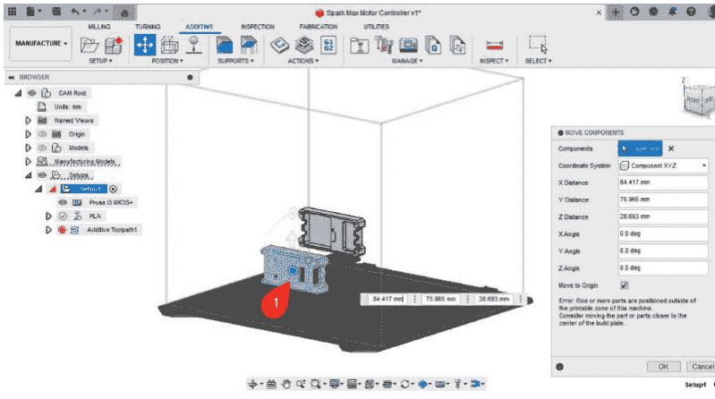

Figure 8.3 – 使用鼠标在增材制造设置中拖动组件

如 *Figure 8.3* 所示，Fusion 360 在此自由零件运动期间使用的增量对于任何平移或旋转都具有三位有效数字。如果我们想更改使用拖放技术平移或旋转组件的精度，我们需要返回首选项对话框，并将通用精度从默认值 **0.123** 更改为更不精确或更精确的选项。作为提醒，**General precision** 可以在 **Preferences** 对话框的 **Unit and Value Display** 部分找到，如 *Figure 8.4* 所示。

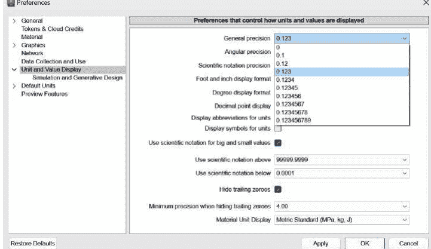

Figure 8.4 – 可以在 Fusion 360 的 Preferences 对话框中编辑通用精度

**MOVE COMPONENTS** 对话框具有额外的功能，允许我们旋转组件。选择要旋转的组件后，我们可以在 **X Angle**、**Y Angle** 或 **Z Angle** 输入字段中输入角度以相应地旋转组件。*Figure 8.5* 显示了围绕其重心将两个组件之一在 X、Y 和 Z 轴上旋转 45 度。

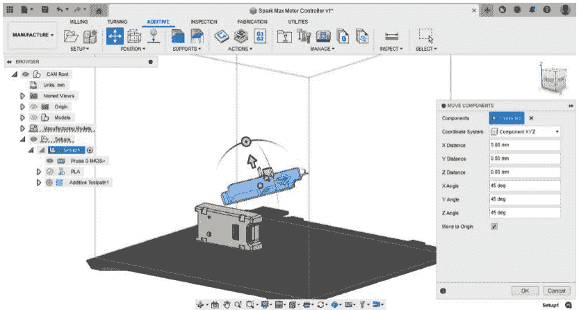

Figure 8.5 – 使用 MOVE COMPONENTS 对话框旋转组件

一旦组件被旋转，如果我们想第二次移动该组件，在 Move Components 对话框中选中它后，Fusion 360 会在其原点自动显示一个局部坐标系，该坐标系基于我们刚刚完成的最后一次移动操作。

如果仔细查看 *Figure 8.5*，您会注意到坐标系设置为 **Component XYZ**。如果我们已经旋转过一个组件一次，则为该组件显示的局部坐标系将与全局 XYZ 轴不匹配。这将使我们在全局 XYZ 轴上平移组件变得更加困难。

为了解决这个问题，我们可以将坐标系从 **Component XYZ** 更改为 **Machine XYZ**，后者始终与全局坐标系匹配。选择 **Machine XYZ** 坐标系后，我们可以轻松地在全局 X、Y 或 Z 方向上平移所选组件，如 *Figure 8.6* 所示。

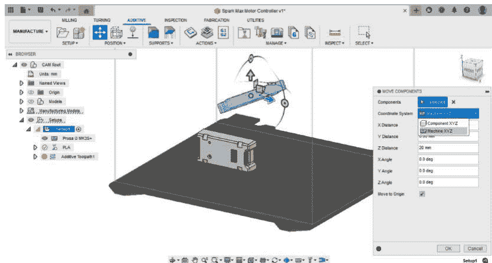

Figure 8.6 – 使用 Machine XYZ 坐标系在全局 Z 方向上平移组件

使用 Move Components 对话框定向零件后，我们可能希望快速将它们平移到 3D 打印机成型体积内的左下角更近的位置。在这种情况下，在选择要平移的组件后，我们可以单击 **Move to Origin** 命令，所选组件将被自动平移，使其包围盒的左下角与 3D 打印机成型体积的前左下角重合，如 Figure 8.7 所示。

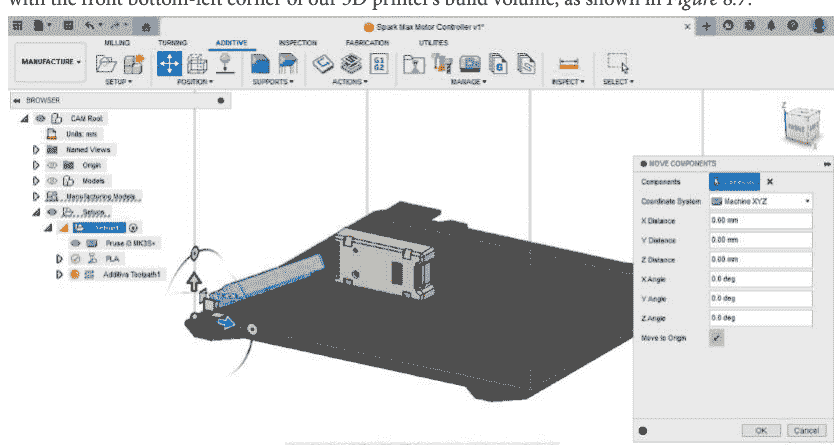

Figure 8.7 – 使用 Move to Origin 功能平移所选组件

**ADDITIVE** 选项卡的 **POSITION** 面板中的另一个有用工具是 **Minimize Build Height**。如果我们有一个形状不规则的组件，或者旋转后占用了相当大的 Z 高度的组件，我们可能希望找到一种方向，使该组件在成型体积内占用最小可能的 Z 高度。在某些增材制造技术中，例如 **selective laser melting (SLM)**、**selective laser sintering (SLS)**、**multijet fusion (MJF)** 和粘结剂喷射，使用最少的 Z 高度是有益的，这样就不会浪费原材料或打印时间。

降低给定增材制造设置的 Z 高度可最大限度地减少需要 3D 打印的层数。这对整体打印时间有积极影响。想象一下，如果我们打印一个有 1,000 层的构建。我们将在层之间有 999 个间隔，在这些间隔中，需要进行增材制造技术特定的工艺，例如用原材料为下一层重新涂覆构建。这种工艺根据 3D 打印机的不同，每层间隔可能需要 ~10 秒。如果您可以通过旋转组件来减少层数，使构建可以用一半的层数打印（在本例中为 500 层），您就可以将重新涂覆构建所花费的总时间减少 ~80 分钟。这是一项可观的时间节省，将对您的制造吞吐量和盈利能力产生积极影响。

minimize build height 命令会自动旋转所选组件，使其在 Z 轴上占用的空间最少，如 Figure 8.8 所示。如果我们在平台间隙字段中输入非 0 值，此命令还会在成型平台和零件之间留出间隙。

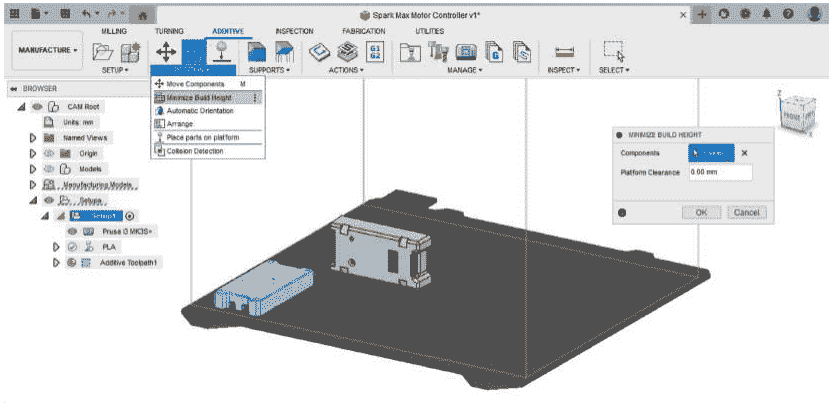

Figure 8.8 – 在增材制造设置中最小化组件的构建高度

本节中我们将重点介绍的最终手动定位是 将零件放置在平台上 命令。如图 8.9 所示，此命令允许我们使用 Type 下拉菜单选择 Component 或该组件内的 Flat Face。如果从下拉菜单中选择 Flat Face，我们可以选择组件上的一个表面并按需填写 Platform Clearance，就像我们之前对 最小化构建高度 命令所描述的那样。单击 将零件放置在平台上 对话框中的 OK 后，我们所选的组件将旋转，所选表面将面向构建平台。请注意，Flat Face 选择类型仅适用于 SOLID 体，MESH 体上的平面面组不能作为此命令的输入。图 8.9 显示了此命令在此增材设置中两个组件之一上的输入和输出。

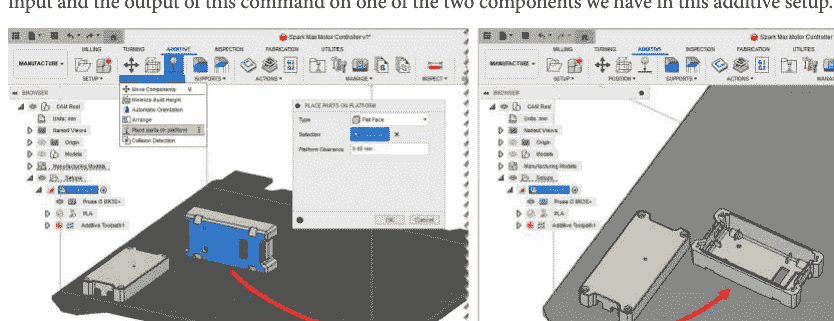

Figure 8.9 – 通过选择平面使用 将零件放置在平台上 命令

在本节中，我们介绍了在增材设置中可用的三种不同的手动零件定位命令。使用这三种相对简单的命令，我们可以平移和旋转组件，使其位于 3D 打印机的构建体积内。本节中强调的所有位置修改都是纯几何的。在移动或旋转组件时，我们没有考虑任何工艺特定的要求。在下一节中，我们将开始考虑各种 3D 打印技术的<|message|>要求并相应地定位我们的组件。

## 自动定向组件

在上一节中，我们讨论了如何利用 Fusion 360 将零件定位在打印机的构建体积内。然而，到目前为止我们展示的所有平移和旋转都是显式操作。Fusion 360 还提供工具帮助我们自动定向零件，以便我们能够根据 3D 打印机特定的技术选择方向，以最小化材料使用并提高打印成功的几率。

为了演示如何使用 Fusion 360 自动定向零件，我们将使用名为 `Connector Bracket` 的模型，如图 8.10 所示。这是我们在上一章作为较大装配的一部分创建的模型。在本章中，我们将打开此 Fusion 360 设计文档并切换到 **MANUFACTURE** 工作区。我们将使用 FFF 打印机 Prusa i3 MK3S + 和 PLA 特定打印设置创建增材设置，如图 8.10 所示。我们还将在 **SETUP** 对话框中取消选中 **Arrangement** 选项并单击 **OK** 以生成增材设置。

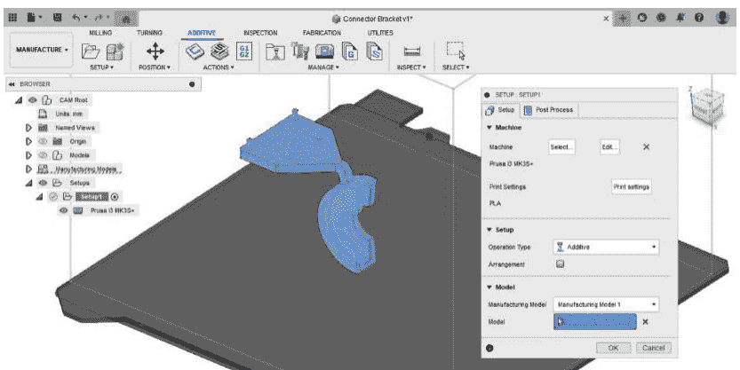

Figure 8.10 – 使用 FFF 机器为单个组件创建增材设置

由于我们在创建此增材设置时未选中 **Arrangement** 复选框，Fusion 360 不会自动在打印机的构建体积内排列我们的零件。然而，由于零件已靠近原点放置，我们的零件会自动显示在构建体积内，我们可以根据需要进一步定位它。

在本节中，我们将重点关注位于 **ADDITIVE** 选项卡的 **POSITION** 面板下拉菜单中的 **AUTOMATIC ORIENTATION** 命令。一旦激活 **AUTOMATIC ORIENTATION** 命令，Fusion 360 将显示一个包含两个选项卡的新对话框，如图 8.11 所示。第一个选项卡名为 **Parameters**，允许我们选择要进行方向研究的组件。在此示例中，我们将进行一次单一的自动定向，因为此增材设置仅包含一个组件。然而，如果增材设置中有多个组件，我们可以为每个要 3D 打印的组件进行独特的方向研究。选择目标组件后，我们可以编辑 **Support Overhang Angle** 输入字段并输入 45 deg，因为大多数 FFF、SLA、DLP 和 MPBF 3D 打印机都能够在无需支撑结构的情况下创建高达 45 度的悬垂。下一个复选框名为 **Support Bottom Surface**，激活时允许我们在零件和 3D 打印机的构建板之间添加平台间隙。

由于此示例适用于 FFF 打印机，我们不需要激活它。然而，如果我们为 MPBF 打印机进行此方向研究，我们可能希望激活该复选框并输入约 3 毫米的平台间隙，以考虑打印过程完成后我们将用来将零件从构建板上切下的切割工具的厚度。

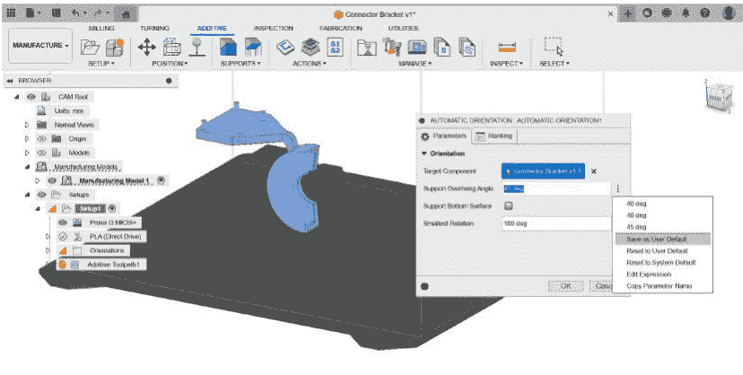

Figure 8.11 – 用于 FFF 打印机增材设置的自动方向研究

根据我们在 **Parameters** 选项卡中提供的信息，Fusion 360 将生成该组件的各种方向，并为每个方向提供信息。为了限制此命令将生成的冗长方向结果列表，**Parameters** 对话框允许我们调整最小允许旋转角度。默认情况下，**Smallest Rotation** 输入设置为 180 度。这意味着我们将从此研究中获得的方向将在 XZ 或 YZ 等全局平面上为镜像。如果减小最小旋转输入，Fusion 360 将在方向结果中产生更多结果。然而，这可能需要稍长的计算时间。

我的建议是，如果您的增材设置用于 FFF 打印机，请使用 **Parameters** 选项卡中的标准输入，不要偏离默认值。如果您发现自己总是需要更改方向研究的输入，您可以左键单击输入旁边的由三个垂直点表示的图标并选择 **Save as User Default** 以将自定义输入设为默认值，如图 8.11 所示。这样，下次您使用此命令时，对话框的输入将基于您的期望偏好。这是您自定义 Fusion 360 **MANUFACTURE** 工作区中大多数对话框默认值的一种常见方式。

如果您切换到 **AUTOMATIC ORIENTATION** 对话框中的 **Ranking** 选项卡，您将能够控制 Fusion 360 如何列出方向研究的结果，如图 8.12 所示。在为所选组件生成方向列表时，Fusion 360 还会计算以下附加信息：

- 在给定方向打印物体时需要多少支撑
- 基于支撑悬垂角度输入，零件上需要支撑的总表面积
- 在给定方向下的包围盒体积
- 在给定方向下占用的最大 Z 高度
- 在给定方向下的重心高度

使用每个排名标准旁边的下拉菜单，您可以为 Fusion 360 计算的每个项目的数值分配优先级。如前所述，默认排名优先级是同时适用于 FFF 和 MPBF 技术的首选排名优先级。

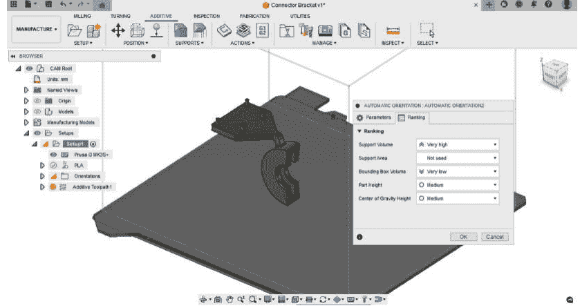

Figure 8.12 – 自动方向研究的排名标准

在进行方向研究并单击 **AUTOMATIC ORIENTATION** 对话框中的 **OK** 按钮后，Fusion 360 会在浏览器中活动增材设置的 **Orientations** 文件夹内添加一个名为 Automatic Orientation1 的新行项目，如图 8.13 所示。一旦 Fusion 360 生成所有方向结果，它将在 **ORIENTATION RESULTS** 对话框中的名为 **Results** 的新选项卡中显示可供选择的可用方向。如果您通过单击 **OK** 关闭此对话框，

您始终可以通过在浏览器中选择 Automatic Orientation1，右键单击它并选择 Orientation Results 来返回它。方向研究的结果包括一个按方向结果排名的下拉列表。通过选择 Rank 旁边的箭头键，我们可以观察到计算出的支撑面积、支撑体积、包围盒体积、整体高度和重心高度的结果，如前所述。排名最高的 Rank 1 结果是推荐在此 FFF 3D 打印机上打印目标组件的方向。

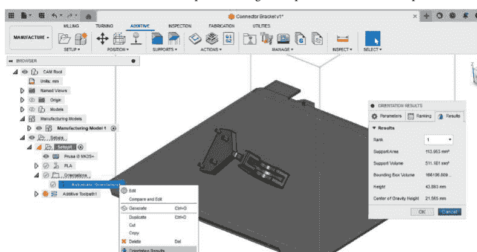

Figure 8.13 – 自动方向研究的定向结果

使用 Rank 下拉菜单选择所需方向结果后，我们可以单击 OK 按钮，我们的组件将从初始位置旋转到我们选择的方向。

在本节中，我们主要关注进行自动定向操作并从结果列表中选择方向结果。然而，突出显示此方向对所选组件的影响也将有益。为了展示此方向的效果，我们可以使用 **ADDITIVE** 选项卡中 **SUPPORTS** 面板内的 SOLID VOLUME SUPPORT 命令为我们的组件添加支撑结构。在对话框的 GEOMETRY 选项卡中选择我们的组件并单击 OK 后，Fusion 360 会为悬垂角度小于 45 度的表面创建支撑结构。支撑生成操作的成果可在图 8.14 中看到，同时显示 SOLID VOLUME SUPPORT 对话框。Fusion 360 创建的支撑结构在画布上显示为蓝色对象。我们可以看到，此方向为我们的组件产生最小的支撑结构，以便使用我们的 FFF 打印机进行 3D 打印。

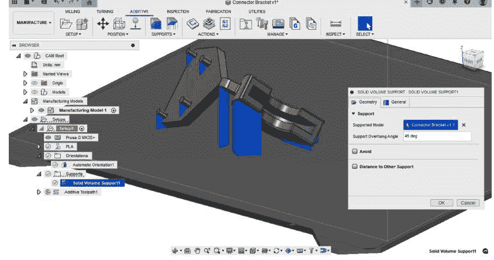

图 8.14 – 自动定向后向组件添加实体体积支撑

需要记住的是，不同的 3D 打印技术在进行自动定向研究时需要不同的参数和排名输入。在下一个示例中，我们将说明如何使用自动定向功能为 SLA/DLP 3D 打印机选择打印方向。

在这个新示例中，我们将使用相同的连接支架文档，但创建一个新的制造模型（制造模型 2），如图 8.15 所示。然后我们将创建一个新的增材设置（Setup2），在模型选择期间将使用制造模型 2。

这个新设置将使用一台名为 Prusa SL1S SPEED 的 SLA 打印机。我们还将从可用的打印设置列表中为该打印机选择适当的打印设置。

创建 Setup2 后，我们可以专注于定向组件。在使用树脂 3D 打印机确定最佳组件方向时，我们通常希望支撑底部表面，并在成型平台与零件之间留出距离，以便生成包含底板的支撑。我们将在第 10 章详细讨论基于 3D 打印技术的各种支撑选项。在图 8.15 中，此参数设置为 7 毫米。FFF 打印机与 SLA 打印机自动定向输入之间的主要区别在于我们如何对结果进行排名。如图 8.15 所示，在对结果进行排名时，我们不依赖包围盒体积、零件高度或重心高度结果。相反，我们寻找所需支撑面积最低的方向，同时将减少支撑体积作为次要优先级。图 8.15 中显示的特定排名优先级是我在使用自动定向工具进行 SLA 或 DLP 3D 打印机时首选的排名标准，因为这些选项倾向于高度排名可以用最小体积的支撑结构进行 3D 打印同时生产出高质量模型的定向。

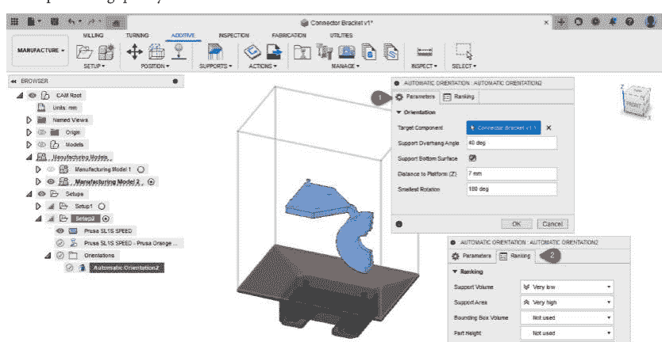

图 8.15 – 针对 SLA/DLP 3D 打印机的自动定向研究

根据我们设定的参数和排名标准，Fusion 360 会生成多个定向此模型的选项。如图 8.16 所示，定向研究中排名最高的定向（Rank 1）所需的支撑结构面积非常小（4.07mm³）。此定向还将需要相对较小的支撑体积（~94 mm³）。然而，定向研究的结果并未考虑 3D 打印过程的某些方面。为了突出此特定定向的问题，我使零件透明并将某些表面涂成红色，如图 8.16 所示。红色表面代表模型中在打印过程中可能发生缩孔的区域。缩孔可能导致使用 SLA 或 DLP 打印机倒置 3D 打印时因被困空腔内压力积聚而导致打印失败。

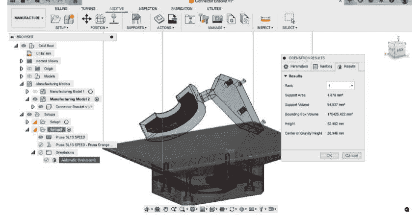

图 8.16 – SLA/DLP 3D 打印机定向研究的成果

如果我们想使用此定向 3D 打印模型，我们希望通过在空腔的局部最小值周围创建排气孔来解决缩孔问题。或者，我们可以选择不同的定向，例如图 8.17 中列为 Rank 3 的定向。如果我们使用此定向打印零件，我们的组件就不会有凸出部分在 3D 打印过程中充当吸盘并困住空气。然而，此定向会导致更大的包围盒高度，这意味着更长的打印时间，并且需要更多的支撑结构，意味着打印过程中使用更多材料。

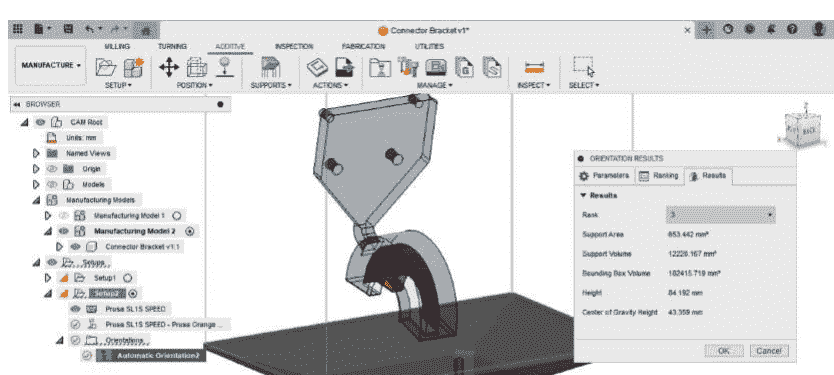

图 8.17 – 避免 SLA/DLP 打印机缩孔效应的定向

使用 Rank 下拉菜单选择所需定向后，我们可以点击 ORIENTATION RESULTS 上的 OK 按钮，我们的组件将保持在所需定向。为了演示此定向对组件的影响，我们可以通过选择位于 ADDITIVE 选项卡 SUPPORTS 面板中的 BAR SUPPORT 命令为此组件添加支撑。

在 BAR SUPPORTS 对话框中，我们可以选择我们的组件，以便 Fusion 360 可以使用 Medium 条为所有悬垂角度小于临界角度的表面创建支撑结构。BAR SUPPORT 对话框和支撑操作的结果都可以在图 8.18 的合成图像中看到。在此图像中，支撑结构以蓝色显示，我们可以看到此定向在 3D 打印过程中需要一定数量的条来支撑组件。

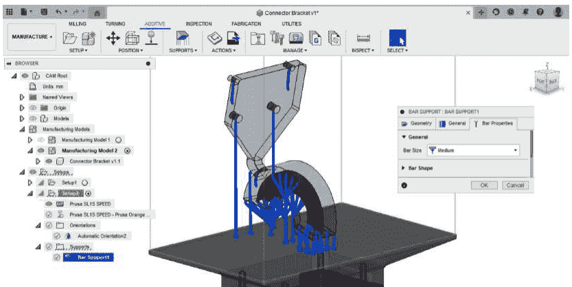

图 8.18 – 自动定向后向组件添加条形支撑

在定向零件时，还有许多其他因素需要考虑，这些因素取决于给定的 3D 打印技术和我们所需的零件表面光洁度。本章中我还想强调的一个关键因素是使用 MPBF 技术进行金属 3D 打印。由于 MPBF 工艺将激光能量传输到金属粉末，使用该技术 3D 打印的零件倾向于在 Z 方向变形。如果在给定层上 Z 方向的变形超过某一值，当新粉末被分散到下一层时，零件可能会与铺粉刀片发生碰撞，从而导致不良缺陷或打印失败。因此，将零件定向远离铺粉刀片的方向是良好的做法。图 8.19 显示了一个向铺粉刀片路径倾斜的设计。这可能会使问题恶化，并由于我们刚刚讨论的热膨胀而导致刀片在打印过程中与零件发生碰撞。在这种情况下，我们可能希望将零件定向使其远离铺粉刀片的路径，以避免与刀片发生潜在碰撞。

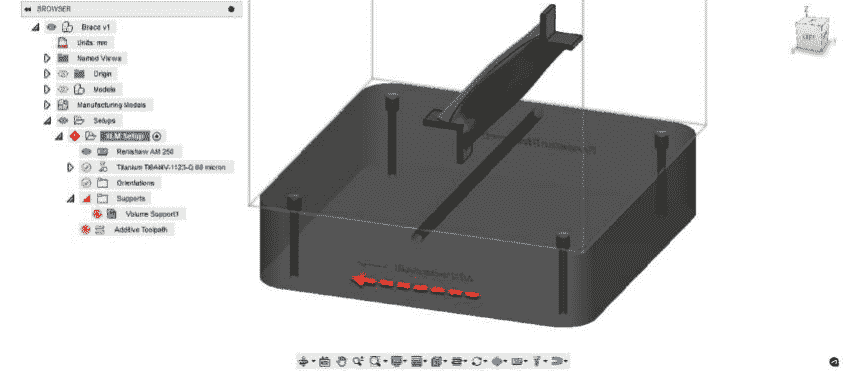

图 8.19 – 铺粉刀片方向与组件位置

在本节中，我们讨论了如何使用 Fusion 360 自动定向我们的零件。我们还强调了如何利用 AUTOMATIC ORIENTATION 对话框内的排名机制，根据给定 3D 打印技术的需求对定向研究的结果进行排名。我们介绍了如何选择排名最高的定向以及次要定向，以提高 SLA、DLP 和 MPBF 工艺的打印成功率，而无需对模型进行进一步修改。在下一节中，我们将使用增材排列等其他自动化工具继续定位我们的零件。

## 自动排列组件

在利用 3D 打印之前，公司通常会将每件零件的成本与传统的制造方法（如注塑成型或 CNC 加工）进行比较。在评估 3D 打印与注塑成型生产塑料零件时，规模经济在原型制作和小批量生产方面有利于 3D 打印。通常 3D 打印单个组件比注塑成型它更便宜。然而，在小批量生产中，为了降低给定组件的每件零件成本，更好的做法是在 SLS 和 MJF 3D 打印机等硬件的成型体积内有效地 3D 排列零件。

为了在塑料粉末床打印机的成型体积内排列组件，Fusion 360 提供了两种工作流程。第一个工作流程可以在 DESIGN 工作区中访问。如图 8.20 所示，位于 SOLID 选项卡 MODIFY 面板中的 ARRANGE 命令允许我们选择一个或多个组件并将其嵌套在我们的成型体积内。在本节中，我们将使用名为 `3D arrange` 的组件装配来演示此排列功能。此装配由四个组件组成，每个组件都有唯一的名称和颜色（红色、黄色、蓝色和绿色）。您可能从前面的章节中认出这些模型。要生成此特定模型，您可以使用 Derive 功能将这些组件从其原始源插入到新的 Fusion 360 设计文档中，或直接打开提供的装配文件。

如前所述，我们将演示的第一个 Arrange 功能位于 DESIGN 工作区 SOLID 选项卡的 MODIFY 面板中。激活 ARRANGE 命令后，我们可以选择将参与此排列的四个组件。它们将作为 ARRANGE 对话框 Objects 选项卡中的垂直项目列表显示，如图 8.20 所示。

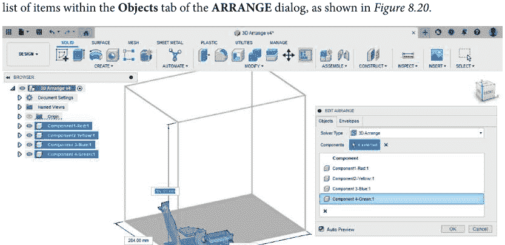

图 8.20 – 在 DESIGN 工作区内 3D 排列组件

如果我们切换到 ARRANGE 对话框的 Envelopes 选项卡，我们可以选择全局 XY 平面作为排列组件的平面。稍后，我们可以输入长度、宽度和高度信息，表示我们 3D 打印机的成型体积。在此示例中，我们将分别使用 380 毫米、284 毫米和 380 毫米作为长度、宽度和高度字段，表示 HP Jet Fusion 5200 3D 打印机的成型体积。此对话框还允许我们执行部分排列。这意味着如果我们拥有的零件数量超过成型体积的容纳能力，Fusion 360 将排列我们的零件，使能够放入成型体积的零件相应定向，而无法放入成型体积的零件保持其初始位置。

此对话框还允许我们进一步控制部件之间的间距、部件与构建体积侧壁之间可能留出的间隙，以及部件与构建板和构建体积顶部之间可能留出的间隙。

如果我们在此对话框底部激活 **Auto Preview** 复选框，Fusion 360 将在对话框仍处于活动状态时自动显示排列的潜在结果，如 *图 8.21* 所示。在此示例中，由于我们处于参数化建模范式中，**Arrange** 功能会在时间轴中添加一个特征，如以下屏幕截图所示。这意味着如果我们想要更改此排列的任何输入，我们可以选择时间轴上的该特征，右键单击它，然后轻松编辑。

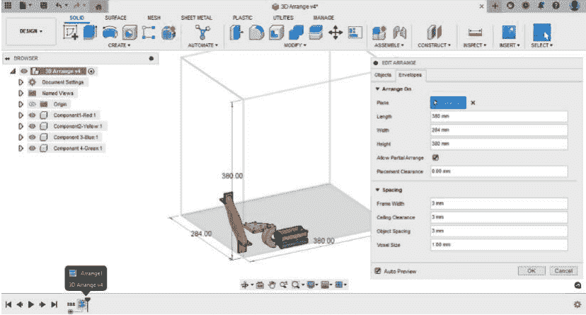

图 8.21 – DESIGN 工作区中 3D Arrange 的与包络相关的输入

我们用于在打印机构建体积内排列组件的下一个方法位于 **MANUFACTURE** 工作区。如 *图 8.22* 所示，在创建了具有适当 3D 打印机及其相关打印设置的增材制造设置后，我们可以在 **ADDITIVE** 选项卡的 **POSITION** 面板中访问 **Arrange** 功能。

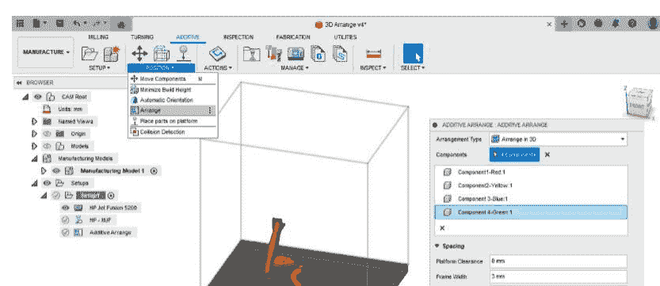

图 8.22 – 在 MANUFACTURE 工作区中在 3D 打印机上下文中排列组件

**MANUFACTURE** 工作区中的 **Arrange** 命令与我们之前在 **DESIGN** 工作区中强调的 **ARRANGE** 功能类似。即使 **ADDITIVE ARRANGE** 对话框没有明确的选项允许部分排列，此排列的结果始终使用此方法排列零件。

**Additive Arrange** 在 **MANUFACTURE** 工作区与 **DESIGN** 工作区中的 **Arrange** 功能之间的第一个区别是，**Additive Arrange** 不要求您显式输入构建体积尺寸。该输入来自您创建的活动设置和您选择的打印机。这两种排列方法之间的第二个区别是您在比较图 8.21 和图 8.22 所示排列结果时可能注意到的。如果仔细查看图 8.22，您会注意到排列结果是被排列的零件集中在构建板的中心周围。这通常是更理想的结果，因为 SLS、MJF 和粘结剂喷射打印机在构建体积中心附近对零件公差的精度更高。这是因为构建体积的中心通常能更一致地保持其温度。因此，将组件放置在构建体积中心附近以避免热诱导变形是可取的。一般最好避免在构建体积的墙壁附近排列零件。

了解 Fusion 360 在 Arrange 命令中使用的 3D 排列求解器也很重要。无论您是在 **MANUFACTURE** 工作区中作为增材设置的一部分使用 **Arrange in 2D** 还是 **Arrange in 3D** 作为 **Arrangement Type** 选项，Fusion 360 都使用 Outbox packer。这意味着给定零件的排列从 Fusion 360 在零件周围创建包围盒开始。之后，Fusion 360 会在构建体积内平移此盒，而不会在过程中对盒或其内容进行定向。

Outbox packers 已知可以在 2D 和 3D 中非常快速地打包零件，但它们不会产生最有效的填充密度结果。如果我们想要实现更好的 3D 填充密度，我们有几个选项可以尝试。第一个选项是创建不同方向的零件副本，并查看哪个方向会导致更好的排列密度。

我们将通过以下示例演示这一概念。但是，为了有效地展示排列密度，我们需要不止四个组件，以便最终得到相对满的构建体积。在图 8.23 中，您可以看到我们在 DESIGN 工作区中使用圆形图案复制的同一四个组件。在此示例中，我们在 Z 轴周围创建了 4 个组件的 18 个副本。这意味着每个组件将在 Z 轴周围旋转 20 度，我们将有总共 72 个组件需要在我们的 3D 打印机的构建体积内排列。

> **重要提示**
> 
> SLS 和 MJF 3D 打印机通常会生产具有各向异性材料特性的零件。这意味着使用 SLS 和 MJF 打印的零件在打印的 Z 方向上较弱。制造工程师通常会确定打印其关键任务零件的方向，然后以相同的方向排列重复组件，而不会沿其 X 或 Y 轴旋转它们，但在他们使用自动嵌套器或手动排列工具时允许 Z 轴旋转。

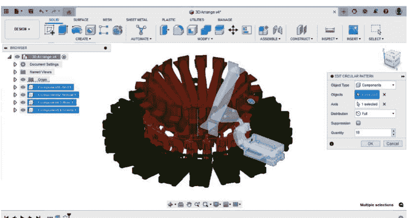

图 8.23 – 在 DESIGN 工作区中创建组件的圆形图案

现在我们可以切换到 **MANUFACTURE** 工作区并创建新的制造模型，如图 8.24 所示。在使用相同的 HP Jet Fusion 5200 打印机创建新设置后，我们可以使用 Additive Arrange 功能以 3D 方式排列全部 72 个组件。以下屏幕截图显示了在构建体积内排列这 72 个组件的结果。如您所见，没有一个组件被旋转超出其原始位置。它们反而被平移到 3D 打印机的包围盒内。由于此排列功能使用包围盒方法，组件不会相互干扰，也不会发生互锁。

互锁是一种现象，其中两个独立组件以这样的方式排列，以至于打印后无法分离。互锁的一个常见示例是使用两个环创建链条。如果我们想打印两个环，我们需要确保它们是分开的并且彼此不互锁。如果它们互锁，我们在 3D 打印后就无法将它们分开。

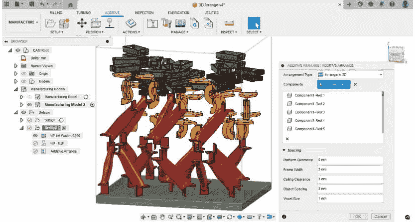

图 8.24 – 在 MANUFACTURE 工作区内以 3D 方式排列 72 个组件

正如我们在上面强调如何有效地在 3D 打印机的构建体积内排列组件时，我们提到了填充密度的概念。填充密度可以在所有零件定位操作完成后，在编辑增材设置中使用的制造模型时计算。在选择制造模型后，我们可以右键单击并编辑。右键单击制造模型，选择属性，并访问我们 3D 打印机构建体积内所有组件的 PROPERTIES 对话框，如图 8.25 所示。PROPERTIES 对话框向我们显示了我们选择检查的组件的总体积。接下来，我们将查看所选组件的包围盒高度。

在此示例中，高度为 337.289 毫米。利用我们掌握的信息，我们可以进行快速计算，将我们 3D 打印机的 X 和 Y 尺寸（分别为 380 mm 和 284 mm）与我们从 PROPERTIES 对话框获得的高度值相乘。让我们称之为打印机利用体积。接下来，我们可以将零件的体积除以打印机利用体积来计算我们的排列密度：

排列密度 = 体积 / 包围盒高度 x（打印机长度 x 打印机宽度）

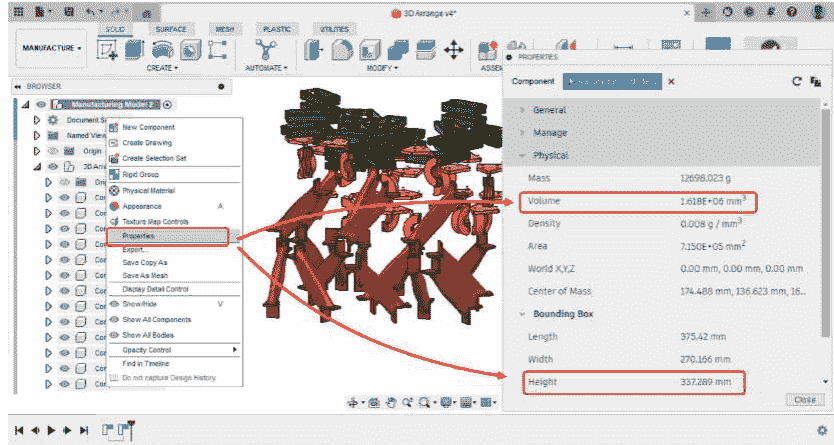

图 8.25 – 检查制造模型以获取排列组件的包围盒高度

在此示例中，我们基于打印机利用体积的排列密度约为 4.4%。这是一个良好的开端，但如果我们在创建重复组件时使用沿 X 或 Y 轴的矩形图案而不是围绕 Z 轴的圆形图案，我们本可以实现更高的排列密度，如图 8.26 所示。

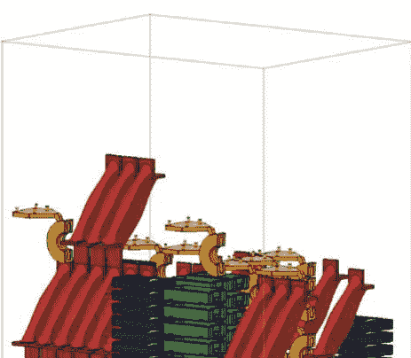

图 8.26 – 使用矩形图案创建的重复零件的排列结果

另外，我们也可以使用 ADDITIVE 选项卡中 POSITION 面板里的 Minimize Build Height 命令来定向所有组件，如图 8.27 所示。请注意，下面的屏幕截图展示了此工作流程的结果，该流程是在创建了新的制造模型（Manufacturing Model 3）以及使用该新制造模型作为输入的新设置（Setup3）之后得到的。

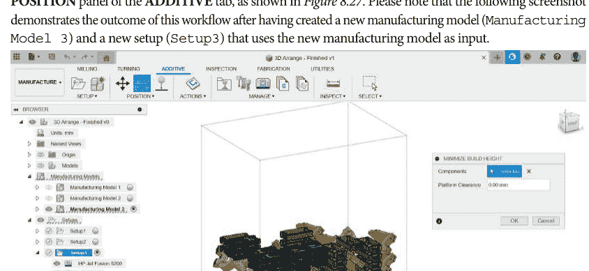

图 8.27 – 最小化构建高度并对所有组件进行 3D 排列

一旦零件被定向到占用最少 Z 高度的位置，我们就可以执行 Additive Arrange 功能。图 8.27 显示了使用最小化构建高度重新定向零件后 Additive Arrange 的结果。您可以看到，此结果基于打印机利用率具有更高的排列密度。如果需要，我们也可以在自动 ADDITIVE ARRANGE 操作完成后手动移动组件。有时自动化解决方案无法识别最佳结果，而作为制造工程师，我们可以直观地发现某些零件方向和位置，这将有利于整体排列密度。

## 总结

在本章中，我们讨论了如何为 3D 打印定位和排列组件。我们通过展示如何使用制造工作区中在增材设置上下文中可用的移动命令手动平移和旋转组件来开始本章。我们还介绍了如何使用 Minimize Build Height 和 Automatic Orientation 等显式函数自动定向零件。我们讨论了 AUTOMATIC ORIENTATION 对话框中可用的各种排序选项，以便根据增材技术的需要对定向研究的成果进行排序。我们通过演示如何在打印机的 3D 构建体积内排列组件来结束本章。在最后一节中，我们介绍了如何对组件的现有方向使用自动排列工具。我们解释了如何在 DESIGN 工作区以及在增材设置上下文中的 MANUFACTURE 工作区中定向和排列组件。我们强调了在 MANUFACTURE 工作区中使用 Additive Arrange 的好处，并讨论了如何将零件定向和零件排列结合起来以实现更高的排列密度。

现在我们知道了如何为 3D 打印排列和定向零件，我们可以开始专注于如何使用独特的工艺参数打印每个组件。在下一章中，我们将介绍如何为每个组件分配唯一的打印设置，以修改每个组件的打印方式，从而影响其物理特性。
