## 打印设置

欢迎来到第 9 章。在前几章中，我们学习了如何为 3D 打印建模以及如何创建增材设置并在该设置中定位我们的组件。我们讨论了定向零件和利用 3D 排列工具以充分利用 3D 打印机的有效方法。

在本章中，我们将重点关注打印设置。我们将重点介绍如何在打印设置中修改某些输入及其对正在打印的模型的影响。我们还将介绍不同增材制造技术的不同打印设置。最后，我们将介绍如何在打印机的构建体积中的不同零件上分配唯一的打印设置，以便我们可以控制每个零件的打印方式。

大多数人通过一次打印一个组件开始他们的 3D 打印之旅。随着他们对 3D 打印越来越熟悉，他们会转向在一次打印中打印多个组件。获得这种信心的重要一步在于更好地了解如何微调我们的打印配置文件，以便从 3D 打印机获得可靠且成功的打印。

学习如何稳定地进行 3D 打印的这一阶段可能需要您使用特定的 3D 打印机进行一些实验。本章中我们将介绍的主题将使您更容易尝试各种打印设置，并为您的特定打印机和材料调整打印配置文件。

在本章中，我们将介绍以下主题：

- 熔丝制造的打印设置概述
- SLA 和 DLP 打印的打印设置概述
- 为实体分配唯一的打印设置

在某些情况下，可能需要编辑所选的打印设置以更改打印过程的某些方面。例如，如果您由于零件没有粘在构建板上而遇到打印失败，您可能希望添加裙边或底边以改善打印床粘附。如果您的 3D 打印零件不够坚固，您可能希望增加填充密度或周长数量。在某些情况下，您可能希望为打印的不同部分使用不同的打印设置。本章将探讨所有这些内容以及更多内容。

到本章结束时，您将更好地了解 Fusion 360 中的打印设置是什么。您将了解到大多数打印设置有多个预设，并且您将了解这些预设之间的差异。您将学习如何创建自己的预设并通过更改某些打印设置来自定义现有预设。您将对关键打印设置及其对 Fusion 360 在生成机器文件时创建的增材刀具路径和切片的影响有坚实的理解。您还将学习如何在组件内的每个实体上分配打印设置及其对增材刀具路径的影响。

### 技术要求

本章涵盖的所有主题都可用于个人、试用、商业、初创和教育版 Fusion 360 许可证类型。

某些 Fusion 360 增材机器和打印设置，例如金属粉末床熔融（MPBF）3D 打印机及其各自的打印设置，在获得 Additive Build Extension 访问权限之前不可用。与所有其他 Fusion 360 扩展一样，Additive Build Extension 不适用于个人使用。由于本章不会涵盖特定于金属 3D 打印的主题，您应该能够毫无问题地跟随本章中的所有示例。

如果您拥有 Fusion 360 的商业许可证，要使用 MPBF 机器创建增材设置，您还需要访问 Additive Build Extension（https://www.autodesk.com/products/Fusion-360/additive-build-extension）。

Autodesk 为所有 Fusion 360 商业用户提供 Additive Build Extension 的 14 天试用期。您可以在 Fusion 360 的 Extensions 对话框中激活您的试用期。

本章的课程文件可以在这里找到：https://github.com/PacktPublishing/3D-Printing-with-Fusion-360。

## 熔丝制造打印设置的概述

在本节的第一部分，我们将重点关注特定于熔丝制造（FFF）增材制造的打印设置。为了演示如何访问和编辑 FFF 的打印设置，我们将使用名为 Knobs 的 CAD 模型，如图 9.1 所示。此零件实际上是 Prusa i3 MK3S+ 3D 打印机的拨号旋钮，可作为网格对象从 printables.com 下载，是 Prusa Research 上传的 38 个组件之一，作为该 3D 打印机的替换零件（https://www.printables.com/model/57217-i3-mk3s-printable-parts/）。因此，如果您愿意，您可以下载并使用不同颜色的丝材或不同的材料打印此零件，并更换打印机上的现有旋钮。

在此示例中，我们将使用此零件的实体（而非原始网格）版本。在 Fusion 360 中打开零件并切换到 **制造** 工作区后，我们可以使用 **Prusa i3 MK3S+** 打印机和 **PLA（直接驱动）** 打印设置创建增材设置，如图 9.1 所示。如果我们展开打印设置，我们会注意到分配给此零件的预设名为 **Normal**。如果我们想编辑打印设置或预设，我们可以通过在活动设置中右键单击打印设置并选择 **编辑** 来执行此操作。另一种方法是转到 **管理** 面板中的 **打印设置库**。在 **打印设置库** 中，我们可以从 **Fusion 360 库** 中选择我们希望自定义的打印设置，并将其复制并粘贴到我们的 **云**、**本地** 或 **链接** 库中，如图 9.1 所示。

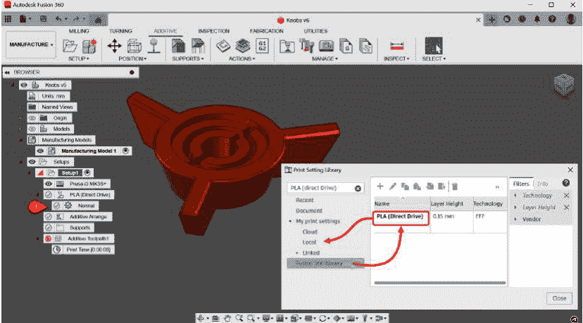

图 9.1 – 在打印设置库中管理打印设置

一旦打印设置保存在 **打印设置库** 的 **我的打印设置** 部分中的文件夹下，我们就可以选择它，右键单击它并对其进行进一步自定义，如图 9.2 所示。

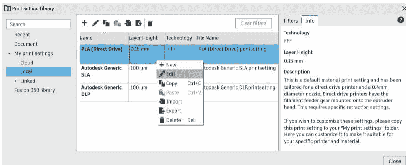

图 9.2 – 编辑位于本地文件夹中的打印设置

选择“编辑”选项后，我们现在将看到打印设置编辑器对话框。我们在上一章中介绍了此对话框，并讨论了如何搜索特定的打印设置以及编辑一些关键输入。在本章中，我们将深入探讨并突出显示打印设置编辑器中所有可用的选项。打印设置编辑器对话框包含两个主要区域。左侧是其浏览器，右侧允许我们更改输入。FFF 打印设置由信息、常规和主体预设组成。如果在浏览器中选择信息，则信息输入字段将显示在右侧。图 9.3 显示了我们对该打印设置的第一次修改，即在所选打印设置名称后添加 - CUSTOMIZED 后缀。

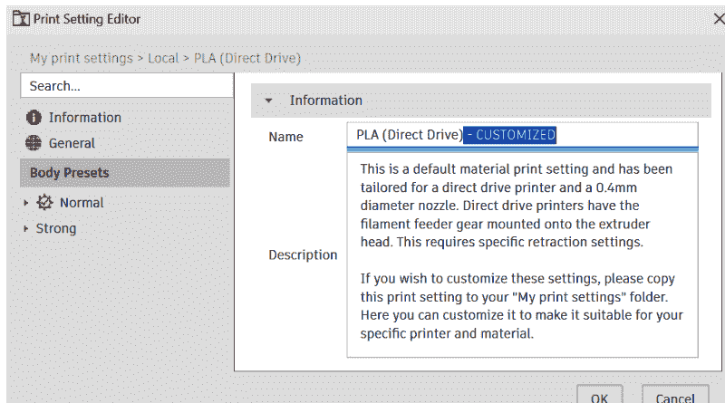

图 9.3 – 修改打印设置的“信息”字段

如果在浏览器中选择 **常规 **，您将能够修改 ** 全局设置 **、** 喷嘴预热设置 ** 和 ** 附加 G-Code 设置 ** 的输入。

> ** 重要提示 **
> 请记住，并非所有 3D 打印机都能管理所有这些输入。例如，如果您使用的是没有加热打印床的打印机，则 ** 打印床温度 ** 字段对您的打印没有任何影响。

## 常规

FFF 打印设置的 ** 常规 ** 部分是自定义打印配置文件时可以修改一些最常见输入字段的地方。*图 9.4* 显示了可在 FFF 打印设置的 ** 常规 ** 部分中自定义的所有输入字段。此部分分为三个类别：** 全局设置 **、** 喷嘴预热设置 ** 和 ** 附加 G-Code 设置 **。在下面的小节中，我们将介绍这些类别中的一些关键输入字段及其用例。

### 全局设置

位于 ** 打印设置编辑器 ** 的 ** 常规 ** 部分内的 ** 全局设置 ** 子部分可能是打印设置中最重要的一部分。在这里您可以编辑诸如构建板温度之类的内容，并控制每层的高度以及第一层的高度。您还可以调整挤出机在打印过程中的移动速度，并决定是否要按设计打印零件或仅使用花瓶模式打印其外壳。让我们花点时间了解一下这些选项中的每一个以及它们在生成增材工具路径中的作用：

- ** 打印床温度 (Temp C) **：这是一个特定于材料的输入，用于在开始打印过程之前设置打印床的温度。加热床有助于第一层的打印床附着力。在图 9.4 中，打印床温度设置为 60°C，这是在使用 PLA 耗材打印时的推荐床温。如果您使用的是 ABS，则该输入为 85°C。
- ** 层高 (mm) **：此输入指定每层的高度。您可以减小该值以获得更好的打印质量，或增大该值以加快打印速度。层高的上限和下限取决于喷嘴尺寸。
- ** 第 1 层高度 (mm) **：此输入指定 3D 打印的第一层的高度。通常，该输入应为喷嘴直径的 50 至 75%，以实现第一层的成功打印床附着。
- ** 移动速度 (mm/s) **：此输入指定挤出机在不挤出耗材时在点之间移动的速度。通常，您希望该输入尽可能接近打印机可处理的最高速度，以减少打印时间。
- ** 螺旋花瓶模式：** 激活后，这将使用一次连续的螺旋运动在活动设置中打印零件，以创建中空的单壁物体。此模式可实现快速打印时间，并在 3D 打印过程中避免任何移动和回抽动作。如果启用，** 主体预设 ** 部分内的许多输入将被忽略，因为它们将不再适用。

### 喷嘴预热设置

如图 9.4 所示，位于 ** 打印设置编辑器 ** 的 ** 常规 ** 部分内的 ** 喷嘴预热设置 ** 子部分控制与在挤出机开始处理零件之前打印预热线相关的所有选项。让我们重点介绍一下您可以在预热线周围控制的一些关键功能：

- ** 喷嘴预热：** 默认启用，此选项将在打印床的前方、左侧、右侧或后方打印一条线。预热线的放置位置取决于增材设置中零件的排列以及打印床上未使用空间的可用性。打印预热线可为 3D 打印做好喷嘴准备。通过打印预热线，您可以确保在打印零件之前耗材正在正确挤出。
- ** 预热边缘间隙距离 (mm)：** 此输入控制预热线应距离构建板边缘多远。
- ** 预热最大长度 (mm)：** 此输入控制预热线的最大长度。我建议将此数字增加到与 3D 打印机构建板的 X 或 Y 尺寸相匹配。

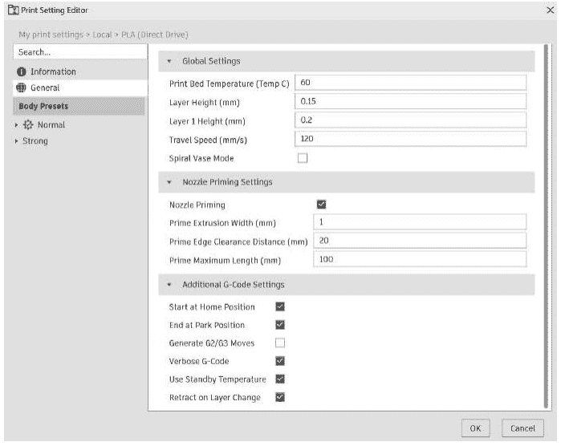

图 9.4 – FFF 打印设置的打印设置编辑器的常规选项卡

在打印设置编辑器的常规部分中，您还可以控制附加 G-code 设置，如图 9.4 所示。默认情况下，您生成的任何 G 代码始终从 home 位置开始并在 park 位置结束。如果您的 3D 打印机支持，您还可以通过在此对话框中选中相应的复选框来生成 G2 和 G3 移动。此操作有助于创建 G-code 文件，其中用单行 G2/G3 文本而不是多行 G1 文本来表示给定切片中的弧形工具路径。如果您不熟悉，G2 用于顺时针弧线，G3 用于逆时针弧线。使用单行 G 代码表示弧线在文件大小方面更高效，并且可实现更高质量/更平滑的 3D 打印。

## 主体预设

FFF 打印设置的打印设置编辑器中的下一个部分是主体预设。默认情况下，Fusion 360 的打印设置库中包含的所有打印设置都有两个主体预设。它们分别命名为 Normal 和 Strong。如果您选择其中一个预设，您可以在右侧更改其名称和描述，如图 9.5 所示。在此图中，我们将预设名称从 Normal 更改为 Medium。

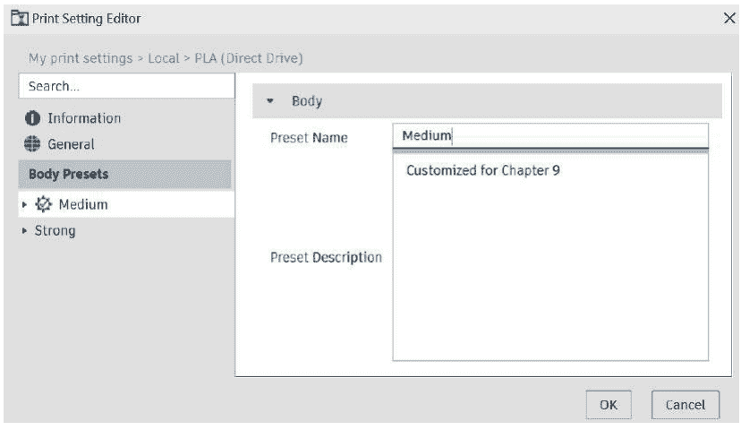

图 9.5 – 更改主体预设名称和描述

我们还可以右键单击主体预设并将其复制。复制主体预设后，您将在打印设置编辑器的浏览器底部看到一个新条目。在图 9.6 中，您会看到在复制名为 Medium 的主体预设后添加了一个名为 Medium 1 的新条目。

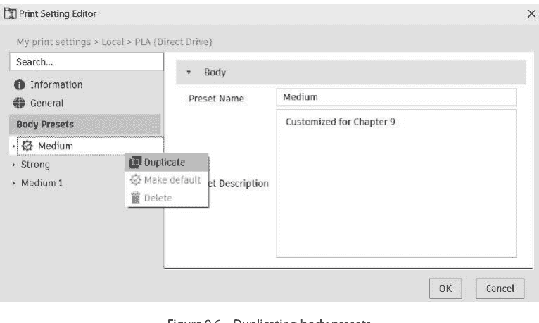

图 9.6 – 复制主体预设

如果您回顾图 9.6，您可以看到在名为 Medium 的主体预设旁边有一个带有蓝色复选标记的齿轮图标。此图标表示该主体预设是默认预设。如果您选择一个非默认预设，您可以右键单击它并将其设为默认预设，如图 9.7 所示。如果您对该打印设置进行此更改，则使用该打印设置创建的任何后续增材设置都将自动将 Medium 1 分配给该设置中的所有组件作为主体预设。

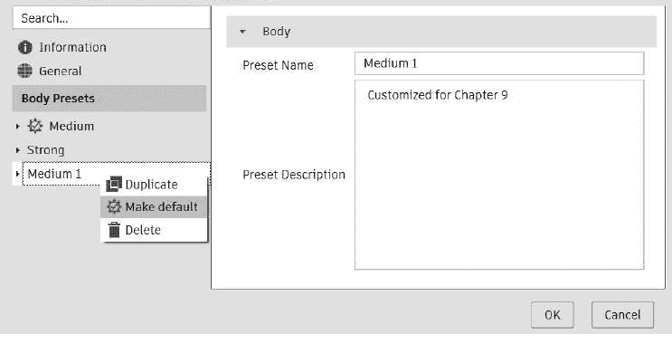

图 9.7 – 将主体预设设为默认

如果我们通过选择其左侧的箭头展开给定的主体预设，如图 9.8 中名为 Medium 的主体预设所示，我们可以看到控制主体预设设置的不同方面的许多条目，例如挤出、壳层、填充等。接下来，让我们深入了解这些设置并解释它们是什么。

## 挤出

给定主体预设的挤出子部分内的输入字段控制在增材设置中用于打印主体的挤出机以及与该挤出机相关的某些设置。如果我们使用单挤出机 3D 打印机创建增材设置，则在编辑该设置的打印设置时，我们将只看到名为挤出和挤出机 1 的子标题，如图 9.8 所示。只有在编辑与多挤出机打印机关联的打印设置时，我们才能在此对话框中看到额外的挤出机子标题。

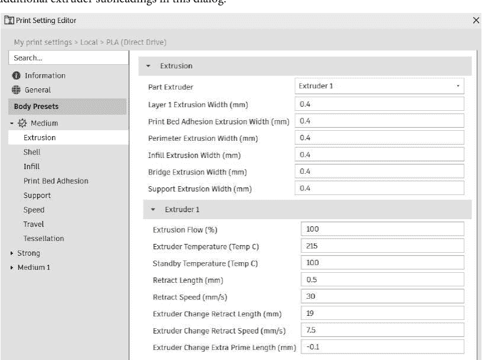

图 9.8 – PLA（直驱）打印设置的默认主体预设的挤出设置

**挤出**子标题控制第一层的宽度以及带有裙边、裙摆和筏底尺寸的打印床粘附。它还具有修改关键刀具路径类型挤出宽度的输入，例如**外壁**、**填充**、**桥接**和**支撑**结构。在**挤出机 1**子标题中，您可以修改另一个关键输入，**挤出机温度（Temp C）**。在*图 9.8*中，此输入显示的值为 215°C，这是 3D 打印 PLA 耗材的适当温度。如果我们要为 ABS 等不同材料编辑打印设置，此值将预先填充为适当的温度**250°C**。

在下一节中，我们将学习如何控制与打印零件外表面相关的各种设置。我们将重点介绍如何修改外壁数量以及顶层和底层数量，以及如何避免每层开始时的表面缺陷。

## 外壳

当为 FFF 切片模型时，切片软件首先做的事情之一是创建模型的壳体。**打印设置编辑器**中**主体预设**的**外壳**子部分中的选项允许我们完全控制这些选项以创建并切片该壳体。让我们看一下一些最常见的设置，您可能希望修改这些设置以生成具有光滑外表面的 3D 打印件：

- **外壁数量、顶层数量和底层数量**：如*图 9.9*所示，在给定主体预设的**外壳**部分中，您可以控制希望在组件周围具有多少条刀具路径线，以及希望切片软件包含多少顶层和底层。在切片模型时包含的外壁、顶层和底层数量越高，这些部分就越坚固。顶层和底层是独特的，因为切片软件会在这些层中添加 100% 填充，使其完全实心。*图 9.9*显示了一个具有两个外壁的模型。对于图中显示的图层，第 121 层，红色线代表外壁，绿色线代表内壁。
- **随机化 Z 缝合对齐**：激活时，此设置允许您分散模型外壁上可能存在的任何缺陷，使其不会全部与 Z 轴对齐。如果未选中，打印的模型可能会出现接缝/拉链效应。
- **先打印内壁**：在 3D 打印给定层时，挤出必须从某处开始。切片软件倾向于在模型外壁沿线的一点开始挤出每一层。激活时，此设置会强制挤出从给定切片的内壁开始。在*图 9.9*中，内壁用绿色线表示。激活此复选框会强制给定层的开始处的任何缺陷隐藏在主体内壁内。

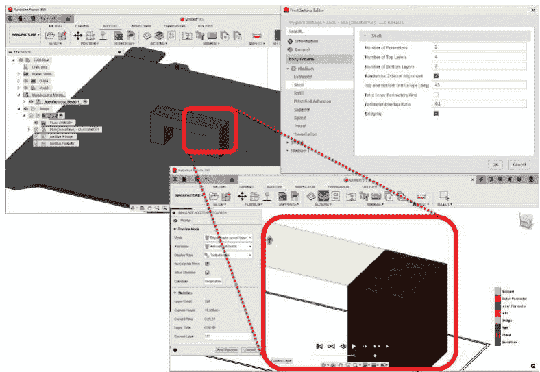

图 9.9 – PLA（直驱）打印设置的默认主体预设的外壳设置

通过修改这些选项，您可以使用 FFF 打印机切片和打印模型的壳体，从而获得零件所需的表面质量和强度重量比。在下一小节中，我们将学习如何修改零件内部的选项。

## 填充

当为 FFF 切片模型时，术语填充代表 3D 打印零件的内部部分。此内部体积可以使用许多不同的形状制造。填充的目的是在保持尽可能坚固的同时最小化零件的重量并减少打印时间。Fusion 360 在给定主体预设的填充子标题中位于填充图案下拉列表中提供了许多不同类型的填充图案，如图 9.10 所示。同一张图还显示了三个组件以 25% 密度的 Gyroid 填充打印。请注意，所有零件的内部部分并非用耗材实心打印，而是主要以 Gyroid 风格的刀具路径制造为空心。

> **重要说明**
> 
> 对 Fusion 360 中所有可用填充图案的一项最新研究（记录在博客 https://www.autodesk.com/products/fusion-360/blog/how-to-build-sustainable-3d-printing-infill-practices/ 中）得出结论，Gyroid 填充是最可持续的填充类型，因为它打印速度最快，同时最大限度地减少耗材消耗。

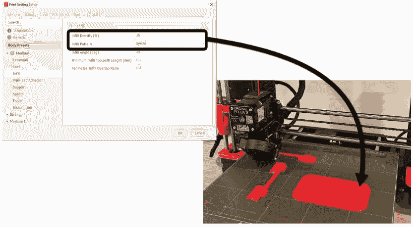

图 9.10 – PLA（直驱）打印设置的默认主体预设的填充设置

通过修改这些选项，您可以使用 FFF 打印机切片和打印模型的内部，从而获得轻质零件，可以更快地打印，同时消耗更少的材料和能源。在下一小节中，我们将学习如何修改选项以在打印第一层时实现与构建板良好的粘附。

## 打印床粘附

在为 FFF 3D 打印切片模型时，最重要的考虑因素之一是打印床粘附问题。3D 打印中的关键故障是由于零件粘附在打印床上的问题而发生的。Fusion 360 在给定主体预设的打印设置编辑器的打印床粘附子标题中提供了几种工具来克服这种潜在故障。

在打印床粘附子标题中，您可以控制要禁用冷却风扇的层数，以便前几层可以在没有风扇提供的冷却效果的情况下打印。此外，您可以从 Fusion 360 提供的三种打印床粘附选项中选择一种：

- **裙摆/裙边**：即使在**打印床粘附类型**下拉列表中裙摆和裙边有明确的选项可供选择，在切片模型时它们实际上会为您提供相同的刀具路径。裙摆和裙边都会跟随零件第一层的周长，并在外周长周围铺设额外的刀具路径线。您可以控制要在主体周长周围添加多少圈裙摆或裙边。如果您为**打印床粘附类型**选择裙摆，您将有一个额外的控制，即裙摆与主体周长之间的距离。如果在此字段中输入 0，您基本上会生成裙边。由于这两种选项几乎可以互换，在模拟刀具路径时，Fusion 360 在图例中将裙摆和裙边显示为相同的颜色，如图 9.9 所示。
- **筏底**：当使用更易翘曲并导致床粘附问题的材料进行 3D 打印时，您可以选择使用筏底，因为筏底有助于稳定模型并创建坚固的基座以打印零件的其余部分。如果您为**打印床粘附类型**选择**筏底**，Fusion 360 将激活额外的**筏底**设置，如图 9.11 所示。筏底的默认设置将产生一个三层**筏底**对象，底层、中层和顶层的填充密度各不相同。您还可以控制筏底与模型第一层周长的边界偏移。

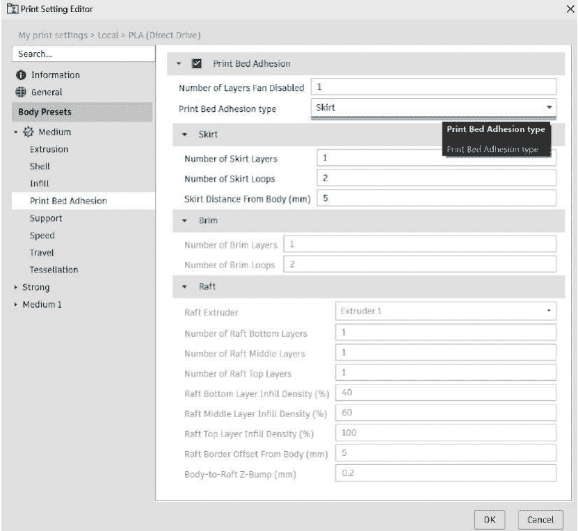

图 9.11 – 打印床粘附设置

通过修改这些选项，您可以在打印第一层时实现与构建板良好的粘附。在下一小节中，我们将学习如何修改选项以切片并为 FFF 增材设置中可在 Fusion 360 中生成的支撑结构生成刀具路径。

## 支撑

即使可以使用桥接技术制造某些悬垂面，在大多数情况下，当悬垂角度超过 45 度时，我们依赖于生成支撑结构，以便零件的朝下表面可以成功打印。

在为 FFF 打印准备模型时，Fusion 360 提供三种支撑类型：**体积支撑**、**杆支撑**和**设定支撑**。设定支撑主要用于使用金属耗材进行 3D 打印或使用金属粘结剂喷射技术进行 3D 打印，以帮助在烧结过程中支撑零件。为了生成设定支撑，我们需要访问增材制造扩展。我们在此不再进一步介绍设定支撑，因为它们不适用于我们展示的任何示例。

在 FFF 机器的增材设置中，您可以生成体积支撑和杆支撑，并且我们可以混合匹配支撑类型，这意味着我们可以用体积支撑支撑一个面，用杆支撑支撑另一个面。因此，Fusion 360 还允许您控制如何切片并为这些支撑结构生成刀具路径。您可以控制为给定支撑结构使用的挤出机，以及杆支撑与体积支撑的刀具路径生成中使用多少外壁。您还可以控制在主体预设的**支撑**子标题中生成支撑结构刀具路径时所需的顶层和底层数量以及填充密度，如*图 9.12*所示。

我在这个部分想要强调的一个设置是**支撑到主体水平间隙（mm）**。此输入控制 Fusion 360 在支撑结构与零件周长上的任何垂直壁之间留出的水平空间。如果您增加此数值，支撑结构与零件在垂直壁沿线的间隙将更大，从而消除零件与支撑结构之间可能的粘合。此设置不控制支撑与零件朝下表面之间的距离。我们将在*第 10 章*中介绍如何控制此类选项，其中我们讨论如何生成支撑结构。

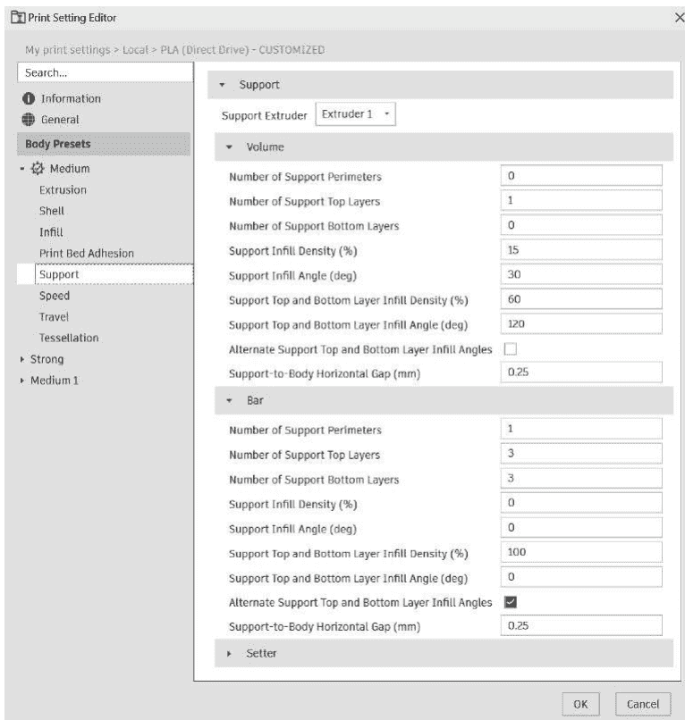

图 9.12 – 支持设置

通过修改这些选项，您可以完全控制 Fusion 360 对 FFF 设置中常用的体积和杆状支撑进行切片的方式。在下一小节中，我们将学习如何修改选项以控制 Fusion 360 在 FFF 增材设置中挤出材料的速度。

## 速度

FFF 的主要缺点之一是打印大型零件所需的时间。这就是为什么您可能想要在所选打印设置的打印设置编辑器中的主体预设部分修改速度设置的原因。这些设置非常易于理解。您可以控制各种挤出类型的执行速度，例如第一层、外壁、填充、支撑、桥接和底座。

如果您激活 **Acceleration** 复选框，您还可以控制行程和挤出动作的 **Acceleration** 输入。此外，Fusion 360 还允许您控制打印时的最大瞬时速度变化。此设置称为 **Jerk**，位于 **Speed** 子标题菜单底部，如 *Figure 9.13* 所示。在对 **Speed**、**Acceleration** 和 **Jerk** 设置进行更改之前，您应该了解 3D 打印机的规格，以免超过基于机器限制的速度和加速度值。

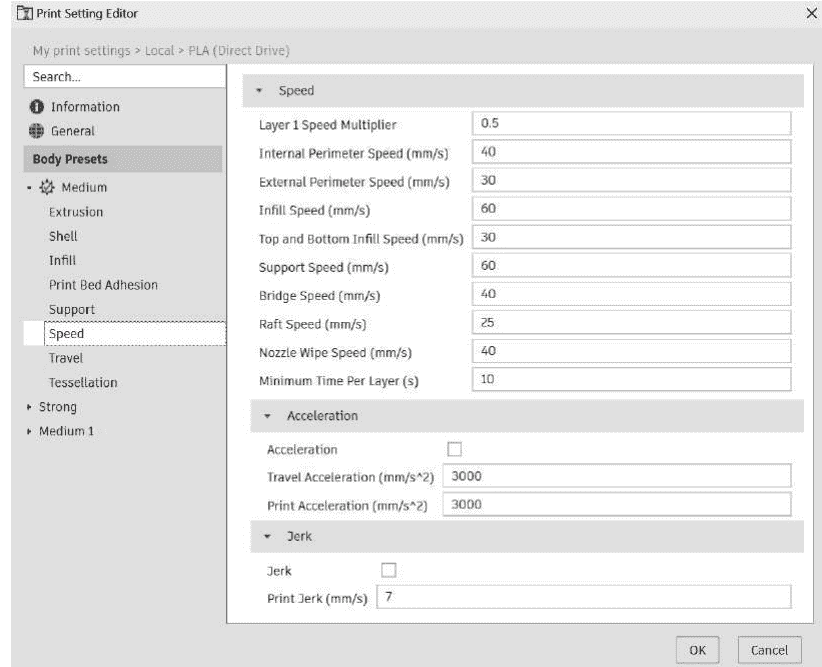

图 9.13 – 速度设置

通过编辑 **Print Setting Editor** 中的 **Speed** 子部分中的选项，您可以完全控制 3D 打印的速度、加速度和加速度变化行为。在下一小节中，我们将介绍如何修改喷嘴在不挤出材料时移动的速度。

## 行程

行程线是在 FFF 3D 打印过程中喷嘴无挤出时的移动。**Body Presets** 中的 **Travel** 子标题控制切片期间行程的各种输入。

如果您遇到挤出机撞到打印件或由于材料渗出而在模型表面产生凸块的问题，您可能希望激活 Rapid Z Lift。此设置会在打印过程中从模型的一个部分移动到另一个部分时将挤出机抬高一定距离。这应可防止喷嘴撞到零件先前挤出的部分，有助于减少凸块并降低打印失败率。然而，此选项会增加打印时间。因此，您可能还希望启用 Rapid Z Lift Diagonal Move 以最大限度地减少执行 Rapid Z Lift 操作时花费的时间。Fusion 360 默认对所有打印设置执行 Nozzle Wipe 操作。此命令会在挤出机关闭的情况下将喷嘴沿刚完成的挤出物拖动一定距离，以帮助清洁喷嘴并可能最大限度地减少拉丝。

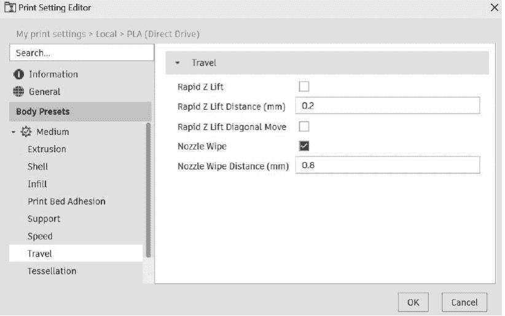

图 9.14 – 行程设置

通过修改这些选项，您可以实现整体打印时间减少，并通过避免挤出机与零件之间的碰撞来提高成功打印的机会。在下一小节中，我们将学习如何在增材设置中切片之前修改 Fusion 360 中对零件进行三角剖分的选项。

## 三角剖分

当我们在增材设置中使用实体体时，为了对它们进行切片并创建刀具路径，Fusion 360 首先对这些体进行三角剖分并将其转换为网格表示。为了进行此转换，它依赖于给定主体预设的三角剖分子标题中显示的值。我们已经在第 5 章中详细介绍了如何对模型进行三角剖分。图 9.15 中显示的三角剖分设置与我们在 Fusion 360 设计工作区中将实体体转换为网格体时介绍的相同三角剖分设置相对应。默认情况下，用于所有打印设置的三角剖分设置使得 Fusion 360 会创建高质量的网格，以便用于切片模型的网格体是实体体的准确表示。

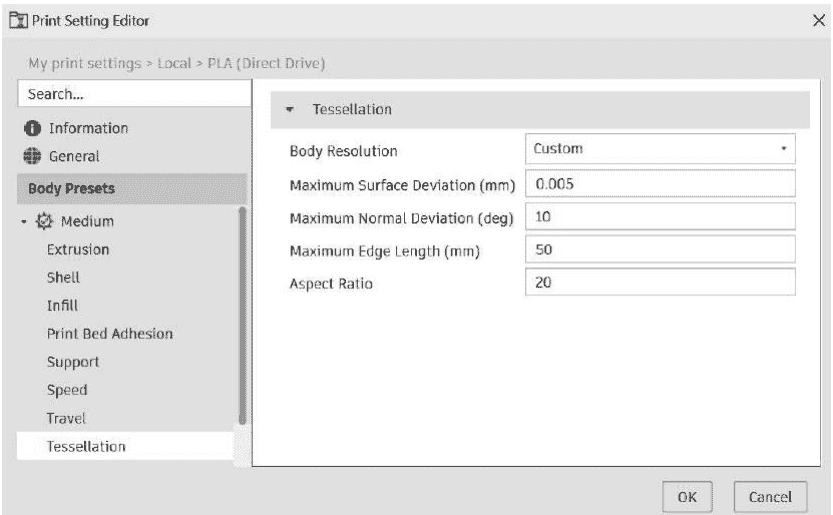

图 9.15 – 三角剖分设置

现在我们已经强调了如何在本地打印设置库中对打印设置进行更改，是时候将此打印设置分配给我们的活动增材设置了。如图 9.16 所示，我们可以选择 ADDITIVE 设置，右键单击并编辑它。当我们编辑设置时，我们可以选择新的打印设置。我们必须导航到打印设置库中“我的打印设置”部分下的本地文件夹，并选择我们最近自定义的名为 PLA (Direct Drive) - CUSTOMIZED 的打印设置，然后按 Select 和 OK 完成设置编辑。

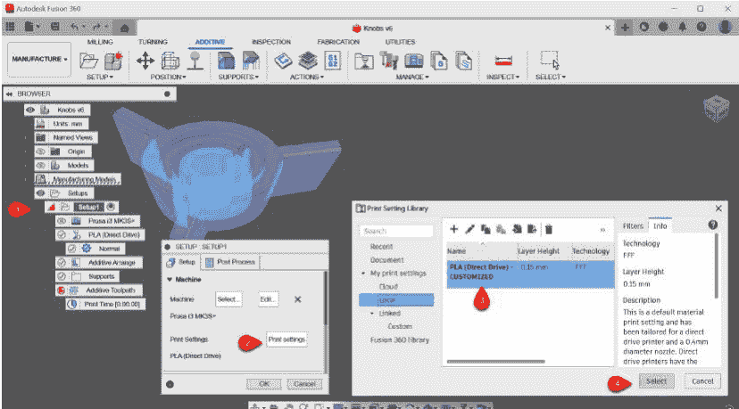

图 9.16 – 在增材设置中选择自定义打印设置

一旦我们选择了本章前几节中修改的打印设置，您会注意到活动设置现在显示一个名为 PLA (Direct Drive) - CUSTOMIZED 的新条目，并且在此条目下显示一个名为 Medium 的主体预设，表明我们的零件将使用该主体预设进行切片。

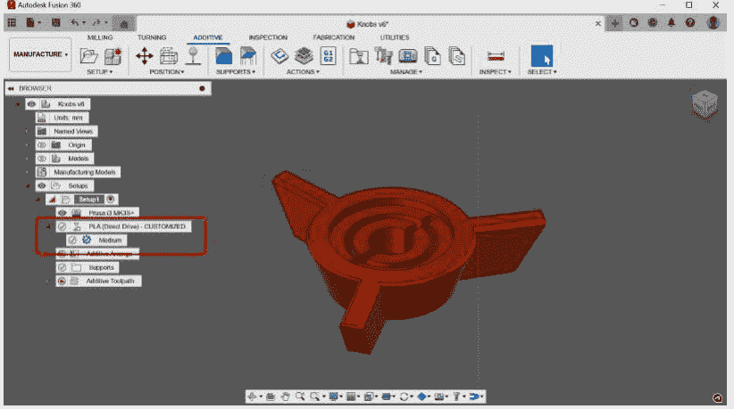

图 9.17 – 在浏览器中观察所选打印设置和主体预设

在本节中，我们重点介绍了 FFF 3D 打印的各种打印设置。我们讨论了如何从 Fusion 360 库复制给定的打印设置到我们的本地库。我们介绍了如何修改该打印设置并演示了各种设置对模型支撑和切片方式以及刀具路径生成的影响。在下一节中，我们将开始查看其他 3D 打印技术的打印设置。

## SLA 和 DLP 打印设置的概述

Fusion 360 的 **MANUFACTURE** 工作区中的增材设置不仅仅适用于桌面 FFF 打印机。通过使用 Fusion 360，您可以为使用 **stereolithography (SLA)** 和 **digital light processing (DLP)** 的树脂基打印机设置打印。就像我们在上一节中从 Fusion 360 的库中复制现有的 FFF 打印设置到本地库并对其进行编辑一样，我们将在本节中对 SLA 和 DLP 打印设置执行相同的操作。

*Figure 9.18* 显示了一个名为 **Autodesk Generic DLP** 的打印设置，已从 Fusion 360 的 **Print Setting Library** 复制到 **My print settings | Local** 以进行自定义。正如同一张图中所示，DLP 打印设置浏览器结构与 FFF 打印设置浏览器结构非常相似。此 DLP 打印设置有三个部分，名为 **Information**、**General** 和 **Body Presets**。*Figure 9.18* 显示了打印设置的 **General** 子部分，您可以在其中配置各种构建参数。**Configure Build Parameter (EBPA) Settings** 中的主要可编辑字段是 **Layer Thickness**。即使在此对话框中未显示层厚度的单位，它们也是微米，并且可以在 **Print Setting Library** 中的 **Information** 面板中选择打印设置时看到。

在 **PNG Export** 子部分中，前六个输入对于生成具有正确尺寸的所需 PNG 文件至关重要：

- **Min X** 和 **Min Y**：这些输入控制在构建体积内每层捕获的图像的最小 X 和 Y 坐标。值为 0 表示您将从构建平台的左下角开始捕获所有图像。如果您想捕获整个构建，我不建议更改这些输入。
- **Size X** 和 **Size Y**：这些输入控制在构建体积内每层捕获的图像的最大 X 和 Y 坐标。这两个输入的单位为毫米。您绝对希望更改这些输入以匹配打印机可打印的 X 和 Y 尺寸。例如，如果您的打印机具有 320 毫米乘 240 毫米的可打印构建体积，您将在切片模型之前在此打印设置中分别在 **Size X** 和 **Size Y** 输入字段中输入这些数字。否则，从 Fusion 360 导出的图像将只是整个构建区域的一个子部分。
- **Image Size X** 和 **Image Size Y**：这些输入控制您将导出的图像的像素大小。通常，这些数字应为您在 **Size X** 和 **Size Y** 中输入的数字的倍数。例如，如果您有一台可打印构建区域为 320 x 240 毫米的打印机，您可以输入 **Image Size X** 和 **Image Size Y** 输入分别为 640 和 480 像素。如果您输入的值不是 **Size X** 和 **Size Y** 值的倍数，您将在切片过程中获得失真的图像，因此在打印过程中会得到失真的物体。

-   **翻转图像**：根据投影仪的放置位置和型号（LCD 与 DLP），您使用的 3D 打印机可能需要为所有切片导出镜像图像，以便不会打印出物体的镜像。
-   **PNG 文件名前缀**：不同的 3D 打印机对 PNG 文件的命名有不同的要求。使用此输入字段，您可以通过添加前缀来自定义每个 PNG 的命名方式。如果您仅保留现有的前缀 `image_`，生成的 PNG 文件将被命名为 `image_000.png`、`image_001.png`，依此类推。

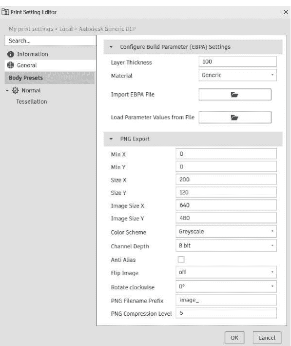

图 9.18 – Autodesk 通用 DLP 打印设置

创建使用 Autodesk 通用 SLA/DLP 打印机和 **Autodesk 通用 DLP** 打印设置的增材设置后，如果您在 **增材** 选项卡的 **操作** 面板中选择 **创建机器构建文件**，您将能够按照规格将每个切片导出为 PNG 文件，并压缩为单个 ZIP 文件。然后，您可以在将文件传输到 3D 打印机用于制造模型之前，进一步编辑 ZIP 文件以包含打印机可能需要的任何其他 TXT 或 XML 文件。

我接下来要重点介绍的打印设置是 **Autodesk 通用 SLA** 打印设置。如果您从 Fusion 360 的 **打印设置库** 中选择此打印设置并将其复制到本地库中，您可以在 **打印设置编辑器** 中编辑打印设置，如 *图 9.19* 所示。与 **Autodesk 通用 DLP** 打印设置和所有 FFF 打印设置一样，**Autodesk 通用 SLA** 打印设置包含名为 **信息**、**常规** 和 **主体预设** 的子部分。**常规** 子部分是我们可以在其中以微米为单位编辑 **层厚** 的位置。此打印设置允许我们创建一个机器构建文件，该文件生成 **立体光刻轮廓 (SLC)** 文件或 ZIP 文件。此 ZIP 文件包含一个或多个 SLC 文件。SLC 文件是包含 SLA 打印机切片信息的<|message|>。 在打印设置中，您可以控制是否要为每个零件创建唯一文件和/或为在增材设置期间可能生成的每个支撑结构创建唯一文件。您还可以选择在导出 SLC 文件时使用组件的名称作为文件名。Fusion 360 会自动为支撑结构名称添加后缀。默认后缀是 _s。如果您使用默认设置并导出 SLC ZIP 文件，它将包含以下两个 SLC 文件：

-   Component1_Body1.slc
-   Component1_Body1_s.slc

这假设您的增材设置包含一个名为 Component 1 的单个主体组件，并且您已为其添加了支撑结构。

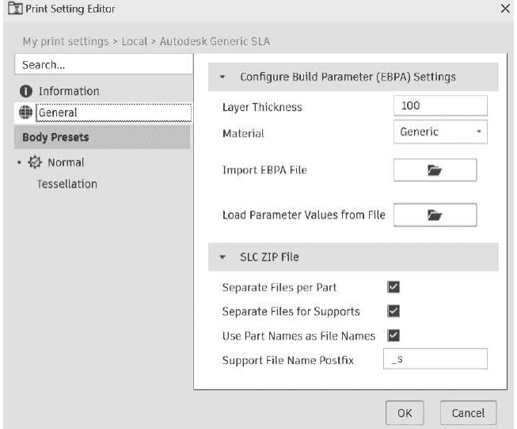

图 9.19 – Autodesk 通用 SLA 打印设置

除了通用的 SLA 和 DLP 打印设置外，Fusion 360 还为树脂打印机提供了三个机器厂商特定的打印设置。第一个是 **Anycubic Photon Mono**。如果您访问 **打印设置库**，可以搜索此打印设置，并在将其复制到本地库后在 **打印设置编辑器** 中查看其输入。如 *图 9.20* 所示，此打印设置看起来与通用的 SLA 或 DLP 打印设置非常相似，但有一个主要区别。此打印设置的 **常规** 子部分包含四个与给定材料应如何切片相关的参数输入。您可以控制诸如曝光时间和给定增材设置的底部层数等输入。您还可以控制打印机在每次切片固化时应暂停的时间，单位为秒。

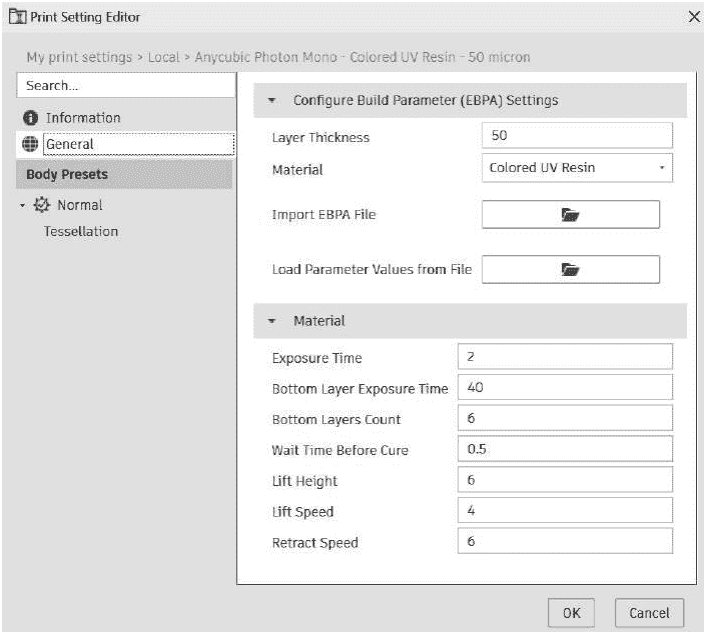

图 9.20 – Anycubic Photon Mono 打印设置

如果您拥有韩国制造商 Carima 的 DLP 3D 打印机，您会注意到与这些打印机关联的打印设置具有非常有限的控制集。如 *图 9.21* 所示，在编辑与 Carima 3D 打印机相关的打印设置时，您唯一可以修改的打印设置是 **层厚**。这是因为所有关键控制都已在 Fusion 360 中设置，由打印机制造商提供。这意味着如果您需要对这些打印设置进行进一步自定义，您需要联系 Carima 支持，他们将能够提供包含自定义参数值的文件，您只需将其加载到 Fusion 360 中的自定义打印设置中即可。

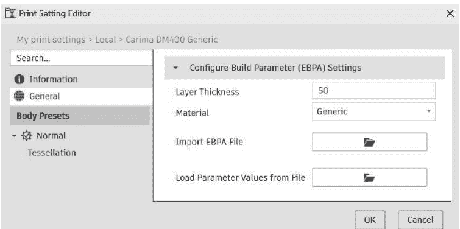

图 9.21 – Carima DM 400 通用打印设置

如果您拥有 Prusa Research 的 SLA 3D 打印机，例如 SL1S SPEED，您会看到可以修改的额外输入，例如曝光时间、初始曝光时间和渐隐层。Fusion 360 的打印设置库中为此特定打印机包含的打印设置如图 9.22 所示。该图显示了 Prusa Orange Tough 树脂的常规打印设置。如果您使用不同的树脂，您可能需要修改曝光时间输入并相应地自定义打印设置，以便在打印过程中为树脂提供足够的固化时间。

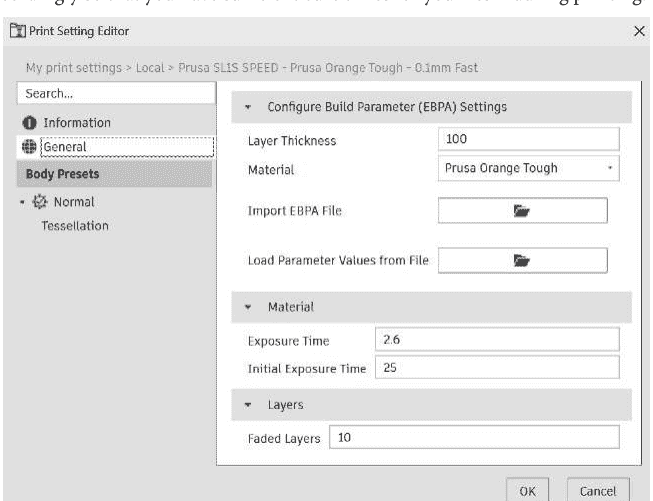

图 9.22 – Prusa SL1S SPEED，Prusa Orange Tough 打印设置

在本节中，我们介绍了 SLA 和 DLP 3D 打印机打印设置的最重要输入。我们强调了您可以通过将其保存到本地库来自定义打印设置的方式。我们演示了无论打印设置类型如何，都可以编辑 **层厚**。我们强调了通用 SLA 和 DLP 打印机打印设置与 Anycubic、Carima 和 Prusa 的机器厂商特定打印设置之间的差异。在下一节中，我们将重点介绍如何为设计的部分分配唯一的打印设置以实现特定的制造标准。

## 为主体分配唯一的打印设置

在前几节中，我们介绍了如何为 FFF 和 SLA/DLP 3D 打印机选择和修改打印设置。我们强调了每个打印设置都包含多个主体预设，以及您可以修改每个主体预设中的信息以根据需要自定义打印设置。对于 FFF 打印机，随 Fusion 360 库提供的打印设置包括 **普通** 和 **强度** 零件打印选项的预设。我们讨论了如何将默认预设从 **普通** 更改为次要预设，例如 **强度** 或我们可以通过复制现有预设创建的自定义预设。在本节中，我们将讨论如何将这些预设分配给增材设置中的特定主体。

为了演示此工作流程，我们将使用第二个制造模型创建一个第二个设置，如图 9.23 所示。如图所示，此设置适用于 FFF 打印机（**Prusa i3 MK3S +**）并使用 **ABS (Direct Drive)** 打印设置。此设置包括原始设计文档中存在的全部三个组件。它们已使用 **增材排列** 自动沿 Y 轴定位，**对象间距** 输入为 5 毫米。

默认情况下，全部三个组件将使用 **普通** 主体预设，因为这是 **ABS (Direct Drive)** 打印设置的默认预设。但是，我们可以轻松地为所选主体分配不同的主体预设。如果我们从浏览器中选择 **增材排列** 行项目并右键单击它，我们可以选择 **分配主体预设** 命令。这将打开一个名为 **分配主体预设** 的新对话框，并显示所选打印设置中的可用主体预设。我们可以在此对话框中看到 **普通** 主体预设和 **强度** 主体预设。**强度** 主体预设行以蓝色突出显示，等待我们选择要分配它的主体。

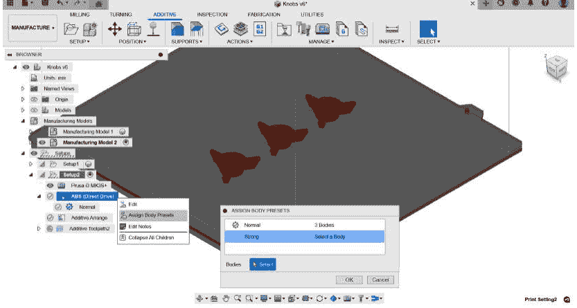

图 9.23 – 增材设置中的分配主体预设对话框

要将 **强度** 主体预设分配给给定对象，我们只需选择该主体。选择构建体积中间的主体后，如图 9.24 所示，**分配主体预设** 对话框将自动更新，我们将看到 **普通** 主体预设分配给两个主体，而 **强度** 主体预设分配给我们刚刚选择的一个主体。

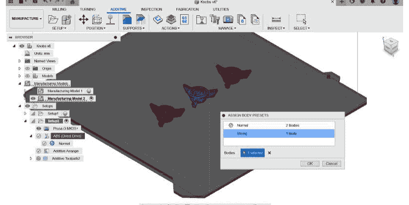

图 9.24 – 为所选主体分配非默认主体预设

在 **ASSIGN BODY PRESETS** 对话框内选择 **OK** 按钮后，浏览器将自动更新并在活动设置的 **ABS (Direct Drive)** 文件夹下同时显示 **Normal** 主体预设和 **Strong** 主体预设，如图 9.25 所示。这表明活动设置中使用了多个主体预设的主体。为了演示不同主体预设对不同主体的影响，我们可以从浏览器中选择 **Additive Toolpath** 项目并使用 **Ctrl + G** 键盘快捷键生成刀具路径。接下来，我们可以激活位于 **ADDITIVE** 选项卡内的 **ACTIONS** 面板中的 **Simulate Additive Toolpath** 命令：

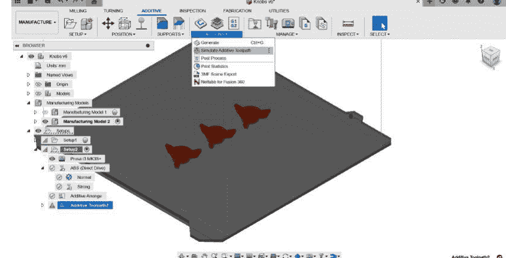

图 9.25 – 模拟增材制造设置的增材刀具路径

当我们可视化增材刀具路径时，可以放大模型，以便更近距离地查看两个相邻部件，如图 9.26 所示。如果取消选中 **Show Machine** 复选框，成型平台将被隐藏，以便我们可以轻松区分刀具路径类型的颜色。

在同一图中，您会注意到图像底部旋钮只有一个红色线条（外周）以及一条绿色线条（内周）。顶部旋钮的外周为红色，但当前显示的层（第 41 层）的内周刀具路径线有四条绿色线条。这是因为 **ABS (Direct Drive)** 打印设置在 **Strong** 主体预设的 **Shell** 子标题下的 **Number of Perimeters** 字段中输入了 5。

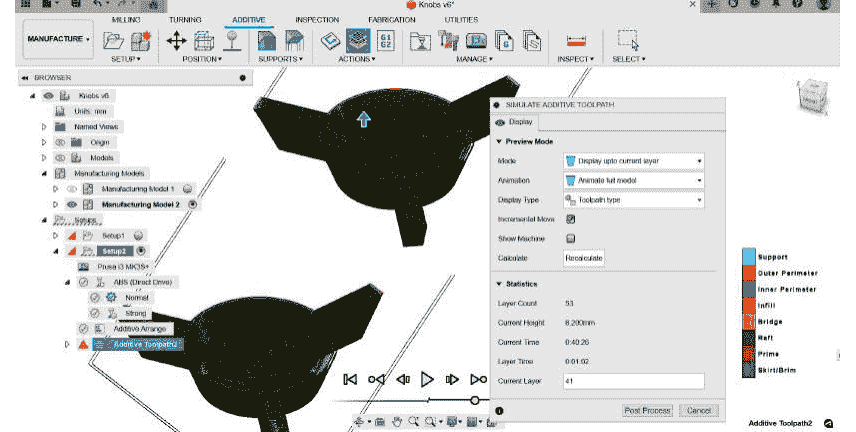

图 9.26 – 模拟使用两种不同主体预设的 FFF 设置的增材刀具路径

我们可能想要为所选主体分配不同的主体预设的原因有很多。在前面的示例中，我们演示了如何使用不同的刀具路径设置打印不同的主体，例如周数以使其中一个比另一个更强。另一个我们可能想要使用主体预设并将其分配给特定主体的原因是为了控制用于打印特定主体的挤出机。

在下一个示例中，我们有一个由两个主体组成的单个部件。部件名为 2BC，主体名为 Body1-Yellow 和 Body2-Red，如图 9.27 所示。如果我们使用具有多个挤出机的 3D 打印机（例如 Raise 3D Pro 2）创建增材设置，我们可以分配打印设置并随后控制哪个主体使用哪个挤出机打印。在此示例中，在选择打印机后，我们将分配 PLA (Bowden Tube) 作为打印设置。接下来，我们可以选择打印设置并右键单击以编辑它。这也允许我们自定义主体预设的名称。图 9.27 演示了如何将默认主体预设的名称从 Normal 改为 Yellow。

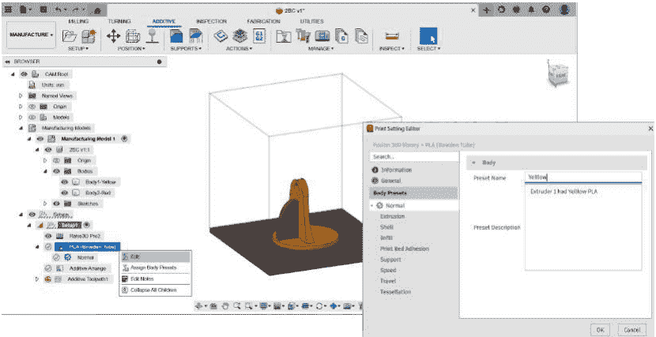

图 9.27 – 在打印设置中自定义主体预设的名称

将现有主体预设分别重命名为 Yellow 和 Red 后，我们必须更改每个主体预设所依赖的挤出机。如图 9.28 所示，我们可以进入 Extrusion 子标题，并将 Red 主体预设的 Part Extruder 从 Extruder 1 改为 Extruder 2。

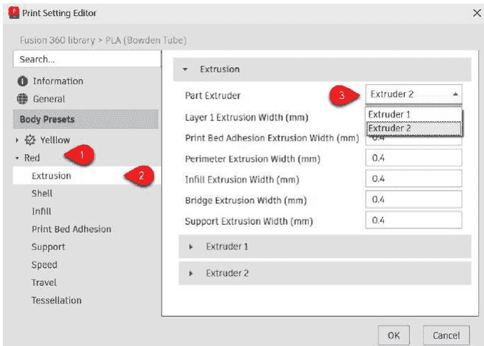

图 9.28 – 修改主体预设的部件挤出机

为每个主体预设分配唯一的挤出机后，我们可以在 **Print Setting Editor** 对话框中选择 **OK** 以接受更改。接下来，我们必须为给定主体分配主体预设。我们可以通过在浏览器中右键单击 **PLA (Bowden Tube)** 打印设置并选择 **Assign Body Presets** 来完成此操作，如 *图 9.29* 所示。接下来，我们可以选择希望使用 **Extruder 2** 打印的主体。**ASSIGN BODY PRESETS** 对话框现在显示一个主体将使用名为 **Yellow** 的主体预设打印，第二个主体将使用名为 **Red** 的主体预设打印。单击 **OK** 后，我们的主体预设分配现已完成。

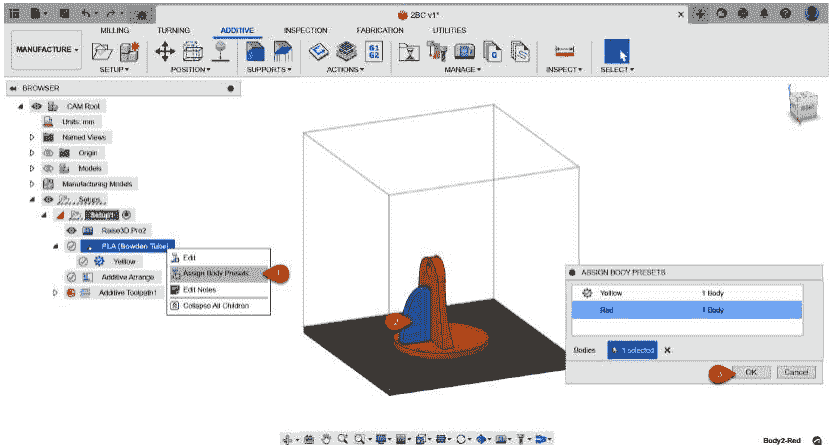

图 9.29 – 为主体分配主体预设

如 *图 9.30* 所示，我们的浏览器已更新，我们可以看到 **Yellow** 和 **Red** 均作为此设置中处于活动状态的主体预设。在生成增材刀具路径并像前一个示例中那样模拟它之后，我们可以切换切片模型的各个层。*图 9.30* 显示了第 310 层的快照。

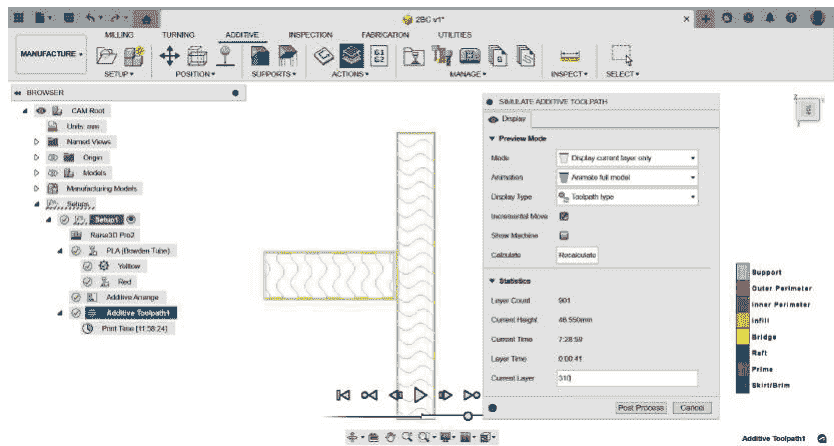

图 9.30 – 增材刀具路径的模拟

前一幅图显示了距离成型平台 46.55 毫米处的切片。**SIMULATE ADDITIVE TOOLPATH** 中的 **Show Machine** 复选框已被取消选择以隐藏成型平台。视图已从视图立方体设置为 **TOP**。**Preview Mode** 设置为 **Display current layer only**。这种设置组合向我们显示了当前层的刀具路径并隐藏了其他所有内容。前一幅图中看到的水平方块代表将使用红色耗材和 **Extruder 2** 打印的主体。同一幅图中看到的垂直方块代表将使用黄色耗材和 **Extruder 1** 打印的主体。您会注意到这两个方块周围有明显的周界，因为它们是两个不同的主体，使用两个不同的挤出机打印。这意味着如果您打印此刀具路径，这两个方块之间的界面将比使用相同的[content]
在 **ASSIGN BODY PRESETS** 对话框内选择 **OK** 按钮后，浏览器将自动更新并在活动设置的 **ABS (Direct Drive)** 文件夹下同时显示 **Normal** 主体预设和 **Strong** 主体预设，如图 9.25 所示。这表明活动设置中使用了多个主体预设的主体。为了演示不同主体预设对不同主体的影响，我们可以从浏览器中选择 **Additive Toolpath** 项目并使用 **Ctrl + G** 键盘快捷键生成刀具路径。接下来，我们可以激活位于 **ADDITIVE** 选项卡内的 **ACTIONS** 面板中的 **Simulate Additive Toolpath** 命令：

图 9.25 – 模拟增材制造设置的增材刀具路径

当我们可视化增材刀具路径时，可以放大模型，以便更近距离地查看两个相邻部件，如图 9.26 所示。如果取消选中 **Show Machine** 复选框，成型平台将被隐藏，以便我们可以轻松区分刀具路径类型的颜色。

在同一图中，您会注意到图像底部旋钮只有一个红色线条（外周）以及一条绿色线条（内周）。顶部旋钮的外周为红色，但当前显示的层（第 41 层）的内周刀具路径线有四条绿色线条。这是因为 **ABS (Direct Drive)** 打印设置在 **Strong** 主体预设的 **Shell** 子标题下的 **Number of Perimeters** 字段中输入了 5。

图 9.26 – 模拟使用两种不同主体预设的 FFF 设置的增材刀具路径

我们可能想要为所选主体分配不同的主体预设的原因有很多。在前面的示例中，我们演示了如何使用不同的刀具路径设置打印不同的主体，例如周数以使其中一个比另一个更强。另一个我们可能想要使用主体预设并将其分配给特定主体的原因是为了控制用于打印特定主体的挤出机。

在下一个示例中，我们有一个由两个主体组成的单个部件。部件名为 2BC，主体名为 Body1-Yellow 和 Body2-Red，如图 9.27 所示。如果我们使用具有多个挤出机的 3D 打印机（例如 Raise 3D Pro 2）创建增材设置，我们可以分配打印设置并随后控制哪个主体使用哪个挤出机打印。在此示例中，在选择打印机后，我们将分配 PLA (Bowden Tube) 作为打印设置。接下来，我们可以选择打印设置并右键单击以编辑它。这也允许我们自定义主体预设的名称。图 9.27 演示了如何将默认主体预设的名称从 Normal 改为 Yellow。

图 9.27 – 在打印设置中自定义主体预设的名称

将现有主体预设分别重命名为 Yellow 和 Red 后，我们必须更改每个主体预设所依赖的挤出机。如图 9.28 所示，我们可以进入 Extrusion 子标题，并将 Red 主体预设的 Part Extruder 从 Extruder 1 改为 Extruder 2。

图 9.28 – 修改主体预设的部件挤出机

为每个主体预设分配唯一的挤出机后，我们可以在 **Print Setting Editor** 对话框中选择 **OK** 以接受更改。接下来，我们必须为给定主体分配主体预设。我们可以通过在浏览器中右键单击 **PLA (Bowden Tube)** 打印设置并选择 **Assign Body Presets** 来完成此操作，如 *图 9.29* 所示。接下来，我们可以选择希望使用 **Extruder 2** 打印的主体。**ASSIGN BODY PRESETS** 对话框现在显示一个主体将使用名为 **Yellow** 的主体预设打印，第二个主体将使用名为 **Red** 的主体预设打印。单击 **OK** 后，我们的主体预设分配现已完成。

图 9.29 – 为主体分配主体预设

如 *图 9.30* 所示，我们的浏览器已更新，我们可以看到 **Yellow** 和 **Red** 均作为此设置中处于活动状态的主体预设。在生成增材刀具路径并像前一个示例中那样模拟它之后，我们可以切换切片模型的各个层。*图 9.30* 显示了第 310 层的快照。

图 9.30 – 增材刀具路径的模拟

前一幅图显示了距离成型平台 46.55 毫米处的切片。**SIMULATE ADDITIVE TOOLPATH** 中的 **Show Machine** 复选框已被取消选择以隐藏成型平台。视图已从视图立方体设置为 **TOP**。**Preview Mode** 设置为 **Display current layer only**。这种设置组合向我们显示了当前层的刀具路径并隐藏了其他所有内容。前一幅图中看到的水平方块代表将使用红色耗材和 **Extruder 2** 打印的主体。同一幅图中看到的垂直方块代表将使用黄色耗材和 **Extruder 1** 打印的主体。您会注意到这两个方块周围有明显的周界，因为它们是两个不同的主体，使用两个不同的挤出机打印。这意味着如果您打印此刀具路径，这两个方块之间的界面将比使用相同的[content]
在 **ASSIGN BODY PRESETS** 对话框内选择 **OK** 按钮后，浏览器将自动更新并在活动设置的 **ABS (Direct Drive)** 文件夹下同时显示 **Normal** 主体预设和 **Strong** 主体预设，如图 9.25 所示。这表明活动设置中使用了多个主体预设的主体。为了演示不同主体预设对不同主体的影响，我们可以从浏览器中选择 **Additive Toolpath** 项目并使用 **Ctrl + G** 键盘快捷键生成刀具路径。接下来，我们可以激活位于 **ADDITIVE** 选项卡内的 **ACTIONS** 面板中的 **Simulate Additive Toolpath** 命令：

图 9.25 – 模拟增材制造设置的增材刀具路径

当我们可视化增材刀具路径时，可以放大模型，以便更近距离地查看两个相邻部件，如图 9.26 所示。如果取消选中 **Show Machine** 复选框，成型平台将被隐藏，以便我们可以轻松区分刀具路径类型的颜色。

在同一图中，您会注意到图像底部旋钮只有一个红色线条（外周）以及一条绿色线条（内周）。顶部旋钮的外周为红色，但当前显示的层（第 41 层）的内周刀具路径线有四条绿色线条。这是因为 **ABS (Direct Drive)** 打印设置在 **Strong** 主体预设的 **Shell** 子标题下的 **Number of Perimeters** 字段中输入了 5。

图 9.26 – 模拟使用两种不同主体预设的 FFF 设置的增材刀具路径

我们可能想要为所选主体分配不同的主体预设的原因有很多。在前面的示例中，我们演示了如何使用不同的刀具路径设置打印不同的主体，例如周数以使其中一个比另一个更强。另一个我们可能想要使用主体预设并将其分配给特定主体的原因是为了控制用于打印特定主体的挤出机。

在下一个示例中，我们有一个由两个主体组成的单个部件。部件名为 2BC，主体名为 Body1-Yellow 和 Body2-Red，如图 9.27 所示。如果我们使用具有多个挤出机的 3D 打印机（例如 Raise 3D Pro 2）创建增材设置，我们可以分配打印设置并随后控制哪个主体使用哪个挤出机打印。在此示例中，在选择打印机后，我们将分配 PLA (Bowden Tube) 作为打印设置。接下来，我们可以选择打印设置并右键单击以编辑它。这也允许我们自定义主体预设的名称。图 9.27 演示了如何将默认主体预设的名称从 Normal 改为 Yellow。

图 9.27 – 在打印设置中自定义主体预设的名称

将现有主体预设分别重命名为 Yellow 和 Red 后，我们必须更改每个主体预设所依赖的挤出机。如图 9.28 所示，我们可以进入 Extrusion 子标题，并将 Red 主体预设的 Part Extruder 从 Extruder 1 改为 Extruder 2。

图 9.28 – 修改主体预设的部件挤出机

为每个主体预设分配唯一的挤出机后，我们可以在 **Print Setting Editor** 对话框中选择 **OK** 以接受更改。接下来，我们必须为给定主体分配主体预设。我们可以通过在浏览器中右键单击 **PLA (Bowden Tube)** 打印设置并选择 **Assign Body Presets** 来完成此操作，如 *图 9.29* 所示。接下来，我们可以选择希望使用 **Extruder 2** 打印的主体。**ASSIGN BODY PRESETS** 对话框现在显示一个主体将使用名为 **Yellow** 的主体预设打印，第二个主体将使用名为 **Red** 的主体预设打印。单击 **OK** 后，我们的主体预设分配现已完成。

图 9.29 – 为主体分配主体预设

如 *图 9.30* 所示，我们的浏览器已更新，我们可以看到 **Yellow** 和 **Red** 均作为此设置中处于活动状态的主体预设。在生成增材刀具路径并像前一个示例中那样模拟它之后，我们可以切换切片模型的各个层。*图 9.30* 显示了第 310 层的快照。

图 9.30 – 增材刀具路径的模拟

前一幅图显示了距离成型平台 46.55 毫米处的切片。**SIMULATE ADDITIVE TOOLPATH** 中的 **Show Machine** 复选框已被取消选择以隐藏成型平台。视图已从视图立方体设置为 **TOP**。**Preview Mode** 设置为 **Display current layer only**。这种设置组合向我们显示了当前层的刀具路径并隐藏了其他所有内容。前一幅图中看到的水平方块代表将使用红色耗材和 **Extruder 2** 打印的主体。同一幅图中看到的垂直方块代表将使用黄色耗材和 **Extruder 1** 打印的主体。您会注意到这两个方块周围有明显的周界，因为它们是两个不同的主体，使用两个不同的挤出机打印。这意味着如果您打印此刀具路径，这两个方块之间的界面将比使用相同的[content]
在 **ASSIGN BODY PRESETS** 对话框内选择 **OK** 按钮后，浏览器将自动更新并在活动设置的 **ABS (Direct Drive)** 文件夹下同时显示 **Normal** 主体预设和 **Strong** 主体预设，如图 9.25 所示。这表明活动设置中使用了多个主体预设的主体。为了演示不同主体预设对不同主体的影响，我们可以从浏览器中选择 **Additive Toolpath** 项目并使用 **Ctrl + G** 键盘快捷键生成刀具路径。接下来，我们可以激活位于 **ADDITIVE** 选项卡内的 **ACTIONS** 面板中的 **Simulate Additive Toolpath** 命令：

图 9.25 – 模拟增材制造设置的增材刀具路径

当我们可视化增材刀具路径时，可以放大模型，以便更近距离地查看两个相邻部件，如图 9.26 所示。如果取消选中 **Show Machine** 复选框，成型平台将被隐藏，以便我们可以轻松区分刀具路径类型的颜色。

在同一图中，您会注意到图像底部旋钮只有一个红色线条（外周）以及一条绿色线条（内周）。顶部旋钮的外周为红色，但当前显示的层（第 41 层）的内周刀具路径线有四条绿色线条。这是因为 **ABS (Direct Drive)** 打印设置在 **Strong** 主体预设的 **Shell** 子标题下的 **Number of Perimeters** 字段中输入了 5。

图 9.26 – 模拟使用两种不同主体预设的 FFF 设置的增材刀具路径

我们可能想要为所选主体分配不同的主体预设的原因有很多。在前面的示例中，我们演示了如何使用不同的刀具路径设置打印不同的主体，例如周数以使其中一个比另一个更强。另一个我们可能想要使用主体预设并将其分配给特定主体的原因是为了控制用于打印特定主体的挤出机。

在下一个示例中，我们有一个由两个主体组成的单个部件。部件名为 2BC，主体名为 Body1-Yellow 和 Body2-Red，如图 9.27 所示。如果我们使用具有多个挤出机的 3D 打印机（例如 Raise 3D Pro 2）创建增材设置，我们可以分配打印设置并随后控制哪个主体使用哪个挤出机打印。在此示例中，在选择打印机后，我们将分配 PLA (Bowden Tube) 作为打印设置。接下来，我们可以选择打印设置并右键单击以编辑它。这也允许我们自定义主体预设的名称。图 9.27 演示了如何将默认主体预设的名称从 Normal 改为 Yellow。

图 9.27 – 在打印设置中自定义主体预设的名称

将现有主体预设分别重命名为 Yellow 和 Red 后，我们必须更改每个主体预设所依赖的挤出机。如图 9.28 所示，我们可以进入 Extrusion 子标题，并将 Red 主体预设的 Part Extruder 从 Extruder 1 改为 Extruder 2。

图 9.28 – 修改主体预设的部件挤出机

为每个主体预设分配唯一的挤出机后，我们可以在 **Print Setting Editor** 对话框中选择 **OK** 以接受更改。接下来，我们必须为给定主体分配主体预设。我们可以通过在浏览器中右键单击 **PLA (Bowden Tube)** 打印设置并选择 **Assign Body Presets** 来完成此操作，如 *图 9.29* 所示。接下来，我们可以选择希望使用 **Extruder 2** 打印的主体。**ASSIGN BODY PRESETS** 对话框现在显示一个主体将使用名为 **Yellow** 的主体预设打印，第二个主体将使用名为 **Red** 的主体预设打印。单击 **OK** 后，我们的主体预设分配现已完成。

图 9.29 – 为主体分配主体预设

如 *图 9.30* 所示，我们的浏览器已更新，我们可以看到 **Yellow** 和 **Red** 均作为此设置中处于活动状态的主体预设。在生成增材刀具路径并像前一个示例中那样模拟它之后，我们可以切换切片模型的各个层。*图 9.30* 显示了第 310 层的快照。

图 9.30 – 增材刀具路径的模拟

前一幅图显示了距离成型平台 46.55 毫米处的切片。**SIMULATE ADDITIVE TOOLPATH** 中的 **Show Machine** 复选框已被取消选择以隐藏成型平台。视图已从视图立方体设置为 **TOP**。**Preview Mode** 设置为 **Display current layer only**。这种设置组合向我们显示了当前层的刀具路径并隐藏了其他所有内容。前一幅图中看到的水平方块代表将使用红色耗材和 **Extruder 2** 打印的主体。同一幅图中看到的垂直方块代表将使用黄色耗材和 **Extruder 1** 打印的主体。您会注意到这两个方块周围有明显的周界，因为它们是两个不同的主体，使用两个不同的挤出机打印。这意味着如果您打印此刀具路径，这两个方块之间的界面将比使用相同的[content]
在 **ASSIGN BODY PRESETS** 对话框内选择 **OK** 按钮后，浏览器将自动更新并在活动设置的 **ABS (Direct Drive)** 文件夹下同时显示 **Normal** 主体预设和 **Strong** 主体预设，如图 9.25 所示。这表明活动设置中使用了多个主体预设的主体。为了演示不同主体预设对不同主体的影响，我们可以从浏览器中选择 **Additive Toolpath** 项目并使用 **Ctrl + G** 键盘快捷键生成刀具路径。接下来，我们可以激活位于 **ADDITIVE** 选项卡内的 **ACTIONS** 面板中的 **Simulate Additive Toolpath** 命令：

图 9.25 – 模拟增材制造设置的增材刀具路径

当我们可视化增材刀具路径时，可以放大模型，以便更近距离地查看两个相邻部件，如图 9.26 所示。如果取消选中 **Show Machine** 复选框，成型平台将被隐藏，以便我们可以轻松区分刀具路径类型的颜色。

在同一图中，您会注意到图像底部旋钮只有一个红色线条（外周）以及一条绿色线条（内周）。顶部旋钮的外周为红色，但当前显示的层（第 41 层）的内周刀具路径线有四条绿色线条。这是因为 **ABS (Direct Drive)** 打印设置在 **Strong** 主体预设的 **Shell** 子标题下的 **Number of Perimeters** 字段中输入了 5。

图 9.26 – 模拟使用两种不同主体预设的 FFF 设置的增材刀具路径

我们可能想要为所选主体分配不同的主体预设的原因有很多。在前面的示例中，我们演示了如何使用不同的刀具路径设置打印不同的主体，例如周数以使其中一个比另一个更强。另一个我们可能想要使用主体预设并将其分配给特定主体的原因是为了控制用于打印特定主体的挤出机。

在下一个示例中，我们有一个由两个主体组成的单个部件。部件名为 2BC，主体名为 Body1-Yellow 和 Body2-Red，如图 9.27 所示。如果我们使用具有多个挤出机的 3D 打印机（例如 Raise 3D Pro 2）创建增材设置，我们可以分配打印设置并随后控制哪个主体使用哪个挤出机打印。在此示例中，在选择打印机后，我们将分配 PLA (Bowden Tube) 作为打印设置。接下来，我们可以选择打印设置并右键单击以编辑它。这也允许我们自定义主体预设的名称。图 9.27 演示了如何将默认主体预设的名称从 Normal 改为 Yellow。

图 9.27 – 在打印设置中自定义主体预设的名称

将现有主体预设分别重命名为 Yellow 和 Red 后，我们必须更改每个主体预设所依赖的挤出机。如图 9.28 所示，我们可以进入 Extrusion 子标题，并将 Red 主体预设的 Part Extruder 从 Extruder 1 改为 Extruder 2。

图 9.28 – 修改主体预设的部件挤出机

为每个主体预设分配唯一的挤出机后，我们可以在 **Print Setting Editor** 对话框中选择 **OK** 以接受更改。接下来，我们必须为给定主体分配主体预设。我们可以通过在浏览器中右键单击 **PLA (Bowden Tube)** 打印设置并选择 **Assign Body Presets** 来完成此操作，如 *图 9.29* 所示。接下来，我们可以选择希望使用 **Extruder 2** 打印的主体。**ASSIGN BODY PRESETS** 对话框现在显示一个主体将使用名为 **Yellow** 的主体预设打印，第二个主体将使用名为 **Red** 的主体预设打印。单击 **OK** 后，我们的主体预设分配现已完成。

图 9.29 – 为主体分配主体预设

如 *图 9.30* 所示，我们的浏览器已更新，我们可以看到 **Yellow** 和 **Red** 均作为此设置中处于活动状态的主体预设。在生成增材刀具路径并像前一个示例中那样模拟它之后，我们可以切换切片模型的各个层。*图 9.30* 显示了第 310 层的快照。

图 9.30 – 增材刀具路径的模拟

前一幅图显示了距离成型平台 46.55 毫米处的切片。**SIMULATE ADDITIVE TOOLPATH** 中的 **Show Machine** 复选框已被取消选择以隐藏成型平台。视图已从视图立方体设置为 **TOP**。**Preview Mode** 设置为 **Display current layer only**。这种设置组合向我们显示了当前层的刀具路径并隐藏了其他所有内容。前一幅图中看到的水平方块代表将使用红色耗材和 **Extruder 2** 打印的主体。同一幅图中看到的垂直方块代表将使用黄色耗材和 **Extruder 1** 打印的主体。您会注意到这两个方块周围有明显的周界，因为它们是两个不同的主体，使用两个不同的挤出机打印。这意味着如果您打印此刀具路径，这两个方块之间的界面将比使用相同的[content]
在 **ASSIGN BODY PRESETS** 对话框内选择 **OK** 按钮后，浏览器将自动更新并在活动设置的 **ABS (Direct Drive)** 文件夹下同时显示 **Normal** 主体预设和 **Strong** 主体预设，如图 9.25 所示。这表明活动设置中使用了多个主体预设的主体。为了演示不同主体预设对不同主体的影响，我们可以从浏览器中选择 **Additive Toolpath** 项目并使用 **Ctrl + G** 键盘快捷键生成刀具路径。接下来，我们可以激活位于 **ADDITIVE** 选项卡内的 **ACTIONS** 面板中的 **Simulate Additive Toolpath** 命令：

图 9.25 – 模拟增材制造设置的增材刀具路径

当我们可视化增材刀具路径时，可以放大模型，以便更近距离地查看两个相邻部件，如图 9.26 所示。如果取消选中 **Show Machine** 复选框，成型平台将被隐藏，以便我们可以轻松区分刀具路径类型的颜色。

在同一图中，您会注意到图像底部旋钮只有一个红色线条（外周）以及一条绿色线条（内周）。顶部旋钮的外周为红色，但当前显示的层（第 41 层）的内周刀具路径线有四条绿色线条。这是因为 **ABS (Direct Drive)** 打印设置在 **Strong** 主体预设的 **Shell** 子标题下的 **Number of Perimeters** 字段中输入了 5。

图 9.26 – 模拟使用两种不同主体预设的 FFF 设置的增材刀具路径

我们可能想要为所选主体分配不同的主体预设的原因有很多。在前面的示例中，我们演示了如何使用不同的刀具路径设置打印不同的主体，例如周数以使其中一个比另一个更强。另一个我们可能想要使用主体预设并将其分配给特定主体的原因是为了控制用于打印特定主体的挤出机。

在下一个示例中，我们有一个由两个主体组成的单个部件。部件名为 2BC，主体名为 Body1-Yellow 和 Body2-Red，如图 9.27 所示。如果我们使用具有多个挤出机的 3D 打印机（例如 Raise 3D Pro 2）创建增材设置，我们可以分配打印设置并随后控制哪个主体使用哪个挤出机打印。在此示例中，在选择打印机后，我们将分配 PLA (Bowden Tube) 作为打印设置。接下来，我们可以选择打印设置并右键单击以编辑它。这也允许我们自定义主体预设的名称。图 9.27 演示了如何将默认主体预设的名称从 Normal 改为 Yellow。

图 9.27 – 在打印设置中自定义主体预设的名称

将现有主体预设分别重命名为 Yellow 和 Red 后，我们必须更改每个主体预设所依赖的挤出机。如图 9.28 所示，我们可以进入 Extrusion 子标题，并将 Red 主体预设的 Part Extruder 从 Extruder 1 改为 Extruder 2。

图 9.28 – 修改主体预设的部件挤出机

为每个主体预设分配唯一的挤出机后，我们可以在 **Print Setting Editor** 对话框中选择 **OK** 以接受更改。接下来，我们必须为给定主体分配主体预设。我们可以通过在浏览器中右键单击 **PLA (Bowden Tube)** 打印设置并选择 **Assign Body Presets** 来完成此操作，如 *图 9.29* 所示。接下来，我们可以选择希望使用 **Extruder 2** 打印的主体。**ASSIGN BODY PRESETS** 对话框现在显示一个主体将使用名为 **Yellow** 的主体预设打印，第二个主体将使用名为 **Red** 的主体预设打印。单击 **OK** 后，我们的主体预设分配现已完成。

图 9.29 – 为主体分配主体预设

如 *图 9.30* 所示，我们的浏览器已更新，我们可以看到 **Yellow** 和 **Red** 均作为此设置中处于活动状态的主体预设。在生成增材刀具路径并像前一个示例中那样模拟它之后，我们可以切换切片模型的各个层。*图 9.30* 显示了第 310 层的快照。

图 9.30 – 增材刀具路径的模拟

前一幅图显示了距离成型平台 46.55 毫米处的切片。**SIMULATE ADDITIVE TOOLPATH** 中的 **Show Machine** 复选框已被取消选择以隐藏成型平台。视图已从视图立方体设置为 **TOP**。**Preview Mode** 设置为 **Display current layer only**。这种设置组合向我们显示了当前层的刀具路径并隐藏了其他所有内容。前一幅图中看到的水平方块代表将使用红色耗材和 **Extruder 2** 打印的主体。同一幅图中看到的垂直方块代表将使用黄色耗材和 **Extruder 1** 打印的主体。您会注意到这两个方块周围有明显的周界，因为它们是两个不同的主体，使用两个不同的挤出机打印。这意味着如果您打印此刀具路径，这两个方块之间的界面将比使用相同的[content]
在 **ASSIGN BODY PRESETS** 对话框中选择 **OK** 按钮后，浏览器会自动更新，并在活动设置的 **ABS (Direct Drive)** 文件夹下同时显示 **Normal** 主体预设和 **Strong** 主体预设，如图 9.25 所示。这表明活动设置中有使用多个主体预设的主体。为演示不同主体预设对不同主体的影响，可从浏览器选择 **Additive Toolpath** 项目并用 **Ctrl + G** 快捷键生成刀具路径。随后可激活 **ADDITIVE** 选项卡内 **ACTIONS** 面板中的 **Simulate Additive Toolpath** 命令：

图 9.25 – 模拟增材制造设置的增材刀具路径

可视化增材刀具路径时，可放大模型以更近距离查看两个相邻部件，如图 9.26 所示。取消勾选 **Show Machine** 复选框后，成型平台会被隐藏，便于区分刀具路径类型的颜色。

同图中，底部旋钮仅有一条红色外周线和一条绿色内周线。顶部旋钮外周为红色，当前显示层为第 41 层，内周刀具路径线有四条绿色线。这是因为 **ABS (Direct Drive)** 打印设置在 **Strong** 主体预设的 **Shell** 子标题下 **Number of Perimeters** 字段的输入值为 5。

图 9.26 – 模拟使用两种不同主体预设的 FFF 设置的增材刀具路径

为所选主体分配不同主体预设的原因很多。前例演示了如何用不同刀具路径设置打印不同主体，如周数以使其中一个更强。另一原因是通过主体预设控制打印特定主体时使用的挤出机。

下一个示例中，有一个由两个主体组成的部件。部件名为 2BC，主体名为 Body1-Yellow 和 Body2-Red，如图 9.27 所示。若使用多挤出机 3D 打印机如 Raise 3D Pro 2 创建增材设置，可分配打印设置并控制各主体使用何种挤出机打印。本例中选定打印机后将 PLA (Bowden Tube) 作为打印设置。随后可选择打印设置右键编辑，也可自定义主体预设名称。图 9.27 演示了将默认主体预设名从 Normal 改为 Yellow。

图 9.27 – 在打印设置中自定义主体预设的名称

将现有主体预设分别重命名为 Yellow 和 Red 后，需更改各主体预设所依赖的挤出机。如图 9.28 所示，可进入 Extrusion 子标题，将 Red 主体预设的 Part Extruder 从 Extruder 1 改为 Extruder 2。

图 9.28 – 修改主体预设的部件挤出机

为各主体预设分配唯一挤出机后，可在 **Print Setting Editor** 对话框中选择 **OK** 接受更改。随后需为给定主体分配主体预设。可在浏览器中右键 **PLA (Bowden Tube)** 打印设置并选择 **Assign Body Presets**，如 *图 9.29* 所示。接着选择希望用 **Extruder 2** 打印的主体。**ASSIGN BODY PRESETS** 对话框显示一个主体将用名为 **Yellow** 的主体预设打印，另一个主体将用名为 **Red** 的主体预设打印。点击 **OK** 后，主体预设分配完成。

图 9.29 – 为主体分配主体预设

如 *图 9.30* 所示，浏览器已更新，可看到 **Yellow** 和 **Red** 均为该设置中激活的主体预设。生成增材刀具路径并模拟后，可切换切片模型的各层。*图 9.30* 为第 310 层的快照。

图 9.30 – 增材刀具路径的模拟

前图显示切片位于成型平台上方 46.55 毫米处。**SIMULATE ADDITIVE TOOLPATH** 中已取消 **Show Machine** 复选框以隐藏成型平台。视图从视图立方体设为 **TOP**，**Preview Mode** 设为 **Display current layer only**。该组合显示当前层刀具路径并隐藏其他内容。前图中水平方块代表将用红色耗材和 **Extruder 2** 打印的主体，垂直方块代表将用黄色耗材和 **Extruder 1** 打印的主体。两者周围有明显周界，因其为两个不同主体且使用不同挤出机打印。若打印此刀具路径，两方块间的界面会比用同一主体预设或作为具有均匀周界和连续填充的单个连接主体打印时更明显。

## 摘要

本章聚焦打印设置，包括如何自定义以及如何为给定部件分配唯一主体预设。本章较长，现做简要回顾。

Fusion 360 提供了可在创建增材设置时使用的打印设置库。每个打印设置都有默认数值，可用于特定打印机和材料组合的打印。但有时需修改部分设置以改善打印质量或满足特定打印机需求。此时可从 Fusion 360 库中选择欲修改的打印设置并复制到个人 Print Setting Library 文件夹。本地库中拥有打印设置后，可修改并保存以备将来使用。根据耗材或树脂，某些打印设置必须修改，如层高、挤出耗材的温度、成型平台温度、为控制打印强度而打印的周数及顶层和底层数，以及打印床粘附设置。

也可按需自定义主体预设，并在增材设置中为每个主体分配唯一主体预设。使用这些技术可完全控制 3D 打印的速度和质量。

下一章将学习为需要支撑的部件和增材制造技术创建支撑结构。我们还将更好地理解 Fusion 360 如何根据本章强调的支撑结构打印设置，在切片和刀具路径生成期间解释这些支撑。

## 10

## 支撑结构

欢迎阅读 *第 10 章*。本章将学习如何为 **熔融沉积制造 FFF**、**立体光刻 SLA** 和 **数字光处理 DLP** 3D 打印生成和切片支撑结构。

大多数主流增材制造技术（除粘结剂喷射、选择性激光烧结和多轴沉积外）都需要为具有大悬垂表面的部件区域生成并打印支撑结构。本章将介绍可用于 FFF 和 SLA/DLP 3D 打印的杆状和体积支撑结构。

本章所学几乎均适用于为用 **金属粉末床熔融 MPBF** 打印机打印的部件生成支撑结构，但将在 *第 12 章* 深入探讨 MPBF 工艺的部件定位和支撑结构生成。MPBF 技术相比 FFF 能以更高精度打印部件和支撑结构，因此不建议在 MPBF 设置中使用如体积和杆状等实体 FFF 支撑。MPBF 工艺通常使用栅格式体积支撑，因此我们有专门章节介绍如何为该工艺支撑部件。

本章将介绍根据增材设置使用的打印技术，如何对生成的支撑结构进行切片。我们还将学习可添加到成型平台的几种独特支撑连接，如垫、根和底板，这些常用于更有效地将杆状支撑连接到成型平台，并在使用底部向上 SLA/DLP 技术 3D 打印时提高成型平台粘附。

本章将涵盖以下主题：

- FFF 打印的体积和杆状支撑
- SLA 和 DLP 打印的杆状支撑
- SLA 和 DLP 打印的底板支撑

在本章结束时，您将更好地理解如何使用 Fusion 360 为实体和网格模型生成支撑结构。您将学习如何根据 3D 打印技术创建包括晶格、体积支撑和底板支撑在内的杆状支撑。您将了解自上而下和自下而上树脂打印技术之间的差异及其独特的支撑要求。您还将深入了解如何在一个区域、边缘或局部最小点上创建杆状支撑，以便使用 SLA/DLP 打印机成功打印零件。

### Technical requirements

本章涵盖的所有内容均可供使用个人、试用、商业、初创或教育版 Fusion 360 许可证类型的用户访问。

某些 Fusion 360 增材制造机，例如 **金属粉末床熔融 (MPBF)** 3D 打印机及其相应的打印设置和支撑结构生成功能，在获得 Additive Build 扩展访问权限之前不可用。与 Fusion 360 的所有其他扩展一样，Additive Build 扩展不适用于个人使用。由于本章不会涵盖特定于金属 3D 打印的主题，您应该能够毫无问题地跟随本章中的所有示例。

如果您拥有 Fusion 360 的商业许可证，要使用金属粉末床熔融机器创建增材设置，您还需要访问 Additive Build 扩展 (https://www.autodesk.com/products/Fusion-360/additive-build-extension)。

Autodesk 为所有 Fusion 360 商业用户提供 Additive Build 扩展的 14 天试用期。您可以在 Fusion 360 的扩展对话框中激活试用期。

本章的练习文件可在以下位置找到：https://github.com/PacktPublishing/3D-Printing-with-Fusion-360。

## Volume and bar supports for FFF printing

**熔丝制造 (FFF)** 3D 打印机通常可以在无需支撑结构的情况下打印悬垂角度小于 45 度的零件。如果您想使用 FFF 打印机打印零件，首先要做的事情之一是尝试找到一种方向，使该零件无需支撑结构即可打印。

然而，某些模型无法在没有支撑的情况下打印。这是因为无论您选择哪种方向，某些部件最终都会出现下表面，其悬垂大于 45 度且跨度超过您 3D 打印机能够桥接的距离。在这种情况下，您需要使用 CAD 工具或切片软件生成支撑结构。由于 Fusion 360 既是 CAD 软件也是切片软件，您可以在 MANUFACTURE 工作区中为任何增材设置参数化生成支撑结构。

在本节中，我们将讨论如何为 FFF 3D 打印机的增材设置生成体积和杆状支撑。为了演示如何生成体积支撑，我们将使用一个名为 Bracket.f3d 的 Fusion 360 文档。该文档已在 **MANUFACTURE** 工作区中包含一个增材设置。如 *Figure 10.1* 所示，**Setup 1** 是一个增材设置，使用 **Prusa i3MK3S +** 打印机和 **PLA (Direct drive)** 打印设置。部件已在 3D 打印机内排列，使其位于构建体积的中间。还为该部件选择了合适的方向。基于此方向，我们需要生成支撑结构才能成功打印该部件。*Figure 10.1* 显示了在此设置中位于 **ADDITIVE** 选项卡的 **SUPPORTS** 面板内的两种生成支撑结构的选项。

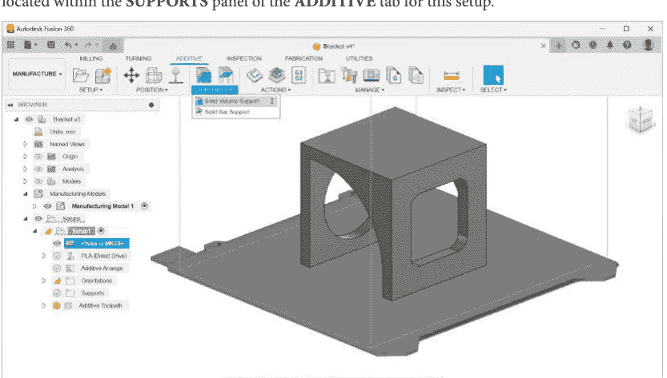

Figure 10.1 – 用于 FFF 3D 打印机增材设置的支撑结构类型

如果您选择位于 **SUPPORTS** 面板内的 **Solid Volume Support** 命令，将会出现一个名为 **SOLID VOLUME SUPPORT** 的新对话框。在此对话框中，有两个选项卡。**Geometry** 选项卡允许您选择应通过此操作进行支撑的面或主体。*Figure 10.2* 显示了在 **SOLID VOLUME SUPPORT** 对话框处于活动状态时，所选面如何以蓝色高亮显示。

在此对话框中，您还可以控制 Support Overhang Angle。Fusion 360 将自动为悬垂角度小于此输入字段中条目的向下表面部分生成支撑结构。换句话说，如果我们增加 Support Overhang Angle 输入，Fusion 360 将在更大区域生成支撑。

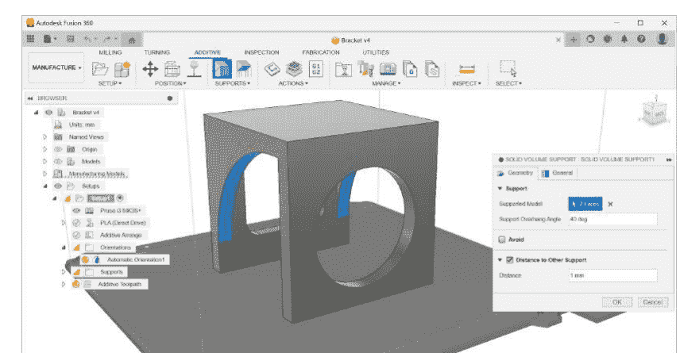

Figure 10.2 – 为体积支撑选择实体模型的面

在第 10 章的 GitHub 文件夹中，您会找到另一个名为 Bracket-Mesh.f3d 的文件。此 Fusion 360 文档是前一个文档的副本，仅有一个细微差别。如 Figure 10.3 所示，在此第二个文档中，名为 Bracket 的部件不是实体主体，而是网格主体。实体体积支撑对话框允许您在被支撑的部件为网格主体时，不仅选择整个主体，还选择单个面组。为了选择单个面组，您必须确保网格面组已显示。在 Fusion 360 的 MANUFACTURE 工作区中显示网格面组的最简单方法是使用键盘快捷键 Shift + F。如果活动设置中的网格主体有多个面组，每个网格面组将以独特颜色显示，如 Figure 10.3 所示。在为特定增材设置在 MANUFACTURE 工作区中显示网格面组后，您可以在 SOLID VOLUME SUPPORT 对话框中将面组选为要支撑的输入对象。

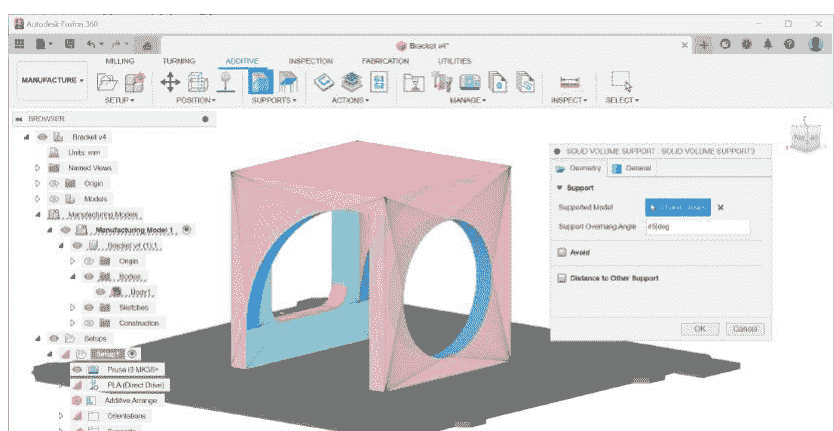

Figure 10.3 – 选择网格主体的三个面组

现在我们已经说明了在生成体积支撑时如何为网格主体选择面组，我们可以切换回原始模型 (Bracket.f3d)，并在先前选择的实体主体的两个面上创建体积支撑。一旦通过单击 SOLID VOLUME SUPPORT 对话框上的 OK 按钮生成支撑结构，Fusion 360 将创建如 Figure 10.4 所示的支撑结构，您将能够将其可视化为悬垂表面下方的蓝色体积。Fusion 360 还会在浏览器中活动设置的 Supports 文件夹内添加一个名为 Solid Volume Support1 的新条目。

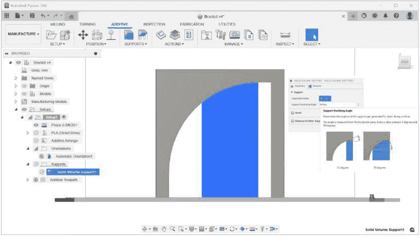

Figure 10.4 – 可视化实体体积支撑

在 Figure 10.4 中，您可能注意到蓝色支撑结构并未封闭整个开口，而是支撑了大约一半的圆弧面。这是因为我们使用了 40 度的支撑悬垂角度，而 Fusion 360 没有对该圆弧上悬垂角度大于 40 度的任何点进行支撑。重要的是要记住，悬垂角度是从水平面测量的，如前一图中的工具提示图像所示。

SOLID VOLUME SUPPORT 对话框的 Geometry 选项卡中我们拥有的另一个选项是 Avoid 复选框。通过激活此复选框，我们可以选择一个或多个面作为输入，并防止 Fusion 360 在这些表面上生成支撑结构。Figure 10.5 显示了创建第二个 Solid Volume Support 以支撑整个主体，同时避免在先前用作创建 Solid Volume Support1 输入的两个蓝色高亮圆弧面上生成支撑。

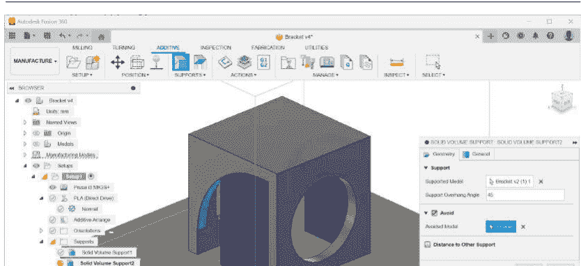

Figure 10.5 – 在生成实体体积支撑时选择要避免的面

生成此第二个实体体积支撑的结果是为整个主体创建体积支撑，同时排除我们在对话框中指定要避免的两个面。使用此技术，我们可以为某些面添加独特的支撑结构，同时为主体其余部分创建不同的支撑集。

SOLID VOLUME SUPPORT 对话框内的第二个选项卡名为 General。Figure 10.6 显示了 General 选项卡中的两个输入字段。第一个输入字段名为 Top Distance to Part，控制我们生成的支撑结构与部件下表皮之间的距离。第二个输入字段名为 Bottom Distance to Part，如果给定支撑结构接触的是部件的上表皮而不是构建板，则控制支撑结构与部件上表皮之间的距离。

这两个字段的输入单位为长度，默认输入为 0.3 毫米。如 Figure 10.6 所示，PLA (Direct Drive) 打印设置的层高为 0.15 毫米。因此，使用这些设置生成的支撑结构将在部件的上表皮上方和下表皮下方各有一个两层间隙。

根据我的经验，使用 PLA 进行 3D 打印时，只要我们在部件和支撑之间留出两层间隙，后处理就会变得更容易，并且可以在打印后毫不费力地将支撑结构从部件上移除。

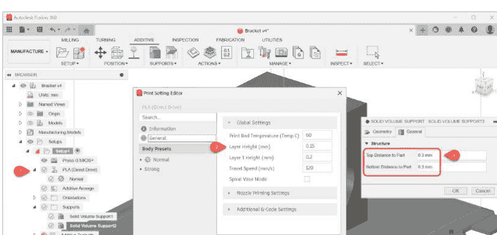

图 10.6 – 体积支撑与打印设置之间的关系

生成一个或多个支撑结构后，Fusion 360 会将它们添加到浏览器中的支撑文件夹中，如图 10.7 所示。如果我们选择其中一个支撑结构，可以右键单击它们并查看选项菜单。我们有选项可以**抑制**某个支撑、**复制**、**剪切**、**复制/粘贴**或**删除**它。请记住，支撑文件夹中支撑结构的顺序很重要。后续支撑会感知到其前驱的存在和位置，可以避免在已创建支撑的位置生成支撑。因此，如果你在支撑文件夹中抑制了某个支撑，前面的支撑结构可能会过时，可能需要重新生成。

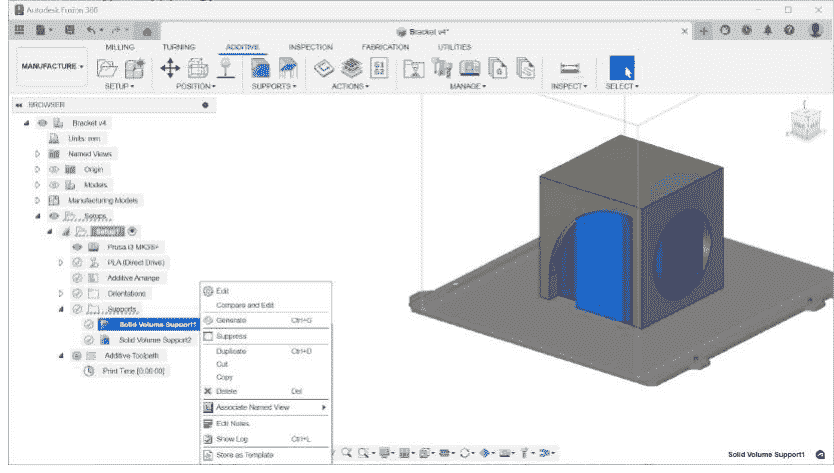

图 10.7 – 支撑结构的右键菜单选项

现在我们已经学会了如何为 FFF 设置生成体积支撑，可以专注于生成杆状支撑。图 10.8 显示了 SOLID BAR SUPPORT 对话框，可通过 ADDITIVE 选项卡中 SUPPORTS 面板内同名命令启动。

在此对话框的 Geometry 选项卡中，首先可以做的是选择一组要支撑的面或实体。正如你可能注意到的，杆状支撑和体积支撑在 Geometry 选项卡中的选项完全相同。在此选项卡中，你可以输入支撑悬垂角度，选择希望避免为其创建支撑结构的表面，并指定多个支撑实体之间的间隙以避免支撑结构重叠。

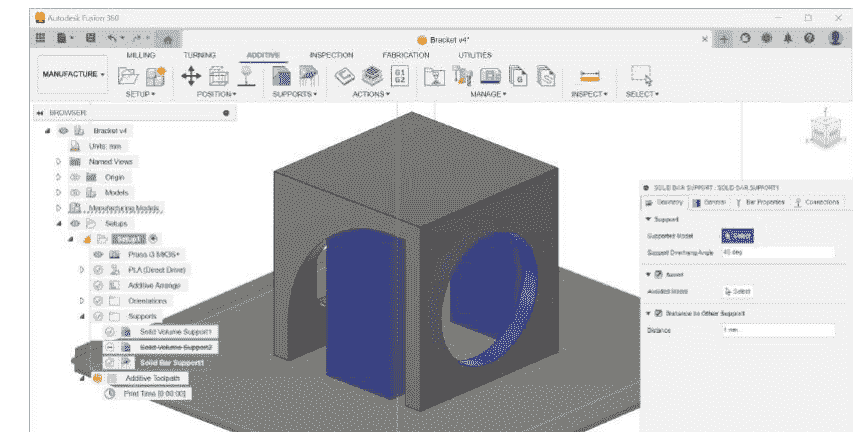

图 10.8 – 选择面以生成杆状支撑

控制零件与支撑结构之间连接点密度的选项位于 General 选项卡中，如图 10.9 所示并标记为 1。Fusion 360 将这些连接点称为锚点。在 General 选项卡中，你还可以选择将多个杆分组并聚集成树状/花束结构，并控制这些结构的外形，同一图中标记为 2。

General 选项卡中 Anchor Density 字段中的术语 anchor 指的是杆状支撑与给定零件下表面之间的连接点。Fusion 360 提供多种预设锚点密度，如 Sparse、Medium 和 Dense，以及完全自定义锚点密度的能力，这使你能够控制锚点之间的距离、它们在下表面上的对齐方式以及锚点与下表面周边的距离。使用自定义锚点密度，你还可以将锚点以六边形或矩形图案分布。

与控制锚点放置设置类似，Fusion 360 还允许你控制杆状支撑的花束/树状结构的参数。在生成杆状支撑时，你可以从包括 Small、Medium 和 Large 花束/树状结构在内的预设集中进行选择。或者，你也可以通过从下拉列表中选择 None 来完全消除花束/树状结构。如果你愿意，还可以完全自定义花束/树状结构，如图 10.9 所示并标记为 2。选择花束/树类型下拉菜单中的 Custom 后，你将可以访问额外的控制项，例如给定花束/树状结构的直径和高度以及其递归深度。你还可以控制花束从每个杆状支撑的主柱分支的最大垂直角度。

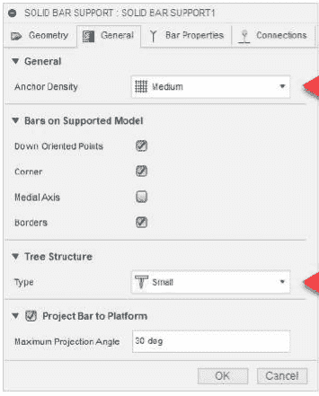
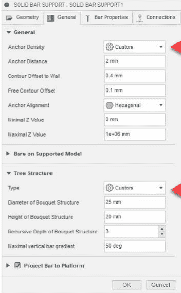

图 10.9 – 实心杆状支撑的 General 选项卡

Bar Properties 选项卡允许你控制杆的大小和形状，如图 10.10 所示。Bar Size 部分允许你控制杆的直径。如果 Width on Part 和 Width on Platform 输入相同，你将得到一个截面均匀的杆。如果你将 Width on Platform 输入的值大于 Width on Part 输入的值，还可以生成一个类似圆锥台的杆。

实心杆状支撑对话框的 Bar Shape 部分允许你自定义杆的形状。Fusion 360 生成的默认杆的 Polygon Corner Count 值为 5。这会导致杆状支撑具有五边形截面。如果你将 Polygon Corner Count 输入增加到 6 或 8，则分别会得到六边形或八边形截面。你还可以通过将 Radial Type 下拉菜单从 Circular 改为 Ellipse 并将 Ellipse Stretch in % 输入字段从 100% 增加到 200% 来生成椭圆形截面。

Bar Path 部分有额外的设置，允许你修改杆状支撑通往成型平台的路径。如图 10.10 所示，杆状支撑默认以直角连接到零件。就像体积支撑一样，FFF 设置中默认的杆状支撑设置也在零件与支撑结构之间留有间隙。此间隙的默认距离为 0.15 毫米，如 Distance to Part 输入字段中设置的那样。如果你的打印设置为 0.15 mm，则该间隙相当于杆状支撑与零件下表面之间 1 层厚的间隙。

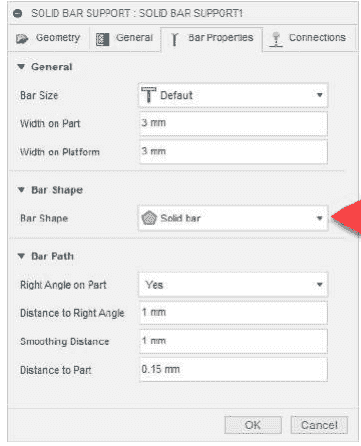
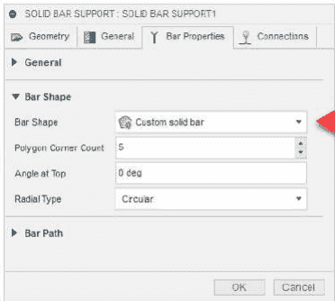

图 10.10 – 为实心杆状支撑选择自定义杆形

SOLID BAR SUPPORT 对话框的 Connections 选项卡允许你控制杆状支撑与零件之间断开点的形状。FFF 设置中杆状支撑的默认设置不使用断开点，如图 10.11 左侧标记 1 所示。如果你选择同一图中右侧标记 1 所示的下拉菜单中的 Custom 选项，可以使用出现的额外输入字段控制断开点的大小和形状。

你还可以控制杆状支撑如何附着到成型平台。默认情况下，所有杆状支撑都与成型平台有实体连接，因为 Pad on Platform 复选框处于激活状态，如图 10.11 所示。你可以使用相关输入字段控制垫的直径、高度和锥角。

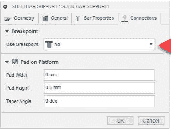
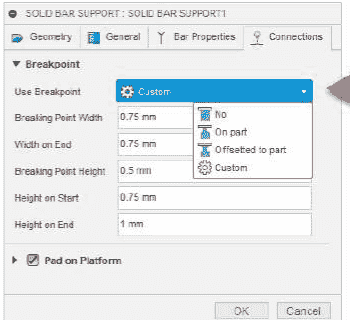

图 10.11 – 为实心杆状支撑选择自定义断点

图 10.12 显示了在此零件的圆形面上生成杆状支撑的结果。要生成此特定支撑，你需要使用以下设置：

- Bar Properties 选项卡 - Bar Size = 默认
- Bar Properties 选项卡 - Bar Shape = 实心杆
- Bar Properties 选项卡 - Right Angle on Part = 是
- Bar Properties 选项卡 - Distance to Part = 0.3 mm
- Connections 选项卡 - Use Breakpoint = 否
- Connections 选项卡 – Pad on Platform = 未选中

如前列表所示，我们将 **Distance to Part** 的输入增加到 0.3 毫米，以便在零件与支撑之间获得两层分离。在 *图 10.12* 中，你可以直观看到杆状支撑与零件之间的间隙，如蓝色杆与灰色零件之间的空白所示。我们在生成此支撑结构时还取消选中了 **Pad on Platform** 选项，以便杆直接接触成型平台而不占用成型平台上的额外面积。

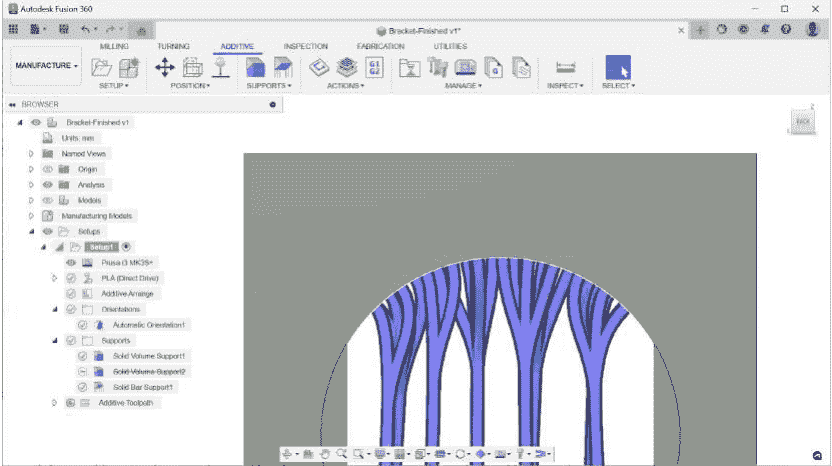

图 10.12 – 具有花束结构的杆状支撑

如果我们从杆状支撑接触零件的区域向外放大，还可以看到此杆状支撑如何连接到成型平台。图 10.13 使用剖面分析视图显示了同一零件及其杆状支撑，其中零件和支撑结构已使用 YZ 平面进行剖切。在下图中，两个 Solid Volume 支撑均已从浏览器中抑制，以便在无遮挡的情况下查看杆状支撑。你会注意到，此杆状支撑使用了小型树状/花束结构，并且杆已以 Maximum Projection Angle 值为 30 度的投影到平台上，以便杆状支撑路径朝向成型平台，同时避免零件本身的上表面，从而使后处理去除支撑的步骤更轻松。

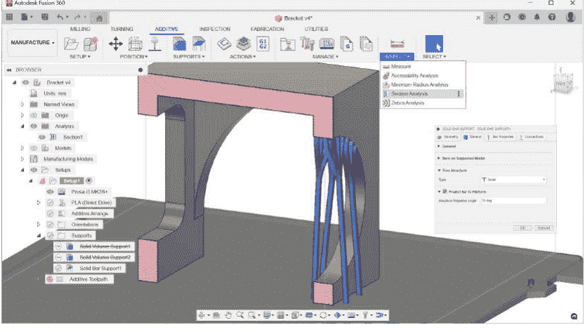

图 10.13 – 投影到平台的杆状支撑

为了更好地了解杆状和实体支撑结构将如何打印，我们需要生成增材工具路径并对其进行仿真。开始时，让我们取消抑制 Solid Volume Support1。我们将保持 Solid Volume Support2 被抑制，如图 10.14 所示。

Fusion 360 能够以独特的方式为体积支撑和杆状支撑创建增材工具路径。正如你在第 9 章中所回忆的那样，打印设置编辑器控制 FFF 支撑的切片方式以及增材工具路径的生成方式。你可以控制诸如为每种支撑类型创建多少个周界等选项。

在此练习中，我们尚未自定义主体预设，并为组件及其相关支撑结构使用 Normal 主体预设。如果我们编辑打印设置并查看 Normal 主体预设的 Support 子部分，可以看到 Volume 支撑的 Number of Support Perimeters 值为 0，而在生成工具路径时，杆状支撑使用 1 个周界进行切片。

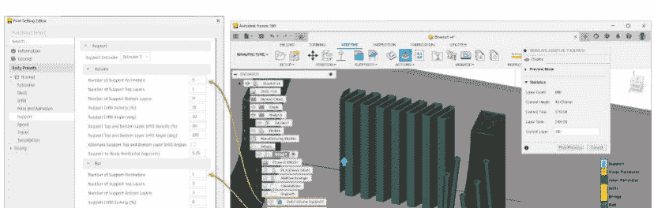

图 10.14 – 我们 FFF 设置中杆状支撑和体积支撑的刀路可视化

生成增材刀路并模拟后，我们可以看到增材模拟中浅蓝色物体代表支撑结构。图 10.14 显示了第 300 层的增材刀路，该层高度为 45.05 毫米，因为该零件以 0.15 毫米的层高切片。如果查看体积支撑所在的区域，您会注意到它们采用了手风琴式刀路进行切片。这是由于 Normal 预设的打印设置编辑器中体积支撑的 15% 填充密度设置所致。您也可以在同一图中观察到，体积支撑的刀路不包含围绕支撑的外轮廓线。

与体积支撑相比，杆状支撑生成的刀路具有五边形截面，并在其周边有一条连续线。然而，杆状支撑刀路不包含任何填充，因为在同一打印设置中，Normal 预设的杆状支撑填充密度设置为 0%。

此示例演示了我们如何在 FFF 3D 打印机上打印零件时生成实心体积支撑和杆状支撑来支撑零件。我们学习了如何控制各种设置以生成杆状支撑和体积支撑所需的形状和连接类型。我们还学习了 Fusion 360 如何为这些支撑结构生成切片和刀路。使用这些设置，我们可以为成功打印创建所需的任何支撑结构。在下一节中，我们将学习如何创建各种杆状支撑以使用 SLA 和 DLP 3D 打印机制造零件。

## 用于 SLA 和 DLP 打印的杆状支撑

市场上主要有两种树脂打印机：底部向上树脂打印机和顶部向下树脂打印机。在底部向上树脂打印机中，光源位于树脂槽下方。随着成型平台从树脂槽（有时称为料 vat）抬起，零件倒置打印。在顶部向下树脂打印机中，光源位于成型平台上方。随着每层成型平台浸入树脂槽，零件正向打印。这两种树脂 3D 打印机都需要出于不同目的的支撑结构。

在顶部向下树脂 3D 打印中，我们需要为悬垂表面生成支撑结构，与为 FFF 3D 打印生成的方式类似。然而，我们为树脂打印机生成的支撑结构很可能是杆状支撑而不是体积支撑。

在顶部向下 3D 打印中，随着每层打印，成型平台会进一步浸入树脂槽。由于打印层与树脂之间没有 **fluorinated ethylene propylene (FEP)** 薄膜，因此该打印过程不会受到零件与 FEP 薄膜之间的分离力作用。因此，我们通常可以创建较弱的支撑结构并仍然成功制造零件。

底部向上树脂打印机在将零件从树脂料 vat 抬起时需要克服重力。底部向上树脂打印机还需要在打印过程中克服零件与 FEP 薄膜之间的剥离效应。根据零件形状和排水孔位置，使用底部向上树脂打印机时您可能还需要克服杯状效应。这就是为什么底部向上树脂打印过程通常需要更强的支撑结构。

Fusion 360 提供了四个不同的命令，用于为 SLA /DLP 3D 打印机的增材设置添加杆状支撑。在图 10.15 中，您可以看到一个包含单个零件的增材设置。名为 Hook.f3d 的 Fusion 360 设计位于本章的 GitHub 文件夹中。该文件包含一个名为 Setup1 的增材设置，用于 Formlabs Form 3 打印机及其相关打印设置。该零件已自动定向，并在成型平台上方 7 毫米，如下图所示。当为 SLA/DLP 增材设置添加杆状支撑时，**BAR SUPPORT** 对话框包含四个选项卡。图 10.15 显示了杆状支撑的 **Geometry** 选项卡。如屏幕截图所示，在选择要支撑的模型后，我们可以控制 **Support Overhang Angle** 输入。

正如本章前一节中我们探索的实心体积支撑和杆状支撑对话框一样，SLA/DLP 打印的杆状支撑从水平面（XY 平面）测量悬垂角度。Fusion 360 为悬垂角度值低于 **Support Overhang Angle** 输入字段中指定的角度的悬垂表面生成支撑结构。

您可能还注意到，SLA/DLP 杆状支撑的 **Geometry** 选项卡与之前看到的 FFF 增材设置的体积支撑和杆状支撑的 **Geometry** 选项卡相似。除了 **Support** 部分外，我们还有 **Avoid** 复选框和 **Distance to Other Support** 复选框，允许我们指定不支撑的表面以及该杆状支撑需要与相邻支撑结构保持多远的距离。

**Geometry** 选项卡中还有一个额外的复选框名为 **Advanced Area Filter**。激活后，高级区域过滤器允许我们控制要支撑的最小和最大面积，以及是否希望 Fusion 360 为可能已存在其他支撑结构的面生成支撑。我们还可以控制要生成的杆状支撑的最小和最大 Z 高度。默认情况下，这些条目分别为 0 毫米和 1e+06 毫米。如果我们将 **Maximal Z Height** 输入减少到 50 mm，Fusion 360 只会为零件前 50 毫米以下、悬垂角度小于 45 度的面部分创建杆状支撑。

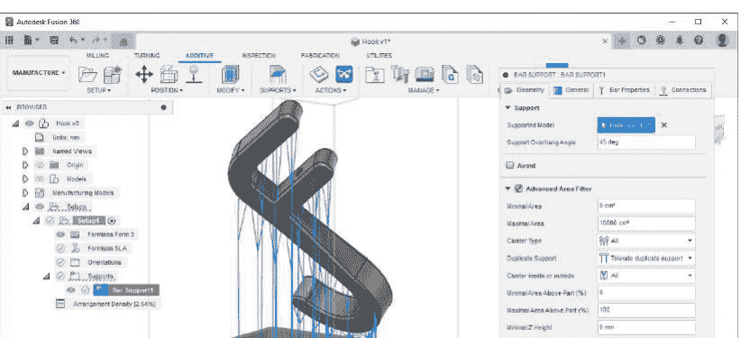

图 10.15 – SLA/DLP 打印机上杆状支撑的 Geometry 选项卡

默认情况下，Fusion 360 使用如前图所示的花束/树状结构创建杆状支撑。我们可以在 BAR SUPPORT 对话框的 General 选项卡中修改 Fusion 360 生成的杆状支撑类型，以及这些杆在接触零件时应彼此多近，如图 10.16 所示。通过将 Anchor Density 输入从默认选项 Medium 改为 Dense，我们可以在杆状支撑和零件之间增加更多的接触点。我们还可以改变树/花束结构的形状。下图显示了通过从 Type 下拉菜单中选择 None 来关闭树状结构的效果。

Fusion 360 还允许您通过激活 Groups 复选框将杆分组。图 10.16 显示了 5 根杆分组在一起，Group Taper (%) 输入为 50%。

这意味着大约五根从零件到成型平台的杆会向中心点聚集指定的量。如果您使用此设置打印零件和支撑，您可以一次处理五根杆的组，并在后处理期间更轻松地将其从零件上折断。

在 General 选项卡中，您还可以为杆状支撑打开 Brace 选项。图 10.16 显示了带有 K 型支撑的杆。Fusion 360 提供了三种不同的支撑类型，类似于字母 K、X 和 N。使用 Brace 复选框下方的附加选项，您可以控制希望连接在一起的杆的数量、支撑与杆状支撑主柱之间的链接角度应为多少，以及是否希望支撑与杆状支撑主柱之间的连接为直线或曲线。

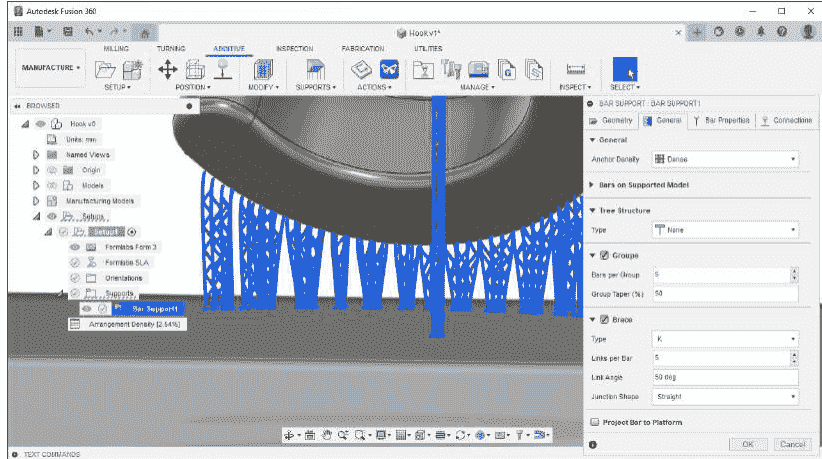

图 10.16 – 无树状结构的分组和支撑杆状支撑

SLA/DLP 打印中杆状支撑的 **Bar Properties** 选项卡与 FFF 3D 打印的相同。在 **Bar Properties** 选项卡中，您可以控制杆的大小和形状。**Bar Properties** 选项卡还允许您控制杆在零件和平台之间应遵循的路径。您可以遵循与下表面法线成直角的路径，或者您的杆可以直接指向成型平台。

现在让我们转到名为 **Connections** 的最后一个选项卡。在此选项卡中，您可以控制杆状支撑如何连接到零件以及平台。默认情况下，杆状支撑通过零件上的断点连接到零件。您还可以选择使断点偏离零件或完全没有断点。您还可以使用有关杆状支撑应如何连接到零件的确切规格来自定义断点的大小和形状。

下一个名为 **Pad on Platform** 的复选框允许您在杆状支撑连接成型平台处添加一个略大于杆本身的小圆形垫片。如果打开此复选框，您可以控制垫片的宽度、高度和锥度角度。锥度角度为零将得到具有圆柱形截面的垫片。正锥度角度将导致截头锥形，垫片在平台处较大，接近杆时变小。负锥度角度将得到相反的形状，其中垫片与成型平台的连接截面较小，随着 Z 方向向上移动，垫片变宽。具有负锥度角度的垫片允许您使用凿子轻松地将垫片和杆状支撑与成型平台分离。

**Connections** 选项卡内的最后一个部分名为 **Connection Type**。Fusion 360 在 **Type** 下拉菜单中提供三个选项：**None**、**Base plate for groups** 和 **Roots**。图 10.17 显示了启用 **Base plate for groups** 选项后生成的杆状支撑。选择此选项后，您可以在 **General** 选项卡中对分组的杆创建底板。您可以控制底板的高度以及其相对于组周边的偏移量。您还可以为这些底板添加锥度角，如之前在平台上添加垫片时所讨论的那样。最后，您可以选择是使用实心图案填充此底板还是应用孔洞图案。我们将在下一节讨论底板支撑时更详细地介绍图案类型。

如果您将连接类型选择为 **Roots**，Fusion 360 将创建杆状支撑柱，这些柱子在打印平台上方不久处分离成多个根部。这会在打印平台方向形成花束结构，增强了杆状支撑主干与打印平台之间的连接，并为细长的高杆状支撑提供额外的稳定性。

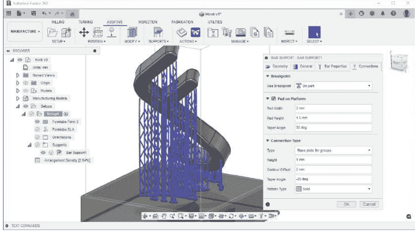

图 10.17 – 带垫片和分组底板的杆状支撑

到目前为止，我们已经研究了用于 SLA/DLP 3D 打印机的杆状支撑命令。Fusion 360 可以为整个部件生成杆状支撑，也可以为给定部件上的特定选定表面生成支撑。

可能存在需要使用杆状支撑来支撑朝下点和边缘的情况。Fusion 360 具有显式命令，可生成附着于朝下点和边缘的杆状支撑。使用 **Down-Oriented Point Bar Support** 和 **Edge with Bar Support** 创建的杆的尺寸和形状控制选项与我们已审查过的杆状支撑选项完全相同。杆状支撑与朝下点杆状支撑和边缘杆状支撑之间的主要区别在于，朝下点杆状支撑会在所选部件的朝下角、边缘和局部最小值处生成单根杆，而 **Edge with Bar Support** 选项则沿所选实体或部件的朝下边缘生成杆状支撑。

在为 SLA/DLP 打印机生成支撑结构时，我的建议是首先添加朝下点杆状支撑。此操作可确保您始终支撑零件上几乎肯定需要支撑结构的任何局部最小值。接下来，我建议为整个部件添加杆状支撑或晶格体积支撑，以便适当考虑所有需要支撑结构的表面。

现在我们已经提到了晶格体积支撑，让我们更详细地查看此支撑操作。*图 10.18* 显示了如何从 **ADDITIVE** 选项卡中的 **SUPPORTS** 面板访问 **Lattice Volume Support** 选项，以及用于控制杆的形状、它们与零件和打印平台的连接、晶格单元的大小以及它们从打印平台移动到零件时的尺寸变化的各种设置。

图 10.18 – 增材设置中的晶格体积支撑选项

如图 10.18 所示，杆状支撑和晶格体积支撑之间有很多相似之处。晶格体积支撑本质上是具有独特支撑样式的杆状支撑。晶格体积支撑与杆状支撑之间的主要区别在于，您无法在晶格体积支撑中选择特定的支撑类型（K、X 或 N）。晶格体积支撑具有自己独特的支撑方法。但是，您可以在 **General** 选项卡下的 **LATTICE VOLUME SUPPORT** 部分控制晶格本身的形状和生长比例行为。

前一幅图显示了一个宽度为 3 毫米、高度为 4 毫米的晶格单元。它还显示了晶格单元大小的变化，您在底板处有较大的单元，在零件连接区域有较小的单元。这种单元大小的变化由 **Adaptive Step Count** 输入控制，对于此支撑结构，该值为 3。

您还可以通过在 **General** 选项卡中激活 **Groups** 复选框来在生成晶格体积支撑时对杆进行分组。如果在创建晶格体积支撑时激活 **Groups**，则可以在晶格体积支撑的 **Connections** 选项卡中为分组添加底板，如图 10.18 所示。

在本节中，我们介绍了如何为使用 SLA/DLP 3D 打印机制造的部件添加各种杆状支撑。我们讨论了杆状支撑、朝下点杆状支撑和边缘杆状支撑之间的相似之处。我们还介绍了如何添加晶格体积支撑。

在下一节中，我们将重点介绍在生成杆状支撑后为获得更好的打印平台粘附而向零件添加底板支撑的具体方法。

## SLA 和 DLP 打印的底板支撑

使用 Fusion 360 自动生成杆状支撑时，Fusion 默认会为每个杆状支撑添加垫片。垫片会添加到杆与打印平台连接处、表面积大于杆直径的位置。此操作可确保支撑与打印平台之间具有良好的粘附性。垫片连接通常推荐用于使用 SLA/DLP 打印机打印小零件，例如珠宝。然而，如果您使用底部向上树脂打印机用杆状支撑打印较大零件，则应考虑使用底板连接而不是在杆状支撑与打印平台之间使用垫片。这将确保您具有更强的打印平台粘附力并提高打印成功的几率。

在上一节中，我们介绍了如何将杆分组并使用底板将这些组连接到打印平台。Fusion 360 还具有显式的 **Base Plate Support** 操作，如图 10.19 所示。此操作位于 **ADDITIVE** 选项卡中，**SUPPORTS** 面板下拉菜单中。

图 10.19 – 如何在 Fusion 360 中访问底板支撑命令

图 10.19 显示了 Formlabs Form 3 打印机的增材设置及其相关打印设置。零件已被刻意布置和定向。已将两个杆状支撑操作应用于零件：Down Oriented Point Bar Support1 和 Bar Support1。此 Fusion 360 文档名为 Screw.f3d，并包含在本章的 GitHub 文件夹中。

在功能区中访问底板支撑命令后，您将看到如图 10.20 所示的 BASE PLATE SUPPORT 对话框。此操作还会在浏览器中的 Supports 文件夹中添加一个名为 Base Plate Support1 的新行项目。在 Geometry 选项卡中选择要创建支撑的模型后，您可以切换到 General 选项卡。在 General 选项卡中，您将看到控制底板边界形状的选项。您可以根据零件当前方向的轮廓创建底板，也可以根据零件的包围盒创建矩形底板。您可以控制轮廓周边的偏移量、底板的高度及其锥度角。如上一节所述，用于锥度角的负值将创建在正 Z 方向上横截面积增加的底板。这种形状允许您在打印完成后轻松使用凿子将底板支撑与打印平台分离。

在此示例中，我们支撑的是没有孔的实心零件。如果我们要打印带孔的零件，例如侧面打印的戒指，则取决于我们为 **Fill Inner Contour** 设置使用的选项，将生成不同的底板。如果选项设置为 **Yes**，我们将创建一个实心、圆形、板状的底板。如果选项设置为 **No**，我们将创建一个垫圈状底板。

图 10.20 – 在 SLA 打印机的增材设置中添加底板支撑

为了节省材料，您还可以在 **BASE PLATE SUPPORT** 对话框的 **General** 选项卡中选择图案类型。默认图案类型为 **Solid**。如果您选择不同的图案类型，例如如图 10.21 所示的 **Hexagonal**，您就可以控制图案的大小及其壁厚。请注意，如果您选择除实心以外的图案，则您的杆状支撑可能不会始终接触底板支撑的打印段，这取决于杆的大小和图案的大小。

图 10.20 – 为底板支撑添加六边形图案

在本节中，我们介绍了如何添加明确的底板支撑，以提高大型零件打印成功的可能性。底板支撑会创建一个结构和一个平坦的表面，以提高打印件对成型平台的附着力。通过控制底板支撑的形状和厚度，您可以在使用 SLA/DLP 3D 打印机进行 3D 打印时确保与平台成功粘合。

## 摘要

无论您计划使用 FFF 打印机还是顶部向下或底部向上的 SLA/DLP 打印机进行 3D 打印，都需要生成支撑结构，以便成功打印切片模型中的悬垂区域或岛状部分。根据您的 3D 打印技术，您可能需要生成体积支撑或杆状支撑。

控制这些支撑的尺寸和形状（因此也控制其强度）在打印是否成功方面起着至关重要的作用。在本章中，我们探讨了如何为 FFF 打印生成体积支撑和杆状支撑。我们讨论了如何有效地将这些支撑应用于组件的整个主体或选定表面。我们展示了如何将支撑应用于实体和网格体。我们演示了更改支撑设置以及切片设置的影响，以控制这些支撑的切片方式和刀具路径的生成。我们还提到了在生成支撑时零件与支撑结构之间的间隙的影响，以便我们能够打印出成功的下表面区域，同时减少零件的后处理工作量。

我们还强调了如何为 SLA/DLP 打印创建杆状支撑。我们展示了 FFF 与树脂基打印机杆状支撑之间的相似之处，以及 SLA/DLP 打印机杆状支撑的独特特性，例如树状结构、分组和加固。我们还了解了如何创建底板支撑以实现与成型平台的牢固附着。

使用本章中学到的技术，您可以尝试使用特定的打印机、材料和打印设置，以创建支撑结构，使其强度足以成功打印给定零件，同时最大限度地减少材料使用量和去除打印支撑结构所需的后处理时间。

在下一章中，我们将进一步探讨如何切片模型并生成增材刀具路径，以及如何逐层模拟该刀具路径，以便更好地了解模型方向、切片设置和支撑结构的影响。
