## 11 切片模型和模拟刀具路径

欢迎阅读 *第 11 章*。在本章中，我们将全面学习如何为 **Fused Filament Fabrication (FFF)** 3D 打印生成和模拟增材刀具路径。我们将介绍如何获取有关增材设置的关键信息，例如打印统计数据和能源消耗。我们还将学习如何生成和自定义启动打印作业所需的 G-code。

一旦我们希望打印的所有组件都已正确定向、排列并得到支撑，就该生成增材刀具路径了。生成刀具路径后，我们可以在每一层可视化结果并模拟喷嘴在移动和挤出动作期间的运动。

在 Fusion 360 中生成增材刀具路径是一个一键式解决方案，但始终建议查看刀具路径，以了解我们选择的打印设置和主体预设是否会产生预期结果。

在本章中，我们将涵盖以下主题：

- 生成增材刀具路径
- 模拟增材刀具路径
- 生成 G-code

到本章结束时，您将更好地了解如何使用 Fusion 360 生成增材刀具路径。您将学习如何自定义 Fusion 360 的首选项以手动和自动生成刀具路径。您将学习如何访问关键打印统计数据，例如打印给定打印件将使用多少耗材以及打印需要多长时间。您还将学习如何计算给定打印作业的总成本，包括耗材成本和能源成本。您将学习如何模拟增材刀具路径，以逐层可视化打印设置对打印作业的影响。最后，您将学习如何生成 G-code 文件。随着本章的结束，您将获得必要的技能，以便在打印过程中在特定层引入暂停动作，以便在零件中嵌入物体，例如磁铁、六角螺母和加强杆。您还将了解如何自定义 G-code 以在打印过程中更改使用的耗材，以便为打印的一部分加载不同颜色的耗材。

### 技术要求

本章涵盖的所有主题都可供个人、试用版、商业版、初创版和教育版 Fusion 360 许可证类型使用。

本章的练习文件可在以下位置找到：https://github.com/PacktPublishing/3D-Printing-with-Fusion-360

除了 Fusion 360 之外，您还需要一个文本编辑器，例如 Notepad 来打开 G-code 文件。

### 生成增材刀具路径

在前几章中，我们介绍了如何创建增材设置、在成型体积内定向和放置零件，以及生成支撑结构。在本节中，我们将在此知识的基础上进行扩展，并演示如何为此类增材设置生成增材刀具路径。

为了演示如何在 Fusion 360 中生成增材刀具路径，让我们使用本章 GitHub 页面提供的 `Connector-Assembly`。该 Fusion 360 文档包含三个组件。如图 11.1 所示，主要组件名为 `Connector`。还有两个名为 `Carbon Fiber Rod` 的附加组件。根据零件的装配方式，碳纤维杆旨在嵌入连接器内部。为了使用传统制造方法制造此类组件，我们必须将连接器分成两半，以便嵌入碳纤维杆。或者，我们必须钻出通孔以将碳纤维杆放置在连接器主体内。然而，由于我们将利用增材制造，我们可以在打印过程中直接插入碳纤维杆，而无需依赖二次操作。

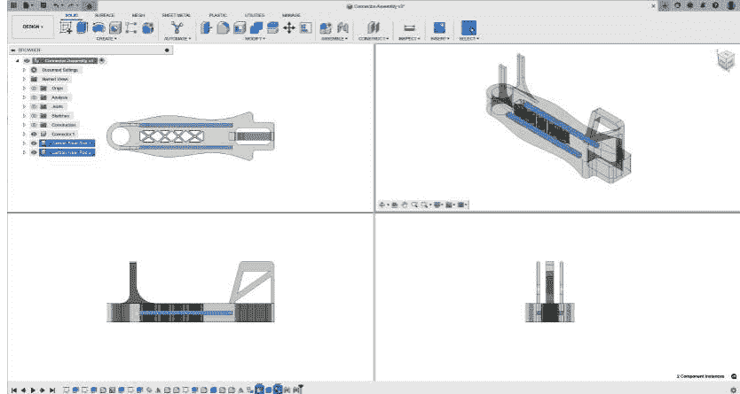

图 11.1 – 包含三个组件的 Connector-Assembly

碳纤维杆可以从各种来源轻松购买，并可用于在特定方向上加强给定组件。图 11.2 显示，在 www.amazon.com 上快速搜索碳纤维杆将得到各种尺寸和价格可供购买。在此示例中，我们将使用 4 mm x 4 mm x 420 mm 的杆，每包 8 根，价格约为 16 美元。

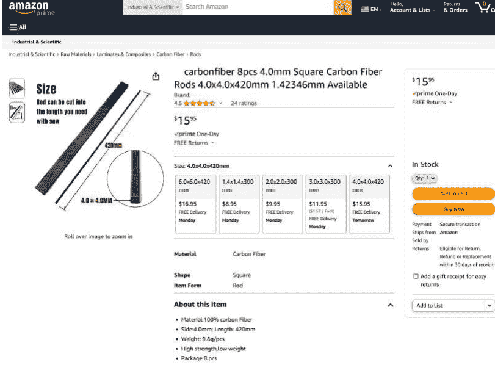

图 11.2 – 在线有各种尺寸的碳纤维杆可供购买

名为 `Connector` 的组件已包含两个腔体，可在打印过程中嵌入碳纤维杆。该设计可容纳长度为 100 mm、横截面为 4 mm x 4 mm 的杆。由于此示例仅为理论示例，腔体不包含额外的公差。如果我们将此组件作为最终设计的一部分进行打印，最好先购买碳纤维杆并测量它们，确保其横截面尺寸确实为 4 x 4 mm。然后，我们将在 Y 和 Z 轴上对其测量的横截面尺寸增加一层公差，以便在打印过程中轻松将杆放置在零件内。

过程中的下一步是创建增材设置。我们在上一章中广泛介绍了如何创建增材设置。如图 11.3 所示，此零件的增材设置包括机器 **Prusa i3MK3S+**，以及打印设置中定制的 **PLA (direct drive)**。如果您查看浏览器，在活动设置（Setup 1）下，您会看到 PLA 打印设置关联了一个 **Custom** 主体预设。

在 **SETUP** 对话框中，我们将明确选择我们的模型为 **Connector:1**。我们不会在模型选择过程中选择碳纤维杆。这将确保我们只 3D 打印连接器零件。

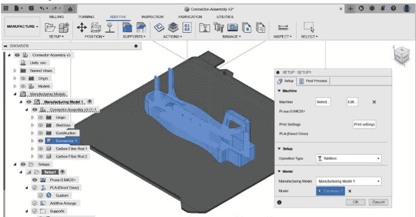

图 11.3 – 为名为 Connector 的组件创建增材设置

在这一点上，我想强调一个我们都应该注意的关键 Fusion 360 首选项。您可能还记得，我们可以通过单击用户界面右上角的头像图标来访问 **Preferences** 对话框，如图 11.4 中标注 1 所示。在 **Preferences** 对话框中，您可以在浏览器中导航到 **Manufacture** 部分，如标注 2 所突出显示。在 **Manufacture** 部分，您会注意到有一个 **Generate Additive Toolpath on Setup creation** 选项，如标注 3 所突出显示。默认情况下，此选项未选中，如图所示。

如果您经常处理不需要支撑结构的模型，您可能更喜欢激活此复选框，然后 Fusion 360 在您创建增材设置后立即为您自动创建增材刀具路径。我经常发现自己处理需要生成支撑结构的模型。因此，我更喜欢保持此选项未选中。这样，我可以先添加支撑结构，然后在对模型的支撑结构感到满意后生成增材刀具路径。

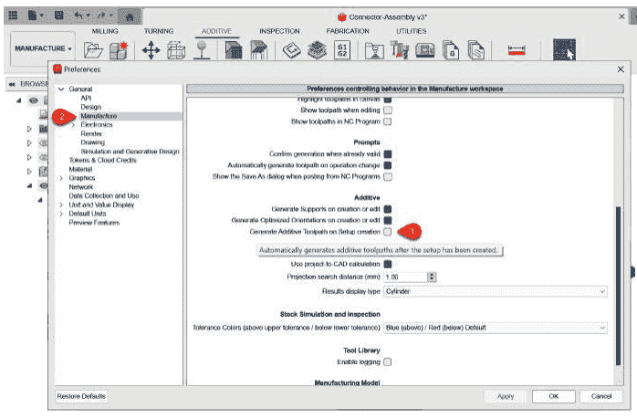

图 11.4 – 生成增材加工刀具路径可以在“首选项”中自动化

创建增材设置后，我们需要为此模型添加必要的支撑结构，以支撑低于特定悬垂角度的下表面。图 11.5 显示了两个具有较大悬垂角度的面的选择，这些面需要支撑结构才能成功进行 3D 打印。如第 10 章详细所述，我们将对这两个面应用实心体积支撑。

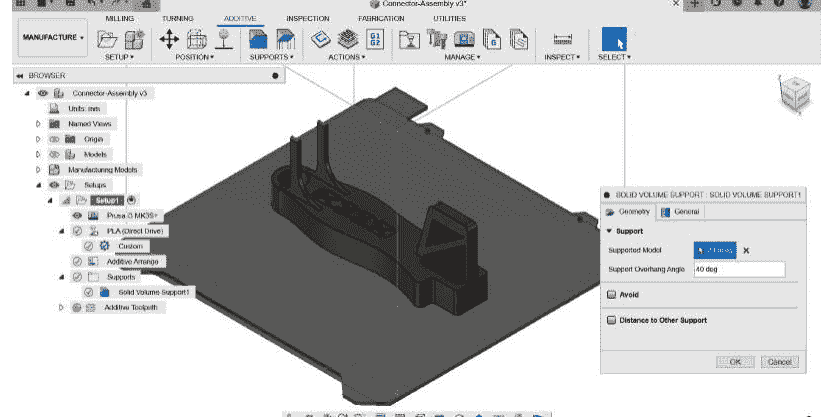

图 11.5 – 对选定面应用实心体积支撑

注意，我们没有对零件中将放置碳纤维杆的两个腔体应用支撑结构。这是可以选择基于 CAD 的表面来生成支撑结构时的一个关键优势。使用明确的选择集，您不仅可以完全控制想要支撑的表面，还可以轻松避免在模型中您知道会进行打印中操作的部分创建支撑，例如插入磁铁、六角螺母或加强杆，这将确保零件自支撑。

现在设置已完成，是时候创建增材加工刀具路径了。Fusion 360 允许您以两种方式之一创建增材加工刀具路径。选择浏览器中的增材加工刀具路径后，您可以右键单击并从弹出菜单中选择“生成”，如图 11.6 所示。或者，在从浏览器选择增材加工刀具路径后，您可以从位于 ADDITIVE 选项卡中的 ACTIONS 面板中选择“生成”命令。这两个命令都将开始生成增材加工刀具路径。

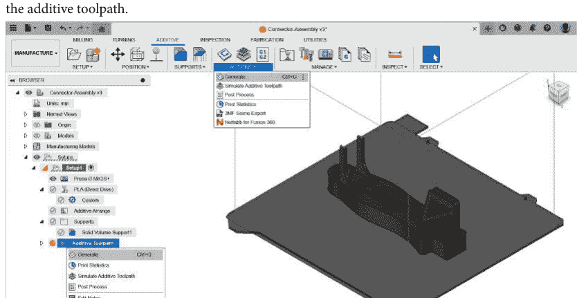

图 11.6 – 生成增材加工刀具路径

一旦为 FFF 打印机生成了增材加工刀具路径，如果在浏览器中展开“增材加工刀具路径”行项目，您将看到一个名为“打印时间”的行项目。该条目在图 11.7 中由标注 1 突出显示，显示了增材设置的总体打印时间。您可以通过在浏览器中双击“打印时间”，或通过选择 ACTIONS 面板下的“打印统计”命令来获取更多信息，如同一图中标注 2 所示。

这两个操作都会显示 **PRINT STATISTICS** 对话框，其中包含两个选项卡。第一个选项卡名为 **Print Statistics**，提供额外信息，例如成功完成此设置打印所需使用的丝材米数。这是一项重要信息，因为在开始打印前您可能需要确保手头有足够的材料。您还会看到有关打印将包含多少层的信息，以及模型打印的各个部分（如外壳、填充和支撑结构）将消耗多少时间。

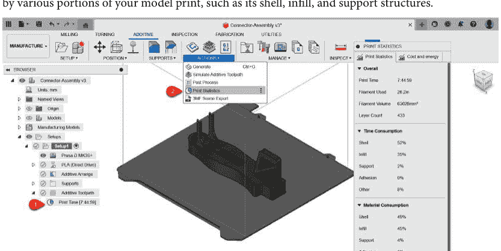

图 11.7 – 增材设置的打印统计信息

在 **PRINT STATISTICS** 对话框的第二个选项卡中，您可以计算完成打印此零件所需的材料成本和能源消耗量。请注意，**Cost and energy** 选项卡仅适用于 FFF 机器。您将无法查询其他增材制造工艺的材料或能源成本。

如 *图 11.8* 所示，**Cost and energy** 选项卡允许您从下拉菜单中选择位置。根据您的位置，您可以输入您所在市场的能源成本以及为本次打印购买的特定丝材的成本。

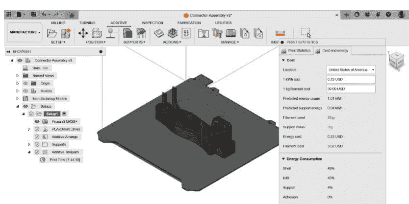

图 11.8 – 使用 FFF 机器的增材设置的成本和能源计算

在此示例中，我们可以将位置设置为美国，并将能源成本输入为每千瓦时 $0.23，这是撰写本文时美国的当前平均能源成本。我们可以将使用的丝材成本输入为每公斤 $39.99。凭借这些输入，Fusion 360 估计打印的总成本为 $3.25，这是基于我们将使用的丝材量以及挤出丝材所需的加热量，以及保持床在一定温度下的加热量。请注意，此计算不包括我们将插入此零件中的碳纤维杆的成本。

如果您还记得，www.amazon.com 上 8 根杆的成本为 $16。这意味着每根杆价值 $2。每根杆长 420 mm，我们的开口长 100 mm。这意味着每件零件可以使用四分之二根杆。因此，我们每件零件将使用价值 $1 的杆，使此零件的总成本达到 $4.25，不包括人工成本。

在打印前能够看到此类信息有助于我们了解制造零件的大致成本。根据此信息，我们可以选择更改打印设置以降低最终零件的能源或丝材成本。

在本节中，我们重点介绍了如何自动和手动生成增材加工刀具路径。我们指出了可以在创建增材设置时立即生成增材加工刀具路径的自定义首选项。我们展示了如何从 Fusion 360 的浏览器和功能区 UI 生成增材加工刀具路径。我们还学习了如何使用 Fusion 360 计算关键打印统计信息，例如总打印时间、所需材料和打印成本。在下一节中，我们将模拟增材加工刀具路径以逐层可视化它。

## 模拟增材加工刀具路径

在上一节中，我们学习了如何使用 Fusion 360 为 FFF 工艺生成增材加工刀具路径。在本节中，我们将重点介绍如何模拟这些增材加工刀具路径。在 Fusion 360 的 **MANUFACTURE** 工作区中，我们有两种方法可以模拟增材加工刀具路径。

第一种方法是在浏览器中为活动设置选择 **Additive Toolpath** 行项目并右键单击它。如 *图 11.9* 中标注 **1** 所示，我们可以在此右键菜单中访问 **Simulate Additive Toolpath** 命令。我们拥有的第二个选项是使用位于 **ADDITIVE** 选项卡的 **ACTIONS** 面板中的 **Simulate Additive Toolpath** 命令。这两个命令都会产生相同的结果，即对活动增材设置的增材加工刀具路径进行模拟。

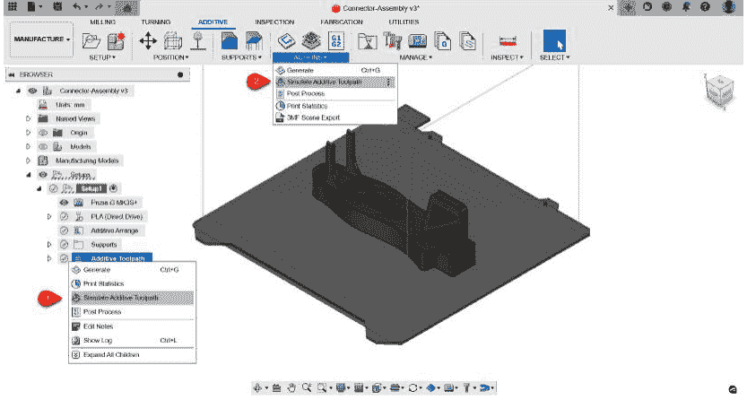

图 11.9 – 如何访问“模拟增材加工刀具路径”命令

一旦我们模拟增材加工刀具路径，我们就可以可视化机器将为此增材设置 3D 打印的所有层。我们有四种方法可以更改我们可视化的层号。*图 11.10* 使用唯一的标注指出每种方法：

- 标注 **1** 指向 Fusion 360 画布中的蓝色箭头。如果我们通过鼠标左键单击选择此箭头，我们可以沿 Z 轴上下拖动箭头以在不同层可视化刀具路径。
- 标注 2 指向位于画布底部的仿真播放器控件。此控件中有七个按钮。使用控件中央的播放按钮（从左数第四个按钮），我们可以开始刀具路径的动画。控件中最左和最右的按钮（从左数第一个和第七个按钮）将自动跳转到第一层和最后一层。在此示例中，最后一层是 433。我们还可以使用按钮二或六逐层切换。按钮三和四在活动层内动画化刀具路径。
- 标注 3 指向 SIMULATE ADDITIVE TOOLPATH 对话框中的“当前层”输入字段。图 11.10 显示了第一层的刀具路径，因为“当前层”的输入设置为 1。我们可以在此字段中输入特定的层号以快速跳转到该层的刀具路径可视化。请记住，在输入所需层号后，您无需按 Enter 或单击“确定”即可使更改生效。Fusion 360 将自动更新并显示您输入的层的刀具路径。
- 标注 4 指向仿真播放器时间线，该时间线位于仿真播放器控件下方。黑色垂直线可用于控制时间线。通过左键单击选择它，您可以将时间线向右拖动以可视化任何计算层的刀具路径。

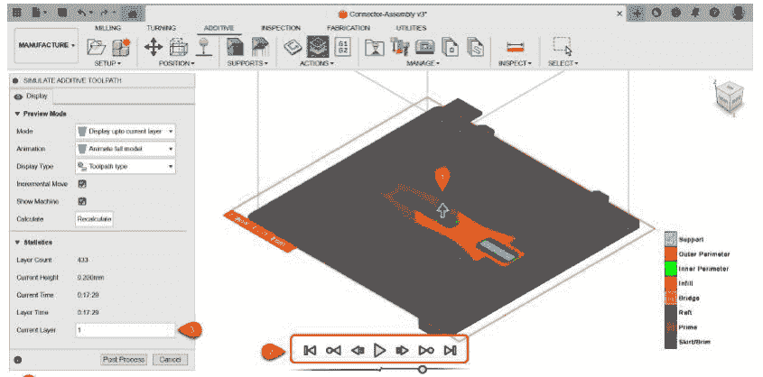

图 11.10 – 如何更改工具路径仿真中显示的层

SIMULATE ADDITIVE TOOLPATH 对话框提供了多个选项，可让你根据需要可视化特定的刀具路径。如果将 Mode 输入从 Display up to current layer（显示至当前层）更改为 Display current layer only（仅显示当前层），你将能够可视化你感兴趣的层号的特定刀具路径。在图 11.11 中，我们可以看到连接器组件在第 80 层的刀具路径。你还可以看到，在 SIMULATE ADDITIVE TOOLPATH 对话框中，Display Type 选项被设置为 Toolpath Type。使用此显示类型，Fusion 360 会根据刀具路径的类型为每条刀具路径线着色。例如，任何外轮廓刀具路径都用红色线着色，而所有内轮廓刀具路径则用绿色着色。支撑结构使用浅蓝色线表示，而填充刀具路径则显示为橙色线。这些是该图中所显示层中存在的唯一四种刀具路径类型。

你可能还注意到，在图 11.11 中 Show Machine 复选框未被选中，并且我们是从顶视图查看模型。关闭机器可视化会隐藏我们在活动设置中使用的 3D 打印机的工作体积以及打印平台。通过隐藏打印平台的可视化，我们可以在模拟增材刀具路径时轻松专注于零件和支撑。

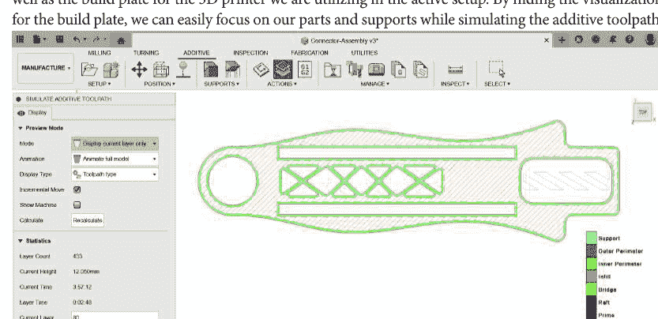

图 11.11 – 可视化特定层的刀具路径

SIMULATE ADDITIVE TOOLPATH 对话框中我们拥有的另一个选项是显示刀具路径的打印速度。我们可以通过将显示类型从 Toolpath type 改为 Print speed 来实现，如图 11.12 所示。使用打印速度显示类型可视化刀具路径时，Fusion 360 会根据 3D 打印每条刀具路径时使用的挤出速度对其着色。左侧图像显示，我们的零件和支撑结构在第 1 层以相对较慢的速度打印。右侧图像显示同一零件在第 81 层。在这里，我们可以看到填充、轮廓、支撑和桥接刀具路径类型以不同的速度打印，并且与第 1 层相比，在这一层通常快得多。

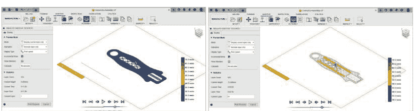

图 11.12 – 使用打印速度显示类型显示增材刀具路径

通过模拟增材刀具路径并可视化 3D 打印机在挤出丝材时在每一层会做什么，我们可以确定零件在各层将有多少条轮廓刀具路径，以及零件在打印过程中将如何得到支撑。我们还可以可视化从一层到另一层的打印速度变化。

使用这些技术，我们可以选择继续打印或更改某些打印设置，以实现我们期望的轮廓、填充和支撑的刀具路径。在下一节中，我们将学习如何生成 G-code 以开始打印。

## 生成 G-code

在创建增材刀具路径并对其进行模拟后，如果我们对结果满意，就可以进入过程中的最后一步，即生成 G-code。为了使用 Fusion 360 为增材设置生成 G-code，我们只需单击 SIMULATE ADDITIVE TOOLPATH 对话框底部的 Post Process 按钮，如图 11.13 所示。此操作将自动打开 NC Program 对话框，在其中我们可以后处理刀具路径并创建必要的 G-code。

在 NC Program 对话框中，有两个选项卡。第一个选项卡名为 Settings，是增材制造中唯一相关的选项卡。因此，我们可以简单地忽略 Operations 选项卡。NC Program 对话框的 Settings 选项卡有两个列。左侧列允许我们选择要使用的后处理器，以便将屏幕上看到的刀具路径转换为 G-code 文件。右侧列名为 Post Properties，允许我们自定义输出，以便生成的 G-code 按照我们的指令执行。

在 NC Program 对话框的 Program 子部分中，我们可以为 G-code 文件命名并添加额外注释。我们还可以指定 G-code 文件的输出文件夹。如果我们选择图 11.13 所示的 Post to Fusion Team 复选框，我们的 G-code 文件不仅会保存在本地文件夹中，还会在我们选择的 FUSION TEAM 文件夹内创建一份副本。

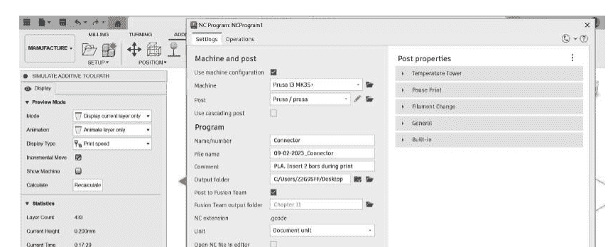

图 11.13 – 后处理 FFF 增材刀具路径

启动 NC Program 对话框的另一种方法是选择 ADDITIVE 选项卡的 ACTIONS 面板中的 Post Process 命令，如图 11.14 所示。请记住，在选择 Post Process 命令以启动 NC Program 对话框之前，必须先选择活动设置的增材刀具路径。

在本例中，我们使用的是 Prusa i3MK3S+ 机器。用于 Prusa 打印机的后处理文件具有额外的属性，如图 11.14 所示。在本例中我们感兴趣探索的属性位于 Pause Print 部分，如标注 2 所示。通过展开 Pause Print 部分的列表，我们可以输入希望暂停打印过程的层号。我们还可以包含一条在暂停期间显示在打印机显示屏上的消息。

正如你在上一节中所回忆的那样，通过模拟我们的增材刀具路径，我们确定在第 80 层，挤出机会尝试跨越我们希望添加碳纤维棒的空腔。因此，在第 79 层暂停打印是个好主意，这样我们就可以在打印机尝试封装空腔之前插入碳纤维棒。

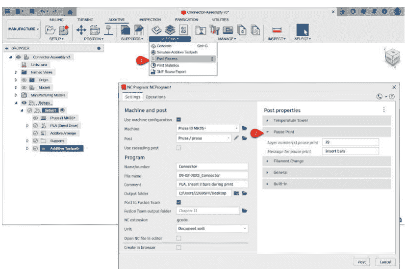

图 11.14 – 在特定层为 G-code 添加暂停打印功能

Fusion 360 根据所选的后处理文件提供独特的后处理属性，该文件与你为设置选择的机器相关联。图 11.15 显示了三种常见 3D 打印机及其后处理属性之间的差异。

左侧图像显示了 Prusa 系列打印机的后处理属性。正如图中所示，使用 Prusa 后处理器，你可以自定义 G-code，以便找到打印特定丝材的最佳温度。这可以通过在 Temperature Tower 部分启用 Trigger 字段来实现。此操作将使你能够在控制温度从初始温度值上升到最终温度值并设置间隔的情况下打印测试对象。打印完成后，你可以观察成品并确定在哪个温度下获得最佳效果，并在后续打印中将该知识用作新的打印设置。正如我们在图 11.14 中之前强调的那样，你还可以执行 Pause Print 功能。除了这两个部分之外，你还可以通过输入应更换为不同丝材的层号来执行 Filament Change 操作。

图 11.15 中的中间图像来自 Ultimaker S5 打印机的 Ultimaker 后处理文件。在此后处理文件的 Post properties 的 General 部分中，你还可以指定装载到机器上的 Extruder 1 和 Extruder 2 的材料和打印核心。没有这些信息，你将无法在此打印机上成功打印。

图 11.15 中右侧的图像来自 Creality CP-01 打印机的 Creality 后处理文件。与 Prusa 和 Ultimaker 系列打印机一样，Creality 打印机在 Post properties 下也有 Temperature Tower 选项。此外，你可以控制是否启用或禁用床水平校准。你还具有额外的功能来控制在哪个 Z 高度关闭床水平校准补偿。

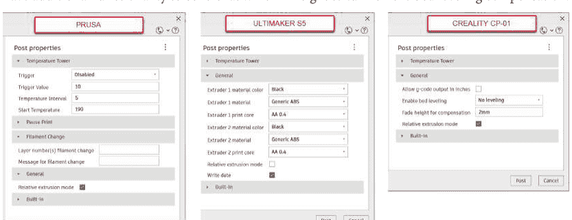

图 11.15 – 基于制造商的后处理属性

NC Program 对话框中的另一个非常有用的功能是能够为给定字段编辑表达式。图 11.16 显示了如何自定义任何输入字段，例如 File name，而不仅仅是手动输入。如果选择输入字段右侧的 : 图标，如标注 1 所示，你可以从下拉菜单中选择 Edit expression，如标注 2 所示。当 Expression 对话框显示时，你可以输入诸如 date 或 documentName 之类的参数，以便为 G-code 使用的文件名自动设置为你指定的参数。在 Expression 对话框中，你还可以使用一些基本公式。

图 11.16 演示了如何使用 + 号连接多个参数。你还可以通过在两者之间使用 _ 来在 date 和 documentName 参数之间添加自定义字符串。选择 OK 后，File name 字段将自动填充日期和 Fusion 360 文档的名称。Expression 对话框还具有自动填充参数名称的能力。如果你不熟悉所有可用参数，只需开始输入，例如 name，你就会看到包含字符串 name 的各种参数，以便你可以从可用选项列表中选择参数，例如 Fusion Team 名称或文档名称。设置好表达式后，你可以通过选择 Save as the user default 来保存它，这样下次创建 NC 程序以导出 G-code 时，就无需输入文件名，文件名将自动设置为日期和 Fusion 360 文档名称的组合。

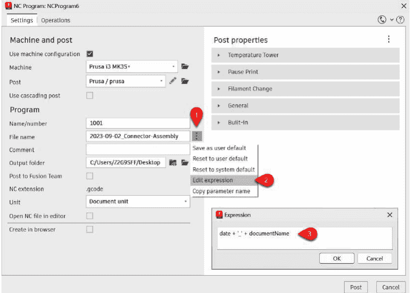

图 11.16 – 如何在 NC Program 中利用表达式作为输入字段

当您完成对后处理属性的自定义后，您所要做的就是选择 NC Program 对话框右下角的 Post 按钮。Fusion 360 然后会将 G-code 文件导出到您指定的位置，并使用您输入的文件名。图 11.17 显示了此操作的输出，这是一个可读文本文件，扩展名为 .gcode。如果您使用原生文本编辑器应用程序（如 Notepad）打开此文件并向下滚动，就能找到第 79 层的开始位置。如图 11.17 所示，暂停打印操作通过代码 M601 引入，同时还通过 M117 显示一条消息，文字为 Insert Bars。如果您在该 3D 打印机上打印此 G-code，打印将进行到第 79 层，然后暂停，直到您按下旋钮。随后，您插入碳纤维棒。

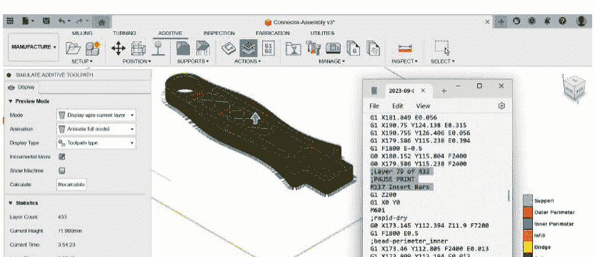

图 11.17 – 使用 NC Program 对话框发布的 G-code 可视化

在本节中，我们介绍了如何使用 Fusion 360 生成 G-code 文件。我们展示了如何从 SIMULATE ADDITIVE TOOLPATH 对话框以及 MANUFACTURE 工作区 ADDITIVE 选项卡中的 ACTIONS 面板访问后处理功能。我们介绍了 NC Program 对话框中可用的各种选项，用于将增材加工刀具路径转换为 G-code 文件以便打印。我们还介绍了根据所选 3D 打印机在 NC Program 对话框中可用的各种后处理属性。

## Summary

在本章中，我们学习了如何为 FFF 3D 打印机切片模型。切片是增材制造打印准备中的重要步骤，其在创建设置、定向零件、将它们排列在构建平台上并生成支撑结构之后进行。一旦零件切片完成，我们还可以模拟增材加工刀具路径。

在本章中，我们学习了如何逐层生成和可视化增材加工刀具路径。我们回顾了 Fusion 360 为 FFF 打印机显示的各种打印统计数据，例如能源消耗、打印时间、材料使用量。凭借这些信息，我们可以按原样对增材加工刀具路径进行后处理并创建 G-code 文件。我们还介绍了如何根据仿真结果和打印统计数据更改打印设置，从而使用更少的材料打印零件并降低能耗。

在本章的最后一节中，我们学习了如何对增材加工刀具路径进行后处理并创建 G-code。在创建 G-code 时，我们还学习了如何对其进行自定义。通过这些自定义设置，我们学习了如何创建温度塔，以便确定使用特定耗材的打印温度。我们还学习了如何暂停打印以插入额外的物体，例如六角螺母、磁铁和加强杆。我们还学习了如何在打印过程中更换耗材，以便使用不同耗材颜色打印零件的不同部分。最后，我们学习了如何使用 Fusion 文档中已有的参数来自动化 **NC Program** 对话框中的某些输入，例如文件名。使用所有这些技术，我们可以自信地从增材设置过渡到为 FFF 打印机生成 G-code。

定位和支撑金属 3D 打印机部件的许多基本原理与我们为 FFF 3D 打印所学的相似。然而，对于金属打印机，我们需要介绍一些特定于工艺的设置。在下一章中，我们将转换方向，介绍更多关于金属 3D 打印的内容。
