# Part 4:
Metal Printing, Process Simulation, and Automation

本书的最后一部分全部关于金属 3D 打印和自动化。首先，我们将介绍各种使用 Autodesk Fusion 为金属 3D 打印创建增材设置的方法。我们将解释如何利用熔融沉积制造、粘结剂喷射、定向能量沉积和金属粉末床熔融技术来制造金属零件。然后，我们将演示如何模拟金属粉末床熔融工艺以检测潜在的打印失败。我们还将演示如何补偿模型中的较大变形，最终最大限度地减少可能的打印失败。

我们将通过介绍各种自动化技术来结束本书，以减少在重复任务上花费的时间。我们将介绍可在 Autodesk App Store 上下载和使用的预制自动化工具。我们将介绍操作模板的概念以及使用 Autodesk Fusion API 用 Python 或 C++ 创建的脚本，以及如何对其进行自定义以满足我们的需求。

本部分包含以下章节：

- 第 12 章，金属打印机 3D 打印
- 第 13 章，模拟 MPBF 工艺
- 第 14 章，自动化重复任务

## 12

## 3D Printing with Metal Printers

欢迎来到第 12 章，我们将学习有关金属增材制造的所有知识。金属 3D 打印在过去几年中越来越受欢迎，因为它为众多行业，例如航空航天、医疗保健和高档消费品，提供了长长的益处清单。使用金属 3D 打印，您可以创建具有复杂内部结构和有机外部表面的零件，这些零件无法通过其他方式制造。与其他制造方法相比，金属 3D 打印在小批量生产中更具成本效益。

Fusion 360 结合 Additive Build 扩展，可用于创建使用金属制造零件的 3D 打印机的增材设置。在本章中，我们将介绍在 Fusion 360 中使用金属增材制造的各种方法。我们将介绍如何利用 Fusion 360 准备模型，以便使用熔融沉积制造、金属粘结剂喷射、金属粉末床熔融和定向能量沉积技术进行 3D 打印。我们还将展示如何根据打印技术选择相关的打印设置。我们将重点介绍如何根据机器特定因素（如匀粉刀方向）对零件进行定向和放置。

根据特定 3D 打印机使用的增材技术以及零件方向，零件在打印过程中可能需要支撑结构。由于金属粉末床熔融过程中使用的支撑与熔融沉积制造和树脂打印所需的支撑不同，我们还将学习如何创建技术相关的支撑结构，以最大限度地减少材料浪费、缩短打印时间并最大限度地减少后处理工作量。

无论我们是使用定制的熔融沉积制造（FFF）3D 打印机打印金属耗材，还是使用金属粘结剂喷射 3D 打印机，我们可能都需要支撑结构来成功打印零件，或在烧结过程中为零件提供必要的支撑。在本章中，我们还将学习如何使用 Fusion 360 创建定位支撑，以防止零件因在烧结炉中暴露于高温而变形。

在本章中，我们将介绍以下主题：

- 金属 3D 打印简介
- 使用金属粉末床熔融机器进行 3D 打印
- 用于成功烧结工艺的定位支撑

到本章结束时，您将很好地了解可用于使用金属材料制造零件的各种 3D 打印技术。您将学会如何使用 Fusion 360 与能够制造金属零件的 3D 打印机创建增材设置。您将了解如何根据 3D 打印技术选择合适的零件放置和方向。您还将学会如何为金属 3D 打印创建轻量级支撑结构。最后，您将学会如何为使用金属粘结剂喷射打印的零件创建支撑结构，以最大限度地减少烧结过程中的变形。

### Technical requirements

在本章中，我们将介绍金属增材制造。我们将介绍如何使用 FFF 和粘结剂喷射打印机进行金属 3D 打印。这些打印机可供所有 Fusion 360 用户使用（许可证类型：个人、试用版、商业、初创企业和教育）。

然而，我们还将使用多台金属粉末床熔融（MPBF）3D 打印机及其各自的打印设置。我们将介绍如何为 MPBF 机器和金属粘结剂喷射机器生成支撑结构。在获得 Additive Build 扩展访问权限之前，这些支撑结构在 Fusion 360 中不可用。

与所有其他 Fusion 360 扩展一样，Additive Build 扩展不适用于个人使用。

如果您拥有 Fusion 360 的商业许可证，要使用 MPBF 机器创建增材设置，您还需要访问 Additive Build 扩展（https://www.autodesk.com/products/Fusion-360/additive-build-extension）。

Autodesk 为所有 Fusion 360 商业用户提供 Additive Build 扩展的 14 天试用期。您可以在 Fusion 360 的扩展对话框中激活试用期。

Additive Build 扩展也免费提供给初创企业和教育许可证用户。

本章的练习文件可在以下位置找到：https://github.com/PacktPublishing/3D-Printing-with-Fusion-360。

## Introduction to Metal 3D printing

在第 7 章中，我们使用 FFF 打印机创建了第一个增材设置。在本章中，我们将介绍如何使用能够进行金属 3D 打印的机器创建增材设置。

Fusion 360 机器库包含具有各种技术增材能力的机器。图 12.1 显示了如何在机器库中根据技术筛选增材机器。Fusion 360 的机器库可在 MANUFACTURE 工作区中访问。您可以在任何选项卡的 MANAGE 面板中访问 Machine Library 命令。如果您有权访问 Additive Build 扩展，在创建增材设置时，您将能够在 Machine Library 中选择 MPBF 机器：

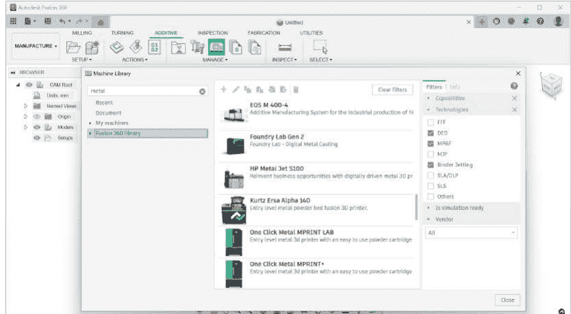

图 12.1 – Fusion 360 机器库

正如我们在本章介绍中所提到的，使用增材制造时多种技术能够生成金属零件。你可以使用 FFF、MPBF、粘结剂喷射、**定向能量沉积 (DED)** 和 **电子束熔化 (EBM)** 来制造金属零件。Fusion 360 可以帮助你使用五种增材制造技术中的四种生成金属零件，如 *表 12.1* 所示。对于每一种受支持的增材制造技术，Fusion 360 都有来自机器制造商列表的机器，你可以使用它们来创建你的增材设置。每种机器供应商和技术都有其能力和局限性，因此创建金属零件的工作流程会因技术和供应商而异。

在本章中，我们将主要关注 MPBF 和粘结剂喷射技术。然而，在本节中，我们将简要介绍如何使用 Fusion 360 通过 FFF 来制造金属零件：

| 熔融长丝制造 | 定向能量沉积 | 粘结剂喷射 | 金属粉末床熔融 |
|---|---|---|---|
| Ultimaker * | Autodesk Generic | Desktop Metal * | Aconity |
| Raise3D * | Meltio | Sintertek * | Additive Industries |
| 所有 FFF 机器（0.6 mm 喷嘴） |  | HP | DMG Mori |
|  |  | Digital Metal | EOS |
|  |  |  | Kurtz Ersa |
|  |  |  | One Click Metal |
|  |  |  | Renishaw |
|  |  |  | SLM Solutions |
|  |  |  | Xact Metal |

表 12.1 – Fusion 360 支持的金属 3D 打印机器制造商

在表 12.1 中，你会注意到某些制造商旁边有一个 *。Fusion 360 机器库包含此表中列出的所有机器制造商的机器。然而，你可能无法使用 Fusion 360 对所有机器库中的机器进行模型切片并创建增材工具路径以使用金属耗材或金属粉末进行 3D 打印。

对于带有 * 的制造商的机器，Fusion 360 可能没有其库中必要的打印设置，或可能无法创建机器制造商所需的特定切片文件格式。不过，你仍然可以使用 Fusion 360 在打印机的成型体积内定向零件并根据需要生成支撑结构。

UltiMaker 和 Raise3D 都利用 FFF 技术使用金属耗材进行 3D 打印。如果你拥有一台配备金属扩展套件的 UltiMaker S5（或 Method 3D）打印机，你可以升级你的 3D 打印机以解锁金属 FFF 功能。使用此升级，你将能够使用 BASF Ultrafuse 17-4PH 或 316L 材料进行打印。这些材料的必要打印设置可以从 UltiMaker Cura 软件的 Material Marketplace 下载。下载后，如图 12.2 所示，你可以使用 cc0.4 或 cc0.6 喷嘴芯进行打印。Fusion 360 打印设置库不包含针对 UltiMaker 打印机使用这些金属耗材的已验证打印设置：

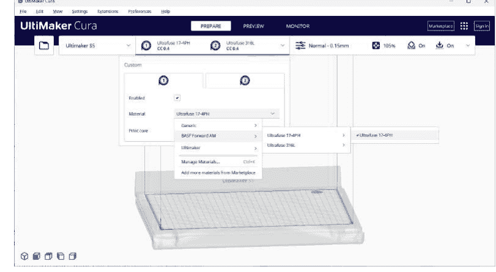

图 12.2 – 配备金属扩展套件的 UltiMaker S5 及来自 BASF 的耗材

如果你可以使用 Raise3D 的 Forge 1 打印机，你可以使用相同的 BASF 耗材（17-4PH 或 316L）通过你的 FFF 机器生成金属零件。与使用 UltiMaker S5 机器进行金属零件 3D 打印类似，Fusion 360 打印设置库不包含针对 Raise3D 打印机的 BASF 17-4PH 或 316L 的已验证打印设置。

对于 Forge 1，你需要使用 Raise3D 的原生切片软件 ideaMaker for Metal 来切片你的模型并生成增材工具路径，因为 ideaMaker 软件包含这些材料的必要打印配置文件。

只有 UltiMaker 和 Raise3D 提供使用不锈钢耗材进行 3D 打印、脱脂和烧结的专用解决方案。对于 UltiMaker，你需要将打印好的金属零件寄送给数家专门的脱脂和烧结服务提供商，以将成品寄回。如果你拥有一台 Raise3D Forge 1 打印机，你还可以从 Raise3D 购买脱脂和烧结工作站，在你的设施内完成整个流程。

如果你有一台来自其他机器提供商的 FFF 打印机，你可以使用金属耗材、专用挤出机以及来自解决方案提供商（如 The Virtual Foundry (https://shop.thevirtualfoundry.com/)）的脱脂和烧结工作站。如 The Virtual Foundry 网页所示，他们目前向客户提供八种金属耗材——Aluminium 6061、Bronze、Copper、H13 Tool Steel、High Carbon iron、Inconel® 718、Tungsten、不锈钢 17-4 和 316L，以及 Titanium 64-5。

Fusion 360 打印设置库已包含来自 The Virtual Foundry 的 Copper 和 Bronze 的必要打印设置。Autodesk 的以下博客重点介绍了设计师如何已经使用 Fusion 360 和 Prusa 3D 打印机采用这种金属 3D 打印方法：https://www.autodesk.com/products/fusion-360/blog/imagining-3d-printed-future-sts-technical-design-virtual-foundry/。

请注意，如果你选择使用此工作流程，你必须在切片和生成增材工具路径之前手动按每种材料的预定乘数因子放大零件。在 3D 打印前进行缩放是必要的，因为零件在烧结过程中会收缩。在之前链接的 Autodesk 博客中，最终用户在切片和打印前将零件放大了 10%。

此工作流程的示例可在图 12.3 中看到。Fusion 360 文档 Slotted Liner 也提供在本章的 GitHub 仓库中。此 Fusion 文档展示了如何使用 Prusa i3 MK3S+ 打印机设置金属增材打印。下图显示了使用定制 Prusa 打印机的增材设置。如浏览器所示，此增材设置使用 0.6 mm 喷嘴，而不是默认的 0.4 mm 喷嘴。此定制是通过编辑为此增材设置选择的 3D 打印机完成的。此外，此设置还包括 Virtual Foundry Copper (Direct Drive) 打印设置。在同一图中，你可以看到此材料的 Print Setting Editor，其中显示了 Normal body 预设的 Infill 部分。如我们所见，此打印设置使用 100% 填充密度和 Rectilinear 模式。增材设置基于 Manufacturing Model 1 中的组件。

如果你在 Fusion 360 中打开此模型并查看 **制造模型 1**，你还会注意到正在 3D 打印的组件与 **设计** 工作区中的模型相比放大了 10%。你可能还记得我们在 *第 6 章* 中讲解过如何使用 Manufacturing Models 在 **制造** 工作区内修改组件：

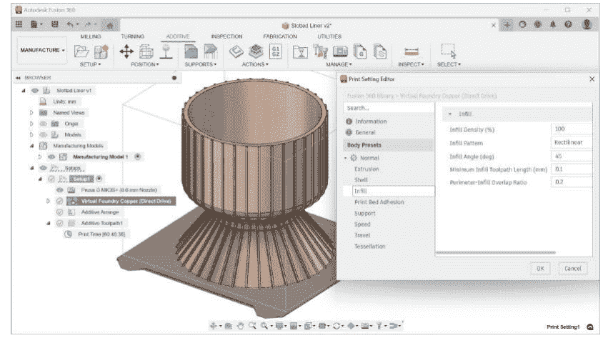

图 12.3 – 配备 0.6 mm 硬质钢喷嘴和铜耗材的 Prusa i3MK3S+

现在我们已经介绍了使用 FFF 打印机通过金属耗材进行 3D 打印的选项，让我们转向另一种技术：DED。除了通用的 DED 打印机外，Fusion 360 机器库还包括来自机器制造商 MELTIO 的名为 M450 的 DED 打印机。该打印机利用多台激光和金属丝制造零件。你可以使用此打印机创建增材设置，并从 Fusion 的打印设置库中选择 316SS 打印设置，以生成该打印机所需的增材工具路径。

由于 DED 工艺不需要脱脂或烧结，因此在创建增材设置之前无需放大组件。在生成增材工具路径并对其进行模拟后，如图 12.4 所示，你可以对增材工具路径进行后处理并生成使用此 3D 打印机制造零件所需的 G-code。图 12.14 展示了 Fusion 360 中使用此打印机的六个金属表壳的增材设置以及相应的 3D 打印。

打印零件的图像来源可在 https://meltio3d.com/technology/ 找到：

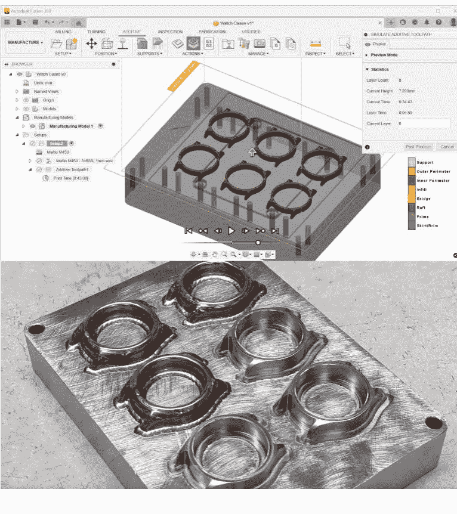

图 12.4 – 使用 Meltio M-450 的增材设置及打印件

你还可以使用 Fusion 360 利用的另一项技术来打印金属零件，即粘结剂喷射。你可以使用 Fusion 360 为多台 Desktop Metal 打印机以及 Sintertek 的 Sinterjet M60 打印机创建增材设置。在这些设置中，你可以使用自动定向工具和我们在前几章中介绍的增材排列功能来定向和排列零件。

完成增材设置后，你需要将设置导出为 3MF 文件，并使用这些公司的原生切片软件来打印零件。根据你使用的机器制造商，你可能还需要在生成 3MF 文件之前根据你感兴趣的 3D 打印材料将零件放大。

如果使用 HP 的金属粘结剂喷射打印机，Fusion 360 提供了额外的功能，可将 Fusion 连接到打印机并直接向机器发送打印作业。图 12.5 显示了为 HP Metal Jet 打印机定向和排列的 `Connector` 零件的增材设置。

在此 Fusion 360 文档中，**DESIGN** 工作区包含一个单一组件。**Manufacturing Model 1** 用于创建 70 个待打印组件。Setup 1 显示了使用增材排列功能将全部 70 个组件放置在此 3D 打印机构建体积内的结果。在 Autodesk App Store（位于 https://apps.autodesk.com/FUSION/en/Detail/Index?id=5739757793764591673）中安装并运行 `HP 3D Printers for Fusion 360 App` 后，你会注意到在 **ADDITIVE** 选项卡内出现了一个名为 **HP** 的新面板。使用该面板中的命令，你可以通过输入打印机的 IP 地址将 Fusion 360 连接到你的 HP Jet Fusion 打印机。你还可以在 Fusion 中存储和管理所有 HP 打印机的列表。连接特定打印机后，你可以查询该打印机的其他详细信息并获取之前提交的打印作业的状态。一旦准备好打印模型，你也可以使用此实用工具直接向打印机发送打印作业：

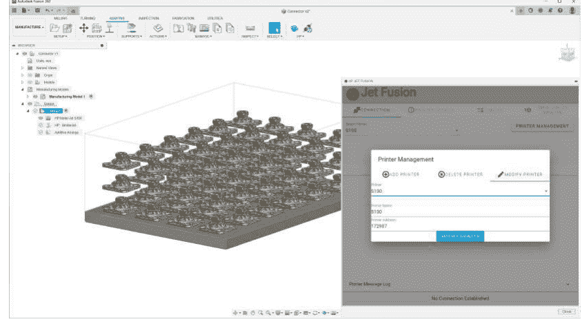

图 12.5 – 使用 HP Metal Jet S100 打印机的增材设置

在此工作流程中，你无需担心缩放模型，因为 Fusion 360 与 HP Jet Fusion 打印机之间的连接会在你将作业发送到打印机时根据材料选择自动缩放模型。

在本节中我们将重点介绍的 Fusion 360 **Machine Library** 中的最后一个粘结剂喷射打印机是 `Digital Metal PX100`。在 Fusion 的 **MANUFACTURE** 工作区中，你可以为该打印机创建机器构建文件以开始打印作业。*图 12.6* 显示了我们在前一图中使用的同一模型在新的制造模型中。

**Manufacturing Model 2** 共有九个相同组件的副本。**Setup2** 包含 **Manufacturing Model 2** 中的所有组件，使用 Digital Metal PX100 打印机和 316L 不锈钢打印设置。当为该打印机创建增材设置时，你必须编辑制造模型并根据你希望使用的 3D 打印材料放大零件。

在此示例中，我们在制造模型中按非均匀缩放系数缩放这九个组件，以考虑烧结过程中不均匀的收缩。完成增材设置后，要启动打印，你可以访问 **ADDITIVE** 选项卡的 **ACTIONS** 面板中的 **Create Machine Build File** 命令。这将显示 **CREATE MACHINE BUILD FILE** 对话框，并允许你选择 **CLI** 作为导出文件格式。创建切片文件 (*.cli) 后，你可以将其带到打印机并开始打印作业：

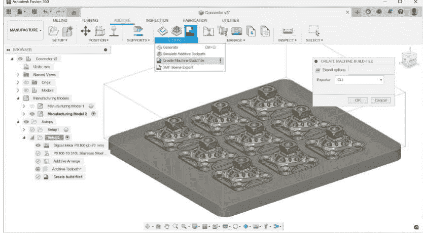

图 12.6 – 使用 Digital Metal PX100 打印机的增材设置

在本节中，我们重点介绍了如何在 Fusion 360 中创建用于金属 3D 打印的四种增材制造技术中的三种的设置。我们介绍了如何使用 UltiMaker 和 Raise3D 的打印机进行金属 3D 打印。我们还介绍了如何自定义现有的 FFF 打印机并使用 The Virtual Foundry 等供应商的耗材进行 3D 打印。除了 FFF 之外，我们还展示了如何使用 Fusion 360 利用 DED 以及粘结剂喷射技术来创建金属 3D 打印的增材设置。FFF 和粘结剂喷射技术都需要额外的后处理步骤，例如烧结，以生成完全致密的金属零件。

在下一节中，我们将介绍使用粉末床熔融技术进行金属 3D 打印。我们还将讨论使用 Fusion 360 为这种增材制造技术创建的独特支撑结构。

## 使用金属粉末床熔融机器进行 3D 打印

MPBF 是 Fusion 360 中完全支持的增材制造技术，用于使用金属粉末打印零件。Fusion 360 的 Machine Library 目前具有来自以下九家机器制造商的 MPBF 打印机：Aconity、Additive Industries、DMG Mori、EOS、Kurtz Ersa、One Click Metal、Renishaw、SLM Solutions 和 Xact Metal。拥有 Additive Build 扩展是使用这些机器提供商中的任何一个的 MPBF 3D 打印机创建增材设置的先决条件。

除了这九家机器制造商之外，你还可以使用 Autodesk 通用 MPBF 机器创建增材设置，如图 12.7 所示。创建设置并在构建平台上排列零件后，假设你不需要支撑结构，你可以为可使用 SLC 和 CLI 等通用文件格式的 3D 打印机生成必要的机器文件。你可以从 **MANUFACTURE** 工作区中 **ADDITIVE** 选项卡的 **ACTIONS** 面板访问 Create Machine Build File 命令。**CREATE MACHINE BUILD FILE** 对话框将允许你在为打印机创建刀具路径文件时指定要使用的导出程序组件：

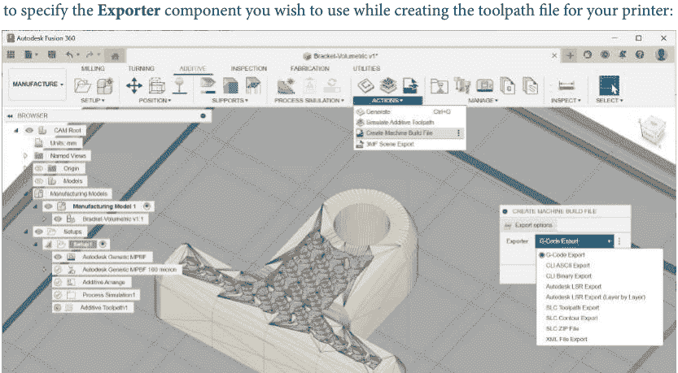

图 12.7 – 使用 Autodesk 通用 MPBF 打印机的增材设置

现在我们已经使用通用 MPBF 打印机创建了增材制造设置，让我们演示如何使用特定机器供应商的 3D 打印机创建类似的设置。

在此练习中，我们将利用使用 Fusion 360 自动建模设计的组件，使用 One Click Metal MPRINT+ 打印机创建增材设置。切换到 **MANUFACTURE** 工作区后，我们可以在 **ADDITIVE** 选项卡中创建增材设置。在创建设置期间，选择打印机时，我们可以选择相关的打印设置。在图 12.8 中，Setup1 使用名为 OCM MPRINT+ SS316L 40 Micron ATU 的打印设置创建。这是为该打印机随 Fusion 360 提供的两个打印设置之一。这些两个打印设置仅用于演示目的。如果你拥有 One Click Metal (OCM) 打印机，你将从 OCM 销售团队获得用于你正在 3D 打印的材料打印设置。选择打印机和打印设置后，你可以在 SETUP 对话框中选择 OK 并创建增材设置：

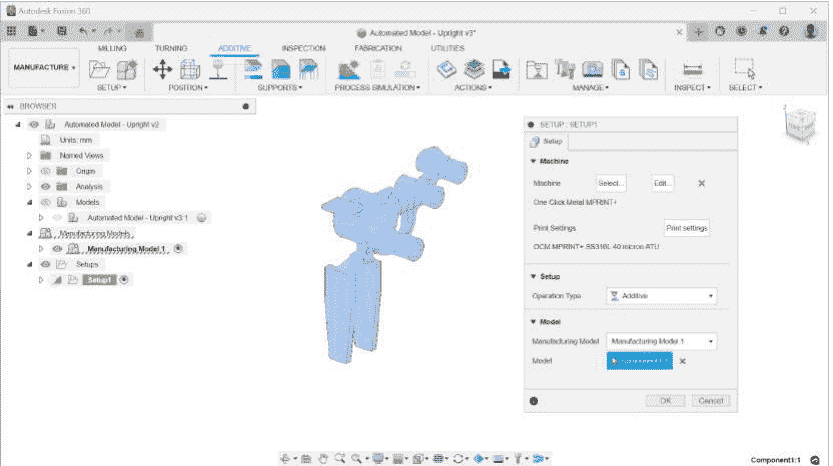

图 12.8 – 使用 OCM 打印机创建增材设置

创建设置后，我们必须做的第一件事之一是在构建体积内排列零件。对于 MPBF 打印机，我们通常使用如图 12.9 所示的 2D 排列选项。此排列类型允许我们在打印机的构建体积内组织零件，以便有效地打印多个零件。在此示例中，由于我们只打印单个零件，因此无需担心 **ADDITIVE ARRANGE** 对话框中的对象间距输入。2D 排列类型将自动将所选组件放置在构建板的中心周围，同时确保我们的零件距离平台边缘有一定的距离，如 Frame Width 输入字段所示。

我们还希望确保我们的零件在构建板上方有一定的高度。在此示例中，我们在构建板和组件之间使用 3 mm 间隙。我们需要这样的平台间隙，以便我们可以使用带锯将零件与构建板分离，而不会损坏打印的模型：

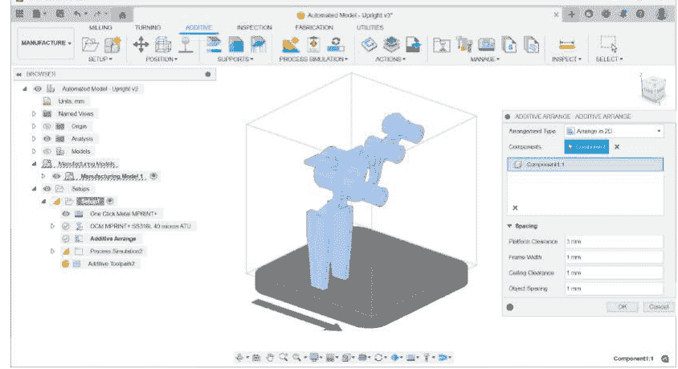

Figure 12.9 – 在 3D 打印机的成型体积内布置部件

下一步是为此 MPBF 增材设置进行打印准备，即定向我们的部件。如 *图 12.10* 所示，我们可以使用 **自动定向** 命令，该命令我们在 *第 8 章* 中已详细讲解过，以为该零件找到合适的定向。

在本例中，我们还必须激活 **支撑底部表面** 复选框，并为 **距离平台 (Z)** 输入字段输入 3 mm 的值，以便我们的定向研究结果与期望的布置结果相匹配。如果使用自动定向时采用 Fusion 360 提供的默认排序选项，则 MPBF 的排序输入无需修改：

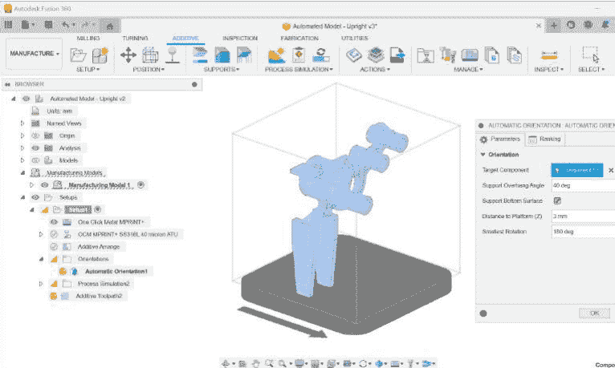

Figure 12.10 – 创建自动定向研究

自动定向完成后，我们可以开始查看其结果并切换不同的排序结果。图 12.11 显示了此次定向结果中排名第五的结果。在本例中，我们将使用该结果，因为它打印该零件所需的支撑体积最少。

选择定向结果时另一个需要考虑的因素是涂粉刀方向。Fusion 360 在大多数金属 3D 打印机上会在成型平台旁用箭头显示涂粉刀方向，如图 12.11 所示。使用 MPBF 打印零件时，由于 3D 打印层上热诱导应力的影响，零件的薄水平段往往会在正 Z 方向发生变形。这种变形会在 3D 打印机在各层之间涂覆新粉末时在涂粉刀与零件之间产生阻力。必须减少零件与涂粉刀之间的此类阻力，以便成功打印零件。如果在同一成型体积内打印多个零件，需要考虑它们在成型平台上的位置与涂粉刀方向的关系。您不希望零件呈与涂粉刀方向垂直的线性排列。相反，最好沿涂粉刀方向交错排列，以防止涂粉刀阻力突然增加以及刀片与零件发生碰撞：

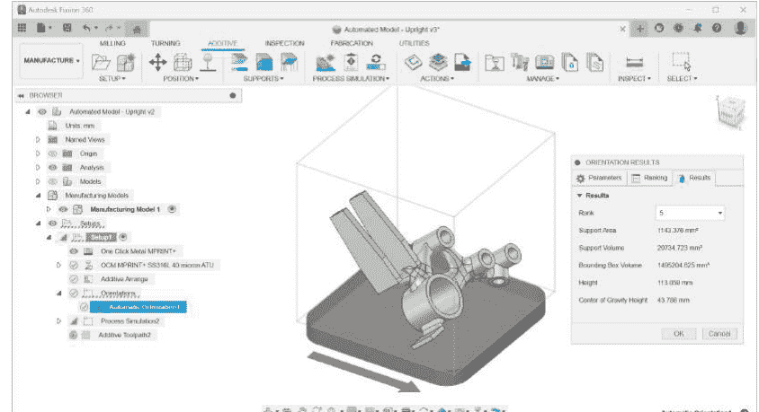

Figure 12.11 – 选择零件的打印定向

到目前为止，我们主要重复了之前章节中学到的打印准备步骤。此时，我们将介绍在获得 Additive Build 扩展后可用于 MPBF 打印机的一些独特的 Fusion 360 功能。

图 12.12 显示了在配备 MPBF 打印机的增材设置中可以为零件添加的支撑结构列表。您可能会注意到，该列表比第 10 章中介绍的可以添加到 FFF 或 SLA/DLP 打印机的支撑结构更长。

获得 Additive Build 扩展后，您可以将 Fusion 360 能够生成的全部支撑结构添加到任何相关的增材设置中。在第 10 章中，我们主要介绍了杆状和底板支撑。本节将重点介绍折线和体积支撑。在下一节中，我们将介绍定位支撑。

我们将使用折线支撑开始演示特定于 MPBF 的支撑。图 12.12 显示了如何将折线支撑应用于我们选择的两个面。折线支撑对话框由五个标签页组成。在几何标签页中，我们可以选择希望支撑的面，并指定低于该角度时 Fusion 360 应创建支撑结构的悬垂角度：

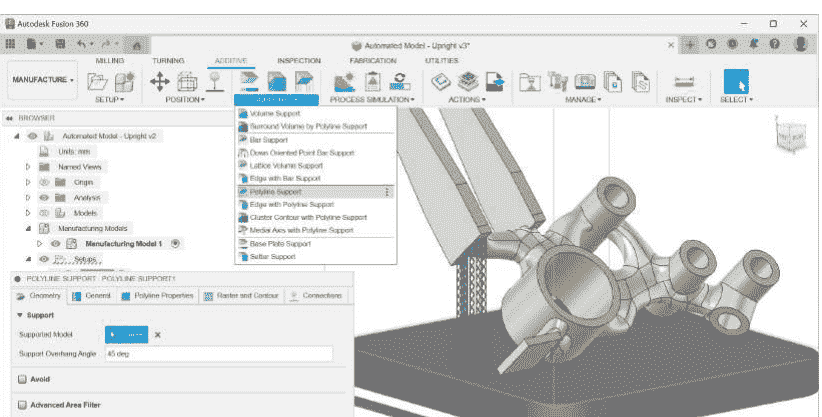

Figure 12.12 – 向所选面添加折线支撑

**几何** 标签页还具有关于如何选择表面以避免生成支撑以及各支撑之间应留多少间隙的额外功能。

如果您选择支撑整个实体或组件，通过选中 *图 12.13* 所示的 **避免** 复选框，您可以选择一个或多个面以避免为其创建支撑结构。如果激活 **高级区域过滤** 复选框，Fusion 360 会提供有关在所选模型/面内哪个区域创建支撑结构的额外选项。如果激活 **与其他支撑的距离** 复选框，您可以指定多个支撑结构之间的间隙以避免它们重叠：

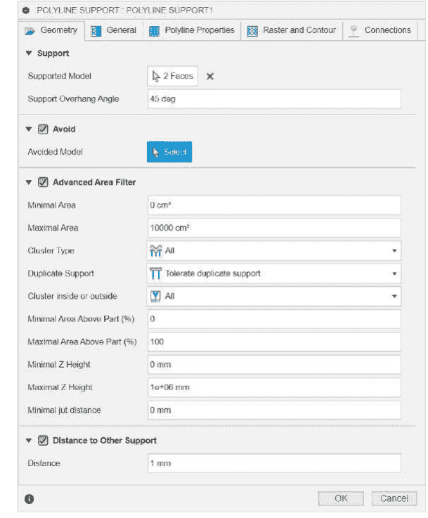

Figure 12.13 – 几何标签页中支撑生成的先进选项

**折线支撑** 对话框中的 **常规** 标签页允许您通过下拉列表控制折线类型，如 *图 12.14* 所示。您可以选择三种折线类型。默认选择为 **带孔图案的结构**，如标注 1 所示。对于此折线类型，您可以使用其指定的标签页控制 **折线属性** 和 **连接**，如 *图 12.14* 左上角所示。如果将折线类型设置为 **表面**，如同一图中标注 2 所示，**折线属性** 标签页和 **连接** 标签页将消失。将折线类型设置为 **实体** 时也同样如此，如标注 3 所示。

**常规** 标签页还允许您在编辑 **锚点距离** 和 **填充距离** 输入时修改各零件连接点之间的距离。您还可以控制折线支撑的定向以及这些支撑是否应延伸到零件边缘。默认情况下，所有折线支撑都与 Y 轴对齐。如果在 **绕 Z 旋转** 字段中输入 45 度，您的折线支撑将在 XY 平面上呈对角线排列：

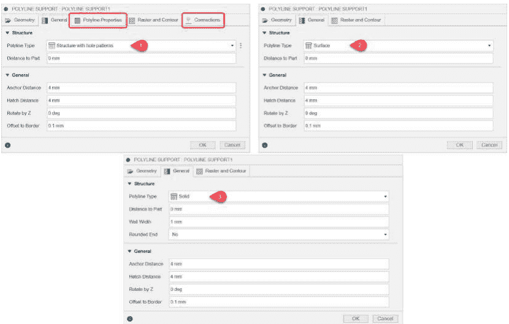

Figure 12.14 – 折线支撑的常规标签页

如果您使用 **带孔图案的结构** 折线类型生成支撑，还可以使用 **折线支撑** 对话框中的第三个标签页编辑折线属性，如 *图 12.15* 所示。此标签页允许您控制孔图案，包括其密度和厚度。您还可以添加 **鳍状结构**，以便与成型平台有更好的连接。默认情况下，Fusion 360 为每个折线支撑创建单个填充。这意味着它们的厚度由增材设置打印设置中设定的激光熔池直径控制。然而，您可以通过选中复选框启用 **加厚结构** 并为折线支撑指定特定厚度，使其更坚固。您可以控制与平台的连接厚度、与零件的连接厚度以及主晶格结构的厚度：

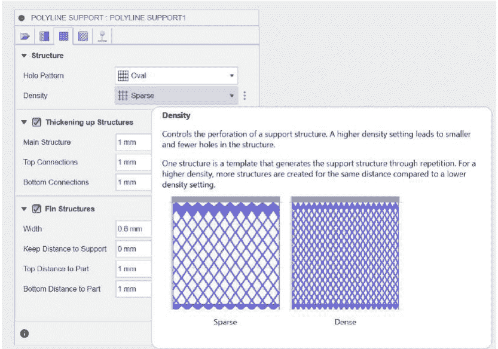

Figure 12.15 – 折线支撑的折线属性标签页

在 **折线支撑** 对话框中，如果导航到 *图 12.16* 所示的 **光栅和轮廓** 标签页，您可以控制片段大小和间隙。默认情况下，**片段大小** 和 **片段间隙** 输入均设置为 **小**。如果将这些字段的输入更改为 **自定义**，您可以控制 **片段轮廓长度** 以及 **片段轮廓间隙**，如 *图 12.16* 所示。**片段轮廓长度** 控制给定片段的大小。在本例中，每个片段设置为 3 mm，这意味着每个折线段长 3 mm。**片段轮廓间隙** 设置为 0.25 mm，这意味着每个折线支撑段之间会有 0.25 mm 的距离：

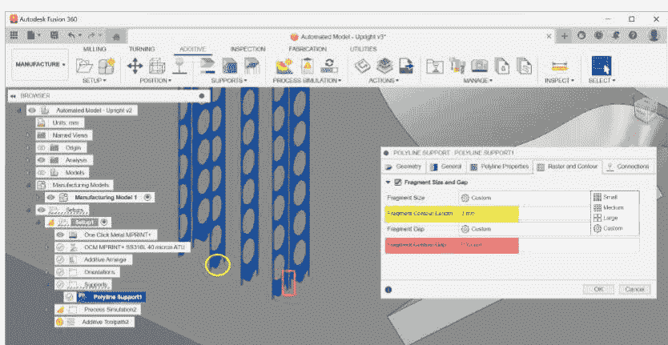

Figure 12.16 – 修改折线支撑的片段大小和间隙

POLYLINE SUPPORT 对话框的最后一个标签页控制零件和成型平台的折线支撑连接属性。有两个段用于控制零件连接。顶部零件连接控制折线支撑与模型下表面区域的接触方式，而底部零件连接控制折线支撑与给定零件上表面的接触方式。平台连接控制折线支撑如何连接到成型平台。您还可以打开平台上的三角形鳍选项，以创建额外的法兰将折线连接到成型平台以获得更强的附着力。

有四个选项可控制给定零件连接的形状。默认连接形状为断裂点。图 12.17 显示了每种形状的结果。最左边的屏幕截图显示了断裂点选项的形状结果。中间的屏幕截图显示了偏移断裂点选项，右侧的屏幕截图显示了条带形状：

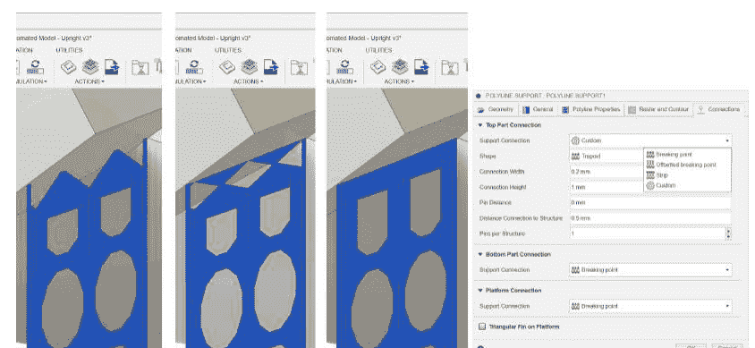

Figure 12.17 – 使用多段线支撑时顶部部件支撑连接的三种形状结果

本节我们将重点介绍的下一个支撑类型是 **体积** 支撑。您可以通过在 **ADDITIVE** 选项卡的 **SUPPORTS** 面板中选择其对应选项来访问 **VOLUME SUPPORT** 对话框。体积支撑与多段线支撑非常相似。主要区别在于体积支撑会创建多条多段线以形成更强的支撑结构。*图 12.18* 显示了选择单个面并创建体积支撑的结果。同一张图左侧显示了之前创建的多段线支撑，右侧显示了新创建的体积支撑。正如您所见，我们可以使用 **Volume Properties** 选项卡将 **Hole Pattern** 设置为 **Oval** 来创建结构。我们还可以控制 **Fragment Size** 和 **Fragment Gap**，以便获得具有轮廓的大块支撑，以及 0.25 mm 的光栅间隙，以复制我们之前生成的多段线支撑的形状和尺寸：

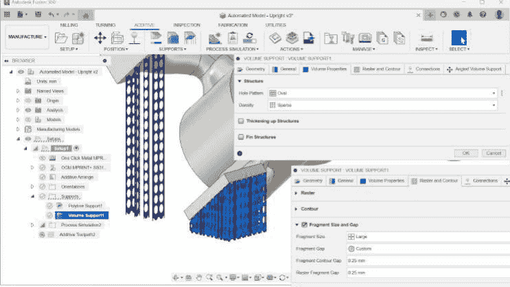

Figure 12.18 – 为 MPBF 增材制造设置创建体积支撑

默认情况下，Fusion 360 中的所有支撑结构都会将选定的下表面连接到成型平台或部件的上表面区域。图 12.19 显示了更新后的设置，其中我们在之前的步骤中创建的 Polyline Support1 和 Volume Support1 已被抑制。在该图中，我们可以看到选择多个表面并使用默认设置生成新的 Volume 支撑的结果。这里可以看到，左侧的支撑一直延伸到成型平台，但右侧的支撑则在同一部件的上表面处停止。这种支撑几何形状是理想的，如果我们希望最大限度地减少使用支撑结构制造部件所需的时间和材料。但我们也必须考虑在后处理阶段需要付出的额外努力。具体来说，任何接触到给定部件上表面的支撑结构都需要被移除，并且任何瑕疵都需要被铣削掉。在这种情况下，我们可能希望避免创建接触部件上表面的支撑结构：

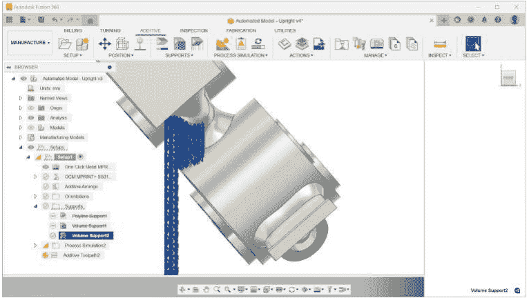

Figure 12.19 – 在所选表面上使用默认设置生成体积支撑

一种生成不接触部件组件上表面的支撑的方法是生成角度体积支撑。**Angled Volume Support** 是体积支撑对话框中的最后一个选项卡。在此选项卡中，我们可以激活 **Angled Support** 并指定我们的体积支撑将被分为两个区段的枢轴点。如图 12.20 所示，通过操作画布上的夹具，我们可以控制体积支撑中的断点，以便生成的支撑结构远离下表面倾斜：

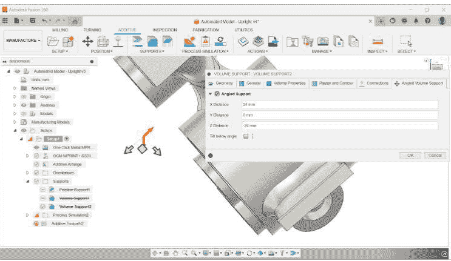

Figure 12.20 – 操作角度体积支撑的枢轴点

默认情况下，角度体积支撑枢轴点允许我们控制支撑结构远离垂直轴枢转的位置。如图 12.21 所示，支撑结构的下半部分是垂直的，并指向成型平台。同一支撑结构的顶部部分是倾斜的，并指向所选的下表面：

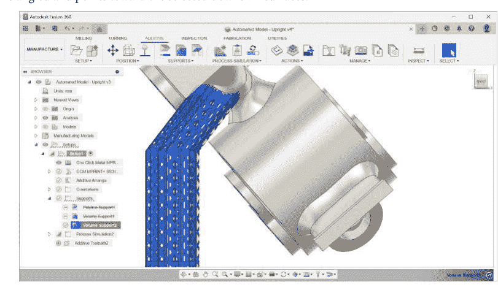

Figure 12.21 – 角度体积支撑

这种结果避免了创建接触部件上表面的支撑。如果您在对话框的 Angled Volume Support 选项卡中选择 Tilt below angle 复选框，您还可以控制支撑的下半部分。如前所述，支撑的下半部分默认是垂直的。但是，您也可以通过激活 Tilt below angle 复选框来控制其矢量。

如 图 12.12 所示，MPBF 增材制造设置有多种多段线和体积支撑选项。所有这些选项都是多段线和体积支撑的变体，可以应用于我们模型的各个方面，例如小面积表面的边缘和中线。您还可以应用次级多段线支撑来环绕现有的体积支撑。各种用于控制这些支撑结构的选项可在各自的对话框中找到。

一旦我们对模型的定向、定位和支撑感到满意，我们就可以生成增材工具路径并对其进行模拟，就像我们在前几章中对 FFF 设置和 SLA/DLP 设置所做的那样。图 12.22 显示了您可以通过在 ADDITIVE 选项卡的 ACTIONS 面板中选择适当命令来模拟增材工具路径的方式。MPBF 设置的 SIMULATE ADDITIVE TOOLPATH 对话框与 FFF 和 SLA/DLP 设置相同。我们可以使用 Show Machine 复选框来显示或隐藏机器平台。我们可以使用 Incremental Move 复选框按一层一层或预设增量显示层结果：

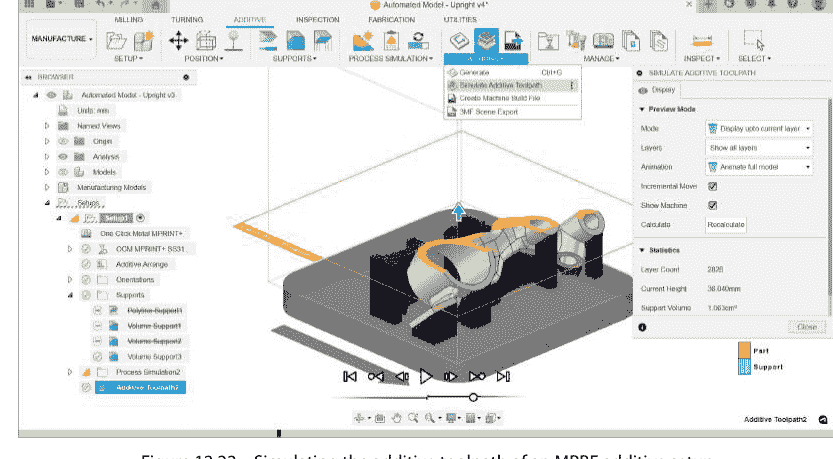

Figure 12.22 – 模拟 MPBF 增材制造设置的增材工具路径

请记住，如果您在 **Simulate Additive Toolpath** 对话框中选择了 **Show all layers** 选项，MPBF 工具路径的计算/重新计算时间会更长，因为 MPBF 打印机具有更小的层高。

如果您只想快速查看增材工具路径的动画，您可能希望选择生成并显示每第 2 层、第 5 层、第 10 层或第 100 层。图 12.22 中显示的增材工具路径模拟是在抑制了多段线支撑以及之前用于演示支撑概念的两个体积支撑之后生成的。**Volume Support3** 已使用默认设置添加到整个组件，以支撑整个主体。

一旦我们完成模型的定向、添加支撑结构和模拟工具路径，我们就可以创建必要的机器构建文件以开始 3D 打印作业。本节开始时，我们为通用 MPBF 打印机创建了机器构建文件，如图 12.7 所示。在图 12.23 中，我们可以看到使用相同的 **Create Machine Build File** 命令将导致一个具有机器特定导出选项的类似对话框。在此设置中，我们使用了 **One Click Metal** 打印机。因此，导出程序下拉菜单中只包含相关的文件格式，即 **OneClickMetal exporter**（.gcode）：

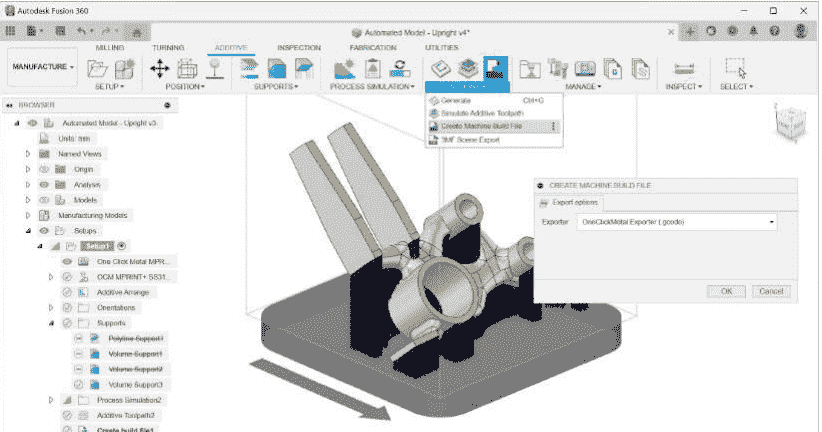

Figure 12.23 – 从增材制造设置导出必要的机器构建文件

Fusion 360 可以为其机器库中九个机器供应商中的八个创建机器构建文件。正如我们刚刚演示的那样，您可以为 OCM 机器创建特定的 gcode 文件。您还可以生成以下内容：

- ILT 文件 (*.ilt)，Aconity 打印机需要
- LMI Exporter 文件 (*.gcode)，Kurtz Ersa Alpha 140 打印机需要
- Additive Industries Exporter 文件 (*.zip)，Additive Industries MetalFAB1 打印机需要
- MTT 文件 (*.mtt)，所有 Renishaw 打印机需要
- SLM 文件 (*.slm)，所有 SLM 打印机需要
- DMG Mori Lasertec 文件 (*.zip)，所有 DMG Mori 打印机需要
- Xact Metal Exporter 文件 (*.cli 或 *.sli)，根据型号不同，Xact Metal 打印机需要

如果您使用 Fusion 360 与您的 EOS 金属 3D 打印机一起使用，您需要拥有机器制造商提供的名为 EOSPrint 的软件许可证才能将作业提交到您的打印机。Fusion 360 可用于使用您的 EOS 金属打印机创建增材设置。您可以从 Fusion 的打印设置库中选择打印设置，该库与 EOS 提供的所有打印设置一致。您也可以在 Fusion 中添加支撑结构并切片模型。但是，要创建特定于您的 EOS 硬件的增材工具路径，您需要拥有 EOSPrint 的许可证。

如果您已在计算机上安装并许可了 Fusion 360 和 EOSPrint 软件，您可以生成增材工具路径，甚至可以查询增材设置的预计构建时间。您可以连接到特定的打印机并直接将打印作业提交到打印机本身。要激活此功能，您还需要下载并安装 EOSPRINT for Autodesk Fusion 360。您可以在 Autodesk App Store 上找到此应用，网址为 https://apps.autodesk.com/FUSION/en/Detail/Index?id=8154614516617688086。

在本节中，我们重点介绍了如何生成定向研究并为使用 MPBF 打印机进行成功的金属增材打印选择部件位置和方向。我们还介绍了如何为这种增材制造技术创建支撑结构。

在下一节中，我们将讨论如何创建 setter 支撑，这些支撑在打印金属粘结剂喷射技术部件后在烧结过程中使用。

## Setter supports for a successful sintering process

MPBF 是使用增材制造创建金属部件的最常用技术之一。然而，最近有多个机器供应商进入金属粘结剂喷射领域。Desktop Metal 多年来一直是该领域的领导者。HP 也最近通过发布名为 Metal Jet S100 的新打印机进入了金属粘结剂喷射领域。Markforged 是一家以能够使用连续纤维增强方法打印 3D 打印机的公司，也开始提供其 Digital Metal PX 100 系列打印机以服务于金属粘结剂喷射领域。除了这些知名品牌外，还有一些新进入者，例如 Sintertek 的 Sinterjet M60。

随着制造商开始在其工作流程中采用金属粘结剂喷射技术，我们需要重点介绍如何使用 Fusion 360 创建增材设置并为这些打印机准备打印。大多数情况下，为粘结剂喷射技术创建增材设置与为 SLS 打印机创建的增材设置没有什么不同。粘结剂喷射打印机增材设置的最重要方面是定向和排列我们部件在构建体积内的位置。使用 HP Metal Jet S100 打印机的四个组件的此类设置如图 12.24 所示。

一些 3D 打印机（例如 Digital Metal PX100）要求我们在切片前将所有模型放大。其他打印机（例如 HP Metal Jet S100）可以在打印机板上自动处理部件的缩放。

无论我们为增材设置使用哪种金属粘结剂喷射打印机，您可能会注意到，粘结剂喷射设置的可用支撑类型列表仅限于底板支撑和定位支撑。这是因为粘结剂喷射技术在打印阶段不需要支撑结构。然而，一旦打印完成，我们就剩下处于生坯状态的零件。用粘结剂喷射打印机打印的零件需要后处理，并且需要烧结以蒸发将金属零件粘合在一起的强力粘结剂。此过程还会完全压实金属零件以去除孔隙：

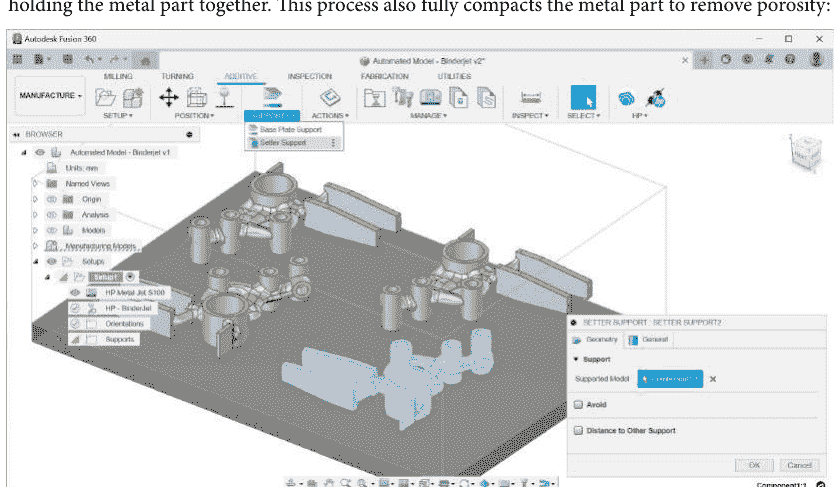

图 12.24 – 为金属粘结剂喷射打印机的增材设置创建定位支撑

打印零件并将其从松散粉末中取出后，我们需要将其放入烧结炉中。刚在打印机中完成固化的零件称为生坯零件。在此状态下，它们很脆弱，需要用一种材料将其固定住，该材料既能托住零件，又能在烧结过程中与零件一起收缩。

使用位于 ADDITIVE 选项卡的 SUPPORTS 面板中的 Setter Support 命令，我们可以选择给定组件来生成支撑结构，该支撑结构主要在烧结过程中使用。

图 12.25 显示了 **SETTER SUPPORT** 对话框的 **General** 选项卡。在此选项卡中，我们可以控制各种选项来创建定位支撑，以在烧结过程中保护我们的零件。**Gap** 输入控制零件与定位支撑之间的距离。**Z Overlap** 下拉菜单默认设置为 **Remove**，这允许零件在 Z 方向上抬起，而不会有任何支撑结构阻挡运动。**Bounding Shape** 默认是零件的 **Silhouette** 组件，根据其阴影生成形状。**Fill Inner Contour** 选项默认设置为 **Yes**，即使零件的孔与 Z 轴对齐，也会创建支撑结构。**Outer Offset (XY Plane)** 输入允许我们控制零件周边定位支撑的厚度。**Maximum Height** 输入允许我们控制定位支撑相对于成型平台的高度。**Taper Angle** 输入控制定位支撑周边壁相对于垂直轴的角度。

当我们在粘结剂喷射机内为零件选择方向和位置时，重要的是将零件放置在 Z 轴上方一定距离，以便我们生成的定位支撑可以沿其底表面以及侧表面托住零件。

图 12.25 显示了我们的增材设置的特写视图，其中隐藏了 **Component 1:2**、**Component 1:4** 和 **Component 1:5**，仅显示 **Component 1:1**。为了改善可视化效果，我们还在该图中隐藏了机器成型平台：

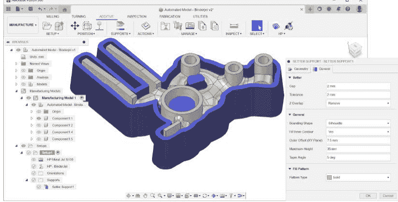

图 12.25 – 为组件生成定位支撑

使用定位支撑的另一个选项是将边界形状从零件的轮廓修改为矩形物体。如图 12.26 所示，我们可以将 Bounding Shape 设置为 Rectangle，并将图案类型从 Solid 图案更改为 Rectangular、Hexagonal、Circular 或 Column 图案。图 12.26 显示了六边形图案的结果。如果我们选择除实心以外的图案，还可以通过调整其单元尺寸和壁厚来控制图案尺寸：

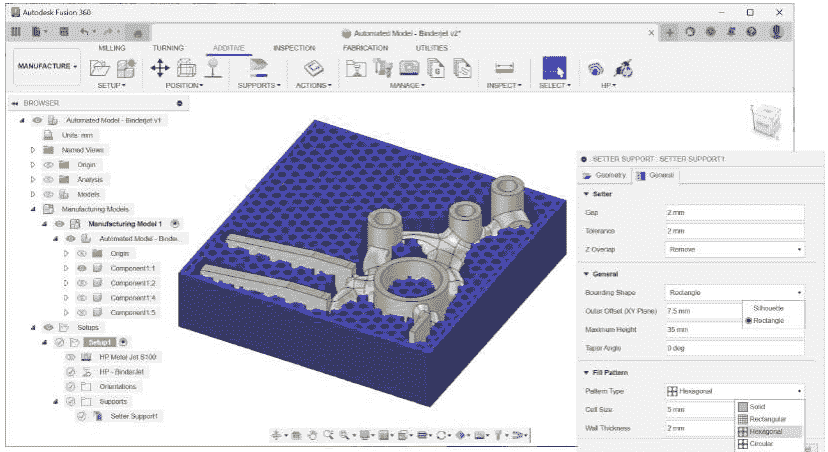

图 12.26 – 具有矩形边界形状和六边形填充图案的定位支撑

一旦我们对支撑感到满意，就需要将支撑结构与零件分离，因为我们可能不想就地 3D 打印它们。请记住，我们在打印过程中不需要支撑结构。我们只会在烧结阶段使用它。因此，我们不需要将零件和支撑结构一起打印。我们可以通过使用位于 ADDITIVE 选项卡的 ACTIONS 面板中的 3MF Scene Export 功能将增材设置导出为 3MF 文件来实现，如图 12.27 所示。当我们使用此命令时，我们将能够修改 3D SCENE EXPORT 对话框中的选项并选择 Include the support structures 复选框：

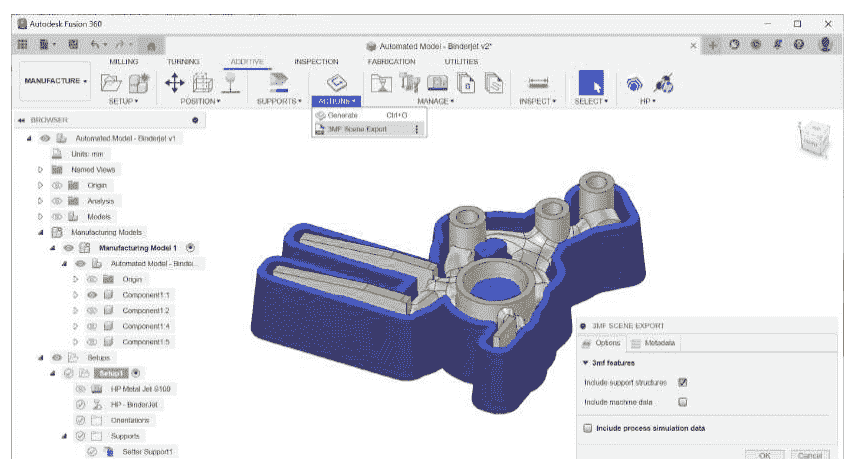

图 12.27 – 创建 3MF 文件并包含支撑结构

一旦 3MF 文件已保存在我们的硬盘上，我们就可以通过选择 + 图标来创建新的 Fusion 文档，如图 12.28 中标注 1 所示。在 DESIGN 工作区的 MESH 选项卡中，我们可以使用 Insert Mesh 功能，如标注 2 所示，将刚刚创建的 3MF 文件插入到活动设计文档中。Fusion 将导入每个组件作为具有唯一名称的网格体。我们可以简单地隐藏网格体 3、4 和 5 的可视化，如标注 3 所示。这样，我们就可以专注于我们为其创建定位支撑的组件的支撑结构和网格体：

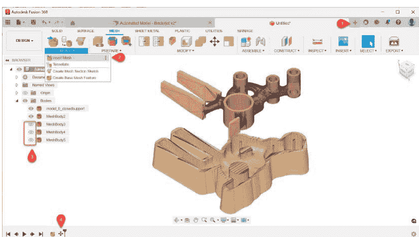

图 12.28 – 将 3MF 文件插入 Fusion 文档以可视化定位支撑结果

使用位于 Modify 选项卡中的 Move 命令，您可以选择 Meshbody2 并将其移动到 Z 轴。图 12.28 显示了此移动操作的结果，如时间线中标注 4 所突出显示。如您所见，我们的支架组件 neatly 适配在定位支撑内，并且可以在没有阻挡的情况下从 Z 轴移除。如果我们将此零件和定位支撑一起放入烧结炉中，粘结剂将从零件和支撑中蒸发，并且这些零件会均匀地一起收缩。定位支撑将在此烧结过程中支撑组件，使其在烧结阶段不会下垂或永久变形。

## Summary

在本章中，我们了解了有关金属增材制造的所有知识。我们首先介绍了您可用于创建金属零件的所有增材制造技术。我们演示了如何使用 UltiMaker 和 Raise3D 的熔融长丝制造打印机以及 BASF 等公司的金属长丝来 3D 打印需要脱脂和烧结的金属零件。我们还展示了如何使用任何配备定制挤出机的 FFF 3D 打印机以及 The Virtual Foundry 等公司的专用金属长丝来打印金属长丝。每个解决方案都需要对 3D 打印零件进行进一步的脱脂和烧结处理。然后我们介绍了如何使用定向能量沉积技术创建金属零件，使用 Fusion 360 机器库中提供的 Meltio M450 等打印机。

在下一节中，我们演示了如何使用 MPBF 打印机创建增材设置。我们展示了 MPBF 打印机的增材设置与我们为 FFF 和 SLA/DLP 3D 打印机创建的设置非常相似，主要区别在于零件定位和支撑结构生成。我们强调了如何错开零件位置，以便不对硬刮刀产生高阻力区域。我们还强调了如何创建各种折线和体积支撑以在打印过程中支撑零件。我们展示了如何通过使用倾斜体积支撑来最大限度地减少创建这些支撑结构所需的材料使用量并避免在上表面创建支撑。在第二部分的末尾，我们还介绍了如何在切片和模拟增材刀具路径后生成启动打印作业所需的特定于机器的文件格式。

在最后一节中，我们将重点放在金属粘结剂喷射工艺上。我们讨论了如何为该工艺创建增材设置。我们强调了粘结剂喷射技术中的松散粉末能够在固化阶段支撑正在打印的零件。我们还讨论了使用该技术制造的零件需要烧结工艺来蒸发粘合剂并得到完全致密的零件。在本章的最后一节中，我们介绍了如何创建定位支撑，这些支撑可以托住我们的零件并在烧结过程中防止其下垂，同时与零件均匀收缩，因为它们是用相同的工艺和材料制成的。

使用其中任何一种技术，您可以更有信心地为可用的 3D 打印技术创建增材设置以生成金属组件。在下一章中，我们将重点介绍如何模拟 MPBF 工艺，以识别和修复由于该工艺中常见的热应力高和变形而导致的潜在打印失败。

