## 模拟 MPBF 工艺

欢迎阅读 *第 13 章*。 在本章中，我们将探讨如何在 **金属粉末床熔融 (MPBF)** 3D 打印机内模拟打印过程。 MPBF 机器是价格最昂贵的 3D 打印机之一。 金属粉末是一种昂贵的 3D 打印材料。 因此，在金属 3D 打印中，任何错误或打印失败都是代价高昂的。 拥有 Additive Build 扩展访问权限的 Fusion 360 用户可以模拟其 MPBF 打印过程，以检测和纠正常见的打印失败模式，例如零件变形和匀粉刀干涉。 在本章中，我们将重点介绍如何执行此类分析并做出必要的更改以避免常见的打印失败模式。

本章将涵盖以下主题：

- 设置工艺仿真
- 解释结果
- 补偿变形并更新设置

到本章结束时，您将学会如何在带有 MPBF 打印机的增材制造设置中选择一个组件作为工艺仿真的目标。 您将了解各种打印设置以及它们如何影响工艺仿真输入。 您将学习如何修改工艺输入，例如打印床加热，以及有限元分析输入，例如网格设置，以进行工艺仿真，同时在速度与精度之间做出权衡。 您还将学习如何检查工艺仿真的结果并识别模型中的大变形区域，判断零件是否会发生匀粉刀碰撞。 到本章结束时，您将能够导出补偿形状以抵消零件在打印过程中可能发生的变形，使零件以最小的变形进行打印。

### 技术要求

本章将继续介绍金属增材制造。 我们将使用 MPBF 3D 打印机及其相应的打印设置创建增材制造设置。 我们将为 MPBF 机器生成特定的支撑结构。 我们还将对零件和支撑进行工艺仿真。 在获得 Additive Build 扩展访问权限之前，Fusion 360 不提供 MPBF 机器、MPBF 特定支撑结构以及进行工艺仿真的能力。

与所有其他 Fusion 360 扩展一样，Additive Build 扩展不适用于个人使用。

如果您拥有 Fusion 360 的商业许可证，要使用 MPBF 机器创建增材制造设置，您还需要访问 Additive Build 扩展 (https://www.autodesk.com/products/Fusion-360/additive-build-extension)。

Autodesk 为所有 Fusion 360 商业用户提供 Additive Build 扩展的 14 天试用。 您可以在 Fusion 360 的扩展对话框中激活试用。

Additive Build 扩展也可免费提供给初创企业和教育许可证用户。

本章的课程文件可在以下位置找到： https://github.com/PacktPublishing/3D-Printing-with-Fusion-360

## 设置工艺仿真

在本节中，我们将演示如何使用粉末床熔融打印机创建金属增材制造设置并启动工艺仿真，以便分析零件在 3D 打印过程中将经历的变形。

为了演示此功能，我们将使用名为 L Brackets 的 Fusion 文档，如图 13.1 所示。 该模型由三个具有不同悬垂角度的组件组成。 Component1 的悬垂角度为 0 度，Component2 的悬垂角度为 15 度，Component3 的悬垂角度为 30 度。

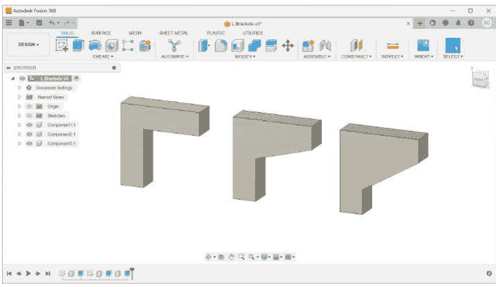

图 13.1 – 具有各种悬垂角度的三个组件

在将 Fusion 工作区从 DESIGN 更改为 MANUFACTURE 后，我们可以使用 Fusion 的机器库中的 Renishaw AM 250 机器创建增材制造设置。 在此设置中，我们将选择如图 13.2 所示的 RenAM250 Titanium Ti6Al4V-1123-Q 60 micron 打印设置。 我们还将手动排列全部三个组件，使其在 X 和 Y 方向上交错，确保它们不会与构建板上指示的匀粉刀方向发生干涉。 正如您可能还记得，在第 12 章中，我们讨论了为什么在为 MPBF 机器准备构建时采用这种布置是有益的。

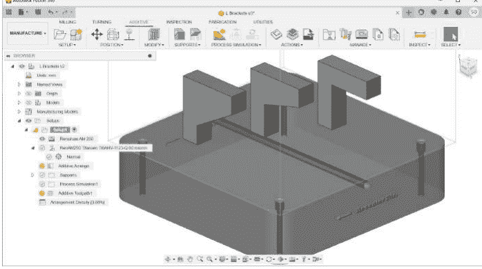

图 13.2 – 在增材制造设置中排列三个组件

一旦零件放置在构建体积内，我们就可以添加必要的支撑结构，以便使用此打印机制造零件。 如图 13.3 所示，我们为每个组件添加了体积支撑。 在创建支撑期间，我们使用了体积支撑的默认设置。

作为提醒，默认体积支撑使用菱形孔图案生成，使用稀疏密度输入。 **Thickening up Structures** 和 **Fin Structures** 已启用，这会创建尽可能薄的支撑几何形状，节省材料和打印时间。 然而，我们不知道我们生成的支撑结构是否足够坚固以在打印过程中支撑零件。 这是我们需要进行工艺仿真的另一个原因——看看是否需要使支撑更强以避免潜在的打印失败。

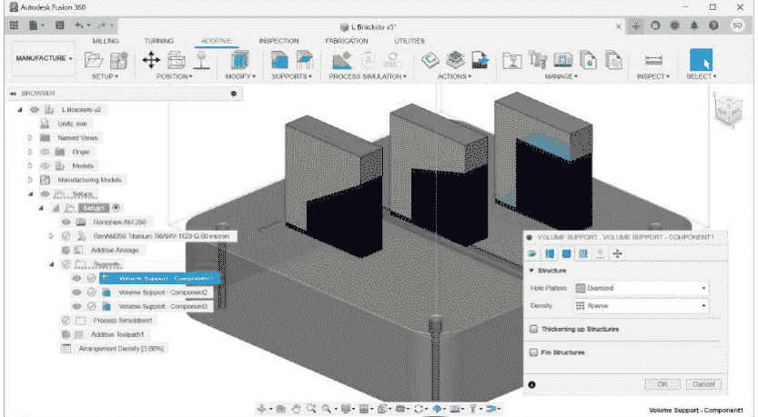

图 13.3 – 为每个组件添加了体积支撑

在启动工艺仿真之前，最好仔细查看我们的打印设置。 如果我们选择与此设置关联的打印设置，右键单击并编辑它，我们将看到 **Print Setting Editor** 对话框并可以检查此打印设置中包含的构建参数。 如图 13.4 中黄色突出显示的那样，此打印设置使用 60 微米的层厚，材料设置为钛。 这两个输入都可以在打印设置的 **General** 部分中找到。

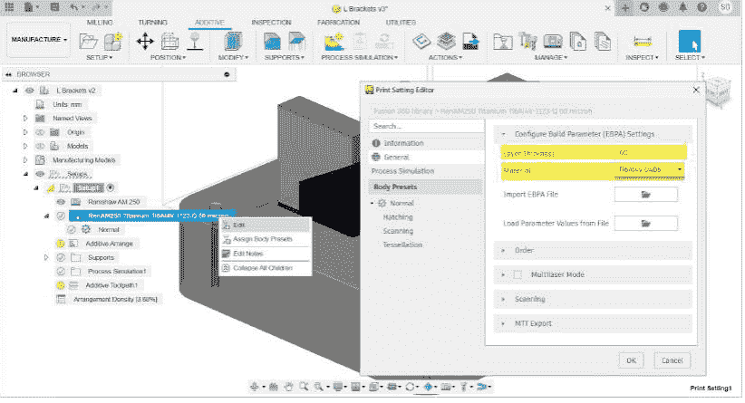

图 13.4 – 编辑打印设置以可视化构建参数

如果我们在 **Normal** 体预设内选择 **Hatching** 子标题，我们还将能够可视化 Fusion 360 将用于为本次打印创建填充的填充图案的填充距离和旋转增量角度。 如图 13.5 左侧所示，填充的当前策略是 **Stripe** 方法。 此图案的每个激光填充线将相距 0.095 毫米，并且填充图案将在每层围绕 Z 轴交替 67 度。

如果我们在 **Normal** 预设的 **Body Presets** 部分内选择 **Scanning** 子标题，我们还将能够可视化与此打印设置关联的激光功率。 图 13.5 右侧的图像显示，在打印填充线时激光将设置为 200 瓦。

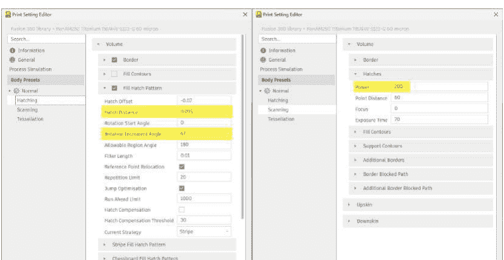

图 13.5 – 钛的填充和扫描打印设置

我们在图 13.3 和图 13.4 中突出显示的信息是机器制造商推荐的参数，以便在此特定打印机上使用钛打印。 如您可能已经注意到的，有许多参数可以编辑以微调 MPBF 打印机的打印设置。 每个参数都会影响打印结果。

然而，只有这些参数的子集在进行工艺仿真时会被考虑，因为它们已被确定为对打印过程中热诱导应力影响最大。 我们在前几幅图中突出显示的参数直接输入到在 Fusion 360 中进行工艺仿真所需的输入中。

如图 13.6 所示，如果我们为此打印设置在 Print Settings Editor 中选择 Process Simulation 子标题，我们可以看到 Fusion 360 已关联一个参数集用于仿真。 工艺仿真参数集保存为 *.PRM 文件。

> **重要说明**
> “**处理参数 (PRM)** 文件记录机器工艺参数和材料属性。 在小规模分析中，将移动热源施加到材料上。 PRM 文件存储材料对机器参数设置的机械响应。 这可以外推到完整零件 … PRM 文件可在使用相同材料和工艺参数组合的任何未来仿真中重复使用” (https://help.autodesk.com/view/NETF/2024/ENU/?guid=GUID-7A9E551D-36B2-4922-8A38-0072EEDB5A23)。

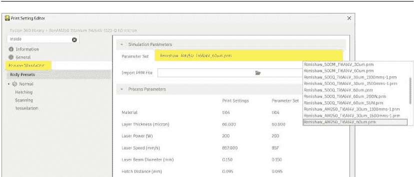

Figure 13.6 – 选择与打印设置关联的工艺仿真参数集

如果你想使用不同的 PRM 文件进行工艺仿真，可以从名为 Parameter Set 的下拉菜单中选择它。该下拉菜单会自动在其库中筛选仿真参数，仅显示与打印设置中选择的相同材料关联的 PRM 文件。如图 13.7 所示，将参数集从默认的 PRM Renishaw_AM250_Ti6Al4V_60um 改为 Renishaw_AM250_Ti6Al4V_30um_1500mm/s-1 后，Print Setting Editor 指示增材工具路径将使用原始打印设置创建，但工艺仿真将基于新选择的参数集。在同一张图中，你可以看到高亮的值，它们显示了 Renishaw_AM250_Ti6Al4V_60um 打印设置与 Renishaw_AM250_Ti6Al4V_30um_1500mm/s-1 参数集输入之间的差异，包括层厚（60.000 微米 versus 30.000 微米）、激光速度（857.000 mm/s versus 1500 mm/s）和 Hatch Distance（0.095 mm versus 0.065 mm）。

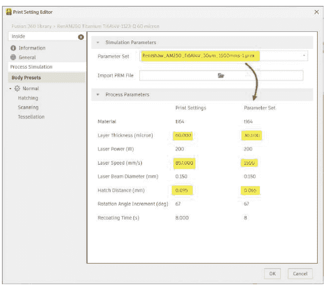

Figure 13.7 – 打印设置与非默认 PRM 之间工艺参数的差异

现在我们已经说明了 Fusion 360 如何利用打印设置中的输入来进行工艺仿真，我们可以关闭 Print Setting Editor 对话框并继续使用默认打印设置。为了开始设置仿真，我们需要访问 ADDITIVE 选项卡中 PROCESS SIMULATION 面板内的 Study 命令。如图 13.8 所示，这将打开 STUDY 对话框，在其中我们可以选择要进行工艺仿真的目标体。此对话框中的高级设置部分允许我们控制 Fusion 360 为进行此有限元分析而创建的网格单元大小。Layers per element 字段根据打印设置中设置的层厚来控制给定单元的大小。默认情况下，Fusion 360 使用自适应网格，其中正在打印的层的单元较小，而活动层以下的单元则变大。自适应网格可在牺牲精度的情况下实现快速分析。Coarsening Generations 和 Max Adaptivity Level 输入控制正在打印的层以下单元大小的变化。对这两个字段使用较小的输入值会提高结果的准确性，但会增加求解时间。你也可以在此对话框中控制 Platform Thickness 和 Platform Heating 输入。

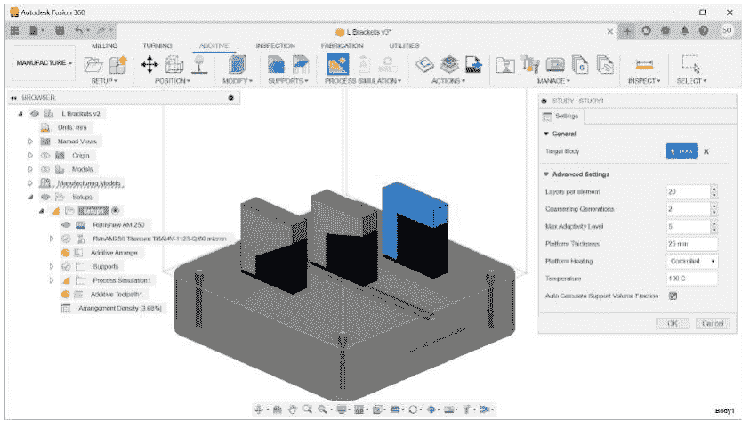

Figure 13.8 – 使用 STUDY 对话框设置工艺仿真

为了简化网格划分过程和求解时间，Fusion 360 会对支撑结构几何形状进行均质化，并使用修改后的物理属性进行仿真。当 **自动计算支撑体积分数** 复选框处于活动状态时，此均质化会自动执行。

Figure 13.8 – 使用 STUDY 对话框设置工艺仿真

在选择目标体并在 **STUDY** 对话框的高级设置中完成所有必要的自定义后，我们可以单击 **OK** 继续。此时，Fusion 360 会进行预检查并显示 **SOLVE** 对话框。

在图 13.9 中，我们可以看到打印设置与 PRM 文件匹配，这意味着我们可以使用默认参数集求解此仿真，无需选择不同的参数集即可继续。

由于我们在 **STUDY** 对话框中选择了 **Layers per element**（20）、**Coarsening Generations**（2）和 **Max Adaptivity Level**（5）的默认输入值，求解精度会较低，但我们会快速计算出结果。

我们的模型与平台有适当的接触，不需要额外的支撑结构。

我们此时尚未生成网格；因此，在 *FEA mesh* 部分旁边会看到一个警告标志。我们可以单击 **Check mesh** 图标，也可以直接单击 **Solve** 按钮开始仿真。

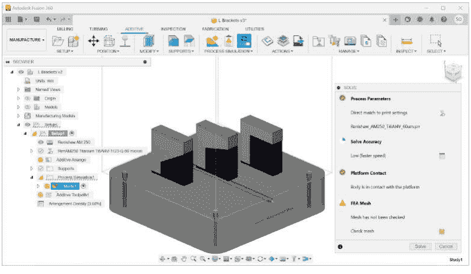

Figure 13.9 – 开始工艺仿真前的预检查

一旦开始求解，Fusion 360 会显示 CAM Task Manager 对话框，如图 13.10 所示。在此对话框中，我们可以看到 Fusion 执行热机械仿真，以计算零件在 3D 打印过程中将承受的变形和应力。如果我们选择活动研究的条目，可以右键单击并禁用 Auto Remove 选项，从而在求解期间监控进度，并在完成后查询总求解时长。

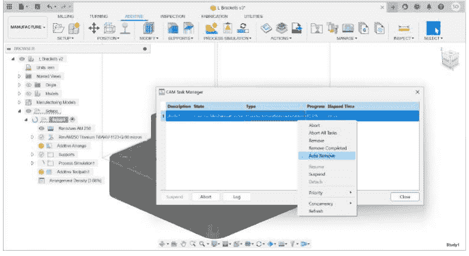

Figure 13.10 – CAM 任务管理器报告工艺仿真的进度

热机械仿真完成后，Fusion 360 将在名为 RESULTS 的新选项卡中显示仿真结果，如图 13.11 所示。我们将看到构建平台和正在 3D 打印的零件的前几层的彩色表示。由于这是一个瞬态分析，我们可以切换时间步长，以可视化零件逐层组打印的过程。

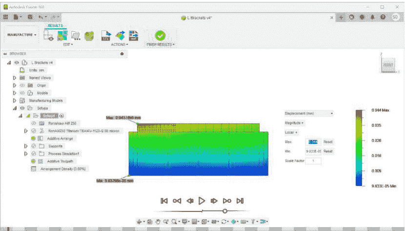

Figure 13.11 – 可视化工艺仿真结果

我们看到的默认颜色代表零件在打印过程中将经历的位移大小，并与画布右侧图例中显示的值相对应。

在本节中，我们说明了如何使用 MPBF 打印机创建增材制造设置。在定向并支撑组件后，我们启动了工艺仿真。我们介绍了如何查询打印设置以及它们如何与工艺仿真参数关联。我们选择了一个组件并使用它进行了工艺仿真。

在下一节中，我们将学习如何查看工艺仿真结果，并将仿真组件的变形和补偿版本导出为 STL 或 3MF 文件。

## 结果解读

我们通过完成第一次工艺仿真结束了上一节。在本节中，我们将重点介绍 Fusion 360 在进行工艺仿真时计算的各种结果类型。

如 *图 13.12* 所示，Fusion 为 MPBF 工艺仿真计算并显示六种结果类型。分析完成后，我们看到的默认结果类型是 **Displacement**。然而，我建议在生成网格或完成工艺仿真后查看 **Structure Type** 结果。此结果类型根据每个单元代表支撑结构、零件还是构建平台对其进行着色。

没有支撑结构的下表面区域以红色显示，表示欠约束区域。Fusion 还将不连续且 Z 轴存在非预期间隙的支撑结构着色为欠约束单元。在这种情况下，你可能需要返回工艺仿真设置并编辑网格设置，以便在对模型进行网格划分/求解之前正确地对支撑结构进行网格划分或生成额外的支撑结构。

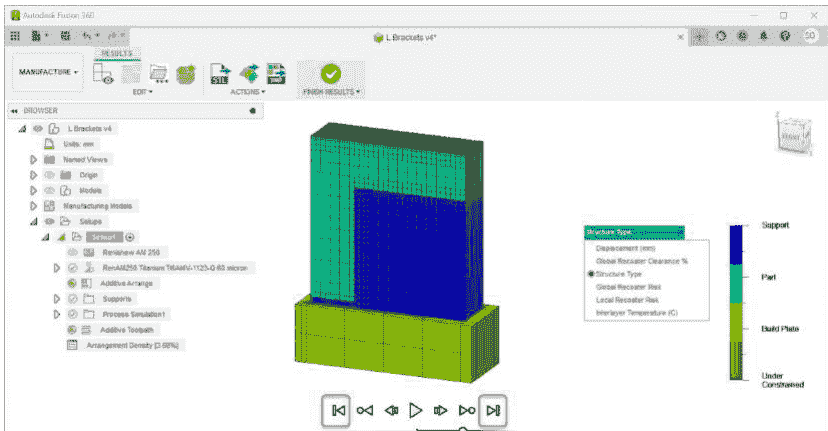

Figure 13.12 – 工艺仿真的结构类型结果

在观察结构类型结果后，通过使用图例旁边的下拉菜单，你可以切回 **Displacement** 结果。**Displacement** 结果可以进一步筛选，以便你可以在 **X**、**Y** 和 **Z** 轴上观察模型的变形。或者，你可以查看位移的大小。应用于单元的图例和颜色轮廓可以修改为设置为全局位移结果，或你正在观察的局部时间步长。在 *图 13.13* 中，我们可以看到最终时间步长的 **Z** 方向位移。你可以使用仿真播放器切换控件切换时间步长，如 *图 13.12* 中所示。

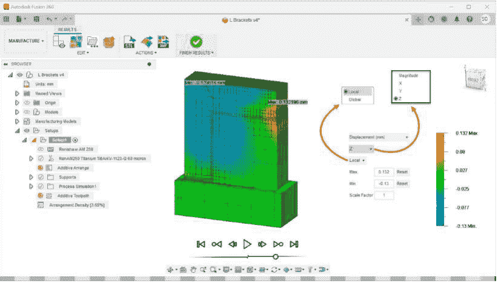

图 13.13 – 工艺仿真的位移结果类型

另外，你可以使用屏幕底部的時間軸並拖動黑色垂直條左右移動以切換到不同的時間步。圖 13.14 顯示了本次仿真距離最後一個時間步兩步的 Z 位移結果，如標註 1 所示。

工藝仿真結果也可以通過一個因子進行縮放以誇大變形形狀，如標註 2 所示。在以下截圖中，縮放因子設置為 20，這會放大位移以顯示變形的方向。**結果**選項卡內的**編輯**面板讓我們可以切換單元邊線，從而在不顯示每個單元邊緣的黑色線條的情況下觀察結果。使用同一面板，你還可以選擇**切換最小/最大探針**，以便在每個時間步了解位移最大和最小的節點位置。你也可以使用**打開結果文件夾**命令來定位所有仿真輸入和輸出在計算機上的存儲位置。這也允許你在需要清理硬盤空間時刪除仿真結果文件，因為工藝仿真結果會占用大量硬盤空間。

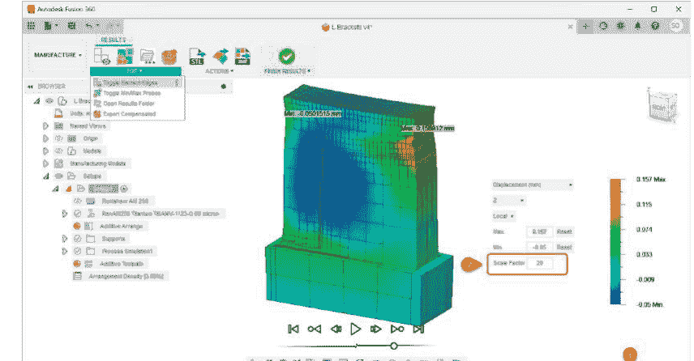

## 图 13.14 – 切换时间步并修改缩放因子

我們接下來要重點介紹的結果類型是刮刀間隙。在打印過程中，隨著激光在粉末上移動，金屬粉末會熔化然後固化。在此循環中金屬受熱冷卻時會產生熱誘導應力。在打印過程中，剛剛打印的層會在 X、Y 和 Z 方向上發生變形。如果某一層在正 Z 軸方向上的變形量超過我們在打印設置中設定的層厚，我們的零件就會發生刮刀碰撞。Fusion 360 可以使用工藝仿真預測此類現象。刮刀間隙百分比結果類型允許我們在打印過程中可視化零件與刮刀葉片的接近程度。100% 間隙意味著零件在某一點沒有 Z 方向變形。0% 間隙意味著零件在該點的 Z 變形量相當於層厚。Fusion 360 將所有層的該結果匯總顯示為一個名為**全局刮刀間隙**的結果類型，如圖 13.15 所示。間隙值高於 100% 表示該點發生了負 Z 方向變形。

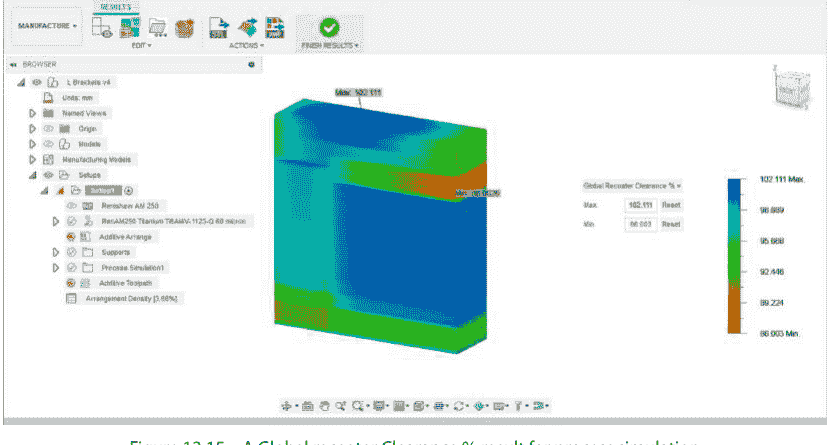

圖 13.15 – 工艺仿真的全局刮刀間隙 % 結果

如前所述，Fusion 會為每個時間步計算刮刀間隙百分比。你可以通過將結果類型切換為**局部刮刀風險**來在每個時間步可視化這些結果的簡化版本。該結果類型使用類似交通燈顏色等高線的圖例（紅、黃、綠）來呈現刮刀間隙百分比。任何刮刀間隙高於 80% 的情況均表示刮刀碰撞的**低**風險。如果刮刀間隙低於 80% 但高於 40%，Fusion 會將這些單元高亮為刮刀碰撞的**中**風險。任何低於 40% 的間隙將被高亮為刮刀碰撞的**高**風險並以紅色顯示。

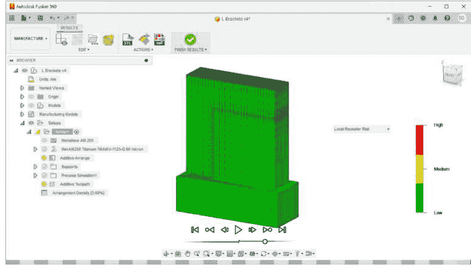

圖 13.16 – 工艺仿真的局部刮刀風險結果

Fusion 360 還允許我們將工藝仿真結果導出為網格文件，如圖 13.17 所示。通過在**結果**選項卡的**操作**面板中選擇**導出彩色 3MF**命令，我們可以提取結果的彩色網格文件。創建仿真報告時可以使用 3MF 文件，並使用 Microsoft Office 工具（如 Word 或 PowerPoint）。

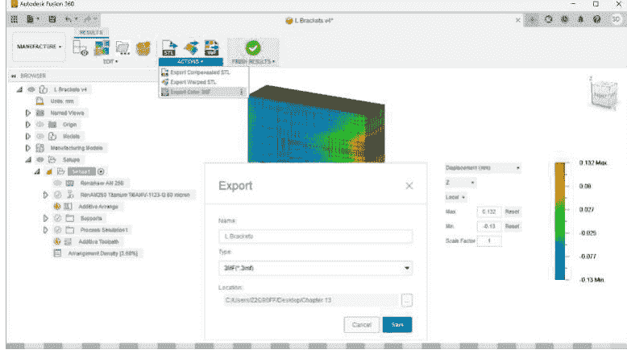

圖 13.17 – 將工藝仿真結果導出為帶顏色的 3MF 文件

當我們完成對工藝仿真結果的分析後，只需從**結果**選項卡中選擇**完成結果**命令即可，這將關閉結果可視化並返回到**制造**工作區的**增材**選項卡。

稍後，如果我們想分析某個研究的結果，可以在瀏覽器中選擇該研究，如圖 13.18 所示，並選擇**工藝仿真**選項卡中位於其中的**查看結果**命令，如標註 1 所示。或者，我們也可以在瀏覽器中右鍵單擊所選研究並從菜單中選擇**查看結果**命令，如標註 2 所示。

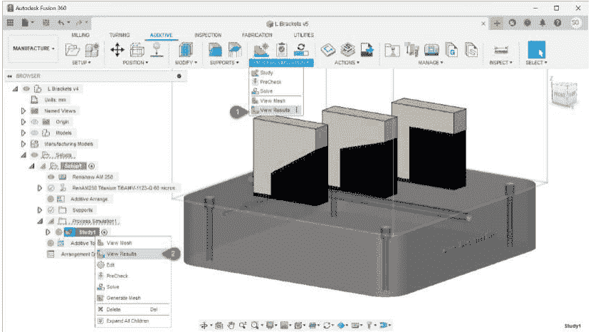

圖 13.18 – 訪問工藝仿真結果

此操作將帶我們返回活動工藝仿真研究的結果可視化。使用**結果**選項卡，我們可以繼續探測結果或導出 3MF 文件以生成結果報告。

在本節中，我們重點介紹了如何利用**結果**選項卡查詢工藝仿真的不同結果類型。在下一節中，我們將探討如何基於工藝仿真結果生成補償模型，以便以最小變形制造零件。

## 补偿变形并更新设置

我們在上一節結束時導出了一個帶顏色的 3MF 文件，以便使用 Microsoft Word 或 PowerPoint 生成交互式報告。在本節中，我們將重點介紹如何從工藝仿真結果中導出翹曲和補償的 STL 文件，以及如何使用補償形狀創建新的設置。

開始時，讓我們使用上一節介紹的**查看結果**命令返回工藝仿真結果。一旦進入**結果**選項卡，我們可以在**操作**面板中選擇**導出補償 STL**和**導出翹曲 STL**，如圖 13.19 所示。

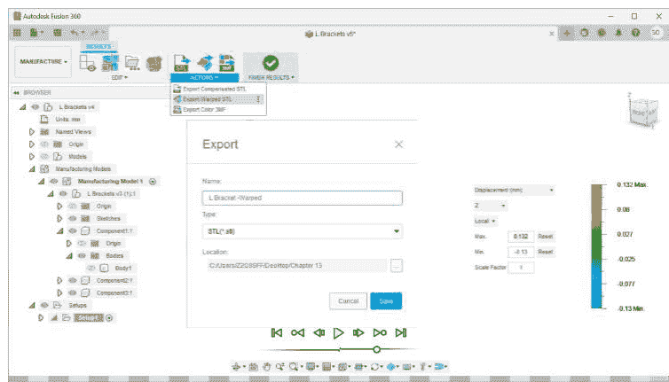

圖 13.19 – 將翹曲形狀導出為 STL 文件

創建翹曲和補償的 STL 文件後，我們可以使用 Fusion 360 對它們進行比較。如圖 13.20 所示，我們可以創建一個新的 Fusion 設計文檔，這會帶我們返回到**設計**工作區。在此工作區中，我們可以進入**網格**選項卡並將這兩個 STL 文件插入到同一文檔中。如圖 13.20 所示，這將在瀏覽器中留下兩個網格體，名稱分別為 L Bracket - Warped 和 L Bracket - Compensated。如果我們在視圖立方體的前視圖中放大左上角，可以看到翹曲形狀和補償形狀之間存在明顯差異。如果我們使用生成的支撐件按設計形狀打印零件，打印機的輸出結果將接近翹曲對象所代表的形狀，該形狀在下圖中由綠色陰影的網格體突出顯示。請注意，在我們組件的這個角落，翹曲網格體向正 X 方向變形。Fusion 360 生成的補償形狀通過創建向負 X 方向傾斜的幾何體來抵消該變形。

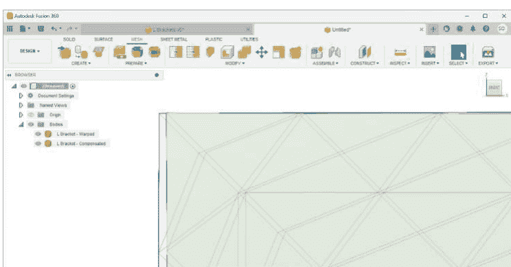

圖 13.20 – 翹曲模型和補償模型的疊加視圖

我們也可以使用翹曲 STL 輸出來比較仿真結果與打印變形，如果我們要評估 Fusion 360 生成的仿真結果的準確性。在 3D 打印模型後，我們可以使用藍光掃描檢查變形，並將打印的變形形狀與 Fusion 360 預測的翹曲輸出進行比較，檢查使用本研究打印設置中選擇的 PRM 文件獲得的結果的準確性。

我在進行工藝仿真後推薦的工作流程是選擇位於**結果**選項卡的**編輯**面板中的**導出補償**命令，如圖 13.21 所示。

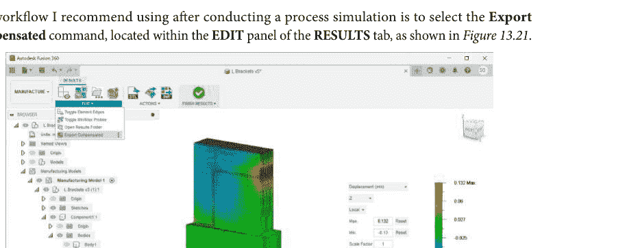

圖 13.21 – 將補償形狀導出到制造模型

使用此功能，您可以生成补偿模型的网格体，并将其直接包含在用于创建活动增材设置的制造模型中，如图 13.22 所示。同一张图以 50% 的不透明度显示组件 1、2 和 3，以便我们能够在没有任何遮挡的情况下清晰地看到新的网格体。

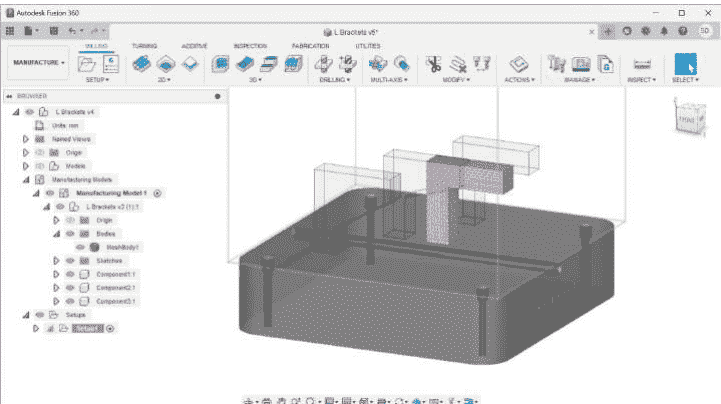

图 13.22 – 补偿形状包含在制造模型中

此时，我们仍需对制造模型进行一些手动修改，以便使用补偿网格体创建设置。首先，我们将选择制造模型，右键单击并编辑它。接下来，我们必须通过右键单击它并选择“Create Components from Bodies”命令来从网格体创建新的组件，如图 13.23 所示。此操作将生成一个名为 Component 4 的新组件，其中包含补偿网格体。现在我们已完成对制造模型的修改，可以在功能区中选择 FINISH EDIT 命令。

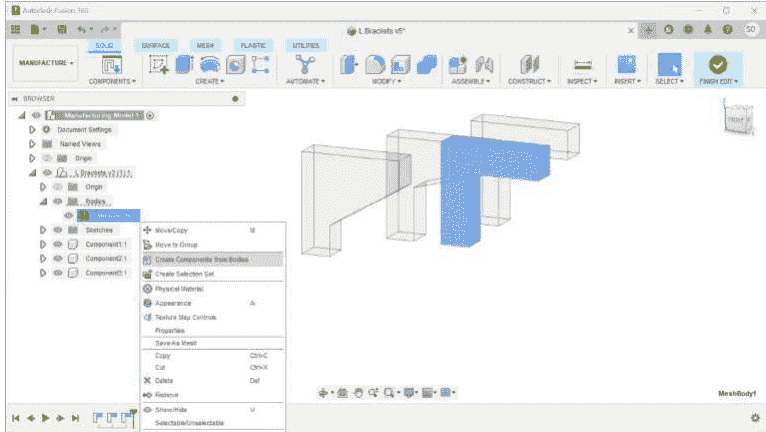

图 13.23 – 从补偿形状的网格体创建新组件

为了保留我们在 Setup1 中的工作，我们可能希望将其复制并创建 Setup1 (2)，如图 13.24 所示。这样，我们就能保留导致补偿形状的过程仿真输入和结果。在未来，如果我们想回顾结果或尝试进行不同的仿真，只需使用 Setup1 即可，该设置不考虑新创建的 Component4。

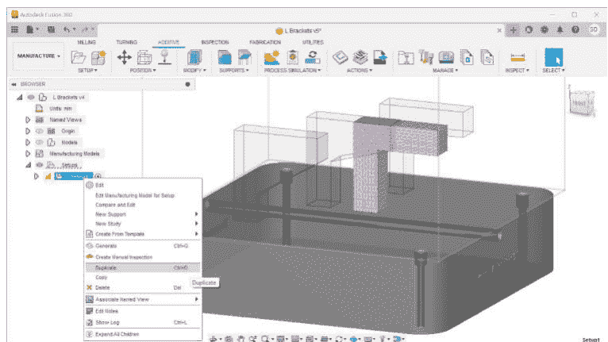

图 13.24 – 复制 Setup1 以创建 Setup2

现在我们有了新的设置，需要编辑它并取消选择组件 1、2 和 3，以便选择 Component 4，如图 13.25 所示，以便对其进行定位和支撑。我们可以通过在浏览器中右键单击 Setup1 (2) 并选择 Edit 来访问 SETUP 对话框，从而实现此操作。

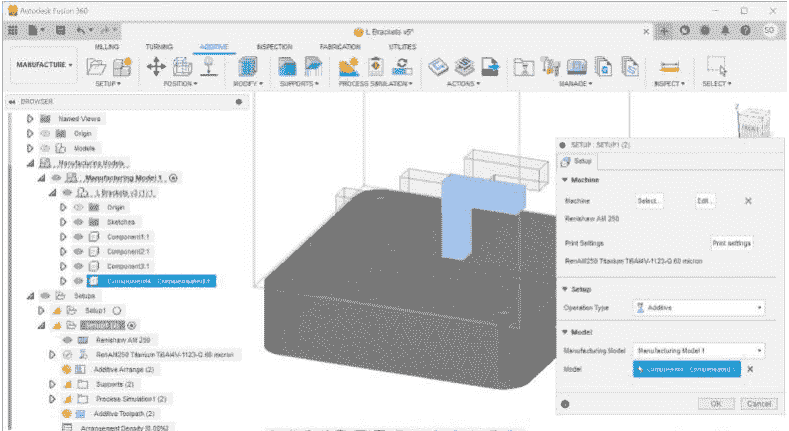

图 13.25 – 编辑 Setup1 (2) 以选择补偿组件

现在我们已将 Component 4 选择为 Setup1 (2) 中唯一的组件，就需要按照本書中所学过的典型打印准备步骤进行操作。我们可以先使用 ADDITIVE 选项卡的 POSITION 面板中的 Arrange 命令，将零件放置在打印机构建体积内。图 13.26 显示了如何安排 3 毫米的平台间隙，将零件放置在打印机构建区域内。

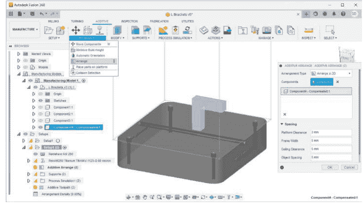

图 13.26 – 在构建体积内排列补偿零件

我们清单上的下一项是为此组件创建支撑结构。图 13.27 显示了我们如何通过在 ADDITIVE 选项卡的 SUPPORTS 面板中选择适当的支撑操作来为此组件添加体积支撑。由于我们在流程早期将 Setup1 复制以创建 Setup1 (2)，因此 Setup1 中使用的所有体积支撑仍可在 Setup1 (2) 中使用。我们需要选择并删除它们或抑制它们，因为它们不会参与此设置。

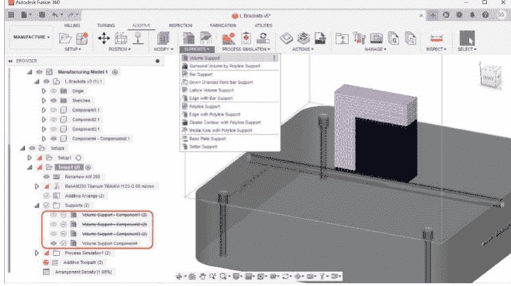

图 13.27 – 为补偿模型应用体积支撑

一旦补偿模型定位并得到适当的支撑，我们就可以生成增材刀具路径并对其进行仿真，如图 13.28 所示。请记住，为了生成刀具路径，您必须从浏览器中选择 **Additive Toolpath** 行项目，并在 **ADDITIVE** 选项卡的 **ACTIONS** 面板中使用 **Generate** 命令。在逐层可视化增材刀具路径后，如果我们对结果满意，可以选择 **Create Machine Build File**，如下图所示。

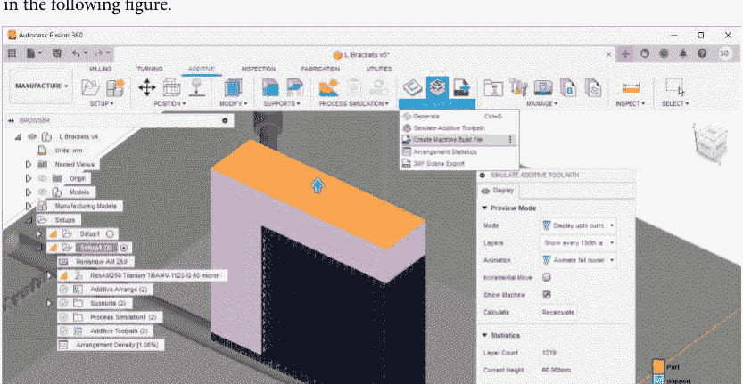

图 13.28 – 仿真增材刀具路径并创建机器构建文件

在此示例中，生成机器构建文件将使我们能够为 Renishaw 打印机创建必要的 MTTF 文件。由于该文件是使用补偿模型生成的，而补偿模型是在进行过程仿真后创建的，因此与按设计 CAD 模型相比， resulting 3D 打印零件的变形将可以忽略不计。

## Summary

## 摘要

在本章中，我们重点介绍了如何为 MPBF 3D 打印机创建设置以及如何使用有限元分析仿真该过程。MPBF 过程是 3D 打印技术中最昂贵的技术之一，无论是资本支出还是材料成本。过程仿真有助于我们确定增材设置是否会产生预期结果。如果我们能够在 3D 打印之前检测并补救潜在的故障，例如涂覆器刀片碰撞或大变形，我们就可以在制造阶段节省大量时间和金钱。

在本章的第一部分中，我们重点介绍了如何使用 MPBF 机器生成增材设置，并强调了控制过程仿真输入的打印设置中的各种参数。我们还展示了如何设置过程仿真研究。我们演示了如何定义过程条件，例如构建板加热，并修改有限元分析求解器的关键输入，例如网格设置。我们以进行第一次过程仿真研究结束该部分。

然后，我们重点介绍了 Fusion 为 MPBF 过程仿真生成的结果类型。我们强调了如何在各种结果类型之间切换，例如结构类型、位移、涂覆器刀片间隙和涂覆器刀片风险。我们以将结果作为带有颜色数据的 3MF 文件导出以用于创建报告结束该部分。

在最后一部分中，我们重点介绍了如何从过程仿真结果中导出翘曲和补偿模型。我们展示了如何将翘曲和补偿模型重新导入 Fusion 以可视化它们之间的差异。我们以演示如何使用补偿模型创建新设置结束本章，以便 3D 打印一个会变形为按设计模型的零件。

使用您在本章中获得的实践知识，您可以更有信心地使用 Fusion 360 仿真金属增材制造设置，以便识别潜在的打印故障并补偿 MPBF 打印过程中固有的变形，从而实现成功的打印。

在下一章中，我们将重点介绍如何使用预设、模板和脚本自动执行重复性任务，例如零件定向、构建体积内的零件排列和支撑结构生成。

## Automating Repetitive Tasks

## 自动化重复性任务

欢迎来到第 14 章。在之前的章节中，我们演示了如何使用 Fusion 360 设计新模型以及从外部来源导入模型。我们还强调了如何生成设置以使用各种 3D 打印技术增材制造这些模型。现在我们对如何使用 Fusion 360 有了良好的理解，并且在创建设置、排列零件以及为各种增材技术创建支撑结构方面积累了经验，让我们学习更多关于如何自动化和优化 Fusion 360 的知识，以便不必为每个增材设置编辑每个输入对话框。

在本章中，我们将重点介绍如何自动化 Fusion 的各个方面，以最大限度地减少我们与软件的交互，创建增材设置并生成刀具路径。我们将通过向您介绍 Autodesk App Store 来介绍 Fusion 生态系统中的现有自动化。然后，我们将重点介绍如何自定义 Fusion 的机器和打印设置库，以便创建可用于创建设置时使用的完全定义的机器。您将学习如何自定义各种操作的输入，例如自动定向研究、零件排列和支撑结构生成。我们还将演示如何将这些输入保存为用户默认值。然后，我们将创建并保存模板，这些模板将多个操作组合到单个文件中，可在后续增材设置中重复使用。我们将以重点介绍如何利用 Fusion 的编程功能结束本章，通过创建 Python 脚本来自动化生成增材设置、定向零件、在构建板内排列它们以及仿真增材刀具路径的整个过程。

在本章中，我们将涵盖以下主题：

- Using apps from the Autodesk App Store
- Customizing presets and using templates
- Automating the additive workflows with scripting

- 使用 Autodesk App Store 中的应用
- 自定义预设并使用模板
- 使用脚本自动化增材工作流程

到第一个部分结束时，您将学会如何使用各种过滤器搜索 Fusion App Store，例如操作系统、应用类别和应用成本。您还将学习如何下载、安装和运行应用以执行某些自动化操作。在下一部分中，您还将很好地了解如何自定义 Fusion 的机器库并创建自己的机器，其中包含

关联打印设置和后处理文件。通过这种技术，您将能够更高效地创建未来的增材制造设置。在本节中，您还将学习如何将常用的输入保存为各种操作的默认值，例如零件方向、零件排列和支撑结构生成。您还将学习如何创建包含多个操作和自定义输入的模板，以及如何在后续的增材制造设置中重用这些模板。到本章结束时，您将知道如何创建和自定义第一个基于 Python 的脚本，以自动化 FFF 机器的整个增材制造工作流程，无论是单个组件还是多个组件。

### 技术要求

本章涵盖的所有主题都可供个人、试用版、商业版、初创版和教育版 Fusion 360 许可证类型使用。如果您打算使用 Python 编程语言创建或自定义脚本以自动化 Fusion 360 中的增材制造设置，您还需要安装来自 Microsoft 的 Visual Studio Code 软件：https://code.visualstudio.com/。

如何下载和安装此软件将在本章的相关部分中突出显示。

本章的课程文件可在以下位置找到：https://github.com/PacktPublishing/3D-Printing-with-Fusion-360

## 使用 Autodesk App Store 中的应用程序

Fusion 360 在使用 3D 打印进行设计和制造方面具有大量内置功能。然而，在某些情况下，您可能需要额外的功能来自动化工作流程。在这种情况下，您可能希望查看 Autodesk App Store，以查看是否有可供您使用的应用程序，以便在无需手动执行多个步骤的情况下完成特定任务。

您可以通过在 Web 浏览器中导航到 https://Apps.autodesk.com/FUSION/en/Home/Index 来访问 Autodesk App Store。您也可以在大多数工作区的 UTILITIES 选项卡的 ADD-INS 面板内访问 Autodesk App Store 命令，包括 DESIGN 工作区，如图 14.1 中的标注 1 所示。

一旦 Autodesk App Store 在您的 Web 浏览器中可见，您会注意到网页左上角的产品设置为 Fusion 360。使用此 App Store，您可以浏览精选应用，或在搜索栏中输入应用名称搜索特定应用。您还可以通过在左侧选择适当的筛选器来筛选与 3D 打印相关的应用，如标注 2 所示。

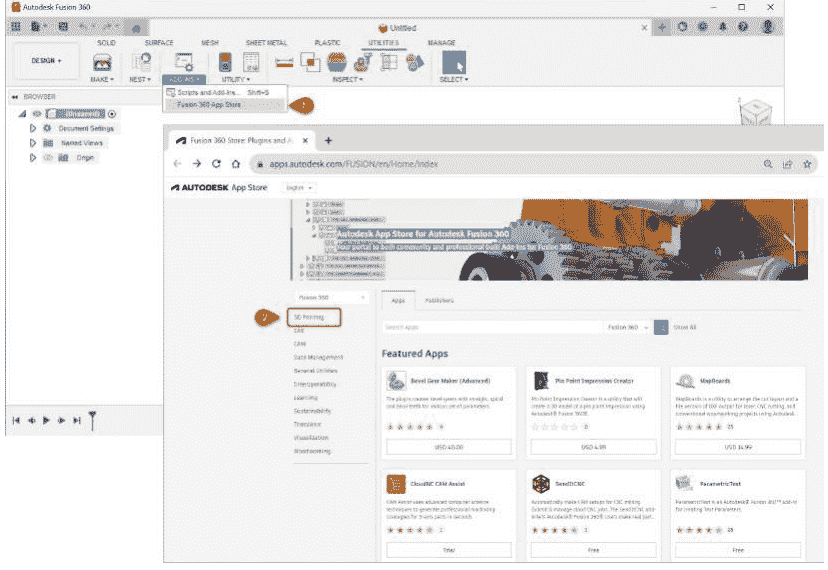

图 14.1 – 访问 Autodesk App Store 并筛选 3D 打印应用

在选择 3D 打印作为筛选器后，App Store 会显示更高级的搜索和筛选工具集，因此您可以使用标题栏中的相应选项查找最相关、最新的或下载量最大的应用，如图 14.2 中的标注 1 所示。Autodesk App Store 包含大量可免费下载和使用的应用程序。然而，某些应用需要一次性费用或订阅。使用筛选器，您还可以根据评分和价格对应用进行排名。使用 App Store 左侧的浏览器，如同一图中的标注 2 所示，您可以筛选免费应用、提供试用选项的应用或付费应用。您还可以根据操作系统（如 Windows 或 Mac OS）筛选应用。

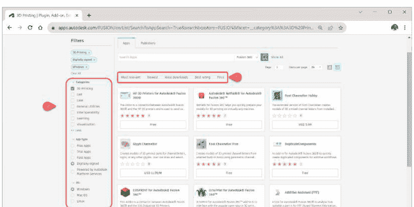

图 14.2 – 具有各种筛选和排名机制的 Autodesk App Store

在本节中，我们将演示如何从 Autodesk App Store 下载并使用名为 DuplicateComponents 的免费应用。该应用由 Autodesk 开发，可用于 macOS 和 Windows 64 位操作系统。在导航到该应用后，使用我们之前强调的筛选器或通过搜索栏搜索其名称，您将看到该应用的详细信息，如图 14.3 所示。为了下载和安装此应用，您首先必须通过选择 Sign In 选项登录 Autodesk App Store，如标注 1 所示。然后，您必须选择操作系统，如标注 2 所示，以便为您的计算机下载正确的应用版本。之后，您将能够选择 Download 选项，如标注 3 所示，以下载安装程序。

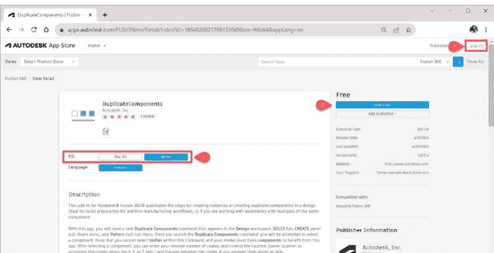

图 14.3 – 登录 App Store 以下载 Fusion 360 的应用

点击 **下载** 按钮将在您的硬盘上保存安装程序的本地副本。在此示例中，我们将下载该应用的 Win64 版本。如标注 1 在 *图 14.4* 中所示，`DuplicateComponent-win64.msi` 文件已保存到 `Downloads` 文件夹。导航到适当的文件夹后，我们可以打开该文件，如标注 2 所示。这将启动安装，如标注 3 所示。

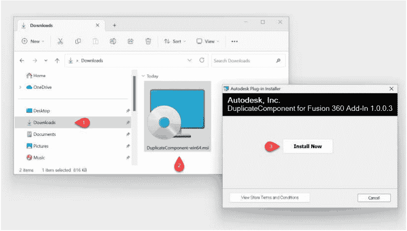

图 14.4 – 下载 MSI 文件并启动应用的安装

安装插件后，我们需要确保它正在运行。为了启动或停止我们安装的插件，我们必须返回 Fusion 360 中的 **脚本和插件** 对话框，该对话框在 *图 14.5* 中显示。然后，您需要转到 **脚本和插件** 对话框的 **插件** 选项卡，并在 **我的插件** 文件夹下选择新安装的 `DuplicateComponent` 插件，如标注 2 所强调。

如果您在某个插件右侧看到圆形的点状图案，则表示该插件已在运行。如果您只看到插件的名称，右侧没有图标，则表示该应用已停止。

您可以选择某个插件并通过选择此对话框底部的相应命令来运行/停止它。如果需要，您还可以选择对话框底部的复选框以在启动时运行某个插件，如下图所示的标注 3 所示。

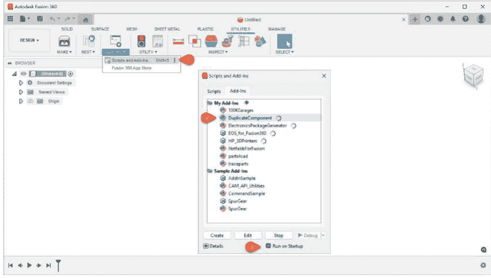

图 14.5 – 在 Fusion 360 启动时运行插件

现在我们的应用已安装并正在运行，我们准备好将其与工作流程一起使用。此插件在 DESIGN 工作区的 SOLID 选项卡下 CREATE 面板的 Pattern 弹出菜单中包含一个新命令，如图 14.6 所示。如果将鼠标悬停在名为 Duplicate Components 的新命令上，您会看到其右侧出现一个新图标。此垂直省略号图标在下图中用标注 1 突出显示。选择此图标后，您将能够激活 Pin to Toolbar 复选框，如标注 2 所示。此操作将把 Duplicate Components 图标添加到 CREATE 面板中的功能区，如标注 3 所示。

如果您从 CREATE 面板或 Pattern 弹出菜单中选择 Duplicate Components 命令，将会出现一个名为 DUPLICATE COMPONENTS 的新对话框，如图 14.6 所示。此对话框允许您选择一个组件并快速创建同一组件的多个副本。您可以控制副本的数量和重复组件的放置位置。您可以选择将副本保持在同一位置，或在 X、Y 和 Z 轴上排列它们，并在每个组件的边界框之间设置特定的间隙。如果选中 Copy & Paste New method 复选框，则重复的组件将与原始组件无关。这意味着您可以为每个副本添加独特的功能，而不会更改原始组件。

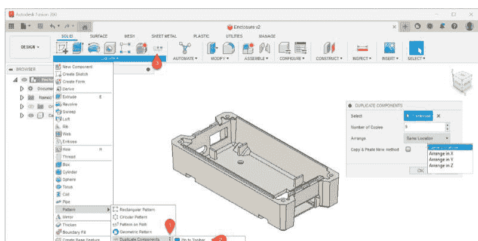

图 14.6 – 在 CREATE 面板中定位 Duplicate Components 命令

在此示例中，我们选择在同一位置创建原始组件的九个额外副本，而不使用 Copy & Paste New method 选项。此操作创建了 9 个额外组件，总共 10 个组件，如图 14.7 所示。每次复制粘贴操作也在时间轴中以功能的形式记录。

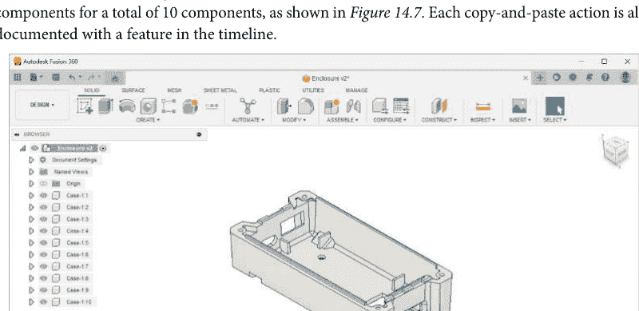

图 14.7 – 复制单个组件以创建 10 组件装配体

Fusion 360 具有复制和粘贴组件的原生功能。然而，如果你想创建多个与原始组件位置相同的新组件，就必须按需多次依次使用复制和粘贴命令。这可能需要很长时间，具体取决于你想要复制的数量。利用插件，例如本节演示的插件，来自动化此过程，将节省大量时间，并消除随着组件数量增加在复制粘贴过程中可能引入的任何潜在错误。

本节主要介绍了如何使用插件在 **设计** 工作区中自动化工作流程。在下一节中，我们将重点介绍如何通过自定义机器、打印设置和预设的库来自动化 **制造** 工作区中的某些工作流程。

## 自定义预设和使用模板

在之前的章节中，我们演示了如何使用 Fusion 360 的 **制造** 工作区创建增材制造设置。我们还展示了如何定向零件、在构建体积内排列它们并生成支撑。我们重点介绍了如何模拟增材制造刀具路径并生成必要的机床文件。

在本节中，我们将展示如何自定义 Fusion 的机器和打印设置库，以便加快创建增材制造设置的过程。我们还将介绍如何自定义增材制造设置中各种对话框的默认输入，以及如何创建预设以将多个自定义支撑操作组合成单个命令，从而有效地为我们的模型生成支撑结构。

尽管创建增材制造设置的过程很简单，但它确实需要在每个设置中明确选择机器和打印设置。在 Fusion 360 的 **制造** 工作区中，我们可以在 **管理** 面板内访问 **机器库** 对话框，如图 14.8 的标注 1 所示。我们还可以将 3D 打印机从 Fusion 360 库复制并粘贴到我们自己的云、本地或链接库中，如标注 2 所示。以下图示显示了一台名为 **Prusa i3 MK3S+** 的 3D 打印机，已保存在“我的机器”下的 **本地** 文件夹中。每当我们从 Fusion 360 的机器库将一台机器复制并粘贴到“我的机器”中的一个文件夹时，关联的后处理文件 (*.cps)，如标注 3 所示，会自动分配。然而，在使用该机器创建增材制造设置时，我们仍然必须指定打印设置。为了加快设置创建过程，我们还可以通过单击标注 4 所示的文件夹图标将打印设置与该机器关联。选择打印设置库中的 **PLA (Direct Drive).printsetting** 后，我们的本地机器现在就可以在设置创建中使用。在设置创建期间从“我的机器”的本地文件夹中选择此机器后，我们无需再选择打印设置，因为该打印设置会自动与机器库中的 **PLA direct drive** 打印设置关联。

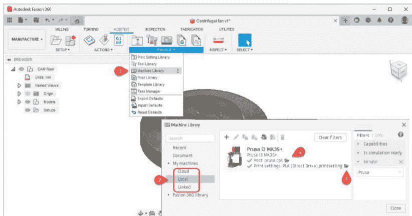

图 14.8 – 将打印设置关联以自定义机器

创建此机器和打印设置后，我们可能需要在 3D 打印机的构建体积内定向组件。图 14.9 显示了如何在 ADDITIVE 选项卡的 POSITION 面板内访问自动定向命令。在此示例中，我们可以选择名为 Centrifugal fan 的组件作为要定向的目标组件。

> 重要提示
> 如第 8 章所述，在计算支撑面积和支撑体积时，自动定向命令会查找从水平面起低于特定角度的悬垂角度的零件段，以便对定向研究的结果进行排序。

制造设置中对话框中的任何输入都可以通过选择输入字段右侧的垂直省略号图标来自定义，如图 14.9 所示。选择省略号图标后，将显示一个下拉菜单，允许你将当前输入保存为用户默认值。通过自定义输入并将其保存为用户默认值，你可以在增材制造设置中执行任何定位或支撑操作时重复使用它。

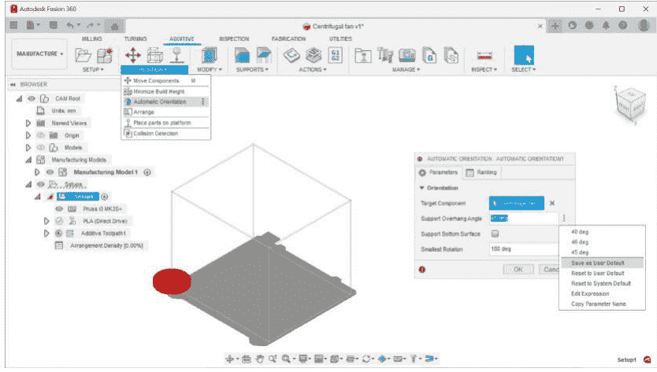

图 14.9 – 将自定义输入保存为用户默认值

同一菜单中的另一个有用选项是复制任何输入字段的参数名称的能力。图 14.10 显示了 **实体体积支撑** 对话框的 **常规** 选项卡。提醒一下，你可以通过在 **增材** 选项卡的 **支撑** 面板中选择 **实体体积支撑** 命令来访问此对话框，以进行使用 FFF 3D 打印机的增材制造设置。

如以下图所示，此选项卡有两个输入字段 – **零件顶部距离** 和 **零件底部距离**。这些字段的默认输入为 0.3 毫米。每个输入字段都有一个与其关联的参数名称，你可以在 **制造** 工作区中的任何对话框以及使用 Fusion API 创建脚本或插件时重复使用。这些参数名称也可以用作 **编辑表达式** 对话框中的等式的一部分，或在输入其他输入字段时使用。

图 14.10 显示了我们如何简单地复制参数名称，如标注 1 所示，并将其粘贴到不同的输入字段中，如标注 2 所示，以创建等式，其中 **零件顶部距离** 输入为 **零件底部距离** 输入值的一半。

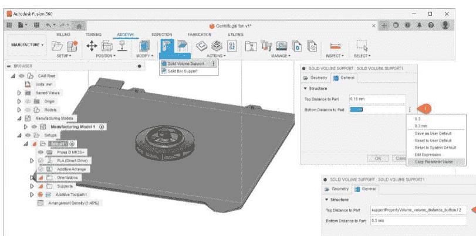

图 14.10 – 使用参数名称编辑输入

现在我们已经介绍了如何自定义用户输入并使用参数，我们可以转换思路，重点关注将多个操作，如排列零件、执行自动定向研究和创建支撑结构，组合到单个模板中。

为了演示如何使用模板，让我们创建一个名为 Centrifugal fan - SLA 的新 Fusion 文档。此 Fusion 文档具有使用 SLA 打印机的增材制造设置，如图 14.11 所示。我们为设置使用的打印机是 **Prusa SL1S SPEED** 打印机，打印设置设置为 **Prusa SL1S SPEED - Prusa Orange Tough - 0.1mm Fast**。零件已在构建体积内排列并定向。如图 14.11 所示，我们已为此组件创建了一个向下定向的点状杆支撑，我们将使用位于 **增材** 选项卡的 **支撑** 面板中的 **杆支撑** 操作创建第二个支撑。在创建杆支撑期间，我们将 **每组杆数** 输入字段更改为 **4**，启用名为 **Brace** 的复选框，并选择 **K** 支撑类型。

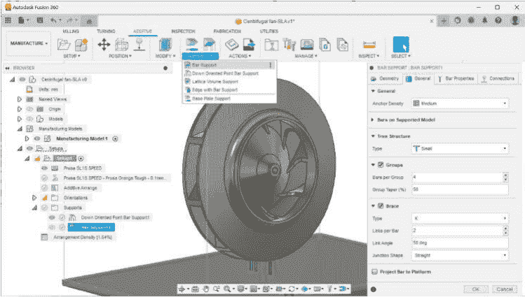

图 14.11 – 在使用 SLA 打印机的增材制造设置中为零件添加杆支撑

创建这两个支撑结构后，我们可以从浏览器中选择它们。如果你右键单击所选的支撑操作，Fusion 将显示一个新菜单，如图 14.12 所示。在此菜单中，我们可以选择 Store as Template，这将打开 Store as template 对话框。在此对话框中，我们可以为模板命名并输入自定义描述。我们还可以选择将此模板存储在我们的本地模板库或云模板库中。

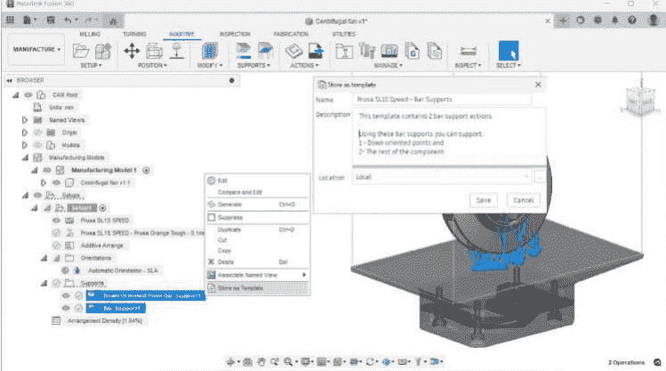

图 14.12 – 将两个支撑操作保存为模板

在我们将自定义支撑操作存储为模板后，它们将列在 Fusion 360 的模板库中。我们可以通过在 MANUFACTURE 工作区中选择 MANAGE 面板内的 Template Library 命令来访问模板库，如图 14.13 中的标注 1 所示。如果你导航到“我的模板”中的 Local 文件夹，如标注 2 所示，你将能够可视化新创建的名为 Prusa SL1S Speed - Bar Supports 的模板，如标注 3 所示。将来，如果你使用 SLA 打印机创建增材制造设置并希望使用此包含两个支撑操作的模板，你只需选择如图 14.13 所示标注 4 中的创建操作图标，并将其应用于你的增材制造设置即可。

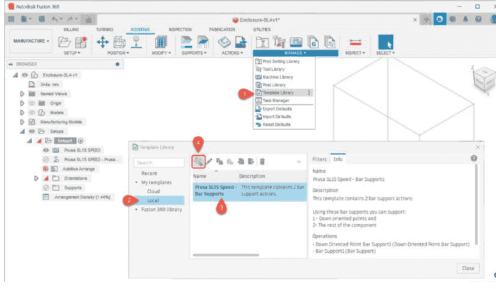

图 14.13 – 管理模板并将其添加到现有设置

图 14.14 显示了一个名为 Enclosure - SLA 的新 Fusion 设计文档。此文档已包含使用相同打印机和打印设置的增材制造设置。零件已定向并放置在构建体积内。还使用模板库添加了两个支撑操作，如图 14.13 所示。一旦你将模板中的支撑操作添加到设置中，你会注意到支撑操作出现错误，如红色菱形图标中的白色感叹号所示，提醒你它们缺少引用。通过选择单个支撑操作，你可以右键单击并选择 Edit 命令，如图 14.14 中的标注 1 所示。然后，你可以从画布中选择要支撑的模型，如标注 2 所示，并选择 OK 以生成支撑，如标注 3 所示。

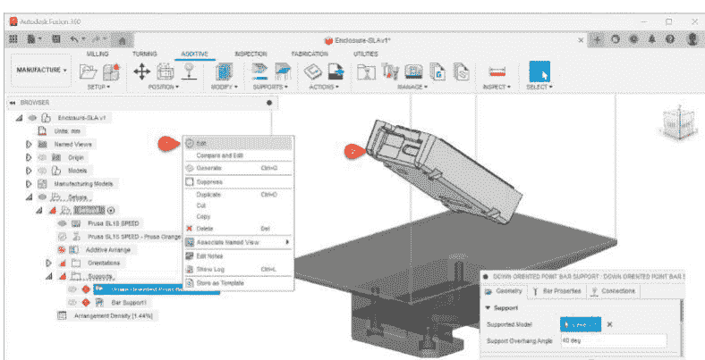

图 14.14 – 编辑支撑操作以选择缺失的引用

在模板内为每个支撑操作定义要支撑的模型并生成支撑结构后，Fusion 360 将显示支撑。 在名为 Enclosure-SLA 的文档中重用我们在设置名为 Centrifugal fan-SLA 的 Fusion 文档时创建的两个支撑操作模板的结果如图 14.15 所示。

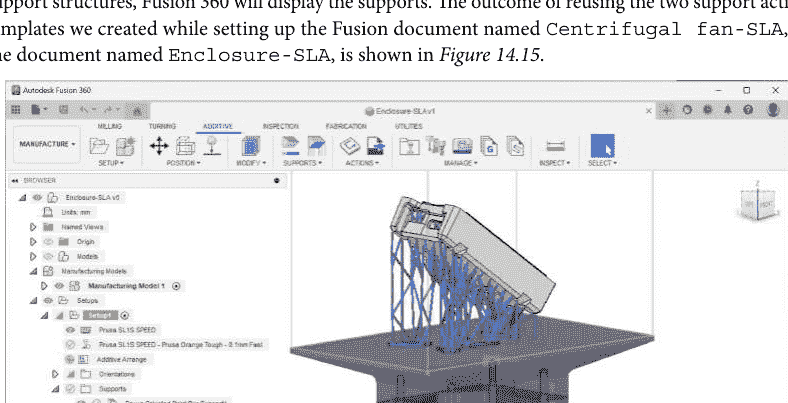

图 14.15 – 选择要支撑的模型后生成支撑

在机器库中自定义机器并为打印机选择关联的打印设置将加快增材设置创建的速度。 自定义用户默认值将允许您使用自己的偏好利用自动定向和增材排列功能。 为定向、排列或支撑结构创建自定义模板将使您能够基于机器的打印设置和材料创建一致的增材设置，从而消除可能因人为错误而引入的不一致。 在下一节中，我们将重点介绍如何使用脚本自动化整个过程，以便我们可以完全消除与 Fusion 360 的 MANUFACTURE 工作区的任何交互，以创建增材设置。

## 使用脚本自动化增材制造工作流程

在上一节中，我们介绍了如何在生成增材设置时将我们的偏好保存为用户默认值并创建模板，以便将这些模板重新应用于后续的增材设置。

使用这些技术将最大限度地减少我们与 Fusion 360 用户界面的交互，并帮助我们消除每个设置之间的一致性。 我们可以通过利用脚本将这一概念提升到下一个层次，完全消除我们与 Fusion 360 的 MANUFACTURE 工作区的交互。

如果我们始终使用相同类型的机器、打印设置、零件定向和排列选项以及支撑结构设置，我们就可以从利用自定义脚本自动化整个工作流程中受益。 如本章第一部分所述，我们可以通过 UTILITIES 选项卡的 ADD-INS 面板访问 Scripts and Add-Ins 命令，如图 14.16 中标注 1 所示。 Scripts and Add-Ins 对话框中的 Scripts 选项卡列出了多个基于 Python 和 C++ 的示例脚本，您可以执行这些脚本来自动化某些工作流程，如标注 2 所指示。 选择某个脚本后，您可以展开 Details 部分，如标注 3 所指示，以了解有关该脚本执行的操作的更多信息并检查其安装路径。

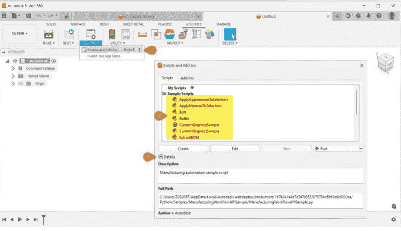

图 14.16 – Fusion 360 包含的示例脚本

如果您想创建自己的 Python 脚本或编辑现有脚本，您需要下载 Visual Studio Code 以编辑或调试给定的脚本。 如果您的计算机上未安装 Visual Studio Code 软件，在选择脚本并按 Edit 后，Fusion 将显示 Download Visual Studio Code 对话框，如图 14.17 所示。 如果您选择 OK，它将自动从 Microsoft 下载并安装 Visual Studio Code 软件。

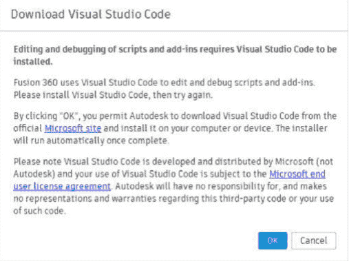

图 14.17 – 下载并安装 Visual Studio Code 以编辑和调试基于 Python 的脚本

Fusion 360 具有丰富的 **应用程序编程接口 (API)**，允许您通过创建自己的脚本和插件来自定义软件。 我们在本章第一部分中介绍的从 Autodesk App Store 下载的应用程序都是使用 Fusion 的 API 创建的，以自动化某些工作流程。 如果您发现自己有自动化某个工作流程的想法，但没有相应的应用程序，您可以创建自己的脚本或应用程序。 要了解有关 Fusion 360 脚本的更多信息，请参考以下链接中的 Fusion 360 API 文档：https://help.autodesk.com/view/Fusion360/ENU/?guid=GUID-A92A4B10-3781-4925-94C6-47DA85A4F65A。 该链接包含 Fusion API 的完整产品文档，并在图 14.18 中显示：

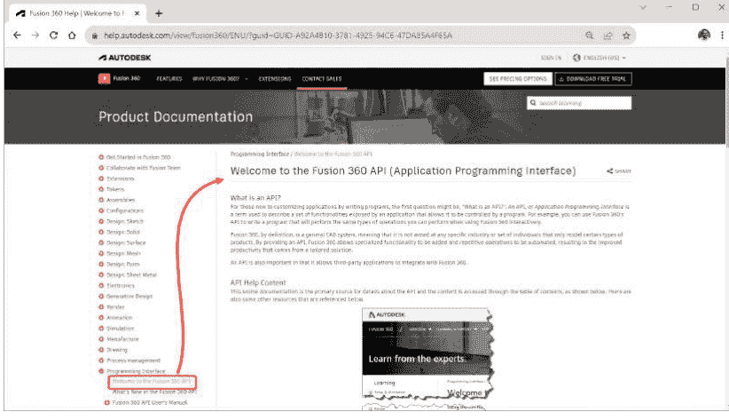

图 14.18 – Fusion 360 API 的在线文档

在此网页中，如果您向下滚动并导航到如图 14.19 中标注 1 所指示的 **示例程序** 部分，您将能够找到 **CAM** 部分。 在展开 **CAM** 标题后，如标注 2 所示，您将在 **通用** 文件夹中找到 **增材制造 API 示例**，如标注 3 所示。 此页面包含一个基于 Python 的代码示例，可自动使用 FFF 打印机和适当的打印设置创建增材设置。 要使用此代码示例，您首先需要复制 Python 代码。 选择如图 14.19 中标注 4 所指示的 **复制代码** 命令。

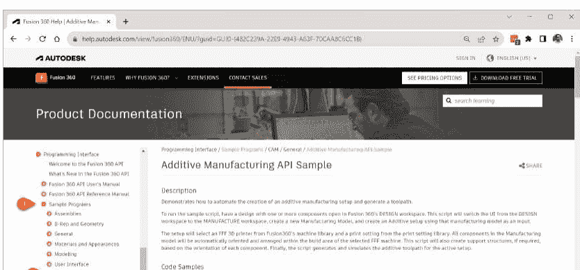

图 14.19 – 查找增材制造 API 示例

在 Fusion 的 Scripts and Add-Ins 对话框中，您可以单击 My Scripts 旁边的 + 图标来创建新脚本。 此操作将填充 Create New Script or Add-In 对话框，如图 14.20 所示。 在此示例中，我们将创建基于 Python 的脚本，因此我们必须选择 Script 和 Python 的单选按钮。 我们必须为脚本提供一个新名称； 让我们使用 FFF Setup。 然后，我们可以输入描述。 我们还可以将自己的姓名输入 Author 字段并定义 Python 脚本文件将被保存的文件夹位置。 在输入所有必要信息后，单击 Create 按钮以生成一个空的 Python 脚本。

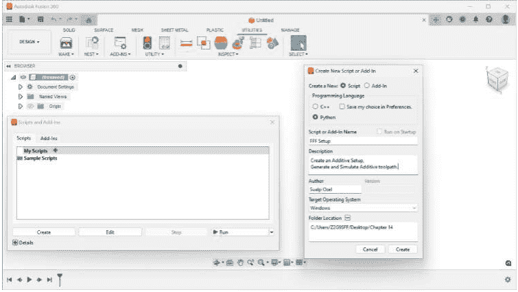

图 14.20 – 在 Fusion 中创建新的 Python 脚本

一旦我们创建了新脚本，它将列在 Scripts and Add-Ins 对话框的 My Scripts 文件夹下。 图 14.21 显示了一个带有 Python 图标的新脚本，后跟 FFF Setup，如标注 1 所指示。 选择此脚本后，按 Edit，如标注 2 所示。 此操作将启动 Visual Studio Code 软件并允许我们编辑脚本。 我们可以选择脚本中的现有文本并将其替换，通过粘贴从 Fusion 360 在线文档中复制的增材制造 API 示例代码。

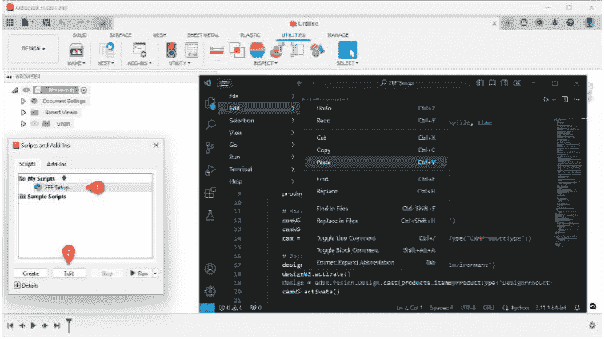

图 14.21 – 编辑 Python 脚本

如 help.autodesk.com 页面上的说明部分所述，此脚本使用 FFF 打印机和打印设置创建增材设置，所有组件均使用该设置。 然后，它会自动在成型平台上定向和排列所有零件。 它还根据脚本中定义的临界悬垂角度向需要支撑结构的零件添加体积支撑。 最后，它会生成增材刀具路径并对其进行仿真。 从技术上讲，此类脚本也可以进一步扩展以生成 G 代码。 然而，在生成机器文件并开始打印之前，始终最好直观地观察设置和生成的刀具路径。

该脚本所采取的所有操作都在代码中明确定义，并且可以根据您的特定打印机、打印设置和增材制造技术进行自定义。 在图 14.22 中，您可以看到脚本使用的打印设置和机器模型相关的行项目。 您可以通过在引号中输入来输入不同的机器模型或不同的打印设置，由标注 1 和标注 2 突出显示。 保存脚本并执行后，Fusion 将为您的打印机和打印设置创建增材设置。

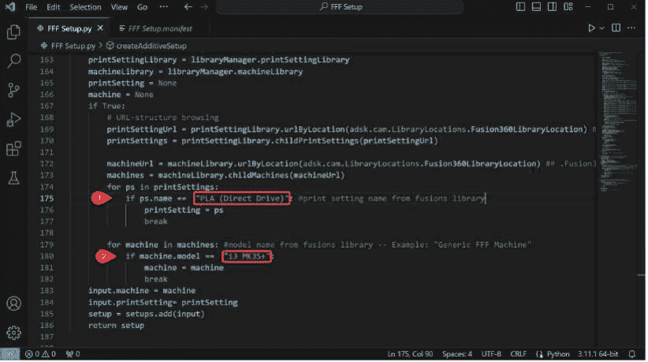

图 14.22 – 编辑脚本以根据打印机和打印设置进行自定义

现在我们已经介绍了如何创建和自定义脚本，让我们演示如何将其与新的 Fusion 设计文档一起使用。 为了展示此脚本的作用，我们将使用一个名为 Front Bumper Bracket 的 Fusion 文档。 打开此 Fusion 文档后，我们可以使用 Shift + F 快捷键访问 Scripts and Add-Ins 对话框。 选择名为 FFF Setup 的自定义脚本后，我们可以选中 Run 以执行它，如图 14.23 所示。

图 14.23 – 在 Fusion 360 中执行脚本

几秒钟后，你会注意到活动工作区已从 **DESIGN** 变为 **MANUFACTURE**，如图 14.24 所示。该脚本创建了一个名为 My Manufacturing Model - FFF 的新制造模型。它还使用 **Prusa i3 MK3S+** 打印机和 **PLA (Direct Drive)** 打印设置创建了一个新的增材设置。它自动对组件进行定向，使其所需的支撑结构最少。然后它将组件排列在构建平台的中心。它还添加了必要的实体体积支撑并创建了增材工具路径。脚本为我们留下了模拟的增材工具路径可视化，如图 14.24 所示。

图 14.24 – 执行 FFF 设置脚本的结果

如前所述，所有这些操作都是我们可以使用 Fusion 的各种命令和对话框手动完成的事情。然而，通过利用脚本，我们消除了与软件手动交互的需求。自动化单个组件所节省的时间可能并不显著，但想象一下，如果你有 10 个独特的组件需要 3D 打印。针对每个组件在与众多对话框交互的同时进行这些步骤将非常耗时。通过使用单个脚本自动化整个工作流程，我们不仅消除了用户因输入错误而可能引入的错误，还节省了打印准备步骤中的时间。使用 API 驱动脚本的自动化功能，你可以最大限度地减少错误并提高生产力。

## 摘要

本章中，我们讨论了在创建增材设置和生成工具路径时如何自动化我们的工作流程。我们首先介绍了如何使用 Autodesk App Store 搜索可以提高我们某些设计和制造工作流程生产力的应用。我们演示了如何下载、安装和使用名为 `DuplicateComponents` 的应用，以便快速创建同一组件的多个副本，从而在同一构建体积内打印多个零件。

然后，我们学习了如何将打印设置与特定机器关联，以便在创建增材设置时轻松选择机器和打印设置组合。然后，我们重点介绍了如何自定义各种对话框的输入，例如零件定向或增材排列，并将我们的输入保存为用户默认值，以便下次使用这些命令时，无需编辑输入以匹配我们的偏好。我们还学习了如何查询每个输入字段的参数名称，以及如何在后续输入字段中使用这些参数名称作为输入。我们通过学习为给定设置创建多个支撑操作并将这些操作保存为模板结束了本章。我们强调了模板在模板库中的保存位置以及如何在后续增材设置中重用这些模板，从而节省时间并最大限度地减少用户输入错误。

我们通过演示使用 Python 等编程语言进行脚本编写来自动化 Fusion 360 内的增材工作流程结束了本章。我们展示了如何使用 Visual Studio Code 创建脚本并对其进行编辑，以满足我们的自动化需求。我们创建了一个示例 Python 脚本并展示了它如何用于自动化整个增材工作流程，从设置创建到零件定向、零件放置、支撑生成和工具路径创建。

利用本章中我们重点介绍的所有信息，你可以通过自动化重复性任务来节省时间，并消除在手动创建增材设置时可能引入的任何潜在错误。
