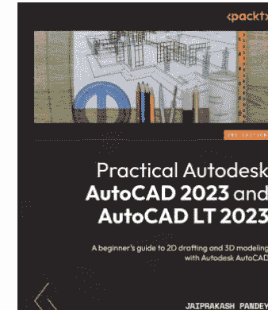
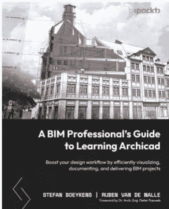
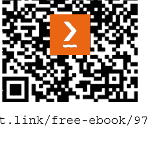

# 索引

### 符号

### A

### B

### C

**3D 打印机**
选择，用于增材设置 195-202
**3D 打印**
零件修改 177-186
制造模型，创建用于 172-177
金属粉末床熔融机器，
使用用于 336-352
首选项和设置 190-195
**3MF 文件格式 146**
网格工作流程，插入 13-18

**增材设置**
创建 195-202
**增材工具路径**
生成 306-313
模拟 314-317
**增材工作流程**
自动化，使用脚本 400-407
**应用程序编程接口 (API) 402**
**ARRANGE 命令 165**
**Autodesk 应用商店**
应用，使用 386-393

自动化建模功能 76-88

**基础网格功能 15**
**粘结剂喷射 226**
**主体预设 部分，FF 打印设置 253-255**
挤出 255, 256
填充 257, 258
打印床粘附 258, 260
外壳 256, 257
速度 261, 262
支撑 260, 261
细分 263-266
移动 262
**边界表示 (BREP) 103**

**CAD 功能**
编辑 54-64
识别 53
**CAD 模型**
工作流程，打开和上传 5-13
**云数据存储**
参考链接 5

组件
自动排列 237-245
自动定向 227-237
手动定位 220-227

### D

DERIVE 对话框 163, 164
DERIVE 功能 177
derive 工作流程
用于管理模型更改
用于打印准备 163-172
设计用于增材制造 (DFAM) 33
设计历史，使用 Fusion 360 34-36
直接建模 44-53
参数化建模 36-43
数字光处理 (DLP) 110, 279
基板支撑 299-302
Digital Metal PX 100 打印机 352
定向能量沉积 (DED) 329
直接建模 44-53
排水孔
创建 116-124

### E

电子束熔化 (EBM) 329

### F

氟化乙烯丙烯 (FEP) 294
熔融长丝制造 (FFF) 110, 197, 248, 279, 280, 305
打印设置 248
用于金属 3D 打印 330-335
体积和杆支撑 280-293
熔融长丝制造 (FFF) 3D 打印机 327
Fusion 360
体，细分使用体积晶格 148-151
设计历史 34, 35, 36
网格文件，操作 64
模型，导出 158
首选项和设置，用于 3D 打印 190-195
参考链接 8
实体，细分 146-148
Fusion 360 机器库 328, 329
Fusion Team 5

### G

G-code
生成 317-322
General 部分，FF 打印设置
全局设置 251
喷嘴预热设置 252, 253

### H

掏空 167

### I

填充图案 257
Insert Derive 功能 163, 173
内部晶格结构
创建 124-140

### L

晶格化 167
线性静应力模拟
进行，以检测和修复故障 98-106

### M
制造模型
创建，用于 3D 打印 172-177
网格体
检查 18-30
修复 18-30
网格文件格式 145
3MF 格式 146
OBJ 格式 146
STL 格式 145, 146
网格文件
导出到切片软件 151
工作流程，打开 5-13
工作流程，上传 5-13
网格文件，操作
插入的网格体，转换后编辑为实体 67-69
插入的网格体，作为网格体编辑 65, 66
插入的网格体，通过重新创建为实体进行编辑 70-73
网格工作流程
插入，用于 3MF 文件 13-18
插入，用于 OBJ 文件 13-18
插入，用于 STL 文件 13-18
金属 3D 打印 328-335
Fusion 360 支持的机器制造商 329, 330
Metal Jet S100 打印机 352
金属粉末床熔融 (MPBF) 279, 280, 360
金属粉末床熔融 (MPBF)
3D 打印机 328, 336
使用 336-352
模型
导出，来自 Fusion 360 158
导出到非 Fusion 360 切片软件 155-158
导出到第三方切片软件 151-155
发送到切片软件 151
MPBF 工艺
补偿，针对失真 376-382
结果，解释 369-375
设置，更新 376-382
模拟，设置 360-369
多喷嘴熔融 (MJF) 215, 226

### N
非 Fusion 360 切片软件
模型，导出到 155-158

### O
OBJ 文件格式 146
网格工作流程，插入 13-18
One Click Metal (OCM) 打印机 337

### P
参数化建模 36-43
零件修改
用于 3D 打印 177-186
零件
掏空 110-116
个人防护装备 (PPE) 54
预设
自定义 393-400
打印设置，FFF
主体预设 253
General 部分 251
概述 248-250
打印设置
用于 SLA 和 DLP 266-271
选择，用于增材设置 203-215
处理参数 (PRM) 364


Prusa i3 MKs+ 248

独特打印设置

分配给体 271-277

## R

## V

Raise3D 331

体积晶格

体，使用 148-151 进行细分

## S

SCALE 命令 166

脚本编写

通过 400-407 自动化增材制造工作流程

截面分析 23

选择性激光熔化 (SLM) 226

选择性激光烧结 (SLS) 110, 215, 226

支撑设置

用于烧结工艺的创建 352-357

形状优化

使用 88-98

SHELL 命令 167, 168

Sinterjet M60 352

立体光刻轮廓 (SLC) 268

立体光刻 (SLA) 110, 208, 279

条形支撑 293-299

底板支撑 299-302

STL 文件格式 145, 146

网格工作流程，插入 13-18

## T

TEAM 功能 177

模板

使用 393-400

细分 146

## U

UltiMaker 331


www.packtpub.com

订阅我们的在线数字图书馆，即可完全访问超过 7,000 本图书和视频，以及行业领先的工具，帮助您规划个人发展并推进职业生涯。更多信息，请访问我们的网站。

## 为什么订阅？

- 花更少时间学习，花更多时间编码，借助来自 4,000 多名行业专业人士的实用电子书和视频
- 使用专为你打造的技能计划提升学习效果
- 每月获得一本免费电子书或视频
- 完全可搜索，便于快速获取重要信息
- 复制粘贴、打印和书签保存内容

您知道 Packt 为每本出版的图书提供电子书版本，可用 PDF 和 ePub 文件吗？您可以在 packtpub.com 升级到电子书版本，并且作为印刷图书客户，您有权享受电子书副本的折扣。欲了解更多详情，请联系我们 customercare@packtpub.com。

在 www.packtpub.com，您还可以阅读一系列免费技术文章，订阅多种免费通讯，并获得 Packt 图书和电子书的独家折扣和优惠。

## 您可能感兴趣的其他图书

如果您喜欢这本书，您可能对 Packt 出版的其他这些图书感兴趣：



### Practical Autodesk AutoCAD 2023 和 AutoCAD LT 2023

Jaiprakash Pandey, Yasser Shoukry

ISBN: 978-1-80181-646-5

- 了解 CAD 基础知识，如功能、导航和组件
- 使用基本形状和编辑工具创建复杂的 3D 物体
- 使用可重用对象（如块）进行工作，并使用 xRef 协作
- 探索高级功能，如外部引用和动态块
- 发现曲面和网格建模工具，如倒角、修剪和延伸
- 使用图纸空间布局为 2D 和 3D 模型创建绘图
- 将您的 2D 绘图转换为 3D 模型



### BIM 专业人士学习 Archicad 指南

Stefan Boeykens, Ruben Van de Walle

ISBN: 978-1-80324-657-4

- 使用 Archicad 作为 BIM 软件从头开始创建建筑模型
- 利用各种工具和视图充分开发项目
- 实现高效的项目组织和建模，以提高生产力并获得专业成果
- 完整记录项目，包括各种 2D 和 3D 文档和施工细节
- 通过深入见解以及专家提示和技巧的使用，使您的 BIM 工作流程专业化
- 通过添加属性并创建进度表来解锁模型中的几何和非几何信息，以准备工程量清单

## Packt 正在寻找像您这样的作者

如果您有兴趣成为 Packt 的作者，请访问 `authors.packtpub.com` 并立即申请。我们已与数千名开发人员和技术专业人士合作，就像您一样，帮助他们与全球技术社区分享他们的见解。您可以进行通用申请，申请我们正在招聘作者的特定热门主题，或提交您自己的想法。

## 分享您的想法

现在您已完成 *3D Printing with Fusion 360*，我们很想听听您的想法！如果您在 Amazon 购买了本书，请点击此处直接前往本书在 Amazon 的评论页面并分享您的反馈，或在您购买的网站上留下评论。

您的评论对我们和技术社区非常重要，并将帮助我们确保提供优质内容。

## 下载本书的免费 PDF 副本

感谢您购买本书！

您喜欢在旅途中阅读但无法随身携带印刷书籍吗？您的电子书购买与您选择的设备不兼容吗？

不用担心，现在每本 Packt 书籍都免费提供无 DRM 的 PDF 版本。

在任何地方、任何地点、在任何设备上阅读。直接从您喜爱的 technical 书籍中搜索、复制和粘贴代码到您的应用程序中。

好处还不止于此，您可以每天通过收件箱独家访问折扣、通讯和优质免费内容

按照以下简单步骤获取福利：

- 1. 扫描二维码或访问以下链接：
- 2. 提交您的购买证明。
- 3. 就这样！我们会直接将您的免费 PDF 和其他福利发送到您的电子邮件。



```
https://packt.link/free-ebook/9781803246642
```
