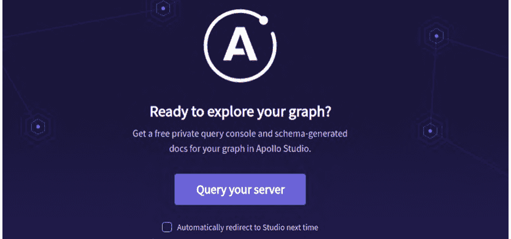
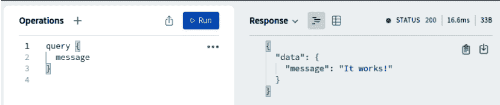
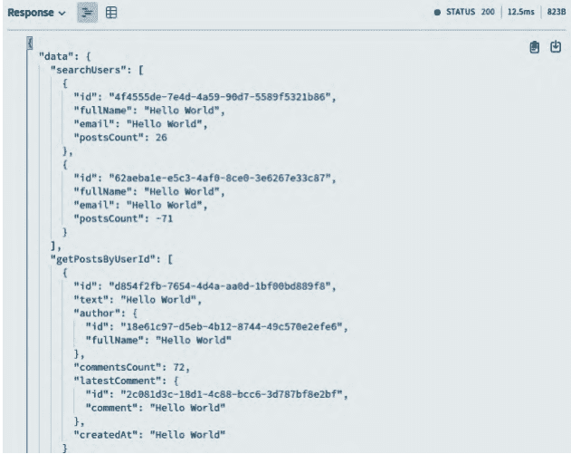

## 2 使用 Node.js、Express.js 和 Apollo 设置 GraphQL

在上一章中，我们通过安装 **Node.js** 和 **MySQL** 为开发机器做好了准备。现在我们可以开始构建后端应用程序，以提供将被我们的 **Angular** 应用程序消费的 API。

为了节省时间，我们将尝试构建一个具有最少功能集的简单社交网络应用程序（一个 **最小可行产品** 或 **MVP**），该产品将在全书中实现。

首先，用户将看到登录和注册界面。在此界面中，用户需要提供电子邮件和密码以登录，或在尚未注册的情况下创建账户。在这种情况下，他们需要输入全名、用户名、电子邮件、密码和密码确认。

登录后，他们将被带到一个界面，在那里他们可以创建帖子并查看自己的动态，动态将显示该应用用户添加的帖子。他们还可以按名称搜索其他用户并从那里访问他们的个人资料。

用户可以看到自己的个人资料，其中包含他们的照片和帖子，以及其他用户的个人资料。

最后，用户可以在帖子上添加评论和点赞，并在有人评论或点赞他们的帖子时收到通知。

在设置开发环境并安装 Node.js 之后，我们需要设置一个具有 **GraphQL** 支持的 Node.js 服务器来实现后端。在本章中，我们将解释如何安装 **Express.js** 并将其与 **TypeScript** 和 GraphQL 配置。

接下来，我们将学习如何使用 **模拟** 来提供一个可工作的 GraphQL 服务器，使用 **Apollo Server** 进行测试，然后再实现 **解析器**，解析器负责获取和修改数据。

我们还将学习如何配置 **跨源资源共享（CORS）**，并学习如何使用 Apollo Studio 测试我们的 GraphQL 服务器。

本章将涵盖以下主题：

- 初始化我们的项目
- 安装 Express.js 并添加 TypeScript 支持
- 使用 Node.js 设置 Apollo Server
- 使用 Apollo Server 模拟我们的 GraphQL API
- 使用 Apollo Studio 测试 GraphQL 服务器
- 在 Express.js 中配置 CORS

### 技术要求

要完成本章，您需要在本地开发机器上安装 Node.js 和 npm。请参阅 *第 1 章，应用架构与开发环境*，以获取如果尚未安装的安装说明。

您还需要熟悉以下技术：

- JavaScript/TypeScript
- Git, Node.js, and Express
- GraphQL concepts such as schemas and types

如果您需要复习 GraphQL 概念，请查看 https://graphql.org/learn/。这是 GraphQL 模式的官方文档，它解释了模式的各种功能以及如何使用模式语言使用它们。

您可以在 https://github.com/PacktPublishing/Full-Stack-App-Development-with-Angular-and-GraphQL/tree/main/Chapter02 找到本章的完整源代码。或者，您也可以访问 https://git.io/JKZpT。请确保您查阅历史记录，其中包含本章主要步骤的提交。

### 设置单仓库项目

我们将采用单仓库方法来管理项目，这本质上围绕着使用单个仓库来管理客户端和服务器应用程序（以及任何共享库）的想法，而不是使用多个仓库。我们将使用一个名为 Lerna 的工具来实现这一点。让我们开始吧：

1. 转到您的命令行界面并运行以下命令安装 Lerna：
2. 接下来，使用以下命令为您的项目创建文件夹并初始化 Lerna：

```
npm install --global lerna
```

```
mkdir ngsocial
```

```
cd ngsocial
```

```
lerna init
```

您应该会看到类似以下的输出：

```
lerna notice cli v4.0.0
lerna info Initializing Git repository
lerna info Creating package.json
lerna info Creating lerna.json
lerna info Creating packages directory
lerna success Initialized Lerna files
```

lerna.json 文件保存 Lerna 的配置，而 package.json 文件包含整个（客户端和服务器）项目的配置。packages/ 文件夹将包含客户端和服务器应用程序，以及您希望在两个应用程序之间共享的任何库。该命令还将运行 git init 命令以初始化 Git 仓库。您可以在 https://github.com/lerna/lerna#lernajson 找到配置 Lerna 的可用选项。

3. 接下来，创建一个 .gitignore 文件并添加以下内容：

```
node_modules
.DS_Store
```

4. 接下来，打开 lerna.json 文件并将 version 设置为 "0.0.1"：

```
{
  "packages": [
    "packages/*"
  ],
  "version": "0.0.1"
}
```

然后，打开 package.json 文件并将 version 设置为 "0.0.1"：

```
{
  "name": "root",
  "private": true,
  "devDependencies": {
    "lerna": "^4.0.0"
  },
  "version": "0.0.1"
}
```

有关 Lerna 的更多信息，请查看 https://lerna.js.org/。

5. 接下来，转到您的 GitHub 账户并创建一个新的仓库，以便将项目的代码推送到其中。此过程很简单，但如果您遇到任何问题，请确保查阅 https://help.github.com/articles/creating-a-new-repository/ 中的文档。

6. 然后，您需要使用以下命令将本地仓库指向远程仓库：

```
git remote add origin <PUT_YOUR_REPO_URL_HERE>
```

7. 在继续之前，让我们创建一个分支，以便我们可以区分每个章节的代码。在您的终端中运行以下命令：

```
git checkout -b chapter2
```

您应该会得到以下输出：

```
Switched to a new branch 'chapter2'
```

8. 最后，使用以下命令暂存并提交更改：

```
git add -A
```

```
git commit -m "Init lerna"
```

9. 然后，如果您想推送代码，请运行以下命令：

```
git push -u origin chapter2
```

现在我们已经使用 Lerna 创建了单仓库项目，让我们初始化我们的服务器端项目。

### 初始化我们的服务器项目

在本节中，我们将学习如何初始化我们的服务器项目并安装 Express.js，这将帮助我们快速启动服务器，而无需处理 Node.js 平台提供的低级 API。

npm 提供了一个命令，允许开发人员创建一个项目（一个带有 package.json 文件的空文件夹）。让我们学习如何使用它来生成 package.json 文件。

### 生成 package.json 文件

我们将通过在 ngsocial/ packages/ 文件夹内为服务器文件创建一个文件夹来开始：

1. 打开一个新的命令行界面并运行以下命令：

```
cd packages
```

```
mkdir server && cd server
```

2. 接下来，运行以下命令：

```
npm init --yes
```

--yes 标志告诉 npm 使用默认设置生成 package.json 文件。

3. 您可以运行以下命令来更新您的 npm 版本：

```
npm install -g npm
```

我们执行此命令是因为我们需要更新到 npm 7（如果您尚未使用此版本，其中包括对工作区（Workspaces）的支持）。请参阅 https://docs.npmjs.com/cli/v7/using-npm/workspaces。

以下为 package.json 文件的内容。在我的例子中，我已调整了名称、作者、版本和许可证信息：

```
{
  "name": "ngsocial",
  "version": "0.0.1",
  "description": "",
  "main": "index.js",
  "scripts": {
    "test": "echo \"Error: no test specified\" && exit 1"
  },
  "keywords": [],
  "author":
    "Ahmed Bouchefra (https://www.ahmedbouchefra.com)",
  "license": "MIT"
}
```

现在我们有了包含 package.json 文件的项目文件夹，接下来我们将安装 Express.js 以及一些开发依赖项，例如 typescript 和 ts-node。

### 安装 Express.js 和开发依赖项

在初始化服务器项目后，我们需要使用以下命令从 npm 仓库安装 express 包：

```
npm install express
```

在撰写本文时，已安装 express v4.17.1。在 package.json 文件中，必须添加一个名为 dependencies 的新对象，如下所示：

```
"dependencies": {
  "express": "^4.17.1"
}
```

接下来，我们需要安装以下开发依赖项：

- `typescript`，一种能够将 TypeScript 代码编译为纯 JavaScript 的工具
- `ts-node`，一种能够直接从终端启动基于 TypeScript 的开发服务器而无需将其编译为纯 JavaScript 的工具

返回你的终端并运行以下命令：

```
npm install --save-dev typescript ts-node
```

安装这些库后，打开 package.json 文件。你会看到一个新的 devDependencies 对象，如下所示：

```
"devDependencies": {
  "ts-node": "^10.2.1",
  "typescript": "^4.4.3"
}
```

我们还将有一个名为 tsc 的新可执行文件，它指的是 TypeScript 编译器。由于我们已将包安装在本地，因此需要提供完整路径来调用它。例如，我们可以通过提供可执行文件的完整路径并使用 -v 开关来获取已安装的 typescript 版本，如下所示：

```
./node_modules/typescript/bin/tsc -v
Version 4.4.3
```

现在，让我们使用此工具在服务器文件夹的根目录生成一个 tsconfig.json 文件：

```
./node_modules/typescript/bin/tsc --init
message TS6071: Successfully created a tsconfig.json file.
```

> **重要提示**
> 我们也可以使用 npx tsc --init --rootDir src --outDir dist --lib dom,es6 --module commonjs --removeComments 命令来生成仅包含我们需要的属性的 tsconfig.json 文件。请参考 https://aka.ms/tsconfig.json 以了解有关 tsconfig.json 文件的更多信息。

tsconfig.json 文件包含配置 TypeScript 的所有可能选项。让我们删除其中大部分，只保留以下最小配置：

```
{
  "compilerOptions": {
    "target": "es6",
    "module": "commonjs",
    "rootDir": "./",
    "outDir": "./dist",
    "esModuleInterop": true,
    "strict": true
  }
}
```

文件中剩余的选项如下：

- target：这用于指定编译器输出的 JavaScript 版本。
- module：这用于指定编译后的 JavaScript 代码的模块系统。
- rootDir：这用于指定 TypeScript 代码文件在项目中的位置。
- outDir：这用于指定编译后的 JavaScript 代码输出文件夹的位置。
- esModuleInterop：这告诉编译器将 ES6 模块编译为 CommonJS 模块。
- strict：这用于启用严格的类型检查。

接下来，我们需要使用以下命令安装 Node 和 Express.js 的类型定义：

```
npm install --save-dev @types/node @types/express
```

它们将被添加到 package.json 文件中的 devDependencies 对象下：

```
"devDependencies": {
  "@types/express": "^4.17.13",
  "@types/node": "^16.9.6",
  "ts-node": "^10.2.1",
  "typescript": "^4.4.3"
}
```

可选地，你可以按如下方式暂存并提交更改：

```
git add -A
git commit -m "Installing Express and development dependencies"
```

在安装 Express.js 和其他开发依赖项并在项目中配置 TypeScript 之后，让我们学习如何创建服务器。

## 创建服务器

现在，我们准备创建 Express 服务器：

- 1. 使用以下命令从 server/ 文件夹的根目录创建 src/index.ts 文件：

```bash
mkdir src && touch src/index.ts
```

请注意，在 TypeScript 的情况下，我们使用的是 .ts 文件扩展名，而不是用于纯 JavaScript 源文件 的 .js 扩展名。

- 2. 接下来，打开 src/index.ts 文件并添加以下代码，该代码用于在 localhost 的 8080 端口启动服务器：

```typescript
import express, { Application } from 'express';
const PORT = 8080;
const app: Application = express();
app.get('/', (req, res) =>
  res.send('Express is successfully running!'));
app.listen(PORT, () => {
  console.log(`Server is running at http://localhost:${PORT}`);
});
```

在前面的代码中，我们首先从 express 模块导入 express 和 Application，然后定义一个常量来保存服务器将监听的端口号。

接下来，我们创建一个应用程序实例，并使用 Express 应用程序的 get() 方法添加一个路由。此路由将使我们能够在向 / 端点发出 GET 请求时调用处理程序方法。最后，我们调用 Express 应用程序的 listen() 方法开始在提供的端口上监听 HTTP 请求。

我们使用 Express 应用程序上可用的一些方法在 Express.js 中创建路由。这些方法包含路由可以处理的 HTTP 请求的名称；例如，你可以使用 .get() 处理 GET 请求，使用 .post() 处理 POST 请求。你可以在 https://expressjs.com/en/4x/api.html#app.METHOD 查看完整列表。

在本书中我们将构建的示例中，我们不需要使用许多路由，因为 GraphQL 只需要一个端点来监听并处理我们应用中的所有请求。

- 3. 现在，我们可以通过向 package.json 文件添加以下启动脚本，使用 ts-node 运行我们的服务器：

```
"scripts": {
  "start": "ts-node ./src/index.ts"
}
```

- 4. 返回你的终端并运行以下命令以调用之前的脚本，从而启动我们的服务器：

```
npm start
> [...]
Server is running at http://localhost:8080
```

如果你使用网络浏览器访问 http://localhost:8080 地址，你应该会看到一个空白页面，其中显示以下消息：Express is successfully running!

现在我们已经创建了 Express.js 服务器，我们将学习如何配置项目以在开发期间监视任何代码更改，自动重新编译代码并重启服务器。

## 监视和重新编译代码

在这一点上，我们可以使用 ts-node 在无需编译的情况下轻松运行 TypeScript 代码。这对于开发来说很棒，但每次更改代码时，我们都需要停止并再次执行脚本。

这对于开发真实项目来说并不合适，因此我们可以通过使用一些监视项目文件夹的实用工具（如 nodemon 和 ts-node-dev）来更进一步。让我们使用后者，因为它是最容易使用的。

返回你的终端，停止正在运行的服务器，并从你的服务器应用程序运行以下命令：

```
npm install --save-dev ts-node-dev
```

此命令将把 ts-node-dev 安装为开发依赖项。

接下来，按如下方式更改 package.json 文件中的启动脚本：

```
"scripts": {
  "start": "ts-node-dev --respawn ./src"
}
```

接下来，再次运行你的启动脚本并更改你的 index.ts 文件（你可以简单地添加一个注释，例如 // 我们的代码现在正在被 ts-node-dev 监视和重新编译）。你的服务器应该会在不手动操作的情况下重启，并且它将在终端中输出类似以下的消息：

```
[INFO] 16:57:48 Restarting: /home/ahmed/ngsocial/packages/server/src/index.ts has been modified
Server is running at http://localhost:8080
```

这对于开发来说是一个不错的设置，但当你的项目准备部署时，你只需要将 TypeScript 代码编译为纯 JavaScript 一次。

我们可以通过添加另一个脚本来实现这一点，该脚本只需调用 tsc 编译器。返回 package.json 文件并添加一个名为 build 的脚本（你可以选择任何有效的名称），如下所示：

```
"scripts": {
  "start": "ts-node-dev --respawn ./src",
  "build": "tsc --project ./"
}
```

--project 标志用于指定将编译为 JavaScript 的 TypeScript 文件的文件夹。在这里，我们指定了 ./，其中存在 tsconfig.json 文件。此命令允许我们在不指定编译器的完整 ./node_modules/typescript/bin/tsc 路径的情况下运行 tsc 编译器。

还有其他方法可以做到这一点，例如使用 npm install 命令的 -g 开关在系统上全局安装 TypeScript，或使用 npx 在不安装的情况下从 npm 仓库运行 tsc（npx tsc）。

返回你的终端，停止正在运行的服务器，并让我们从服务器项目的根目录使用以下命令调用我们的构建脚本：

```
npm run build
```

这将运行 tsc 编译器以将我们项目的代码编译为纯 JavaScript。此时，我们只有一个文件（index.ts），它将被转换为 dist/src/index.js 文件中的 JavaScript 代码。


我们可以在 dist/ 文件夹内获得 JavaScript 源文件的扁平输出，而没有 src/ 子文件夹，通过将 tsconfig.json 文件中 rootDir 属性的值更改为 src/：

```
{
  "compilerOptions": {
    "target": "es6",
    "module": "commonjs",
    "rootDir": "./src",
    "outDir": "./dist",
    "esModuleInterop": true,
    "strict": true
  }
}
```

现在，如果我们再次运行 npm run build 命令，我们将在 dist/ 文件夹中获得输出，而没有 src/ 子文件夹。

这是编译后的代码：

```
"use strict";
var __importDefault =
(this && this.__importDefault) || function (mod) {
    return (mod && mod.__esModule) ? mod : { "default": mod };
};
Object.defineProperty(exports, "__esModule", { value: true });
const express_1 = __importDefault(require("express"));
const PORT = 8080;
const app = express_1.default();
app.get('/', (req, res) =>
    res.send('Express is successfully running!'));
app.listen(PORT, () => {
    console.log('Server is running at
        http://localhost:${PORT}');
});
```

我们可以测试是否可以使用 Node 运行我们的服务器，使用以下命令：

```
node dist/index.js
```

这应该启动 Express 服务器并在终端中输出 **Server is running at http://localhost:8080**。如果您在浏览器中访问该地址，它将显示一条消息，内容为 **Express is successfully running!**。

从现在开始，我们将使用 `ts-node-dev` 工具（使用之前的 `npm start` 命令）。这将允许我们持续监视我们的 TypeScript 源代码，该源代码位于服务器项目的 `src/` 文件夹内，并调用 `ts-node` 工具，以运行它并在我们每次更改后重新运行它。

到目前为止，我们已经初始化了服务器项目，安装了 Express.js 和 TypeScript，并创建了一个在本地主机的 8080 端口上运行的基本服务器。在下一节中，我们将学习如何配置 Apollo Server 以公开 GraphQL API。

## 创建 GraphQL API

在本节中，我们将学习如何使用 Apollo Server 创建我们的 GraphQL API，Apollo Server 是一个由社区维护的开源 GraphQL 服务器。首先，我们将创建一个具有简单模式的服务器。然后，我们将添加类型和解析器，以便能够查询和变更每个用户所做的帖子、评论和点赞；我们将首先使用假数据，然后再添加真实数据库。

## 安装必要的库

让我们开始安装必要的库。返回到您的终端，并从 `server/` 文件夹的根目录运行以下命令：

```
npm install graphql apollo-server-express @graphql-tools/utils @graphql-tools/schema
npm install --save-dev @types/graphql graphql-tag
```

`graphql-tag` 库导出一个 JavaScript 模板字面量标签，可将 GraphQL 查询字符串转换为 **GraphQL 抽象语法树**。

之前的命令将安装 `graphql v15.6.0`、`apollo-server-express v3.3.0`、`@graphql-tools/schema v 8.2.0` 和 `@graphql-tools/utils v8.2.3` 作为依赖项，以及 `graphql-tag v2.12.5` 和 `@types/graphql v14.5.0` 作为开发依赖项。

接下来，让我们通过创建 GraphQL 服务器和模式来学习如何继续。首先，我们将在为社交网络应用程序添加 API 之前公开一个具有简单 API 的服务器。

## 公开简单的 GraphQL API

现在我们已经安装了必要的库，我们将学习如何公开一个简单的 GraphQL 服务器和简单模式来测试我们的服务器如何工作：

- 1. 打开 src/index.ts 文件并在您进行时用以下代码替换其内容。
- 首先添加必要的导入：
- 2. 接下来，按如下方式添加类型定义：
- 3. 添加解析器：
- 4. 然后，添加以下配置对象：
- 5. 最后，添加以下函数：

```
import express, { Application } from 'express';
import { ApolloServer, Config, gql }
    from 'apollo-server-express';
import { IResolvers } from '@graphql-tools/utils';
```

```
const typeDefs = gql`
    type Query {
        message: String!
    }
`
```

```
const resolvers: IResolvers = {
    Query: {
        message: () => 'It works!'
    }
};
```

```
const config: Config = {
    typeDefs: typeDefs,
    resolvers: resolvers
};
```

```
async function startApolloServer(config: Config) {
    const PORT = 8080;
    const app: Application = express();
```

```
const server: ApolloServer =
    new ApolloServer(config);
await server.start();
server.applyMiddleware({
    app,
    path: '/graphql'
});
app.listen(PORT, () => {
    console.log('Server is running at
        http://localhost:${PORT}');
});
}
startApolloServer(config);
```

首先，我们开始添加必要的导入，例如从 `express` 包导入 Express.js，以及从 `apollo-server-express` 包导入 `ApolloServer` 和 `gql`。接下来，我们定义我们的模式类型和解析器，然后创建一个 `express` 应用程序。

之后，我们创建一个 Apollo Server 实例，该实例将 `typeDefs` 和 `resolvers` 作为配置参数。接下来，我们通过使用 `applyMiddleware` 将 Apollo Server 添加到 Express 应用程序中，`applyMiddleware` 接受 `express` 应用程序和 GraphQL 端点作为参数。

您需要在调用 ApolloServer 的 `server.applyMiddleware()` 之前等待 `server.start()`。

我们的模式包含一个简单的类型定义，该类型定义有一个名为 `message` 的单个字段，其类型为 `string`。在查询解析器对象中，我们为 message 字段实现了一个解析器函数，该函数仅返回一些文本，内容为 **It works!**。

> **重要提示**
> 本书假设您已经熟悉 GraphQL 的基本概念。如果不是这样，或者您需要复习，我们建议您访问 `https://graphql.org/learn/`。

接下来，让我们通过使用 Apollo Studio 向我们的服务器发送查询来与此 API 交互。

## 使用 Apollo Studio 发送查询

确保您的服务器仍在运行且没有错误，然后使用网络浏览器转到 http://localhost:8080/graphql 地址。您应该会看到一个类似于以下内容的界面：



图 2.1 – 查询您的服务器

从此界面，您可以单击 Query your server 按钮以访问 Apollo Studio，在那里您可以向 API 端点发送请求。

在左侧面板中，编写以下 GraphQL 查询以发送 message 查询：

```
query {
  message
}
```

单击 Run 按钮。您应该在右侧面板中获得以下输出：

```
{
  "data": {
    "message": "It works!"
  }
}
```

以下屏幕截图显示了 Apollo Studio，以及我们的查询和响应：



图 2.2 – Apollo Studio

现在我们已经测试了我们的 Apollo Server，让我们创建我们的社交应用程序的 GraphQL 模式。我们将处理用户、帖子、评论、点赞和通知等实体。

## 为我们的社交网络创建 GraphQL 模式

在本节中，我们将在单独的文件中创建类型定义和解析器，并将它们导入到我们的 index.ts 文件中。让我们更改之前示例的文件夹结构，并在添加更多 GraphQL 类型之前确保它仍然按预期工作：

- 1. 返回到您的终端，并从服务器文件夹的根目录运行以下命令：
- 2. 打开 src/graphql/schema.graphql 文件并添加以下类型：
- 3. 打开 src/graphql/resolvers.ts 文件并添加以下代码：

```
cd src && mkdir graphql
cd graphql && touch schema.ts && touch schema.graphql && touch resolvers.ts
```

```
type Query {
  message: String!
}
```

```
import { IResolvers } from '@graphql-tools/utils';
const resolvers: IResolvers = {
  Query: {
    message: () => 'It works!'
  }
};
export default resolvers;
```

在这里，我们创建了一个 resolvers 变量，其类型为 IResolvers，其中包含 message 字段的解析器，然后将其从文件中导出。

- 4. 接下来，打开 src/graphql/schema.ts 文件并添加以下代码：

```ts
import fs from 'fs';
import { GraphQLSchema } from 'graphql';
import { makeExecutableSchema }
    from '@graphql-tools/schema';
import { gql } from 'apollo-server-express';
import resolvers from './resolvers';

const typeDefs = gql`${fs.readFileSync(
    __dirname.concat('/schema.graphql'), 'utf8')}`;
const schema: GraphQLSchema = makeExecutableSchema({
    typeDefs,
    resolvers,
});
export default schema;
```

在这里，我们使用从 fs 模块导入的 readFileSync 方法从 .graphql 文件读取查询，并使用 import 语句从 resolvers.ts 文件导入解析器。接下来，我们使用 typeDefs 和 resolvers 参数调用 makeExecutableSchema，以创建我们可以从 schema.ts 文件导出的模式。

> **重要提示**
> 如果您使用 **Webpack**，您可以使用随 graphql-tag 包提供的加载器，使用 Webpack 从 .graphql 文件导入 GraphQL 查询。

- 5. 打开 src/index.ts 文件并按如下方式更新其内容：

```ts
import express, { Application } from 'express';
import { ApolloServer } from 'apollo-server-express';
import schema from './graphql/schema';
async function startApolloServer() {
    const PORT = 8080;
```


```
const app: Application = express();
const server : ApolloServer =
    new ApolloServer({schema});
await server.start();
server.applyMiddleware({
    app,
    path: '/graphql'
});
app.listen(PORT, () => {
    console.log('Server is running at
                http://localhost:${PORT}');
});
}
startApolloServer();
```

我们使用 import 语句导入 schema 并将其传递给 Apollo Server。如果再次运行服务器，你应该能够像之前那样与 Apollo Studio 交互。

现在，让我们为我们的小型社交网络应用添加类型。

6. 进入 src/graphql/schema.graphql 文件并按如下方式添加 User 类型：

```
type User {
    id: ID!
    fullName: String!
    bio: String
    email: String!
    username: String!
    password: String!
    image: String
    coverImage: String
    postsCount: Int!
    createdAt: String!
}
```

7. 接下来，按如下方式添加 Post 类型：

```
type Post {
  id: ID!
  text: String
  image: String
  author: User!
  commentsCount: Int!
  likesCount: Int!
  likedByAuthUser: Boolean
  latestComment: Comment
  latestLike: String
  createdAt: String!
}
```

8. 按如下方式添加 Comment 类型：

```
type Comment {
  id: ID!
  Comment: String!
  Author: User!
  post: ID!
  createdAt: String!
}
```

9. 按如下方式添加 Like 类型：

```
type Like {
  id: ID!
  user: User!
  post: ID!
  createdAt: String!
}
```

10. 按如下方式添加 Notification 类型：

```
type Notification {
  id: ID!
  text: String!
```

```
postId: ID!
createdAt: String!
}
```

11. 然后，我们需要按如下方式添加查询：

```
type Query {
  message: String!
  getUser(userId: ID!): User
  getPostsByUserId(userId: ID!, offset: Int, limit:
    Int): [Post]
  getFeed(offset: Int, limit: Int): [Post]
  getNotificationsByUserId(userId: ID!, offset: Int,
    limit: Int): [Notification]
  getCommentsByPostId(postId: ID!, offset: Int, limit:
    Int): [Comment]
  getLikesByPostId(postId: ID!, offset: Int, limit:
    Int): [Like]
  searchUsers(searchQuery: String): [User]
}
```

12. 最后，按如下方式添加变更：

```
type Mutation {
  post(text: String, image: String): Post
  removePost(id: ID!): ID
  comment(comment: String!, postId: ID!): Comment
  removeComment(id: ID!): Comment
  like(postId: ID!): Like
  removeLike(postId: ID!): Like
  removeNotification(id: ID!): ID
}
```

这是我们将在后续章节中不断改进的初始 schema。在继续实现 GraphQL API 之前，让我们学习如何使用 Apollo Server 的模拟功能（如果你计划遵循 **GraphQL优先开发** 流程，这是一个重要步骤）。

## 使用 GraphQL API 模拟

模拟允许前端开发者在后端开发完成之前开始构建 UI。它还让我们可以在不等待缓慢的数据库操作或运行完整的 GraphQL 服务器的情况下测试 UI。

社区提供了许多工具，可以轻松地基于 GraphQL schema 和查询进行请求模拟，例如 graphql-tools、graphql-faker 以及 Apollo Server 的内置模拟功能。

由于我们已经在使用 Apollo Server，让我们在实现解析器之前使用其模拟功能来模拟我们的 GraphQL 请求。

打开 src/index.ts 文件并按如下方式向 Apollo Server 添加 mocks: true：

```
const server : ApolloServer = new ApolloServer({schema ,
  mocks: true});
```

Apollo Server 的内置模拟非常基础。它只是查看类型定义并返回与对应字段相同类型的值。

前往 Apollo Studio 并添加以下查询：

```
query {
  searchUsers(searchQuery:"a") {
    id fullName email postsCount
  }
  getPostsByUserId(userId:"1") {
    id text author { id fullName } commentsCount
    latestComment { id comment }
    createdAt
  }
}
```

以下截图显示了查询结果：



图 2.3 – 使用 Apollo Studio 的查询结果

在这里，我们可以看到，默认情况下，每个预期返回列表值的查询只返回两个值，并且每个字符串值字段都返回 Hello World。这提供了结果的正确结构，但离真实情况还很远。

幸运的是，我们可以在 Apollo Server alongside 使用其他工具，例如 casual，这是一个用于 JavaScript 的假数据生成器，它允许我们在实现所需解析器之前从 GraphQL 查询中返回更真实和随机的值。

返回到你的终端，并在 server/ 文件夹的根目录下运行以下命令：

```
npm install casual
```

接下来，返回 src/index.ts 文件并添加以下导入：

```
import casual from 'casual';
```

接下来，按如下方式添加一个 mocks 对象：

```
const mocks = {};
```

接下来，通过在 mocks 对象内部添加以下代码来模拟 User 类型：

```
User: () => ({
    id: casual.uuid,
    fullName: casual.full_name,
    bio: casual.text,
    email: casual.email,
    username: casual.username,
    password: casual.password,
    image: 'https://picsum.photos/seed/picsum/200/300',
    coverImage:
      'https://picsum.photos/seed/picsum/200/300',
    postsCount: () => casual.integer(0)
  }),
```

接下来，按如下方式模拟 Post 类型：

```
Post: () => ({
    id: casual.uuid,
    text: casual.text,
    image: 'https://picsum.photos/seed/picsum/200/300',
    commentsCount: () => casual.integer(0),
    likesCount: () => casual.integer(0),
    latestLike: casual.first_name,
    createdAt: () => casual.date()
  }),
```

接下来，按如下方式模拟 Comment 类型：

```
Comment: () => ({
    id: casual.uuid,
    comment: casual.text,
    post: casual.uuid,
    createdAt: () => casual.date()
  }),
```

接下来，按如下方式模拟 Like 类型：

```
Like: () => ({
  id: casual.uuid,
  post: casual.uuid
})
```

对于 schema 中每个类型的每个字段，我们可以使用 casual 为其分配常量值或随机值，casual 为最常用的数据类型提供了生成器。你可以在 https://github.com/boolean/casual 找到可用属性和方法的列表。

默认情况下，我们的模拟解析器对查询只返回两个结果。我们可以按如下方式更改此默认行为。在同一个 mocks 对象中，你需要添加以下对象：

```
Query: () => ({
  getPostsByUserId: () =>
    [...new Array(casual.integer(10, 100))],
  getFeed: () => [...new Array(casual.integer(10, 100))],
  getNotificationsByUserId: () =>
    [...new Array(casual.integer(10, 100))],
  getCommentsByPostId: () =>
    [...new Array(casual.integer(10, 100))],
  getLikesByPostId: () =>
    [...new Array(casual.integer(10, 100))],
  searchUsers: () =>
    [...new Array(casual.integer(10, 100))]
})
```

现在，我们的查询将返回 10 到 100 条假条目。有关更多详细信息，请参阅 https://www.graphql-tools.com/docs/mocking#using-lists-in-mocks。

按如下方式更新传递给 ApolloServer 的对象：

```
const server: ApolloServer = new ApolloServer({schema,
  mocks, mockEntireSchema: false});
```

如果你与开发团队一起工作，前端开发者可以开始构建前端，因为他们可以与 GraphQL API 交互并获取生成的数据，而无需等待后端开发者实现解析器。出现的一个问题是，在现实场景中应链接的条目在我们的模拟 API 中并未链接——让我们学习如何更改这一点！

## 链接模拟数据

帖子应属于用户，因此应通过 user 字段链接到用户。然而，该字段的随机生成值不保证是为用户标识符生成的其中一个值。我们可以通过在 src/index.ts 文件中模拟对象之前定义两个数组来轻松解决此问题，如下所示：

```
let postsIds: string[] = [];
let usersIds: string[] = [];
```

这些数组将允许我们跟踪用户和帖子生成的标识符，以确保 Post、Comment 和 Like 类型的 user 和 post 字段接收这些值中的一个。这样，我们生成的数据将更真实，更类似于现实世界的示例。

接下来，将 mock User 对象上 id 字段的生成器更改为以下函数：

```
id: () => {let uuid = casual.uuid; usersIds.push(uuid);
        return uuid},
```

这确保生成的 ID 被添加到 usersIds 数组中。

接下来，你需要将模拟的 Post 类型的 id 字段更改为以下函数：

```
id: () => {let uuid = casual.uuid; postsIds.push(uuid);
        return uuid},
```

同样，这确保生成的帖子 ID 被添加到 postsIds 数组中。

接下来，按如下方式向模拟的 Post 对象添加 author 字段：

```
author: casual.random_element(usersIds),
```

接下来，按如下方式更改模拟的 Comment 对象的 author 字段：

```
author: casual.random_element(usersIds),
```


Next, add a user field to the Like type, as follows:

```
user: casual.random_element(usersIds),
```

Next, change the post fields of the Comment and Like types, as follows:

```
post: casual.random_element(postsIds)
```

We've added all these modifications to make sure the fields that point to users and posts are getting values from the usersIds and postsIds arrays.

Finally, you need to change the user and author fields on the Post, Comment and Like types in our src/graphql/schema.graphql file to the ID type instead of the User type:

```
author: ID!
user: ID!
```

This is only temporary for the sake of mocking realistic data relationships.

Now, head back to Apollo Studio and run the following query:

```
query {
  searchUsers { id }
  getPostsByUserId(userId:"93c9c019"){ id author }
  getCommentsByPostId(postId:"93c9c019"){ id author post }
  getLikesByPostId(postId:"93c9c019"){ id user post }
}
```

Make sure that you pass the right values for userId and postId as they will be different in your case since they are randomly generated values.

You should get linked results – that is, the user and post fields will contain values that are equal to the values that were generated for the posts' identifiers.

Now that we have realistic and linked data to test our API, we'll learn how to configure CORS. This will help us connect to our GraphQL server from the Angular frontend without getting blocked by the browser.

## 配置 CORS

Cross-origin resource sharing (CORS) refers to a mechanism by which we can allow or disallow other domains from requesting restricted resources on a web page that are being served from a specific domain.

We have already set up a server on port 8080 of our localhost machine and we'll be also running a development server of the Angular CLI from another port in the next few chapters. Different ports on localhost are considered different origins, so we need to configure CORS in our Express.js server; otherwise, the requests from our Angular frontend will be disallowed.

Fortunately for us, configuring CORS in Express.js is easy. Head to your Terminal and run the following command from the root of the server folder to install the cors module:

```
npm install cors
```

Now, you need to open the src/index.ts file and import the cors module:

```
import cors from 'cors';
```

Next, add the following line just below where you created an instance of the Express.js application:

```
app.use(cors());
```

This is the basic configuration of CORS in our Express.js server, which allows any other domains to request data from your server without restriction.

You can refer to the docs of the cors module at https://expressjs.com/en/resources/middleware/cors.html for more options for configuring CORS while protecting your server resources from non-authorized access.

## 摘要

In this chapter, we started implementing our backend application, which will be exposing the GraphQL API. We created a project using Lerna to follow the monorepo approach to organizing our code base, which will contain both the server and client apps.

We installed Express.js and configured it with TypeScript and also GraphQL via Apollo Server.

Next, we created an initial GraphQL schema for our small social network application and configured Apollo Server with mocking. Then, we used the casual tool to use realistic values for our mock data.

Thanks to mocking, we were able to run a working GraphQL server by providing only a schema without implementing the resolvers.

This is a great feature that allows us to easily test the GraphQL API without running a complete API server. It also allows the frontend developer/team to start working on the features that require data to be fetched from the server as quickly as possible without waiting for the backend development to finish.

Next, we used Apollo Studio to send queries to our Apollo Server, which was able to return data that contains the shapes of our schema types.

Finally, we installed the `cors` module and configured CORS in our Express/Apollo Server to enable our frontend application, which will be running from a different port at localhost during development, to send requests without getting blocked due to the same-origin policy in web browsers.

In the next chapter, we'll continue our journey of building our backend application to expose a fully working GraphQL API with resolvers that fetches data from a real MySQL database.
