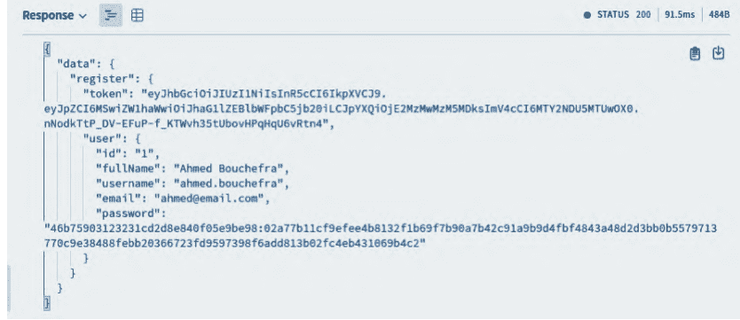
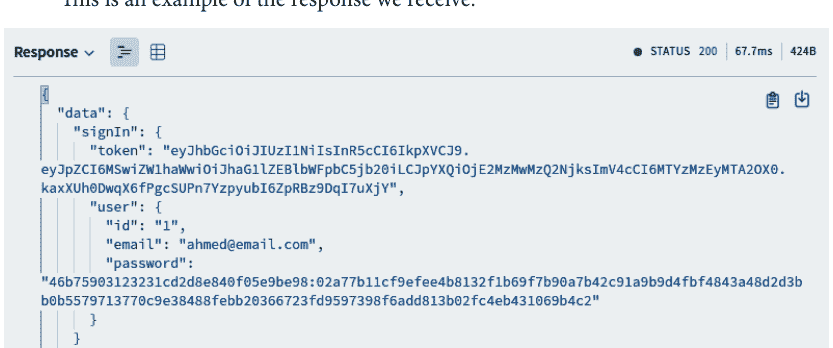
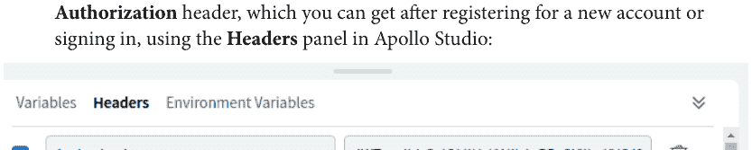
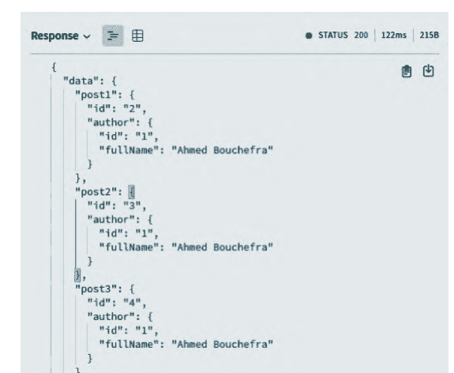

## 4 实现身份验证和授权
使用 Apollo Server 实现身份验证和图像上传

在上一章中，我们介绍了如何使用 TypeORM 将 MySQL 数据库连接到我们的 Web 应用程序，并实现了用于与数据库通信的一些解析器。我们能够公开一个可工作的 GraphQL API，其中包含实际的解析器，可查询和删除真实 MySQL 数据库中的数据。

我们使用 TypeORM 而不是纯 SQL 来操作数据库，它使用 TypeScript 中的高级编程结构抽象底层数据库管理系统和 SQL 指令。

我们创建了负责为社交应用程序生成数据库表和列的 TypeORM 实体，并将 TypeORM 与 Apollo Server 集成。在本章中，我们将了解如何使用 Apollo Server 为我们的 GraphQL API 添加身份验证和图像上传，并实现更多解析器。

我们将学习使用 Node.js、Express 和 Apollo Server 添加身份验证所需的概念，然后学习如何处理图像上传。

我们将具体涵盖以下主题：

- 什么是 JWT?
- 使用 Node.js 和 Apollo 实现身份验证
- 保护 GraphQL 查询和变更
- 实现图像上传

## 技术要求

要完成本章的步骤，你需要完成本书的第 3 章《使用 TypeORM 连接数据库》。

你需要熟悉以下技术：

- TypeScript
- Node.js
- SQL 基础
- GraphQL 基础

你需要拥有 Amazon S3/DigitalOcean Spaces 对象存储或任何兼容服务的账户。

Amazon 提供免费套餐供你跟随本章步骤使用，但如果你无法为他们注册账户，可以使用 MinIO 等工具在本地运行与 Amazon S3 兼容的服务器。更多信息请查看 https://docs.min.io/。

你可以在 https://github.com/PacktPublishing/Full-Stack-App-Development-with-Angular-and-GraphQL/tree/main/Chapter04 找到本章的源代码。


## 什么是 JWT？

**JWT** 代表 **JSON Web Token**，它是一个开放标准（RFC 7519），提供了一种简洁且自包含的机制，用于以 JSON 对象的形式在计算机之间安全地编码和传输信息。

在开发 GraphQL API 时，你几乎总是需要保护特定端点免受公开访问，并且需要用户先经过身份验证，然后获得授权（允许）使用该端点（们）。

你可以使用 JWT 实现这一点。这就是使用 JWT 进行身份验证的工作方式：

- 1. 当用户注册或登录时，我们在服务器上构建包含用户身份的 JWT 令牌并将其发送给客户端。
- 2. 我们需要在客户端每次请求时将收到的令牌传回服务器，以便服务器验证客户端的身份并确定其是否被允许访问该端点。

在当代 Web 应用中，其中 JavaScript 客户端应用必须与 API 接口以查询和保存数据到服务器，JWT 身份验证非常流行且高效。

由于令牌未加密而只是使用加密技术签名，因此在使用 JWT 时需要使用 HTTPS 来持久化用户数据，以防止任何中间人攻击拦截和篡改它。

身份验证可以通过多种方式完成。最典型的方法是使用用户填写的登录表单要求用户的电子邮件和密码。

在保护我们的 API 时，我们应注意两个概念之间的区别：

- **Authentication**，即确认用户身份的过程。
- **Authorization**，用于验证经过身份验证的用户是否根据其在系统中的角色有权访问或执行某些操作。

现在我们了解了 JWT 令牌是什么以及身份验证和授权之间的区别，让我们看看如何使用 Apollo 实现身份验证。

## 实现身份验证

在实现 GraphQL API 时，你几乎总是需要保护查询和变更免受未经身份验证和/或未经授权的用户访问。在本节中，我们将向我们的 GraphQL API 添加 JWT 身份验证。

在 Apollo 中，我们可以从 HTTP 头中检索客户端发送回的 JWT 令牌，从该令牌中提取用户信息，并将其包含在上下文中，该上下文可以从任何解析器访问。在解析器中，我们可以使用用户信息来验证用户有权访问的数据。

我们将使用 dotenv 等库从 .env 文件加载环境变量，我们可以使用它来添加生成 JWT 所需的密钥，并使用 jsonwebtoken 生成令牌。我们还将使用 Scrypt 算法在将用户密码保存到数据库之前对其进行哈希处理。

让我们现在看看实际步骤：

- 1. 让我们从服务器项目的目录开始，使用以下命令安装所需的库：

```
npm install dotenv jsonwebtoken
```

```
npm install --save-dev @types/jsonwebtoken
```

- 2. 在你的 GraphQL 模式中添加以下类型，可从 server/src/graphql/schema.graphql 文件获得：

```
type AuthPayload {
    token: String!
    user: User!
}
```

- 3. 接下来，我们需要在 src/graphql/schema.graphql 文件中添加两个用于注册和登录用户的变更：

```
type Mutation {
    [...]
    register(fullName: String!, username: String!,
    email: String!, password: String!): AuthPayload!
    signIn(email: String!, password: String!):
    AuthPayload!
}
```

- 4. 更新模式后，你需要重新生成类型。打开一个新的命令行界面，并从你的 monorepo 项目文件夹（其中包含 /packages 文件夹）运行以下命令：

```
npm run codegen
```

- 5. 之后，我们需要在 server/src/graphql/resolvers.ts 文件中实现解析器。首先添加以下导入：

```
import jsonwebtoken from 'jsonwebtoken';
import crypto from 'crypto';
import dotenv from 'dotenv';
```

- 6. 接下来，添加以下行：

```
dotenv.config();
```

这将配置 dotenv 以加载我们的环境变量。

- 7. 在 server/ 文件夹内，创建一个 .env 文件并添加以下将用于签名令牌的变量：

```
JWT_SECRET=azerty123456
```

我们使用了 azerty123456 作为我们的 JWT 共享密钥。然而，对于生产环境，请确保使用强密钥使用 HMAC 算法签名 JWT，以防止任何暴力攻击。

- 8. 在 server/src/graphql/resolvers.ts 文件中添加以下用于哈希密码的方法：

```
const hashPassword = async (plainPassword: string):
Promise<string> => {
    return new Promise((resolve, reject) => {
        const bytes = crypto.randomBytes(16);
        const salt = bytes.toString("hex");
        crypto.scrypt(plainPassword, salt, 64,
        (error, buffer) => {
            if (error) reject(error);
            const hashedPassword =
                `${salt}:${buffer.toString('hex')}`;
            resolve(hashedPassword);
        });
    })
};
```

我们将使用此函数在将密码保存到数据库之前使用 Scrypt（一种加盐哈希算法）对其进行哈希处理。

为了使用 Scrypt 对密码进行哈希处理，你需要为每个哈希创建唯一的盐。你可以查看 https://auth0.com/blog/adding-salt-to-hashing-a-better-way-to-store-passwords/ 和 https://qvault.io/cryptography/very-basic-intro-to-the-scrypt-hash/ 了解更多详情。

此函数连接并返回盐和密码的哈希值，两者都将保存到数据库中，因为验证密码需要盐。

- 9. 添加以下方法，将用于比较明文密码与哈希值：

```ts
const compareToHash = async (plainPassword: string, hash: string): Promise<boolean> => {
  return new Promise((resolve, reject) => {
    const result = hash.split(":");
    const salt = result[0];
    const hPass = result[1];
    crypto.scrypt(plainPassword, salt, 64,
      (error, buffer) => {
        if (error) reject(error);
        resolve(hPass == buffer.toString('hex'));
      });
  })
};
```

查看文档 https://nodejs.org/api/crypto.html#crypto_crypto_scrypt_password_salt_keylen_options_callback。

- 10. 接下来，添加用于注册用户的 register 变更：

```ts
register: async (_, args, { orm }) => {}
```

在方法体内部，我们首先解构 args 对象以检索用户的全名、用户名、电子邮件和密码：

```ts
const { fullName, username, email, password } = args;
```

- 11. 接下来，我们调用用户存储库的 create() 方法，使用检索到的信息创建一个新用户。对于密码，我们在分配之前调用 hashPassword() 方法对其进行哈希处理：

```ts
let user = orm.userRepository.create({
  fullName: fullName,
  username: username,
  email: email,
  password: await hashPassword(password),
  postsCount: 0,
  image: 'https://i.imgur.com/nzTFnsM.png'
});
```

- 12. 接下来，我们调用用户存储库的 save() 方法将用户保存到数据库中：

```
const savedUser = await orm.userRepository.save(user)
.catch((error: unknown) => {
  if (error instanceof QueryFailedError &&
    error.driverError.code == "ER_DUP_ENTRY") {
    throw new ApolloError("A user with this email/username already exists",
    "USER_ALREADY_EXISTS");
  }
});
```

确保按如下方式导入 QueryFailedError 类：

```
import { DeleteResult, QueryFailedError } from 'typeorm';
```

在持久化注册的用户信息后，我们使用 jsonwebtoken 库的 sign() 方法根据用户的 ID 和电子邮件创建一个 JWT，过期期为一年，并使用密钥：

```
const token = jsonwebtoken.sign(
  { id: savedUser.id, email: user.email },
  process.env.JWT_SECRET as string,
  { expiresIn: '1y' }
);
```

有关 JWT 的更多详细信息，请阅读 https://jwt.io/introduction/。

- 13. 最后，我们从解析器返回生成的 JWT 和用户：

```
return { token: token, user: savedUser };
```

- 14. 接下来，让我们按如下方式实现 signIn 变更：

```ts
signIn: async (_, args, { orm }) => {}
```


在方法体内部，我们解构 args 对象以获取用户的电子邮件和密码：

```js
const { email, password } = args;
```

然后，调用用户仓库的 findOne() 方法来验证数据库中是否存在具有提供电子邮件的用户。如果用户不存在，我们将抛出一个错误，消息为 No user found with this email!：

```js
const user = await orm.userRepository.findOne({ where: {
  email: email } });
if (!user) {
  throw new ApolloError('No user found with this email!', 'NO_USER_FOUND');
}
```

15. 接下来，我们调用 compareToHash() 函数来验证提交的密码是否与返回用户的密码匹配。如果不匹配，我们将抛出一个错误，消息为 Incorrect password!：

```js
if (!await compareToHash(password, user.password)) {
  throw new ApolloError('Incorrect password!', 'INCORRECT_PASSWORD');
}
```

16. 之后，我们从用户信息生成 JWT token 并从 resolver 返回用户和 token：

```js
const token = jsonwebtoken.sign(
  { id: user.id, email: user.email },
  process.env.JWT_SECRET as string,
  { expiresIn: '1d' }
);
return { token, user };
```

接下来，访问 http://localhost:8080/graphql 并从 Apollo Studio 调用你的 register 和 signIn mutations，以查看它们是否按预期工作。

17. 首先使用 register mutation 根据提供的信息创建用户：

```graphql
mutation {
  register(
    fullName: "Ahmed Bouchefra"
    username: "ahmed.bouchefra"
    email: "ahmed@email.com"
    password: "123456789"
  ) {
    token
    user {
      id fullName username email password
    }
  }
}
```

这应该在数据库中创建用户并返回 token，以及已保存用户的 ID、全名和密码。 通过 mutation 参数提交的 fullName、username 和 email 值应与用户子选择字段相同，而 password 值必须以加密格式返回。

例如，这是我对之前 mutation 收到的响应：



图 4.1 – register mutation 的响应

如果你再次使用相同输入运行 mutation，应该会收到一个错误，指出该电子邮件或用户名已存在用户。

18. 接下来，发送 signIn mutation 以验证用户身份：

```graphql
mutation {
  signIn(email: "ahmed@email.com", password: "123456789") {
    token
    user {
      id email password
    }
  }
}
```

这应该验证用户是否以提交的信息存在于数据库中，并连同 token 一起返回。 你应该收到包含用户信息的 token。 参数和响应中的电子邮件应相同，而返回的密码应为哈希。

如果你提供错误的电子邮件或密码与用户注册密码不匹配，你应该会收到相应的 No user found with this email! 或 Incorrect password! 错误消息。

这是我们收到的响应的一个示例：



图 4.2 – signIn mutation 的响应

我们已使用 JWT 创建了用于注册和登录用户的 mutations。 接下来，我们将了解如何使用生成的 JWT 与 Apollo 保护 GraphQL 端点。

## 保护 GraphQL 查询和变更

在实现用于注册和登录用户的 GraphQL mutations 之后，我们需要使用在用户注册或登录时获得的 JWT token 来保护其他查询和 mutations。

在用户身份验证后，服务器会将 JWT token 传输给客户端，客户端应将其本地存储并在每次请求中使用 HTTP 头（授权头）将其传回。

我们可以使用 Apollo Server 的 context 选项从请求对象访问授权头并将此数据传递给 resolvers。 context 在每个 resolver 中都可用。

保护我们的 GraphQL API 所需的步骤如下：

- 1. 打开 server/src/index.ts 文件并添加以下代码：
- 2. 添加以下方法，该方法将使用来自 jsonwebtoken 的 verify() 方法和密钥来验证并从 JWT 中检索用户信息：

```js
import jwt from 'jsonwebtoken'
import dotenv from 'dotenv';
dotenv.config();
const { JWT_SECRET } = process.env;
```

我们导入必要的符号并从 process.env 对象检索 JWT_SECRET 环境变量（使用 dotenv 在运行时从 .env 文件加载）。 这将使我们能够从 .env 文件获取 JWT 密钥。 查看 https://nodejs.dev/learn/how-to-read-environment-variables-from-nodejs 了解有关如何在 Node.js 中读取环境变量的更多详细信息。

```js
const getAuthUser = (token: string) => {
  try {
    if (token) {
      return jwt.verify(token, JWT_SECRET as string);
    }
    return null;
  } catch (error) {
    return null;
  }
}
```

接下来，我们需要在允许用户访问受保护的端点之前确认用户的身份。

- 3. 按如下方式更新 Context 类型：

```ts
export type Context = {
  orm: {
    userRepository: Repository<User>;
    postRepository: Repository<Post>;
    commentRepository: Repository<Comment>;
    likeRepository: Repository<Like>;
    notificationRepository: Repository<Notification>;
  };
  authUser: User | null;
};
```

- 4. 按如下方式修改引导 Apollo Server 的代码：

```ts
const server: ApolloServer = new ApolloServer({ schema,
  context: ({req}) => {
    const token = req.get('Authorization') || '';
    const authUser = getAuthUser(token.split(' ')[1]);
    const ctx: Context = {
      orm: {
        userRepository: userRepository,
        postRepository: postRepository,
        commentRepository: commentRepository,
        likeRepository: likeRepository,
        notificationRepository: notificationRepository
      },
      authUser: authUser
    };
    return ctx;
  }
});
```

在 context 函数中，我们调用请求对象的 get() 方法来检索授权头的值，该值应包含 "JWT: " 字符串加上 token。 接下来，我们使用空格分割该值并将第二部分（包含实际 JWT）传递给我们的 getAuthUser() 函数，以解码 token 并获取用户信息，即用户的 ID 和电子邮件。 然后，我们创建一个 ctx 对象（使用 Context 类型）并带有 authUser 和包含 TypeORM 仓库的 orm 对象。

请注意，我们已将 context 对象的创建从外部移至 Apollo Server 的 context 方法内部，因此你必须删除在引导 Apollo Server 调用正上方存在的用于创建实例的先前代码。 查看此 GitHub 提交以了解我们所做的更新： https://git.io/JgCgO。

在实现此功能后，如果 JWT 与对我们 GraphQL API 的任何请求一起发送回来，我们将能够从任何 resolver 函数的 context 参数访问已登录用户的 ID 和电子邮件。

- 5. 之后，你可以进入 server/src/graphql/resolvers.ts 文件并通过添加以下内容修改需要保护的每个 resolver：

```ts
getUser: async (_, args, { orm, authUser }) => {
  if (!authUser) throw new Error('Not authenticated!');
  // [...] 
}
```

我们解构传递给函数的 context 参数以获取包含已验证用户信息 authUser 对象的对象。 然后，我们检查该对象是否不为 null；否则，我们抛出一个错误，消息为 Not authenticated!。

这将确保每个 resolver 都能防止未经过身份验证的用户访问。

更好的解决方案是使用指令，因此让我们看看如何实现这种第二种方法。 我们将实现一个 @auth 指令，可以将其应用于模式中的查询和 mutation 字段，以在用户完成操作之前检查用户是否已通过身份验证：

- 1. 打开 server/src/graphql/schema.ts 文件并导入以下符号：

```ts
import { defaultFieldResolver } from 'graphql';
import { getDirective, MapperKind, mapSchema } from '@
```

```js
import { mapSchema, getDirective, MapperKind } from 'graphql-tools/utils';
import { ApolloError } from 'apollo-server-express';
```

- 2. Next, add the following function:
```js
function authDirective() {
  return {
    authDirectiveTypeDefs: gql`directive @auth on FIELD_DEFINITION`,
    authDirectiveTransformer: (schema: GraphQLSchema) => mapSchema(schema, {})
  };
}
```

- 3. Next, add the following code to the second parameter of the mapSchema() function, between the curly braces:
```js
[MapperKind.OBJECT_FIELD]: (fieldConfig) => {
  const directiveName = 'auth';
  const authDirective = getDirective(schema, fieldConfig, directiveName)?.[0];
  if (authDirective) {
    const { resolve = defaultFieldResolver } = fieldConfig;
    fieldConfig.resolve = (source, args, context, info) => {
      if (!context.authUser) {
        throw new ApolloError("User is not authenticated", "USER_NOT_AUTHENTICATED");
      }
      return resolve(source, args, context, info);
    };
    return fieldConfig;
  }
}
```

有关实现指令的更多详细信息，请阅读 https://www.graphql-tools.com/docs/schema-directives。

- 4. Next, call the function and destructure the returned object, as follows:
```js
const { authDirectiveTypeDefs, authDirectiveTransformer } = authDirective();
```

我们获得了授权指令的类型定义以及将应用于模式以使用 @auth 指令的转换器函数。

- 5. Next, update the call to the makeExecutableSchema() function and include the type definition of the authorization directive, as follows:
```js
const typeDefs = gql`${fs.readFileSync(__dirname.concat('/schema.graphql'), 'utf8')}`;
let schema: GraphQLSchema = makeExecutableSchema({
  typeDefs: [authDirectiveTypeDefs, typeDefs],
  resolvers: resolvers
});
```

在这里，我们将一个数组传递给 typeDefs 选项，其中包含我们模式的类型定义和授权指令。

- 6. Next, apply authDirectiveTransformer() to the schema before exporting it:
```js
schema = authDirectiveTransformer(schema);
export default schema;
```

查看对应的 GitHub 提交 https://git.io/JgCwA。

- 7. Finally, you need to apply the created @auth directive to the schema fields you need to protect. Open the server/src/graphql/schema.graphql file and update the Query type, as follows:
```graphql
type Query {
  message: String!
  getUser(userId: ID!): User
  getPostsByUserId(userId: ID!, offset: Int, limit: Int): [Post] @auth
  getFeed(offset: Int, limit: Int): [Post] @auth
  getNotificationsByUserId(userId: ID!, offset: Int, limit: Int): [Notification] @auth
  getCommentsByPostId(postId: ID!, offset: Int, limit: Int): [Comment] @auth
  getLikesByPostId(postId: ID!, offset: Int, limit: Int): [Like] @auth
  searchUsers(searchQuery: String): [User] @auth
}
```

- 8. Next, update the Mutation type, as follows:
```graphql
type Mutation {
  post(text: String, image: String): Post @auth
  removePost(id: ID!): ID @auth
  comment(comment: String!, postId: ID!): Comment @auth
  removeComment(id: ID!): Comment @auth
  like(postId: ID!): Like @auth
  removeLike(postId: ID!): Like @auth
  removeNotification(id: ID!): ID @auth
  register(fullName: String!, username: String!, email: String!, password: String!): AuthPayload!
  signIn(email: String!, password: String!): AuthPayload!
}
```

你可以通过在 Apollo Studio 中使用 Headers 面板发送带有 Authorization 头部的 JWT 来测试你的实现是否正常工作，该 JWT 可以在注册新账户或登录后获得：



图 4.3 – 在 Apollo Studio 中发送 JWT

要实现更复杂的权限系统，请查看 graphql-shield，可从 https://github.com/maticzav/graphql-shield 获取。

对于 post、comment、like 和 removeLike 突变，我们不仅需要检查用户是否已通过身份验证，还需要使用已通过身份验证的用户的 ID 来执行操作。

因此，我们需要添加并解构 context 参数以获取已通过身份验证的用户的[content]
```js
import { mapSchema, getDirective, MapperKind } from 'graphql-tools/utils';
import { ApolloError } from 'apollo-server-express';
```

- 2. 接下来，添加以下函数：
```js
function authDirective() {
  return {
    authDirectiveTypeDefs: gql`directive @auth on FIELD_DEFINITION`,
    authDirectiveTransformer: (schema: GraphQLSchema) => mapSchema(schema, {})
  };
}
```

- 3. 接下来，将以下代码添加到 `mapSchema()` 函数的第二个参数中，位于大括号之间：
```js
[MapperKind.OBJECT_FIELD]: (fieldConfig) => {
  const directiveName = 'auth';
  const authDirective = getDirective(schema, fieldConfig, directiveName)?.[0];
  if (authDirective) {
    const { resolve = defaultFieldResolver } = fieldConfig;
    fieldConfig.resolve = (source, args, context, info) => {
      if (!context.authUser) {
        throw new ApolloError("User is not authenticated", "USER_NOT_AUTHENTICATED");
      }
      return resolve(source, args, context, info);
    };
    return fieldConfig;
  }
}
```

有关实现指令的更多详细信息，请阅读 https://www.graphql-tools.com/docs/schema-directives。

- 4. 接下来，按如下方式调用该函数并解构返回的对象：
```js
const { authDirectiveTypeDefs, authDirectiveTransformer } = authDirective();
```

我们获得了授权指令的类型定义以及将应用于模式以使用 `@auth` 指令的转换器函数。

- 5. 接下来，更新对 `makeExecutableSchema()` 函数的调用并包含授权指令的类型定义，如下所示：
```js
const typeDefs = gql`${fs.readFileSync(__dirname.concat('/schema.graphql'), 'utf8')}`;
let schema: GraphQLSchema = makeExecutableSchema({
  typeDefs: [authDirectiveTypeDefs, typeDefs],
  resolvers: resolvers
});
```

在这里，我们将一个数组传递给 `typeDefs` 选项，其中包含我们模式的类型定义和授权指令。

- 6. 接下来，在导出之前将 `authDirectiveTransformer()` 应用于模式：
```js
schema = authDirectiveTransformer(schema);
export default schema;
```

查看对应的 GitHub 提交 https://git.io/JgCwA。

- 7. 最后，你需要将创建的 `@auth` 指令应用于需要保护的模式字段。打开 `server/src/graphql/schema.graphql` 文件并按如下方式更新 `Query` 类型：
```graphql
type Query {
  message: String!
  getUser(userId: ID!): User
  getPostsByUserId(userId: ID!, offset: Int, limit: Int): [Post] @auth
  getFeed(offset: Int, limit: Int): [Post] @auth
  getNotificationsByUserId(userId: ID!, offset: Int, limit: Int): [Notification] @auth
  getCommentsByPostId(postId: ID!, offset: Int, limit: Int): [Comment] @auth
  getLikesByPostId(postId: ID!, offset: Int, limit: Int): [Like] @auth
  searchUsers(searchQuery: String): [User] @auth
}
```

- 8. 接下来，按如下方式更新 `Mutation` 类型：
```graphql
type Mutation {
  post(text: String, image: String): Post @auth
  removePost(id: ID!): ID @auth
  comment(comment: String!, postId: ID!): Comment @auth
  removeComment(id: ID!): Comment @auth
  like(postId: ID!): Like @auth
  removeLike(postId: ID!): Like @auth
  removeNotification(id: ID!): ID @auth
  register(fullName: String!, username: String!, email: String!, password: String!): AuthPayload!
  signIn(email: String!, password: String!): AuthPayload!
}
```

你可以通过在 Apollo Studio 中使用 Headers 面板发送带有 Authorization 头部的 JWT 来测试你的实现是否正常工作，该 JWT 可以在注册新账户或登录后获得：


图 4.3 – 在 Apollo Studio 中发送 JWT

要实现更复杂的权限系统，请查看 graphql-shield，可从 https://github.com/maticzav/graphql-shield 获取。

对于 `post`、`comment`、`like` 和 `removeLike` 突变，我们不仅需要检查用户是否已通过身份验证，还需要使用已通过身份验证的用户的 ID 来执行操作。

因此，我们需要添加并解构 `context` 参数以获取已通过身份验证的用户的[content]
```js
import { mapSchema, getDirective, MapperKind } from 'graphql-tools/utils';
import { ApolloError } from 'apollo-server-express';
```

- 2. 接下来，添加以下函数：
```js
function authDirective() {
  return {
    authDirectiveTypeDefs: gql`directive @auth on FIELD_DEFINITION`,
    authDirectiveTransformer: (schema: GraphQLSchema) => mapSchema(schema, {})
  };
}
```

- 3. 接下来，将以下代码添加到 `mapSchema()` 函数的第二个参数中，位于大括号之间：
```js
[MapperKind.OBJECT_FIELD]: (fieldConfig) => {
  const directiveName = 'auth';
  const authDirective = getDirective(schema, fieldConfig, directiveName)?.[0];
  if (authDirective) {
    const { resolve = defaultFieldResolver } = fieldConfig;
    fieldConfig.resolve = (source, args, context, info) => {
      if (!context.authUser) {
        throw new ApolloError("User is not authenticated", "USER_NOT_AUTHENTICATED");
      }
      return resolve(source, args, context, info);
    };
    return fieldConfig;
  }
}
```

有关实现指令的更多详细信息，请阅读 https://www.graphql-tools.com/docs/schema-directives。

- 4. 接下来，按如下方式调用该函数并解构返回的对象：
```js
const { authDirectiveTypeDefs, authDirectiveTransformer } = authDirective();
```

我们获得了授权指令的类型定义以及将应用于模式以使用 `@auth` 指令的转换器函数。

- 5. 接下来，更新对 `makeExecutableSchema()` 函数的调用并包含授权指令的类型定义，如下所示：
```js
const typeDefs = gql`${fs.readFileSync(__dirname.concat('/schema.graphql'), 'utf8')}`;
let schema: GraphQLSchema = makeExecutableSchema({
  typeDefs: [authDirectiveTypeDefs, typeDefs],
  resolvers: resolvers
});
```

在这里，我们将一个数组传递给 `typeDefs` 选项，其中包含我们模式的类型定义和授权指令。

- 6. 接下来，在导出之前将 `authDirectiveTransformer()` 应用于模式：
```js
schema = authDirectiveTransformer(schema);
export default schema;
```

查看对应的 GitHub 提交 https://git.io/JgCwA。

- 7. 最后，你需要将创建的 `@auth` 指令应用于需要保护的模式字段。打开 `server/src/graphql/schema.graphql` 文件并按如下方式更新 `Query` 类型：
```graphql
type Query {
  message: String!
  getUser(userId: ID!): User
  getPostsByUserId(userId: ID!, offset: Int, limit: Int): [Post] @auth
  getFeed(offset: Int, limit: Int): [Post] @auth
  getNotificationsByUserId(userId: ID!, offset: Int, limit: Int): [Notification] @auth
  getCommentsByPostId(postId: ID!, offset: Int, limit: Int): [Comment] @auth
  getLikesByPostId(postId: ID!, offset: Int, limit: Int): [Like] @auth
  searchUsers(searchQuery: String): [User] @auth
}
```

- 8. 接下来，按如下方式更新 `Mutation` 类型：
```graphql
type Mutation {
  post(text: String, image: String): Post @auth
  removePost(id: ID!): ID @auth
  comment(comment: String!, postId: ID!): Comment @auth
  removeComment(id: ID!): Comment @auth
  like(postId: ID!): Like @auth
  removeLike(postId: ID!): Like @auth
  removeNotification(id: ID!): ID @auth
  register(fullName: String!, username: String!, email: String!, password: String!): AuthPayload!
  signIn(email: String!, password: String!): AuthPayload!
}
```

你可以通过在 Apollo Studio 中使用 Headers 面板发送带有 Authorization 头部的 JWT 来测试你的实现是否正常工作，该 JWT 可以在注册新账户或登录后获得：


图 4.3 – 在 Apollo Studio 中发送 JWT

要实现更复杂的权限系统，请查看 graphql-shield，可从 https://github.com/maticzav/graphql-shield 获取。

对于 `post`、`comment`、`like` 和 `removeLike` 突变，我们不仅需要检查用户是否已通过身份验证，还需要使用已通过身份验证的用户的 ID 来执行操作。

因此，我们需要添加并解构 `context` 参数以获取已通过身份验证的用户的信息。

- 9. 返回 `server/src/graphql/resolvers.ts` 文件并添加以下导入：
```ts
import {
  Post as PostEntity,
  Comment as CommentEntity,
  Like as LikeEntity
} from '../entity';
```

- 10. 按如下方式实现 `post` 突变：
```ts
post: async (_, args, { orm, authUser }: Context) => {
  const post = orm.postRepository.create(
    {
      text: args.text,
      image: args.image,
      author: await orm.userRepository.findOne(authUser?.id)
    } as unknown as PostEntity
  );
  const savedPost = await orm.postRepository.save(post);
  await orm.userRepository.update({ id: authUser?.id }, { postsCount: post.author.postsCount + 1 });
  return savedPost as unknown as Post;
}
```

这将使用提交的信息和已通过身份验证的用户作为作者来创建帖子。

- 11. 按如下方式实现 `comment` 突变：
```ts
comment: async (_, args, { orm, authUser }: Context) => {
  const comment = orm.commentRepository.create({
    comment: args.comment,
    post: await orm.postRepository.findOne(args.postId),
    author: await orm.userRepository.findOne(authUser?.id)
  } as CommentEntity);

  const savedComment = await orm.commentRepository.save(comment);
  await orm.postRepository.update(args.postId, {
    commentsCount: savedComment.post.commentsCount + 1,
    latestComment: savedComment
  });
  savedComment.post = await orm.postRepository.findOne(args.postId) as PostEntity;
  return savedComment as unknown as Comment;
}
```

- 12. 接下来，按如下方式实现 `like` 突变：
```ts
like: async (_, args, { orm, authUser }: Context) => {
    const like = orm.likeRepository.create({
        user: await orm.userRepository.findOne(authUser?.id),
        post: await orm.postRepository.findOne(args.postId)
    } as LikeEntity);
    const savedLike = await orm.likeRepository.save(like);
    await orm.postRepository.update(args.postId, {
        likesCount: savedLike.post.likesCount + 1
    });

    savedLike.post = await orm.postRepository.findOne(args.postId) as PostEntity;
    return savedLike as unknown as Like;
}
```

- 13. 接下来，按如下方式实现 `removeLike` 方法：
```ts
removeLike: async (_, args, { orm, authUser }: Context) => {
    const like = await orm.likeRepository.createQueryBuilder("like")
        .innerJoinAndSelect("like.user", "user")
        .innerJoinAndSelect("like.post", "post")
        .where("post.id = :postId", { postId: args.postId })
        .andWhere("user.id = :userId", { userId: authUser?.id })
        .getOne();
    if (like && like.id) {
        const result: DeleteResult = await orm.likeRepository.delete(like.id);
        if (result.affected && result.affected <= 0) {
            throw new ApolloError("Like not deleted", "LIKE_NOT_DELETED");
        }
    }
    if (like && like.post && like.post.likesCount >= 1) {
        await orm.postRepository.update(like.post.id, {
            likesCount: like.post.likesCount - 1
        });
    }
    return like as unknown as Like;
}
```

- 14. 我们还需要更新 `getPostsByUserId` 和 `getFeed` 查询以设置 `likedByAuthUser` 字段。让我们从 `getPostsByUserId` 解析器开始：
```ts
posts.forEach((post: PostEntity) => {
    if (post.likes?.find((like: LikeEntity) => { return like.user.id == ctx.authUser?.id })) {
        post.likedByAuthUser = true;
    }
});
return posts as unknown as Post[];
```

就在 `return` 语句上方，我们遍历 `posts` 数组并检查当前用户是否已点赞该帖子。如果是，我们只需将帖子的 `likedByAuthUser` 属性设置为 `true`。

对于 `getFeed` 解析器，添加以下内容：
```ts
feed.forEach((post: PostEntity) => {
    if (post.likes?.find((like: LikeEntity) => { return like.user.id == ctx.authUser?.id })) {
        post.likedByAuthUser = true;
    }
});
return feed as unknown as Post[];
```

查看 GitHub 提交 https://git.io/JgCDh。

- 15. 现在，让我们使用 Apollo Studio 尝试这些突变。让我们首先使用以下突变创建一些帖子：
```graphql
mutation CreatePosts {
  post1: post(text: "This is post 1") {
    id author { id fullName }
  }
  post2: post(text: "This is post 2") {
    id author { id fullName }
  }
  post3: post(text: "This is post 3") {
    id author { id fullName }
  }
}
```


这是我收到的响应：



图 4.4 - post mutation 的响应

你可以看到作者与我们使用 signIn mutation 登录时使用的已认证用户相同。它已成功从我们通过 authorization header 传递的 token 中检索出来。这表明我们的实现按预期工作。

接下来，让我们在这篇文章上创建一些评论和点赞：

```graphql
mutation CreateComments {
    c1: comment(comment: "Comment on post with id #2",
        postId: 2 ) {
        id comment author { id fullName } post { id }
    }
    c2: comment(comment: "Comment on post with id #3",
        postId: 3 ) {
        id comment author { id fullName } post { id }
    }
    c3: comment(comment: "Comment on post with id #4",
        postId: 4 ) {
        id comment author { id fullName } post { id }
    }
}
```

在响应中，你在 selection set 中收到的 post ID 应与你传递给 mutation 的 postId 参数相同。这意味着我们在 resolver 中正确地检索了关系。此外，selection set 中的作者应与已认证用户相同。

让我们以同样的方式创建点赞：

```graphql
mutation CreateLikes {
  like1: like(postId: 1) {
    id user { fullName } post { id }
  }
  like2: like(postId: 2) {
    id user { fullName } post { id }
  }
  like3: like(postId: 3) {
    id user { fullName } post { id }
  }
}
```

我们已保护了 GraphQL 端点，仅允许已认证用户与 API 的大多数查询和 mutation 交互。我们还实现了 post、comment、like 和 removeLike mutation。接下来，我们将了解如何使用 Apollo Server 实现图片上传，以便用户上传其个人资料的照片和封面图片。

## 实现图片上传

在 GraphQL API 中实现身份验证并保护查询和 mutation 之后，现在让我们实现图片上传功能，该功能将用于上传用户的个人资料照片和封面图片。

我们将了解如何使用 Apollo Server 实现文件上传并将图片流式传输到存储服务，例如 Amazon S3 或 DigitalOcean Spaces 对象存储。我们将使用后者服务，但如果你更喜欢 Amazon S3 或任何 S3 兼容的对象存储服务，也可以随意使用。

在此之前，请确保为你选择的 S3 兼容服务注册，创建 S3 存储桶，并记下以下信息：

- S3_ACCESS_KEY_ID
- S3_SECRET_ACCESS_KEY
- S3_ENDPOINT
- S3_BUCKET

使用服务器 URL、存储桶名称（或 Space 名称）、访问密钥和密钥，你可以将任何 S3 兼容的客户端或库连接到你的 DigitalOcean Space。Space 等同于存储桶。

DigitalOcean Spaces API 与 Amazon S3 REST API 互操作，因此我们将使用 AWS SDK 与 Spaces 交互：

- 1. 打开 server/src/graphql/schema.graphql 文件并在顶部添加以下行：
- 2. 然后，添加以下类型：
- 3. 接下来，添加以下 mutation：
- 4. 接下来，你需要返回到 Terminal 并从 server 文件夹运行以下命令：

```
scalar Upload
```

```
type File {
    url: String
    filename: String
    mimetype: String
    encoding: String
}
```

```
type Mutation {
    [...]
    uploadFile(file: Upload!): File!
}
```

```
npm i graphql-upload aws-sdk
npm i --save-dev @types/graphql-upload
```

这将安装 graphql-upload 及其类型，以及 aws-sdk 包。

- 5. 接下来，打开 server/src/index.ts 文件并首先添加此导入：

```
import { graphqlUploadExpress } from 'graphql-upload';
```

然后，按如下方式使用中间件：

```
async function startApolloServer() {
  const PORT = 8080;
  const app: Application = express();
  app.use(cors());
  app.use(graphqlUploadExpress());
  // [...]
```

确保在调用 server.applyMiddleware() 方法之前使用 graphqlUploadExpress 中间件。

我们现在已使用 Apollo Server 和 Express 启用了文件上传；接下来，我们需要实现 uploadFile resolver。

在此之前，打开 .env 文件并使用你自己的 S3 服务凭据添加以下变量：

```
S3_ACCESS_KEY_ID=<YOUR_ACCESS_KEY>
S3_SECRET_ACCESS_KEY=< YOUR_SECRET_KEY >
S3_ENDPOINT=<YOUR_S3_ENDPOINT>
S3_BUCKET=<YOUR_S3_BUCKET>
```

此外，请确保重新生成你的 resolver 类型（使用从 Lerna 项目根目录运行的 npm run codegen）。

- 6. Upload scalar 的实现由 graphql-upload 包中的 GraphQLUpload 导出提供，因此你需要将其添加到 resolver 的映射中以启用它。打开 server/src/graphql/resolvers.ts 文件并添加以下导入：

```
import { GraphQLUpload } from 'graphql-upload';
```

然后，将其添加到 resolvers 对象中：

```
const resolvers: Resolvers = {
  Upload: GraphQLUpload,
  Query: {...},
  Mutation: {...}
};
```

接下来，在顶部添加以下代码：

```
import AWS from 'aws-sdk';
const spacesEndpoint = new AWS.Endpoint(process.env.S3_ENDPOINT as string);
const s3 = new AWS.S3({
  endpoint: spacesEndpoint,
  accessKeyId: process.env.S3_ACCESS_KEY_ID,
  secretAccessKey: process.env.S3_SECRET_ACCESS_KEY
});
```

最后，按如下方式添加 uploadFile mutation：

```
uploadFile: async (_, { file }) => {
  const { createReadStream, filename, mimetype, encoding } = await file;
  const fileStream = createReadStream();
  const uploadParams = { Bucket: process.env.S3_BUCKET as string, Key: filename, Body: fileStream, ACL: "public-read" };
  const result = await s3.upload(uploadParams).promise();
  console.log(result);
  const url = result.Location;
  return { url, filename, mimetype, encoding };
}
```

我们解构作为参数传递给 resolver 的 file promise。这样，我们就可以获取读取流和其他信息，例如文件名、MIME 类型和编码，这些信息是使用 AWS SDK 的 upload() 方法将文件保存到 S3 服务所需的。接下来，我们获取已保存文件的 URL 并连同其他信息一起返回。

## 练习

我们将使用 uploadFile mutation 为帖子上传图片。对于上传用户的照片和封面图片，我们还需要将上传的图片链接到相应的用户。为此，我们需要添加两个 setUserPhoto 和 setUserCover mutation。

按照相同的步骤将 `setUserPhoto` 和 `setUserCover` mutation 添加到 schema。两个 mutation 都应具有 `Upload` 类型的 `file` 参数，并应返回 `User` 对象。

接下来，重新生成 resolver 的类型，然后实现所需的 resolver。

最后，使用 `@auth` 指令保护 mutation 免受未认证用户的访问。

你可以在 https://git.io/JgQiC 找到此练习的解决方案。

作为第二个练习，添加 `setUserBio` mutation（它接受 `String` 类型的 `bio` 参数并返回更新后的 `User` 对象），重新生成 resolver 的类型，并实现 mutation 的 resolver。

你可以在 https://git.io/JgQzA 的提交中找到此练习的解决方案。

## 总结

在本章中，我们了解了如何使用 JWT 向 GraphQL API 添加身份验证和图片上传，并保护端点免受未认证用户的访问。

本章到此结束！在下一章中，我们将继续构建后端应用程序的旅程，通过实现实时订阅。
