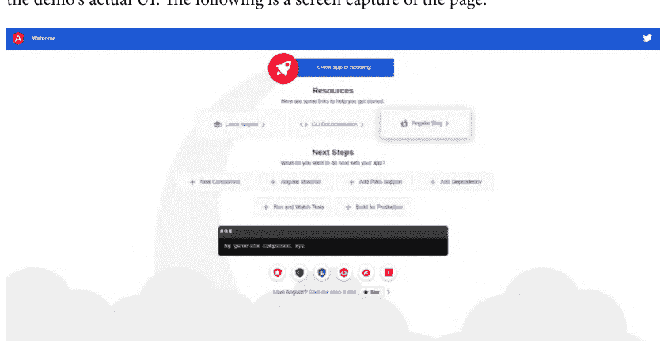
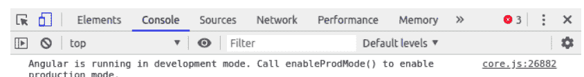

## 6 Angular 应用程序架构和路由

在之前的章节中，我们使用 GraphQL 和 Apollo Server 开发了后端，并且还使用 Apollo Studio 与我们的 GraphQL API 通信。我们现在可以开始开发前端应用程序来使用 API 并向用户展示用户界面以与后端通信。

在接下来的章节中，我们将重点关注通过 Apollo Client 将前端应用程序与后端 API 连接起来并发送查询以获取和变更数据，但在开始之前，我们需要使用基本布局构建一个 Angular 前端项目。

在本章中，我们将首先安装 **Angular CLI** 并使用最新版本的 Angular 创建一个新项目。之后，我们将利用 Angular CLI 创建构成应用程序用户界面的 **模块**、**服务** 和 **组件**，并向您介绍 **依赖注入**。

在创建项目所需的各种工件之后，我们将向您介绍 **Angular Router** 并演示如何实现路由和导航以开发单页应用程序。之后，我们将指导您使用当前的 **Angular Ivy** 运行时进行调试，这将允许您从控制台访问应用程序组件、执行方法，甚至触发变更检测。最后，我们将在项目中安装和配置 **Angular Material**，以提供用于开发应用程序用户界面的组件。

以下主题将被涵盖：

- 安装 Angular CLI
- 初始化 Angular 项目
- 理解应用程序架构
- 理解服务和依赖注入
- 创建模块、服务和组件
- 理解 Angular 路由
- 理解并添加路由
- 添加导航
- 调试 Angular 应用程序
- 添加 Angular Material

### 技术要求

为了按照本章中的说明操作，您必须在本地开发机器上安装 Node.js 和 npm。如果您尚未安装，请参阅本书的 *第 1 章，应用程序架构和开发环境* 以获取安装说明。

您还必须完成之前的章节，以便开发将在本章开始实现的前端使用的 GraphQL API。

您还应熟悉以下技术：

- JavaScript/TypeScript
- HTML

您可以在 https://github.com/PacktPublishing/Full-Stack-App-Development-with-Angular-and-GraphQL/tree/main/Chapter06 找到本章的源代码。

不需要 TypeScript 专业知识，但了解类和装饰器等概念会有所帮助。

TypeScript 类的示例如下：

```typescript
class Product {
  name: string;
  constructor(name: string) {
    this.name = name;
  }
  getName() {
    return this.name;
  }
}

let product1 = new Product("product1");
```

如果您之前使用过基于类的面向对象编程语言，您应该熟悉这种语法，但即使是 JavaScript 的最新版本，例如 ECMAScript 6 或 JavaScript 2015，也允许开发人员使用这种语法定义类。

我们只需使用 class 关键字，后跟类名和类体来定义类。

类的成员被添加到用大括号包围的类体中。在这种情况下，我们有一个名为 name 的字符串类型属性、一个构造函数和一个名为 getName() 的方法。

最后，我们使用 new 关键字创建 Product 类的实例，这将创建一个具有 Product 类型的新对象并调用类的构造函数来初始化它。

类可以被视为创建用户定义类型的机制，从而让您轻松表示现实世界中的对象。

在 TypeScript 中，装饰器是一种特殊结构，允许您动态地修改类、方法、访问器、属性和参数。


> **重要提示**
> 有关类的更多信息可在 TypeScript 手册中找到，网址为 https://www.typescriptlang.org/docs/handbook/classes.html。您可以在 https://www.typescriptlang.org/docs/handbook/decorators.html 了解有关装饰器的更多信息。

这是一个使用 @Component 装饰器装饰的类的示例，该装饰器可从 Angular 核心模块获得，用于从 TypeScript 类创建组件：

```
@Component({
  selector:  'product-list',
  templateUrl: './product-list.component.html'
})
export class ProductListComponent implements OnInit {
  products: Product[];
  myProduct;
  constructor(private service: ProductService) { }
  ngOnInit() {
    this.products = this.service.getProducts();
  }
  selectProduct(product: Product) {
    this.myProduct = product;
  }
}
```

本章后面，我们将了解组件是什么以及提供给 @Component 装饰器的不同属性的作用。

Angular 严重依赖于可从核心模块访问的自定义装饰器，例如 @Component、@Injectable 和 @NgModule，以生成可用于构建应用程序结构的各种产物。

## 安装 Angular CLI

本节我们将学习如何安装 Angular CLI，这样就可以在无需处理 webpack 或其他构建系统的复杂性情况下快速开始 Angular 项目。

创建 Angular 项目的官方工具是 Angular CLI。它简化了创建功能完整的 Angular 项目的过程。

Angular CLI 不仅可以帮助你创建项目文件和安装依赖项，还能在整个开发过程中提供帮助，从在本地提供应用程序、进行测试，到生成最终的生产包并部署到你选择的托管服务提供商。

现在，让我们从本章的第一个实践步骤开始。通过打开一个新的命令行界面并输入以下命令，你可以从 npm 安装 Angular CLI：

```
npm install -g @angular/cli
```

在撰写本章时，我们的开发机器上安装的是 angular/cli 版本 12。

> **重要提示**
> 为了在你的机器上全局安装包，在 Ubuntu 系统中你可能需要在命令前加上 `sudo`。请查看 https://www.shabang.dev/multiple-versions-node-nvm。

## Angular CLI 命令

Angular CLI 包含大量有助于项目开发的命令。只需在命令行界面中运行 `ng` 可执行文件，即可显示可用命令及其说明。以下是一些最常用的命令：

- `ng new` 命令用于创建应用程序。
- `ng generate` 命令用于创建 Angular 构造，如模块、组件和服务。
- `ng serve` 命令用于在项目开发期间启动实时重新加载服务器。
- `ng build` 命令用于创建项目的最终包。

我们安装了 Angular CLI，并介绍了 CLI 中最有用的一些命令。在下一节中，我们将了解如何利用 CLI 创建和提供项目。

## 初始化 Angular 项目

本节介绍如何创建我们的 Angular 项目以及如何构建、监控和提供应用程序。

返回到你的命令行界面并进入项目的 packages/ 子目录：

```
cd ~/ngsocial/packages/
```

然后，要在不使用 Git 仓库的情况下创建新的 Angular 项目，请使用以下命令：

```
ng new client --skip-git
```

CLI 会询问你几个问题：

- 是否要添加 Angular 路由？输入 Y 表示是。
- 你想使用哪种样式表格式？选择 CSS。

> **重要提示**
> 要查看我们使用的 Angular CLI 的版本，可以在项目文件夹内运行 ng version 命令。可以通过使用 --routing 和 --style=css 选项与 ng new 命令一起使用来跳过提示问题，告诉 Angular CLI 你想要使用预配置的路由和 CSS 样式表创建项目。

确认后，CLI 将自动创建基本的文件夹结构和源文件，从 npm 安装所需的依赖项，并且由于你已选择启用 Angular 路由，它还将为你的项目设置路由。

上述命令将创建一个工作区，其中包含一个以项目命名的初始应用程序，并位于项目的根文件夹中。工作区可以包含许多应用和库。

你的应用程序源代码位于 src/ 子目录中，TypeScript 源文件就在此处创建。

你会在 src/ 子目录之外看到多个配置文件，包括以下内容：

- 用于 npm 的 package.json 文件。
- 用于配置 TypeScript 的 tsconfig.json 文件。
- karma.conf.js 用于 **karma** 测试运行器。
- 用于 Angular CLI 配置的 angular.json。

接下来，导航到包含你的项目的目录并使用以下命令启动本地开发服务器：

```
cd client
```

```
ng serve
```

本地实时重新加载开发服务器可通过 http://localhost:4200/ 地址访问。当你对代码进行更改时，应用程序会自动重建并交付到浏览器，无需手动刷新。

打开你的网络浏览器并导航到 http://localhost:4200/，即可看到你的 Angular 应用程序正在运行并带有一些初始内容，我们将在创建演示的实际 UI 之前将其删除。以下是该页面的屏幕截图：



Figure 6.1 – Angular 项目默认页面

现在我们已经创建了 Angular 项目并启动了实时重新加载开发服务器，我们准备进入以下阶段，其中包括对 Angular 基本概念的介绍，例如模块、组件和服务，然后是用户界面的创建。

## 了解应用程序架构

在本节中，我们将开发一个具有小型社交网络功能的全栈 Web 应用程序。我们已经讨论了后端应用程序的架构，它使用 Node.js、Apollo Server 和 GraphQL。现在，我们将使用 Angular 和 Apollo Client 创建应用程序的前端，以使用服务器的 GraphQL API。

Angular 是 Google 开发的平台，用于使用 TypeScript 创建面向移动设备和桌面的客户端 Web 应用。我们将使用它来使用服务器的 GraphQL API 并构建应用程序的用户界面。此外，我们还将使用 Angular Material 来设置 UI 样式。

TypeScript 是 Microsoft 创建的 JavaScript 超集，在编译为 JavaScript 并在 Web 浏览器中处理之前，为语言添加了静态类型、改进的错误检查、类型安全和面向对象编程原则。此外，它与代码编辑器和集成开发环境（IDE）集成得更紧密，这增强了开发体验，特别是在开发必须可扩展的大型 JavaScript 应用程序时。

与 React 等其他流行的 JavaScript 库相比，Angular 是一个框架，它包含用于常见开发任务的内置库，例如以下内容：

- **HttpClient** 用于使用 HTTP 与服务器通信
- **Angular Universal** 用于在服务器上渲染你的 Angular 应用程序
- **Angular Material** 用于提供用于设置用户界面样式的材料组件
- **Angular forms** 用于创建、验证和操作表单

Angular 支持模块化和基于组件的架构，使你能够使用模块和组件构建应用程序。

在开发 Angular 应用程序时，你可以将它分解为可在应用程序中重复使用并且在仔细处理的情况下可在多个应用程序中重复使用的模块和组件。

虽然 Angular API 包含在内置模块中，但你也可以开发自定义模块来构建和组织你的应用程序。模块可以包含组件、服务和任何其他 Angular 构件。让我们更详细地了解模块和组件。


## 什么是模块？

一个模块不过是实现特定领域功能的 Angular 代码的容器。

它们允许你将应用程序拆分为更小、更易管理的部分。

为了避免为每个新项目都从头编写所有代码，代码单元可以组合成库，供其他开发者使用。

Angular 模块可以包含组件、指令、管道和服务，并且可以由路由器懒加载以提高应用程序速度。

你可以设计自己的自定义模块来实现应用中的需求或功能，也可以利用内置模块来暴露 Angular API，例如下面列出的模块：

-   `FormsModule` 用于创建和验证表单。
-   `HttpClientModule` 用于发出 HTTP 请求。
-   `RouterModule` 用于为你的 Angular 应用提供路由器以及各种有用的 API 和组件。
-   `CommonModule` 用于提供所有基本的 Angular 指令和管道，例如 `NgIf` 和 `NgForOf`。

**NgModules** 可用于定义 Angular 模块。`NgModule` 是一个用 `@NgModule` 装饰器标注的 TypeScript 类，它接受某些元数据并执行以下功能：

-   声明其他模块构件，例如组件、指令和管道
-   导出一些组件、指令或管道，以便其他模块可以导入并使用它们
-   导入其他模块及其组件、指令和管道
-   提供其他组件可以使用的服务

按惯例，Angular 应用至少包含一个模块，称为根模块。这是用于启动应用程序的模块。

在我们使用 Angular CLI 生成的项目中，我们已经在 `src/app/app.module.ts` 和 `src/app/app-routing.module.ts` 文件中包含了两个模块，它们导出了用于定义根应用程序模块和路由模块的类。

一个模块可以由一个或多个组件组成。那么组件到底是什么？

## 什么是组件？

一个 **Angular 组件** 负责显示应用程序用户界面的某个区域。组件例如可用于创建应用程序的首页，如果你想获得更高的代码复用性，可以将首页进一步拆分为更小的组件，例如导航栏、主体和页脚区域。

这样你就可以在应用程序的其他页面上使用导航和页脚组件，而无需为所有或部分共享的元素重写相同的代码。

从代码角度看，组件只是一个用从 Angular 核心模块导出的 `@Component` 装饰器装饰的 TypeScript 类。它还包含一个 HTML 模板，该模板可以内联或保存为单独的 HTML 文件，并使用特定的 Angular 模板语法来显示数据并绑定组件类中的属性和事件。

最后，组件可以有一个或多个关联的样式表文件，其中包含以你为项目选择的格式（如 CSS、SCSS 或 Sass）为视图提供的样式。

Angular 9 带来了名为 Ivy 的新渲染引擎，被视为下一代编译和渲染系统，由编译器和一组运行时指令组成。

Ivy 产生更小的生产包、更快的构建时间和运行时性能，以及更易于调试。它使用 **增量 DOM**，其中 Angular 组件和模板被编译成一组 JavaScript 指令，用于创建和更新 **文档对象模型 (DOM)**。

让我们暂时回到我们的应用程序。在 `src/app` 文件夹中，你会找到包含 app 组件的 TypeScript 代码、HTML 模板和 CSS 样式表的多个文件：

-   提供组件 CSS 样式的 `app.component.css` 文件
-   提供用于渲染组件的 HTML 代码的 `app.component.html` 文件
-   提供用于定义组件数据和功能的 TypeScript 代码的 `app.component.ts` 文件

当应用启动时，根组件首先被加载。这是通过将组件包含在应用程序模块的 `bootstrap` 数组中实现的。

只需打开包含应用程序模块的 src/app/app.module.ts 文件即可看到这一点：

// [...]
import { AppComponent } from './app.component';

@NgModule({
  // [...]
  bootstrap: [AppComponent]
})
export class AppModule { }

根组件也包含在 src/index.html 文件中，该文件是在用户从 Web 浏览器访问你的 Angular 应用程序时下载的文件：

```
<!doctype html>
<html lang="en">
<head>
  <!-- [...] -->
</head>
<body>
  <app-root></app-root>
</body>
</html>
```

通过其选择器，你可以看到根组件正像标准 HTML 标签一样被使用。这指示 Angular 将组件及其所有子组件加载到 DOM 中。

在 src/app 目录中打开 app.component.ts 文件。根组件应使用以下代码定义：

```
import { Component } from '@angular/core';

@Component({
  selector: 'app-root',
  templateUrl: './app.component.html',
  styleUrls: ['./app.component.css']
})
export class AppComponent {
  title = 'client';
}
```

这只是一个普通的 TypeScript 类，已应用从核心模块导入的 `@Component` 装饰器。装饰器包含有关组件的元数据，例如以下内容：

-   `selector`：它与常规 HTML 标签的使用方式相同，用于从 HTML 页面调用组件。你可以使用 Angular 构建只能在应用程序内部使用的自定义 HTML 标签。
-   `templateUrl`：用于告诉 Angular 在哪里查找包含展示标记的 HTML 模板。
-   `styleUrls`：用于指定组件特定样式的位置，这些样式决定了组件的外观和感觉。

组件的生命周期始于 Angular 构造组件类的实例，并在组件被销毁并从 DOM 中移除时结束。

Angular 通过一系列接口支持生命周期钩子方法，每个接口都包含一个方法，以便你可以在组件生命周期的关键事件上挂钩。

例如，`OnInit` 接口提供了 `ngOnInit` 方法，该方法在组件初始化时运行。请参阅 https://angular.io/guide/glossary#lifecycle-hook 了解有关生命周期钩子的更多信息。

现在我们已经定义了模块和组件，让我们来看看服务和依赖注入。

## 理解服务和依赖注入

Angular 中的服务是一个单例，可以通过 `dependency injection` 提供给其他组件或服务，依赖注入是一种向对象提供依赖的方式。

不要被这个术语误导！这仅仅意味着一个名为 **注入器** 的 Angular 实体负责创建服务的实例并将其交付给请求它的组件。

依赖注入与 Angular 框架紧密相关，用于将服务和其他对象注入组件，从而在无需手动创建实例的情况下访问服务功能。

Angular 服务使你能够创建遵循以下准则的应用：

-   将应用程序的业务逻辑与其在组件中的显示逻辑分离
-   在应用程序的组件之间交换数据
-   代码可复用性

这意味着你应该利用服务来组织和复用应用程序中的代码，以防止重复和重复造轮子。

通常，你应该利用组件通过数据绑定和事件向 HTML 模板提供属性和方法来创建应用程序的用户界面。你可以参考 `https://angular.io/guide/binding-syntax` 了解有关 Angular 绑定语法的更多信息。

另一方面，服务对于多个组件正常运行所需的常见任务是必要的，例如从服务器检索数据。

在 Angular 中，你可以使用 `@Injectable` 装饰器定义服务，这允许你提供框架所需的信息，以便将服务作为依赖项注入组件或其他服务。

那么我们如何指示 Angular 注入服务呢？

只需将依赖项作为参数传递给请求组件的构造函数即可。这足以让 Angular 为组件提供服务实例。然而，在 Angular 能够做到这一点之前，我们必须以以下方式之一提供服务：

-   通过将服务添加到组件的 `providers` 数组中，它就成为该组件独有的。
-   通过将服务包含在模块的 `providers` 数组中，它仅在该模块内可用。
-   通过结合使用 `@Injectable` 装饰器中的 `providedIn` 属性。有关更多详细信息，请参阅 `https://next.angular.io/api/core/Injectable`。

现在我们已经定义了模块、组件和服务，我们将探讨如何使用 Angular CLI 创建它们。


## 创建模块、服务和组件

你可以通过调用相关的 Angular CLI 命令在 Angular 中自动创建组件、服务和模块，该命令会生成创建基本组件、服务或模块所需的最基本代码。

让我们使用 Angular CLI 生成我们的模块、服务和组件。

为应用程序的每个功能创建一个模块。这是一条基本规则。例如，首页信息流可以包含在单独的模块中。将应用程序拆分为模块使你能够延迟加载组件并高效维护它。

### 创建模块

在我们的应用程序中，我们将使用以下模块：

- 一个 `users` 模块，包含登录、注册和个人资料的组件。
- 一个 `feed` 模块，包含使用 GraphQL 获取的帖子所需的组件。
- 一个 `shared` 模块可能包含与应用程序中其他模块共享的元素。
- 一个根模块，包含应用程序的全局服务和通用布局组件，例如身份验证服务以及页眉和页脚组件。

共享模块通过避免导入多个模块所需的通用模块、组件和其他构件来节省您的时间。

例如，通过从共享模块导入并导出 ReactiveFormsModule，我们可以通过简单地导入共享模块来避免在 users 和 feed 模块中分别导入它。

此外，我们将导入并重新导出 Angular Material 组件模块到共享模块中，以便在项目中的其他模块中使用。

让我们开始使用 Angular CLI 自动创建模块。打开一个新的终端窗口，浏览到包含 Angular 项目的文件夹，并运行以下命令：

```
ng generate module shared
ng generate module users --routing
ng generate module feed --routing
```

这些命令将在 src/app/ 文件夹下创建多个文件，每个文件都有一个以我们指定的模块命名的子目录。

例如，共享模块将创建在 src/app/shared/shared.module.ts 文件下。打开该文件并进行以下更改：

```
import { NgModule } from '@angular/core';
import { CommonModule } from '@angular/common';
import { ReactiveFormsModule } from '@angular/forms';

@NgModule({
    declarations: [],
    imports: [
        CommonModule,
        ReactiveFormsModule
    ],
    exports: [
        ReactiveFormsModule
    ]
})
export class SharedModule { }
```

我们只是将 ReactiveFormsModule 导入到 imports 数组中，然后通过 exports 数组重新导出它。这使得它可用于导入共享模块的所有模块，从而消除了单独导入的需求。

--routing 选项指示 CLI 为每个生成的模块创建路由模块，使我们能够为每个模块的组件实现路由。此外，它将使我们能够使用延迟加载，从而通过允许 Angular 仅在需要时加载模块而不是在启动时全部加载来提高应用程序的速度。

> **重要提示**
> 
> 此外，我们可以将 CommonModule 添加到 exports 数组中以从共享模块重新导出它，然后将其从导入共享模块的任何其他模块中移除。虽然你可能认为共享模块对于小型应用程序是不必要的，但随着应用程序变得更大，它将为你节省大量重复的导入行，因此遵循这一做法是明智的。

### 创建组件和服务

接下来，让我们开发模块的组件和服务，首先是可能属于根应用程序模块的 header、footer、page-not-found 和 search-dialog 组件：

```
ng generate component core/components/header --module=app
```

```
ng generate component core/components/footer --module=app
```

```
ng generate component core/components/page-not-found --module=app
```

```
ng generate component core/components/search-dialog --module=app
```

```
ng generate service core/services/auth/auth
```

> **重要提示**
> 
> 另外，我们可以创建一个包含这些组件的核心模块，并导入和重新导出诸如 BrowserModule、AppRoutingModule 和 BrowserAnimationsModule 之类的模块，同时将 app 模块留空。然而，我们选择使用 core/ 文件夹而不是单独的模块来聚合应用程序的主要功能并直接从应用程序模块导入它们。

接下来，我们使用以下命令生成 users 模块的组件：

```
ng generate component users/components/login --module=users
```

```
ng generate component users/components/signup --module=users
```

```
ng generate component users/components/profile --module=users
```

```
ng generate service users/services/profile/profile
```

接下来，我们将创建 feed 模块的组件：

```
ng generate component feed/components/posts --module=feed
```

该命令已自动将创建的组件添加到各自的模块中。

接下来，我们创建共享模块的组件和服务：

```
ng generate component shared/components/create-post --module=shared
```

```
ng generate component shared/components/post --module=shared
```

```
ng generate component shared/components/dialog --module=shared
ng generate service shared/services/post/post --module=shared
```

然后，在 src/app/feed/feed.module.ts 文件中，按如下方式导入共享模块：

```
import { NgModule } from '@angular/core';
import { CommonModule } from '@angular/common';

import { FeedRoutingModule } from './feed-routing.module';
import { PostsComponent } from './components/posts/posts.component';
import { SharedModule } from '../shared/shared.module';

@NgModule({
  declarations: [PostsComponent],
  imports: [
    CommonModule,
    FeedRoutingModule,
    SharedModule
  ]
})
export class FeedModule { }
```

此外，你必须在 app 和 users 模块中导入共享模块，因为它将用于导入这些模块所需的组件（例如 Angular Material 组件）。

现在我们需要做的就是构建应用程序的模块、组件和服务的结构。一些其他构件也将在本书的后续章节中添加。在接下来的几章中，我们将开发每个组件和服务的底层功能。

在下一节中，我们将了解 Angular Router 以及如何使用它将应用程序用户界面的组件映射到特定的 URL 路由并提供应用内导航。

## 理解 Angular 路由

通常，你需要在 Web 应用程序中实现路由，因为你无法将应用程序的所有功能都放在一个页面上——这会造成糟糕的用户体验，甚至使某些任务对用户来说变得不可能，例如，在我们的例子中，通过其唯一 URL 访问个人资料的能力，或通过 **搜索引擎优化 (SEO)** 使个人资料可被搜索引擎找到。

作为一个一体化平台，Angular 具有内置的路由器模块，可简化具有众多视图和导航的单页应用的实现。此外，Angular CLI 在项目创建过程中可以通过自动配置应用程序中的路由模块来帮助你。

Angular Router 是一个静态路由库。与动态路由相反，路由是在应用程序初始化时指定的。你可以在包含应用程序所有路由的单个路由模块中实现路由，也可以为每个模块单独添加路由。

接下来，我们将探讨 Angular Router 的工作原理以及 Angular CLI 如何自动化我们在项目中配置路由的过程。

### Angular Router 的工作原理

而不是向服务器请求获取新页面，你可以通过显示或隐藏由组件控制的视图来管理用户在 Angular 应用程序中看到的内容。这是通过 **客户端路由** 而非服务器端路由实现的。

为了提供良好的用户体验，你的应用程序应根据业务领域为每个活动或相关活动组呈现不同的视图，而不是将所有功能都合并到单个视图中。此外，它应启用不同视图之间的导航——这可以通过使用 Angular Router 和浏览器 URL 实现。

Angular Router 是一个客户端 JavaScript 解决方案，它通过监控 URL 的变化并使用路由/组件映射数组将路径映射到视图来运行。

你在路由模块中指定路径如何映射到组件，当路径匹配时（即当用户导航到与路由条目关联的某个路径时），路由器会处理显示适当的组件。

路由器还允许你提供一个通用的通配符条目，当未识别到匹配的路径时将使用该条目。


如果某个组件匹配，路由器会将其显示在路由出口中。路由出口是一个 Angular 指令，用作与当前 URL 匹配的组件（们）的放置位置。

> **重要说明**
> 在 Angular 中，指令是一个概念，允许你使用仅在应用程序上下文中可用的自定义标签来扩展 HTML。Angular 提供了许多内置指令，例如 NgFor 和 NgIf，并且你可以使用 @Directive 装饰器创建自己的指令。

路由器可在 @angular/router 模块中找到。通过导入此模块，你将获得构建 Angular 项目中路由和导航所需的所有服务、组件和指令。

回到 *初始化 Angular 项目* 部分，当你创建项目时，Angular CLI 会询问是否要添加路由。通过选择 yes，你指示 CLI 自动设置路由，导致在 src/app/app-routing.module.ts 文件中生成路由模块。你还指示 Angular CLI 为 users 和 feed 模块生成路由模块，以便在 *创建模块、服务和组件* 部分使用 --routing 选项为每个模块的组件提供路由。

要实现路由，现在你需要做的就是在路由模块内部添加路由/组件映射，但首先让我们看看 CLI 为设置路由所做的工作。

## The <base href> tag

当你查看 src/index.html 文件时，你会注意到 <base> 标签已被插入为 <head> 标签的子元素。这有助于路由器构建导航路径。以下是你在添加路由后 Angular 应用程序的 index.html 文件示例：

```
<!doctype html>
<html lang="en">
<head>
    <meta charset="utf-8">
    <title>Client</title>
    <base href="/">
    <meta name="viewport" content="width=device-width, initial-scale=1">
    <link rel="icon" type="image/x-icon" href="favicon.ico">
</head>
<body>
  <app-root></app-root>
</body>
</html>
```

<base href> 标签是一个 HTML 标签，允许你定义将用于确定文档中任何相对 URL 的绝对 URL 的基本 URL。

## The routing modules

CLI 已在 src/app/app-routing.module.ts 文件中添加了一个路由模块用于设置路由，如下所示：

```
import { NgModule } from '@angular/core';
import { Routes, RouterModule } from '@angular/router';

const routes: Routes = [];

@NgModule({
  imports: [RouterModule.forRoot(routes)],
  exports: [RouterModule]
})
export class AppRoutingModule { }
```

此代码从提供必要路由器 API 的 @angular/router 包导入 Routes 和 RouterModule 符号。接下来，它定义了一个 Routes 类型的 routes 数组。此数组将用于添加应用程序中的任何路由。

接下来，通过路由模块的 imports 数组添加 RouterModule，并使用之前定义的 routes 数组调用其 forRoot() 方法。然后使用 exports 数组从路由模块导出 RouterModule。

AppRoutingModule 只是一个 Angular 模块，它将 RouterModule 的一个实例与将用于保存应用程序中任何路由的 routes 数组包装在一起。RouterModule 是一个内置模块，提供实现路由所需的服务和指令，例如 RouterLink、RouterLinkActive 和 RouterOutlet。

相同的路由模块已添加到 users 和 feed 模块中。

## The router outlet

除了路由模块之外，还在根应用程序组件中添加了 router-outlet 指令。转到 src/app/app.component.html 模板并查找包含 <router-outlet> 自定义标签的一些 HTML 代码，如下所示：

```
<!-- [...] -->
<router-outlet></router-outlet>
```

路由出口是一个与 @angular/router 模块中的其他路由 API 一起导入的指令，它充当标记，告诉路由器根据之前描述的传递给 routes 数组的信息，在哪里插入并渲染与浏览器 URL 匹配的组件（们）。

## Importing the routing module

CLI 还在根应用程序模块中导入了 AppRoutingModule，该模块可在 src/app/app.module.ts 文件中找到，使用以下代码：

```
import { NgModule } from '@angular/core';
import { BrowserModule } from '@angular/platform-browser';

import { AppRoutingModule } from './app-routing.module';
import { AppComponent } from './app.component';
import { HeaderComponent } from './core/components/header/header.component';
import { FooterComponent } from './core/components/footer/footer.component';
import { PageNotFoundComponent } from './core/components/page-not-found/page-not-found.component';

@NgModule({
  declarations: [
    AppComponent,
    HeaderComponent,
    FooterComponent,
    PageNotFoundComponent
  ],
  imports: [
    BrowserModule,
    AppRoutingModule
  ],
  providers: [],
  bootstrap: [AppComponent]
})
export class AppModule { }
```

AppRoutingModule 从 app-routing.module.ts 文件导入并添加到 AppModule imports 数组中。对 users 和 feed 模块中的每个路由模块也执行了相同的操作。

我们已记录了 Angular CLI 自动执行以在项目中建立路由的所有步骤。在下一部分中，我们将了解如何向之前创建的组件添加路由以提供应用内导航。

## Understanding and adding routes

如前所述，Angular CLI 在创建项目时自动配置了路由，因此现在我们需要做的就是指定我们之前创建的应用程序组件的路由。

并非所有组件都是可路由的——换句话说，它们不应映射到特定路径。例如，header 组件将包含在其他组件中以通过其选择器渲染页面的页眉元素，因此我们无需将其包含在路由模块的 routes 数组中。

路由是一个 Route 对象，其中包含有关哪个组件映射到哪个路径的信息。路径是 URL 元素，指定应导航到哪个视图。

路由可能具有以下一个或多个属性：

- **path**：保存路由路径的属性。
- **pathMatch**：用于配置路由器匹配路径时使用的匹配策略的属性。它可以具有 `prefix` 或 `full` 值，其中 `prefix` 为默认值。
- **component**：引用应映射到路由的组件的属性。
- **redirectTo**：包含另一个路径的属性，如果 `path` 属性中的路径匹配，则希望重定向到该路径。
- **loadChildren**：路由器按需加载模块的属性。

这些是路由最常用的功能，但我们也可以使用其他属性，可在官方文档中找到。

考虑以下示例：如果我们浏览到 /posts URL，我们希望路由器渲染 posts 组件。我们需要做的就是将以下路由配置添加到 routes 数组中：

```
{ path: 'posts', component: PostsComponent }
```

我们还可能有特殊路径，例如空路径，它指的是应用程序域名根 URL，或用 ** 标记的通配符路径，它指的是路由器在用户导航到 routes 数组中不存在的路径时将匹配的默认路由。你可以使用它来显示 404 错误页面，告知用户页面不存在，或者你可以简单地将访客重定向到另一个 URL。

接下来，我们将了解路由器匹配路由的匹配策略。

## Route-matching strategies

Angular 路由器中的匹配算法提供两种策略：prefix 和 full，不过你也可以使用自定义匹配策略：

- 路由器检查浏览器 URL 的开头是否以路由的路径为前缀，并使用默认的 prefix 策略渲染适当的组件。
- 路由器使用 full 策略确定浏览器 URL 的路径段是否与路由的路径相同。

如果需要匹配整个路径，只需将路由的 pathMatch 属性设置为 full 策略，如下所示：

```
{ path: 'posts', pathMatch: 'full', component: PostsComponent }
```

空路径的场景是匹配完整路径的另一个典型示例，因为默认的 prefix 策略将匹配所有路径，因为空字符串是任何路径的一部分。例如，我们可以使用以下路由配置将访客在首次访问我们的应用程序时重定向到 /home 路径：

```
{ path: '', redirectTo: '/home', pathMatch: 'full' }
```

我们使用 redirectTo 而不是 component 属性，后者接受用户将被路由到的路径。


现在我们已经学习了路由匹配策略以及前缀和完整策略的区别，让我们来看一下路由参数。

## 路由参数

路由也可以用于携带参数。Angular 路由器支持动态路径，并提供在匹配的组件中访问路由参数所需的 API。

你可以通过在参数名称前加上冒号来为路由添加参数，如下所示：

```
{path: 'post/:id' , component: PostComponent}
```

我们使用了一个名为 id 的参数。

路由参数的值可以通过使用 ActivatedRoute 服务获得，该服务允许你获取与在路由器出口中加载的组件关联的路由信息，以及 ParamMap Observable，它提供查询参数的映射。

> **重要提示**
> 将 Observable 视为可能在未来某个时间点可用（不一定是在定义时）的数据集合。它是执行 JavaScript 异步操作的一种不同方法，比 Promise 更强大。它在 Angular 中通过 RxJS 库得到支持，并且与框架紧密集成，拥有多个内置 API。

## 添加路由

现在我们已经学习了路由、匹配策略和参数，让我们在应用程序中为之前创建的组件添加路由。

返回 src/app/app.component.html 文件并删除所有不必要的 HTML 标记，只保留路由器出口。接下来，分别在路由器出口上方和下方包含页眉和页脚组件，如下所示：

```
<app-header></app-header>
<main>
    <router-outlet></router-outlet>
</main>
<app-footer></app-footer>
```

接下来，打开 src/app/users/users-routing.module.ts 文件并开始添加以下导入：

```
import { LoginComponent } from './components/login/login.component';
import { SignupComponent } from './components/signup/signup.component';
import { ProfileComponent } from './components/profile/profile.component';
```

接下来，为每个组件添加路由并将空路由重定向到登录路由：

```
const routes: Routes = [
  { path: '' , pathMatch: 'full', redirectTo: 'login' },
  { path: 'login' , component: LoginComponent },
  { path: 'signup' , component: SignupComponent },
  { path: 'profile/:userId' , component: ProfileComponent }
];
```

我们导入了 users 模块的组件并在 routes 数组中为它们添加了路由。

接下来，打开 src/app/feed/feed-routing.module.ts 文件并添加此导入：

```
import { PostsComponent } from './components/posts/posts.component';
```

接下来，为 posts 组件添加路由并将空路由重定向到 posts 路由：

```
const routes: Routes = [
  { path: '', pathMatch: 'full', redirectTo: 'posts' },
  { path: 'posts', component: PostsComponent }
];
```

我们导入了 feed 模块的组件并在 routes 数组中为其添加了路由。

最后，打开 src/app/app-routing.module.ts 文件并开始添加以下导入：

```
import { PageNotFoundComponent } from './core/components/page-not-found/page-not-found.component';
```

接下来，将突出显示的路由添加到 routes 数组中：

```
const routes: Routes = [
  { path: '', pathMatch: 'full', redirectTo: 'feed' },
  { path: 'users', loadChildren: () =>
    import('./users/users.module').then(m => m.UsersModule)
  },
  { path: 'feed', loadChildren: () =>
    import('./feed/feed.module').then(m => m.FeedModule) },
  { path: '**', component: PageNotFoundComponent }
];
```

我们导入了 PageNotFoundComponent 组件，然后为该组件添加了通配符路由。如果用户尝试访问路由器配置中不存在的路由，这将把用户带到该组件。我们还使用了 loadChildren 属性，以便在用户访问 users 和 feed 路径时延迟加载 users 和 feed 模块。

你可以从 https://angular.io/guide/lazy-loading-ngmodules 了解更多关于 loadChildren 的信息。

现在我们已经学习了 Angular 中的路由，并在应用程序的不同模块和组件中添加了路由，让我们继续添加导航链接，以便用户可以在应用的不同视图之间导航。

## 添加导航

Angular Router 提供了 routerLink 和 routerLinkActive 指令，它们必须代替 <a> 标签中的常规 href 属性来创建导航链接。routerLinkActive 用于标记活动链接。

打开 src/app/core/components/header.component.html 文件并按如下方式更新它：

```
<button routerLink="/feed/posts">Feed</button>
<button routerLink="/users/profile/ahmedbouchefra">My profile</button>
<button routerLink="/users/login">Login</button>
<button routerLink="/users/signup">Sign up</button>
```

我们使用 routerLink 指令添加了四个导航按钮，该指令保存用户在点击相应按钮后将被带到的目标路径。

这只是为了测试我们的导航链接；我们稍后会更改此组件的模板以在更合适的位置包含按钮。例如，我们实际上不需要将登录和注册按钮放在页眉区域，因为如果用户未登录，用户将被自动重定向到登录组件。

接下来，让我们看看如何在相应的 profile 组件中获取传递给 /profile 路径的 userId 参数。打开 src/app/users/components/profile/profile.component.ts 文件并按如下方式更新它：

```
import { Component, OnInit } from '@angular/core';
import { ActivatedRoute } from '@angular/router';

@Component({
    selector: 'app-profile',
    templateUrl: './profile.component.html',
    styleUrls: ['./profile.component.css']
})
export class ProfileComponent implements OnInit {
    constructor(private route: ActivatedRoute) { }
    ngOnInit(): void {
        this.route.params.subscribe(params => {
            console.log(params['userId']);
        });
    }
}
```

我们通过组件构造函数导入并注入 ActivatedRoute 的一个实例，并订阅 params Observable 以获取 userId 参数。我们稍后将看到如何使用此信息查询与当前登录用户相关的信息和帖子并将其渲染在个人资料页面上。

在 Angular 前端实现路由和导航之后，让我们向你介绍一些调试应用程序的技巧。

## 调试 Angular 应用程序

Angular 默认以开发模式运行，该模式启用了调试并为开发者提供了 enableProdMode() 方法来启用生产模式。这也会禁用调试并从最终的生产包中删除任何调试信息。

使用新的 Ivy 渲染器，我们还在全局 ng 对象上有一组 API，你可以在 Angular 应用程序运行时直接从浏览器控制台调用方法、更新状态和访问组件。有关更多信息，请查看 https://angular.io/api/core/global。

运行你的 Angular 应用程序后，打开浏览器控制台；你应该能够看到 Angular is running in development mode. Call enableProdMode() to enable production mode 消息：



图 6.2 – 控制台中 Angular 正在开发模式下运行的消息

这只是告诉你你的应用程序处于开发模式并且已启用调试。

在完成应用程序的开发后，你应该通过使用 enableProdMode() 函数启用生产模式来关闭调试，如下所示：

```typescript
import { enableProdMode } from '@angular/core';
enableProdMode();
```

启用生产模式会告诉 Angular 停止执行生产环境中不需要的许多不必要操作，这将同时减少最终应用程序包的大小并提高运行时性能。

事实上，如果你打开项目的 src/main.ts 文件，你应该会看到此方法已被添加：

```typescript
import { enableProdMode } from '@angular/core';
import { platformBrowserDynamic } from '@angular/platform-browser-dynamic';
import { AppModule } from './app/app.module';
```


```
import { environment } from './environments/environment';

if (environment.production) {
    enableProdMode();
}
// [...]
```

这仅在 environment.production 变量被设置为 true 时启用生产模式，而在 Angular CLI 运行 ng build --prod 命令时使用的 environments/environment.prod.ts 文件中就是这种情况。

继续在你的应用程序中选择一些 DOM 元素，例如 Feed 按钮，然后右键单击并在上下文菜单中点击 Inspect（或在 Chrome 上按 Ctrl + Shift + I）。

在 DevTools 中，我们可以使用 $0 引用最近选择的 DOM 元素。将其与 ng.getOwningComponent() 方法结合，我们可以在控制台中获取渲染该元素的组件，如下所示：

```
> ng.getOwningComponent($0)
< ▼ HeaderComponent { _ngContext_: LComponentView_AppComponent(53) } ⓘ
  ► _ngContext__: LComponentView_AppComponent(53) [app-root, TView, 147, LRootView(31), nul...
  ▼ _proto__:
    ► constructor: class HeaderComponent
    ► ngOnInit: f ngOnInit()
    ► _proto__: Object
> |
```

图 6.3 – 使用 ng 获取 DOM 元素的父组件

返回 src/app/core/components/header/header.component.ts 文件并向组件添加以下方法：

```
invokeMe() {
    console.log("Invoked from the console");
}
```

接下来，返回正在运行的应用程序，从头部区域选择一个按钮，运行 ng.getOwningComponent($0) 方法，并将结果分配给一个组件变量，如下所示：

```
const component = ng.getOwningComponent($0)
```

你应该能够按如下方式调用 invokeMe () 方法：

```
component.invokeMe ()
```

这是在浏览器控制台中你会看到的结果：

```
> const component = ng.getOwningComponent($0)
< undefined
> component.invokeMe()
  Invoked from the console                header.component.ts:16
< undefined
> |
```

图 6.4 – 从控制台调用组件方法

你也可以使用其他方法，例如以下：

- `ng.getComponent(element)` 用于在所选元素对应于组件时获取该元素的组件
- `ng.getDirectives(element)` 用于获取所选元素的关联指令
- `ng.applyChanges(element)` 用于触发所选组件的变更检测

我们已经看到 Angular 默认以启用调试的开发模式运行，以及在完成应用程序开发时如何打开生产模式。我们还看到了 Ivy 提供的一些方法，这些方法可以帮助开发人员从浏览器控制台调试 Angular 应用程序。在下一节中，你将了解 Angular Material，并将看到如何使用 Angular CLI 在项目中安装和配置它。

## 添加 Angular Material

Angular Material 为 Angular 提供基于 Material Design 的 UI 组件。借助 Angular CLI，你可以在几个步骤内将其安装到项目中。

返回你的命令行界面，并在项目的根目录下运行以下命令：

```
ng add @angular/material
```

系统会提示你 `The package @angular/material@12.2.8 will be installed and executed. Would you like to proceed? (Y/n)`。输入 Y 并按 Enter。

这将从 npm 安装包。接下来，CLI 会提示你 `Choose a prebuilt theme name, or "custom" for a custom theme`。我们选择 Indigo/Pink。接下来，它会询问 `Set up global Angular Material typography styles?` 输入 y。接下来，它会询问 `Set up browser animations for Angular Material?` 输入 y。

就这样——你应该已经在项目中安装并配置了 Angular Material。

## 总结

在本章中，我们学习了如何使用 Angular CLI 基于框架的最新版本生成全新的 Angular 应用程序。我们还研究了 Angular 的许多基本概念，例如模块、组件和服务，以及如何使用 Angular CLI 生成提供应用程序结构的这些构件。

在涵盖这些主题并生成应用程序的基本结构后，我们随后讨论了 Angular 中路由的基本概念，包括路由模块、路由以及导航指令，例如 `routerLink`，它取代了 HTML 中的常规 `href` 属性。

接下来，我们研究了一些调试应用程序的技巧，使用开发模式下默认可用的调试方法，以及在准备将应用程序部署到生产环境时启用生产模式的原因。

最后，我们向项目添加了 Angular Material，以在接下来的章节中提供 Material Design 组件来构建应用程序 UI。

本章到此结束！在下一章中，我们将继续构建前端应用程序以使用后端之前构建的 GraphQL API 的旅程。我们将具体看到如何使用 Apollo Client 将前端与后端集成，以便向服务器发送 GraphQL 查询和写入数据。
