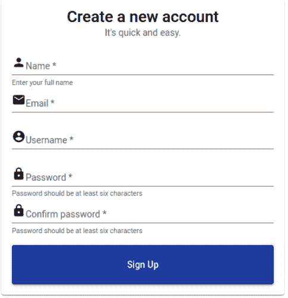
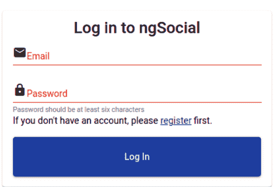
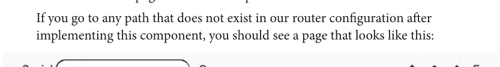
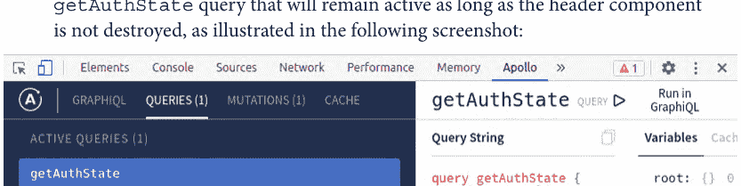
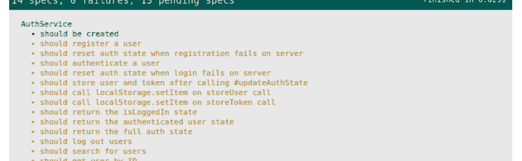
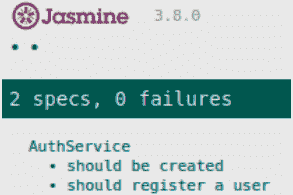
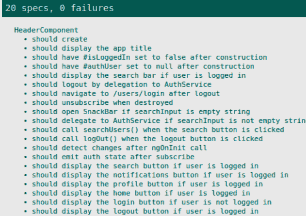

## 7 添加用户搜索功能

在上一章中，我们看到了如何使用 Angular CLI 基于最近版本的框架创建一个全新的 Angular 项目。我们回顾了许多基本的 Angular 概念，例如模块、组件和服务，以及如何使用 Angular CLI 生成构成应用程序结构的构件。

我们还在项目中包含了 Angular Material，以提供 Material Design 组件用于创建视觉上吸引人的应用程序 UI。

在本章中，我们将具体研究如何使用 Apollo Client 将前端与后端集成，Apollo Client 旨在向服务器发送 GraphQL 查询和变更以获取和写入数据。

我们将介绍使用 Angular、Apollo Client 和 GraphQL 添加身份验证所需的概念和步骤。同时，我们将开发以下功能：

- 一个注册和登录界面，允许用户创建账户并进行身份验证
- 一个包含用于导航应用程序、登录和注销的按钮的头部栏，以及用于搜索网络用户的搜索栏
- 一个显示 `ngSocial (c) 2021` 的页脚

我们将涵盖以下主题：

- 介绍和安装 Apollo Client
- 导入 Angular Material 组件
- 注册和登录用户

## 技术要求

要成功完成本章的步骤，你必须先完成本书的上一章。

你可以选择性地安装以下内容：

- Angular DevTools
- DevTools for Apollo Client
- Visual Studio Code

如果你使用 Visual Studio Code，强烈建议使用 `ext install GraphQL.vscode-graphql` 命令安装 GraphQL for Visual Studio Code 扩展。你也可以使用 `ext install capaj.graphql-codegen-vscode` 命令将 Codegen 与 Visual Studio Code 集成，并在每次保存查询/变更时运行它。

你还应熟悉以下技术：

- JavaScript/TypeScript
- HTML
- CSS
- RxJS Observables；请查看 https://angular.io/guide/observables 和 https://rxjs.dev/guide/observable
- Angular testing；请查看 https://angular.io/guide/testing

本章的源代码可在 https://github.com/PacktPublishing/Full-Stack-App-Development-with-Angular-and-GraphQL/tree/main/Chapter07 找到。

## 介绍和安装 Apollo Client

在本节中，我们将向你介绍 Apollo Client，它有助于将你的 Angular 前端与构建在 Apollo Server 之上的 GraphQL API 集成。然后，我们将看到如何在 Angular 项目中安装和配置 Apollo Client。

Apollo Client 是一个 JavaScript 状态管理库，允许开发人员使用 GraphQL 管理本地和远程数据。它可用于检索、缓存和更新应用程序数据，同时自动将数据更改与你的 UI 同步。

让我们在 Angular 项目中安装 Apollo Client：

- 1. 返回你的终端并从 Angular 项目的根文件夹执行以下命令：
- 2. 之后，系统会提示你输入 GraphQL 端点的 URL。输入 http://localhost:8080/graphql。

```
ng add apollo-angular
```

apollo-angular 包将被安装并执行。你将被问到以下问题：

```
Would you like to proceed?
```

输入 Y 并按 Enter。

这将安装并配置 Apollo Client。src/app/graphql.module.ts 文件将被创建并在 src/app/app.module.ts 文件中导入，如下所示：

```
// [...] 
import { GraphQLModule } from './graphql.module';
import { HttpClientModule } from
'@angular/common/http';

@NgModule({
  declarations: [
    // [...] 
  ],
  imports: [
    // [...] 
    GraphQLModule,
    HttpClientModule
  ],
```


```
providers: [],
    bootstrap: [AppComponent]
})

export class AppModule { }
```

在 GraphQL 模块中，我们使用来自 apollo-angular/http 的 HttpLink 服务将客户端链接到运行在 http://localhost:8080/graphql 的 GraphQL 服务器。我们还使用来自 @apollo/client/core 的 InMemoryCache 来创建内存缓存，用于存储本地和远程数据。HttpLink 服务使用 HttpClient 与服务器通信，因此我们在应用程序根模块中还导入了来自 @angular/common/http 的 HttpClientModule。

Apollo 提供了 Apollo Link 接口，它允许你管理网络层，在该层中可以插入链接来控制客户端与 GraphQL 服务器之间的数据流，或查询的发送方式。客户端的网络行为可以描述为按顺序运行的链接链。

HttpLink 就是这些链接中的一个示例。默认情况下，Apollo Client 使用 Apollo Link 的 HttpLink 通过 HTTP 将 GraphQL 操作发送到远程服务器。此默认链接会自动创建，可满足我们的初始用例，但稍后，我们将定义更高级的链接并指定其执行顺序，以扩展默认的网络行为。

阅读 https://www.apollographql.com/docs/react/api/link/introduction/ 了解有关 Apollo Link 的更多信息，并查看社区开发的自定义链接列表 https://www.apollographql.com/docs/react/api/link/community-links/。

内存缓存是 Apollo Client 存储从 GraphQL 服务器获取的数据的位置。你可以在 https://apollo-angular.com/docs/caching/configuration/ 找到更多信息。

现在我们已将 Apollo Client 添加到应用程序中并建立了与 GraphQL 服务器的连接，我们将在下一节中了解如何导入构建应用程序 UI 所需的 Angular Material 组件。

## 导入 Angular Material 组件

每个 Angular Material 组件都包含在其自己的模块中。这些组件通常在整个应用程序的多个位置使用，这就是为什么我们必须从共享模块导入并重新导出它们，以避免在每个模块中都导入它们：

- 1. 打开 shared/shared.module.ts 文件并添加以下导入：

```typescript
import { MatToolbarModule } from '@angular/material/toolbar';
import { MatButtonModule } from '@angular/material/button';
import { MatIconModule } from '@angular/material/icon';
import { MatInputModule } from '@angular/material/input';
import { MatCardModule } from '@angular/material/card';
import { MatFormFieldModule } from '@angular/material/form-field';
import { MatTooltipModule } from '@angular/material/tooltip';
import { MatSnackBarModule } from '@angular/material/snack-bar';
import { MatDialogModule } from '@angular/material/dialog';
import { MatProgressBarModule } from '@angular/material/progress-bar';
import { MatBadgeModule } from '@angular/material/badge';
```

组件模块的名称不言自明；例如，MatToolbarModule 包含 Material Toolbar 组件，将用于构建应用程序的页眉，但你也可以查阅官方文档 https://material.angular.io/ 了解有关每个可用 UI 组件的更多信息。

- 2. 接下来，我们需要按如下方式将这些组件添加到共享模块的 imports 和 exports 数组中。

首先，将导入的模块添加到 matModules 数组中：

```typescript
const matModules = [
  MatToolbarModule,
  MatButtonModule,
  MatIconModule,
  MatInputModule,
  MatCardModule,
  MatFormFieldModule,
  MatTooltipModule,
  MatSnackBarModule,
  MatDialogModule,
  MatProgressBarModule,
  MatBadgeModule
];
```

接下来，按如下方式将它们添加到共享模块的 imports 和 exports 数组中：

```typescript
@NgModule({
  declarations: [],
  imports: [
    CommonModule, ReactiveFormsModule, ...matModules
  ],
  exports: [ReactiveFormsModule, ...matModules]
})
export class SharedModule { }
```

由于这些 Angular Material 组件需要同时添加到共享模块的 imports 和 exports 数组中，我们只将它们添加到 matModules 数组一次，然后使用 Spread 运算符将其包含在内。查看 https://basarat.gitbook.io/typescript/future-javascript/spread-operator。

在导入并重新导出必要的 Material UI 组件后，我们将了解如何添加用户注册和身份验证功能，包括如何使用 UI 组件构建注册和登录界面。

## 注册和登录用户

在本节中，我们将了解如何使用 Apollo Client 和 Angular 的 Apollo 库为 Angular 前端添加用户身份验证。

### 定义 GraphQL 文档

让我们首先定义用户注册、登录和搜索所需的 GraphQL 文档（查询和变更）：

- 1. 创建 shared/constants/auth.ts 文件（确保在 shared/ 文件夹内创建 constants/ 文件夹）并首先添加以下导入和两个字符串常量，其中包含访问令牌和已认证用户的键，这些键将用于在用户浏览器的本地存储中存储相应信息：
- 2. 添加并导出发送到后端 API 用于注册用户的 register 变更：

```typescript
import { gql } from 'apollo-angular';
export const ACCESS_TOKEN: string = 'accessToken';
export const AUTH_USER: string = 'authUser';
```

```typescript
export const REGISTER_MUTATION = gql`
mutation register($fullName: String!, $username: String!, $email: String!, $password: String!){
  register(fullName:$fullName, username:$username, email:$email, password:$password){
    token, user { id fullName bio email username image coverImage postsCount createdAt }
  }
}
`;
```

我们使用 gql 函数包装查询和变更字符串，使其被解析为 GraphQL 文档。它是一个模板字面量标签，用于将查询、变更、订阅和片段传递给 Apollo Client。它返回 DocumentNode 类型的对象，即解析后 GraphQL 查询字符串的对象表示形式。参见 https://git.io/JikfN。

我们使用了 mutation 操作类型，因为我们需要在 GraphQL 服务器上调用一个变更。我们将其命名为 register，并使用 GraphQL 变量提供了必要的参数（因为我们需要动态传递用户的全名、用户名、电子邮件和密码以便为他们注册账户）。

在我们的变更体中，我们只是请求了 register 字段，该字段我们之前已添加到 GraphQL 服务器模式的 Mutation 类型中，并且由于相应的解析器将返回包含身份验证令牌和保存在数据库中的用户的对象，因此我们指定了一个选择集来请求所需字段。

查看 https://graphql.org/learn/queries/ 了解有关操作类型的更多信息。

- 3. 添加并导出用于身份验证用户的登录变更：

```ts
export const LOGIN_MUTATION = gql`
mutation signIn($email: String!, $password: String!){
  signIn(email:$email, password:$password){
    token, user { id fullName bio email username image coverImage postsCount createdAt }
  }
}
`;
```

再次，我们使用了 gql 模板字面量来构建将发送到服务器以验证用户的 GraphQL 文档。我们使用了 mutation 类型来指示服务器调用顶级 Mutation 类型上的 signIn 字段，并使用变量传递动态参数，例如名称和密码，这些参数是验证用户所必需的。

由于 signIn 变更字段引用了一个包含令牌字符串和用户对象的对象，我们使用选择集来请求客户端所需的所有信息，包括 JWT 和已认证用户。

- 4. 创建 shared/constants/user.ts 文件并按如下方式导入 gql 标签：

```ts
import { gql } from 'apollo-angular';
```

然后，添加并导出用于按 ID 获取用户的用户查询：

```typescript
export const USER_QUERY = gql`
query getUser($userId: ID!){
  getUser(userId:$userId){
    id fullName bio email username image coverImage postsCount createdAt }
}
`;
```

在这里，我们使用 query 操作类型并将用户 ID 作为参数传递，以要求 API 服务器返回具有该 ID 的现有用户。服务器上的 Query 类型包含我们正在查询的 getUser 字段，并且由于它返回一个用户对象，因此我们在客户端提供一个选择集来请求我们感兴趣的字段。

- 5. 添加并导出以下用于搜索用户的查询：

```typescript
export const SEARCH_USERS_QUERY = gql`
query searchUsers($searchQuery: String!){
  searchUsers(searchQuery:$searchQuery){
    id fullName bio username image
  }
}
`;
```

在这里，我们使用 query 操作类型来请求 GraphQL 模式顶级查询上的 searchUsers 字段，该字段返回一个包含作为参数传递的搜索词的全名用户的数组。然后我们指定一个选择集来选择我们感兴趣的用户字段，例如用户的 ID、全名、简介、用户名和图像。

- 6. 最后，创建 shared/index.ts 文件（桶文件）并按如下方式导出已定义的常量：

```typescript
export * from './constants/auth';
export * from './constants/user';
```

在定义将通过 Apollo Client 解析并发送到服务器的查询和变更之后，我们必须定义将从 API 服务器返回的响应/结果的类型。


## 为用户认证定义类型

TypeScript 是一种强类型编程语言。我们将使用它来编写类型安全代码，这有助于防止意外错误并为 IDE 提供自动完成功能以提高生产力。

让我们看看如何创建 TypeScript 类型以对服务器响应进行强类型化。我们将从 User 模型开始，它表示单个用户并封装了对应于 GraphQL API 用户信息的字段：

- 1. 创建 shared/models/user.model.ts 文件并添加，然后导出一个 TypeScript 接口，其中包含以下引用用户详细信息及其类型的字段：
- 2. 创建 shared/types/auth.ts 文件并首先导入 User 模型：

```ts
export interface User {
  id: string;
  fullName: string;
  bio: string;
  username: string;
  email: string;
  image: string;
  coverImage: string;
  postsCount: number;
  createdAt: string;
}
```

前面的代码块指定了 GraphQL API 返回的用户数据的格式。

```ts
import { User } from '../models/user.model';
```

然后，为了对认证状态进行强类型化，定义并导出以下接口：

```ts
export interface AuthState {
  isLoggedIn: boolean;
  currentUser: User | null;
  accessToken: string | null;
};
```

接下来，定义并导出 register 和 signIn 突变的响应类型：

```ts
export type AuthResponse = {
    token: string;
    user: User;
};
export type RegisterResponse = {
    register: AuthResponse;
};
export type LoginResponse = {
    signIn: AuthResponse;
};
```

3. 创建 shared/types/user.ts 文件并首先添加以下导入：

```ts
import { Observable } from 'rxjs';
import { User } from '../models/user.model';
```

接下来，定义并导出以下类型以对 getUser 和 searchUsers 查询的响应进行类型化：

```ts
export type UserResponse = {
    getUser: User;
};
export type UsersResponse = {
    searchUsers: User[];
};
export type SearchUsersResponse = {
    data: Observable<UsersResponse>;
    fetchMore: (users: User[]) => void
};
```

我们从 RxJS 导入了 Observable 类并导入了之前定义的 User 模型，然后定义并导出了一组类型以对服务器返回的响应进行类型化。这些类型定义了服务器为每个操作返回的响应的数据形状。我们将使用 SearchUsersResponse 来为包含搜索用户查询响应以及用于分页的获取更多数据的方法的变量进行类型化。

4. 最后，打开 shared/index.ts 文件并添加以下导出：

```ts
export { User } from './models/user.model';
export * from './types/user';
export * from './types/auth';
```

在下一节中，我们将了解如何构建服务来封装发送用于用户认证的查询和突变的请求的逻辑。

我们将用户搜索功能添加到认证服务中，因为它将对我们的应用程序全局可用，并在仅在我们懒加载用户模块时才加载的个人资料服务之前访问。

## 定义 Apollo 服务

在定义了 GraphQL 查询和突变以及请求发送到服务器后将返回的响应类型之后，我们现在必须创建一系列用于注册、认证和搜索用户的服务。

Angular 的 Apollo Client 库支持两种与服务器通信的方法：

- 使用 Apollo 服务，一个 Angular 服务，其中包含诸如 `query()` 和 `watchQuery()` 等方法来发送查询，以及 `mutate()` 和 `subscribe()` 来发送突变和订阅。
- 内置的 `Query`、`Mutation` 和 `Subscription` 服务。

Mutation、Query 和 Subscription 是泛型 TypeScript 类，它们在类名后接受尖括号之间的泛型类型参数。我们为每个服务指定预期的响应类型以及将发送到服务器的突变、查询或订阅的 document 属性。查看 https://apollo-angular.com/docs/data/services。

> **注意**
> 有关 TypeScript 中泛型类的更多信息，请查看 https://www.typescriptlang.org/docs/handbook/2/generics.html#generic-classes。

在本书中，我们将使用这两种方法与后端通信。更多信息可以在官方文档 https://apollo-angular.com/docs/ 中找到。

现在，让我们创建用于注册、认证和搜索用户的服务：

- 1. 创建 core/services/auth/graphql/register.service.ts 文件并添加以下代码：
- 2. 创建 core/services/auth/graphql/login.service.ts 文件并添加以下代码：
- 3. 创建 core/services/auth/graphql/getuser.service.ts 文件并添加以下代码：

```ts
import { Injectable } from '@angular/core';
import { Mutation } from 'apollo-angular';
import { RegisterResponse, REGISTER_MUTATION } from
  'src/app/shared';

@Injectable({
  providedIn: 'root',
})
export class RegisterGQL extends
  Mutation<RegisterResponse> {
    document = REGISTER_MUTATION;
  }
```

```ts
import { Injectable } from '@angular/core';
import { Mutation } from 'apollo-angular';
import { LOGIN_MUTATION, LoginResponse } from
  'src/app/shared';

@Injectable({
  providedIn: 'root',
})
export class LoginGQL extends Mutation<LoginResponse> {
  document = LOGIN_MUTATION;
}
```

```ts
import { Injectable } from '@angular/core';
import { Query } from 'apollo-angular';
import { UserResponse, USER_QUERY } from
  'src/app/shared';
```

```ts
@Injectable({
  providedIn: 'root',
})
export class GetUserGQL extends Query<UserResponse> {
  document = USER_QUERY;
}
```

我们导入必要的 API，例如 Injectable 装饰器用于装饰类以定义 Angular 服务，例如 apollo-angular 的 Mutation 和 Query 服务、包含将发送到服务器的查询和突变的常量以及响应类型。

接下来，我们通过扩展 Mutation 或 Query 服务并将 document 属性设置为适当的查询或突变来创建我们的 GraphQL 服务。

封装用户认证功能的认证服务将接下来实现。

## 实现用户认证服务

认证服务是 app 模块的一部分，所有之前定义的 Apollo 服务将被注入到其中。

该服务将包含用户的认证逻辑，并为用户的组件提供注册、登录、注销、检查认证状态、按 ID 获取特定用户以及最后搜索用户的方法。

让我们通过以下步骤开始实现认证服务：

- 1. 打开 core/services/auth/auth.service.ts 文件并首先添加这些导入：

```ts
import { Apollo } from 'apollo-angular';
import { Observable, BehaviorSubject } from 'rxjs';
import { map, tap } from 'rxjs/operators';
```

此外，从 shared 模块添加以下导入：

```ts
import {
  User,
  RegisterResponse,
  LoginResponse,
  AuthState,
  UserResponse,
  UsersResponse,
  SearchUsersResponse,
  SEARCH_USERS_QUERY,
  ACCESS_TOKEN,
  AUTH_USER
} from 'src/app/shared';
```

接下来，从相应的源文件导入 GraphQL 服务：

```ts
import { GetUserGQL } from
'./graphql/getuser.service';
import { LoginGQL } from './graphql/login.service';
import { RegisterGQL } from
'./graphql/register.service';
```

2. 定义以下公共属性和私有属性：

```ts
authState: Observable<AuthState>;
isLoggedInAsync: Observable<boolean>;
private readonly authSubject:
BehaviorSubject<AuthState>;
```

我们定义了两个 Observables，authState 和 isLoggedInAsync，以及一个 authSubject 私有属性，它提供了存储当前用户认证状态的所有不同方式。这些 Observables 可用于对认证状态的实时更改做出反应。

3. 接下来，通过服务构造函数注入 Apollo 服务和 GraphQL 服务，如下所示：

```ts
constructor(
private apollo: Apollo,
private registerGQL: RegisterGQL,
private loginGQL: LoginGQL,
private getUserGQL: GetUserGQL) {}
```

在构造函数的体内，添加以下代码：

```
const localToken = this.getLocalToken();
let isLoggedIn = false;
if (localToken) {
    isLoggedIn = this.tokenExists() &&
        !this.tokenExpired(localToken);
}
this.authSubject = new BehaviorSubject<AuthState>({
    isLoggedIn: isLoggedIn,
    currentUser: this.getLocalUser(),
    accessToken: localToken
});
this.authState = this.authSubject.asObservable();
this.isLoggedInAsync = this.authState.pipe(map(state
    => state.isLoggedIn()));
```

在构造函数内部，我们创建了 BehaviorSubject 的实例，其初始状态从浏览器的本地存储中检索（用于在离开应用程序后持久保存身份验证状态）。

创建身份验证主题后，我们调用 asObservable() 方法以仅获取主题的可观察部分并将其分配给 authState 属性。由于它被声明为公共属性，其他组件或服务可以使用它来监视身份验证状态。

主题既是观察者也是可观察对象；但要从其他组件监视状态，我们只需要可观察部分。

我们还创建了 isLoggedInAsync 属性，它使用 authState 可观察对象上的 map() 运算符仅公开身份验证状态的 isLoggedIn 部分。

为了获取存储在用户浏览器本地存储中的访问令牌、当前用户和登录状态，我们使用服务中的 getLocalToken()、getLocalUser()、tokenExists() 和 tokenExpired() 方法，这些方法将在后续步骤中定义。

如果 localStorage 中存在令牌且未过期，我们将 isLoggedIn 变量设置为 true，并将其作为初始值连同当前用户和访问令牌一起提供给身份验证主题。

我们使用 `BehaviorSubject` 来存储身份验证状态。

`BehaviorSubject` 是一种能够存储当前值并将其发送给所有新订阅者的主题类型。它应始终使用初始值进行初始化。在我们的例子中，我们用之前定义过的 `AuthState` 类型的对象对其进行初始化。它包含三个属性：`isLoggedIn` 布尔属性，表示用户是否已登录；`currentUser` 属性，包含当前登录的用户；以及访问令牌。

> **Note**
> 
> RxJS 的可观察对象、主题和运算符使我们能够构建对实时变化做出反应的响应式 UI。你可以在 https://www.techiediaries.com/javascript-reactive-asynchronous-code-rxjs-6-angular-10/ 阅读更多关于 RxJS 和响应式编程的内容。

4. 在服务构造函数下方定义以下属性以获取用户的登录状态和当前登录用户：

```typescript
get isLoggedIn(): boolean {
    return this.authSubject.getValue().isLoggedIn;
}
get authUser(): User | null {
    return this.authSubject.getValue().currentUser;
}
```

在这里，我们使用 `BehaviorSubject` 的 `getValue()` 方法来获取身份验证状态的 `isLoggedIn` 和 `currentUser` 属性的值。此方法允许我们同步获取行为主题中存储的值，而无需订阅 Observable 并异步获取值。这是因为行为主题在任何时候都包含一个值。

5. 定义以下方法以获取令牌并将当前用户存储在用户浏览器的本地存储中：

```typescript
getLocalToken(): string | null {
    return localStorage.getItem(ACCESS_TOKEN);
}
storeUser(user: User): void {
    localStorage.setItem(AUTH_USER,
        JSON.stringify(user));
}
```

6. 定义以下私有方法以从本地存储获取存储的用户并存储令牌：

```ts
private getLocalUser(): User | null {
  return JSON.parse(localStorage.getItem(AUTH_USER) as string) ?? null;
}
private storeToken(token: string): void {
  localStorage.setItem(ACCESS_TOKEN, token);
}
```

7. 定义以下私有方法以检查本地存储中是否存在令牌以及令牌是否已过期：

```ts
private tokenExists(): boolean {
  return !!localStorage.getItem(ACCESS_TOKEN);
}
private tokenExpired(token: string): boolean {
  const tokenObj =
    JSON.parse(atob(token.split('.')[1]));
  return Date.now() > (tokenObj.exp * 1000);
}
```

8. 定义以下私有方法以更新和重置身份验证状态：

```ts
private updateAuthState(token: string, user: User) {
  this.storeToken(token);
  this.storeUser(user);
  this.authSubject.next({
    isLoggedIn: true,
    currentUser: user,
    accessToken: token
  });
}
private resetAuthState() {
  this.authSubject.next({
    isLoggedIn: false,
    currentUser: null,
    accessToken: null
  });
}
```

第一个方法将提供的令牌和用户参数存储在本地存储中，然后调用主题的 next () 方法将身份验证状态发布给所有订阅者。此方法将由接下来定义的 register () 和 login () 方法调用。

第二个方法调用身份验证主题的 next () 方法来重置身份验证状态。这将由接下来定义的服务的 logOut ()、register () 和 login () 方法调用。它将 isLoggedIn 属性设置为 false，并将 currentUser 和 accessToken 设置为 null。

9. 按如下方式定义用于注册用户的 register() 方法：

```
register(
    fullName: string,
    username: string,
    email: string,
    password: string): Observable<RegisterResponse |
    null | undefined> {}
```

在方法体内，添加以下代码：

```
return this.registerGQL
    .mutate({
        fullName: fullName,
        username: username,
        email: email,
        password: password
    }).pipe(map(result => result.data), tap());
```

该方法调用注入的 RegisterGQL 服务实例的 mutate () 方法，使用提供的信息注册用户。

接下来，在 tap () 方法内部，添加以下观察者对象：

```
{
    next: (data: RegisterResponse | null | undefined) => {
        if (data?.register.token && data?.register.user) {
            const token: string = data?.register.token,
            user: User = data?.register.user;
            this.updateAuthState(token, user);
```

```
}
},
    error: err => {
        console.error(err);
        this.resetAuthState();
    }
}
```

在 tap() 方法中，我们检查是否从服务器获取到令牌和用户，并调用 updateAuthState() 方法使用行为主题发布身份验证状态。出现错误时，我们调用 resetAuthState() 来重置身份验证状态。

tap() 运算符用于执行副作用。查看 https://rxjs.dev/api/operators/tap。

10. 按如下方式定义用于验证用户的 login() 方法：

```
login(
    email: string,
    password: string): Observable<LoginResponse | null |
    undefined> {}
```

接下来，在方法体内添加以下代码：

```
return this.loginGQL
    .mutate({
        email: email,
        password: password
    }).pipe(map(result => result.data), tap());
```

接下来，在 tap() 内部添加以下观察者对象：

```
{
    next: (data: LoginResponse | null | undefined) => {
        if (data?.signIn.token && data?.signIn.user) {
            const token: string = data?.signIn.token, user =
                data?.signIn.user;
            this.updateAuthState(token, user);
        }
    },
```

```
error: err => {
    console.error(err);
    this.resetAuthState();
}
}
```

在 login() 和 register() 方法中，我们都调用相应 Apollo 服务的 mutate() 方法向服务器发送请求。它们分别返回 LoginResponse 和 RegisterResponse 类型的 Observable。

我们使用 tap() 运算符执行副作用，即将令牌和已验证用户存储在本地存储中并向订阅者发布身份验证状态。mutate() 方法接收一个包含将传递给突变的参数的对象。

我们使用 map() 运算符获取结果的数据对象而不是整个对象，这对应于我们的响应类型，或可能为 null 或 undefined，因此需要添加这些类型；否则 TypeScript 编译器会抛出错误。

出现错误时，我们将错误记录到控制台并调用 resetAuthState() 方法来重置身份验证状态。

11. 实现 getUser() 方法以从我们的 GraphQL API 按 ID 获取用户，如下所示：

```
getUser(userId: string): Observable<UserResponse> {
    return this.getUserGQL.watch({
        userId: userId
    }).valueChanges.pipe(map(result => result.data));
}
```

在此方法中，我们使用扩展 Apollo Query 服务的 GetUserGQL 服务的 watch() 方法发送查询并保持监视；我们使用 map() 运算符获取结果的数据对象，而不是完整的 Apollo 查询结果对象，这对应于 Observable<UserResponse> 类型的对象。

只要我们没有取消订阅返回的 Observable，此查询将在应用程序的生命周期内保持活动状态。


### 12. 实现 searchUsers() 方法，如下所示：

```
searchUsers(searchQuery: string, offset: number, limit: number): SearchUsersResponse {
  // [...] 
  return { data:
    feedQuery.valueChanges.pipe(map(result =>
      result.data)), fetchMore: fetchMore };
}
```

在方法体中，添加以下代码以发送查询：

```
const feedQuery = this.apollo.watchQuery<UsersResponse>({
  query: SEARCH_USERS_QUERY,
  variables: {
    searchQuery: searchQuery,
    offset: offset,
    limit: limit
  },
  fetchPolicy: 'network-only',
});
```

对于给定的查询，你可以指定不同的 fetch policies。包含 fetchPolicy 以实现此目的。在这种情况下，我们指示 Apollo Client 忽略缓存并使用 network-only fetch policy 直接从服务器检索数据。因此，我们永远不会重用本地缓存的数据，并且总是发送网络请求来检索查询，忽略任何本地缓存的数据。

fetch policy 指定当查询执行时 Apollo Client 将如何使用缓存。cache-first policy 是默认值，这意味着 Apollo Client 首先检查缓存以查看结果是否在其中，然后发送网络请求以从服务器获取结果。如果结果存在，则无需发送网络请求。

通过将此查询的 fetch policy 配置为 network-only，我们确保 Apollo Client 总是要求我们的服务器检索与用户输入的搜索词相对应的最新用户列表。

你可以在 https://www.apollographql.com/docs/react/data/queries/#supported-fetch-policies 找到有关支持的 fetch policies 的更多详细信息。

### 13. 然后，添加以下包装 Apollo Client 的 fetchMore() 方法的函数：

```
const fetchMore: (users: User[]) => void = (users: User[]) => {
        feedQuery.fetchMore({
            variables: {
                offset: users.length,
            }
        });
    }
```

在此方法中，我们将用于搜索用户的 GraphQL 查询传递给 Apollo.watchQuery() 方法中的 query 属性。该方法返回一个包含 valueChanges 属性的 QueryRef 对象，该属性是一个 Observable。我们返回 SearchUsersResponse 类型的对象，其中包含 data 属性，该属性是 UsersResponse 类型的 Observable，以及 fetchMore 属性，该属性是一个可用于根据传递的分页参数获取更多用户的函数。

> 注意
> fetchMore() 方法由 Apollo 提供用于数据分页。
> 查看 https://apollo-angular.com/docs/caching/interaction/#incremental-loading-fetchmore。

该方法接受一组与查询一起发送的变量。我们还将 offset 设置为 users.length，以便我们可以获取尚未获取的用户。

在获取分页数据时，我们将使用基于偏移量的分页。按此方法实现，分页字段接收两个参数：limit 参数，确定我们想要获取的数据量，以及 offset 参数，告诉我们在返回特定查询的结果时服务器应在数据集中从何处开始。

你可以在 https://apollo-angular.com/docs/data/pagination 了解有关 Apollo Client 分页的信息。

watchQuery() 方法返回 QueryRef 类型的对象，其中包含与 RxJS Observable 相同的 methods，但要获取数据，我们需要订阅其 valueChanges 属性，该属性公开标准 RxJS Observable。

### 14. 定义以下用于注销用户的方法：

```ts
logOut(): void {
  localStorage.removeItem(ACCESS_TOKEN);
  localStorage.removeItem(AUTH_USER);
  this.resetAuthState();
}
```

我们通过从本地存储中移除访问令牌和已认证用户并重置认证状态来进行注销。

### 15. 创建 src/app/core/index.ts 文件并按如下方式导出认证服务：

```ts
export { AuthService } from './services/auth/auth.service';
```

在实现处理认证所需服务方法之后，我们将查看如何构建和设置 signup UI。

## 构建和样式化注册用户界面

在本节中，我们将构建和样式化注册用户界面，其中包括用户必须填写并提交以注册账户的表单。

这是我们将要构建的截图：



图 7.1 – 注册用户界面

你应该采取的步骤如下：

- 1. 打开 users/components/signup/signup.component.ts 文件并开始添加以下导入：
- 2. 实现 OnDestroy 接口：

```
import { Component, OnInit, OnDestroy } from '@angular/core';
import { FormGroup, FormControl, Validators } from '@angular/forms';
import { Subscription } from 'rxjs';
import { Router } from '@angular/router';
import { MatSnackBar } from '@angular/material/snack-bar';
import { AuthService } from 'src/app/core';
import { RegisterResponse } from 'src/app/shared';
```

```
export class SignupComponent implements OnInit, OnDestroy {}
```

3. 向组件添加 form 属性：

```
form: FormGroup = new FormGroup({
    fullName: new FormControl('', [Validators.required]),
    email: new FormControl('', [Validators.required, Validators.email]),
    username: new FormControl('', [Validators.required]),
    password: new FormControl('', [Validators.required, Validators.minLength(6)]),
    password2: new FormControl('', [Validators.required, Validators.minLength(6)])
});
```

这里，我们使用 FormGroup、FormControl 和 Validators 创建一个响应式注册表单。我们使用 Validators.required 确保所有字段都是必填的；我们还使用 Validators.email 确保用户为 email 字段输入有效的电子邮件地址，并使用 Validators.minLength(6) 确保密码最少为六个字符。

4. 添加 errorMessage 属性和 private registerSubscription 属性：

```
errorMessage: string | null = '';
private registerSubscription: Subscription | null = null;
```

我们定义一个 errorMessage 变量来保存任何错误消息并在模板上显示它，以及一个 registerSubscription 变量，它将保存订阅认证服务的 register 方法返回的订阅，以便在组件销毁时取消订阅返回的 Observable。

5. 通过构造函数将 MatSnackBar、router 和 AuthService 注入到组件中：

```
constructor(
    private authService: AuthService,
    private snackBar: MatSnackBar,
    private router: Router) { }
```

6. 按如下方式定义组件的 ngOnDestroy() 方法：

```
ngOnDestroy() {
    if (this.registerSubscription) {
        this.registerSubscription.unsubscribe();
    }
}
```

在 ngOnDestroy() 方法中，该方法在组件销毁时被调用，我们取消订阅从 register() 方法返回的 Observable。

7. 定义 submit() 方法，该方法在注册表单提交时被调用：

```
submit() {}
```

接下来，在方法内部解构 form.value 对象：

```
const { fullName, username, email, password, password2 } = this.form.value;
```

接下来，检查密码及其确认是否相同；否则，从方法返回：

```
if (password !== password2) {
    this.errorMessage = 'Passwords mismatch';
    return;
}
```

然后，检查表单是否有效；否则，从方法返回：

```
if (!this.form.valid) {
    this.errorMessage = 'Please enter valid information';
    return;
}
```

接下来，调用 register() 方法并订阅返回的 Observable：

```
this.registerSubscription = this.authService.register(fullName, username, email, password).subscribe();
```

最后，将以下观察者对象传递给 subscribe() 方法：

```
{
    next: (result: RegisterResponse | null | undefined) => {
        const savedUserId = result?.register.user.id;
        this.snackBar.open('Signup Success!', 'Ok', {
            duration: 5 * 1000
        });
        if (savedUserId) {
        this.router.navigateByUrl(`/users/profile/${savedUserId}`)
        }
    },
}
```

在 submit() 方法中，我们检查密码和密码确认是否相同以及表单是否有效。

如果表单无效，我们从方法返回并将 errorMessage 变量设置为方便的错误消息。接下来，我们调用注入的认证服务的 register() 方法，然后订阅返回的 Observable。

在传递给 subscribe() 方法的观察者对象的 next 处理程序中，该处理程序将在订阅成功时被调用，我们从注册响应中检索已注册的用户 ID，使用 snack-bar 显示成功消息，然后使用 router 的 navigateByUrl() 方法导航到用户的个人资料。

- 8. 按如下方式向观察者对象添加错误处理程序：

```
error: (err) => {
    console.error(err.error);
    this.errorMessage = err.message;
    this.snackBar.open(err.message, 'Ok', {
        duration: 5 * 1000
    });
}
```

如果发生错误，我们使用 snack-bar 显示错误，并将错误消息分配给 errorMessage 变量，以便也可以在模板中显示。


9. 接下来，让我们添加一个包含 HTML 表单的 Material 卡片；打开 src/app/users/signup/signup.component.html 文件并按如下方式更新它：

```
<mat-card>
  <mat-card-title>Create a new account</mat-card-title>
  <mat-card-subtitle>It's quick and easy.</mat-card-subtitle>
  <mat-card-content>
    <!-- ADD_FORM_HERE -->
  </mat-card-content>
</mat-card>
```

10. 按如下方式添加表单的第一部分：

```
<form [formGroup]="form" (ngSubmit)="submit()">
  <mat-form-field>
    <mat-icon matPrefix>person</mat-icon>
    <input autofocus type="text" matInput
      placeholder="Name *" formControlName="fullName">
    <mat-hint align="start">
      Enter your full name.
    </mat-hint>
  </mat-form-field>
</form>
```

我们使用 formGroup 属性将表单绑定到组件类中创建的表单组，并且还将表单的 ngSubmit 事件绑定到 submit() 方法，该方法将在提交表单时被调用。我们使用 <mat-form-field> 组件包装表单字段，以为诸如浮动标签、下划线和提示消息等表单控件提供通用的 Material 样式和行为。我们使用带有 matPrefix 指令的 <mat-icon> 组件在表单字段前面显示图标。

接下来，我们使用带有 matInput 指令的原生 <input> 元素，使其能够与 <mat-form-field> 配合使用。我们使用 autofocus 属性自动将焦点赋予输入元素，并使用 formControlName 将元素绑定到组件类中对应表单组定义的 fullName 属性。

最后，我们添加一条提示消息，该消息显示在下划线下方，提示用户在此字段中输入全名，使用 <mat-hint> 组件并将 align 属性设置为 start 使其左对齐。

表单尚未关闭；在接下来的步骤中我们仍需添加更多字段。

11. 按如下方式向表单添加更多字段：

```
<mat-form-field>
    <mat-icon matPrefix>mail</mat-icon>
    <input type="email" matInput placeholder="Email *"
        formControlName="email">
</mat-form-field>
<mat-form-field>
    <mat-icon matPrefix>account_circle</mat-icon>
    <input type="text" matInput placeholder="Username *" formControlName="username">
</mat-form-field>
```

我们创建两个表单字段并将它们绑定到组件类中表单组的 email 和 username 属性。

12. 按如下方式向表单添加更多字段：

```
<mat-form-field>
    <mat-icon matPrefix>lock</mat-icon>
    <input type="password" matInput
        placeholder="Password *"
        formControlName="password">
    <mat-hint align="start">
        Password should be at least six characters.
    </mat-hint>
</mat-form-field>
<mat-form-field>
    <mat-icon matPrefix>lock</mat-icon>
    <input type="password" matInput
        placeholder="Confirm password *"
        formControlName="password2">
    <mat-hint align="start">
Password should be at least six characters.
</mat-hint>
</mat-form-field>
```

我们为密码及其确认添加两个表单字段。我们为两个字段添加锁图标作为密码输入字段的前缀；我们使用 <mat-hint> 组件为用户提供提示消息，说明密码应至少为六个字符，放置在左侧。我们还添加了占位符消息，向用户提示我们期望在字段中输入的内容。

13. 添加以下标记并关闭表单，如下所示：

```
<p *ngIf="errorMessage" class="error-message">
  {{ errorMessage }}
</p>
<button type="submit" mat-raised-button
  color="primary">Sign Up</button>
</form>
```

我们使用 ngIf 指令和组件类中定义的 errorMessage 属性有条件地渲染错误消息。接下来，我们为表单显示一个提交按钮，使用 mat-raised-button 指令增强了 Material Design 样式和墨水涟漪效果；然后，我们关闭表单。

14. 之后，我们需要添加一些 CSS 样式。首先，进入 src/app/app.component.css 文件并按如下方式更新它：

```
:host {
  min-height: 100%;
  display: flex;
  flex-direction: column;
  align-items: stretch;
}
main {
  flex-grow: 1;
}
```

我们使用 :host 伪类来为承载组件的元素设置样式。我们将其转换为具有列方向的 flex 容器，以便容器内的元素以列形式显示并被拉伸。

15. 然后，打开 signup/signup.component.css 文件并首先为组件的主机元素添加以下样式：

```css
:host {
  display: flex;
  justify-content: center;
  margin: 100px 0px;
}
```

我们将 display 设置为 flex，将内容 justify 到中心，最后将顶部和底部边距设置为 100 像素，左侧和右侧边距设置为 0 像素。

16. 按如下方式设置包含表单的卡片样式：

```css
mat-card-title,
mat-card-subtitle,
mat-card-content {
  display: flex;
  justify-content: center;
}
```

我们将 display 设置为 flex 并居中卡片的标题、副标题和正文内容。

17. 按如下方式设置表单字段、按钮和错误消息的样式：

```css
.mat-form-field {
  width: 100%;
  min-width: 400px;
  display: block;
}
.mat-raised-button {
  width: 100%;
  height: 60px;
  margin-top: 15px;
}
.error-message {
  color: white;
  background-color: red;
}
```

我们将表单字段的宽度设置为 100%，最小宽度设置为 400 像素；将 display 设置为 `block`。接下来，我们将按钮的宽度设置为 100%，高度设置为 60 像素，顶部边距设置为 15 像素。最后，我们将错误消息的颜色设置为白色，背景颜色设置为红色。

在创建并设置 signup 组件样式后，我们将继续创建并设置 login 组件的样式。

## 构建和设置登录 UI 的样式（练习）

在本练习中，构建并设置登录 UI 的样式，该 UI 应包含一个用户必须填写并提交以登录的表单。表单应如下所示：



图 7.2 – 登录 UI

应采取的步骤如下：

- 1. 首先向 `login.component.ts` 文件添加必要的导入。接下来，实现包含 `ngOnDestroy` 方法的 `OnDestroy` 接口，然后为登录表单创建一个组，该组包含两个 `email` 和 `password` 控件，必须绑定到关联模板中对应 HTML 表单的字段。电子邮件地址和密码都是必需的，并且密码应至少为六个字符长。应使用 `required`、`email` 和 `minLength` 验证器来强制执行这些规则。
- 2. 定义一个 `string` 类型的 `errorMessage` 属性，用于包含任何错误，以及一个私有属性，用于保存通过订阅身份验证服务的 `login()` 方法返回的 Observable 创建的订阅。
- 3. 接下来，通过组件的构造函数注入 `AuthService`、`MatSnackBar` 和路由器，然后在组件的 `ngOnDestroy` 生命周期事件中取消订阅登录 Observable，该事件将在组件被销毁并从 DOM 中移除时调用，以避免任何内存问题。
- 4. 实现 `submit()` 方法。在方法体中，首先解构表单的值对象以获取用户输入的电子邮件和密码值；然后检查表单是否有效。如果无效，则添加错误消息并退出方法。
- 5. 然后，使用提供的电子邮件和密码调用身份验证服务的 `login()` 方法并订阅返回的 Observable 以向服务器发送请求。
- 您必须在传递给 `subscribe()` 方法的观察者对象的 `next` 处理程序中从服务器返回的响应对象中获取用户 ID，然后显示一个 **Login Success!** 消息并将用户重定向到其个人资料页面。如果出现错误，应使用 snack-bar 显示它。
- 6. 将登录表单插入组件的模板中，可在 `login.component.html` 文件中找到。HTML 表单必须放置在 Material 卡片内。将其 `formGroup` 属性绑定到组件的 `form` 属性，然后将其 `ngSubmit` 事件绑定到组件的 `submit()` 方法，该方法将在提交表单时被调用。
- 7. 使用 `<mat-form-field>` 元素添加电子邮件字段并将其绑定到组件类中登录表单组的 `email` 属性。然后将 `matInput` 指令应用于该字段以添加 Material Design 样式和行为。
- 8. 添加密码字段并将其绑定到登录表单的 `password` 属性，使用 `<mat-hint>` 元素在左侧显示提示消息，说明密码应至少为六个字符。
- 9. 使用 `ngIf` 指令和组件类的 `errorMessage` 属性，如果存在则有条件地渲染错误消息。然后，如果用户尚未拥有账户，将显示一个链接以引导他们到注册页面。
- 10. 添加登录表单的提交按钮并使用 `mat-raised-button` 指令和主要颜色使用 Material Design 设置其样式。
- 11. 在 `login.component.css` 文件中，添加以下 CSS 样式以设置登录 UI 的样式。
将 display 设置为 `flex`，将内容 justify 到中心，并将顶部和底部边距设置为 100 像素，左侧和右侧边距设置为 0 像素，以设置组件主机元素的样式。

- 3. 接下来，通过组件的构造函数注入 `AuthService`、`MatSnackBar` 和路由器，然后在组件的 `ngOnDestroy` 生命周期事件中取消订阅登录 Observable，该事件将在组件被销毁并从 DOM 中移除时调用，以避免任何内存问题。
- 4. 实现 `submit()` 方法。在方法体中，首先解构表单的值对象以获取用户输入的电子邮件和密码值；然后检查表单是否有效。如果无效，则添加错误消息并退出方法。
- 5. 然后，使用提供的电子邮件和密码调用身份验证服务的 `login()` 方法并订阅返回的 Observable 以向服务器发送请求。
- 您必须在传递给 `subscribe()` 方法的观察者对象的 `next` 处理程序中从服务器返回的响应对象中获取用户 ID，然后显示一个 **Login Success!** 消息并将用户重定向到其个人资料页面。如果出现错误，应使用 snack-bar 显示它。
- 6. 将登录表单插入组件的模板中，可在 `login.component.html` 文件中找到。HTML 表单必须放置在 Material 卡片内。将其 `formGroup` 属性绑定到组件的 `form` 属性，然后将其 `ngSubmit` 事件绑定到组件的 `submit()` 方法，该方法将在提交表单时被调用。
- 7. 使用 `<mat-form-field>` 元素添加电子邮件字段并将其绑定到组件类中登录表单组的 `email` 属性。然后将 `matInput` 指令应用于该字段以添加 Material Design 样式和行为。
- 8. 添加密码字段并将其绑定到登录表单的 `password` 属性，使用 `<mat-hint>` 元素在左侧显示提示消息，说明密码应至少为六个字符。
- 9. 使用 `ngIf` 指令和组件类的 `errorMessage` 属性，如果存在则有条件地渲染错误消息。然后，如果用户尚未拥有账户，将显示一个链接以引导他们到注册页面。
- 10. 添加登录表单的提交按钮并使用 `mat-raised-button` 指令和主要颜色使用 Material Design 设置其样式。
- 11. 在 `login.component.css` 文件中，添加以下 CSS 样式以设置登录 UI 的样式。
将 display 设置为 `flex`，将内容 justify 到中心，并将顶部和底部边距设置为 100 像素，左侧和右侧边距设置为 0 像素，以设置组件主机元素的样式。


The form's fields should be styled with a block display and a width of 100%.

Set the display to flex and justify the contents to the center of the card containing the form.

The error message should have a width of 300 pixels, a white-colored text, and a red background.

The submit button should have a full width of 300 pixels, a height of 60 pixels, and a top margin of 15 pixels.

That's it; if you completed the assignment successfully, you should see a login UI similar to the one shown in Figure 7.2. This assignment's source code can be found at this link: https://git.io/Ja7Bo.

## Implementing the header component

Let's implement and style the header and footer components now that we've implemented the user authentication functionality.

When the user is logged in, the header should look like this:


Figure 7.3 – The header component

Begin with the header component and proceed as follows:

- 1. Open the core/components/header/header.component.ts file and start by adding the following imports:

```
import { Component, OnInit, ElementRef, ViewChild }
    from '@angular/core';
import { Router } from '@angular/router';
import { MatDialog, MatDialogConfig } from
    '@angular/material/dialog';
import { User, SearchUsersResponse } from
    'src/app/shared';
import { AuthService } from 'src/app/core';
import { SearchDialogComponent } from '../search-dialog/search-dialog.component';
```

- 2. Add the following two public properties to the header component:

```
@ViewChild('searchInput') searchInput: ElementRef | null = null;
fetchMore: (users: User[]) => void = (users: User[]) => { };
```

To access the corresponding input element, referenced by the searchInput reference in the template, where users can enter the term for searching for other users in our application, we define a searchInput property of the ElementRef type and decorate it with @ViewChild.

The fetchMore property is then defined, which accepts a function for retrieving more paginated users.

Then, via the component's constructor, inject AuthService, MatDialog, and Router:

```
constructor(
  public authService: AuthService,
  public matDialog: MatDialog,
  private router: Router) { }
```

- 3. Implement the logOut() method in the header component, as follows:

```
logOut(): void {
  this.authService.logOut();
  this.router.navigateByUrl('/users/login');
}
```

We call the logOut() method of AuthService, then navigate to the login page.

Then, implement the method to search for users:

```
searchUsers(): void {
  const searchText =
    this.searchInput?.nativeElement.value;
  const result: SearchUsersResponse =
    this.authService.searchUsers(searchText, 0, 10);
  const dialogConfig = new MatDialogConfig();
  dialogConfig.data = result;
  this.matDialog.open(SearchDialogComponent,
dialogConfig);
}
```

We get the search term entered by the user in the search input field using the nativeElement.value property of the searchInput property, then call the searchUsers() method of the authentication service to send the search query to the server, and finally, call the openSearchDialog() method to display the users whose names correspond to the entered search term, using a Material dialog.

- 4. Open the core/components/header/header.component.html file and add the following markup to display the search bar on the left:

```
<mat-toolbar>
    <mat-toolbar-row>
        <h1>ngSocial</h1>
        <div *ngIf="authService.isLoggedIn">
            <input class="searchbar" type="text"
                placeholder="Search" #searchInput matInput>
            <button mat-icon-button
                (click)="searchUsers()">
                <mat-icon>search</mat-icon>
            </button>
        </div>
        <span class="spacer"></span>
```

We add a Material toolbar using the <mat-toolbar> component with one row using the <mat-toolbar-row> component. Next, we add the <h1> tag containing our application's name, as well as a <div> tag containing the search bar and some navigation buttons that will be added next.

We conditionally render the <div> tag containing the input field, which has the #searchInput template reference used to access it from the component's class with the ViewChild decorator. It also has a search icon button for invoking the searchUsers() method defined in the component's class and bound to the click event.

If the user is logged in, the search bar will be displayed. Using the mat-icon-button and matInput directives, we apply Material Design styling and behavior to the button and input field. The <mat-icon> component is used to display icons.

We also add a span with a spacer class to add space between the input field on the left and the buttons on the right of the toolbar.

- 5. Add the following markup to display the buttons to show the notifications and navigate to the user's profile:

```
<button *ngIf="authService.isLoggedIn" mat-icon-button
  matTooltip="Notifications">
  <mat-icon aria-hidden="false" aria-label="Notifications">
    notifications</mat-icon>
</button>
<button *ngIf="authService.isLoggedIn" mat-icon-button
  matTooltip="My profile"
  routerLink="/users/profile/{{authService.authUser?.id}}"
>
  <mat-icon aria-hidden="false" aria-label="My profile">person</mat-icon>
</button>
```

If the user is logged in, we conditionally render the button to display notifications and the button to navigate to the user's profile. We obtain the current user's ID by accessing the id property of the authentication service's authUser property, which is injected publicly via the component's constructor.

Because the buttons only contain icons and no text, we use the matTooltip attribute of the Material button to display a tooltip or hint when hovering over them, informing users about their function.

- 6. Add the following markup to display the buttons to navigate to the feed and login pages, as well as the logout button:

```
<button *ngIf="authService.isLoggedIn" mat-icon-button
  matTooltip="Home" routerLink="/feed/posts">
  <mat-icon aria-hidden="false" aria-label="Home">home</mat-icon>
</button>
<button *ngIf="!authService.isLoggedIn" mat-icon-button matTooltip="Log In" routerLink="/users/login">
  <mat-icon aria-hidden="false" aria-label="Log in">login</mat-icon>
</button>
<button *ngIf="authService.isLoggedIn" mat-icon-button
matTooltip="Log Out" (click)="logOut()">
<mat-icon aria-hidden="false" aria-label="Log out">logout</mat-icon>
</button>
```

Finally, close the toolbar:

```
</mat-toolbar-row>
</mat-toolbar>
```

If the user is logged in, we conditionally render the button for navigating to the home feed and the logout buttons. If the user is not logged in, we render the login button.

Then, we close the toolbar row and the toolbar component. For the home and login buttons, we use the router's routerLink directive to navigate to the appropriate routes, while for the logout button, we simply bind the logOut() method defined in the component's class to the logout button's click event.

- 7. Open the core/components/header/header.component.css file and add the following CSS styles:

```
.spacer {
  flex: 1 1 auto;
}
button.mat-raised-button {
  border-radius: 0;
}
.searchbar {
  width: 99%;
  margin: 5px;
  height: 30px;
  border-radius: 23px;
}
```

## Implementing the footer and page not found components

After we've finished with the header component, we'll move on to the footer component and then the page not found component.

This is how our footer appears:


Figure 7.4 – The footer component

Let's start with the steps:

- 1. Open the core/components/footer/footer.component.html file and update it as follows:
- 2. Open the core/components/footer/footer.component.css file and add the following style:

```
<p>
    ngSocial (c) 2021
</p>
```

```
p {
    margin: 1rem;
}
```

We set the margin of the p element in the footer component to 1rem.

Let's now add the page not found component.

If you go to any path that does not exist in our router configuration after implementing this component, you should see a page that looks like this:



Figure 7.5 – The page not found component


3. 打开 core/components/page-not-found/page-not-found.component.html 文件并按如下方式更新：

```html
<p>
    This page doesn't exist!
</p>
```

4. 打开 core/components/page-not-found/page-not-found.component.css 文件并按如下方式更新：

```css
:host {
    display: flex;
    justify-content: center;
    margin: 100px 0px;
}
```

我们使用 flex 显示样式对组件的主机元素进行样式设置，以将内容居中对齐，然后设置边距。

我们现在已经实现了并[content]
3. 打开 core/components/page-not-found/page-not-found.component.html 文件并按如下方式更新：

```html
<p>
    This page doesn't exist!
</p>
```

4. 打开 core/components/page-not-found/page-not-found.component.css 文件并按如下方式更新：

```css
:host {
    display: flex;
    justify-content: center;
    margin: 100px 0px;
}
```

我们使用 flex 显示样式对组件的主机元素进行样式设置，以将内容居中对齐，然后设置边距。

我们现在已经实现了并对 header、footer 和页面未找到组件进行了样式设置；现在让我们来看如何实现用户搜索对话框组件。

## 实现用户搜索对话框组件

用户可以使用 header 中的搜索栏查找在我们的应用程序中创建了账户的其他用户。输入搜索词并点击搜索按钮后，将创建并显示一个对话框组件。

在本节中，我们将了解如何制作以下屏幕截图中显示的搜索对话框组件：


图 7.6 – 搜索对话框组件

- 1. 进入 core/components/ 文件夹中的 search-dialog/search-dialog.component.ts 文件，并开始添加以下导入：

```ts
import {
  Component,
  Inject,
  OnInit,
  OnDestroy
} from '@angular/core';
import { Router } from '@angular/router';
import { Subscription } from 'rxjs';
import {
  MatDialogRef,
  MAT_DIALOG_DATA
} from '@angular/material/dialog';
import {
  User,
  SearchUsersResponse,
  UsersResponse } from 'src/app/shared';
```

- 2. 向组件的类添加以下属性：

```ts
usersSubscription: Subscription | null = null;
users: User[] = [];
fetchMore: (feed: User[]) => void = () => {};
```

接下来，按如下方式更新构造函数：

```ts
constructor(
  public dialogRef:
    MatDialogRef<SearchDialogComponent>,
  @Inject(MAT_DIALOG_DATA) public response:
    SearchUsersResponse,
  public router: Router) { }
```

- 3. 按如下方式更新 ngOnInit() 方法：

```ts
ngOnInit(): void {
  this.usersSubscription =
    this.response.data.subscribe({
      next: (data: UsersResponse | null | undefined) => {
        if (data?.searchUsers) {
          this.users = data.searchUsers;
        }
      }
    });
  this.fetchMore = this.response.fetchMore;
}
```

- 4. 按如下方式添加 ngOnDestroy() 方法：

```ts
ngOnDestroy(): void {
  if (this.usersSubscription) {
    this.usersSubscription.unsubscribe();
  }
}
```

- 5. 向组件添加以下辅助方法，这些方法将从模板中调用：

```ts
goToProfile(profileId: string): void {
    this.router.navigateByUrl(`/users/profile/${profileId}`);
}
invokeFetchMore(): void {
    this.fetchMore(this.users);
}
close(): void {
    this.dialogRef.close();
}
```

- 6. 接下来，打开 core/components/ 文件夹中的 search-dialog/search-dialog.component.html 文件并添加以下内容：

```html
<h2 mat-dialog-title>Users</h2>
<mat-dialog-content>
<!-- [...] -->
</mat-dialog-content>
<mat-dialog-actions>
<button class="mat-raised-button" (click)="close()">Close</button>
<button class="mat-raised-button" (click)="invokeFetchMore()">More...</button>
</mat-dialog-actions>
```

然后，在对话框的内容部分中，遍历用户并使用 Material 卡片显示每个用户：

```html
<mat-card *ngFor="let user of users;">
    <mat-card-header>
        
        <mat-card-title>
            {{ user.fullName }}
        </mat-card-title>
        <mat-card-subtitle>
            {{ user.username }}
        </mat-card-subtitle>
        <button mat-button (click)="goToProfile(user.id)">Visit</button>
</mat-card-subtitle>
</mat-card-header>
</mat-card>
```

我们已经完成了注册和登录界面，这将允许用户注册和登录。然后，我们构建了 header 和 footer 组件。Header 包含应用程序的导航按钮，这些按钮根据用户是否已通过身份验证有条件地呈现。如果用户未登录，我们只显示将用户带到登录组件的按钮。

Header 还包括一个搜索栏，允许用户搜索社交网络中的其他用户，并在 Material Design 风格的对话框组件上显示结果。

## 摘要

在本章中，我们看到了如何使用 Apollo Client 向我们之前实现的后端 API 发送查询和变更。我们将 Apollo 与 Angular 前端集成，然后为用户身份验证实现所需服务和组件。

我们还向应用程序 header 添加了功能，以允许用户在页面之间导航，例如个人资料、主页信息流和登录页面。我们使用条件渲染根据用户的身份验证状态仅显示必要的按钮。我们添加了必要的功能，允许用户使用 header 中的搜索栏搜索网络上的其他用户。然后，结果显示在包含分页和关闭按钮的对话框组件中。

在下一章中，我们将继续改进我们的身份验证系统并添加单元测试以确保我们的代码按预期工作。

## 8 保护路由和测试身份验证

## 保护路由和测试身份验证

在上一章中，我们看到了如何使用 Apollo Client 向我们之前实现的后端 **API** 发送查询和变更。我们将 Apollo 与 Angular 前端集成，然后为用户 **authentication** 实现所需服务和组件。

我们还向应用程序 header 添加了功能，以允许用户在个人资料、主页信息流和登录页面等页面之间导航。我们添加了必要的功能，允许用户使用 header 中的搜索栏搜索网络上的其他用户。

在本章中，我们将通过保护必要的路由免受未经授权的访问、将 **JWT** 与 API 请求一起发送以及对代码进行单元测试来继续实现我们的 auth 系统。

本章将涵盖以下主题：

- 保护路由
- 测试 auth 服务和组件

## 技术要求

要成功完成本章的步骤，您必须首先完成本书的上一章。

您还应熟悉以下技术：

- JavaScript/TypeScript。
- HyperText Markup Language (HTML)。
- Cascading Style Sheets (CSS)。
- Angular 测试——请查看 https://angular.io/guide/testing。

本章的源代码可在 https://github.com/PacktPublishing/Full-Stack-App-Development-with-Angular-and-GraphQL/tree/main/Chapter08 找到。

## 保护路由

由于我们已经实现了 auth，因此我们需要保护应用程序的路由免受未通过身份验证的用户访问。

并非所有页面都应受保护；例如，用户的个人资料页面可以设为公开，以便尚未拥有账户的用户可以通过搜索引擎找到其他用户。如果他们在网络上有朋友，这将鼓励他们注册账户。

让我们开始创建 auth guard，如下所示：

- 1. 返回到您的 Terminal 并输入以下命令：
- 2. 打开 core/guards/auth/auth.guard.ts 文件并开始导入 auth 服务和 Router，如下所示：

```
ng g guard core/guards/auth/auth
```

您将被提示 Which interfaces would you like to implement?。

按空格键选择 CanActivate，然后按 Enter 确认。

```ts
import { ActivatedRouteSnapshot, CanActivate, Router, RouterStateSnapshot, UrlTree } from '@angular/router';
import { AuthService } from '../../services/auth/auth.service';
```

- 3. 通过 guard 类的构造函数注入 auth 服务和 Router，如下所示：

```ts
constructor(
    private authService: AuthService,
    private router: Router) {}
```

- 4. 接下来，按如下方式更新 auth guard 的 canActivate() 方法：

```ts
canActivate(
    route: ActivatedRouteSnapshot,
    state: RouterStateSnapshot): Observable<boolean | UrlTree> | Promise<boolean | UrlTree> | boolean | UrlTree {
        if (this.authService.isLoggedIn) {
            return true;
        }
        else {
            return this.router.parseUrl
                ("/users/login");
        }
    }
```

在 guard 的 canActivate() 方法中，该方法将被调用以确定路由是否可以被激活，我们使用注入的 auth 服务的 isLoggedIn 属性来确定当前用户是否已登录；如果是，我们返回 true。否则，我们使用 router 的 parseUrl() 方法将用户重定向到登录组件。此方法返回一个 UrlTree 对象，它只不过是一个解析的 Uniform Resource Locator (URL)。

我们通过返回 /users/login URL 的 URL 树结构来告诉 Angular 将用户重定向到登录组件。

**Note**
有关 UrlTree 的更多信息，请查看 https://angular.io/api/router/UrlTree。

- 5. 按如下方式从 core/ 文件夹的 index.ts 文件导出 auth guard：

```ts
export { AuthGuard } from './guards/auth/auth.guard';
```

- 6. 打开 src/app/app-routing.module.ts 文件并导入守卫：

```
import { AuthGuard } from 'src/app/core';
```

接下来，按如下方式更新 routes 数组中的 feed 路由：

```
{
  path: 'feed',
  canActivate: [AuthGuard],
  loadChildren: () =>
    import('./feed/feed.module').then(m =>
      m.FeedModule)
}
```

要应用我们刚刚创建的身份验证守卫，我们使用路由的 canActivate 选项。这可以保护 feed 模块的子路由免受未认证用户的访问。

我们已为应用添加了身份验证并将 feed 路由从公开访问中保护起来。现在我们的应用用户可以创建账户、登录，并使用页眉区域的搜索输入框搜索其他网络用户（实际上，最后这个功能尚未完全实现）。

由于我们现在有两个应用，前端和后端，我们可以从 monorepo 项目的根目录运行以下命令来同时启动两者：

```
lerna run start --stream
```

这将运行客户端和服务器包的 start 脚本。

## 发送 JWT

如果此时尝试搜索用户，你将收到用户未通过身份验证的错误。这是因为访问令牌必须随请求一起发送。

你可以这样做：

- 1. 打开 src/app/graphql.module.ts 文件并首先添加以下高亮的导入：

```
import { ApolloClientOptions, from, InMemoryCache } from '@apollo/client/core';
import { HttpLink } from 'apollo-angular/http';
import { setContext } from '@apollo/client/link/context';
import { HttpHeaders } from '@angular/common/http';
```

- 2. 按如下方式更新 createApollo() 函数：

```
export function createApollo(httpLink: HttpLink): ApolloClientOptions<any> {
    const accessToken =
        localStorage.getItem('accessToken');
    const http = httpLink.create({ uri });
    const setAuthorizationLink = setContext(() => ({
        headers: new HttpHeaders().set(
            'Authorization', `Bearer ${accessToken}`
        )
    }));
    return {
        link: from([setAuthorizationLink, http]),
        cache: new InMemoryCache(),
    };
}
```

更多详情，请查看 https://www.apollographql.com/docs/react/api/link/apollo-link-context/。

## 改进搜索功能（作业）

作为作业，按如下方式更新页眉组件的 searchUsers() 方法代码：

- 如果用户输入的搜索词为空，使用 Material snack bar（导入并注入 MatSnackBar）显示 **请输入搜索词！** 的消息，之后应退出该方法。
- 在打开对话框显示结果之前检查是否找到任何用户；否则，使用 snack bar 显示 **未找到与此搜索词匹配的用户！** 消息。

此作业的源代码可在以下链接找到：https://git.io/Ja7WN。

## 使用 GraphQL 片段

在本节中，我们将重构代码以利用另一个 GraphQL 功能：**GraphQL 片段**。

多个查询和变更使用了我们在多个 GraphQL 文档中使用的相同用户字段。使用片段，我们可以避免重复这些字段。

首先重构我们的查询以使用 GraphQL 片段。片段允许你定义一组字段，可以在多个查询中重复使用，而无需重复相同的内容。

要重构现有查询以使用片段，请按照以下步骤操作：

- 1. 创建 shared/constants/user.fragments.ts 文件并添加以下内容：

```
import { gql } from 'apollo-angular';

export const BASIC_USER_FIELDS_FRAGMENT = gql`
fragment BasicUserFields on User {
  id fullName bio username image
}`;
export const USER_FIELDS_FRAGMENT = gql`
fragment UserFields on User {
  id fullName bio email username image coverImage
  postsCount createdAt
}`;
```

- 2. 接下来，让我们更新查询字符串以在其选择集中使用之前的片段，以便减少查询间共享的重复字段。打开 shared/constants/auth.ts 文件并首先导入以下片段：

```
import { USER_FIELDS_FRAGMENT } from
  './user.fragments';
```

- 3. 然后，按如下方式更新 LOGIN_MUTATION 文档：

```
export const LOGIN_MUTATION = gql`
${USER_FIELDS_FRAGMENT}
mutation signIn($email: String!, $password: String!) {
  signIn(email:$email, password:$password) {
    token, user { ...UserFields }
  }
}
`;
```

- 4. 最后，按如下方式更新 REGISTER_MUTATION 文档：

```
export const REGISTER_MUTATION = gql`
${USER_FIELDS_FRAGMENT}
mutation register($fullName: String!, $username:
    String!, $email: String!, $password: String!){
    register(fullName:$fullName, username:$username,
        email:$email, password:$password){
        token, user { ...UserFields }
    }
}
`;
```

作为作业，使用 UserFields 和 BasicUserFields 片段更新 shared/constants/user.ts 文件中的文档。

## 使用 Apollo Client 进行本地状态管理

在本节中，我们将了解如何重构代码以使用 Apollo Client 内置的本地状态管理功能，例如仅本地字段、字段策略和响应式变量。

响应式变量是在 Apollo Client 3 中引入的，是一种在 Apollo Client 缓存之外存储本地状态的便捷方式。它们可以保存任何类型和结构的信息，因为它们独立于缓存，并且你可以在应用程序的任何位置与它们交互，而无需使用 GraphQL 语法。

> **注意**
> 阅读 https://www.apollographql.com/docs/react/local-state/reactive-variables/ 以获取有关响应式变量的更多解释。

仅本地字段只是那些在 GraphQL 服务器模式中未定义的字段。这些值是使用你想要的任何逻辑在本地计算的，例如从 localStorage 读取数据。

> **注意**
> 阅读 https://www.apollographql.com/docs/react/local-state/managing-state-with-field-policies/。

字段策略定义了确定单个 GraphQL 字段如何从 Apollo Client 缓存获取和写入的自定义逻辑。字段策略可以为仅本地字段和远程获取的字段设置。

> **注意**
> 请在继续之前阅读 https://www.apollographql.com/docs/react/caching/cache-field-behavior/。

我们使用 RxJS behavior subject 在 auth 服务中管理 auth 状态，这在 Angular 中是一种常见做法，但由于我们使用的是 Apollo Client，它也是一个状态管理工具，我们可以利用其缓存以及诸如仅本地字段和响应式变量等功能来管理 auth 状态，使缓存成为我们应用中唯一的 **事实来源**。

让我们一步一步地来看如何重构代码，特别是 auth 服务和页眉组件，以使用 Apollo Client 缓存和响应式变量，如下所示：

- 1. 创建一个新的 `src/app/cache.ts` 文件并将创建内存缓存的代码移至其中，如下所示：

```
import { InMemoryCache } from '@apollo/client/core';
export default new InMemoryCache();
```

- 2. 返回 `src/app/graphql.module.ts` 文件并按如下方式导入缓存：

```
import cache from './cache';
```

然后，按如下方式修改 createApollo() 函数以使用导入的缓存：

```
export function createApollo(httpLink: HttpLink):
  ApolloClientOptions<any> {
  // [...] 
  return {
    link: from([setAuthorizationLink, http]),
    cache: cache
  };
}
```

另外，请确保从此模块中删除未使用的 InMemoryCache 导入。

- 3. 创建 src/app/reactive.ts 文件并包含以下导入：

```
import { makeVar } from '@apollo/client/cache';
import { gql } from '@apollo/client/core';
import { AuthState } from './shared';
```

接下来，使用 makeVar() 函数创建并导出一个名为 authState 的响应式变量，如下所示：

```
export const authState = makeVar<AuthState>(
  {
    accessToken: '',
    currentUser: null,
    isLoggedIn: false
  } as AuthState
);
```

这将使用提供的对象初始化我们的响应式变量，该对象应具有作为泛型类型传递给括号的 AuthState 接口的形状。

makeVar() 返回的函数可用于通过调用 authState() 获取变量的当前值，并通过调用 authState(newValue) 设置新值。

响应式变量的文档可在 https://apollo-angular.com/docs/local-state/reactive-variables/ 找到。

- 4. 接下来，定义并导出以下客户端查询：

```
export const GET_AUTH_STATE = gql`
  query getAuthState {
    authState @client
  }
`;
```


我们使用 gql 标签创建一个 GraphQL 文档，其中包含一个名为 getAuthState 的查询，该查询向 Apollo Client 请求名为 authState 的字段。我们使用 @client 指令告知 Apollo Client 这是一个客户端查询，不应尝试向服务器发送请求。它将改为从其缓存中检索。

- 5. 接下来，你需要使用字段策略将 authState 字段添加到缓存中的 Query 类型策略中。返回 src/app/cache.ts 文件并按如下方式导入响应式变量：

```
import { authState } from './reactive';
```

然后，按如下方式通过为 Query 类型策略添加 authState 的字段策略来更新内存缓存：

```
export default new InMemoryCache({
  typePolicies: {
    Query: {
      fields: {
        authState: {
          read() {
            return authState();
          }
        }
      }
    }
  }
});
```

当查询 authState 字段时，read() 函数会返回 authState 响应式变量的值。在我们的例子中，我们为字段和响应式变量使用了相同的名称，但这不是必需的。

为了提供控制如何在 Apollo Client 缓存中读取或写入相应 GraphQL 字段的逻辑，我们使用字段策略。字段策略可以为仅本地字段（附加 @client 指令）或远程字段（从服务器获取）添加。

> 注意
> 
> 有关更多信息，请查看 https://apollo-angular.com/docs/local-state/management#field-policies-and-local-only-fields.

### 6. 打开 core/services/auth/auth.service.ts 文件并开始添加以下导入：

```
import { ApolloQueryResult } from '@apollo/client/core';
import { authState, GET_AUTH_STATE } from 'src/app/reactive';
```

然后，从服务的类中移除以下成员：

```
authState: Observable<AuthState>;
isLoggedInAsync: Observable<boolean>;
private readonly authSubject: BehaviorSubject<AuthState>;
```

接下来，在构造函数内部，移除以下代码：

```
this.authSubject = new BehaviorSubject<AuthState>({
  isLoggedIn: isLoggedIn,
  currentUser: this.getLocalUser(),
  accessToken: localToken
});
this.authState = this.authSubject.asObservable();
this.isLoggedInAsync = this.authState.pipe(map(state => state.isLoggedIn));
```

然后，用以下代码替换它：

```
authState({
  isLoggedIn: isLoggedIn,
  currentUser: this.getLocalUser(),
  accessToken: localToken
});
```

我们删除初始化 BehaviorSubject 以及保存 auth 状态的其他 Observable 的代码，并用代码替换它，该代码使用从浏览器 localStorage 检索到的初始 auth 状态初始化我们的响应式变量。

你还应该删除未使用的 BehaviorSubject 符号的导入。

### 7. 要获取 auth 状态，请定义以下属性：

```
get authState(): Observable<AuthState> {
  return this.apollo.watchQuery<{ authState: AuthState }>({
    query: GET_AUTH_STATE
  }).valueChanges.pipe(map((qr: ApolloQueryResult<{ authState: AuthState }>) => qr.data.authState));
}
```

此外，对现有的 isLoggedIn getter 做出以下更改：

```
get isLoggedIn(): Observable<boolean> {
    return this.apollo.watchQuery<{ authState: AuthState }>({
        query: GET_AUTH_STATE
    }).valueChanges.pipe(map((qr: ApolloQueryResult<{ authState: AuthState }>) =>
        qr.data.authState.isLoggedIn));
}
```

然后，按如下方式更新现有的 authUser getter：

```
get authUser(): Observable<User | null> {
    return this.apollo.watchQuery<{ authState: AuthState }>({
        query: GET_AUTH_STATE
    }).valueChanges.pipe(map((qr: ApolloQueryResult<{ authState: AuthState }>) =>
        qr.data.authState.currentUser));
}
```

在所有这些 getter 属性中，我们调用 Apollo Client 的 watchQuery() 方法，将获取 auth 状态的客户端查询作为参数传递，以将查询发送到缓存，缓存将返回 authState 字段的结果。客户端将使用字段策略的 read() 函数返回结果，在我们的例子中，这是保存 auth 状态的响应式变量的值。

### 8. 通过删除发布行为主体新状态的代码并用调用来更新响应式变量的代码替换它，更新 private updateAuthState() 方法，如下所示：

```
private updateAuthState(token: string, user: User) {
    this.storeToken(token);
    this.storeUser(user);
    authState({
        isLoggedIn: true,
        currentUser: user,
        accessToken: token
    });
}
```

然后，按如下方式更新 resetAuthState() 方法：

```
private resetAuthState() {
  authState({
    isLoggedIn: false,
    currentUser: null,
    accessToken: null
  });
}
```

为了更新 auth 状态，register()、login() 和 logOut() 方法会调用这些更新后的方法。我们不调用 subject 的 next() 方法来发布新的 auth 状态，而是使用 authState() 函数来更新包含本地 auth 状态的响应式变量。

就是这样——我们已经完成了服务的重构；请参阅提交 https://git.io/JVyRO。

现在，我们将按如下方式查看 auth guard 和 header 组件：

- 1. 转到 core/guards/auth/auth.guard.ts 文件并首先按如下方式导入 map() 操作符来更新 auth guard：

```
import { map } from 'rxjs/operators';
```

然后，在 auth guard 的类中，按如下方式更新 canActivate() 方法：

```
canActivate(
  route: ActivatedRouteSnapshot,
  state: RouterStateSnapshot): Observable<boolean | UrlTree> | Promise<boolean | UrlTree> | boolean | UrlTree {
  return this.authService.isLoggedIn.pipe(
    map((isLoggedIn: boolean) => {
      if (isLoggedIn) {
        return true;
      }
      return this.router.parseUrl('/users/login');
    })
  );
}
```

而不是使用 behavior subject 的 getValue() 方法返回的同步（当前）值，我们的 auth guard 现在使用由更新后的 isLoggedIn 属性返回的 Observable 以及 router 的 parseUrl() 方法。

- 2. 然后，你需要更新 header 组件。打开 core/components/header/header.component.ts 文件并按如下方式开始添加必要的导入：

按如下方式更新来自 @angular/core 的第一个导入语句以包含 OnDestroy 符号：

```
import { Component, OnInit, ElementRef, ViewChild, OnDestroy } from '@angular/core';
```

按如下方式更新来自 src/app/shared 的导入以包含 AuthState：

```
import { User, SearchUsersResponse, UsersResponse, AuthState } from 'src/app/shared';
```

然后，按如下方式更新来自 rxjs/operators 的导入语句以包含 takeUntil 符号：

```
import { first, takeUntil } from 'rxjs/operators';
```

最后，按如下方式导入 Subject 符号：

```
import { Subject } from 'rxjs';
```

- 3. 通过执行以下代码实现 OnDestroy 接口：

```
export class HeaderComponent implements OnInit, OnDestroy { /*...*/ }
```

接下来，向组件添加以下成员：

```
public isLoggedIn: boolean = false;
public authUser: User | null = null;
private destroyNotifier$: Subject<boolean> = new Subject<boolean>();
```

为了避免内存泄漏，我们将使用 subject 在组件销毁时通知 takeUntil() 操作符，以便它可以完成其应用到的源 Observable。请阅读官方文档 https://rxjs.dev/api/operators/takeUntil。

- 4. 按如下方式更新组件的 ngOnInit() 方法：

```
ngOnInit(): void {
  this.authService.authState
  .pipe(takeUntil(this.destroyNotifier$))
  .subscribe({
    next: (authState: AuthState) => {
      this.isLoggedIn = authState.isLoggedIn;
      this.authUser = authState.currentUser;
    }
  });
}
```

我们订阅 authState 属性返回的 Observable，并提供一个观察者对象，其中包含 next() 处理程序，每当 Observable 发出值时就会调用它（在我们的例子中，这是存储在响应式变量中的 auth 状态）。

为了避免内存泄漏，我们还使用 takeUntil() 操作符在组件销毁时完成 Observable。

然后，按如下方式添加 ngOnDestroy() 方法：

```
ngOnDestroy(): void {
  this.destroyNotifier$.next(true);
  this.destroyNotifier$.complete();
}
```

当组件被销毁时，我们通过调用 subject 的 next() 方法来通知 takeUntil() 操作符，该方法发出 true 值，并且我们还完成通知 subject。


5. 前往 core/components/header/header.component.html 文件，并将 *ngIf 表达式* 从使用 authService.isLoggedIn 属性（该属性过去返回布尔值，现在返回 Observable）改为使用组件的 isLoggedIn 属性。例如，搜索栏应按如下方式渲染：

```
<div *ngIf="isLoggedIn">
  <input class="searchbar" type="text" placeholder="Search" #searchInput matInput>
  <button mat-icon-button (click)="searchUsers()">
    <mat-icon>search</mat-icon>
  </button>
</div>
```

你还必须对右侧的按钮进行同样的操作以有条件地渲染它们。

此外，对于将用户带到其个人资料的按钮，请将 {{ 和 }} 之间的插值表达式 authService.authUser?.id 替换为仅 authUser?.id，如下所示：

```
<button *ngIf="isLoggedIn" mat-icon-button
  matTooltip="My profile"
  routerLink="/users/profile/{{authUser?.id}}">
```

对于对头部组件所做的所有更新，请查看此提交：https://git.io/JVyW0。

如果你在登录后检查 Apollo Client Devtools，你应该会看到一个活动的 getAuthState 查询，只要头部组件未被销毁，该查询就会保持活动状态，如以下屏幕截图所示：



图 8.1 – Apollo Client Devtools 中的 getAuthState 查询

## 使用 OnPush 变更检测策略

Angular 默认采用 ChangeDetectionStrategy.Default 策略。由于每次应用程序中发生事件（例如点击或网络响应）时，变更检测都会在所有组件上运行，因此该策略在性能方面并不是最高效的。为了避免不必要的变更检测运行，我们可以在某些组件上使用 OnPush 策略，如以下步骤所示：

-   1. 前往 core/components/header/header.component.ts 文件并从 @angular/core 模块导入 ChangeDetectionStrategy 和 ChangeDetectorRef，如下所示：

```
import { Component, OnInit, ElementRef, ViewChild,
  OnDestroy, ChangeDetectionStrategy,
  ChangeDetectorRef } from '@angular/core';
```

-   2. 将检测策略更改为 OnPush，如下所示：

```
@Component({
  selector: 'app-header',
  templateUrl: './header.component.html',
  styleUrls: ['./header.component.css'],
  changeDetection: ChangeDetectionStrategy.OnPush
})
export class HeaderComponent implements OnInit,
  OnDestroy {
  /* [...] */
}
```

之后，你会注意到如果退出登录再重新登录，搜索栏和右侧的按钮将无法正确渲染。这是因为 Angular 没有运行变更检测来将视图与组件的更新变量——即 authUser 和 isLoggedIn 成员——同步。我们可以通过在认证状态发生变化时手动触发变更检测来修复这个问题。

-   3. 将 ChangeDetectorRef 注入到头部组件的构造函数中，如下所示：

```
constructor(
  /*...*/,
  private changeDetectorRef: ChangeDetectorRef) { }
```

4. 在头部组件的 ngOnInit() 方法中标记组件以进行检查，如下所示：

```
ngOnInit(): void {
    this.authService.authState
    .pipe(takeUntil(this.destroyNotifier$))
    .subscribe({
        next: (authState: AuthState) => {
            this.isLoggedIn = authState.isLoggedIn;
            this.authUser = authState.currentUser;
            this.changeDetectorRef.markForCheck();
        }
    });
}
```

将 OnPush 检测策略用于页脚和页面未找到组件作为练习。更新和解决方案可以在此提交中找到：https://git.io/JV9zb。

## 测试 auth 服务和组件

在完成认证部分的实施之前，我们需要为实现添加自动测试，以检测在手动测试时可能遗漏的隐藏错误。

当我们使用 Angular 命令行界面（Angular CLI）生成项目时，我们还配置了测试，并添加了一些初始测试，以确保工件（例如组件和服务）能够正确实例化。

如果你对 Angular 测试不熟悉，请先阅读 https://angular.io/guide/testing 和 https://techiediaries.com/angular/jasmine-unit-testing，然后在 https://jasmine.github.io/tutorials/your_first_suite 学习如何编写你的第一个测试套件。

此外，在测试 Apollo Client API 之前，请务必阅读官方测试文档 https://apollo-angular.com/docs/development-and-testing/testing/。

Jasmine 包含一组 API，可简化单元测试的编写。我们基本上有以下三个选项：

-   - describe() 函数用于定义一组测试。
-   - it() 函数用于初始化单元测试/规范。
-   - `expect()` 函数用于定义期望，以确保我们的代码按预期工作。

当我们使用 Angular CLI 生成工件（例如组件或服务）时，我们还会获得一个规范文件，其中包含工件的测试，以及一个检查工件是否已实例化的单元测试。

### 测试认证服务

你的项目已准备好进行测试。你只需按照本节中的后续步骤操作即可。

前往你的终端并输入以下命令：

```
ng test
```

ng test 命令构建应用程序并以监视模式运行 Karma 测试运行器。有关更多信息，请访问 https://github.com/karma-runner/karma。该命令将运行我们的测试并打开一个网页浏览器，显示通过或失败的测试。此时，我们期望所有测试都通过，但事实并非如此。这是因为测试（而非代码）损坏了。

这是因为我们通过构造函数注入一些服务或向组件的 ngOnInit() 方法添加代码，修改了 Angular CLI 生成的默认项目代码。由于它们参与组件的创建，构造函数和 ngOnInit() 方法都会在现有的单元测试中被调用。

让我们先在修复损坏的测试之前测试认证服务。如果你不熟悉服务测试，请阅读 https://angular.io/guide/testing-services 以更好地理解这些步骤。

我们服务的大多数方法遵循类似的模式——我们请求数据、处理错误并从响应中提取数据，因此它们应以大致相同的方式进行测试。

我们必须模拟/伪造响应，然后断言查询和变更是否按预期文档和变量被调用一次或多次，并且返回了模拟的响应数据。按如下方式进行：

-   1. 返回你的终端并仅运行认证服务的测试，使用以下命令从 client/ 文件夹执行：

```
ng test --include src/app/core/services/auth/auth.service.spec.ts
```

如你所见，现有的 *应被创建* 测试用例通过了；让我们再编写一些。打开 core/services/auth/auth.service.spec.ts 文件并添加以下规范：

```
it('should register a user');
it('should reset auth state when registration fails on server');
it('should authenticate a user');
it('should reset auth state when login fails on server');
it('should store user and token on updateAuthState call');
it('should call localStorage.setItem on storeUser call');
it('should call localStorage.setItem on storeToken call');
it('should return the isLoggedIn state');
it('should return the authenticated user state');
it('should return the full auth state');
it('should log out users');
it('should search for users');
it('should get user by ID');
```

如果你在实现实际测试逻辑之前查看 Karma 报告，你会看到在 it() 函数的第二个参数中，你的规范被标记为待定，如以下屏幕截图所示：



图 8.2 – 认证服务的待定测试

我们将使用 apollo-angular/testing 模块，其中包含 ApolloTestingModule 和 ApolloTestingController，以便通过模拟对 GraphQL 端点的调用来简化调用 Apollo Client API 的代码测试。

2. 首先包含以下导入：

```
import {
    ApolloTestingController,
    ApolloTestingModule
} from 'apollo-angular/testing';
import {
    AuthResponse,
    RegisterResponse,
    REGISTER_MUTATION,
    User
} from 'src/app/shared';
```

3. 现在让我们通过定义测试控制器来扩展 describe() 块，如下所示：

```
let controller: ApolloTestingController;
```

然后，创建假用户对象，如下所示：

```
const fakeUser: User = {
    id: 'id#1',
    fullName: 'A B',
    username: 'a.b',
    email: 'a.b@email.com'
} as User;
```

创建假令牌，如下所示：

```
const fakeToken: string = '<ADD_A_TOKEN_HERE>';
```

你可以使用 Apollo Studio 从服务器获取有效令牌，或使用 https://token.dev/ 等在线服务。

4. 然后，使用假用户和令牌创建认证响应，如下所示：

```
const authResponse: AuthResponse = {
    token: fakeToken,
    user: fakeUser
};
```


测试模块随后必须通过将 ApolloTestingModule 添加到 imports 数组中并注入测试控制器来配置，如以下代码片段所示：

```
beforeEach(() => {
  TestBed.configureTestingModule({
    imports: [ApolloTestingModule]
  });
  service = TestBed.inject(AuthService);
  controller =
    TestBed.inject(ApolloTestingController);
});
```

5. 之后，添加 afterEach() 函数，该函数将在套件中的每个测试之后调用，并调用测试控制器的 verify() 方法，如下所示：

```
afterEach(() => {
  controller.verify();
});
```

配置完测试后，让我们实现 should register a user 测试。

6. 首先更新 it() 函数，如下所示：

```
it('should register a user', (done) => {});
```

接下来，在回调块内部，定义一个假的注册响应，如下所示：

```
const fakeRegisterResponse: RegisterResponse = {
  register: authResponse
};
```

然后，调用 spyOn() 函数来监视服务的 updateAuthState() 方法，如下所示：

```
spyOn(service, 'updateAuthState' as never);
```

由于此方法为私有，我们需要添加 as never 以阻止 TypeScript 抛出错误。

7. 接下来，调用服务的 register() 方法，如下所示：

```
service.register('A B', 'a.b', 'a.b@techiediaries.com', '1..9').subscribe({
  next: (result) => {
    expect(result)
        .toEqual(fakeRegisterResponse);
    expect(service['updateAuthState'])
        .toHaveBeenCalledOnceWith(
            fakeRegisterResponse.register.token,
            fakeRegisterResponse.register.user
        );
    done();
  }
});
```

我们使用添加到假响应中的相同用户信息调用该方法，然后订阅返回的 Observable。在观察者对象的 next() 处理程序中，我们断言返回的结果等于假响应，并且 updateAuthState() 方法是用正确的参数调用的。最后，我们使用 done() 函数通知 Jasmine 我们的异步任务已完成。

我们使用内省来访问该方法，因为 updateAuthState() 是私有的。

8. 在 register() 方法之外，我们必须通过使用以下代码验证是否发送了一个包含 register 突变的请求：

```
const op = controller.expectOne((operation) => {
    expect(operation.query.definitions)
        .toEqual(REGISTER_MUTATION.definitions);
    return true;
});
```

9. 通过执行以下代码断言操作变量的值与 register() 方法传递的参数相同：

```
expect(op.operation.variables.fullName)
    .toEqual('A B');
expect(op.operation.variables.username)
    .toEqual('a.b');
expect(op.operation.variables.email)
    .toEqual('a.b@techiediaries.com');
expect(op.operation.variables.password)
    .toEqual('1..9');
```

10. 最后，刷新假响应以使 Observable 发出，如下所示：

```
op.flush({ data: fakeRegisterResponse });
```

保存并返回到 Karma 报告后，您应该有两个通过的规范，如以下屏幕截图所示：



图 8.3 – 通过的测试

在测试完 register 方法后，让我们添加第二个规范，以断言当服务器上注册失败时 auth 状态会被重置。

11. 首先包含以下导入：

```
import { authState } from 'src/app/reactive';
```

然后，按如下方式更新相应的 it() 函数：

```
it('should reset auth state when registration fails on server ', (done) => {});
```

添加以下对象，其中包含初始 auth 状态：

```
const initialState = {
  isLoggedIn: false,
  currentUser: null,
  accessToken: null
};
```

12. 按如下方式监视私有 resetAuthState() 方法：

```
const resetAuthStateSpy = spyOn(service, 'resetAuthState' as never);
```

调用 register() 方法以断言我们的 auth 状态等于初始状态，并且观察者对象的 error() 处理程序已调用 resetAuthState() 方法，如下所示：

```
service.register('A B', 'a.b',
    'a.b@techiediaries.com', '1..9').subscribe({
    error: (err) => {
        expect(authState())
            .toEqual(initialState);
        expect(resetAuthStateSpy)
            .toHaveBeenCalled();
        done();
    }
})
```

我们使用 authState() 函数获取当前 auth 状态，然后将其与初始状态进行比较。

13. 通过执行以下代码断言使用了正确的操作：

```
const op = controller.expectOne((operation) => {
    expect(operation.query.definitions).toEqual
        (REGISTER_MUTATION.definitions);
    return true;
});
```

最后，使用以下方法使 Observable 发出网络错误：

```
op.networkError({} as Error);
```

作为练习，实现以下测试用例：

- 1. 应该验证用户
- 2. 应该在服务器登录失败时重置 auth 状态
- 3. 应该在 updateAuthState 调用时存储用户和令牌
- 4. 应该在 storeUser 调用时调用 localStorage.setItem
- 5. 应该在 storeToken 调用时调用 localStorage.setItem

在此提交中查看实现：https://git.io/Johq3。

然后，对于 isLoggedIn 属性，让我们添加一个测试用例。不幸的是，不清楚如何使用控制器模拟客户端查询的响应而不导致错误，因此我们将通过监视 Apollo Client 的 watchQuery() 方法来实现此规范，如下所示：

1. 首先添加必要的导入，如下所示：

```
import { GET_AUTH_STATE } from 'src/app/reactive';
import { Apollo, QueryRef } from 'apollo-angular';
import { of } from 'rxjs';
```

2. 然后，定义以下 Apollo 对象：

```
let apollo: Apollo;
```

3. 在 beforeEach() 函数中按如下方式注入 Apollo 服务：

```
apollo = TestBed.inject(Apollo);
```

然后，按如下方式更新测试用例：

```
it('should return the isLoggedIn state', (done) =>
  {});
```

4. 在正文内部，监视 apollo 对象的 watchQuery() 方法并返回一个假的 QueryRef 对象，如下所示：

```
spyOn(apollo, 'watchQuery').and.returnValue({
  valueChanges: of(
    {
      data:
        {
          authState:
            {
              isLoggedIn: true
            }
        }
    })
} as QueryRef<any, any>);
```

然后，订阅 isLoggedIn getter 并断言 watchQuery() 方法已使用适当的查询调用，并且 isLoggedIn 状态为 true，如下所示：

```
service.isLoggedIn.subscribe((isLoggedIn: boolean) => {
    expect(apollo.watchQuery)
        .toHaveBeenCalledOnceWith({ query: GET_AUTH_STATE });
    expect(isLoggedIn).toEqual(true);
    done();
});
```

作为练习，以相同的方式实现以下规范：

- `should return the authenticated user state`
- `should return the full auth state`

在此链接中查看实现：https://git.io/Johtr。

也将以下规范作为练习实现：

- `should log out users`
- `should search for users`
- `should get user by ID`

请注意，您需要在 shared/constants/user.ts 文件中的 getUser 和 searchUsers 查询中添加 __typename 字段，以便 ApolloTestingController 能与查询和片段正常工作。

在此链接中查看实现：https://git.io/JohLH。

在对我们的 auth 服务进行测试期间，我们有机会深入思考我们的实现，以便能够正确地对其进行测试，这也有助于检测隐藏错误并提高代码质量。例如，在注册或登录失败后重置 auth 状态其实并不是必要的，因此让我们按如下方式更改代码：

- 1. 从 auth 服务的 register 和 login 方法中移除错误处理。
- 2. 为避免在服务的代码中重复 null | undefined，使用通用类型别名。确保也在登录和注册组件中包含此别名。
- 3. 使用 exit() 函数禁用相关测试。

查看此链接获取更新：https://git.io/JohPJ。


## 测试认证守卫

让我们编写 auth guard 测试。我们将编写一些测试来断言守卫会根据用户的认证状态适当地重定向用户。如果用户已登录，我们的守卫会使用 auth service 来确定他们是否已登录；否则，它会使用 router 的 parseUrl() 方法将他们重定向到登录路径。

为了确保我们的实现按预期工作，我们需要添加一个隔离的单元测试套件。因此，我们必须定义 auth service 的一个存根，供 auth guard 使用以确定用户是否已通过身份验证。我们还将为 parseUrl() 方法定义一个间谍对象。按以下步骤操作：

- 1. 打开 core/guards/auth/auth.guard.spec.ts 文件并开始通过包含以下导入来配置测试：

```
import { TestBed }
  from '@angular/core/testing';
import {
  ActivatedRouteSnapshot,
  Router,
  RouterStateSnapshot,
  UrlTree } from '@angular/router';
import { Observable, of } from 'rxjs';
import { AuthService }
  from '../../services/auth/auth.service';
```

然后，添加以下用于模拟 auth service 的类：

```
class AuthServiceMock {
  get isLoggedIn(): Observable<boolean> {
    return of(true);
  }
}
```

我们使用 of() 函数返回一个同步的 Observable，该 Observable 为身份验证状态发出 true 值。

- 2. 接下来，我们需要通过定义这些变量来扩展我们的 describe() 块：

```
let router: Partial<Router>;
let authService: Partial<AuthService>;
let routerStateSnapshot: RouterStateSnapshot;
let activatedRouteSnapshot: ActivatedRouteSnapshot;
```

- 3. 在 beforeEach() 函数内部，我们必须通过向 TestBed. configureTestingModule({}) 调用添加以下 providers 来配置测试模块：

```
providers: [
  {
    provide: Router,
    useValue: {
      parseUrl: jasmine.createSpy('navigate')
    }
  },
  {
    provide: AuthService,
    useClass: AuthServiceMock
  },
]
```

- 4. 接下来，按如下方式注入 router 和 auth 服务：

```
router = TestBed.inject(Router);
authService = TestBed.inject(AuthService);
```

然后，按如下方式创建虚拟对象：

```
routerStateSnapshot = { url: '/feed' } as RouterStateSnapshot;
activatedRouteSnapshot = {} as ActivatedRouteSnapshot;
```

而不是使用完整对象，我们只设置测试所需的最小属性。CanActivate 接受 RouterStateSnapshot 和 ActivatedRouteSnapshot 对象作为参数，但 auth guard 实际上并不使用它们来允许或拒绝访问。因此，我们可以使用这些空对象作为参数。

- 5. 添加第二个测试用例，如下所示：

```
it('should allow access when user is logged in', () =>
  {});
```

在 it() 块内部，按如下方式调用守卫的 canActivate() 方法：

```
const canActivateObs: Observable<boolean | UrlTree> =
  guard.canActivate(
    activatedRouteSnapshot,
    routerStateSnapshot
) as Observable<boolean | UrlTree>;
```

然后，订阅返回的 Observable 并断言 isLoggedIn 变量为 true，如下所示：

```
canActivateObs.subscribe((isLoggedIn) => {
    expect(isLoggedIn).toBe(true);
});
```

- 6. 添加第三个测试用例，如下所示：

```
it('should redirect to login page when user is logged out', () => {});
```

在 it() 函数内部，通过执行以下代码来监视 auth service 的 isLoggedIn 属性：

```
spyOnProperty(authService,
    'isLoggedIn').and.returnValue(of(false));
```

然后，按如下方式调用守卫的 canActivate() 方法：

```
const canActivateObs: Observable<boolean | UrlTree> =
    guard.canActivate(
        activatedRouteSnapshot,
        routerStateSnapshot
    ) as Observable<boolean | UrlTree>;
```

最后，订阅返回的 Observable 并断言 router 的 parseUrl() 方法已被调用并传入 /users/login 路径，如下所示：

```
canActivateObs.subscribe(() => {
    expect(router.parseUrl)
        .toHaveBeenCalledOnceWith('/users/login');
});
```

我们的测试应该通过，如以下屏幕截图所示：


图 8.4 – AuthGuard 测试

你可以在此提交获取这些测试用例的代码：https://git.io/J6xBe。

## 测试 header 组件

让我们在编写测试之前先配置 header 组件的测试。
按以下步骤操作：

- 1. 打开 core/components/header/header.component.spec.ts 文件并包含以下导入：

```
import {
    ChangeDetectionStrategy,
    NO_ERRORS_SCHEMA
} from '@angular/core';
import { fakeAsync, tick } from
    '@angular/core/testing';
import { MatDialog } from '@angular/material/dialog';
import { MatSnackBar } from '@angular/material/
    snack-bar';
import { By } from '@angular/platform-browser';
import { Router } from '@angular/router';
import { defer, of, Subject } from 'rxjs';
import {
    AuthState,
    SearchUsersResponse,
    UsersResponse } from 'src/app/shared';
import { AuthService } from 'src/app/core';
```

- 2. 在 describe() 函数的回调中定义以下变量：

```
let authService: AuthService;
let authServiceStub: Partial<AuthService>;
let router: Router;
let routerStub: Partial<Router>;
let matSnackBar: MatSnackBar;
let matDialog: MatDialog;
```

- 3. 你必须在 beforeEach() 函数的回调中创建 auth service 的存根，如下所示：

```
authServiceStub = {
  authState: of({
    isLoggedIn: false,
    currentUser: null
  } as AuthState),
  logOut: jasmine.createSpy('logOut'),
  searchUsers: (searchQuery: string, offset: number,
    limit: number): SearchUsersResponse => {
    return {
      data: defer(() => Promise.resolve({
        searchUsers: []
      } as UsersResponse)),
      fetchMore: jasmine.createSpy('fetchMore')
    };
  }
};
```

然后，按如下方式创建 router 服务的存根：

```
routerStub = {
  navigateByUrl: jasmine.createSpy('navigateByUrl')
};
```

- 4. 然后必须通过向传递给 TestBed.configureTestingModule() 方法的对象添加以下 providers 来配置测试模块：

```
providers: [
  { provide: MatDialog, useValue: {} },
  {
    provide: Router, useValue: routerStub
  },
  {
    provide: MatSnackBar, useValue: {
      open: jasmine.createSpy('open')
    }
  },
{
    provide: AuthService, useValue: authServiceStub
}
]
```

- 5. 之后，你必须通过执行以下代码来配置测试模块以忽略未知指令：

```
await TestBed.configureTestingModule({
    // [...] 
    schemas: [NO_ERRORS_SCHEMA]
})
```

- 6. 覆盖 header 组件并将 changeDetection 设置为默认策略而不是与测试不兼容的 OnPush 策略。操作方法如下：

```
await TestBed.configureTestingModule({
    // [...] 
}).overrideComponent(HeaderComponent, {
    set: {
        changeDetection: ChangeDetectionStrategy.Default
    }
})
.compileComponents();
```

- 7. 在 compileComponents() 方法正下方按如下方式注入 header 组件所需的服务：

```
authService = TestBed.inject(AuthService);
router = TestBed.inject(Router);
matSnackBar = TestBed.inject(MatSnackBar);
matDialog = TestBed.inject(MatDialog);
```

在配置完测试后，让我们按如下方式为 header 组件编写测试用例：

- 8. 编写第一个测试用例，如下所示：

```
it('should display the app title', () => {
    const h1Element: HTMLElement = fixture.nativeElement
        .querySelector('h1');
    expect(h1Element).toBeDefined();
    expect(h1Element.textContent).toContain('ngSocial');
});
```

这断言正确标题已渲染。

- 9. 编写第二个测试用例，断言 isLoggedIn 属性初始为 false，如下所示：

```
it('should have #isLoggedIn set to false after construction', () => {
  expect(component.isLoggedIn).toEqual(false);
});
```

- 10. 编写第三个测试用例，断言 authUser 属性初始为 null，如下所示：

```
it('should have #authUser set to null after construction', () => {
  expect(component.authUser).toEqual(null);
});
```

- 11. 编写第四个测试用例以断言如果用户已登录则搜索栏出现，如下所示：

```
it('should display the search bar if user is logged in', () => {
  component.isLoggedIn = true;
  fixture.detectChanges();
  const searchbar = fixture.debugElement
    .query(By.css('.searchbar'));
  expect(searchbar).toBeTruthy();
});
```

- 12. 实现以下测试用例以断言组件将注销委托给 auth service：

```
it('should logout by delegation to AuthService', () => {
  component.logOut();
  expect(authService.logOut)
    .toHaveBeenCalledTimes(1);
});
```


13. 实现以下测试用例，以断言用户在注销后被重定向到登录组件：

```ts
it('should navigate to /users/login after logout', () => {
    component.logOut();
    expect(router.navigateByUrl)
        .toHaveBeenCalledOnceWith('/users/login');
});
```

14. 实现以下测试用例，以断言组件在被销毁后取消订阅任何订阅：

```ts
it('should unsubscribe when destroyed', () => {
    const nextSpy = spyOn(Subject.prototype, 'next');
    const completeSpy = spyOn(Subject.prototype,
        'complete');
    component.ngOnDestroy();
    expect(nextSpy).toHaveBeenCalledOnceWith(true);
    expect(completeSpy).toHaveBeenCalledTimes(1);
});
```

15. 实现以下测试用例，该用例断言组件会显示一条带有 snack bar 的消息，以通知用户在调用 searchUsers() 方法之前必须输入搜索词：

```ts
it('should open SnackBar if searchInput is empty string',
() => {
    component.isLoggedIn = true;
    fixture.detectChanges();
    component.searchInput!.nativeElement.value = '';
    component.searchUsers();
    expect(matSnackBar.open)
        .toHaveBeenCalledOnceWith(
            'Please enter a search term',
            'Ok',
            {
                duration: 5 * 1000
            });
});
```

16. 实现以下测试用例，以断言组件将搜索用户的任务委托给 auth service 的 searchUsers() 方法：

```
it('should delegate to AuthService if searchInput is not empty string', fakeAsync(() => {
  component.isLoggedIn = true;
  fixture.detectChanges();
  component.searchInput!.nativeElement.value = 'A B';
  spyOn(authService, 'searchUsers')
    .and.callThrough();
  component.searchUsers();
  tick()
  expect(authService.searchUsers)
    .toHaveBeenCalledOnceWith(
      'A B', 0, 10
    );
}));
```

17. 实现以下测试用例，以断言当按下搜索按钮时，组件会调用 searchUsers() 方法：

```
it('should call searchUsers() when the search button is clicked', fakeAsync(() => {
  component.isLoggedIn = true;
  fixture.detectChanges();
  spyOn(component, 'searchUsers');
  const searchBtn = fixture.debugElement
    .query(By.css('button:nth-of-type(1)'));
  searchBtn.nativeElement.click();
  tick();
  expect(component.searchUsers)
    .toHaveBeenCalled();
}));
```

同样，作为作业，实现以下规范：

- 单击注销按钮时应调用 logOut()
- 在 ngOnInit 调用后应检测变化
- 订阅后应发出 auth 状态
- 如果用户已登录，则应显示搜索按钮
- 如果用户已登录，则应显示通知按钮
- 如果用户已登录，则应显示个人资料按钮
- 如果用户已登录，则应显示主页按钮
- 如果用户未登录，则应显示登录按钮
- 如果用户已登录，则应显示注销按钮

你可以在 https://git.io/JimqJ 查看这些测试用例的完整代码。

在 Karma 中，你应该得到类似的结果，如下所示：



图 8.5 – 头部组件的测试

## 测试搜索对话框组件

接下来，你必须为搜索对话框组件编写一些测试，如下所示：

- `should display title with h2 tag`
- `should go to user profile when Visit button is clicked`
- `should close dialog when Close button is clicked`
- `should invoke fetchMore when More.. button is clicked`
- `should emit found users after subscribing to searchUsers`
- `should unsubscribe when component is destroyed`
- `should call navigateByUrl when goToProfile is called`
- `should close dialog on trigger`

你可以在此提交中找到实现：https://git.io/JimHz.

## 测试其他组件

此外，作为作业，请执行以下操作：

- 1. 为 footer 组件编写一个测试用例，以断言它使用 `<p>` 标签渲染 `ngSocial (c) 2021` 文本。
- 2. 为 page-not-found 组件编写一个测试用例，以断言它使用 `<p>` 标签渲染 `This page doesn't exist!` 文本。
- 3. 为 signup 组件编写以下测试用例：
  - `should initially have invalid form`
  - `should initially have empty error message`
  - `should set error message to 'Please enter valid information'`
  - `should set error message to 'Passwords mismatch'`
  - `should navigate to user profile when signup succeeds`
  - `should display success message when signup succeeds`
  - `should display error when signup fails`
  - `should unsubscribe when destroyed`

4. 为 login 组件编写测试用例，如下所示：

```
should initially have invalid form
should initially have empty error message
should set error message when email or password is not valid
should navigate to user profile when login succeeds
should display success message when login succeeds
should display error when login fails
should unsubscribe when destroyed
```

5. 通过为 ActivatedRoute 服务添加一个 stub 来修复 profile 组件的现有测试用例。

6. 通过移除未使用的 title 属性来清理 app 组件，并移除相关的测试用例。

在 https://git.io/Jimdh 找到相关提交。

最后，运行 ng test 命令以确保所有测试都通过。

## 摘要

在本章中，我们通过添加 guards 来保护需要用户身份验证的页面，从而改进了我们的 auth 系统，然后我们测试了 auth service 以确保其按预期工作。

在下一章中，我们将开始实现 profile 组件的功能。我们将添加必要的代码来获取与个人资料 URL 对应的用户，并在页面上渲染其信息，包括上传用户照片和封面图片的能力，以及添加个人简介。
