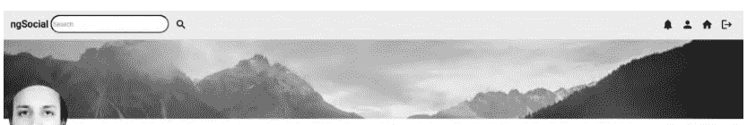
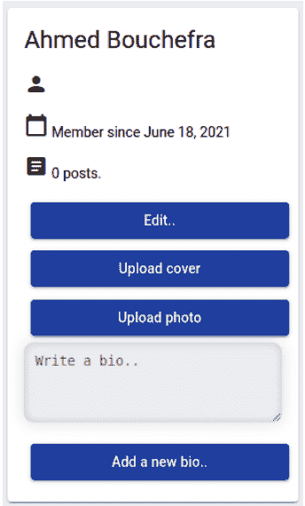
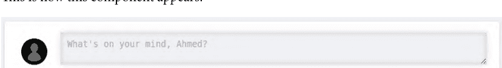

## 9 上传图片和添加帖子

在上一章中，我们通过添加 authentication guard 和单元测试完成了身份验证系统的实现。

在本章中，我们将开始实现 profile 组件的功能。我们将添加必要的代码来获取与个人资料 URL 对应的用户，并在页面上渲染其信息，包括上传用户照片和封面图片的能力，以及添加个人简介。

我们将使用 GraphQL Code Generator 等额外工具来生成代码并自动推断变量和结果类型，而不是手动指定它们，这使我们的代码保持干净、可维护且可扩展。

我们将涵盖以下主题：

- 使用 Angular 和 Apollo 上传图片
- 实现 post service
- 实现 profile service
- 实现 base component
- 实现 profile component

- 创建 profile UI
- 实现 `create-post` 组件

## 技术要求

要完成本章的步骤，你必须先完成本书的上一章。

你还应熟悉以下技术：

- JavaScript/TypeScript
- HTML
- CSS

本章的源代码可在 https://github.com/PacktPublishing/Full-Stack-App-Development-with-Angular-and-GraphQL/tree/main/Chapter07 找到。

## 使用 Angular 和 Apollo 上传图片

上传图片是任何社交网络的必备功能；在我们的案例中，我们不仅需要帖子的图片，还需要用户的照片和个人资料封面。

我们已在后端添加了三个 mutations：`uploadFile`、`setUserPhoto` 和 `setUserCover`。在本节中，我们将编写代码以发送请求调用这些 GraphQL mutations，从而创建带或不带图片的帖子，以及设置用户的个人资料照片和封面。

我们在上一节中通过使用 `gql` 标签包装查询和 mutations 手动创建了 GraphQL 文档，该标签返回我们传递给 Apollo Client 方法以获取或变更数据的文档（`DocumentNode` 类型的对象）。

然后，为了与我们的 GraphQL API 通信，我们为 results/responses 创建了类型并实现了 Apollo services，这些服务扩展了通用的 `Query` 或 `Mutation` 类。

这可行，但随着代码库的增长，很可能无法扩展，因为手动编写和维护类型需要额外的工作来确保结果（和变量）的类型与我们正在使用的 selection sets（和 GraphQL arguments）匹配。这增加了出现诸如拼写错误等错误的可能性。


幸运的是，我们拥有诸如 GraphQL Code Generator 之类的生成工具，它可以生成 TypeScript 类型甚至 Apollo 服务。

使用各种插件，该工具通过提供服务器模式和 GraphQL 查询与变更来生成完整的类型和代码结构，例如 GraphQL 文档和 Apollo 服务（用于 apollo-angular）。请查看 https://www.graphql-code-generator.com。

要为变量和结果生成 TypeScript 类型，我们可以使用 @graphql-codegen/typescript 和 @graphql-codegen/typescript-operations 插件。

然后，使用 @graphql-codegen/typescript-apollo-angular 插件，我们可以生成 Angular 服务。

这让你无需手动创建和更新类型。该工具最近已扩展，因此在调用 Apollo Client API（或你偏好使用的任何 GraphQL 客户端）时无需手动指定类型。

此功能在 graphql-typed-document-node 插件中实现，该插件生成具有强类型的 DocumentNode 对象。有关更多信息，请参阅 https://github.com/dotansimha/graphql-typed-document-node 和 https://the-guild.dev/blog/typed-document-node。

在本节中，我们将继续实现我们的应用程序，但这次我们将使用代码生成器，并使用必要的插件进行配置，以生成服务和类型化的 DocumentNode 对象，从而自动推断变量和结果类型，而不是手动指定，这样可以保持代码整洁、可维护且可扩展！

## 设置 GraphQL Code Generator

类型化文档节点由 apollo-angular 2.6.0 及更高版本支持，因此让我们确保拥有 @apollo/client 和 apollo-angular 包的最新版本，通过从 client/ 文件夹运行以下命令来升级现有依赖项：

```bash
npm i @apollo/client
npm i apollo-angular
```

请注意，在本书编写期间已添加对类型化文档的支持，因此在你的情况下此步骤可能并非必要。

让我们逐步介绍如何设置 GraphQL Code Generator 以生成用于与 GraphQL API 交互的类型化文档和服务：

- 1. 首先，打开你的终端并从 monorepo 项目的根目录执行以下命令以安装必要的依赖项：

```
npm i @graphql-codegen/cli
npm i @graphql-typed-document-node/core
npm i @graphql-codegen/typescript
npm i @graphql-codegen/typescript-operations
npm i @graphql-codegen/typed-document-node
npm i @graphql-codegen/typescript-apollo-angular
npm i @graphql-codegen/import-types-preset
```

我们在处理服务器端应用程序时之前已安装 CLI，但重新安装可确保我们拥有最新版本。

- 2. 在 monorepo 项目的根目录中打开 codegen.yml 文件，并使用根级配置中的 documents 字段更新它以指向你的 GraphQL 文档，如下所示：

```
documents: './packages/client/src/**/*.graphql'
```

该字段与 schema 字段在同一级别添加。该字段接受多种选项。在我们的例子中，我们使用 glob 表达式指定可能存在于 ./packages/client/src/ 文件夹子文件夹中的多个文件。有关该字段的更多信息，请查看 https://www.graphql-code-generator.com/docs/getting-started/documents-field。

- 3. 在 generates 字段下，添加以下输出以生成类型：

```
generates:
  # [...] 
  ./packages/graphql-types/src/types.ts:
    plugins:
      - typescript
```

为了生成将在下一个生成文件中导入的类型，我们使用 TypeScript 插件。

- 4. 同样，添加以下输出以生成 GraphQL 文档和操作：

```
./packages/graphql-types/src/client/
  graphql-operations.ts:
  preset: import-types
  presetConfig:
    typesPath: ../types
  plugins:
    - typescript-operations
    - typed-document-node
```

import-types 预设用于从 ../types 路径导入并重用之前生成的类型，而 typescript-operations 和 typed-document-node 插件用于生成 GraphQL 操作和类型化文档。

- 5. 最后，使用 typescript-apollo-angular 插件按如下方式生成 Angular 服务：

```
./packages/client/src/app/core/gql.services.ts:
  config:
    documentMode: external
    importOperationTypesFrom: Operations
    importDocumentNodeExternallyFrom:
      '@ngsocial/graphql/documents'
  plugins:
    - typescript-apollo-angular
```

在 config 字段中，我们传递选项以从 '@ngsocial/graphql/documents' 路径导入文档，该路径将被配置为指向我们之前生成的 graphql-operations.ts 文件，因为它们是生成服务所必需的。

否则，我们还必须在此处添加 typescript-operations 插件，这将在 gql.services.ts 文件中生成相同的类型。有关 config 字段的更多信息，请查看 https://www.graphql-code-generator.com/docs/getting-started/config-field。

我们使用 `importDocumentNodeExternallyFrom` 选项，并将 `documentMode` 设置为 `external`，以便在自己的文件中导入使用 `typescript-operations` 插件生成的基类型，在我们的例子中是 `graphql-operations.ts`，并且我们使用 `importOperationTypesFrom` 选项为它们添加 `Operations` 前缀。

有关更多信息，请查看 https://www.graphql-code-generator.com/docs/plugins/typescript-document-nodes。

此配置用于避免在每个文件中生成相同的基本类型、文档类型和 GraphQL 操作。我们只创建一次，然后根据需要从其他文件导入。查看所有可用插件 https://www.graphql-code-generator.com/docs/plugins/index。

## 添加片段和变更

在本节中，我们将添加创建帖子和上传图像所需的片段和变更，然后生成结果的类型和用于向服务器发送变更的 Apollo 服务，然后再实现 users 模块的个人资料服务。

如果你不熟悉片段，请阅读官方指南 https://graphql.org/learn/queries/#fragments。

让我们开始添加 GraphQL 片段和变更：

- 1. 首先，在 `client/src/app/` 文件夹内创建 `graphql.documents/` 文件夹，然后创建 `graphql.documents/user.graphql` 文件，并添加以下作用于 User 类型上的片段：
- 2. 按如下方式添加 UserFields 片段：

```graphql
fragment BasicUserFields on User {
  id
  fullName
  username
  image
}
```

此片段包含我们 GraphQL 模式的 User 类型的一组基本字段。

```graphql
fragment UserFields on User {
  ...BasicUserFields
  email
  bio
  coverImage
  postsCount
  createdAt
}
```

此片段包含 User 类型字段的全部集合。为了在 UserFields 片段上扩展 BasicUserFields 片段，我们使用 ...（三个点）语法。

- 3. 添加用于设置用户照片的 setUserPhoto 变更：

```graphql
mutation setUserPhoto($file: Upload!) {
  setUserPhoto(file: $file) {
    ...UserFields
  }
}
```

由于此变更返回其照片已被设置的 user 对象，我们使用选择集来要求后端为我们在前端应用中需要的确切字段。在选择集中，我们扩展 UserFields 片段，该片段引用模式中 User 类型的字段。

- 4. 添加用于设置用户封面图像的 setUserCover 变更：

```graphql
mutation setUserCover($file: Upload!) {
  setUserCover(file: $file) {
    ...UserFields
  }
}
```

- 5. 添加用于设置用户简介的 setUserBio 变更：

```graphql
mutation setUserBio($bio: String!) {
  setUserBio(bio: $bio) {
    ...UserFields
  }
}
```

让我们现在添加必要的 Post 类型片段。

- 1. 创建 graphql.documents/post.graphql 文件并开始添加以下片段：
- 2. 添加以下片段，其中包含与 Post 类型的点赞信息相关的字段：
- 3. 添加以下片段，其中包含与 Post 类型上的评论信息相关的字段：

```graphql
fragment BasicPostFields on Post {
  id
  text
  image
  createdAt
}
```

```graphql
fragment LikesInfo on Post {
  likesCount
  latestLike
  likedByAuthUser
}
```

```graphql
fragment CommentsInfo on Post {
  latestComment {
    ...CommentFields
    author {
      ...BasicUserFields
    }
  }
  commentsCount
}
```

我们在返回对象的 latestComment 字段中扩展将在后续步骤中定义的 CommentFields 片段。我们在 author 字段中扩展 BasicUserFields 片段，该片段包含 User 类型的基本字段。


4. 按如下所示添加 PostFields 片段：

```
fragment PostFields on Post {
  ...BasicPostFields
  author {
    ...BasicUserFields
  }
  ...CommentsInfo
  ...LikesInfo
}
```

接下来，添加三个用于上传文件、创建和删除帖子的 mutation。

5. 首先将以下 mutation 添加到同一个 post.graphql 文件中：

```
mutation uploadFile($file: Upload!) {
  uploadFile(file: $file) {
    url
    filename
    mimetype
    encoding
  }
}
```

添加以下用于从文本和/或图像创建帖子的 mutation：

```
mutation createPost($text: String, $image: String) {
  post(text: $text, image: $image) {
    ...BasicPostFields
    author {
      ...BasicUserFields
      postsCount
    }
  }
}
```

我们在选择集中扩展 BasicPostFields 片段，然后在 author 字段中扩展 BasicUserFields 片段。

添加以下用于通过 ID 删除帖子的 mutation：

```
mutation removePost($id: ID!) {
  removePost(id: $id)
}
```

- 6. 同时创建 graphql.documents/comment.graphql 文件，并向 GraphQL 模式的 Comment 类型添加以下片段：

```
fragment CommentFields on Comment {
  id
  comment
  createdAt
}
```

现在我们已添加了用于上传图像、创建和删除帖子所需片段和 mutation，将会看到如何使用代码生成器生成类型和 Apollo 服务。

## 生成类型和服务

让我们使用代码生成器生成类型和服务：

- 1. 要从 monorepo 项目的根目录启动代码生成器，请使用以下命令：

```
npm run codegen
```

这将生成相关文件，其中包含适当的代码和类型。在 @ngsocial/graphql 包中，类型和文档会被生成，而 Angular 服务则在客户端项目的 core/ 文件夹中生成。

- 2. 打开 client/tsconfig.json 文件并向生成的文件添加以下路径：

```
"paths": {
  "@ngsocial/graphql": ["../graphql-types/src"],
  "@ngsocial/graphql/types": ["../graphql-types/src/types"],
  "@ngsocial/graphql/documents": ["../graphql-types/src/client/graphql-operations"]
}
```

而不是指定完整路径，我们将能够从 @ngsocial/graphql/types 和 @ngsocial/graphql/documents 路径导入类型和文档节点对象。

## 实现 post 服务

现在让我们生成并实现 post 服务，该服务封装了创建和删除帖子以及上传图像的方法，在我们生成类型和服务并配置路径之后。只需注入生成的 CreatePostGQL、RemovePostGQL 和 UploadFileGQL 服务，并使用必要的参数调用它们的 mutate() 方法以将 mutation 发送到后端：

- 1. 要在 core/ 文件夹中生成 post 服务，请打开终端并运行以下命令：

```
ng g s core/services/post/post
```

接下来，创建 core/services/index.ts 文件并从 core/ 文件夹内部将现有服务导出到导入路径：

```
export { AuthService } from './auth/auth.service';
```

```
export { PostService } from './post/post.service';
```

此外，打开 core/index.ts 文件并按如下方式更新它：

```
export {
    AuthService,
    PostService
} from './services';
export { AuthGuard } from './guards/auth/auth.guard';
export * from './gql.services';
```

我们重新导出 post 服务和所有 Apollo 服务，这些服务由代码生成器在 ./gql.services.ts 文件中生成。

- 2. 向 core/services/post/post.service.ts 文件添加以下导入：

```
import { map } from 'rxjs/operators';
import {
    CreatePostGQL,
    RemovePostGQL,
    UploadFileGQL
} from 'src/app/core';
```

3. 接下来，使用服务构造函数按如下方式注入导入的服务：

```
```typescript
export class PostService {
  constructor(
    private createPostGQL: CreatePostGQL,
    private removePostGQL: RemovePostGQL,
    private uploadFileGQL: UploadFileGQL) { }
```
```

4. 定义并实现以下文件上传方法：

```
```typescript
uploadFile(image: File) {
  return this.uploadFileGQL.mutate(
    {
      file: image
    },
    {
      context: {
        useMultipart: true
      }
    }).pipe(map(result => result.data!.uploadFile));
}
```
```

5. 定义并实现以下创建帖子的方法：

```
```typescript
createPost(text: string | null, image: string | null) {
  return this.createPostGQL
    .mutate({
      text: text,
      image: image
    })
    .pipe(map(result => result.data!.post));
}
```
```

6. 按如下方式定义并实现按 ID 删除帖子的方法：

```
```typescript
removePost(id: string) {
  return this.removePostGQL
    .mutate({
      id: id
    })
```
```

```
```ts
.pipe(map(result => result.data!.removePost));
}
```
```

我们已添加了创建和删除帖子以及上传帖子图像所需的必要方法。接下来，我们必须实现 profile 服务，其中包含用于配置用户简介、照片和封面的代码。然后，我们将查看如何使用 profile 组件添加用于调用这些功能的 UI。

## 实现 profile 服务

在本节中，我们将构建 profile 服务，其中包含与用户个人资料交互的代码。此服务注入生成的 SetUserBioGQL、SetUserPhotoGQL 和 SetUserCoverGQL 服务并实现 setUserBio()、setUserPhoto() 和 setUserCover() 方法，这些方法只是将必要的 mutation 发送到后端：

- 1. 将以下符号导入 users/services/profile/profile.service.ts 文件（该文件在上一章中创建）：

```
```ts
import {
  SetUserCoverGQL,
  SetUserPhotoGQL,
  SetUserBioGQL
} from 'src/app/core';
import { map } from 'rxjs/operators';
```
```

使用构造函数注入 Apollo 服务：

```
```ts
export class ProfileService {

  constructor(
    private setUserBioGQL: SetUserBioGQL,
    private setUserPhotoGQL: SetUserPhotoGQL,
    private setUserCoverGQL: SetUserCoverGQL
  ) { }
```
```

- 2. 按如下方式实现 setUserBio() 方法：

```
```ts
setUserBio(bio: string) {
  return this.setUserBioGQL.mutate({
    bio: bio
```
```

```
}) .pipe(map(result => result.data!.setUserBio));
}
```

3. 按如下方式实现 setUserPhoto() 方法：

```
setUserPhoto(photoImage: File) {
  return this.setUserPhotoGQL.mutate({
    file: photoImage
  },
  {
    context: {
      useMultipart: true
    }
  }).pipe(map(result => result.data!.setUserPhoto));
}
```

4. 按如下方式实现 setUserCover() 方法：

```
setUserCover(coverImage: File) {
  return this.setUserCoverGQL.mutate({
    file: coverImage
  },
  {
    context: {
      useMultipart: true
    }
  }).pipe(map(result => result.data!.setUserCover));
}
```

## 实现基础组件

由于用户个人资料和 feed 帖子组件的实现相似，这些组件之间共享大量代码。为了避免重复造轮子并遵循 Don't Repeat Yourself (DRY) 原则，我们可以使用 TypeScript 继承，通过抽象基类实现共享功能，然后从两个组件中扩展它。

让我们逐步介绍如何实现 profile 组件：

1. 创建 shared/types/post.event.ts 文件并添加以下类型：

```
export type PostEvent = {
  text: string | null;
  image: File | null;
};
```

然后，创建 shared/types/removepost.event.ts 文件并添加以下类型：

```
export type RemovePostEvent = {
  id: string;
};
```

这些类型用于为自定义事件进行类型化，这些事件将用于在父级、profile 和 posts 组件（扩展基类）与负责创建和删除帖子的子组件之间进行通信。这些组件将在后面添加，但处理事件的方法将在下一步中添加到基类。

打开 shared/index.ts 文件并按如下方式导出类型：

```
export { PostEvent } from './types/post.event';
export { RemovePostEvent } from './types/removepost.event';
```

2. 创建 core/components/base.component.ts 文件并添加以下导入：

首先导入 Injector 和生命周期接口：

```
import {
  Injector,
  Component,
  OnDestroy,
  OnInit
} from '@angular/core';
```


导入以下 rxjs 符号和 snack-bar 组件：

```typescript
import {
    Subject
} from 'rxjs';
import {
    mergeMap,
    takeUntil
} from 'rxjs/operators';
import { MatSnackBar }
    from '@angular/material/snack-bar';
```

导入身份验证和帖子服务：

```typescript
import {
    AuthService,
    PostService
} from '../services';
```

导入 User 和 Post 类型：

```typescript
import {
    User,
    Post
} from '@ngsocial/graphql/types'
```

在这种情况下，我们导入的是代码生成器生成的 User 类型，而不是我们手动创建的 User 模型。

最后，导入自定义事件类型：

```typescript
import {
    PostEvent,
    RemovePostEvent
} from 'src/app/shared';
```

## 3. 定义以下抽象类，包括其 public、protected 和 private 属性：

```typescript
@Component({
    template: ''
})
export abstract class BaseComponent
    implements OnInit, OnDestroy {}
```

在类的主体中定义以下成员：

```ts
public authService: AuthService;
public postService: PostService;
public posts: Post[] = [];
public authUser: Partial<User> | null = null;
public loading: boolean = false;
protected snackBar: MatSnackBar;
private componentDestroyed = new Subject();
```

我们定义了将在父组件中使用的属性，例如 posts 数组，用于保存获取到的帖子，authUser 对象，用于保存已认证的用户，以及 loading 属性，用于跟踪操作的加载状态。

我们还定义了 componentDestroyed subject，它将在组件被销毁后用于取消订阅各种方法返回的可观察对象。

最后，我们定义了 authService、postService 和 snackBar 属性，这些属性将用于使用 Injector 服务分配依赖项，而不是通过构造函数注入，以简化子组件。

private 属性只能从基组件内部访问，而 protected 属性可以从基组件和子组件访问。public 属性可以从组件内部和关联的模板访问。

## 4. 接下来，而不是使用构造函数的参数，让我们在构造函数内部注入依赖项：

```ts
constructor(public injector: Injector) {
  this.snackBar = injector.get(MatSnackBar);
  this.authService = injector.get(AuthService);
  this.postService = injector.get(PostService);
}
```

我们在构造函数中注入 Injector 服务，然后使用它获取所需的依赖项。这消除了子组件需要将其父依赖项重新传递到其构造函数的需要。有关更多信息，请查看 https://devblogs.microsoft.com/premier-developer/angular-how-to-simplify-components-with-typescript-inheritance/。

## 5. 使用以下代码实现生命周期 ngOnInit() 方法：

```ts
ngOnInit(): void {
    this.authService
        .authUser
        .pipe(
            takeUntil(this.componentDestroyed)
        )
        .subscribe({
            next: (authUser) => {
                this.authUser = authUser;
            }
        });
}
```

我们还将已认证的用户分配给组件的 authUser 属性，这样我们就可以在组件及其子组件中访问它，而无需引用身份验证服务。

## 6. 使用以下代码实现 ngOnDestroy() 生命周期方法：

```ts
ngOnDestroy(): void {
    this.componentDestroyed.next();
    this.componentDestroyed.complete();
}
```

如果组件被销毁，我们从 componentDestroyed subject 发出一个值并完成该 subject。这将作为 takeUntil() 运算符的通知器，该运算符将在以下步骤中实现的方法上应用，以取消订阅返回的可观察对象。当我们的 subject 发出值时，takeUntil() 运算符将取消订阅我们订阅的源可观察对象。

## 7. 为处理错误，添加 protected handleErrors() 方法，该方法将传递给 subscribe() 方法的错误处理程序：

```ts
protected handleErrors(err: Error) {
    if(this.loading) this.loading = false;
    console.log(err);
    this.snackBar.open(err.message, 'Ok', {
        duration: 5 * 1000
    });
}
```

当发生错误时，loading 属性被设置为 false，并显示错误消息。loading 属性控制用户界面中是否出现加载指示器。

## 8. 添加 displayMessage() 方法，该方法使用 snack bar 显示作为参数传递的消息：

```ts
protected displayMessage(message: string) {
    this.snackBar
        .open(message,
            'Ok', {
                duration: 5 * 1000
            });
}
```

## 9. 添加 createPost() 方法以创建仅文本帖子或显示错误消息，如下所示：

```ts
private createPost(text: string | null) {
    if (!text?.length) {
        this.displayMessage('Cannot create an empty
            post.');
        return;
    }
    if (text) {
        this.createTextPost(text);
    }
}
```

要创建没有图片的帖子，将调用此方法。如果作为参数传递的文本为空，则会使用 snack bar 组件显示 Cannot create an empty post. 错误，并退出该方法。否则，我们将操作委托给下一步的 createTextPost() 方法。

## 10. 实现 createTextPost() 方法，该方法将帖子的创建传递给 post 服务：

```ts
private createTextPost(text: string): void {
    this.loading = true;
    this.postService
        .createPost(text, null)
        .pipe(
            takeUntil(this.componentDestroyed))
        .subscribe(/* ... */);
}
```

当操作即将开始时，我们将 loading 属性设置为 true，并在操作成功或失败时将其值设置为 false。为了避免内存泄漏，我们还将使用 takeUntil() 运算符取消订阅返回的可观察对象。

然后，将以下观察者对象传递给 subscribe() 方法：

```ts
{
    next: (post) => {
        if (post) {
            this.loading = false;
            this.displayMessage('Your post was created.');
            console.log(post);
        }
    },
    error: (err) => this.handleErrors(err)
}
```

如果操作成功，我们将 loading 属性设置为 false，并使用 snack bar 组件显示成功消息。否则，我们处理错误。

## 11. 实现 uploadImageAndCreatePost() 方法以上传图片并创建带或不带文本的帖子：

```ts
private uploadImageAndCreatePost(image: File, text: string | null) {
    this.loading = true;
    this.postService
        .uploadFile(image)
        .pipe(
            mergeMap(uploadFile => this.postService
                .createPost(text, uploadFile?.url || null)
            ),
            takeUntil(this.componentDestroyed)
        ).subscribe(/* ... */);
}
```

在此方法中，我们首先将 loading 属性设置为 true，然后调用 post 服务的 uploadFile() 方法并订阅返回的可观察对象。

我们使用 mergeMap() 运算符将创建帖子的可观察对象与上传图片的可观察对象链接起来，因为对 createPost() 方法的调用依赖于 uploadFile() 方法的结果。当我们订阅组合后的可观察对象时，它会将两个可观察对象合并为一个，并确保内部可观察对象在源之后发出。

当源可观察对象发出上传文件的信息时，发出的值会传递给我们传递给 mergeMap() 运算符的函数，在该函数中我们调用 createPost() 方法，该方法返回内部可观察对象。

这意味着图片将首先被上传，然后输出将传递给负责创建帖子的方法。顺序至关重要，因为我们必须先获取上传图片的 URL，然后才能调用 createPost() 方法。

mergeMap() 运算符将 uploadFile() 方法返回的源可观察对象发出的每个值映射并展平为 createPost() 方法返回的内部可观察对象。

请参阅 https://rxjs.dev/api/operators/mergeMap。

我们还使用 pipe() 方法在调用 subscribe() 方法之前将 takeUntil() 运算符应用于源可观察对象。

我们将 componentDestroyed subject 作为通知器传递给 takeUntil() 运算符，以便在组件被销毁时取消订阅可观察对象。

然后，将以下观察者对象传递给 subscribe() 方法：

```ts
{
    next: (post) => {
        this.loading = false;
        if (post) {
```


```
this.displayMessage('Your post was created.');
console.log(post);
}
},
error: (err) => this.handleErrors(err)
}
```

如果帖子成功创建，我们会显示一条成功消息，否则，我们会处理错误。为了在方法中处理错误，我们在错误处理程序中调用 handleErrors() 方法。

12. 实现以下 onPost() 方法，当用户想要创建帖子时调用该方法：

```
onPost(e: PostEvent): void {
  if (e.image) {
    this.uploadImageAndCreatePost(e.image, e.text);
  }
  else {
    this.createPost(e.text);
  }
}
```

此方法将在响应帖子创建的自定义事件时被调用。如果用户选择了图片，我们使用 uploadImageAndCreatePost() 方法上传图片并创建帖子，该帖子可以带或不带文字（e.text 对象可以为 null）。否则，我们将使用 createPost() 方法创建仅包含文字的帖子。

13. 添加 onRemovePost() 方法以根据其 ID 删除帖子：

```
onRemovePost(e: RemovePostEvent): void {
  this.postService
    .removePost(e.id)
    .pipe(takeUntil(this.componentDestroyed))
    .subscribe({
      next: () => {
        this.displayMessage('Post deleted.');
      },
      error: (err) => this.handleErrors(err)
    });
}
```

此方法将在响应通过 ID 删除指定帖子的自定义事件时被调用。它调用注入的 post 服务的 removePost() 方法并订阅返回的 observable。如果操作成功，我们会显示一条成功消息，内容为 Post deleted.。否则，我们会处理错误。

我们使用 takeUntil() 操作符与 componentDestroyed 主题配合，在组件被销毁时取消订阅返回的 observable。

14. 最后，让我们将基础组件添加到 core/ 文件夹的 barrel 文件中。在 core/index.ts 文件中添加以下行：

```
export { BaseComponent }
    from './components/base.component';
```

随着本书的推进，我们将向基础组件添加更多方法，但就目前而言，这已足以继续进行 profile 组件实现的下一步。

## 实现 profile 组件

在本节中，我们将通过扩展基础组件来实现 profile 组件：

1. 首先，打开 core/index.ts 文件并使用以下语法导出 profile 服务：

```
export { ProfileService }
    from '../users/services/profile/profile.service';
```

2. 打开 users/components/profile/profile.component.ts 文件并按如下方式添加导入：

```
import {
    Component,
    ElementRef,
    Injector,
    ViewChild
} from '@angular/core';
import {
    ActivatedRoute,
    ParamMap
} from '@angular/router';
import { User }
    from '@ngsocial/graphql/types';
import {
    User
    as UserModel
} from 'src/app/shared';
import { Maybe } from 'graphql/jsutils/Maybe';
import { Subject } from 'rxjs';
import {
    take,
    takeUntil,
    switchMap
} from 'rxjs/operators';
import {
    BaseComponent
} from 'src/app/core/components/base.component';
import { authState }
    from 'src/app/reactive';
import { ProfileService }
    from 'src/app/core';
```

3. 按如下方式更新组件的类：

```
export class ProfileComponent
    extends BaseComponent {
    private destroyNotifier: Subject<boolean> = new
        Subject();
    @ViewChild('bioInput') bioInput: ElementRef | null =
        null;
    profileUser: Partial<User> | null = null;
    showEditSection: boolean = false;
    isAuthUserProfile: boolean = false;
    constructor(
        private route: ActivatedRoute,
        private profileService: ProfileService,
        public injector: Injector
    ) {
        super(injector);
    }
}
```

我们定义将从模板访问的公共属性，以及仅在组件类中使用的私有成员：

- The `profileUser` property, which contains the user of the profile
- The `showEditSection` Boolean, which specifies whether the profile's editing section is visible or hidden
- The `isAuthUserProfile` Boolean, which indicates whether the profile belongs to the authenticated user
- The `bioInput` element reference, decorated with `ViewChild`, which will be used to get the value of the bio input field in the template
- The `destroyNotifier` subject, which notifies the `takeUntil` operator when the component is destroyed

我们将所需的服务，如 `Injector`、`ActivatedRoute` 和 `ProfileService`，注入到构造函数中。injector 被传递给基础服务，profile 组件使用 `ActivatedRoute` 和 `ProfileService`。

4. 定义以下 setter 和 getter 属性：

以下代码块用于设置用户个人简介文本区域的值：

```
set bioInputValue(value: string) {
    this
        .bioInput!
        .nativeElement
        .value = value;
}
```

以下代码块用于获取个人简介文本区域的值：

```
get bioInputValue() {
    return this
        .bioInput!
        .nativeElement
        .value;
}
```

以下代码块用于获取个人资料用户的名字：

```
get userFirstName() {
  return this.profileUser
    ?.fullName
    ?.split(' ')
    ?.shift();
}
```

我们首先使用 split() 方法按空格拆分姓名，它返回一个包含两个字符串的数组，然后使用数组的 shift() 方法获取第一个元素，即个人资料用户的名字。

5. 对 ngOnInit() 方法做如下更改：

```
ngOnInit(): void {
  super.ngOnInit();
  const userObs = this.route.paramMap
    .pipe(
      switchMap((params: ParamMap) => {
        const userId = params.get('userId')!;
        return this.authService.getUser(userId);
      }),
      takeUntil(this.destroyNotifier)
    );
  userObs.subscribe({
    next: (userResponse) => {
      this.setProfileUser(userResponse.getUser);
      this.setIsAuthUserProfile();
    },
    error: (err) => super.handleErrors(err)
  });
}
```

我们使用 ActivatedRoute 服务从个人资料 URL 获取用户 ID，然后调用身份验证服务的 getUser() 方法（手动注入到基础组件中），并订阅返回的 observable 以获取通过获取到的用户 ID 标识的用户。

如果操作成功，我们将调用私有方法 setProfileUser() 和 setIsAuthUserProfile()，它们只是将响应体中的个人资料用户分配给组件的 profileUser 属性，并设置一个布尔属性以指示个人资料是否属于已认证用户。

出现错误时，我们调用基础组件的 handleErrors() 方法。为了避免组件被销毁时应用程序出现内存泄漏，我们使用 RxJS 的 takeUntil() 操作符自动取消订阅返回的 observable。

6. 定义私有方法 setUserProfile() 和 setIsAuthUserProfile()：

```
private setProfileUser(user: Partial<User>) {
    this.profileUser = user;
}

private setIsAuthUserProfile() {
    this.isAuthUserProfile =
        !!(
            this.authUser &&
            this.authUser.id == this.profileUser?.id
        );
}
```

7. 按如下方式定义 setBio() 方法，以设置用户的个人简介：

```
setBio(): void {
    const bio = this.bioInputValue;
    this.profileService
        .setUserBio(bio)
        .pipe(take(1))
        .subscribe(/* ... */);
}
```

然后，将以下观察者对象传递给 subscribe() 方法：

```
{
    next: (userResult) => {
        if (userResult) {
            this.handleSuccess(
                userResult,
                'Your bio is updated.'
            );
            this.bioInputValue = '';
        }
    },
    error: (err) => this.handleErrors(err)
}
```

8. 按如下方式定义 setUserCover() 方法，以设置用户的个人资料封面：

```
setUserCover(file: File): void {
    this.profileService
        .setUserCover(file)
        .pipe(take(1))
        .subscribe(/* ... */);
}
```

然后，将以下观察者对象传递给 subscribe() 方法：

```
{
    next: (userResult) => {
        if (userResult)
            this.handleSuccess(
                userResult,
                'Your profile cover is successfully updated.'
            )
    },
    error: (err) => this.handleErrors(err)
}
```

9. 按如下方式定义 setUserPhoto() 方法，以设置用户的照片：

```
setUserPhoto(file: File): void {
    this.profileService
        .setUserPhoto(file)
        .pipe(take(1))
        .subscribe(/* ... */);
}
```


然后，将以下观察者对象传递给 subscribe() 方法：

```
{
    next: (userResult) => {
        this.handleSuccess(
            userResult,
            'Your profile photo is successfully updated.'
        )
    },
    error: (err) => this.handleErrors(err)
}
```

10. 定义 private handleSuccess() 方法：

```
private handleSuccess(
    userResult: Partial<Maybe<User>>,
    message: string) {
    if (userResult) {
        this.displayMessage(message);
        const prevAuthState = authState();
        authState({
            ...prevAuthState,
            currentUser: userResult as UserModel
        });
        if (this.authUser) {
            this.authUser = userResult as User;
            this.authService
                .storeUser(this.authUser as any);
        }
    }
}
```

11. 定义以下方法，通过将 showEditSection 属性设置为 true/false 来显示/隐藏个人资料的编辑部分：

```
enableDisableEditing(): void {
    this.showEditSection = !this.showEditSection;
}
```

定义以下方法，当用户从系统文件对话框中选择照片时将被调用：

```
onPhotoSelected(event: Event): void {
  const files: FileList =
    (event.target as HTMLInputElement)
      .files!;
  if (files.length > 0) {
    const photoFile = files[0];
    this.setUserPhoto(photoFile);
  }
}
```

我们从事件对象获取图像文件，并使用组件的 setUserPhoto() 方法将其上传。

12. 最后，定义当用户为个人资料封面选择照片时将被调用的方法：

```
onCoverSelected(event: Event) {
  const files: FileList =
    (event.target as HTMLInputElement)
      .files!;
  if (files.length > 0) {
    const coverFile = files[0];
    this.setUserCover(coverFile);
  }
}
```

此方法与前一个方法类似，当用户从系统文件对话框中选择封面图像时会被调用。我们从事件对象获取封面图像，并使用 setUserCover() 将其上传到服务器。

在进入下一节之前，我们需要在身份验证服务中更改一种行为：当令牌过期时，我们需要从 localStorage 中删除当前用户和令牌。

只需打开 core/services/auth/auth.service.ts 文件并对构造函数进行以下更改：

```
constructor(
  /* ... */
) {
  const localToken = this.getLocalToken();
  let isLoggedIn = false;
  if (localToken) {
    isLoggedIn = this.tokenExists() && !this.tokenExpired(localToken);
  }
  if(!isLoggedIn){
    localStorage.removeItem(ACCESS_TOKEN);
    localStorage.removeItem(AUTH_USER);
  }
  // [...] 
}
```

如果令牌过期，isLoggedIn 变量包含 false 值。在这种情况下，访问令牌和身份验证用户将从 localStorage 中移除。

## 定义字段策略

在开始构建 UI 之前，我们必须先在用户字段显示在个人资料 UI 上之前对其应用一些转换。我们可以通过多种方式实现这一点，包括使用内置或自定义的 Angular 指令和管道，以及 Apollo Client 的类型和字段策略。

让我们看看如何使用字段策略来转换用户的 coverImage 和 createdAt 字段：

- 1. 打开 client/src/app/cache.ts 文件并按如下方式将 User 类型策略添加到内存缓存的 typePolicies 对象中：
- 2. 然后，在 fields 对象中，添加要转换的字段，从 coverImage 字段策略开始：

```
User: {
  fields: {}
}
```

```
coverImage: {
  read(coverImage) {
    return 'url(${coverImage})';
  }
}
```

```
}
}
```

访问该字段时，它将返回用 CSS url() 函数包装的 coverImage URL，该 URL 可以分配给将显示封面图像的 HTML 元素的 background-image 样式属性。

- 3. 然后，添加 createdAt 字段策略：

```
createdAt: {
    read(createdAt) {
        return new Date(Number(createdAt))
            .toLocaleDateString('en-US', {
                weekday: 'short',
                day: 'numeric',
                year: 'numeric',
                month: 'long'
            });
    }
}
```

访问 createdAt 字段时，它将返回相应的可读日期。

## 创建个人资料 UI

在实现组件方法后，让我们构建个人资料 UI：

- 1. 首先将以下 HTML 标记添加到 users/components/profile/profile.component.html 文件中：

```
<mat-card class="profile-cover-card">
<mat-card-content *ngIf="profileUser">
    <div class="profile-cover" [ngStyle]="
        {'background-image': profileUser.coverImage }">
    </div>
    
</mat-card-content>
</mat-card>
```

为了显示个人资料封面和图像，我们使用 Material Card 组件。我们使用 ngStyle 指令将 CSS background-image 属性设置为 profileUser 封面照片的 URL，并通过插值使用元素的 src 属性显示用户的照片。

2. 在前一个卡片正下方，添加以下标记：

```
<mat-card class="profile-call-action">
<mat-card-content *ngIf="!authUser">
<h1>Do you know {{ userFirstName }}?</h1>
<p>
    If you know {{ userFirstName }}, join our network
    to see their posts.
</p>
</mat-card-content>
</mat-card>
```

这是另一个带有号召性用语的卡片，邀请访问用户加入我们的网络。我们使用 *ngIf 指令有条件地渲染此卡片，以便它仅在访客未注册或未登录并且我们拥有从访问的 URL 中检索到的用户 ID 的个人资料时出现。

3. 为了从用户的全名中获取名字，我们使用 userFirstName getter。直接在前一个卡片下方添加以下标记：

```
<div *ngIf="profileUser; else userNotFound"
    class="profile-grid">
<mat-card>
    <mat-card-title>
        <h1>{{ profileUser.fullName }}</h1>
    </mat-card-title>
    <mat-card-content>
        <!-- ... -->
    </mat-card-content>
</mat-card>
<div class="posts-column">
    <!-- ... -->
</div>
</div>
```

4. 在 <mat-card-content> 元素内部，添加以下标记：

```
```html
<p>
  <mat-icon>person</mat-icon>
  <span>
    {{ profileUser.bio }}
  </span>
</p>
<p>
  <mat-icon>calendar_today</mat-icon>
  <span>
    Member since {{ profileUser.createdAt }}
  </span>
</p>
<p>
  <mat-icon>article</mat-icon>
  <span>
    {{ profileUser.postsCount }} posts.
  </span>
</p>
<button *ngIf="isAuthUserProfile" mat-raised-button
  color="primary" class="profile-bio-btn"
  (click)="enableDisableEditing()">
  Edit..
</button>
<!-- ADD MARKUP FOR PROFILE UPDATE SECTION HERE -->
```
```

5. 在前一个标记正下方，添加以下用于个人资料更新部分的标记：

```
```html
<div class="profile-settings" *ngIf="showEditSection
  && isAuthUserProfile">
  <button mat-raised-button color="primary"
    class="profile-bio-btn"
    (click)="uploadCover.click()">
    Upload cover
  </button>
  <input #uploadCover type='file' style="display:none"
(change)="onCoverSelected($event)" />
    <button mat-raised-button color="primary"
    class="profile-bio-btn"
    (click)="uploadPhoto.click()">
    Upload photo
</button>
    <input #uploadPhoto type='file' style="display:none"
    (change)="onPhotoSelected($event)" />
    <div class="bio-box-wrapper">
    <textarea #bioInput class="profile-bio-box"
    placeholder="Write a bio.."></textarea>
</div>
    <button mat-raised-button color="primary"
    class="profile-bio-btn" (click)="setBio()">
    Add a new bio..</button>
</div>
```

添加以下模板，如果未找到用户则会显示该模板：

```
<ng-template #userNotFound>
    <div class="user-not-found">
    <p>
    User not found!
    </p>
    </div>
</ng-template>
```

用于设置个人资料组件样式的 CSS 样式将在下一节中添加。

## 设置个人资料组件样式

将以下样式添加到 users/components/profile/profile.component.css 文件以设置个人资料组件样式：

- 1. 首先包含以下样式：

```
* {
    box-sizing: border-box;
}
mat-card {
```


```
margin: 0.4rem;
}
.profile-cover-card {
    margin: 0px;
    padding: 0px;
}
```

这些样式用于将 box-sizing 设置为 border-box，这指示浏览器在计算我们赋予元素的宽度和高度值时，将边框和内边距纳入考虑。

接下来，我们为 Material Card 元素设置外边距，并将包含个人资料封面图像和用户照片的卡片的外边距和内边距均设置为 0 像素。

- 2. 按如下方式设置具有 .profile-cover 类的元素（包含封面图像的 <div> 元素）：

```
.profile-cover {
    height: 10rem;
    width: 100%;
    background-position: center;
    background-repeat: no-repeat;
    background-size: cover;
    background-color:rgb(97, 76, 76);
    position: absolute;
}
```

为了占据页面的整个宽度，我们将宽度设置为 100%，然后将高度设置为 10rem。随后将背景属性设置为位置居中，重复属性为不重复。最重要的是，我们将 background-size 属性设置为 cover 并使用绝对定位。

查看 https://developer.mozilla.org/en-US/docs/Web/CSS/CSS_Backgrounds_and_Borders/Resizing_background_images。

3. 添加用户图像的以下样式：

```css
.profile-image {
  width: 9rem;
  height: 9rem;
  clip-path: circle(60px at center);
  background-color: gray;
  border-width: 1px;
  margin-top: 5rem;
}
```

在这种情况下，我们将宽度和高度均设置为 9rem，使用 clip-path 属性将图像裁剪为圆形，并为用户头像设置默认背景，当用户未上传照片时将显示该背景。

查看 https://developer.mozilla.org/en-US/docs/Web/CSS/clip-path。

4. 接下来，让我们使用 CSS Grid 布局设置元素的样式：

```css
.profile-grid {
  display: grid;
  grid-template-columns: 1fr 2.5fr 1.5fr;
}
.profile-bio-btn {
  margin: 0.4rem;
  width: 100%;
}
.profile-bio-box {
  width: 100%;
  height: 5rem;
}
.bio-box-wrapper > textarea {
  padding: 10px;
  background-color: #f0f2f5;
  border-radius: 9px;
}
```

profile-grid 类包含封面图像和用户照片下方的所有信息，以及包含全名、简介、日期、帖子计数和帖子的元素。

我们将显示切换到网格模式，并使用 fr 单位（分数单位）将可用水平空间划分为比例为 1、2.5 和 1.5 的三列。查看 https://www.techiediaries.com/css-grid-layout-tutorial/ 获取详细说明。

5. 设置在找不到与对应个人资料用户 ID 匹配的用户时将显示的元素样式：

```
.user-not-found {
    text-align: center;
    font-size: 5vw;
    margin: 100px;
}
```

6. 对于最大宽度为 600px 的小屏幕，添加以下样式：

```
@media (max-width: 600px) {
    .profile-grid {
        display: grid;
        grid-template-columns: 1fr;
    }
}
```

如果屏幕宽度小于 600px，我们仅为个人资料网格元素使用一列，该列占据所有可用水平空间。

在添加这些样式后，在创建账户并添加封面和照片图像后，您将拥有如下图所示的个人资料：



图 9.1 – 个人资料组件的顶部部分

以下是点击 Edit.. 按钮后用户简介部分的屏幕截图：



图 9.2 – 用户简介部分

以下是添加简介后用户简介部分的屏幕截图：


图 9.3 – 用户信息部分

现在我们已经完成了个人资料组件中用户信息的实现，让我们继续进行用户帖子部分。

## 实现创建帖子组件

在本节中，我们将实现创建帖子组件，该组件将用于从个人资料页面（以及主页信息流）创建帖子。我们将创建帖子的逻辑放在自己的可重用组件中，因为它将在多个页面上需要。

此组件被称为 **presentational** 或 **dumb** 组件。它接收输入并向父组件发出自定义输出事件。此类组件不知道如何获取数据（没有注入的服务），因此其唯一职责是接收数据、渲染它，并为父组件处理发出一些事件。在我们的例子中，这些父组件是个人资料和信息流的帖子组件，它们被称为 **container** 或 **smart** 组件。

当此组件的 post 事件触发时，我们之前定义的基组件的 onPost() 方法将被调用。当用户点击创建帖子的按钮时，将触发此自定义事件，我们将在以下步骤中实现该功能：

- 1. 首先通过在 client/ 文件夹中运行以下命令生成一个组件：
- 2. 按如下方式从 shared/shared.module.ts 文件导出 create-post 组件：
- 3. 首先在 core/components/create-post/ 文件夹中的 create-post.component.ts 文件中添加以下导入：

```
ng g c core/components/create-post --module=shared
```

```
@NgModule({
  declarations: [CreatePostComponent],
  imports: [
    CommonModule, ReactiveFormsModule, ...matModules
  ],
  exports: [ReactiveFormsModule, ...matModules,
    CreatePostComponent]
})
```

```
import {
  Component,
  ElementRef,
  EventEmitter,
  Input,
}
OnInit,
Output,
ViewChild
} from '@angular/core';
import { User }
from '@ngsocial/graphql/types';
import { PostEvent }
from 'src/app/shared';
```

我们导入 Angular 核心模块的 API、之前定义的 User 类型和 PostEvent。

4. 按如下方式定义组件的公共和私有属性：

```
@Input() authUser!: Partial<User>;
@Input() loading: boolean = false;
@Output() post: EventEmitter<PostEvent> = new
EventEmitter();
public imageFile: File | null = null;
@ViewChild('postText') postText!: ElementRef;
```

我们添加两个自定义输入属性用于通过父组件接收已认证用户和加载状态，以及一个自定义事件，该事件将在用户点击创建帖子按钮时触发。

使用输入属性和事件，我们确保组件之间的父子通信。有关更多信息，请参阅 https://angular.io/guide/inputs-outputs#sending-data-to-a-child-component。

我们使用 @Input 装饰器装饰类属性以创建输入属性，我们可以通过创建 EventEmitter 的实例并将其作为属性公开，该属性用 @Output 装饰，父组件可以绑定到它以监听自定义事件并通过 $event 对象访问相关数据。

如果我们不使用默认值初始化所有定义的组件属性，TypeScript 将抛出错误。这是因为 Angular 12+ 默认启用了 strict 模式的 strictPropertyInitialization 规则。

我们还定义了 `imageFile` 属性，如果存在则包含用户选择的图像，以及 `postText` 属性，我们用 `ViewChild` 装饰它，以便让我们在相关模板中获取由 `#postText` 模板引用引用的输入元素的文本值：

1. 定义以下 getter 以获取已认证用户的名字：

```
get userFirstName() {
    return this.authUser
        ?.fullName
        ?.split(' ')
        ?.shift();
}
```

2. 定义以下方法以获取用户选择的图像：

```
onFileSelected(event: Event): void {
    const files: FileList =
        (event.target as HTMLInputElement)
        .files!;
    if (files.length > 0) {
        this.imageFile = files[0];
    }
}
```

此方法将绑定到用于从用户计算机选择图像的输入字段的 `change` 事件。图像文件信息从事件中提取并存储在 `imageFile` 属性中。

3. 定义以下方法以处理创建帖子的按钮点击事件：

```
handlePostClick(): void {
    if (this.authUser!.id) {
        this.post.emit({
            text: this.postText?.nativeElement.value,
            image: this.imageFile as File
        });
    }
    if (this.postText.nativeElement) {
        this.postText.nativeElement.value = '';
    }
}
```


```
this.imageFile = null;
}
```

因为此子组件仅用于展示且不与服务通信，我们必须通过 EventEmitter 的 emit() 方法向父组件发出自定义事件，该方法可通过组件的 post 属性使用，而父组件将通过 onPost() 方法实际创建帖子，并将操作委托给注入的 post 服务。

EventEmitter 的 emit() 方法将数据发送到父组件，在本例中为 PostEvent 对象，其中包含父组件和委托服务创建帖子所需的文本和图像。

事件触发后，我们使用 ElementRef 的 nativeElement.value 属性清除由 postText 属性引用的 <textarea> 元素的值，并将 imageFile 属性设为 null。

4. 接下来，我们将添加组件模板的标记。打开 create-post.component.html 文件并添加以下更改：

```
<mat-card class="post-box-wrapper">
<mat-card-content>
    <mat-progress-bar style="margin-bottom: 20px;"
        mode="indeterminate" *ngIf="loading"></mat-
        progress-bar>
    
    <textarea #postText class="post-box"
        placeholder="What's on your mind, {{ userFirstName 
        }}?"
        matInput></textarea>
    <button mat-button (click)="handlePostClick()"
        >Post</button>
    <button mat-button (click)="postImage.click()" >{{
        imageFile?.name?? 'Select Image..' }} </button>
    <input #postImage type="file" style="display:none"
        (change)="onFileSelected($event)" />
</mat-card-content>
</mat-card>
```

我们使用卡片头像显示已认证用户的图像，使用 textarea 元素输入帖子文本，并使用 #postText 模板引用通过 ViewChild 装饰器从模板中查询该元素。

接下来，我们添加两个按钮；第一个按钮的点击事件将绑定到 handlePostClick() 方法，该方法会将帖子数据提交给父组件。第二个按钮将用于触发隐藏输入字段的点击事件，该字段用于从用户计算机中选择图像。

选择图像时，会触发 change 事件，并调用 onFileSelected() 方法，该方法设置组件的 imageFile 属性。

5. 最后，我们需要为组件添加一些样式。打开 create-post.component.css 文件，首先按如下方式将模板中所有元素的 box-sizing 设置为 border-box：

```
* {
  box-sizing: border-box;
}
```

6. 按如下方式设置卡片元素的 margin：

```
mat-card {
  margin: 0.4rem;
}
```

7. 按如下方式将帖子框包装器的宽度设置为 100%：

```
.post-box-wrapper {
  width: 100%;
}
```

8. 按如下方式设置帖子框样式：

```
.post-box {
  width: 90%;
  height: 50px;
  margin-left: 10px;
  padding: 10px;
  background-color: #f0f2f5;
}
```

9. 按如下方式设置已认证用户图像的样式：

```
.auth-user-image {
  background-color: gray;
  border-width: 1px;
  margin: 10px;
}
```

如果用户未上传照片，我们为已认证用户图像设置默认背景。

创建后，让我们在 profile 组件中使用我们的哑组件：

10. 在 users/components/profile/profile.component.html 文件中定位具有 posts-column 类的 <div> 元素，并按如下方式添加组件：

```
<app-create-post [authUser]="authUser"
  [loading]="loading" (post)="onPost($event)"
*ngIf="isAuthUserProfile && authUser">
</app-create-post>
```

我们使用组件装饰器中定义的 selector 来调用组件，就像其他任何标签一样。我们从 profile 组件传入 authUser 和 loading 属性，并使用 Angular 事件绑定语法（即 ()）将 profile 组件的 onPost() 方法绑定到 <app-create-post> 组件的自定义 post 事件。因此，profile 组件可以监听子组件的事件并访问通过 $event 对象传递的数据。

我们使用输入属性和自定义事件在父子组件之间进行通信。我们可以使用输入属性将数据从父组件传递到子组件，并可以使用事件将数据从子组件传递到父组件。

该组件的显示如下：



Figure 9.4 – The create post component

图 9.4 – 创建帖子组件

我们添加了一个用于创建文本和图像帖子的展示组件。该组件显示一个带有已认证用户头像的 <textarea> 元素，以及用于选择图像和创建帖子的两个按钮。自定义 post 事件用于将此最终操作委托给父组件。更具体地说，会调用 onPost() 方法来创建帖子，该方法也将此过程委托给了 post 服务。

现在您可以手动测试应用程序，查看发布是否正常工作。如果您选择一张图像，输入一些文本，然后按下 Post 按钮，您应该会看到一条消息，说明您的帖子已创建。打开浏览器控制台，您应该会看到创建的帖子显示如下截图类似：

```
▼ {id: "25", text: "T", image: null, createdAt: "1635913458506", __typename: "Post", ...}
  ▶ author: {id: "4", fullName: "Ahmed Bouchefra", username: "a.hmed", image: "https://angulars
  createdAt: "1635913458506"
  id: "25"
  image: null
  text: "T"
  __typename: "Post"
  ▶ __proto__: Object
```

Figure 9.5 – Created post displayed on the console

图 9.5 – 控制台中显示的已创建帖子

带有嵌套 author 对象的帖子由 mutation 返回。由于嵌套的 author 对象是创建帖子的当前 profile 用户，我们可以使用 Apollo Client 在不手动更新或刷新页面的情况下自动更新 profile 部分显示的帖子计数。

如前所述，如果 mutation 返回的对象已存在于缓存中，Apollo Client 将自动选择修改后的字段并将其与缓存中现有对象合并，之后用户界面将自动更新。然而，在我们的情况下，这似乎不起作用，但这与前端无关。创建帖子后，后端未返回更新的作者帖子计数。这可以通过浏览器控制台确认。

我们可以通过打开 server/src/graphql/resolvers.ts 文件，搜索 post mutation，然后简单地按如下方式更改突出显示行的顺序来解决此问题：

```
post: async (_, args, { orm, authUser }: Context) => {
  const post = orm.postRepository.create(
    {
      text: args.text,
      image: args.image,
      author: await orm.userRepository.findOne(authUser?.id)
    } as unknown as PostEntity
);
await orm.userRepository.update({ id: authUser?.id }, {
    postsCount: post.author.postsCount + 1 });
const savedPost = await orm.postRepository.save(post);
return savedPost as unknown as Post;
}
```

这确保了在保存帖子之前，作者的 postsCount 字段已更新。

添加新帖子后，我们的 profile UI 现在将自动更新。

## 测试

现在我们已经实现了图像上传功能，其中包括设置用户照片、封面图像和创建帖子，我们需要添加单元测试。作为练习，我们将测试 post 和 profile 服务，然后是 profile 组件。

为 post 服务编写以下测试：

- 应上传作为参数传递的文件
- 应创建帖子
- 应按 ID 删除帖子

然后，为 profile 服务编写以下测试：

- 应设置用户简介
- 应设置用户照片
- 应设置用户个人资料封面

修复现有测试并为 profile 组件编写更多测试：

- 应邀请未认证用户
- 应为已认证用户显示编辑按钮
- 应显示个人资料用户信息
- 应在找到时设置个人资料用户
- 应设置 auth 用户
- 如果未找到个人资料用户，应显示 'User not found!'
- 应为其他用户的个人资料隐藏编辑按钮


- 应为已认证用户资料渲染 '创建帖子组件'
- 应为其他用户资料隐藏 '创建帖子组件'
- 应将 props 传递给 '创建帖子组件'
- 应处理 '创建帖子组件' 的 post 事件
- 点击按钮时应显示编辑区
- 按钮触发时应设置 bio
- 输入更改时应设置封面
- 输入更改时应设置照片

为 '创建帖子组件' 编写以下测试：

- 加载为 true 时应渲染进度条
- 应渲染认证用户图像
- 应在占位符上渲染认证用户名字
- 点击按钮时应发出 post
- 选择文件时应设置 imageFile 属性
- 应渲染所选图像名称

你可以在 https://git.io/JXRLn 找到这些作业的代码。

## 摘要

在本章中，我们开始实现个人资料组件的功能。我们添加了必要的代码来获取与个人资料 URL 对应的用户并在页面上渲染其信息，包括上传用户照片和封面图像的能力，以及添加个人简介。

在下一章中，我们将在为用户添加实时订阅以实时通知用户网络中的其他用户是否点赞或评论了他们的帖子之前，继续实现用户的个人资料组件。
