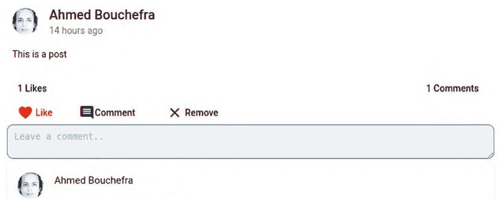
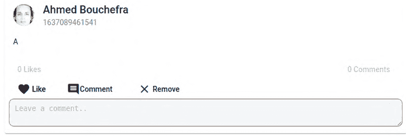
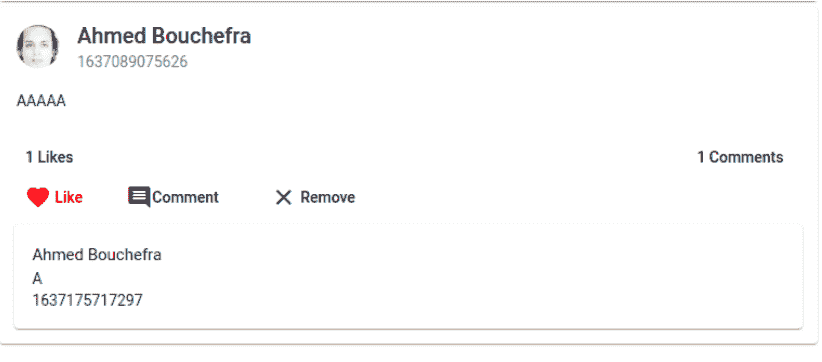

## 10 获取帖子并添加评论和点赞

在之前的章节中，我们向您介绍了 Apollo Client 并演示了如何将其与我们的 Angular 前端集成。我们还实现了身份验证和图像上传，将 feed 的帖子组件屏蔽给未认证用户，并构建了一个带有应用程序导航按钮和用于使用全名在网络中搜索用户的搜索栏的头部组件。

我们随后开始创建个人资料组件，该组件允许用户添加个人简介、封面图像和照片，以及创建帖子。

在本章中，我们将首先处理身份验证令牌过期问题，我们稍后会描述，然后我们将继续处理我们的个人资料组件，通过发送查询来接收分页的帖子和评论数据，以及突变来向帖子添加评论和点赞。

以下主题将被涵盖：

- 改进身份验证系统
- 添加查询并生成类型和服务
- 获取分页帖子
- 实现评论和点赞服务
- 实现展示型帖子组件
- 显示帖子、评论和点赞

以下是我们将要做的工作摘要：

1. 首先，我们将编写将发送到服务器的查询和突变字符串。
2. 我们将利用 GraphQL 生成器生成结果和变量的类型，以及 GraphQL 服务（扩展 apollo-angular 的 Query 和 Mutation 类）以点赞和评论帖子。
3. 我们将创建并导出 Angular 服务，其中包含处理评论和点赞以及向服务器发送请求的逻辑。
4. 我们将向上一章的帖子服务添加带分页的帖子获取逻辑。我们将提供两种方法来检索用户的帖子，以及应用程序成员最近发布的帖子 feed。
5. 我们将实现一个帖子组件，一个用于显示单个帖子（包括评论和点赞）以及点赞和评论帖子的按钮的哑组件。
6. 最后，帖子、评论和点赞将在个人资料和主页视图上显示。

## 技术要求

要完成本章的步骤，您必须首先完成上一章的步骤和作业，并熟悉以下技术：

- JavaScript/TypeScript
- 超文本标记语言 (HTML)
- 级联样式表 (CSS)

你可以在 https://github.com/PacktPublishing/Full-Stack-App-Development-with-Angular-and-GraphQL/tree/main/Chapter08 找到本章的源代码。

## 改进身份验证系统

在我们继续构建个人资料组件之前，我们必须解决一个令牌过期问题。当令牌过期时，用户必须返回登录页面并再次登录以获取新令牌。即使在收到令牌并被重定向到用户个人资料页面后，个人资料的帖子也不会被检索，用户会看到一条表明他们未经过身份验证的消息。

这是因为，在重新身份验证后，Apollo 上下文仍在使用之前的——已过期——令牌，我们只需按如下方式替换它：

1. 将以下符号导入 core/services/auth/auth.service.ts 文件：
2. 通过构造函数注入 HttpLink，如下所示：
3. 找到 login() 函数并在 updateAuthState() 调用之后插入以下代码，在提供给 tap() 操作符的对象中的下一个处理程序内：

```ts
import { createApollo } from 'src/app/graphql.module';
import { HttpLink } from 'apollo-angular/http';
```

身份验证令牌从本地存储获取并在 createApollo() 方法中提供给 Apollo 上下文。

Apollo Client 使用 HttpLink 向服务器发送 GraphQL 查询。我们导入它是因为 createApollo() 方法需要它。

```ts
export class AuthService {
  constructor(
    private httpLink: HttpLink) { /* ... */ }
```
```

我们注入 HttpLink，因为它将在下一步调用的 createApollo() 方法中需要。有关更多信息，请参阅 https://apollo-angular.com/docs/data/network/#http-link。

```ts
const acOpts = createApollo(this.httpLink);
this.apollo.client.setLink(acOpts.link!);
```

我们调用 GraphQL 模块的 createApollo() 函数，这会导致上下文链接从 localStorage 获取新令牌，然后我们调用 setLink() 方法来设置返回的链接链并将其传递给 Apollo Client。

在这些更改之后，当令牌过期时，只需再次登录，您应该能够运行需要用户身份验证的操作。强烈建议您阅读 https://www.apollographql.com/docs/react/api/link/introduction/ 中的 Apollo Link 概述。

## 添加查询并生成类型和服务

在本节中，我们将通过发送查询来接收分页的帖子和评论数据，以及突变来向帖子添加评论和点赞，从而继续处理我们的个人资料组件。

这是添加任何评论或点赞之前的单个帖子的屏幕截图：


图 10.1 – 无评论或点赞的帖子

这是我评论并点赞后的帖子屏幕截图：



图 10.2 – 添加评论和点赞后的帖子

在开始之前，让我们更改我们在 *第 9 章，上传图像和添加帖子* 中实现的一个行为。我们在基础组件中使用了 `takeUntil()` 操作符，以便在组件销毁时取消订阅返回的 Observables。当我们需要在组件生命周期内保持 Observables 存活以继续监视活动查询时，这是正确的方法，但对于 `createTextPost()`、`uploadImageAndCreatePost()` 和 `onRemovePost()` 方法来说并非必要。为了释放内存，最好使用 `first()` 或 `take()` 操作符，以便在收到 Observables 发出的第一个值后立即取消订阅。

作为一项作业，从 `rxjs/operators` 导入 `take()` 操作符，并在提及的方法中使用 `take(1)` 语句代替 `takeUntil(this.componentDestroyed)` 进行取消订阅。

接下来，让我们通过添加将发送到 GraphQL 服务器的查询和突变字符串来开始，用于获取帖子、评论和点赞，以及为现有帖子添加评论和点赞。按以下步骤操作：

1. 打开 `graphql.documents/post.graphql` 文件并首先按如下方式更新 `CommentsInfo` 片段：

```graphql
fragment CommentsInfo on Post {
  latestComment {
    ...CommentFields
    author {
      id fullName username image
    }
  }
  commentsCount
}
```

而不是在 `author` 字段上展开 `BasicUserFields` 片段，我们只是明确请求所需的字段。这目前只是为了修复一个未知问题所必需的，该问题会导致在获取帖子时发送错误的 GraphQL 请求。

2. 在同一文件中添加以下查询：

```graphql
query getPostsByUserId(
  $userId: ID!,
  $offset: Int,
  $limit: Int) {
  getPostsByUserId(
```


```
userId: $userId,
    offset: $offset,
    limit: $limit) {
      ...PostFields
    }
  }
```

这是一个 GraphQL 查询，根据用户 **标识符（ID）** 返回分页的帖子。它接受用户 ID、offset 和 limit 作为输入。通过在选择集中展开 *第 9 章，上传图片和添加帖子* 中定义的 `PostFields` 片段，我们选择渲染帖子所需的所有字段。

3. 将 getFeed 查询添加到同一文件中以检索用户的 feed，如下所示：

```
query getFeed(
  $offset: Int,
  $limit: Int) {
  getFeed(
    offset: $offset,
    limit: $limit) {
    ...PostFields
  }
}
```

此查询与之前的查询类似。它用于获取网络上的所有最新帖子，而不仅仅是某个特定用户的帖子。它仅接受分页数据所需的 offset 和 limit 参数作为输入。我们在选择集中展开 `PostFields` 片段，以请求与上一个查询相同的字段。

4. 将以下查询添加到 graphql.documents/comment.graphql 文件中：

```
query getCommentsByPostId(
  $postId: ID!,
  $offset: Int,
  $limit: Int) {
  getCommentsByPostId(
    postId: $postId,
    offset: $offset,
    limit: $limit) {
    ...CommentFields
    author { ...BasicUserFields }
    post { id }
  }
}
```

此查询文档将用于检索特定帖子的评论。它接受 post ID 以及用于分页评论的 offset/limit 参数作为输入。在选择集中，我们请求 ID、评论文本和日期，以及作者信息（ID、姓名全称、用户名和图片）和帖子（ID）的子选择。

5. 将以下 mutation 添加到同一文件中以创建评论：

```
mutation commentPost(
  $comment: String!,
  $postId: ID!){
  comment(comment:$comment, postId:$postId){
    id post { id commentsCount }
  }
}
```

在此步骤中，我们定义一个 GraphQL 文档，接受评论文本和 post ID 作为输入，两者都是必需的输入。在选择集中，我们选择新评论的 ID、帖子的 ID 和 commentsCount 字段。

6. 添加以下 mutation 以删除评论：

```
mutation removeComment($id: ID!){
  removeComment(id:$id){
    id post { id commentsCount }
  }
}
```

此 mutation 以待删除评论的 ID 作为参数。

7. 创建 graphql.documents/like.graphql 文件并向其中添加以下查询：

```
query getLikesByPostId(
  $postId: ID!,
  $offset: Int,
  $limit: Int){
  getLikesByPostId(
    postId:$postId,
    offset: $offset,
    limit: $limit){
    id
    user { ...BasicUserFields }
    post { id likesCount }
    createdAt
  }
}
```

此查询用于检索帖子的点赞，并接受帖子的 ID 作为输入，以及用于分页点赞的 offset/limit 参数。

8. 添加以下 mutation 以点赞帖子：

```
mutation likePost(
$postId: ID!){
like(postId:$postId){
id post { id ...LikesInfo }
}
}
```

此 mutation 以帖子的 ID 作为输入，并请求已保存在服务器数据库中的点赞的 ID，以及相关帖子的信息。

9. 添加以下 mutation 以通过 ID 删除点赞：

```
mutation removeLike(
$postId: ID!){
removeLike(postId:$postId){
id post { id ...LikesInfo }
}
}
```

此 mutation 以被点赞帖子的 ID 作为输入，并请求 ID 和帖子的详细信息。

10. 返回到您的 Terminal 并执行以下命令以从 monorepo 项目的根目录调用代码生成器：

```
npm run codegen
```

我们添加了将发送到服务器的 GraphQL 查询和 mutation 的字符串，然后生成了变量和结果类型以及用于发送请求的服务。

基本上，我们将利用多个生成的 Angular 服务来获取帖子并添加/删除评论或点赞，这些服务扩展了 apollo-angular 中的通用 Query 或 Mutation 类。通过将 document 属性设置为适当的查询或 mutation 文档，并在尖括号内设置响应类型，我们定义了结果和变量的形状。

为了检索用户的帖子，我们将使用 Apollo 服务的通用 watchQuery() 方法，并将括号之间的类型设置为正确的结果和变量类型。

接下来，我们将查看如何在上一章构建的 post 服务中检索帖子。

## 获取分页帖子

在 post 服务中，我们将定义并实现一个 getPostsByUserId() 方法，该方法将被 profile 组件调用以检索属于特定用户的分页帖子。作为作业，我们还将实现一个 getFeed() 方法来检索网络上最新的帖子，无论谁发布的。按以下步骤操作：

- 1. 打开 core/services/post/post.service.ts 文件并向其中添加以下导入：
- 2. 按如下方式注入 Apollo 服务：

```
import { Apollo } from 'apollo-angular';
import {
  GetPostsByUserIdDocument,
  GetPostsByUserIdQuery,
  GetPostsByUserIdQueryVariables
} from '@ngsocial/graphql/documents';
```

这些导入由 GraphQL 代码生成器生成。

```
constructor(
  /* ... */
  private apollo: Apollo) { }
```

3. 按如下方式定义 getPostsByUserId() 方法：

```
getPostsByUserId(
  userId: string,
  offset?: number,
  limit?: number) {
}
```

此方法以 user ID 作为必需参数，并以 offset/limit 对作为可选参数。

4. 在方法体中调用注入的 Apollo 服务的通用 watchQuery() 方法，并按如下方式传递参数：

```
const queryRef = this.apollo
.watchQuery<
  GetPostsByUserIdQuery,
  GetPostsByUserIdQueryVariables>(/* ... */);
return queryRef;
```

watchQuery() 方法返回一个 QueryRef 对象，但我们主要关注 valueChanges 属性，它是一个 RxJS Observable，我们必须订阅它才能接收数据，以及 fetchMore() 方法，我们将使用它来获取更多分页数据。

See https://apollo-angular.com/docs/data/queries/#what-is-queryref for more on this.

然后，按如下方式传递以下对象作为参数：

```
{
  query: GetPostsByUserIdDocument,
  variables: {
    userId: userId,
    offset: offset || 0,
    limit: limit || 10
  },
  fetchPolicy: 'cache-and-network',
}
```

我们指定将发送到 GraphQL 服务器的查询，在本例中，是我们之前从 getPostsByUserId 查询生成的用于获取用户帖子的文档。

然后，我们提供 `variables` 对象，其中包含查询所需的参数，即 `userId`、`offset` 和 `limit` 参数。

接下来，我们将 `fetchPolicy` 设置为 `cache-and-network`，以指示 Apollo 首先检查缓存中是否有可用数据，然后向 GraphQL 服务器发送请求以获取更新数据并将其保存到缓存中。此最后一步无论缓存中是否找到数据都会发生。

- 5. 打开 `src/app/cache.ts` 文件并按如下方式添加 `offsetLimitPagination` 导入：

```
import { offsetLimitPagination } from '@apollo/client/utilities';
```

接下来，通过为 `Query` 添加以下字段策略来更新缓存。
`getPostsByUserId:`

```
getPostsByUserId: offsetLimitPagination(['userId'])
```

在 `InMemoryCache` 的构造函数中，我们提供字段策略来自定义 Apollo Client 缓存中字段的读写方式。

我们使用 `offsetLimitPagination` 辅助函数为所需字段生成适当的字段策略。这为该字段创建了一个 `merge()` 函数，可以处理将分页结果合并到缓存中。这将使我们能够使用 `fetchMore` 方法获取更多数据。

由于 `getPostsByUserId` 字段接受 `userId` 参数以及 `offset` 和 `limit` 参数，我们需要将用户 ID 设置为该字段的 key 参数，以便 Apollo Client 区分属于每个用户的帖子。这是通过向 `offsetLimitPagination` 辅助函数传递 key 参数数组来完成的。See https://www.apollographql.com/docs/react/pagination/offset-based/#setting-keyargs-with-offsetlimitpagination for more on this.

For more information, see https://apollo-angular.com/docs/data/pagination/, and check out how to configure the cache at https://apollo-angular.com/docs/caching/configuration/.

在为 post 服务添加用于按用户 ID 获取帖子的 `getPostsByUserId()` 方法并实现分页后，接下来我们将了解如何实现评论和点赞服务。


## 实现评论和点赞服务

现在让我们实现用于获取评论和点赞的服务。这两个服务 CommentsService 和 LikesService 封装了对帖子进行点赞和评论的逻辑，以及分页获取帖子评论和点赞的方法。按以下步骤操作：

- 1. 返回你的终端并运行以下命令以生成 CommentsService 和 LikesService 实例：

```
ng g s core/services/comment/comments
ng g s core/services/like/likes
```

- 2. 打开 core/services/comment/comments.service.ts 文件并开始添加以下导入：

```
import { StoreObject } from '@apollo/client/core';
import { map } from 'rxjs/operators';
import {
  CommentPostGQL,
  RemoveCommentGQL,
  GetCommentsByPostIdGQL
} from '../../gql.services';
```

接下来，按如下方式更新服务构造函数：

```
constructor(
  private commentPostGQL: CommentPostGQL,
  private removeCommentGQL: RemoveCommentGQL,
  private getCommentsByPostIdGQL:
    GetCommentsByPostIdGQL) { }
```

我们只需通过构造函数注入生成的 CommentPostGQL、RemoveCommentGQL 和 GetCommentsByPostIdGQL 服务。这些是我们之前生成的用于创建、删除和获取评论的 mutation 和 query 服务。

- 3. 向服务添加以下方法以创建评论：

```
createComment(
  comment: string,
  postId: string) {
  return this.commentPostGQL
.mutate({
    comment: comment,
    postId: postId
})
.pipe(map(result => result.data!.comment));
}
```

我们实现一个用于创建评论的方法，该方法接受评论和帖子 ID 作为参数并返回一个 Observable。在方法体中，我们调用 mutate() 方法发送创建评论的 mutation。该方法接受一个对象，其属性对应于 GraphQL mutation 所期望的变量。mutate() 方法返回一个 Observable，因此我们使用 pipe() 方法和 map() 操作符将结果对象映射到 data!.comment 对象。

- 4. 添加以下方法通过 ID 删除评论：

```
removeComment(id: string) {
    return this.removeCommentGQL
    .mutate({
        id: id
    })
    .pipe(map(result => result.data!.removeComment));
}
```

与之前的方法类似，我们调用 mutation 服务的 mutate() 方法来删除帖子。我们传递 id 参数，并将结果对象映射到 data!.removeComment 对象。

- 5. 添加以下方法根据帖子 ID 获取评论：

```
getCommentsByPostId(
    postId: string,
    offset?: number,
    limit?: number) {
    const queryRef = this.getCommentsByPostIdGQL
    .watch(
    {
        postId: postId,
        offset: offset || 0,
        limit: limit || 5
}, {
    fetchPolicy: 'cache-and-network'
});
    return queryRef;
}
```

而不是调用 mutate() 方法，我们调用 watch() 方法来发送并监视查询以从服务器获取评论。我们传递查询所需的变量，例如帖子 ID、offset 和 limit，并将获取策略设置为 cache-and-network。由于 offset 和 limit 参数是可选的，我们还为分页传递默认值，offset 为零，limit 为五。

Query 类提供了两种获取数据的方法——watch() 和 fetch() 方法，它们相似之处在于 fetch() 方法只获取一次数据。在我们的情况下，由于需要实现分页，因此需要使用 watch() 方法。查看 https://apollo-angular.com/docs/data/services/#api-of-query 了解更多信息。

作为练习，实现 LikesService 的以下方法：

- likePost(postId: string)
- removeLike(postId: string)
- getLikesByPostId(postId: string, offset?: number, limit?: number)

首先导入适当的 GraphQL 服务；接下来，通过服务构造函数注入它们，然后调用方法向服务器发送请求。

getLikesByPostId() 方法与 getCommentsByPostId() 方法类似。你可以通过以下任一方式实现它：

- 通过构造函数注入 Apollo 服务并调用注入实例的通用 watchQuery() 方法，通过指定将发送到 GraphQL 服务器的适当查询和变量以及返回响应数据的类型参数
- 注入生成的 GetLikesByPostIdGQL mutation 服务并调用 watch() 方法

在实现用于与 GraphQL 服务器通信的必要 Angular 服务后，我们现在将了解如何创建一个展示型（dumb）组件来显示每个帖子及其点赞和评论信息。

## 实现展示型帖子组件

帖子组件仅为展示型。它不注入任何服务，并通过输入属性和事件与父组件（例如 feed 帖子和个人资料组件等容器）通信。

查看 https://www.webtutpro.com/smart-dumb-components-in-angular-3c51ae6efcc4 了解有关智能（容器）和哑（展示型）组件的更多信息。

帖子组件以 post 和 authUser 属性作为输入，这些属性应从父组件传递，以便组件渲染帖子及其作者的信息。它还向父组件发出大量自定义事件，例如以下内容：

- 用户对帖子发表评论时触发的 comment 事件
- 用户点赞帖子时触发的 like 事件
- 用户删除帖子时触发的 remove 事件
- 用户想要显示帖子评论时触发的 listComments 事件
- 用户想要显示更多帖子评论时触发的 moreComments 事件
- 用户想要显示帖子点赞时触发的 listLikes 事件

让我们开始实现帖子组件的步骤：

- 1. 使用以下命令生成帖子组件：

```
ng g c shared/components/post
```

该组件将在 shared/ components 文件夹的 post/ 文件夹内生成。

该组件将自动导入到 shared 模块中，但你还需要通过将其添加到 exports 数组中从模块导出它。这使你能够在导入 shared 模块的其他模块中使用该组件。

- 2. 定义事件类型；创建 shared/types/comment.event.ts 文件并添加以下类型：

```
export type CommentEvent = {
  comment: string;
  postId: string;
};
```

接下来，创建 removecomment.event.ts 文件并添加以下代码：

```
export type RemoveCommentEvent = {
  id: string;
};
```

接下来，创建 listcomments.event.ts 文件并添加以下代码：

```
export type ListCommentsEvent = {
  postId: string;
};
```

接下来，创建 morecomments.event.ts 文件并添加以下代码：

```
export type MoreCommentsEvent = {
  postId: string;
};
```

这些类型定义了将随自定义事件发送的数据值的形状。

确保按如下方式从 shared/index.ts 文件导出这些类型：

```
export { CommentEvent }
  from './types/comment.event';
export { RemoveCommentEvent }
  from './types/removecomment.event';
export { ListCommentsEvent }
  from './types/listcomments.event';
export { MoreCommentsEvent }
  from './types/morecomments.event';
```

- 3. 打开 shared/types/like.event.ts 文件并添加以下类型：

```
import { Post } from "@ngsocial/graphql/types";

export type LikeEvent = {
  post: Post;
};
```

接下来，创建 removelike.event.ts 文件并添加以下代码：

```
export type RemoveLikeEvent = {
  id: string;
};
```

接下来，创建 displaylikes.event.ts 文件并添加以下代码：

```
export type DisplayLikesEvent = {
  postId: string;
};
```

此外，从 shared/index.ts 文件导出以下类型：

```
export { LikeEvent }
  from './types/like.event';
export { RemoveLikeEvent }
  from './types/removelike.event';
export { DisplayLikesEvent }
  from './types/displaylikes.event';
```

- 4. 打开 shared/components/post/post.component.ts 文件并开始添加这些导入：

```
import {
  Input,
  Output,
  EventEmitter,
  ViewChild,
  ElementRef
} from '@angular/core';
```

接下来，像这样导入 User 和 Post 类型：

```
import {
  User,
  Post
} from '@ngsocial/graphql/types';
```

最后，导入已定义的事件类型，如下所示：

```ts
import {
  RemovePostEvent,
  CommentEvent,
  ListCommentsEvent,
  MoreCommentsEvent,
  LikeEvent,
  DisplayLikesEvent
} from '../..';
```

这些将从 shared/ 文件夹的 barrel 文件——index.ts 文件——中导入。

## 5. 定义输入属性，如下所示：

```ts
@Input() post!: Post;
@Input() authUser: Partial<User> | null = null;
@Input() commentsPerPost: number = 5;
```

我们定义了三个属性——post、authUser 和 commentsPerPost——并用 @Input 装饰器对其进行装饰，以便 post 组件能够从其父组件（profile 和 feed 的 posts 组件）接收它们的值。

我们使用非空断言运算符 (!) 来断言 post 输入不会为 null。有关更多信息，请参阅 https://www.typescriptlang.org/docs/handbook/release-notes/typescript-2-0.html#non-null-assertion-operator 。

## 6. 定义输出事件，如下所示：

```ts
@Output()
like = new EventEmitter<LikeEvent>();
@Output()
comment = new EventEmitter<CommentEvent>();
@Output()
listComments = new EventEmitter<ListCommentsEvent>();
@Output()
moreComments = new EventEmitter<MoreCommentsEvent>();
@Output()
remove = new EventEmitter<RemovePostEvent>();
@Output()
listLikes = new EventEmitter<DisplayLikesEvent>();
```

我们定义输出属性并用 @Output 装饰器对其进行装饰；然后，我们为每个属性分配一个 EventEmitter 的实例，并将泛型 EventEmitter 类的类型参数设置为我们之前定义的相关自定义事件类型。传递的类型对应于将发送到父组件的对象类型。

## 7. 定义属性，如下所示：

```ts
@ViewChild('commentInput')
commentInput!: ElementRef;
commentsShown: boolean = false;
```

我们定义了一个类型为 ElementRef 的 commentInput 属性，并用 @ViewChild 装饰器对其进行装饰，以便我们可以在关联的模板中访问具有 commentInput 引用的元素。然后，我们定义一个 commentsShown 属性来控制是否显示评论。

## 8. 添加以下 getter，它只是返回点赞数与 Likes 字符串拼接的结果：

```ts
get latestLike(): string {
  return `${this.post?.likesCount ?? 0} Likes`;
}
```

接下来，定义 stub 方法，如下所示：

```ts
displayLikes(): void {}
displayComments(): void {}
loadComments(): void {}
sendLike(): void {}
removePost(): void {}
createComment(e: Event): void {}
```

代码将在稍后添加，但目前它们是必需的，以便在不出现错误的情况下显示组件。

## 9. 为组件实现模板。打开 shared/components/post/post.component.html 文件并开始添加 Material 卡片以显示帖子，如下所示：

```html
<mat-card class="post-wrapper" *ngIf="post">
</mat-card>
```

该卡片仅在 post 输入不为 null 时才有条件地渲染。由于我们对将从父组件中的 *ngFor 指令传递的 post 输入使用了非空断言运算符，如果你愿意，在这种情况下可以安全地去掉条件渲染。

## 10. 在卡片内部，添加一个头部，如下所示：

```html
<mat-card-header>
  
  <mat-card-title>
    {{post.author?.fullName}}
  </mat-card-title>
  <mat-card-subtitle>
    {{ post.createdAt }}
  </mat-card-subtitle>
</mat-card-header>
```

接下来，添加一个内容部分，如下所示：

```html
<mat-card-content>
  <p>
    {{post.text}}
  </p>
  
</mat-card-content>
```

接下来，为卡片添加一个操作部分，如下所示：

```html
<mat-card-actions>
</mat-card-actions>
```

我们使用 Material 卡片通过诸如帖子作者的全名、帖子创建的日期以及帖子的文本和图像等信息来显示帖子。我们使用 Angular 插值来显示 author.fullName、createdAt 和 text 属性的值，并使用属性绑定将  元素的 src 属性绑定到 post.image 属性。

图像仅在 post.image 属性不为 null 时才使用 *ngIf 指令有条件地渲染。

## 11. 在卡片的操作部分内部，添加以下 class 属性值为 engagements-count 的 HTML division：

```html
<div class="engagements-count">
    <button [disabled]="post.likesCount === 0" mat-button (click)="displayLikes()">
    {{ latestLike }}
    </button>
    <button [disabled]="post.commentsCount === 0" mat-button (click)="displayComments()">
    {{ post.commentsCount }} Comments
    </button>
</div>
```

我们添加两个按钮来显示点赞数和评论数，然后将它们的点击事件与 displayLikes() 和 displayComments() 方法绑定以发送事件来显示点赞和评论。我们在左侧显示点赞数，在右侧显示评论数。如果没有点赞或评论，则禁用按钮。

## 12. 添加第二个 class 属性值为 engagement-actions 的 HTML division，如下所示：

```html
<div class="engagement-actions">
    <button [style.color]="post?.likedByAuthUser ? 'red' : 'black'" mat-button (click)="sendLike()">
    <mat-icon>favorite</mat-icon>
    <span>
    Like
    </span>
    </button>
    <button mat-button (click)="displayComments()">
<mat-icon>comment</mat-icon>
<span>Comment</span>
</button>
<button *ngIf="authUser?.id == post.author?.id" mat-button (click)="removePost()">
<mat-icon aria-hidden="false" aria-label="Remove">clear</mat-icon>
<span>
    Remove
</span>
</button>
</div>
```

我们添加三个带有图标的 Material 按钮并将它们的点击事件绑定到 sendLike()、displayComments() 和 removePost() 方法。这些方法用于发送点赞、添加评论和删除帖子。Remove 按钮使用 *ngIf 指令有条件地渲染，因此仅在帖子的作者是已认证用户时显示。

这里使用了安全导航运算符 (?)，因为 authUser 对象可能为 null。

## 13. 添加第三个 class 属性包含 comment-area 值的 division，如下所示：

```html
<div class="comment-area"></div>
```

在 division 内部，添加一个用于显示最新评论的卡片，如下所示：

```html
<mat-card *ngIf="!commentsShown && post.latestComment"
    class="comment-card">
    <mat-card-content class="card-comment-content">
        <h4>{{post.latestComment?.author?.fullName}}</h4>
        {{post.latestComment?.comment}}
    </mat-card-content>
    {{ post.latestComment?.createdAt }}
</mat-card>
```

如果帖子有最新评论并且评论 feed 未显示，则有条件地渲染一个用于显示最新评论的 Material 卡片。

然后，添加一个用于提交评论的 division，如下所示：

```html
<div class="comment-box" *ngIf="commentsShown">
  <textarea #commentInput
    placeholder="Leave a comment.."
    matInput
    (keydown.enter)="createComment($event)">
  </textarea>
</div>
```

我们有条件地渲染此 HTML division，其中包含一个 <textarea> 元素，使用 #commentInput 引用进行引用，用于输入评论。我们将 <textarea> 元素的 keydown.enter 事件绑定到 createComment() 方法，以便用户通过在键盘上按 Enter 键来创建评论。

最后，添加一个用于加载更多评论的按钮，如下所示：

```html
<button mat-button class="load-comments-btn"
  (click)="loadComments()"
  *ngIf="commentsShown && post.commentsCount > commentsPerPost">
  Load more comments
</button>
```

这显示了一个 Material 按钮，其点击事件绑定到 loadComments() 方法以加载更多评论。

## 14. 打开 post.component.css 文件并开始向其中添加以下样式：

```css
* {
  box-sizing: border-box;
}
mat-card {
  margin: 0.4rem;
}
.post-wrapper {
  width: 100%;
}
.post-card-image {
  margin:0px;
}
```


```
max-width: 100%;
max-height: 100%;
width: auto;
height: auto;
}
```

15. 为设置帖子用户头像的样式添加以下类：

```
.post-user-avatar {
  background-color: gray;
  border-width: 1px;
}
```

16. 使用以下样式设置带有 engagements-count 类的 division：

```
.engagements-count {
  display: flex;
  flex-direction: row;
  width: 100%;
  justify-content: space-between;
}
```

17. 使用以下样式设置评论元素：

```
.comment-box > textarea {
  width: 100%;
  padding: 10px;
  background-color: #f0f2f5;
  border-radius: 9px;
}
```

我们已经实现了一个用于显示单个帖子及其评论和点赞信息的帖子组件。让我们在下一节中继续，使用帖子服务获取帖子，并使用此哑组件显示其中的每一个。

## 显示帖子、评论和点赞

在部分实现了我们的展示型帖子组件后，让我们看看如何在父级用户个人资料组件中使用它，并使用其输入属性和自定义事件在子组件和父组件之间进行通信。我们需要遵循以下步骤：

- 1. 首先，我们需要在个人资料组件中包含帖子组件，因此打开 users/components/profile/profile.component.html 文件，并在 <app-create-post> 组件下方、带有 posts-column 类的 <div> 元素中添加以下标记：

```
<div *ngFor="let post of posts;">
  <app-post [post]="post" [authUser]="authUser"
    (remove)="onRemovePost($event)">
  </app-post>
</div>
```

我们使用组件装饰器中选择器属性的值在模板中包含组件，在本例中为 app-post。

我们可以毫无问题地调用此组件，因为它是从共享模块导出的，而共享模块本身是从包含个人资料组件的 users 模块导入的。

我们使用 *ngFor 指令遍历 posts 数组，并使用帖子组件显示每个帖子。我们通过组件的 post 属性传入 post 对象，并使用 authUser 属性传入已认证用户。然后，我们将哑组件的自定义 remove 事件绑定到 onRemovePost() 方法，该方法已在基础组件中实现并继承。

该组件接受其他自定义事件，但在将它们绑定到此处之前，我们首先需要在基类中定义并实现这些事件的处理程序。我们将这些处理方法添加到基类，以便能够从 feeds 模块的帖子组件中重用它们。

- 2. 向个人资料组件的类添加获取帖子的代码。打开 users/components/profile/profile.component.ts 文件，首先通过以下方式将 Post 类型添加到现有的导入声明中：

```
import { Post, User }
from '@ngsocial/graphql/types';
```

然后，通过在 switchMap() 运算符的第二次调用中调用帖子服务的 getPostsByUserId() 方法，更新 ngOnInit () 方法中的现有代码，如下所示：

```
switchMap((userResponse) => {
  this.setProfileUser(userResponse.getUser);
  this.setIsAuthUserProfile();
  return this.postService
    .getPostsByUserId(userResponse.getUser.id)
    .valueChanges;
})
```

这将把 switchMap() 的上一次调用返回的 getUser Observable 展平为 getPostsByUserId Observable。

我们还将对 setProfileUser() 和 setIsAuthUserProfile() 方法的调用从 userObs Observable 的 subscribe() 方法移到了第二个 switchMap() 调用的主体中，因为在这里我们接收到包含个人资料用户信息的 getUser 对象。

getPostsByUserId() 方法返回一个 QueryRef 对象，其中包含 valueChanges Observable 等属性。

之后，您需要将 loading 属性设置为 true，并按如下方式更新传递给 subscribe() 方法的对象中的 next 处理程序：

```
userObs
  .pipe(getPostsObs => {
    this.loading = true;
    return getPostsObs;
  })
  .subscribe({
    next: (result) => {
      this.loading = result.loading;
      this.posts = result
        .data
        .getPostsByUserId as Post[];
      console.log(this.posts);
    },
    error: (err) => super.handleErrors(err)
  });
```

在成功的情况下，我们会得到一个 `ApolloQueryResult` 对象，其中包含接收到的数据和指示查询是否仍在加载的 `loading` 属性。

Observable 在查询完成后会发出，并且 `loading` 将被设置为 `false`。查询还具有一个 `data` 对象，其中包含 `getPostsByUserId` 成员，这是我们在相应的 GraphQL 操作中请求字段。请参阅 https://apollo-angular.com/docs/data/queries/ 了解更多信息。

在这一点上，您应该能够使用展示组件获取并显示每个帖子。此外，如果您创建了一个帖子，它将自动显示在帖子列表中，而无需刷新页面或添加任何额外代码，这要归功于 Apollo Client 及其缓存。

这是一个帖子的截图：


图 10.3 – 单个帖子

您可以看到帖子添加日期未以人类可读的格式显示。我们稍后将使用控制字段如何读取和/或写入的字段策略来修复它。

如果您点击按钮，则没有任何一个能工作。我们已在上一章中实现了用于按 ID 删除帖子的 `onRemovePost()` 方法，并将方法分配给了 `<app-post>` 元素的自定义 `remove` 事件，但按钮仍然无法工作。这仅仅是因为点击按钮时没有发出事件。

- 3. 让我们在点击 **移除** 按钮时发出适当的事件。返回 `shared/components/post/post.component.ts` 文件并按如下方式更新 `removePost()` 方法：

```
removePost(): void {
  this.remove.emit({
    id: this.post.id
  });
}
```

我们调用自定义 remove 事件的 emit() 方法向父组件发出事件，并将应被删除的帖子的 ID 作为事件的值传递。

现在，如果您点击按钮，帖子应该会被删除。您可以通过刷新组件来确认这一点，因为 Apollo Client 在帖子从服务器删除后无法自动将其从缓存中删除。

我们可以使用各种技术从缓存中删除帖子，要么手动更新缓存，要么重新获取相关查询，例如 getUser 和 getPostsByUserId。

请查看 https://apollo-angular.com/docs/caching/advanced-topics 和 https://www.apollographql.com/docs/react/data/refetching/ 了解更多信息。

由于我们之前在实现评论服务时已经看到如何手动更新缓存，让我们在此方法中使用查询重新获取。

- 4. 打开 core/services/post/post.service.ts 文件并按如下方式更新 removePost() 方法：

```
removePost(id: string) {
    return this.removePostGQL
        .mutate({
            id: id
        }, { refetchQueries: ['getUser'] })
        .pipe(map(result => result.data!.removePost));
}
```

我们使用传递给 mutate() 方法的第二个对象中的 refetchQueries 选项，它接受一个要重新获取的查询数组。在这里，我们传递用于获取个人资料用户的 getUser 查询，这也将导致 getPostsByUserId 查询重新获取，因为它们的 Observable 使用 switchMap() 运算符链接在一起。

我们仅出于学习目的使用此选项，但由于它会向服务器发送额外请求，因此出于性能原因可能不是最佳方法。

作为作业，实现帖子组件的其他方法以发出适当的自定义事件。

- 5. 对于 createComment() 方法，您需要获取 <textarea> 元素中输入的值，发出自定义 comment 事件，然后清除 <textarea> 元素，如下所示：

```
createComment(e: Event): void {
  e.preventDefault();
  this.comment.emit({
    comment: this.commentInput.nativeElement.value,
    postId: this.post.id
  });
  if (this.commentInput) {
    this.commentInput.nativeElement.value = '';
  }
}
```

我们调用 EventEmitter 的 emit() 方法，使用适当的值向父组件发出自定义事件。我们使用包含评论文本和帖子 ID 的对象发出 comment 事件，该对象的值将传递给父组件。最后，我们使用绑定到模板中评论输入元素的 commentInput 属性的 nativeElement.value 属性清除评论输入。

- 6. 对于 displayComments() 方法，您需要切换 commentsShown 属性的值，该属性控制是否显示评论，然后仅在值为 true 时发出 listComments 事件。操作方法如下：

```
displayComments(): void {
  this.commentsShown = !this.commentsShown;
  if (this.commentsShown) {
    this.listComments.emit({
      postId: this.post.id
    });
  }
}
```

此方法绑定到两个按钮的 click 事件——显示帖子评论数量的按钮和评论按钮。

在 sendLike() 方法中，我们使用帖子对象作为值发出自定义 like 事件。


实现该方法后，如果你点击其中一个按钮——至少现在点击其中一个——另一个按钮将被禁用，因为你的帖子最初不应有评论，并且你应该看到评论框显示，如下图所示：



图 10.4 – 显示评论框的单个帖子

接下来，让我们添加用于获取分页帖子的代码。

7. 返回 users/components/profile/profile.component.ts 文件并向组件添加以下属性：

```
fetchMore!: () => void;
```

这将用于引用获取更多帖子的方法，该方法可从组件 ngOnInit() 方法中对 post 服务的 getPostsByUserId() 方法调用返回的 QueryRef 对象获得。

8. 按如下方式更新 ngOnInit() 方法中获取帖子的代码：

```
switchMap((userResponse) => {
    this.setProfileUser(userResponse.getUser);
    this.setIsAuthUserProfile();
    const qRef = this.postService
        .getPostsByUserId(userResponse.getUser.id);
    this.fetchMore = () => {
        qRef.fetchMore({
            variables: {
                offset: this.posts.length
            }
        });
    }
    return qRef.valueChanges;
})
```

我们将返回的 QueryRef 对象分配给 qRef 常量，然后将一个箭头函数分配给 fetchMore 属性。此函数只是包装 qRef.fetchMore() 方法，将 offset 变量设置为 posts.length 值，以便我们只获取尚未获取的帖子。

然后，我们返回 valueChanges Observable，如上一步所述。

- 9. 按如下方式向个人资料模板添加用于获取帖子的按钮：

```
<button *ngIf="authUser && profileUser.postsCount && profileUser.postsCount > posts.length" mat-raised-button color="primary" (click)="fetchMore()">More</button>
```

我们只需将此按钮的点击事件绑定到作为组件类属性可用的 fetchMore() 函数。

此按钮仅在用户已登录并且获取的帖子长度 posts.length 小于从 profileUser.postsCount 属性检索到的属于个人资料用户的帖子数量时才有条件地渲染。我们使用 *ngIf 指令有条件地渲染此按钮。我们使用 mat-raised-button 指令为按钮添加 Material 样式和行为，并为其指定主要颜色。

> **Note**
> 
> fetchMore() 方法由 Apollo 用于数据分页提供。
> 请查看 https://apollo-angular.com/docs/caching/interaction#incremental-loading-fetchmore 了解更多信息。

让我们继续实现添加评论和点赞的代码。当用户输入评论并按下 Enter 时，将调用 post 组件的 createComment() 方法。

我们已经实现了此方法，它会将自定义 comment 事件连同所需信息（如评论本身和帖子 ID）一起发出到父 profile 组件，并清除评论框。

类似地，当用户点击显示黑色心形的 Like 按钮时，将调用 sendLike() 方法并发出自定义 like 事件，连同应被点赞的帖子一起发出。

由于 post 组件是哑组件，其作用在于向父组件发出事件，父组件将创建评论和点赞的任务委托给相应的服务。

让我们在 base 组件中实现这两个事件的处理程序并将它们绑定到 <app-post> 元素上。按如下步骤操作：

- 1. 打开 core/components/base.component.ts 文件，首先导入 CommentsService 和 LikesService 以及结果的类型，然后注入服务，如下所示：

```
import { CommentsService }
  from './services/comment/comments.service';
import { LikesService }
  from '../services/like/likes.service';
```

然后，按如下方式定义服务的实例：

```
public commentsService: CommentsService;
public likesService: LikesService;
```

最后，在构造函数中注入它们，如下所示：

```
this.commentsService = injector.get(CommentsService);
this.likesService = injector.get(LikesService);
```

我们使用 Angular 的 injector 实例的 get() 方法（通过构造函数注入）来注入 CommentsService 和 LikesService，然后将实例分配给 commentsService 和 likesService 属性。

你还需要将以下突出显示的类型添加到现有的 import 声明中：

```
import {
  CommentEvent,
  LikeEvent,
  PostEvent,
  RemovePostEvent
} from 'src/app/shared';
```

- 2. 添加以下用于处理评论事件的方法：

```
onComment(e: CommentEvent): void {
  this.commentsService
    .createComment(e.comment, e.postId)
    .pipe(take(1))
    .subscribe({
        error: (err) => this.handleErrors(err)
    });
}
```

当评论事件从子 post 组件发出时，将使用此方法来处理事件。它接受自定义 CommentEvent 类型的对象作为参数。

在方法内部，我们调用 CommentService 的 createComment() 方法，并传递从子组件发出的事件对象中获取的评论和帖子 ID 参数。我们订阅返回的 Observable，然后传递一个观察者对象，其中包含一个错误处理程序，该处理程序 simply 调用 handleErrors() 方法并传递错误对象。

我们使用 take() 操作符获取发出值并取消订阅返回的 Observable。

- 3. 按如下方式实现用于处理自定义 like 事件的 onLike() 方法：

```
onLike(e: LikeEvent): void {
  if (e.post.likedByAuthUser) {
    this.likesService
      .removeLike(e.post.id)
      .pipe(take(1))
      .subscribe({
        error: (err) => this.handleErrors(err)
      });
  } else {
    this.likesService
      .likePost(e.post.id)
      .pipe(take(1))
      .subscribe({
        error: (err) => this.handleErrors(err)
      });
  }
}
```

当自定义 like 事件从子组件发出时，我们将调用此方法来处理它。如果目标帖子对象的 likedByAuthUser 属性为 true，这意味着帖子已被认证用户点赞，我们调用并订阅 removeLike() 方法以取消点赞。否则，我们调用并订阅 likePost() 方法以点赞该帖子。在这两种情况下，我们都使用 take() 操作符在发出第一个值后取消订阅返回的 Observable。

4. 返回 profile 组件的模板并将已定义的方法绑定到 <app-post> 元素的 comment 和 like 事件，如下所示：

```html
<app-post [post]="post" [authUser]="authUser"
  (remove)="onRemovePost($event)"
  (comment)= "onComment($event)"
  (like)= "onLike($event)">
</app-post>
```

在实现这些方法后，我们将能够对帖子进行点赞和评论。转到你的应用，对帖子进行点赞和评论，你应该会看到以下用户界面（UI）变化：

- 显示的点赞数和评论数将增加一，并且按钮将被启用。
- Like 按钮的颜色将从黑色变为红色，表示帖子已被认证用户点赞。如果你再次点击按钮，帖子将被取消点赞，颜色将变回黑色。
- 添加的评论将作为最新评论显示在 Post 按钮正下方。

由于我们在 commentPost 和 likePost mutations 中要求服务器在创建评论后返回更新的帖子对象的 ID 以及 commentsCount，并在帖子中返回 likedByAuthUser 属性以及 likesCount 属性，Apollo Client 将捕捉到这些变化并自动将它们与缓存中已存在的帖子（按 ID 标识）合并。这将重新运行活动的 getPostsByUserId 查询，并导致由 watchQuery() 方法返回的相关 Observable 重新发出帖子数据，这将自动更新 UI，这得益于 Angular 的变更检测和数据绑定机制——由于其 post 输入发生变化，ngFor 指令将重新渲染 <app-post> 元素。


这对我们来说都是很棒的魔法！除了一个副作用——post 元素会被初始化，并且诸如 commentsShown 之类的属性会具有初始的 false 值，这将隐藏评论框（以及稍后的评论 feed）并显示最新评论。

以下是点赞并评论后的帖子截图：



图 10.5 – 添加评论和点赞后的帖子

这不是期望的行为，因为我们不希望组件在用户每次对帖子发表评论或点赞时都重置其内部状态。相反，用户应一直看到评论框和评论 feed（将在后面实现），直到他们选择隐藏它们。我们将在下一章看到如何实现这些功能。

## 摘要

我们展示了如何增强我们的身份验证系统以处理令牌过期，以及如何利用 Apollo Client 向我们之前开发的后端应用程序编程接口（API）发送查询和变更。我们继续完善个人资料组件，添加了获取分页帖子和评论的代码，以及发表评论和点赞的功能。

在下一章中，我们将在学习如何为应用程序添加实时支持以便在无需不断刷新应用的情况下从服务器检索和显示新数据之前，完成个人资料组件的构建。
