## 11 实现 GraphQL 订阅

在上一章中，我们学习了如何使用 Apollo Client 向我们之前实现的后端 API 发送查询和变更，以获取分页帖子和评论，以及创建新的评论和点赞。

在本章中，我们将在学习如何为应用程序添加实时支持之前继续构建用户的个人资料组件。这将使我们能够在无需不断刷新应用的情况下从服务器检索和显示新数据。我们将利用 GraphQL 订阅、Apollo Client 和 Angular 来实现此功能。

然后，我们将为 GraphQL 订阅配置 Apollo Client，并向您展示如何在应用程序的页眉中通过徽章获取和显示通知。GraphQL 订阅允许应用程序在无需手动刷新应用的情况下从服务器获取新数据。

在本章中，我们将涵盖以下主题：

- 使用响应式变量持久化组件状态
- 使用字段策略重写日期
- 显示评论
- 为订阅设置 Apollo Client
- 实现 GraphQL 订阅

## 技术要求

要完成本章，您必须在本地开发机器上安装 Node.js 和 npm。请参阅 *第 1 章，应用架构和开发环境*，如果您尚未安装，请学习如何安装它们。

您还需要完成上一章中提到的步骤和作业。

最后，您需要熟悉以下技术：

- JavaScript/TypeScript
- HTML
- CSS and SCSS

您可以在 https://github.com/PacktPublishing/Full-Stack-App-Development-with-Angular-and-GraphQL/tree/main/Chapter08 找到本章的源代码。

## 使用响应式变量持久化组件状态

在上一章中，我们实现了一些允许我们点赞和评论帖子的方法。然而，这存在一个问题——在评论或点赞帖子后，帖子元素将被初始化，并且诸如 `commentsShown` 之类的属性将具有 `false` 的初始值，这将隐藏评论框（以及稍后的评论 feed）并显示最新评论。

这并不是完全期望的行为，因为我们不希望组件在用户每次评论或点赞帖子时都重置其内部状态。相反，用户应一直看到评论框和评论 feed（将在后面实现），直到他们选择隐藏它们。

以下截图显示了帖子在被点赞和评论后的样子：

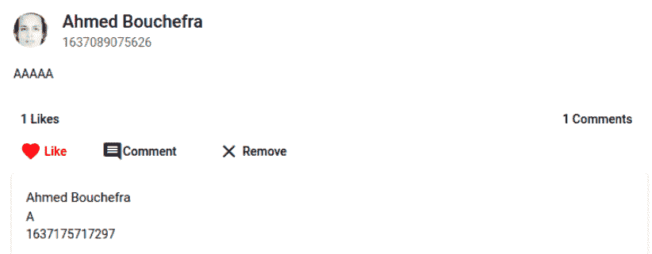

图 11.1 – 被点赞和评论后的帖子

此功能的实现是使用 Apollo Client 进行状态管理的良好候选方案。思路是使用缓存或响应式变量来保存组件的状态，例如 commentsShown 属性值，我们需要在组件重新渲染时对其进行持久化。

让我们学习如何使用响应式变量，因为这是一种更简单的方法：

1. 打开 src/app/reactive.ts 文件并定义并导出用于存储布尔值的响应式变量：
2. 打开 shared/components/post/post.component.ts 文件并导入已定义的响应式变量：

```
export const commentsShownState =
    makeVar<boolean>(false);
```

```
import { commentsShownState }
from 'src/app/reactive';
```

更新 displayComments() 方法以将响应式变量的值设置为 commentsShown 属性的值：

```
displayComments(): void {
    this.commentsShown = !this.commentsShown;
    if (this.commentsShown) {
        this.listComments.emit({
            postId: this.post.id
        });
    }
}
```

```
}
    commentsShownState(this.commentsShown);
}
```

3. 最后，一旦组件已初始化，将 commentsShown 属性的值设置为响应式变量的值：

```
ngOnInit(): void {
    this.commentsShown = commentsShownState();
}
```

实现此功能后，组件的 commentsShown 状态将被保留。现在，如果您显示评论框并对帖子发表评论或点赞，它仍将显示。这可以在以下截图中看到，该截图是在添加评论后立即拍摄的：

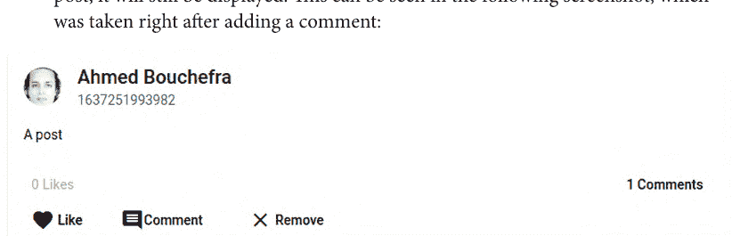

图 11.2 – 添加评论后状态得以保留的帖子

现在，如果您点赞该帖子，状态也将被保留。

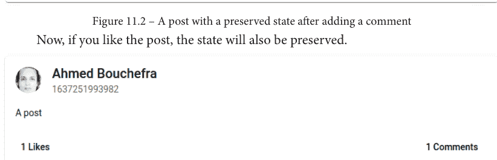

图 11.3 – 添加点赞后状态得以保留的帖子

如果添加的评论超过五条，将显示“加载更多评论”按钮：

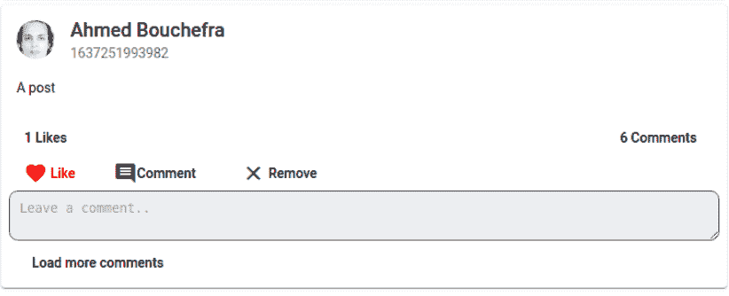

图 11.4 – 带有“加载更多评论”按钮的帖子

然后，如果您点击评论按钮或显示评论数量的按钮，<textarea> 和“加载更多评论”按钮将被隐藏，而最新评论将显示出来。

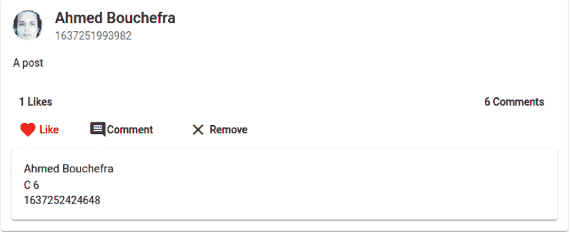

图 11.5 – 显示最新评论的帖子

当您添加帖子时，Apollo Client 并不会总是显示它，因此我们需要刷新应用才能看到它。让我们确保它始终被添加，而无需刷新。类似于删除帖子，我们可以重新获取相关查询或手动更新缓存。打开 src/app/core/services/post/post.service.ts 文件并按如下方式更新 createPost() 方法：

```
createPost(text: string | null, image: string | null) {
  return this.createPostGQL
    .mutate({
      text: text,
      image: image
    }, { refetchQueries: ['getUser'] })
    .pipe(map(result => result.data!.post));
}
```

在这里，我们重新获取活动的 getUser 查询，这将导致相关的 Observable 重新发出更新后的个人资料用户对象（postsCount 属性已递增）。这也将导致 getPostsByUserId Observable 重新发出帖子数据，因为它们都由 switchMerge() 操作符链接。

## 使用字段策略重写日期

接下来，让我们以人类可读的格式显示帖子和评论的日期。我们将以时间流逝格式进行，这在社交网络应用中很常见：

1. 在客户端项目中安装以下包：
2. 打开 src/app/cache.ts 文件并导入库：
3. 为 Post.createdAt 和 Comment.createdAt 字段添加两个字段策略。让我们从 Post 类型开始：

```
npm install timeago.js
```

```
import * as timeago from 'timeago.js';
```

```
Post: {
  fields: {
    createdAt: {
      read(createdAt) {
        return timeago.format(createdAt)
      }
    }
  }
}
```

```
}
}
},
```

我们只是在字段被读取时使用我们刚刚导入的 `timeago` 对象的 `format()` 方法返回格式化的 `createdAt` 日期。您可以在 https://timeago.org/ 了解更多。

然后，为 Comment 类型添加一个类似的字段策略：

```
Comment: {
    fields: {
        createdAt: {
            read(createdAt) {
                return timeago.format(createdAt)
            }
        }
    }
}
```

您可以在 https://www.apollographql.com/docs/react/caching/cache-field-behavior/#the-read-function 了解更多关于 `read()` 函数的信息。

下图显示了一篇帖子和一条评论，其日期使用 time ago 格式进行了格式化：

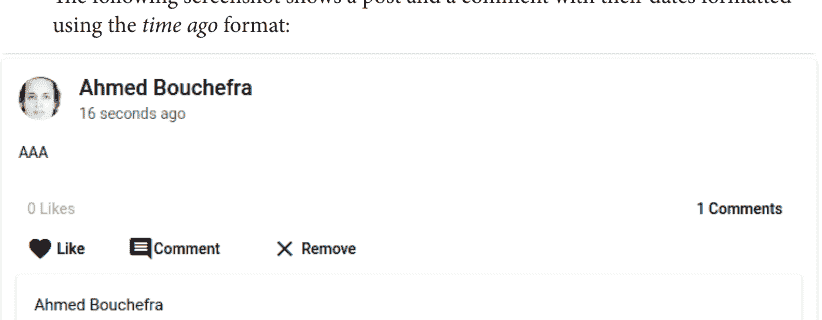

Figure 11.6 – 使用格式化日期的帖子和评论

现在我们已使用“time ago”格式格式化了帖子和最新评论的日期，让我们学习如何获取和显示评论。

## 显示评论

按照以下步骤获取并显示评论：

- 1. 在 core/components/base.component.ts 文件中，通过将其添加到现有的导入声明中导入 Comment 类型：
- 2. 在同一文件中，在基本组件内部定义以下属性：
- 3. 向基类添加用于获取评论的 onListComments() 方法：

```
import {
  User,
  Post,
  Comment
} from '@ngsocial/graphql/types';
```

然后，导入以下突出显示的类型：

```
import {
  CommentEvent,
  LikeEvent,
  ListCommentsEvent, MoreCommentsEvent,
  PostEvent,
  RemoveCommentEvent,
  RemovePostEvent
} from 'src/app/shared';
```

```
public comments: Map<string,
  {
    result: Comment[],
    fetchMore: () => void
  }> = new Map();
```

这将用于将评论数组和 fetchMore() 函数映射到帖子 ID，从而允许我们保存和跟踪每个帖子的评论和分页函数。

```
onListComments(e: ListCommentsEvent): void {}
```

在方法体内部，调用 commentsService 的 getCommentsByPostId() 方法：

```
const qRef = this.commentsService
.getCommentsByPostId(e.postId);
```

定义 fetchMore() 函数，它只是包装返回的 QueryRef 对象的 fetchMore() 方法：

```
const fetchMore = () => {
  qRef.fetchMore({
    variables: {
      offset: this.comments
        .get(e.postId)?.result.length
    }
  })
}
```

订阅 QueryRef 对象的 valueChanges Observable：

```
qRef
.valueChanges
.pipe(takeUntil(this.componentDestroyed))
.subscribe();
```

将以下观察者对象传递给 subscribe() 方法：

```
{
  next: (result) => {
    this.comments
      .set(
        e.postId,
        {
          result: result
            .data
            .getCommentsByPostId as Comment[],
          fetchMore: fetchMore
        });
  }
}
```

此方法用于通过 ID 获取帖子的评论。它将自定义事件对象作为参数，调用 `CommentsService` 的 `getCommentsByPostId()` 方法，并在使用 `componentDestroyed` 主题应用 `takeUntil()` 操作符后订阅 `valueChanges` Observable，以便在组件销毁时取消订阅。

在 `next()` 处理程序中，我们只需将获取到的评论与 `fetchMore()` 函数一起放入 `comments` 映射中，以评论所属的帖子 ID 作为键。这将使我们能够在下次重新调用该方法以获取另一个帖子的评论时保存此信息。

- 4. 向基类添加用于获取更多评论的 `onLoadMoreComments()` 方法：

```
onLoadMoreComments(e: MoreCommentsEvent): void {
  const fetchMore = this.comments
    .get(e.postId)?.fetchMore!;
  fetchMore();
}
```

添加用于按 ID 删除评论的 `onRemoveComment()` 方法：

```
onRemoveComment(e: RemoveCommentEvent) {
  this.commentsService
    .removeComment(e.id)
    .pipe(take(1))
    .subscribe({
      error: (err) => this.handleErrors(err)
    });
}
```

- 5. 打开 `src/app/cache.ts` 文件并使用 `offsetLimitPagination` 辅助函数为 `getCommentsByPostId` 字段添加策略：

```
getCommentsByPostId: offsetLimitPagination(['id',
  'postId'])
```

- 6. 生成一个用于表示单个评论的哑组件：

```
ng g component shared/components/comment
```

确保通过将其添加到 `exports` 数组中从共享模块导出该组件。

- 7. 打开 shared/components/comment/comment.component.ts 文件并添加以下导入：

```ts
import {
  Component,
  EventEmitter,
  Input,
  OnInit,
  Output
} from '@angular/core';
import { RemoveCommentEvent }
  from '../../types/removecomment.event';
import { Comment }
  from '@ngsocial/graphql/types';
```

- 8. 向组件添加以下输入和输出属性：

```ts
@Input() comment: Comment | null = null;
@Output() removeComment:
  EventEmitter<RemoveCommentEvent>
  = new EventEmitter();
```

- 9. 向组件添加 remove() 方法以发出自定义 removeComment 事件：

```ts
remove() {
  this.removeComment.emit({
    id: this.comment?.id ?? ''
  })
}
```

- 10. 打开 shared/components/comment/comment.component.html 文件并添加一个卡片：

```html
<mat-card *ngIf="comment" class="comment-card">
</mat-card>
```

在卡片内部，添加卡片的头部：

```html
<mat-card-header>
</mat-card-header>
```

在头部内部，添加以下标记以显示评论作者的头像：

```

Then, add the card's title:
<mat-card-title>
<h4>{{comment.author.fullName}}</h4>
</mat-card-title>
```

然后，添加卡片的副标题，标记如下：

```
<mat-card-subtitle class="comment">
<p>
  {{comment.comment}}

  {{comment.createdAt}}
  <button mat-icon-button
    matTooltip="Remove" (click)="remove()">
    x
  </button>
</p>
</mat-card-subtitle>
```

在这里，我们显示了评论、评论的日期以及用于删除评论的删除按钮。

然后，我们将 mat-icon-button 指令应用于此按钮以创建具有 Material 样式和行为的图标按钮，并使用 matTooltip 属性为悬停在按钮上时添加工具提示。

现在，让我们返回帖子组件的模板，并在包含评论 textarea 元素的 comment-box 类的 division 之后添加以下 division：

```
<div *ngIf="commentsShown">
  <ng-content></ng-content>
</div>
```

此插槽将用于将父组件用于显示评论的标记投影/插入到此 division 的右侧。

- 11. 打开 users/components/profile/profile.component.ts 文件并向组件的类添加以下方法：

```
postComments(postId: string){
    return this.comments.get(postId)?.result!;
}
```

这将用于通过帖子 ID 从 comments 映射中访问评论数组。

- 12. 打开 users/components/profile/profile.component.html 文件，添加剩余自定义事件的处理程序，并按如下方式显示帖子的评论：

```
<div *ngFor="let post of posts;">
    <app-post [post]="post" [authUser]="authUser"
        (remove)="onRemovePost($event)"
        (comment)= "onComment($event)"
        (like)= "onLike($event)"
        (listComments)= "onListComments($event)"
        (moreComments)= "onLoadMoreComments($event)">
    </app-post>
</div>
```

在 <app-post> 元素内部，按如下方式显示评论：

```
<div class="comments-section"
*ngFor="let comment of postComments(post.id)">
    <app-comment
        [comment]="comment"
        (removeComment)="onRemoveComment($event)"></app-comment>
</div>
```

在这里，我们添加了一个带有 comments-section 类的 HTML division，它将被投影到 <post> 组件内部的带有 <ng-content> 元素的 HTML division 中。在此 division 内部，我们使用 *ngFor 指令遍历帖子的评论，并使用 <app-comment> 元素显示每个评论。我们通过 comment 属性传递 comment 对象，并将 removeComment 事件的处理程序设置为在基组件中实现的 onRemoveComment() 方法。


下面的截图显示了正在显示的评论：

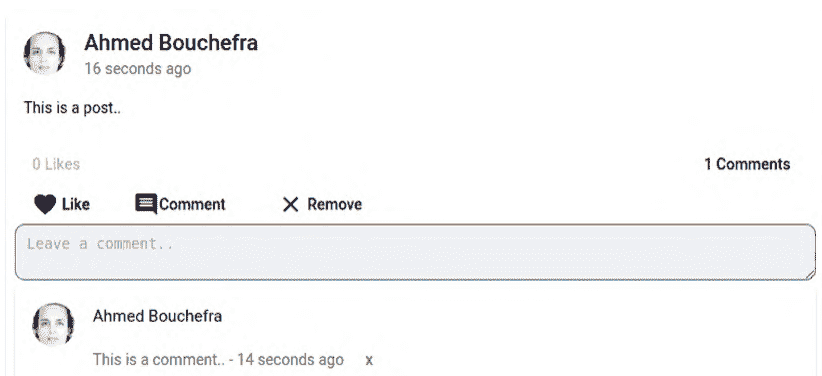

图 11.7 – 显示的评论

现在，我们可以显示评论并加载更多评论。但是，如果我们添加一条评论，它不会自动显示，直到我们点击其中一个按钮。我们将在下一节中修复这个问题。

## 显示新评论

我们可以通过在添加新评论时重新获取评论，或手动将评论添加到缓存来实现此功能。

我们可以通过更新 core/services/comment/comments.service.ts 文件中的 createComment() 方法来重新获取评论，如下所示：

```ts
createComment(
    comment: string,
    postId: string) {
    return this.commentPostGQL
        .mutate({
            comment: comment,
            postId: postId
        }, {
            refetchQueries: ['getCommentsByPostId']
        })
        .pipe(map(result => result.data!.comment));
}
```

但是，在重新获取评论时要小心，因为这将重新运行我们之前为其获取过评论的所有帖子的所有 getCommentsByPostId 活动查询。

例如，在我的情况下，下面的截图显示了 Apollo DevTools 中当前活动的查询：

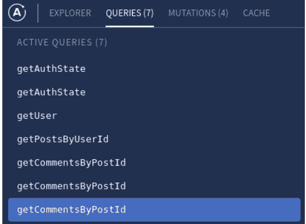

图 11.8 - Apollo DevTools 中的活动查询

在这里，你可以看到我们同时可以有多个活动的 getCommentsByPostId 查询。

现在，让我们学习如何手动更新缓存。通过将以下对象以及 update () 方法作为 mutate () 方法的第二个参数添加到 createComment () 方法中进行更新：

```ts
{
    update(cache, comment) {
        cache.modify({
            fields: {
                getCommentsByPostId(existingComments) {
                    const comments = [comment, ...existingComments]
                    return comments;
                }
            }
        })
    }
}
```

接下来，我们将学习在删除评论后更新缓存。

## 删除评论后更新缓存

如果我们想删除评论，可以点击评论旁边的 x 按钮。此时，评论会被删除，但我们需要刷新评论以验证它已被删除。

我们希望立即看到结果。同样，我们可以通过重新获取评论或手动更新缓存来实现此功能。通过添加带有 update() 方法的第二个参数对象来更新 core/services/comment/comments.service.ts 文件中的 removeComment() 方法，如下所示：

```ts
{
    update(cache) {
        cache.modify({
            fields: {
                getCommentsByPostId(existingComments, { readField }) {
                    return existingComments
                        .filter((cc: StoreObject) => {
                            return id !== readField('id', cc)
                        });
                }
            }
        });
    }
}
```

我们已经导入了 StoreObject，它只代表缓存中的一个对象。在 update() 函数中，我们添加代码通过 filter() 方法和 readField() 实用函数来更新缓存以删除已删除的评论，该实用函数用于读取缓存字段的值。有关更多信息，请参阅 https://www.apollographql.com/docs/react/caching/cache-interaction/#example-removing-an-item-from-a-list.

有关此内容的更多信息也可在 https://www.apollographql.com/docs/react/caching/overview/ 获取。

## 为评论框赋予焦点

显示评论框后，我们希望 <textarea> 自动获得焦点，以便我们可以立即开始输入评论。我们可以使用自定义 Angular 指令来实现此功能，如下所示：

- 1. 转到你的终端并运行以下命令：

```
ng g directive shared/directives/autofocus
```

该指令由 CLI 自动导入到共享模块中。你不需要像对 post 和 comment 组件那样重新导出它，因为它只会在共享模块的组件内部使用。

- 2. 打开 shared/directives/autofocus.directive.ts 文件并按如下方式更新它：

```ts
import { Directive, AfterViewInit } from '@angular/core';
import { MatInput } from '@angular/material/input';

@Directive({
  selector: '[appAutofocus]'
})
export class AutofocusDirective implements AfterViewInit {

    constructor(private matInput: MatInput) { }
    ngAfterViewInit() {
      this.matInput.focus();
    }
  }
```

在这里，我们在实现生命周期接口并注入指令之前导入了 AfterViewInit 接口和 MatInput 指令。

最后，我们在 ngAfterViewInit() 方法内部调用了 MatInput 实例的 focus() 方法，该方法在视图初始化后调用一次。

> **注意**
> 请参阅 https://angular.io/api/core/AfterViewInit 和 https://material.angular.io/components/input/overview 获取更多信息。

最后，在 shared/components/post/post.component.html 文件中，将自定义 appAutofocus 指令应用于 <textarea> 元素，以便在显示时自动赋予其焦点：

```
<textarea #commentInput placeholder="Leave a comment.." matInput (keydown.enter)="createComment($event)" appAutofocus></textarea>
```

下面的截图显示了点击评论按钮后具有焦点的评论框：


图 11.9 – 具有焦点的评论文本区域

我们通过添加用于显示带评论和点赞的帖子的代码和标记完成了个人资料组件的实现。同样，我们需要实现 feeds 模块的 posts 组件，即主页，应在其中显示网络上所有用户的最新帖子。

由于 feed 的 posts 组件与个人资料组件相似，并且最常见的代码已实现在基类中，feed 的 posts 组件也可以扩展该基类，因此我们将实现此功能留给你作为练习。

## 练习

作为练习，实现用户搜索功能的分页。在第 10 章《获取帖子并添加评论和点赞》中，我们在搜索对话框中添加了一个用于获取更多用户的按钮。但是，我们没有在服务器和客户端应用程序上实现所有必需的代码。因此，作为练习，添加必要的代码以使分页与用户的搜索结果一起工作。

作为第二个练习，实现 post 服务的 getFeed() 方法以获取网络的最新帖子。它的签名如下：

```
getFeed(offset: number, limit: number) {}
```

此方法与 getPostsByUserId() 方法类似，只是我们不需要传递 user ID 参数。我们之前定义了 GraphQL 查询并生成了此方法所需变量和结果类型，因此你只需编写方法体即可。

你还需要为 Query.getFeed 字段的缓存添加必要的字段策略。

最后，实现 feed 模块的 posts 组件。此组件应显示已登录用户的名字和用户 feed。下面的截图显示了在添加用户照片和一些帖子后组件应是什么样子：

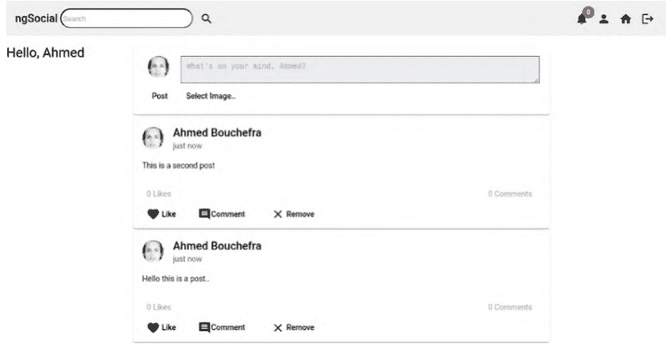

图 11.10 – feed 的帖子组件

最后，编写必要的测试，类似于你在前几章中所做的那样。

接下来，让我们学习如何为订阅设置 Apollo Client。

## 为订阅设置 Apollo Client

在本节中，我们将为订阅设置 Apollo Client，以便在网络上的其他用户实时点赞或评论他们的帖子时通知用户。

订阅需要持久连接，因此无法使用 Apollo Client 用于查询和突变的默认 HTTP 协议来处理。相反，它们通过社区维护的 subscriptions-transport-ws 库通过 WebSocket 发送，我们需要在项目中安装它：

- 1. 转到你的终端，确保你已导航到前端项目文件夹（client/ 文件夹）内部，并运行以下命令：

```
npm install subscriptions-transport-ws
```

- 2. 打开 src/app/graphql.module.ts 文件并开始添加以下导入：

```ts
import {
  ApolloClientOptions,
  from,
  split
} from '@apollo/client/core';
import { WebSocketLink } from '@apollo/client/link/ws';
import { getMainDefinition } from '@apollo/client/utilities';
```

在这里，我们从其包中导入了 WebSocketLink 和 getMainDefinition 符号，并将 split 方法添加到从 @apollo/client/core 的现有导入声明中。

- 3. 在 createApollo() 函数内部，定义以下 Apollo 链接：

```ts
const ws = new WebSocketLink({
  uri: 'ws://localhost:8080/graphql',
  options: {
    reconnect: true,
```


```
connectionParams: {
    authToken: accessToken
}
}
}) ;
```

这里，我们创建了一个指向 ws://localhost:8080/graphql URL 的 WebSocket 链接，该 URL 上 WebSocket 服务器正在监听。我们指定了一些选项，例如将 reconnect 属性设置为 true 以便在 WebSocket 断开连接时重新连接，并使用 connectionParams 对象将身份验证令牌传递给服务器。

- 4. 在同一个函数中，添加以下代码以拆分链接，如下所示：

```
const splitLink = split(
    ({ query }) => {
        const definition = getMainDefinition(query);
        return (
            definition.kind === 'OperationDefinition' &&
            definition.operation === 'subscription'
        );
    },
    ws,
    http
);
```

这里，我们使用 split() 函数来拆分链接，以便我们可以根据发送的操作类型——查询、变更或订阅——将适当的数据发送到每个链接。

- 5. 最后，用拆分后的链接替换 createApollo() 函数返回的链接链中的 HTTP 链接：

```
return {
    link: from([setAuthorizationLink, splitLink]),
    cache: cache
};
```

现在，我们同时拥有指向在不同端口上运行的 HTTP 和 WebSocket 服务器的链接。查看源代码提交 https://git.io/JDuwf。

接下来，我们将学习如何在客户端应用程序中实现实时订阅。

## 实现 GraphQL 订阅

现在我们已经为 GraphQL 订阅设置了 Apollo Client，我们将学习如何使用订阅为我们的应用程序添加一些实时功能。

在服务器中，我们在 GraphQL 模式中添加了一个包含两个字段——onPostCommented 和 onPostLiked 的 Subscription 类型。然后，我们实现了所需的解析器，以便在帖子被评论或点赞时将实时更新推送到客户端。

在本节中，我们将学习如何监听来自服务器的实时更新。此过程类似于我们使用查询查询数据的方式，但不是使用查询操作，而是使用订阅操作以及需要从服务器发送的字段。对于响应，每当服务器上有新数据可用时，我们都会收到结果。

在我们的案例中，我们将实现在网络用户添加新评论和点赞时显示帖子上的新评论和点赞的功能，而无需刷新页面或重新点击按钮。我们还将实现一个简单的通知系统，以通知用户新的评论和点赞。

在继续之前，我们需要在服务器中修复一行代码。打开 server/src/index.ts 文件并找到 SubscriptionServer.create() 方法。然后，按如下方式更新 onConnect 处理程序内部从 connectionParams 对象检索令牌的代码：

```
const token = connectionParams['authToken'] || '';
```

通过阅读以下代码提交查看更改：https://git.io/JDuom。

让我们开始添加用于监听帖子新评论的订阅：

- 1. 打开 src/app/graphql.documents/comment.graphql 文件并添加以下订阅：

```
subscription onPostCommented{
  onPostCommented {
    ...CommentFields
    author { ...BasicUserFields }
    post { id commentsCount }
  }
}
```

onPostCommented 订阅返回一个 Comment 对象。因此，我们必须使用选择集来请求我们感兴趣的字段，例如 ID、评论文本、作者信息、被评论帖子的 ID 以及其创建时间。

- 2. 打开 src/app/graphql.documents/like.graphql 文件并添加以下订阅以监听新的点赞：

```
subscription onPostLiked{
  onPostLiked{
    id
    user { ...BasicUserFields }
    post { id likesCount }
    createdAt
  }
}
```

- 3. 添加这些订阅后，从 monorepo 项目的根目录使用以下命令运行代码生成器：

```
npm run codegen
```

- 4. 在 src/app/core/services/comment/comments.service.ts 文件中，添加以下导入：

```
import { OnPostCommentedDocument }
from '@ngsocial/graphql/documents';
```

- 5. 通过添加以下代码更新 getCommentsByPostId() 方法：

```
queryRef.subscribeToMore({
  document: OnPostCommentedDocument,
  updateQuery: (prev, { subscriptionData }) => {}
});
```

这里，我们使用了 watch() 方法返回的 QueryResult 对象的 subscribeToMore() 来订阅来自 onPostCommented 订阅的实时更新。我们调用了 queryRef 变量的 subscribeToMore() 方法，并将参数对象的 document 属性设置为 onPostCommentedDocument 订阅。

- 6. 在传递给 updateQuery 属性的箭头函数中，添加以下代码：

```
if (!subscriptionData.data) {
    return prev;
}
const newComment = subscriptionData
    .data
    .onPostCommented!;
console.log("New comment coming: ",
    subscriptionData.data);
if (newComment.post.id !== postId) {
    return prev;
}
return {
    getCommentsByPostId: [newComment,
        ...prev.getCommentsByPostId!]
};
```

这里，我们实现了 updateQuery 回调函数，该函数在每次从服务器获取新数据时都会被调用，以将新评论与现有评论合并。此函数应返回一个具有初始查询数据形状的对象。

- 7. 打开 src/app/core/services/like/likes.service.ts 文件并添加以下导入：

```
import { OnPostLikedDocument }
    from '@ngsocial/graphql/documents';
```

- 8. 按如下方式更新 getLikesByPostId() 方法：

```
queryRef.subscribeToMore({
    document: OnPostLikedDocument,
    updateQuery: (prev, { subscriptionData }) => ({})
});
```

- 9. 在传递给 updateQuery 属性的函数中，添加以下代码：

```
if (!subscriptionData.data) {
    return prev;
}
const newLike = subscriptionData
    .data
    .onPostLiked!;
console.log("New like coming: ",
    subscriptionData.data);
if (newLike.post.id !== postId) {
    return prev;
}
return {
    getLikesByPostId: [newLike,
        ...prev.getLikesByPostId!]
};
```

现在，如果有人向帖子添加评论，它将被添加并实时显示在评论区域。但是在开始接收新评论的实时更新之前，用户需要至少通过点击帖子上的两个按钮之一来运行 getCommentsByPostId() 方法以获取评论。前往 https://git.io/JDurx 查看源代码提交。

如果我们需要实现单独的逻辑，例如在获取之前显示有关新评论的通知，我们必须使用之前生成的扩展 Subscription 服务的 GraphQL 服务：

- 1. 打开 src/app/core/components/header/header.component.ts 文件并导入以下生成的服务：

```
import {
    OnPostCommentedGQL,
    OnPostLikedGQL
} from '../../gql.services';
```

- 2. 在组件的类中定义以下属性：

```
public notificationsCount: number = 0;
```

这将用于在页眉模板上显示通知的数量。

- 3. 通过服务的构造函数注入你导入的服务：

```
constructor(
  // [...] 
  private onPostCommentedGQL: OnPostCommentedGQL,
  private onPostLiked: OnPostLikedGQL) { }
```

- 4. 向组件的类添加以下用于订阅新评论的方法：

```
subscribeToNewComments() {
  const onPostCommentedObs = this.onPostCommentedGQL
    .subscribe();
  onPostCommentedObs
    .subscribe({
      next: (result) => {
        const comment = result.data?.onPostCommented;
        if (this.authUser?.id !== comment?.author.id) {
          this.notificationsCount++;
          this.changeDetectorRef.markForCheck();
        }
      }
    });
}
```

这里，我们调用了 GraphQL 服务的 subscribe() 方法以返回一个 Observable，我们可以订阅它以开始监听新评论。

然后，我们订阅了返回的 Observable 以开始监听新评论。在观察者对象的 next 处理程序中，我们从 GraphQL 订阅响应中检索评论；如果评论的作者与当前登录用户不同，我们将递增 notificationsCount 属性。


5. 同样地，为组件的类添加以下用于订阅新点赞的方法：

```
subscribeToNewLikes() {
    const onPostLikedObs = this.onPostLiked
        .subscribe();
    onPostLikedObs.subscribe({
        next: (result) => {
            const like = result.data?.onPostLiked;
            if (this.authUser?.id !== like?.user.id) {
                this.notificationsCount++;
                this.changeDetectorRef.markForCheck();
            }
        }
    });
}
```

6. 按如下方式从组件的 ngOnInit() 方法调用之前的方法：

```
ngOnInit(): void {
    this.authService.authState
        .pipe(takeUntil(this.destroyNotifier$))
        .subscribe({
            next: (authState: AuthState) => {
                this.isLoggedIn = authState.isLoggedIn;
                this.authUser = authState.currentUser;
                this.changeDetectorRef.markForCheck();
                this.subscribeToNewComments();
                this.subscribeToNewLikes();
            }
        });
}
```

7. 最后，使用 Material 徽章在模板中显示通知计数。打开 src/app/core/components/header/header.component.html 文件并按如下方式更新 Notifications 按钮：

```
<button *ngIf="isLoggedIn" mat-icon-button matTooltip="Notifications">
  <mat-icon aria-hidden="false" aria-label="Notifications" [matBadge]="notificationsCount" matBadgeColor="warn">
    notifications
  </mat-icon>
</button>
```

这里，我们向 <mat-icon> 元素添加了 matBadge 属性并将其绑定到组件的 notificationsCount 属性。

就这样——现在你应该能够在应用程序中接收并显示新评论和点赞的通知了。查看提交 https://git.io/JDuoK。

你始终可以扩展此实现以显示用户收到的通知的更多信息。

## 摘要

在本最后一章中，我们学习了如何为 GraphQL 订阅配置 Apollo Client，然后添加代码使用徽章在应用程序的页眉中显示通知。

在整本书中，我们使用 Angular 和 GraphQL 等前沿技术，使用 Lerna 开发了具有 monorepo 架构的全栈应用程序。我们在客户端和服务器上都使用 Apollo 来发送和响应 GraphQL 查询。

在设置开发环境并安装 Node.js 之后，我们使用 Express.js 和 Apollo Server 构建了一个支持 GraphQL 的服务器来实现后端。我们还在开始开发用于消费 API 并向用户展示用户界面以便与后端通信的前端应用程序之前，使用 Apollo Studio 与我们的 GraphQL API 通信。

之后，我们解释了如何安装 Express.js 并使用 TypeScript 和 GraphQL 对其进行配置。我们使用模拟在实现负责获取和添加数据的解析器之前提供了一个使用 Apollo Server 的工作 GraphQL 服务器。

然后，我们学习了如何使用 TypeORM 将 MySQL 数据库连接到我们的 Web 应用程序，并实现了用于与数据库通信的解析器。我们公开了一个工作中的 GraphQL API，其解析器从真实的 MySQL 数据库中查询和删除数据。

我们还利用 TypeORM 抽象数据库操作，使开发人员能够在不更改代码的情况下为其应用程序使用任何所需的数据库管理系统。我们学习了如何将 TypeORM 连接到 Apollo，以及如何生成和填充数据库表。

接下来，我们使用 Apollo Server 向我们的 GraphQL API 添加了身份验证和图像上传，并学习了使用 Node.js、Express 和 Apollo Server 添加身份验证以及处理图像上传所需的概念。

我们还向服务器应用程序添加了带身份验证的实时支持，这使我们能够在数据可用时立即将最新数据从服务器通信到客户端。为此，我们利用 Apollo Server 的 GraphQL 订阅，在用户帖子上的新评论和点赞被添加的瞬间将其从服务器推送到客户端。

在实现后端之后，我们使用 Angular CLI 创建了一个新的 Angular 项目，并回顾了许多基本的 Angular 概念，例如模块、组件和服务。我们还学习了如何使用 Angular CLI 生成构成应用程序结构的工件。

然后，我们在项目中使用 Angular Material 提供 Material 设计组件，以创建视觉上吸引人的应用程序 UI。

最后，我们使用 Apollo Client 将使用 Angular 构建的前端与后端集成，Apollo Client 设计用于向服务器发送 GraphQL 查询和变更以获取和写入数据。

在开发和测试应用程序并添加任何你想要的额外功能之后，你可以构建生产包并使用你喜欢的托管服务托管它们。请参阅 `https://angular.io/guide/deployment` 官方文档以获取有关此过程的更多信息。

感谢你抽出时间阅读本书，希望你喜欢它。

## Index

## Symbols

<base href> 标签 143

## A

AfterViewInit 接口
  参考链接 345
Amazon Relational Database Service
  (Amazon RDS) 9, 10
Angular
  关于 132
  图像上传 244, 245
  用于构建前端 10
Angular applications
  调试 152-154
Angular binding syntax
  参考链接 137
Angular command-line interface
  (Angular CLI)
  关于 128, 220
  命令 129
  安装 129
Angular forms 132

Angular Material
  关于 132
  添加 154
  组件导入 161, 162
Angular project
  初始化 130, 131
Angular Router
  关于 142
  工作方式 142, 143
Angular routing 142
Angular testing
  参考链接 220
Angular Universal 132
Apollo
  关于 9
  图像上传 244, 245
  与 TypeORM 集成 68-85
  用于集成后端 9
  用于集成前端 9
Apollo Client
  关于 9, 159
  安装 159, 160
  用于本地状态
    管理 209-218

## C

## B

Apollo Client for subscriptions
    设置 348, 349
Apollo Link
    接口 160
    参考链接 160, 294
Apollo services
    定义 168-170
Apollo Studio
    用于向服务器发送查询
      32, 33
Apollo, testing in Angular
    参考链接 220
application architecture 132
authentication
    关于 89
    实现 89-96
    与授权的区别 89
authentication over WebSockets
    参考链接 120
authentication system
    改进 293
auth guard
    测试 230-233
authorization 89
auth service
    测试 220-229
backend
    与 Apollo 集成 9
base component
    实现 256-265

cache
    删除评论后更新 344
cache configuration
    参考链接 301
cached field
    参考链接 344
cached fields behavior, customizing
    参考链接 210
client-side apps 5
client-side routing 142
code
    重新编译 26-29
    查看 26-29
commands, Angular CLI
    ng build 129
    ng generate 129
    ng new 129
    ng serve 129
comment box
    练习 347
    显示 345, 346
comments
    显示 315-325, 336-343
CommentsService
    实现 302-304
CommonModule 133
component
    关于 134
    创建 140, 141
    测试 220-241
Component decorator
    selector 136
    styleUrls 136
    templateUrl 136

component state
    使用响应式
      变量持久化 330-334
container components 282
create post component
    实现 282-289
    测试 289, 290
Cross-origin resource sharing (CORS)
    关于 44
    配置 44
custom events
    comment 305
    like 305
    listComments 305
    listLikes 305
    moreComments 305
    remove 305
D
data
    使用 MySQL 数据库保存 9, 10
    使用 TypeORM 保存 9, 10
database
    测试数据填充 62-67
dates
    使用 field policies 重写 334-336
dependency injection 136
development dependencies
    安装 22-24
development technologies 6
Document Object Model (DOM) 134
Don't Repeat Yourself (DRY) 256
dumb 282

E
Express.js
    关于 7
    安装 22-24
    用于运行 Web 服务器 7
Express server
    创建 25, 26
F
feed module
    关于 138
    组件生成 140
fetchMore() method
    参考链接 321
field policies
    关于 209, 210
    定义 273, 274
    参考链接 210, 212
    用于重写日期 334, 335
footer component
    实现 196
FormsModule 133
fragments
    参考链接 248
frontend
    使用 Angular 构建 10
    使用 TypeScript 构建 10
    与 Apollo 集成 9
full-stack application
    关于 4, 5
    后端 5
    前端 5
full-stack architecture 4


## G

泛型类，TypeScript
  参考链接 168
GraphQL
  关于 8, 9
  参考链接 31
GraphQL 抽象语法树 29
GraphQL API
  关于 6
  创建 29
  暴露 30, 31
  库，安装 29
  链接模拟数据 42, 43
  模拟 38-41
  向服务器发送查询，使用
    Apollo Studio 32, 33
GraphQL 代码生成器
  关于 68
  设置 245-248
  URL 68
GraphQL 文档
  定义 163-165
GraphQL 片段
  使用 208
GraphQL 变更
  保护 97-108
GraphQL 查询
  保护 97-108
GraphQL 模式
  为社交网络创建 33-37
GraphQL 订阅
  定义 114
  实现 115-119, 350-356
实现 JWT 身份验证
  使用 120, 121

## H

头部组件
  实现 191-195
  测试 233-239
HttpClient 132
HttpClientModule 133
HttpLink 160

## I

标识符 (ID) 296
图像
  使用 Angular 上传 244, 245
  使用 Apollo 上传 244, 245
使用 Angular 和 Apollo 上传图像
片段和变更，
  添加 248-252
GraphQL 代码生成器，
  设置 245-248
生成类型和服务 252, 253
使用 Apollo Server 上传图像
练习 111, 112
实现 108-111
增量 DOM 134
注入器 136
Ivy 134

## J

JavaScript
  使用 Node.js 在服务器上运行 6, 7
JSON Web Token (JWT)
  关于 89
  发送 206, 207
JWT 身份验证
  实现，使用
    订阅 120, 121

## L

## M

## N

Lerna 19
  URL 20
库
  安装 29
点赞
  显示 315-325
LikesService
  实现 302-304
仅本地字段
  关于 209
  参考链接 212
本地状态管理
  使用 Apollo Client 209-218
登录 UI（练习）
  构建 189-191
  样式化 189-191
MySQL Server
  配置 11, 12
  测试 12
MySQL 用户
  创建 49, 50
MatToolbarModule 161
模块
  关于 133
  创建 138
单仓库项目
  关于 206
  设置 19, 20
单仓库 4
变更
  添加 297-299
MySQL
  安装 11
  在服务器项目中设置 5-53
MySQL 数据库
  创建 49, 50
  用于保存数据 9, 10
导航
  添加 150, 151
ng build 命令 129
ng generate 命令 129
NgModules 133
ng new 命令 129
ng serve 命令 129
Node.js
  关于 7
  配置 13
  安装 13
  使用 Node Version Manager (nvm) 安装 13, 14
  用于在服务器上运行 JavaScript 6, 7
Node Package Manager (npm)
  用于安装包 7
nodist
  参考链接 15
非空断言运算符 (!)
  参考链接 308
Node Version Manager (nvm)
  用于安装 Node.js 13, 14
nvm-windows
  参考链接 15

## O

- 对象关系映射器 (ORM) 50
    - 参考链接 301
- offsetLimitPagination 辅助工具
    - 参考链接 301
- OnPush 变更检测策略
    - 使用 219, 220
- 操作类型，GraphQL
    - 参考链接 164

## Q

- 查询
    - 添加 294-297
- 查询和变更
    - 参考链接 83
- Query 类
    - 参考链接 304
- QueryRef 对象
    - 参考链接 300

## P

- 包
    - 使用 Node Package Manager (npm) 安装 7
- 页面未找到组件
    - 实现 196, 197
- 分页帖子
    - 获取 299-301
- 使用 Apollo Client 的分页
    - 参考链接 180
- 帖子
    - 显示 315-325
- 帖子服务
    - 实现 253-255
- 展示型 282
- 展示型帖子组件
    - 实现 305-314
- 个人资料组件
    - 定义字段策略 273, 274
    - 实现 265-273
- 个人资料服务
    - 实现 255, 256
- 个人资料 UI
    - 组件，样式化 277-281
    - 创建 274-277

## R

- 响应式变量
    - 关于 209
    - 参考链接 209, 211
    - 用于持久化组件状态 330-334
- 响应性
    - 参考链接 173
- read() 函数
    - 参考链接 335
- 解析器函数 9
- 根组件 135
- 根模块 138
- 路由匹配策略 147
- 路由参数 148
- RouterModule 133
- 路由出口 145
- 路由
    - 关于 146
    - 添加 147-150
    - 属性 146
    - 保护 204-206
路由模块
  关于 139, 144
  导入 145, 146
RxJS
  参考链接 173

## S

搜索对话框组件
  测试 240
搜索引擎优化 (SEO) 142
搜索功能
  改进 207
服务器项目
  代码，重新编译 26-29
  代码，查看 26-29
  开发依赖，
    安装 22-24
安装 Express.js 22-24
创建 Express 服务器 25, 26
初始化 21
设置 MySQL 50-53
生成 package.json 文件 21, 22
设置 TypeORM 50-53
服务
  关于 136, 137
  创建 140, 141
共享模块
  关于 138, 139
  生成组件 140
注册 UI
  构建 180-189
  样式化 181-189
智能和哑组件
  参考链接 305
智能组件 282
社交网络
  为其创建 GraphQL 模式 33-37
单一事实来源 (SOT) 210
展开运算符
  参考链接 162
订阅。参见 GraphQL 订阅
支持的获取策略
  参考链接 179

## T

takeUntil() 运算符
  参考链接 217
测试数据
  在数据库中播种 62-67
测试服务
  参考链接 221
tsconfig.json 文件
  参考链接 23
TypeORM
  关于 50
  在服务器项目中设置 50-53
  用于集成 Apollo 68-85
  用于保存数据 9, 10
TypeORM 实体
  创建 54-61
类型
  为用户定义
    身份验证 166, 167
TypeScript
  关于 132
  用于构建前端 10

## U

统一资源定位符 (URL) 205

UrlTree

参考链接 205

用户身份验证

为其定义类型 166, 167

用户身份验证服务

实现 170-180

用户界面 (UI)

更改 324

用户搜索对话框组件

实现 197-201

用户模块

关于 138

生成组件 140

## W

Web 服务器

使用 Express.js 运行 7

Windows Subsystem for Linux (WSL) 15

工作区 130


Packt.com

订阅我们的在线数字图书馆，即可完全访问超过 7,000 本书籍和视频，以及行业领先的工具，帮助您规划个人发展并推进职业生涯。有关更多信息，请访问我们的网站。

## 为什么订阅？

- 花更少的时间学习，花更多的时间编码，使用来自 4,000 多名行业专业人士的实用电子书和视频
- 使用专为你打造的技能计划提升学习效果
- 每月获得一本免费电子书或视频
- 全文可搜索，便于快速获取重要信息
- 复制粘贴、打印和书签保存内容

您知道 Packt 为出版的每本书都提供电子书版本，支持 PDF 和 ePub 格式吗？您可以在 packt.com 升级到电子书版本，并且作为印刷书籍客户，您有权享受电子书的折扣。有关更多详情，请联系 customercare@packtpub.com。

在 www.packt.com，您还可以阅读一系列免费技术文章，订阅多种免费通讯，并获得 Packt 书籍和电子书的独家折扣和优惠。

## 您可能喜欢的其他书籍

如果您喜欢这本书，您可能对 Packt 出版的其他这些书籍感兴趣：

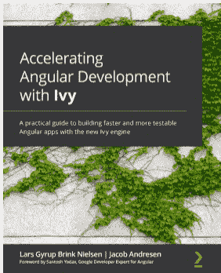

## 使用 Ivy 加速 Angular 开发

Lars Gyrup Brink Nielsen | Jacob Andresen

ISBN: 978-1-80020-521-5

了解为什么 Angular Ivy 测试更快、更稳健。

- 探索 CSS 自定义属性和值作用域的概念，并学习如何与 Angular Ivy 一起使用。
- 使用 Angular 组件中提供的测试工具编写有效的测试。
- 探索 Angular 兼容性编译器的架构并了解其重要性。

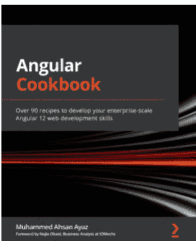

## Angular 食谱

Muhammad Ahsan Ayaz

ISBN: 978-1-83898-943-9

- 更好地理解组件、服务和指令在 Angular 中如何工作。
- 了解如何从头开始使用 Angular 创建渐进式 Web 应用。
- 构建丰富的动画并将其添加到您的 Angular 应用中。
- 使用 RxJS 管理应用的数据响应性。
- 使用 NgRx 为您的 Angular 应用实现状态管理。


## Packt 正在寻找像您这样的作者

如果您有兴趣成为 Packt 的作者，请访问 authors.packtpub.com 并立即申请。我们已与数千名开发人员和技术专业人士合作，就像您一样，帮助他们与全球技术社区分享他们的见解。您可以提交通用申请，申请我们正在招聘作者的特定热门主题，或提交您自己的想法。

## 分享您的想法

现在您已经完成了 *使用 Angular 和 GraphQL 进行全栈开发*，我们很想听听您的想法！如果您是在 Amazon 购买了本书，请为本书选择 https://www.amazon.in/review/create-review/error?asin=1800202466 并分享您的反馈，或在您购买的网站上留下评论。

您的评论对我们和技术社区非常重要，并将帮助我们确保我们提供卓越质量的内容。
