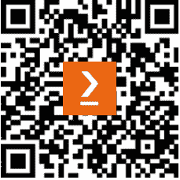

## 前言

2020 年 3 月 11 日，世界卫生组织在全球 COVID-19 爆发中正式宣布大流行。随着世界进入封锁，企业必须迅速转变并利用创新方式继续运营。我们见证了各行各业的组织采用创造性技术。许多零售企业在被要求关闭门店或限制店内顾客数量时提供了在线订购和路边取货服务。

当超市货架空空如也且难以补货时，餐馆也利用其直接供应商为客户提供包括农产品、乳制品和生肉在内的杂货套装。健身房提供在线虚拟课程以保持会员活跃和参与。医生为患者提供在线虚拟预约。传统上要求员工到场的办公室转向使用 Microsoft Teams 等协作工具实现远程办公。他们有什么共同点？他们都利用了云服务。

在疫情期间的首次财报电话会议上，微软首席执行官 Satya Nadella 表示：“我们见证了两年数字转型的成果在两个月内完成。” 启用远程办公、加速向云的数字化转型以及构建创新解决方案使组织不仅得以生存，而且得以蓬勃发展。

三年后，世界已缓慢恢复到一种新常态——一种混合世界，既参与在线体验，也参与面对面体验。然而，组织并未放缓脚步。他们正在加速其数字化转型和应用现代化计划。Gartner 预测，到 2025 年云支出将继续增长，企业组织将继续投资其向云的转变。我在日常工作中亲眼目睹了这一点，我领导着一个云解决方案架构师团队，帮助组织在 Azure 上实现现代化并进行创新。

这对你意味着什么，无论你是架构师、开发者、学生还是有志于技术的专业人士？随着对云原生技能的需求持续增长，现在是学习这些关键开发技能的时候，否则你可能会被落下。在 LinkedIn 上简单搜索“云原生”职位就会产生数千个结果。这是一项需求旺盛的技能，可作为职业加速器。你已经通过购买 Hamida 的这本书迈出了第一步，这对你来说是一项明智的投资。

Hamida 凭借多年在 Azure 上开发云原生解决方案的经验，将她的专业知识提炼于此。这是一份全面的资源，超越了“什么是云原生应用开发？”这个问题。这不是另一本关于容器和编排服务的书籍。Hamida 为你提供了“如何做”。她提供了构建端到端云原生应用的路线图，从开发到部署。

你将带着准备好将这些页面中学到的所有内容付诸实践。你将更深入地了解使用哪种云服务、为什么以及它如何结合起来创建和部署可扩展、可靠、高可用的应用。

祝你在旅程中好运！

Lori Lalonde

微软高级云解决方案架构师经理

## 贡献者

### 关于作者

**Hamida Rebai Trabelsi** 在计算领域工作超过 12 年。她在突尼斯开始了职业生涯，曾为**跨国公司 (MNCs)**担任软件开发人员，然后在加拿大 CGI 担任 .NET 顾问。她目前是 Revenu Québec 加拿大的高级顾问和信息与解决方案集成架构师。她曾被微软授予开发者技术领域最有价值专家和 Microsoft DevHeros，并持有多个 Azure 认证。除了是微软认证讲师和 .NET 基金会成员外，Hamida 还是一名博主、国际演讲者，并在 2019 年加拿大 Women in IT 奖中成为决赛选手之一。

> 我被所有团队给予的支持所感动。他们在这个期间鼓励了我，我感到自豪的是我能够完成这本书并分享我作为开发者开始使用 Azure 的经验。献给我父亲 Mongi Rebai 的记忆，我将这本书献给你，希望你与我同在，分享这项添加到我职业生涯中的新冒险。感谢我的妈妈 Rafika Boukari 你的牺牲和支持。感谢我的丈夫 Mohamed Trabelsi 相信我。每天醒来，我看到我的儿子 Rayen Trabelsi 和我的小女儿 Eya Trabelsi，我感到更有动力，所以感谢你们的能量。

### 关于审阅者

**Ryan Mangan** 是一名专注于应用迁移和现代化的云和终端用户计算技术专家。他是各种主题的国际演讲者、作者，并在过去十年中帮助客户和技术社区。Ryan 是英国计算机学会的特许会员、微软**最有价值专家 (MVP)**、VMware vExpert 以及**非常重要的 Parallels 专业人士 (VIPP)**。

**Stefano Demiliani** 是微软业务应用最有价值专家、**微软认证解决方案开发者 (MCSD)**、Azure 认证架构师，也是其他微软相关技术的专家。他的主要活动是基于微软技术全栈（主要专注于 ERP 和云）进行企业解决方案的架构和开发。他曾与 Packt Publishing 合作过许多与 Azure 云应用和 Dynamics 365 Business Central 相关的 IT 书籍，并在欧洲各地的会议上发表演讲。你可以通过 Twitter (@demiliani) 或 LinkedIn 联系他。


## 前言

Azure 是微软的公有云计算提供商。它提供一系列云服务，包括计算、网络、存储和分析。用户将继续使用 Azure 中的无服务器和事件驱动技术构建面向云的应用程序，将他们的应用程序与关系型或非关系型数据库集成，在 Azure 中使用数据库即服务，并使用 Docker 容器在 Azure 上构建 CI/CD 管道。

为了在市场中保持竞争力并以更快的速度和更低的成本交付软件，拥有稳定遗留系统且数据量不断增长的公司正在对其应用程序进行现代化改造并加速创新。然而，许多企业难以满足现代化改造的需求。本书将通过示例帮助你在 Azure 上构建安全可靠的基于云的应用程序，并展示如何将它们连接到数据库，以克服应用程序现代化改造的挑战。本书将带你了解 Azure 中的各种服务，即使用网关模式的 Azure API 管理、事件驱动架构、Event Grid、Azure Event Hubs、Azure 消息队列、使用 Azure Functions 的函数即服务，以及面向数据库的云。在此过程中每一步，你都将学习如何在 Azure 中创建、导入和管理 API 与 Service Fabric，以及如何确保 Azure 中的持续集成和部署，从而完全自动化软件交付流程（构建和发布流程）。

## 本书读者对象

本书面向云开发者、软件架构师、系统管理员、DBA、数据工程师、开发人员以及希望理解云世界中软件架构师或开发者新角色的计算机科学学生。希望提升云和云原生编程概念的专业人士也会发现本书非常有用。

## 本书涵盖内容

第 1 章“无服务器架构、事件驱动架构和云数据库简介”涵盖无服务器架构的定义，以及 API 在应用程序及其生态系统中的定义、生命周期、类型和角色。本章还涵盖事件驱动架构和面向数据库的云。

第 2 章“API 管理——导入、管理和发布你的第一个 API”涵盖 Azure API 管理的不同功能，并定义 API 网关模式。本章还涵盖 API 安全性。


*第 3 章，开发基于事件和基于消息的解决方案*，涵盖了基于事件和基于消息的解决方案。本章描述了 Event Grid、Azure Event Hubs 以及 Service Bus Queue 和 Topic。我们将使用 .NET 应用程序向 Service Bus Queue 或 Topic 发送和接收消息，并使用 .NET 应用程序发布和订阅 Event Grid 事件。

*第 4 章，在 Azure 中创建和部署 Function App*，涵盖了 Azure Functions 的基本概念及其托管计划选项，以及 Azure Functions 的开发。本章还涵盖了 Durable Functions。

*第 5 章，开发 Azure Service Fabric 分布式应用程序*，涵盖了 Azure Service Fabric 的基本概念、主要优势以及 Service Fabric 应用程序在本地或远程部署到云中的方法。

*第 6 章，应用程序数据简介*，涵盖了数据分类、数据概念以及 Azure 中关系型和非关系型数据的不同概念。本章还涵盖了现代数据仓库分析。

*第 7 章，使用 Azure SQL Database*，涵盖了 Azure SQL Database 和 Azure SQL Managed Instance 的配置和部署。本章讨论了单个 SQL 数据库、数据库弹性池和 SQL Managed Instance 的部署。在本章中，我们将 Azure SQL 数据库连接到 ASP.NET 应用程序。

*第 8 章，使用 Azure Storage*，涵盖了 Azure Storage 服务中可用的不同存储选项。本章讨论了 Azure 存储账户，包括 Azure Table storage、Azure Blob storage、Azure Disk storage 和 Azure Files。

*第 9 章，使用 Azure Cosmos DB 管理数据库服务*，涵盖了使用多模型 NoSQL 数据库管理系统设计和实现云原生应用程序。本章讨论了 Microsoft Azure Cosmos DB。

*第 10 章，大数据存储概述*，涵盖了大数据存储的不同解决方案。本章概述了 Azure Data Lake Storage、Azure Data Factory、Azure Data Factory、Azure Synapse Analytics 和 Azure Analysis Services。

*第 11 章，Azure 上的容器和持续部署*，涵盖了在 Azure 上容器的 **持续集成/持续交付 (CI/CD)**。本章讨论了设置持续部署以生成容器映像和编排。

## 为充分利用本书

具备良好的 C#、ASP.NET Core 和 Visual Studio（任何最新版本）背景，以及对云计算和数据库的基本了解，将有助于使用本书。

大多数示例中展示的解决方案引用均使用 .NET 6 呈现；了解 C# 和 .NET 技术的基础知识对于理解所述主题至关重要。

| 书中涵盖的软件/硬件 | 操作系统要求 |
|---|---|
| .NET 6 和 .NET 7 | Windows、macOS 或 Linux |
| Docker Desktop | Windows、macOS 或 Linux |
| Visual Studio 2022（社区版） | Windows 或 macOS |
| Visual Studio Code | Windows、macOS 或 Linux |

我们假设您可以将 Visual Studio Code 安装为 IDE。如果您无法访问商业许可证，Visual Studio 2022（社区版）足以运行示例。

**如果您使用的是本书的数字版，我们建议您自行输入代码或从本书的 GitHub 仓库访问代码（链接在下一节中提供）。这样做将有助于您避免与复制和粘贴代码相关的任何潜在错误。**

示例用于解释每种 Azure 服务的使用。

## 下载示例代码文件

您可以从 GitHub 下载本书的示例代码文件，地址为 `https://github.com/PacktPublishing/A-Developer-s-Guide-to-Building-Resilient-Cloud-Applications-with-Azure`。如果代码有更新，将在 GitHub 仓库中更新。

我们还有来自我们丰富的图书和视频目录的其他代码包，可在 `https://github.com/PacktPublishing/` 获取。快来看看吧！

## 下载彩色图片

我们还提供了一份 PDF 文件，其中包含本书中使用的屏幕截图和图表的彩色图像。您可以在此处下载：`https://packt.link/LyxzAd`。

## 使用的约定

本书中使用了多种文本约定。

`Code in text`：表示文本中的代码词、数据库表名、文件夹名、文件名、文件扩展名、路径名、虚拟 URL、用户输入和 Twitter 账号。示例：“`az apim create` 命令用于创建实例。”

代码块如下所示：

```
var event1= new EventGridEvent(
    subject: $"New Patient: Hamida Rebai",
    eventType: "Patients.Registration.New",
    dataVersion: "1.0",
    data: new
    {
        FullName = "Hamida Rebai",
        Address = "Quebec, G2C0L6"
    }
);
```

当我们希望引起您对代码块中特定部分的注意时，相关行或项目以粗体显示：

```
dotnet build
```

任何命令行输入或输出均如下编写：

```
Az group create -name packrg -location eastus
```

**粗体**：表示新术语、重要单词或您在屏幕上看到的单词。例如，菜单或对话框中的单词以 **粗体** 显示。示例：“在左侧菜单的 **Settings** 部分中选择 **Shared access policies**。”

**提示或重要说明**
显示如下。

## 联系我们

我们始终欢迎读者的反馈。

**一般反馈：** 如果您对本书的任何方面有疑问，请发送电子邮件至 `customercare@packtpub.com`，并在邮件主题中提及书名。

**勘误：** 尽管我们已尽一切努力确保内容的准确性，但难免会出错。如果您在本書中发现错误，我们将不胜感激您向我们报告。请访问 www.packtpub.com/support/errata 并填写表格。

**盗版：** 如果您在互联网上发现我们作品的任何形式的非法副本，我们将不胜感激您提供位置地址或网站名称。请发送邮件至 `copyright@packt.com` 并附上材料链接。

**如果您有兴趣成为作者：** 如果您在某个领域有专业知识，并且有兴趣撰写或为一本书做出贡献，请访问 `authors.packtpub.com`。

## 分享您的想法

阅读完 *A Developer’s Guide to Building Resilient Cloud Applications with Azure* 后，我们很想听听您的想法！请 `click here to go straight to the Amazon review` 页面分享您的反馈。

您的评论对我们和技术社区都很重要，并将帮助我们确保提供优质内容。

## 下载本书的免费 PDF 副本

感谢您购买本书！

您喜欢随时阅读但无法随身携带印刷书籍吗？您的电子书购买与您选择的设备不兼容？

不用担心，现在每本 Packt 书籍都免费提供一份无 DRM 的 PDF 版本。

在任何地方、任何地点、在任何设备上阅读。直接从您喜爱的图书中搜索、复制和粘贴代码到您的应用程序中。

福利还不止于此，您可以每天通过电子邮件获得独家折扣、新闻通讯和精彩免费内容

按照以下简单步骤获取福利：

- 1. 扫描二维码或访问以下链接



https://packt.link/free-ebook/9781804611715

- 2. 提交您的购买证明
- 3. 就这样！我们会直接将免费 PDF 和其他福利发送到您的电子邮件
