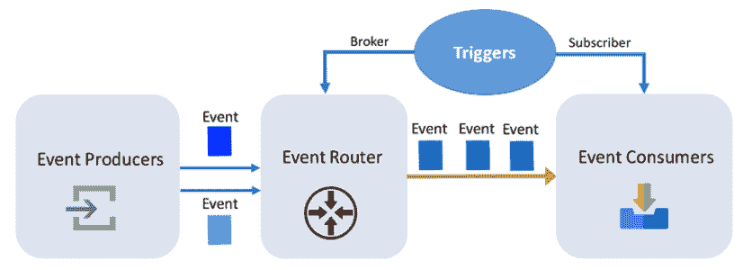

# 第 1 部分：

# 使用模式和技术构建面向云的应用
# 

在本書的这一部分中，我们将介绍无服务器架构、API、事件驱动架构和面向数据库的云。

本部分包含以下章节：

- *第 1 章，无服务器架构、事件驱动架构和云数据库简介*
- *第 2 章，API 管理 – 导入、管理和发布您的第一个 API*
- *第 3 章，开发基于事件和基于消息的解决方案*

## 无服务器架构、事件驱动架构和云数据库简介

第一章介绍本书的内容，包括使用**应用程序编程接口（API）**、**事件驱动架构**、**函数**和 **Service Fabric** 对应用进行现代化改造，并将其与数据库连接。

**现代化**不仅仅适用于那些已经稳定运行多年、数据量不断增长的公司。组织希望保持盈利能力，不愿因不进行技术现代化、不利用新冠疫情等改变世界的因素带来的市场变化而被淘汰。

现代化是为了加速创新和降低成本。现代化不仅涉及应用，也涉及数据。

在本章中，我们将讨论以下主要内容：

- 理解无服务器架构
- 理解 API 在应用及其生态系统中的作用
- 理解事件驱动架构
- 探索云数据库

### 理解无服务器架构

**无服务器架构**是一种软件设计模式，应用由第三方服务托管，使开发人员无需管理底层基础设施即可构建和运行服务。

应用被划分为多个独立的函数，这些函数可以被单独调用和伸缩。

开发人员只实现和部署应用代码，就可以运行由云提供商配置的服务器上托管的应用、数据库和存储系统。

我们将理解 API 在应用和生态系统中的作用。为了在不做任何修改的情况下开始改造遗留应用，我们可以使用 API 与现有代码进行交互。这些 API 将在云端运行，但如果我们需要为应用添加更多功能以实现现代化，我们将通过 API 将数据和函数封装到服务中。这个封装阶段是一种重用遗留软件组件的技术。其目标是将代码保留在其原有环境中，并通过封装将其连接到新的表示层，从而通过 API 访问不同的层。API 允许你定义通用协议（规则），以暴露应用的数据，并有可能解耦表示层。

从技术上讲，封装使用包装器技术，为遗留组件提供新的接口。该组件可以轻松地被其他软件组件访问。

这些最小的修改降低了破坏应用稳定性的风险。即使封装是一种快速、有效且成本较低的解决方案，它也无法解决与维护或升级困难相关的现有问题。

因为我们正在讨论 API 在数字化转型中的作用及其生命周期，所以我们需要对它们进行定义。

### API 定义

API 在不同应用之间架起桥梁，确保它们之间的通信和信息交换。它们甚至可以定义这些应用的行为。

API 被视为连接器，因为它们使不同的应用能够交换信息。

交换的信息通常是数据；例如，如果我们在移动应用中发出请求，数据将被发送到服务器，服务器执行读取操作，然后以 JSON 可读格式返回响应。

有时，微服务会与 API 进行比较。我们经常谈论 API 与微服务之间的关系，但它们之间也存在差异。微服务是一种架构风格，它将应用划分为一组服务；每个服务代表一个非常特定的领域，例如身份验证服务或另一个用于产品管理的服务。另一方面，API 是开发人员用来与 Web 应用进行交互的框架（一种可以构建软件的结构）。或者，微服务可以使用 API 来提供服务之间的通信。但 API 是如何工作的呢？

发送请求的应用称为**客户端**，发送响应的应用称为**服务器**。以蜜蜂为例，蜂巢是客户端，花朵是服务器，蜜蜂是通信路径（REST API 请求）。

### API 生命周期

API 管理器——通常是企业架构师或 API 产品经理——负责管理 API 生命周期。

API 生命周期由以下三个主要阶段组成：

- **创建阶段：** 包括创建和记录 API。API 创建需要考虑一些关键方面；API 将使用或重用后端资源（服务或业务能力实现）。这些资源通常以 RESTful 服务、**简单对象访问协议（SOAP）** 的 Web 服务，或符合**高级消息队列协议（AMQP）** 的消息代理的形式提供。
- **控制阶段：** 包括应用必要的安全策略，以确保交换的安全性。
- **消费阶段：** 包括发布 API，以便我们可以消费它并从中获利。

在理解了 API 生命周期及其不同阶段之后，接下来我们将了解 API 在应用间通信方面的重要作用。

### API 的作用

一组规则通过定义应用或机器如何通信来确保 API 的通信，因此 API 是两个希望相互通信的应用之间的中间桥梁。

### API 类型

Web API 是可以通过 HTTP 协议访问的 API。有许多 API 协议/规范，如下所示：

- 开放 API
- 合作伙伴 API
- 内部 API
- 复合 API
- **表述性状态转移（REST）**
- SOAP
- **可扩展标记语言远程过程调用（XML-RPC）**
- **JavaScript 对象表示法远程过程调用（JSON-RPC）**

最流行的 API 类型是 **RESTful**，因为它在创建满足客户端需求和依赖关系的 API 时具有多种灵活性优势，因为数据不绑定到方法或资源。RESTful API 支持不同的数据格式，例如 `application/json`、`application/xml`、`application/xhtml+xml`、`multipart/form-data` 和 `application/x-www-form-urlencoded`。

**RESTful API** 利用了现有协议——例如，Web API 利用了 HTTP 协议。

到目前为止，在本章中，我们已经讨论了通过 API 访问不同层的封装，作为遗留系统现代化的一种技术。我们介绍了 API 生命周期和 API 角色，这些角色包含多个确保通信的职责，并且我们确定了 API 类型，例如最流行的 RESTful API。在下一节中，我们将介绍用于提高复杂应用敏捷性的事件驱动架构。

### 理解事件驱动架构

事件驱动架构是一种软件架构，它使用事件在解耦的服务之间进行通信。它是一种设计松散耦合应用的模式，用于使用微服务构建的现代应用中。当消费者监听某个事件（可能是状态更改或更新）时，事件生产者无法知道哪些事件消费者在监听，甚至不知道事件发生后的后果。

在事件驱动架构中，我们有以下三个关键组件：

- **事件生产者：** 生成事件流
- **事件路由器：** 管理生产者和消费者之间的事件传递
- **事件消费者：** 监听事件

下图说明了这些组件：

图 1.1 – 事件驱动架构

事件的来源由内部或外部输入触发。事件可以由用户（例如，通过点击或使用键盘输入）、外部源（例如传感器输出）或通过系统（例如加载程序）生成。

在事件驱动架构中，我们可以使用事件流或发布者/订阅者模型。但是事件流和发布者/订阅者模型之间有什么区别？

- **发布者/订阅者模型：** 提供了一种框架，支持发布者和订阅者之间的消息交换。此模式涉及发布者和订阅者，并依赖于消息代理，该代理将消息从发布者重新路由到订阅者。
- **事件流：** 当事件流发布到代理时，客户端可以订阅该流并随时加入；他们可以访问这些事件，消费多个偏好的流，并且可以从任何位置读取并推进其位置。事件始终写入日志文件中。

事件驱动架构被推荐用于提高敏捷性和快速移动。它们用于现代应用，主要是微服务，或任何包含多个解耦组件的应用。采用事件驱动架构时，你可能需要重新思考如何看待应用设计。

在本节中，我们探讨了事件驱动架构及其不同的关键组件。

- **Azure Database for MariaDB**：用于在任何地方构建应用程序，保证低延迟和高可用性，并可扩展至任意规模，或将 Cassandra、MongoDB 及其他 NoSQL 工作负载迁移到云端。
- **Azure Cache for Redis**：用于借助兼容开源的内存数据存储来运行快速且可扩展的应用程序。
- **Azure Database Migration Service**：用于通过简单、自主掌控的迁移过程加速你向云的迁移。
- **Azure Managed Instance for Apache Cassandra**：用于对现有 Cassandra 数据集群和应用进行现代化改造，并通过托管实例服务享受灵活性与自由度。

### 总结

如果你正在构建新应用程序，或正在对旧版应用程序进行现代化改造，你需要了解这些架构：无服务器架构、API 和事件驱动架构。这些架构模式至关重要，必须掌握。

本章介绍了无服务器架构、API 定义、类型、生命周期、应用程序或机器之间的通信、事件驱动架构以及云数据库。

在下一章中，你将学习如何部署 Web API，以及 API 管理服务的浏览功能。

### 延伸阅读

如果需要更多关于无服务器架构的信息，可以查看这个链接：https://azure.microsoft.com/en-us/resources/cloud-computing-dictionary/what-is-serverless-computing/ 以及这本电子书：https://learn.microsoft.com/en-us/dotnet/architecture/serverless/。

你可以通过以下链接查看事件驱动架构的文档：https://learn.microsoft.com/en-us/azure/architecture/guide/architecture-styles/event-driven 和 https://learn.microsoft.com/en-us/azure/architecture/reference-architectures/serverless/event-processing。

### 问题

- 1. 事件驱动架构的三个关键组成部分是什么？
- 2. Azure 提供哪些不同的数据库服务？
