## API 管理——导入、管理和发布你的第一个 API

在本章中，我们将探索 Azure API 管理的各种功能。我们将了解 API 网关模式以及 API 调用的管理。我们还将把医疗解决方案的 Web API 发布到 Azure API 管理，使用订阅和证书保护 API，并创建后端 API。

在本章中，我们将涵盖以下主要主题：

- 技术要求
- API 网关模式
- 探索 API 管理服务
- 保护 API 安全
- 练习 1——创建后端 API 并部署 API
- 练习 2——使用 Azure API 管理代理公共 API

### 技术要求

在开始探索我们的解决方案之前，你需要一个用于 C# 的代码编辑器。Microsoft 提供了代码编辑器和集成开发环境（IDE），例如：

- 适用于 Windows、macOS 或 Linux 的 Visual Studio Code
- 适用于 Windows 的 Visual Studio 2022
- 适用于 Linux 的 Visual Studio 2022
- GitHub Codespaces

作为先决条件，我们需要一个 Azure 帐户，以便能够在 Azure 应用服务和 Azure API 管理中部署我们的 API。

本章介绍的医疗解决方案使用 .NET 6 框架。

本书的 GitHub 仓库包含与医疗领域相关的完整应用程序项目解决方案，这些解决方案将在接下来的章节中使用：

```
https://github.com/didourebaI/developerGuideForCloudApps
```

### API 网关模式

在基于多个客户端应用程序上建立的复杂或大型微服务开发应用程序时，建议使用 API 网关模式。

### 定义

API 网关模式是一种供客户端与系统服务通信的集成模式，旨在底层服务与客户需求之间提供单一抽象层。它是所有客户端的单一入口点。它类似于**面向对象编程（OOP）**设计中的外观模式，但在这种情况下，它是分布式系统的一部分。

API 网关模式通常被称为*面向前端的后端*，因为其实现基于客户端应用程序的需求。该模式提供一种反向代理，其目的是将客户端请求重定向或路由到内部微服务端点。

何时应考虑使用 API 网关模式？以下列表说明了适用场景：

- 发起调用的系统会发出同步响应
- 微服务之间的依赖关系可控且不会随时间变化
- 没有延迟要求；即使响应缓慢也不会出现严重问题
- 需要公开 API 以从各个微服务收集数据

在定义 API 网关模式之后，下一节我们将探讨本章要使用的用例。

### 用例

让我们首先看一个与客户端应用和微服务之间直接通信相关的问题。下图展示了我们的解决方案，其中包含多个直接与客户端应用程序交互的前端和后端服务。

在我们的场景中，客户端应用必须直接向微服务发送请求。客户端如何知道要调用哪些端点？例如，如果我们引入新服务，或者决定进行更改并重构现有服务，会发生什么？

服务如何处理身份验证或**安全套接层（SSL）**终止、数据转换和动态请求分发？

客户端应用如何与使用不同协议的服务通信？当我们直接向客户端暴露服务时，存在一些潜在问题：

- 客户端必须跟踪已实现的多个端点以确保弹性的故障处理，这导致客户端代码实现复杂。
- 客户端与后端之间的耦合。这使得维护客户端更加困难，也使得重构服务更加困难。

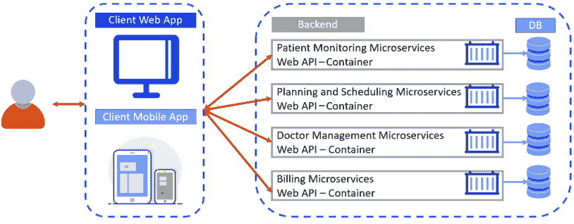

图 2.1——使用直接客户端到微服务通信架构的场景

所有这些挑战都可以通过实现 API 网关模式来解决，从而将客户端与服务解耦，因为对于基于微服务的应用程序来说，设置一个中间层级或间接层（网关）可能非常方便。API 网关位于客户端应用和微服务之间。

下图展示了一个基于微服务并通过自定义 API 网关集成与客户交互的简化架构：

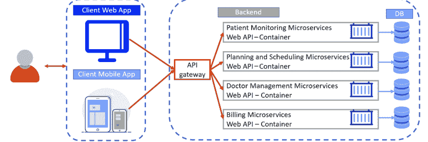

图 2.2——使用自定义服务实现 API 网关的场景

除了使用 API 网关模式的优势之外，还有一些不容忽视的缺点：

- 设置可能很复杂，因为 API 网关是另一个额外部分，需要与微服务及整个解决方案分开开发、部署和管理。
- 通信过程中可能存在延迟。由于通过 API 网关额外增加了一次网络跳转，响应时间可能比简化架构更慢——但对于大多数应用程序而言，额外的往返开销并不大。

组织之所以采用微服务，是因为该架构具有可扩展性和灵活性。然而，要充分利用微服务战略的优势，需要 API 网关。Azure API 管理包含 API 网关，我们将在下一节中对其进行探索。

### 探索 API 管理服务

在本节中，我们将介绍 API 管理的组件及其功能，并探索 API 管理中使用 API 的产品。

### API 管理组件

Azure API 管理是一个混合、可移植、多云 API 管理平台，其核心功能是通过开发者参与、业务洞察、分析、安全和保护来确保 API 项目的成功。每个 API 可以包含一个或多个操作，并且可以添加到一个或多个产品中。


## 如何在 API 管理中使用 API？

开发者使用 API 其实非常简单且交互性强。他们必须订阅包含该 API 的产品，然后就可以调用 API 的所需操作，同时确保执行可能生效的使用策略。

API 在集成应用时提供了简化的体验，使新产品和服务数据能够在通用规模上实现重用和访问。

随着 API 的增加，尤其是对 API 发布和使用的依赖日益增长，每家公司都必须将这些 API 作为符合多项标准的优质资产进行管理。

这些标准包括 API 生命周期；API 消费者后端架构的多样性和复杂性；API 运行的保护、加速和监控；以及不同用户对 API 的消费和对托管在 Azure 内部或外部的这些服务的保障。所有这些标准都由 Azure API Management 支持。

Azure API Management 由以下组件组成：

- API 网关
- Azure 门户
- 开发者门户

下图展示了 Azure API Management 的不同组件：

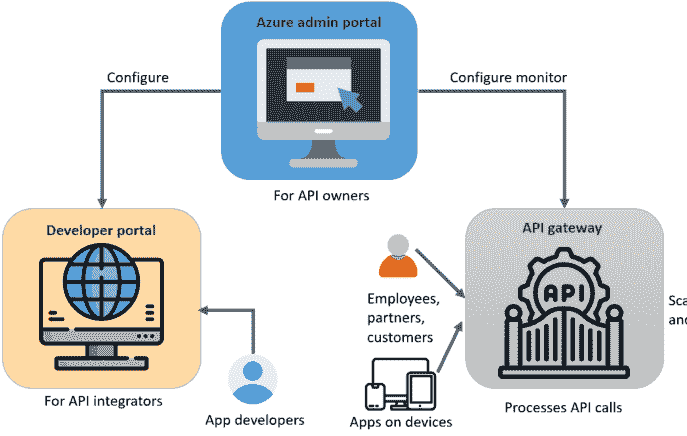

图 2.3 – Azure API Management 组件

我们已经探讨了使用 API Management 的不同方式及其不同组件。接下来我们将查看 API 网关。

## API 网关

如前所述，API 网关是端点。它接收开发者发出的 API 调用，并根据 API 的内部设计将其路由到一个或多个后端。**API 密钥、JSON Web Tokens (JWTs)、证书**和其他凭据的验证也在端点级别执行。如果你的 API 被无限制调用，从而减慢系统并产生干扰，则可以通过应用使用配额和流量限制来管理凭据验证。我们可以在不更改 API 网关代码的情况下即时执行 API 转换。

元数据将被记录以供分析目的，以及在配置时进行的后端响应缓存。

在下面的屏幕截图中，我们可以看到在 Azure 中创建 API Management 服务实例时显示的网关 URL：

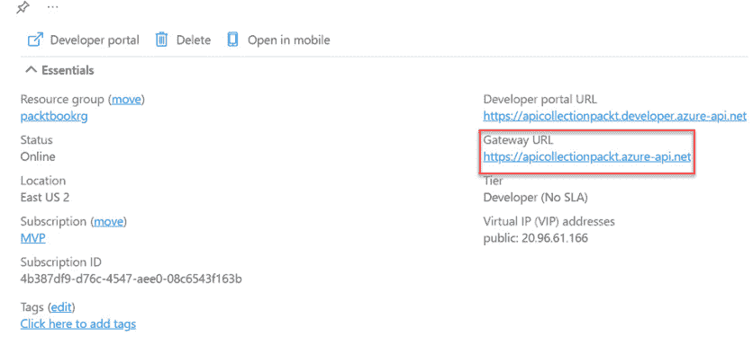

图 2.4 – Azure API Management 中的网关 URL

我们将开始使用 Azure 门户创建 API Management 服务。

## Azure 门户

Azure 门户包含 200 多种云产品和服务，API Management 是一个管理界面，您可以在其中配置 API 程序。

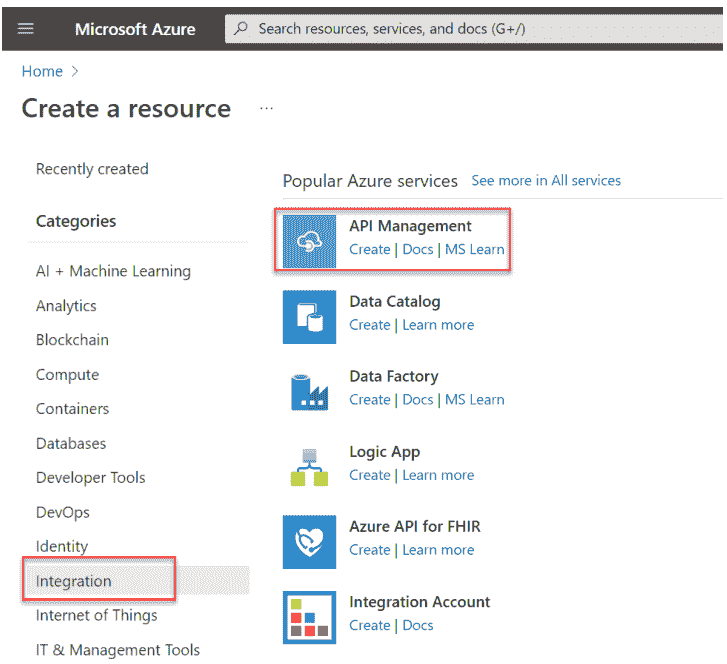

图 2.5 – Azure 门户中的 API Management

通过 API Management，我们可以定义或导入 API 架构，将 API 分组到产品中，管理用户，从分析中获取洞察，甚至配置访问或消费策略，例如配额或对 API 执行的转换。

## 开发者门户

当我们创建新的 API Management 实例时，会自动生成一个开源开发者门户。它供开发者使用，是一个可以个性化的网站，包括您 API 的文档。

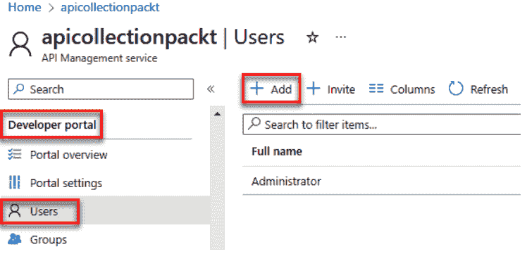

图 2.7 – 在 Azure API Management 中创建新开发者

默认情况下，新创建的开发者账户具有活动状态，并被分配到 Developers 组。活动的开发者账户可用于访问其已订阅的任何 API。

我们可以通过从开发者门户向他们发送通知来邀请开发者访问开发者门户。发送邀请的步骤如下：

- 1. 在 **Developer portal** 下的 **Users** 中，选择 **Invite**。
- 2. 填写邀请用户所需的所有信息。邮件将发送给开发者。可以为邮件使用自定义模板。如果用户接受邀请，账户将被激活。请注意，邀请链接有效期为 48 小时。

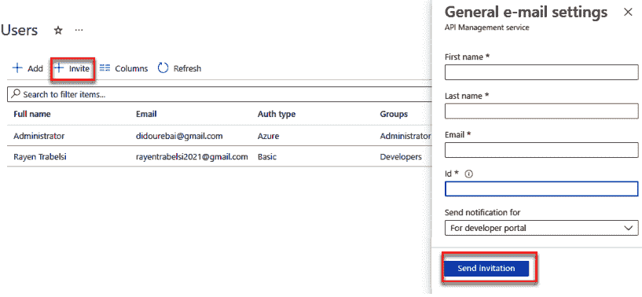

图 2.8 – 邀请开发者

要禁用开发者账户以阻止其访问开发者门户或调用任何 API，请选择 **Block**，如 *图 2.9* 所示。要重新激活被阻止的开发者账户，请选择 **Activate**。如果我们想删除现有活动用户，则选择 **Delete**。

这些选项显示在以下屏幕截图中：

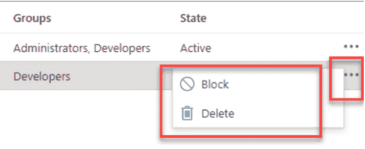

图 2.9 – 在 Azure API Management 中阻止或删除开发者账户

用户与一个组相关联。组用于为每个开发者提供产品可见性管理。API Management 具有以下不可变的系统组：

- **Administrators：** Azure 订阅管理员是该组的成员。管理员管理 API Management 服务实例。他们创建开发者使用的 API、操作和产品。
- **Developers：** 该组面向使用 API 构建应用的已认证开发者门户用户。他们可以访问开发者门户，并能够构建调用 API 操作的应用。
- **Guests：** 开发者门户的未认证用户，例如访问 API Management 实例开发者门户的潜在客户，属于该组。管理员可以授予他们只读访问权限，例如查看 API 而不调用它们。

管理员可以创建自定义组或在 Azure Active Directory 租户中使用外部组。

## 产品

产品是 API Management 中一个或多个 API 的集合，并配置了标题、描述以及使用条款和访问限制：开放或受保护。开放和受保护的唯一区别是，受保护的产品必须在开发者使用或消费前订阅；开放的产品无需订阅即可使用。配置订阅审批是在产品级别本身完成的，需要管理员审批或自动审批。

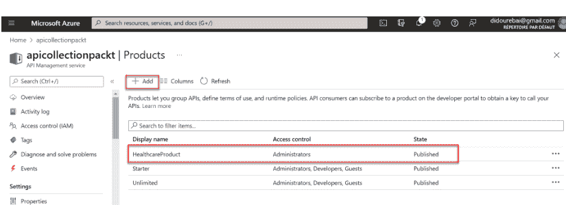

图 2.10 – Azure API Management 中的产品

允许 Azure 门户通过配置修改 API 行为的最强大的 API Management 功能之一是 **policies**。

策略呈现了一组语句列表，可以按顺序在 API 的请求或响应上执行。最著名的声明包括从 XML 到 JSON 的格式转换。

## 创建和发布产品

在 Azure API Management 中，产品包含一个或多个 API、使用配额和服务条款。一旦产品发布，开发者就可以订阅并开始使用这些 API。

要创建和发布产品，您需要按照以下步骤操作：

- 1. 登录 Azure 门户并导航到您的 API Management 实例。
- 2. 在左侧导航窗格中，选择 **Products**；之后，选择 + **Add** 按钮。

3. 在 **Add product** 窗口中，填写字段，如以下屏幕截图所示，以创建您的产品：

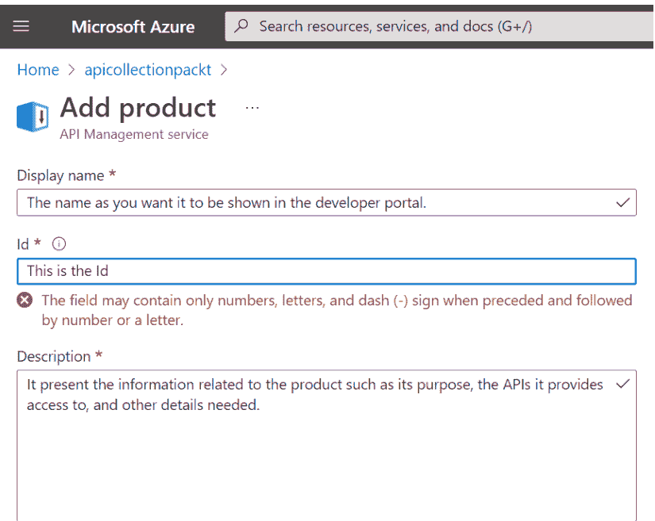

图 2.11 – 添加产品 第 1 部分

如果我们向下滚动 **Add product** 窗口，将看到以下屏幕截图所示的内容。我们需要填写更多信息并选择复选框以定义产品是否可以发布等：

### Add product

API Management service

Home > apicollectionpackt >

Published

Requires subscription

Requires approval

Subscription count limit

2000

Legal terms

You can include the terms of use for the product which subscribers must accept in order to use the product.

APIs

Create

图 2.12 – 添加产品 第 2 部分

如果选中 **Published**，产品将被发布，此产品中的 API 可以被调用；否则，未发布产品仅对 Administrators 组可见。

如果选中 **Requires subscription**，用户在使用产品前需要订阅，因为产品受保护，需要使用订阅密钥访问产品的 API；否则，产品是开放的，不需要订阅密钥。

如果选中 **Requires approval**，管理员将审查并接受或拒绝对此产品的订阅尝试，否则订阅尝试将自动批准。

**Subscription count limit** 对同时订阅数量施加限制，是可选的。

在 **APIs** 下，我们可以选择一个或多个 API 将其添加到要创建的产品中。这是可选的，因为您也可以在创建产品后添加 API。

- 4. 最后，选择 **Create** 以创建您的新产品。

一旦新产品创建完成，它就可以被开发者或任何应用使用。


## 保护 API

通过 API 管理发布 API 时，使用订阅密钥来保护对这些 API 的访问。开发人员在调用 API 时必须在 HTTP 请求中包含有效的订阅密钥；否则，这些调用将被 API 管理网关拒绝。然而，到后端的传输并不安全。

如果开发人员想要使用已发布的 API，则需要订阅。想要使用已发布 API 的开发人员在调用这些 API 时，必须在 HTTP 请求中包含有效的订阅密钥。没有有效的订阅密钥，这些调用会被 API 管理网关立即拒绝，或者不会被转发到后端服务。他们无需 API 发布者批准即可获得订阅，尽管 API 发布者甚至可以直接为 API 消费者创建订阅。

Azure API 管理服务支持多种 API 访问安全机制，例如 OAuth 2.0、客户端证书和 IP 允许列表。

### 订阅和密钥

订阅密钥是唯一的自动生成的密钥。此密钥可以通过客户端请求的标头或作为查询字符串参数传递。

订阅提供对授权和策略的全面而详细的控制。密钥直接与订阅关联，并且可以扩展到不同的域。

每个应用程序在调用受保护的 API 时，必须在每个请求中包含密钥。

如果我们想与另一个授权用户共享密钥，则订阅密钥的重新生成既简单又可行。

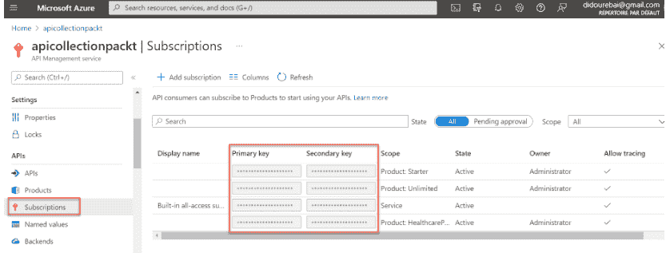

图 2.13 – Azure API 管理中的订阅

前面的截图显示，一个订阅有两个密钥：主密钥和辅助密钥，这使得重新生成更容易。例如，在修改主密钥的情况下，为了避免停机，您可以在应用程序中使用辅助密钥。

回到已经包含我们 API 并启用了订阅的产品，每个客户在产品 API 调用期间必须提供密钥。

开发人员将提交订阅请求以获取密钥。如果此请求获得批准，则订阅密钥将以安全（加密）的方式发送。

### 使用订阅密钥调用 API 的过程

默认标头名称是 `Ocp-Apim-Subscription-Key`，默认查询字符串是 `subscription-key`。调用受订阅保护的 API 端点的应用程序必须在其所有 HTTP 请求中包含有效的密钥，可以在请求标头中，也可以作为 URL 中的查询字符串。

如果我们想测试 API 调用，可以使用开发人员门户或命令行工具，例如 cURL。

查看此示例，使用 cURL 在请求标头中传递密钥：

```bash
curl --header "Ocp-Apim-Subscription-Key: <your key string>"
https://<yourapim gateway>.azure-api.net/api/path
```

下面是另一个 cURL 命令示例，它在 URL 中传递密钥作为查询字符串：

```bash
curl https://<yourapim gateway>.azure-api.net/api/path?subscription-key=<keystring>
```

如果由于任何原因未在请求标头或 URL 的查询字符串中传递密钥，将从 API 网关收到 `401 Access Denied` 响应。

### 使用证书保护 API

在上一节中，我们使用了密钥，但我们也可以使用证书在客户端和 API 网关之间提供传输层安全性（TLS）相互认证。

我们必须将 API 管理网关配置为只允许包含特定指纹的证书请求。网关级别的授权通过入站策略处理。

证书可以包含以下属性：

- **证书颁发机构（CA）：** API 只允许由特定 CA 签名的证书。
- **指纹：** API 只允许包含指定指纹的证书。
- **主题：** API 允许特定主题（证书中提及）。
- **过期日期：** API 只允许尚未过期且仍然有效的证书。

#### 在消耗层中接受客户端证书

如果您使用无服务器技术（如 Azure Functions）构建 API，则 API 管理中的消耗层旨在满足无服务器设计原则。

您必须显式启用消耗层的客户端证书使用，这可以在**自定义域**页面上完成。

自定义域是我们可以从提供商处购买的域或子域，用于个人或专业目的（例如，`yourdomain.com` 或 `pages.yourdomain.com`）。

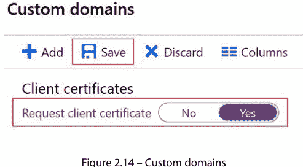

在前面的截图中，我们可以看到我们能够添加一个或多个客户端证书。我们可以通过选择**是**来启用请求客户端证书。接下来，我们将创建策略。

#### 证书授权策略

有以下不同的授权策略：

- 调用 API 管理 API 时执行入站策略。
- API 管理调用后端 API 时执行后端策略。
- API 管理向调用方返回响应时执行出站策略。

### 使用 Azure 门户

我们将使用以下链接打开 Azure 门户：https://portal.azure.com/，然后按照以下步骤操作：

1. 在主页上选择**创建资源**。
2. 在**创建资源**页面上，选择**集成**，然后选择**API 管理**。
3. 在**安装 API 管理网关**页面上，输入请求的各种设置。以下截图显示了**项目详细信息**和**实例详细信息**部分：

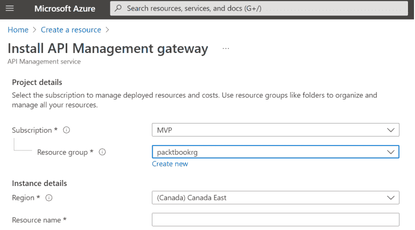

图 2.16 – 创建 API 管理实例（第 1 部分）

在**项目详细信息**部分，我们需要选择**订阅**字段，并选择**资源组**字段或创建一个新资源组。

在**实例详细信息**部分，我们将指定**区域**字段并输入**资源名称**字段。这是您的 API 管理服务的唯一名称，创建后无法修改。将按如下方式生成默认域名：`<ResourceName>.azure-api.net`。但是，我们可以配置域名来更改它。

如果我们向下滚动前面截图中显示的窗口，我们会看到需要完成**组织名称**和**管理员电子邮件**字段，并从**定价层**字段中选择一个选项。如下面的截图所示：

> **安装 API 管理网关**
> API 管理服务
> 主页 > 创建资源
>
> **组织名称** *
> 输入组织名称
>
> **管理员电子邮件** *
> 输入管理员电子邮件
>
> **定价层**
> API 管理定价层因每单位计算容量和提供的功能集而异——例如，对虚拟网络、多区域部署或自托管网关的支持。若要容纳更多 API 请求，请考虑改为添加 API 管理服务单元。了解详细信息
>
> API 管理的开发人员层不包含 SLA，不应用于生产目的。您的服务可能会遭遇间歇性中断，例如在升级期间。了解详细信息
>
> **定价层：** 开发人员（无 SLA）
>
> **查看 + 创建**
>
> < 上一步 | 下一步：监控 >

图 2.17 – 创建 API 管理实例（第 2 部分）

> **重要说明：** 在此层中创建和启用 API 管理服务可能需要 30-40 分钟。之后，您可以将服务固定到仪表板，以便快速找到它。


我们使用 Azure 门户创建了一个 API 管理服务。这是一种交互式方法，但如果你喜欢使用命令行，可以使用 Azure Cloud Shell。我们将在下一节学习关于它的内容。

## 使用 Azure Cloud Shell

Azure Cloud Shell 是一个基于浏览器的交互式、已授权 shell，用于管理 Azure 资源。它为你提供了使用 Bash 或 PowerShell 作为 shell 体验的选项，具体取决于你的操作方式：

- 1. 登录到 Azure 门户并打开 Cloud Shell。

  

  图 2.18 – Azure Cloud Shell

  当 Cloud Shell 门户打开时，你有两个选项：PowerShell 或 Bash。我们将选择 Bash 环境：

  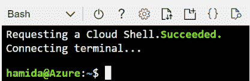

  图 2.19 – 使用 Bash 环境的 Azure Cloud Shell

- 2. 我们将定义变量以便在命令行界面 (CLI) 命令中使用。在以下代码片段中，我们仅定义了 API 管理实例的名称、位置和电子邮件地址：

  ```bash
  $ myApiName=apicollectionpackt
  $ myLocation=EastUS2
  $ myEmail=rebai.hamida@gmail.com
  ```

- 3. 我们将创建一个资源组。以下命令将创建一个名为 packtbookrg 的资源组：

  ```bash
  $ az group create --name packtbookrg --location $myLocation
  ```

- 4. 我们将创建一个 API 管理实例。`az apim create` 命令用于创建实例。`--sku-name Consumption` 选项在我们的案例中仅用于加快演练过程，但我们可以使用任何库存保持单位 (SKU)（定价层）：

  ```bash
  $ az apim create -n $myApiName \
  --location $myLocation \
  --publisher-email $myEmail \
  --resource-group packtbookrg \
  --publisher-name First-APIM-Exercise \
  --sku-name Consumption
  ```

**重要说明**
操作大约需要 5 分钟完成。

创建 API 管理服务后，我们将在下一节导入并发布 API。

## 导入 API

本节向你展示如何导入和发布 OpenAPI 规范后端 API（以前称为 Swagger 规范）。

在本节中，你将了解我们在示例中使用的最小 Web API。

### 最小 Web API 简介

这是一种构建 API 的新方法，无需模型-视图-控制器 (MVC) 的复杂结构，且名称上是最小的。它包含构建 HTTP API 所需的基本组件。你只需要 csproj 和 program.cs。

使用最小 Web API 的好处如下：

- 它比使用 ASP.NET Web API 更简单
- 它易于学习和使用
- 你不需要 MVC 结构 – 无需控制器！
- 它只需最少的代码即可构建和编译应用程序，这意味着应用程序运行速度更快，因此性能更好
- 它具有 .NET 6 和 C# 10 的最新改进和功能

### 使用 Visual Studio 2022 创建最小 Web API

在本节中，我们将使用 Visual Studio 2022 创建 ASP.NET Core Web API 应用程序。

按照以下步骤在 Visual Studio 2022 中创建最小 Web API：

- 1. 打开 Visual Studio 2022 并选择 **Create a new project**。
- 2. 选择 **ASP.NET Core Web API** 项目模板：

  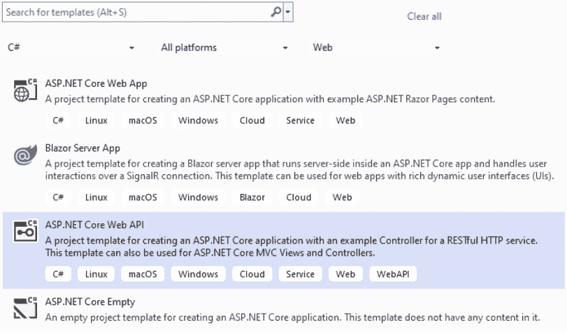

  图 2.20 – ASP.NET Core Web API 模板

- 3. 禁用 **Use controllers (uncheck to use minimal APIs)** 以便能够使用最小 API。

  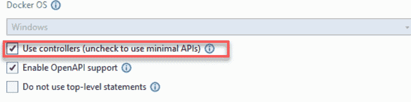

  图 2.21 – 在 Visual Studio 2022 中启用最小 API

- 4. 当项目创建完成后，打开 program.cs 查看 API 实现：

  ```csharp
  app.MapGet("/weatherforecast", (HttpContext httpContext) =>
  {
      var forecast = Enumerable.Range(1, 5).Select(index =>
          new WeatherForecast
          {
              Date = DateTime.Now.AddDays(index),
              TemperatureC = Random.Shared.Next(-20, 55),
              Summary = summaries[Random.Shared.Next(summaries.Length)]
          })
          .ToArray();
      return forecast;
  })
  .WithName("GetWeatherForecast");
  ```

  图 2.22 – Program.cs 中的最小 API 示例

在探索了最小 Web API 后，我们将在下一节学习如何将其导入 API 管理服务。

### 将 API 导入 API 管理

让我们查看将 API 导入 API 管理的步骤：

- 1. 在 Azure 门户中搜索并选择 API 管理服务。
- 2. 接下来，在 API 管理窗口中，选择你已创建的 API 管理实例。
- 3. 在 API 管理服务导航窗格中选择 APIs。

  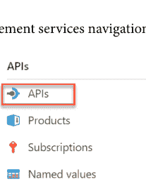

  图 2.23 – API 管理中的 APIs

- 4. 从列表中选择 OpenAPI。之后，我们将在弹出窗口中选择 Full：

  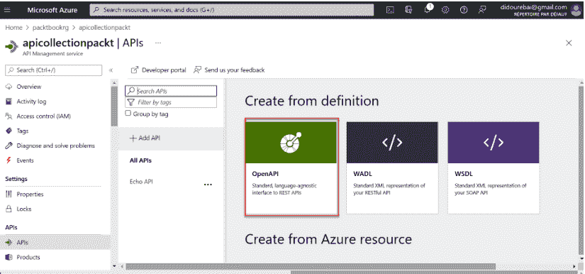

  图 2.24 – 选择 OpenAPI

我们需要在“Create from OpenAPI specification”弹出窗口中填写所有所需信息：

### Create from OpenAPI specification

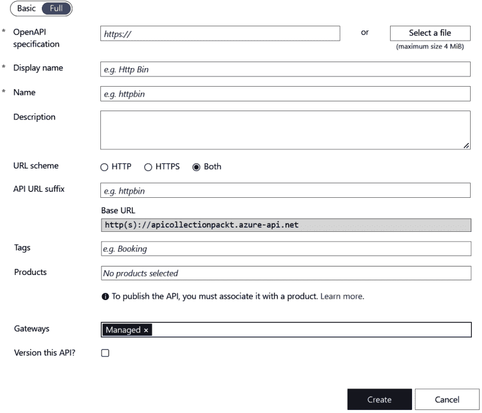

图 2.25 – Create from OpenAPI specification

- 5. 要从 **OpenAPI specification** 创建 API，我们需要添加所有配置设置。下表描述了前一个屏幕截图中显示的每个设置：

| 设置 | 描述 |
|---|---|
| **OpenAPI specification** | 这是指实现 API 的服务。请求将被转发到此地址。一旦输入 URL，表单中大部分所需信息会自动填写。 |
| **Display name** | 配置后，该名称将在开发者门户中显示。 |
| **Name** | 这是 API 的唯一名称。 |
| **Description** | 这是可选的，用于提供与你的 API 相关的更多信息。 |
| **API URL suffix** | API 管理通过其后缀区分 API。该后缀对每个 API 都是唯一的。它将被添加到 API 管理服务的基 URL。 |

点击 **Create** 导入 API。

### 配置后端设置

API 已创建，现在需要指定后端。

我们将选择右侧刀片中的设置并在 **Web service URL** 字段中输入 URL。之后，我们将取消选择 **Subscription required** 复选框。

一旦 API 已导入并且后端已配置，就是测试 API 的时候了。在下一节中，我们将学习如何在 Azure API 管理服务中测试我们的 API。

### 测试 API

我们需要选择 Test 选项卡。在左侧，我们会找到与我们的 API 相关的所有操作。在页面右侧是查询参数和标头（如有）。Ocp-Apim-Subscription-Key 会自动填充与此 API 关联的订阅密钥。另一个选择将显示方法列表。我们可以选择一种方法，例如 BillingList，然后点击 Send。

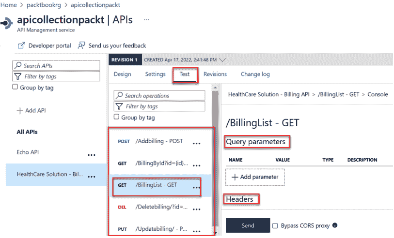

图 2.27 – 测试 API

后端响应 200 OK 并返回一些数据。

### HTTP 响应

```http
HTTP/1.1 200 OK
content-type: application/json; charset=utf-8
date: Sun, 17 Apr 2022 19:00:37 GMT
ocp-apim-apiid: healthcare-solution-billing-api
```

图 2.28 – 后端响应 200 OK

在下一节中，我们将学习如何使用 Azure API 管理来代理公共 API。

## 练习 2 – 使用 Azure API 管理代理公共 API

当我们设计解决方案以使用一个或多个 API 时，通信在不同服务、系统和脚本之间必须通过 API 进行。在描述这些通信并设计我们的 API 之前，我们必须考虑以下几个要素：

- 路由结构
- 身份验证和授权
- 速率限制

使用 Azure API 管理，在数据接收或发送之前，你可以轻松代理现有 API 并修改输入和输出。

在大多数情况下，我们希望修改现有公共 API 的结构、添加身份验证、限制传入请求的数量，甚至缓存获得的结果。这就是本节将要涵盖的内容，我们将发现管理 API 和快速使用它的便捷性。

我们可以使用 Azure Logic Apps 代理、Azure App Service 或 Azure Functions 应用，但在我们的示例中，我们将使用公共 API。

在本练习中，我们将使用之前导入的 API。

### 导入 OpenAPI 模式以进行代理

Azure API 管理服务将导入的不同格式。

在可用方法列表中，/BillingList 方法以 JSON 格式提供账单明细列表。使用标准 PowerShell 查询，如以下代码片段所示，将允许我们通过 API 代理检索结果：

```powershell
$Result = Invoke-RestMethod -URI 'https://healthcarebillingapi.azurewebsites.net/BillingList'
$Result.data.summary
```

开发人员倾向于对返回给他们的输出键进行更改。我们将选择需要修改的方法；之后，我们将在 **Outbound Processing** 中选择相同的方法并选择 **Add Policy**。之后，选择 **Other policies**，并在 **Transformation policies** 中查找 **Find and replace string in body** 选项。


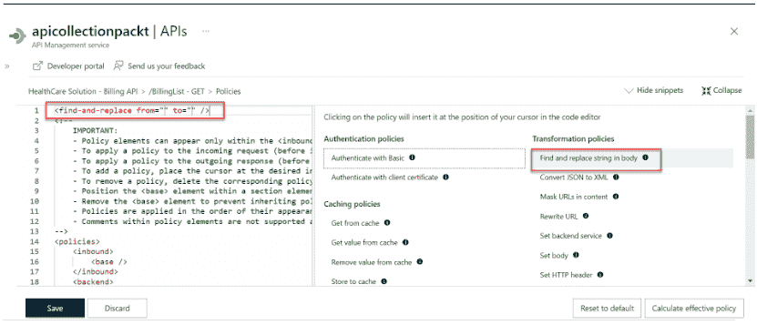

图 2.29 – 在正文中查找并替换字符串

我们将按如下方式修改发送回客户端的结果：

```
find-and-replace from="price_billing" to="price" />
```

在出站处理中，我们能够在响应发送到客户端之前对其进行修改。

## 总结

在本章中，我们了解了 API 管理服务的不同组件及其功能。之后，我们重点讨论了 API 网关在管理对我们 API 的调用中的作用。然后，我们学习了如何使用订阅和证书来保护对 API 的访问。我们创建了一个后端 API，并使用 Azure API 管理来代理公共 API。

在下一章中，我们将学习如何开发基于事件和基于消息的解决方案。我们将探索 Event Grid、Azure 事件中心和 Azure 消息队列。
