## 开发基于事件和基于消息的解决方案

在本章中，我们将探索基于事件和基于消息的解决方案的使用。我们将从 Web 应用程序发布和订阅，了解如何使用相同的应用程序从服务总线队列发送和接收消息，发现 Event Grid 的操作模式以及它如何连接到服务和事件处理程序，并探索 Azure 事件中心。

在本章中，我们将涵盖以下主要内容：

- 探索 Event Grid 和 Azure 事件中心
- 练习 1 – 从 .NET 应用向 Event Grid 事件发布和订阅
- 探索 Azure 消息队列
- 练习 2 – 创建 Azure 服务总线命名空间和队列
- 练习 3 – 使用 .NET Core 应用程序向服务总线队列发布消息
- 练习 4 – 使用 .NET Core 应用程序从服务总线队列读取消息
- 练习 5 – 向主题发送消息以及从主题接收消息

### 引言

事件是导致状态发生变化的动作。这种状态变化可以很简单，也可以很复杂，但当状态发生变化时，就被视为一个事件。在事件驱动的架构方法中，消费者*订阅*事件，并能在事件发生时收到通知。这与传统的服务器-客户端模型形成对比，在传统模型中，客户端主动请求一组信息的更新。该模型解决了一个简单的问题——我们如何通知消费者状态变化？基于消息的方法解决了同样的问题，但方式与传统服务器-客户端模型不同。基于消息的方法背后的简单想法是，不要求消费者订阅事件更新，而是各个元素或服务可以拥有包含许多调用的消息队列。这些调用按顺序排列并发送给所有相关方。

总而言之，消息队列不是通过通知让某个事件创建服务，而是接收需要额外处理的事件或输出，然后将其添加到长队列中。

企业组织需要变得事件驱动，并能够实时响应。在事件驱动的架构中，事件用于触发和通信解耦服务，并几乎实时地传递，消费者能够在事件产生时立即响应。

事件可以是状态的变化，也可以是电子商务网站上购物车中某项商品的更新或删除。一系列相关事件代表一种行为或状态。例如，对于已购买的商品，其价格和配送地址，在这种情况下，事件将呈现标识符，例如发送订单已发货的通知。

让我们看一下下面的图示。事件路由器连接不同的服务，并用作发送和接收消息的路由。

当事件生产者生成事件时，事件路由器会将事件作为输入发送给适当的消费者，然后对第一个事件执行响应。我们可以观察到托管服务之间异步处理的事件流，这些服务的结果取决于服务对事件的反应。

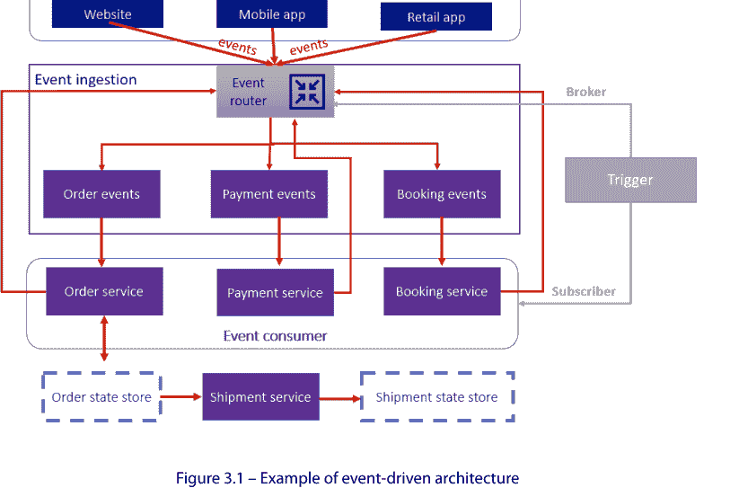

图 3.1 – 事件驱动架构示例

我们已经了解了基于事件的架构的基本元素。现在我们将继续了解 **Azure 事件网格**，它使我们能够轻松构建基于事件的架构的应用程序，以及 **Azure 事件中心**，一个可扩展的事件处理服务，允许我们存储和管理事件。

## 探索事件网格和 Azure 事件中心

在本节中，我们将探索事件网格和事件中心的基本元素。

### 事件网格

Azure 事件网格用于轻松构建基于事件的架构的应用程序。

它简单且交互性强。首先，我们选择想要订阅的 Azure 资源，然后指明事件处理程序或我们要将事件发送到的 webhook 端点。

事件网格支持来自 Azure 服务的所有事件，例如存储 Blob 和资源组。事件网格还支持使用自定义主题的其他外部事件。

筛选器提供了将特定事件路由到不同端点的能力。我们还可以向多个端点进行多播，以确保事件可靠地流式传输。

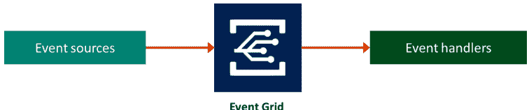

图 3.2 – 源和处理程序

事件源是事件发生的位置。包括 Blob 存储、媒体服务、IoT 中心和 Service Bus 在内的多个 Azure 服务会自动配置为发送事件。我们还可以使用自定义应用程序发送事件。请注意，自定义应用程序不需要托管在 Azure 或云中，即可使用事件网格进行事件分发。

事件处理程序是事件发送到的目标。处理程序会采取进一步的操作来处理事件。多个 Azure 服务（例如 **Azure Functions**、**逻辑应用**、**队列存储**或任何事件中心）会自动配置为处理事件。我们还可以使用任何 webhook 来处理事件。webhook 不需要托管在 Azure 或云中即可处理事件。

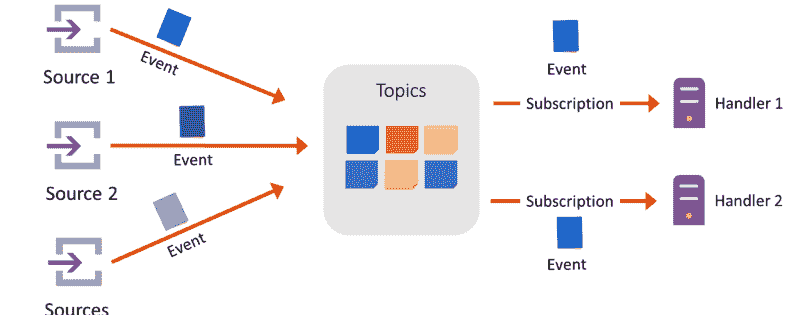

图 3.3 – 事件网格基本概念

我们将 Azure 事件网格定义为路由来自 Azure 服务的所有事件。事件网格由两个基本元素组成：事件源和事件处理程序。在下一节中，我们将在开始一些练习之前定义事件中心。

### 事件中心

Azure 事件中心是一种可扩展的事件处理服务，用于存储和处理分布式软件和设备产生的大量事件、数据和遥测。它提供了一个低延迟、高可靠性的分布式流处理平台。

## 练习 1 – 从 .NET 应用向 Event Grid 事件发布和订阅

在本练习中，我们可以使用 Visual Studio Code 或 Visual Studio 2022 来创建控制台 .NET 应用程序。我们将完成以下步骤：

- 1. 创建事件网格。
- 2. 创建 .NET 控制台项目。
- 3. 对程序类进行一些修改，以便能够连接到事件网格。
- 4. 向事件网格发布新事件。

在下一节中，我们将首先创建一个事件网格主题。

### 创建事件网格主题

事件网格主题是相关事件（例如，*存储事件*或*库存事件*）的通道。

事件网格主题提供了源向其发送事件的端点。发布者创建事件网格主题，并决定事件源需要一个主题还是多个主题。主题用于相关事件的集合。订阅者决定订阅哪些主题，以便响应特定类型的事件。

我们将使用 Azure 门户创建事件网格主题，步骤如下：

- 1. 浏览到 Azure 门户（`https://portal.azure.com`），然后使用你的帐户登录。
- 2. 在 **搜索服务和市场** 文本框中，键入 `Event Grid Topic`，然后按 *Enter*。
- 3. 选择 **Event Grid Topic** 结果，然后选择 **创建**。以下截图显示了 **基本信息** 选项卡中配置的设置。我们输入创建事件网格主题所需的所有信息，然后选择 **查看 + 创建**，然后选择 **创建**。

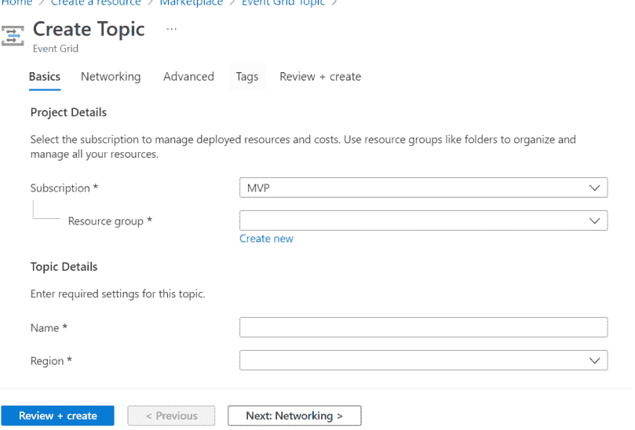

图 3.4 – 在事件网格中创建主题

- 4. 现在，我们将 Azure 事件网格查看器部署到 Web 应用程序。

我们已经创建了一个事件网格主题。在下一节中，我们将创建一个 Web 应用程序，以部署 Azure 事件网格查看器。


## 创建 Web 应用以部署 Azure Event Grid 查看器

我们将在与 Event Grid 主题相同的资源组中创建一个 Web 应用。我们将使用以下配置设置在 Docker 容器中发布 Web 应用实例：

Figure 3.5 – Create Web App – the Basic tab

在 **Docker** 选项卡中，按以下图所示配置设置。我们在 **Image and tag** 字段中使用 `microsoftlearning/azure-event-grid-viewer:latest`。该镜像是一个使用 **ASP.NET Core** 和 **SignalR** 构建的 Web 应用程序，专门用于近实时查看来自 Azure Event Grid 的通知。完成后，选择 **Review + create**。

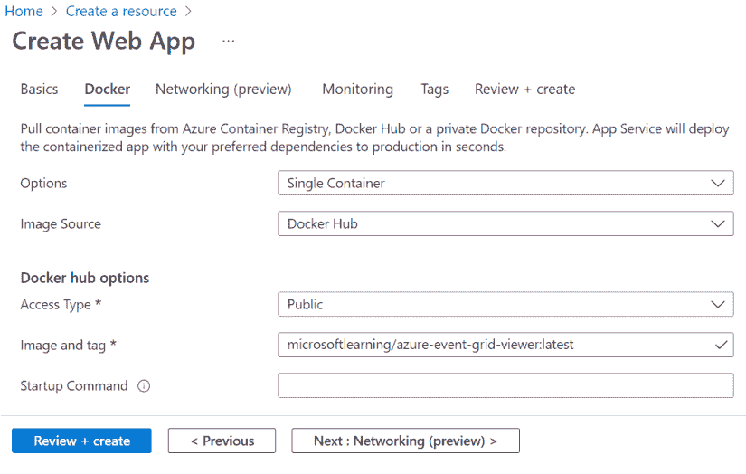

*Figure 3.6 – Create Web App – the Docker tab*

最后，选择 **Create** 以使用您指定的配置创建 Web 应用。

## 创建 Event Grid 订阅

我们现在将创建一个新的订阅，验证其注册，然后保存必要的凭据以便在主题上发布新事件。

如果我们返回之前创建的 Event Grid 主题，我们将在底部看到一个用于创建订阅的按钮，如以下屏幕截图所示：

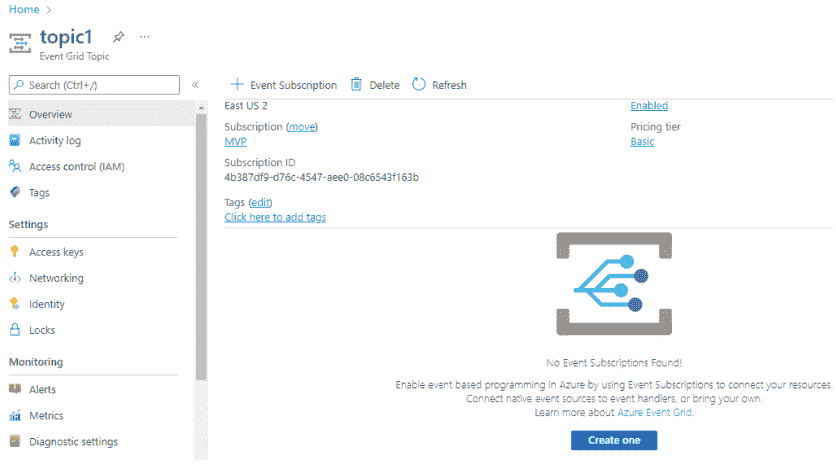

Figure 3.7 – Event Grid Topic window

选择 Create one 按钮。

在 Basic 选项卡中，我们首先定义事件订阅的名称和事件模式。主题已为我们定义。我们可以向目标添加事件类型。以下屏幕截图完整展示了配置设置：

### Figure 3.8 – Create Event Subscription – the Basic tab part 1

在 **ENDPOINT DETAILS** 部分，我们需要将 **Endpoint type** 字段定义为 **Web Hook**。在 **Subscriber Endpoint** 文本框中，输入我们之前创建的 Web 应用 URL 值并添加 /api/updates。因此，例如，如果您的 Web 应用 URL 值为 https://eventgridviewersample.azurewebsites.net，则您的 **Subscriber Endpoint** 值将为 https://eventgridviewersample.azurewebsites.net/api/updates。最后，确认选择并选择 **Create。**

如果您需要有关 Event Grid 的更多详细信息，可以访问以下链接：

- https://learn.microsoft.com/en-us/azure/event-grid/create-view-manage-system-topics
- https://learn.microsoft.com/en-us/azure/event-grid/custom-event-quickstart
- https://learn.microsoft.com/en-us/azure/event-grid/scripts/event-grid-cli-subscribe-custom-topic

以下屏幕截图展示了 Basic 选项卡中的端点详细信息：

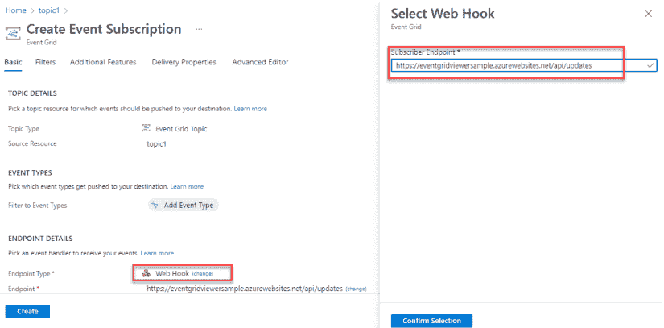

Figure 3.9 – Create Event Subscription – the Basic tab part 2

到目前为止，我们已创建了 Event Grid 主题和订阅。接下来，我们将学习如何使用 .NET 控制台应用程序向 Event Grid 主题发布新事件。

## Create a .NET Console project

要创建新的 .NET 控制台项目，我们可以使用两种集成开发环境（IDE）之一：Visual Studio Code 或 Visual Studio 2022。

### Using Visual Studio Code

在 Visual Studio Code 中，打开集成终端。接下来，运行以下命令在当前文件夹中创建一个名为 EventPublisherSample 的新 .NET 项目：

```
dotnet new console -name EventPublisherSample -output .
```

让我们从 NuGet 导入 Azure.Messaging.EventGrid 的最新版本，在我们的示例中为版本 4.10.0，并运行以下命令：

```
dotnet add package Azure.Messaging.EventGrid -version 4.10.0
```

要构建应用程序，我们使用以下命令：

```
dotnet build
```

### Using Visual Studio 2022

我们选择 **Create a new project**，然后搜索 `console` 模板。我们将项目命名为 EventPublisherSample 并选择最新的 .NET 框架：

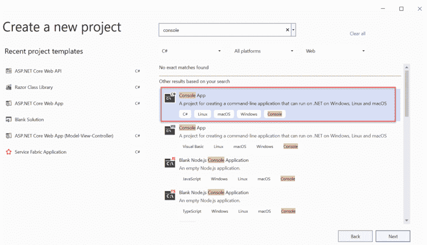

Figure 3.10 – Create a new project – Console App

让我们从 NuGet 导入 Azure.Messaging.EventGrid 的最新版本。在我们的示例中，它是版本 4.10.0。我们通过右键单击 **Dependencies**，然后选择 **Manage NuGet Packages**，并通过 NuGet 安装 Azure.Messaging.EventGrid 来使用 NuGet，如以下屏幕截图所示：

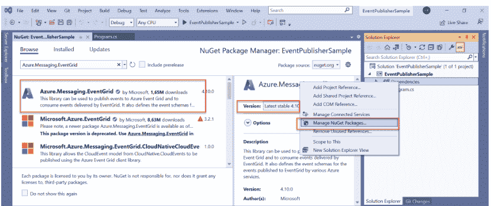

Figure 3.11 – Import Azure.Messenging.EventGrid

添加包后，我们将在下一节中更新 Program 类。

## Making some modifications to the Program class to be able to connect to Event Grid

我们将在以下步骤中继续使用 Visual Studio 2022（我们也可以使用 Visual Studio Code）：

- 1. 打开 Program.cs 文件。
- 2. 导入 Azure 和 Azure.Messaging.EventGrid 命名空间（https://www.nuget.org/packages/Azure.Messaging.EventGrid/）从之前从 NuGet 导入的 Azure.Messaging.EventGrid 包，使用以下代码行：
- 3. 检查 Program.cs 文件中的整个源代码：

```
using Azure;
using Azure.Messaging.EventGrid;
```

```
using System;
using System.Threading.Tasks;
using Azure;
using Azure.Messaging.EventGrid;
public class Program
{
    private const string topicEndpoint = "<topic-endpoint>";
    private const string topicKey = "<topic-key>";
    public static async Task Main(string[] args)
    {
    }
}
```

我们添加了 System 和 System.Threading.Tasks 包，这些包将用于异步方法。

在代码中，我们添加了一个 Program 类，其中包含两个私有属性和一个静态异步方法。

第一个属性是 topicEndpoint 字符串常量，其中包含 Event Grid 端点值。第二个属性是 topicKey 字符串常量，其中包含 Event Grid 主题密钥值。

我们可以通过转到 Event Grid Topic 刀片，选择左侧菜单中的 Overview，并查看 Topic Endpoint 条目来找到这些凭据：

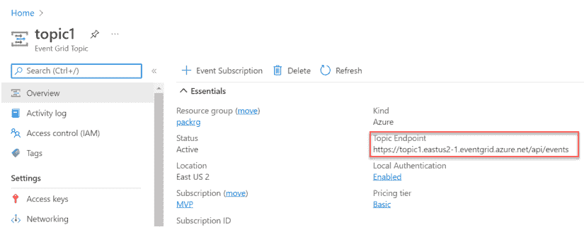

Figure 3.12 – Topic Endpoint

主题密钥是通过在设置标题下选择左侧菜单中的 Access keys 获得的。我们需要选择并复制 Key 1 文本框中的链接。

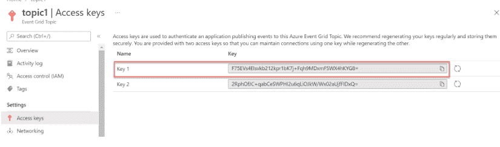

Figure 3.13 – Topic key

在下一节中，我们将发布新事件。

## Publishing new events

在 Program.cs 文件中，在空的主方法中，我们将创建一个名为 credential 的新变量，它将使用 topicKey，并创建另一个名为 client 的变量，它将在构造函数中使用 endpoint 和 credential 变量作为参数。因此，我们将在主方法中添加以下代码行：

```
var endpoint = new Uri(topicEndpoint);
var credential = new AzureKeyCredential(topicKey);
```

```
var client = new EventGridPublisherClient(endpoint,
credential);
```

我们添加以下源代码来创建一个新的 event1 变量并使用示例数据填充该变量：

```
var event1= new EventGridEvent(
    subject: $"New Patient: Hamida Rebai",
    eventType: "Patients.Registration.New",
    dataVersion: "1.0",
    data: new
    {
        FullName = "Hamida Rebai",
        Address = "Quebec, G2C0L6"
    }
);
```

接下来，我们添加 event2 变量：

```
var event2 = new EventGridEvent(
    subject: $"New Patient: Mohamed Trabelsi",
    eventType: "Patients.Registration.New",
    dataVersion: "1.0",
    data: new
    {
        FullName = "Mohamed Trabelsi",
        Address = "Quebec, G1X3Z2"
    }
);
```

之后，我们将添加以下代码行来调用 EventGridPublisherClient.SendEventAsync 方法，并在以下源代码中查看如何将每条事件的消息渲染到控制台：

```
await client.SendEventAsync(event1);
Console.WriteLine("This is the first event published");
await client.SendEventAsync(event2);
Console.WriteLine("This is the second event published");
```

让我们运行我们的应用程序并在 Azure Event Grid 查看器 Web 应用程序中观察结果：

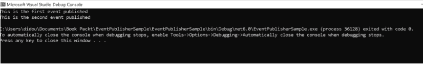

Figure 3.14 – Console App output for published events

在以下屏幕截图中，我们展示了发布在 Azure App Service 上的 **Azure Event Grid Viewer**：

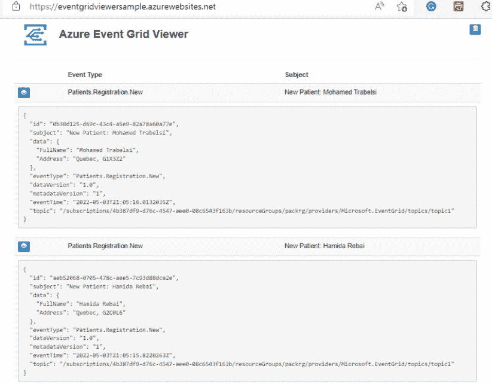

Figure 15 – Azure Event Grid viewer result

为了总结本次练习，我们在控制台应用程序中使用了静态数据，但在现实生活中，此数据可以由另一个应用程序（Web 或移动）或任何 **software as a service (SaaS)** 解决方案提供。对于我们的用例，此数据来自 Web 和移动应用程序，每次新注册都将发送到 Event Grid 以供另一系统验证。


## 探索 Azure 消息队列

Microsoft Azure Service Bus 是一个完全托管的企业集成消息代理。Service Bus 中包含了一些常见的消息场景，例如在传输数据时进行消息传递或解耦应用程序以提高其可靠性和可扩展性，以及通过实现需要消息排序的工作流来提供消息会话，例如主题和订阅。

Azure 支持以下两种类型的队列机制：

- Queue Storage 是一个用于存储大量消息的简单消息队列服务
- Service Bus 队列是更广泛的消息服务集的一部分，支持排队、发布/订阅和高级集成模式

Azure Queue Storage 是一个用于发送和接收消息的服务，但也用于存储大量消息；一个队列消息的大小可达 64 KB。

## 练习 2 – 创建 Azure Service Bus 命名空间和队列

在本练习中，我们将执行以下操作：

- 创建一个 Azure Service Bus 命名空间
- 创建一个 Azure Service Bus 队列

队列可以通过 Azure 门户的交互式界面、使用 PowerShell 或 Azure CLI 的命令行，或使用资源管理器模板来创建。我们在这里只介绍前两种方法：Azure 门户和 Azure CLI。

### 使用 Azure 门户

让我们打开 Azure 门户并选择 **All services**。在 **Integration** 类别中，我们可以找到 **Service Bus** 资源：

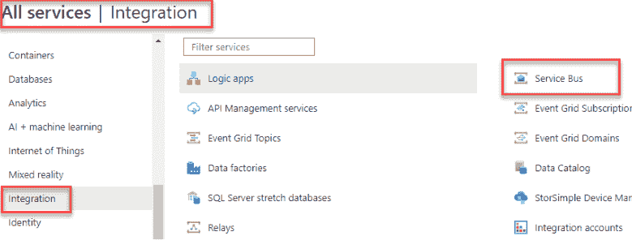

图 3.16 – 使用 Azure 门户创建 Service Bus

在填写完创建命名空间所需的配置后，该命名空间将包含队列之后，我们点击 **+ Create** 或选择 **Create service bus namespace**：

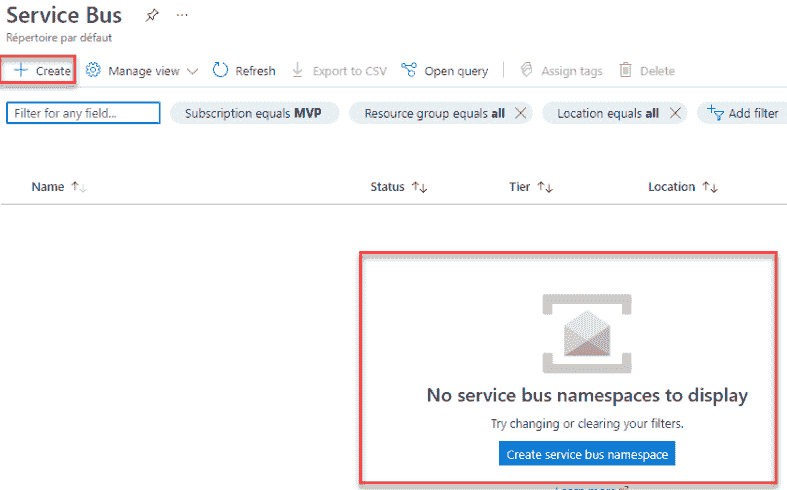

图 3.17 – 使用 Azure 门户创建命名空间

在 **Basics** 选项卡中，我们有以下界面：

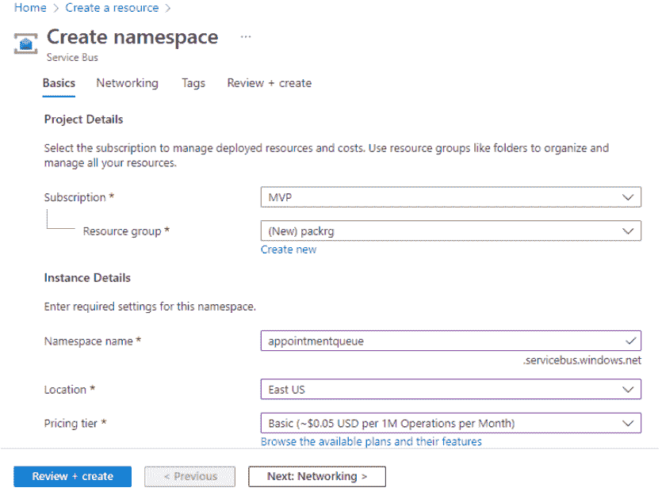

图 3.18 – 创建 Service Bus 命名空间

如果在 **Pricing tier** 字段中选择 **Basic**，请注意您将无法创建 **Topics**，只能创建 **Queues**，如下图所示：

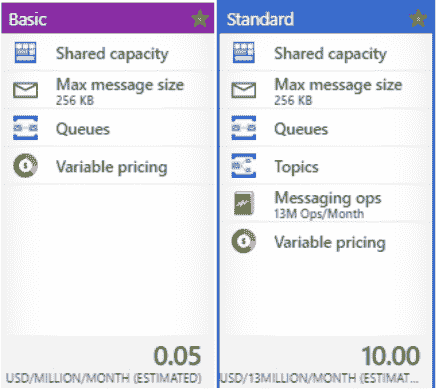

在 **Networking** 选项卡中，您可以保留公共访问的连接方法的默认值，或者如果您已配置登陆区，则可以选择您的私有访问。在登陆区中，您配置您的账户、安全治理、网络和身份。

我们将选择 **Review + create** 然后选择 **Create**，Service Bus 命名空间将被创建。

完成后，我们将在门户中创建一个队列。让我们打开 Service Bus 命名空间并从左侧菜单中选择 **Overview**。接下来，在屏幕顶部选择 **+ Queue** 并填写创建队列所需的所有信息，包括名称、队列最大大小、最大投递次数、消息生存时间（天、小时、分钟和秒）、锁定持续时间（天、小时、分钟和秒）。此外，我们需要启用以下选项：

- Auto-delete on idle queue
- Duplicate detection
- Dead lettering on message expiration
- Partitioning
- Sessions

我们可以启用将消息转发到队列和主题：

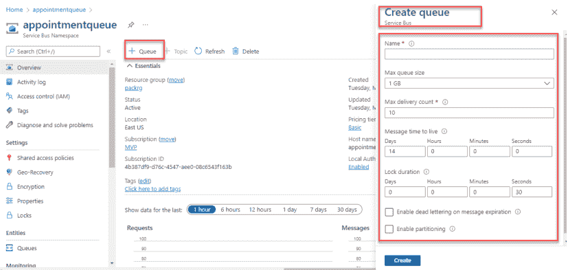

图 3.20 – 创建队列

我们使用 Azure 门户创建了 Azure Service Bus 命名空间和队列。在下一节中，我们将了解如何使用 Azure CLI 来完成此操作。

### 使用 Azure CLI

首先，如果尚未存在，我们需要创建一个资源组：

```
Az group create --name packrg --location eastus
```

消息队列使用命名空间，因此我们需要创建一个命名空间：

```
Az servicebus namespace create --resource-group packrg --name appointmentQueue --location eastus
```

接下来，使用以下命令创建队列：

```
az servicebus queue create --resource-group packrg --namespace-name appointmentQueue --name myqueue
```

要检查消息队列是否已成功创建，您可以在门户中检查或运行以下命令行：

```
az servicebus queue list -resource-group packrg -namespace-name appointmentQueue
```

在下面的屏幕截图中，我们可以看到不同的 Service Bus 队列：

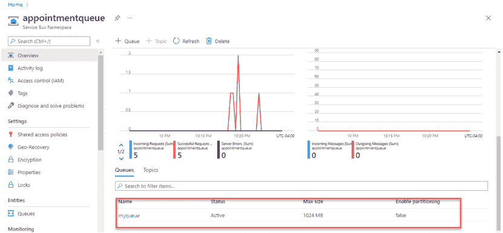

图 3.21 – Service Bus 队列

我们演示了两种不同的方法来创建 Azure Service Bus 命名空间和队列 – Azure CLI 和 Azure 门户。在下一个练习中，我们将使用应用程序将消息发布到 Service Bus 队列。

## 练习 3 – 使用 .NET Core 应用程序将消息发布到 Service Bus 队列

我们之前创建了 Azure Service Bus 队列。现在，我们将开始使用 .NET Core 控制台应用程序从 Azure Service Bus 队列发送消息。

我们将创建一个包含两个项目的解决方案：

- AzureQueueSample.Domains：一个类库
- AzureQueueSample.Sender：一个 .NET Core 控制台应用程序

我们将 AzureQueueSample.Domains 项目添加为 AzureQueueSample.Sender 项目的项目引用。为此，右键单击 AzureQueueSample.Sender 项目的 Dependencies，然后选择 Add Project Reference：

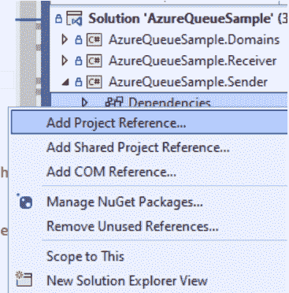

图 3.22 – 向项目添加 Dependencies 引用

我们选择 AzureQueueSample.Domains 项目，项目将被添加为引用：

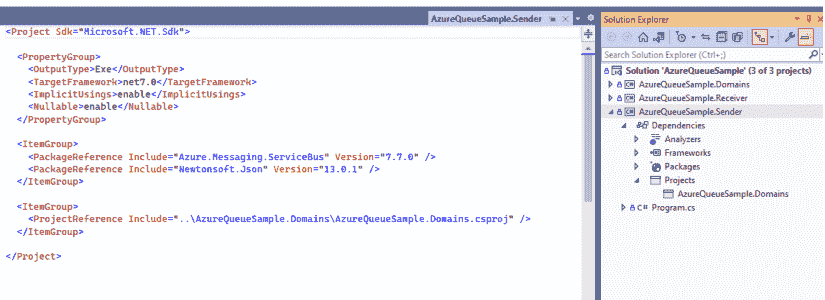

图 3.23 – AzureQueueSample 解决方案

在 AzureQueueSample.Domains 项目中，我们将添加一个名为 Appointment 的新类：

```
public class Appointment
{
    public Guid AppointmentId { get; set; }
}
```

```
public string Status { get; set; }
public string SlotId { get; set; }
public string PatientEmail { get; set; }
public string DoctorId { get; set; }
public string CurrentDate { get; set; }
public string StartTime { get; set; }
public string EndTime { get; set; }
}
```

在下面的屏幕截图中，我们使用 NuGet Package Manager 向 AzureQueueSample.Sender 添加了两个不同的包，即 Azure.Messaging.ServiceBus 和 Newtonsoft.Json。

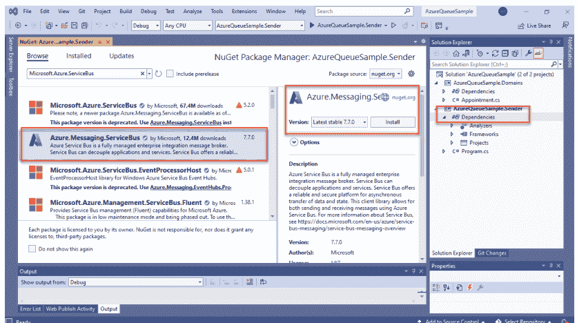

图 3.24 – 从 NuGet 添加 Microsoft.Azure.ServiceBus 包

接下来，我们打开 AzureQueueSample.Sender 的 program.cs 类并添加预约列表。我们还添加了目标 Azure Service Bus 命名空间的连接字符串和队列名称。

在 Azure 门户中，返回 Service Bus 命名空间并选择 Settings | Shared access policies，然后复制 Primary Connection String 值：

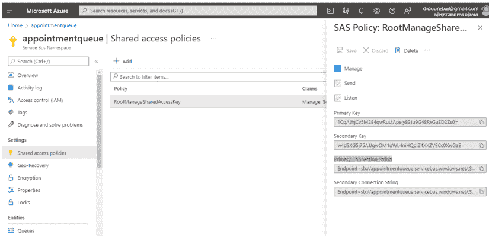

图 3.25 – Azure Service Bus 命名空间中的共享访问策略

这是允许我们将消息发布到 Service Bus 队列的 Program 类：

```
private const string ServiceBusConnectionString = "Endpoint=sb://appointmentqueue.servicebus.windows.net/;SharedAccessKeyName=RootManageSharedAccessKey;SharedAccessKey=1CqAJhjCv5M284qwRuLtApely83Ju9G48RxGuED2Zs0=";
    private const string QueueName = "myqueue";
    static List<Appointment> appointments = new List<Appointment>
    {
        new Appointment ()
        {
            AppointmentId = Guid.NewGuid(),
            CurrentDate = DateTime.Now.ToString(),
            StartTime = "10:00AM",
            EndTime ="11:00AM",
            DoctorId = "code1",
            SlotId="S1",
            PatientEmail= "patient1@email.com",
            Status = "Pending"
        },
```

```
var messageBody = JsonConvert.
SerializeObject(item);
    ServiceBusMessage message = new
ServiceBusMessage(Encoding.UTF8.GetBytes(messageBody));
    await sender.SendMessageAsync(message);
    Console.WriteLine($"Sending Message : {item.
AppointmentId.ToString()} ");
    }
    Console.Read();
}
```

结果如下：

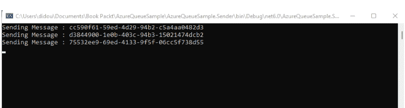

图 3.26 – 向 Azure Service Bus 队列发送消息

在本练习中，我们使用 .NET Core 应用程序将消息发布到 Service Bus 队列。在下一节中，我们将使用同一应用程序从 Service Bus 队列读取消息。

## 练习 4 – 使用 .NET Core 应用程序从 Service Bus 队列读取消息

之前，我们向 Service Bus 队列发送了一些消息。在本练习中，我们将读取它们。为此，我们将添加一个新的 AzureQueueSample.Receiver .NET Core 控制台应用程序。我们需要为接收器应用程序添加与发送器应用程序之前相同的 NuGet 包：Azure.Messaging.ServiceBus 和 Newtonsoft.Json。我们还将添加 AzureQueueSample.Domains 作为引用。


要从 Service Bus 队列读取消息，我们使用以下代码：

```csharp
public class Program
{
    private const string ServiceBusConnectionString = "Endpoint=sb://appointmentqueue.servicebus.windows.net/;SharedAccessKeyName=RootManageSharedAccessKey;SharedAccessKey=1CqAThjCv5M284qwRuItApely83Ju9G48RxGuED2zs0=";
    private const string QueueName = "myqueue";
    static async Task Main(string[] args)
    {
        await ReceiveMessagesAsync();
    }

    private static async Task ReceiveMessagesAsync()
    {
        await using var client = new ServiceBusClient(ServiceBusConnectionString);
        // The receiver is responsible for reading messages from the queue.
        ServiceBusReceiver receiver = client.CreateReceiver(QueueName);
        ServiceBusReceivedMessage receivedMessage = await receiver.ReceiveMessageAsync();

        string body = receivedMessage.Body.ToString();
        Console.WriteLine(body);
        Console.Read();
    }
}
```

现在，我们已经在上一段源代码中将消息发布到 Service Bus 队列，然后使用 .NET Core 控制台应用程序从队列中读取消息。

我们将向 Azure Service Bus 发送消息，并打开 Azure Service Bus 实例。在“概述”页面中，我们检查与请求和消息数量相关的指标，如下面的截图所示：

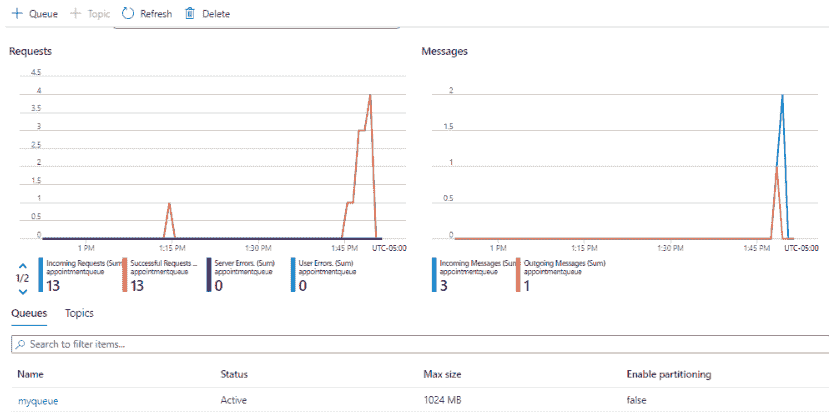

图 3.27 – Azure Service Bus 中的队列指标

我们可以选择“实体”下的“队列”来获取与队列指标相关的更多详细信息，如下面的截图所示：

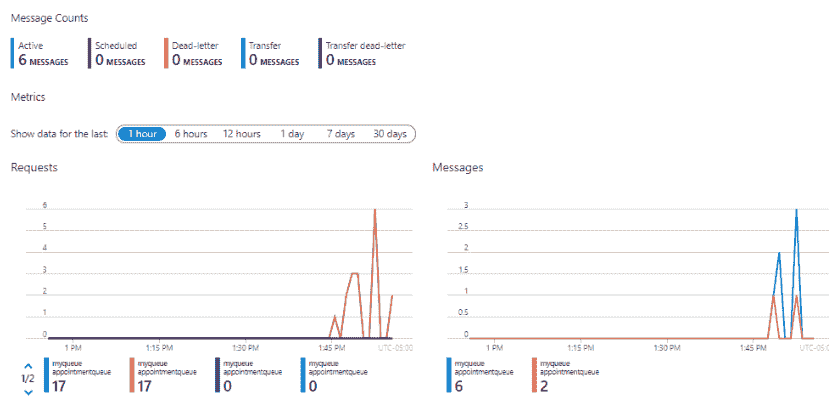

图 3.28 – Azure Service Bus 中的扩展队列指标

- 3. 将显示一个新的对话框。为主题输入一个名称，例如 `mytopic`，并保留其他选项的默认值。

- 4. 选择**创建**以确认主题创建。

既然我们已经创建了一个新主题，接下来让我们为该主题创建一个订阅。

## 创建主题的订阅

要创建之前所创建主题的订阅，我们需要执行以下步骤：

- 1. 打开主题，并点击工具栏上的 **+ 订阅** 按钮，如下面的截图所示：

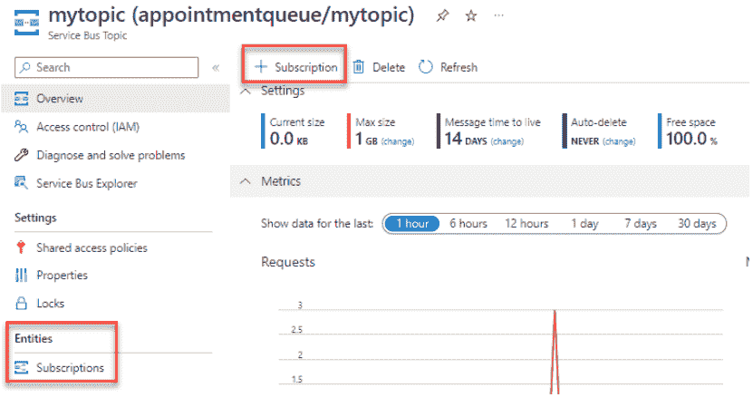

图 3.30 – 向 Service Bus 主题添加订阅

- 2. 将显示一个新的对话框。要创建订阅，请在“名称”字段中输入 Sub1，并在“最大传递计数”字段中输入 3。我们将其余值保留为默认值，如下面的截图所示：

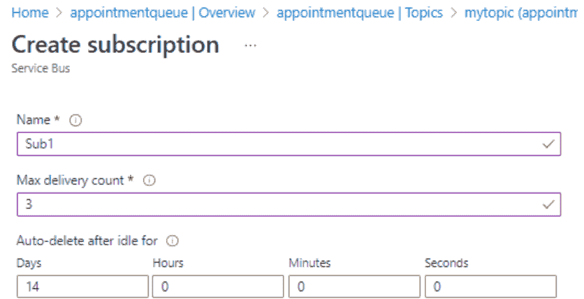

图 3.31 – 创建订阅页面

- 3. 选择“创建”以确认创建订阅。

## 向主题发送消息

在本节中，我们将向我们先前创建的 .NET 应用程序添加函数，并向 Service Bus 主题发送消息。

我们首先配置此 Service Bus 主题的访问策略：

- 1. 从左侧菜单的“设置”部分选择“共享访问策略”。然后，点击 **+ 添加** 按钮以配置新的共享访问策略。

- 2. 根据需要填写“策略名称”字段，并选择要授权的不同策略（管理、发送或监听），如下面的截图所示：

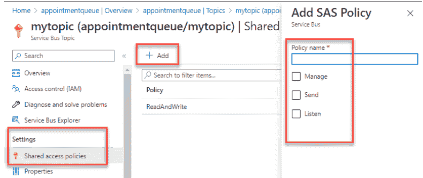

图 3.32 – 管理共享访问策略

- 3. 在“共享访问策略”下，选择该策略并复制“主连接字符串”值，如下面的截图所示：

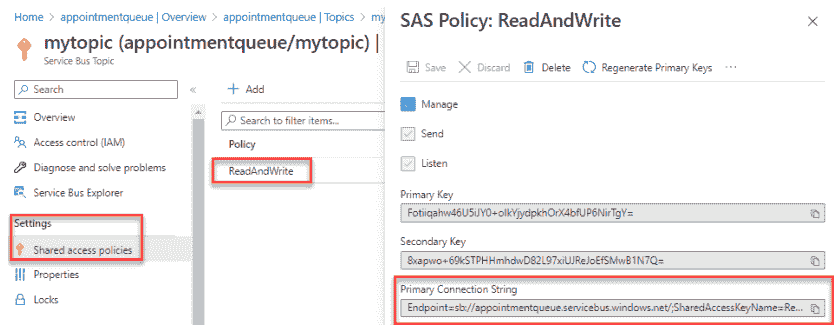

图 3.33 – 选择共享访问策略的主连接字符串

- 4. 要向 Service Bus 主题发送消息，我们使用以下代码：

```csharp
private const string ServiceBusTopicConnectionString = "Endpoint=sb://appointmentqueue.servicebus.windows.net/;SharedAccessKeyName=ReadAndWrite;SharedAccessKey=Fotiiqahw46U5iJY0+olkYjydpkhOrX4bfUP6NirTgY=;EntityPath=mytopic";
private const string topicName = "mytopic";
await using var clientForTopic = new ServiceBusClient(ServiceBusTopicConnectionString);
ServiceBusSender sender = clientForTopic.CreateSender(topicName);
await using var client = new ServiceBusClient(ServiceBusConnectionString);

ServiceBusSender sender = client.CreateSender(topicName);
foreach (var item in appointments)
{
    var messageBody = JsonConvert.SerializeObject(item);
    ServiceBusMessage message = new ServiceBusMessage(Encoding.UTF8.GetBytes(messageBody));
    await sender.SendMessageAsync(message);

    Console.WriteLine($"Sending Message: {item.AppointmentId} ");
}
```

- 5. 在 Azure 门户中打开 Service Bus 主题，然后选择订阅以查看已发送消息的指标，如下面的截图所示：

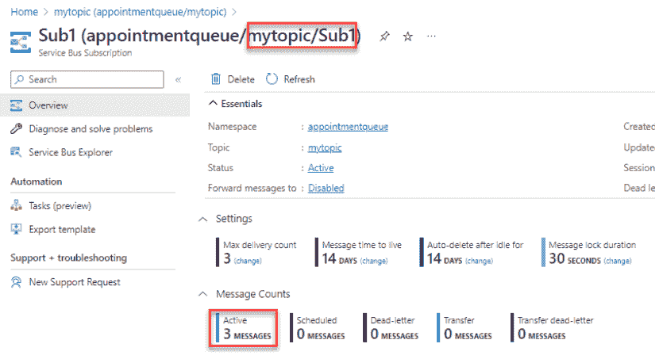

图 3.34 – 订阅下 Service Bus 主题的指标

- 6. 要查看有关请求和发送到主题的消息的更多详细信息，请选择该主题，然后在**概述**窗格中，您将看到类似于以下截图的内容：

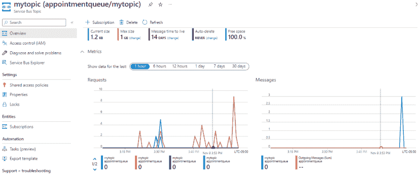

图 3.35 – 主题指标：请求和消息

队列允许单个消费者处理消息。与队列不同，主题和订阅在发布-订阅模型中提供一对多的通信形式。这在扩展到大量接收者时非常有用。所有已发布的消息都可用于该主题的所有已订阅订阅者。当发布者在主题上发布消息时，一个或多个订阅者会收到消息的副本。

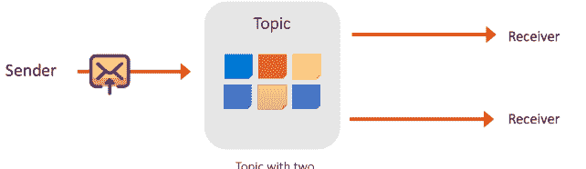

具有两个订阅（包含消息）的主题

图 3.36 – 主题和订阅

订阅可以使用额外的筛选器来限制它们接收的消息。发布者向主题发送消息的方式与向队列发送消息的方式相同。但是，消费者不会直接从主题接收消息。相反，消费者从主题的订阅中接收消息。主题订阅就像一个虚拟队列，接收发送到主题的消息副本。消费者从订阅接收消息的方式与从队列接收消息的方式相同。

我们创建了一个主题以及该主题的一个 Service Bus 订阅，并向该主题发送了一条消息。在下一节中，我们将使用 C# 源代码从该主题的订阅中接收这些消息。

## 从订阅接收消息

要从 Service Bus 主题读取之前创建的消息，我们首先创建一个可用于接收消息的接收器：

```csharp
await using var clientForTopic = new ServiceBusClient(ServiceBusTopicConnectionString);
ServiceBusReceiver receiver = clientForTopic.CreateReceiver(topicName);
```

接收到的消息是一种不同的类型，因为它包含一些服务设置的属性：

```csharp
ServiceBusReceivedMessage receivedMessage = await receiver.ReceiveMessageAsync();
```

我们将以字符串形式检索消息正文：

```csharp
string body = receivedMessage.Body.ToString();
Console.WriteLine(body);
Console.Read();
```

队列和主题在发送方发送消息时是相似的，但消息的处理方式因接收方而异。队列只能有一个消费者，但主题可以有多个订阅者。

## 总结

在本章中，我们讨论了基于事件和基于消息的解决方案以及它们之间的区别。接下来，我们探索了 Azure 事件网格和 Azure 事件中心，并研究了如何从 .NET 应用程序向事件网格发布和订阅。然后，我们讨论了 Azure 消息队列，并从 .NET 应用程序发布了消息。最后，我们使用 .NET 控制台应用程序读取了这些消息。

在下一章中，我们将在 Azure 中创建和部署函数应用。

## 问题

- 1. 使用 .NET Core 应用程序从 Service Bus 队列读取消息需要添加哪些包？


