# 在 Azure 中创建和部署 Function App

在设计新的云软件或应用程序的阶段，架构师和开发人员做出的关键决策之一是如何连接到后端服务、运行后台处理、运行后端任务，并执行更多任务，例如调度和发送电子邮件，而不影响主应用程序的处理。对于此，Azure Functions 应用可能很有用。

我们可以使用 Azure Functions 以无服务器方式在云环境中执行代码。我们需要做的就是为特定问题编写更少的代码，成本低廉，而无需关心整个应用程序，甚至运行它的基础设施。我们将重点关注逻辑和业务范围。我们也可以响应事件执行 Azure Functions。

在本章中，我们将介绍 Azure Functions 的基本概念和托管计划选项。我们将探讨 Azure Functions 的开发并开发 Durable Functions，它是 Azure Functions 的扩展。

在本章中，我们将涵盖以下主要主题：

- 探索 Azure Functions
- 开发 Azure Functions
- 开发 Durable Functions

## 探索 Azure Functions

Azure Functions 与 Azure WebJobs 类似，但在扩展策略、语言支持和触发事件方面存在一些差异。它们都构建在 Azure App Service 上。由于 Azure Functions 构建在 WebJobs SDK 上，因此它与 Azure 服务共享相同的触发器和连接。

Azure Functions 作为现代无服务器架构，提供事件驱动的、配置的云计算用于应用程序开发。

在 Azure Functions 中，有两个非常重要的概念：绑定和触发器。

当我们创建 Azure Functions 时，我们需要配置函数的名称。要调用函数，我们使用触发器。函数必须至少有一个触发器。函数名称和触发器在 `function.json` 文件中配置。我们在配置文件中有更多信息，例如关于绑定。我们使用约束来拥有输入和输出绑定，所有这些都允许您从代码中连接到数据库。所有这些都节省了连接上的编码。但对于许多 Azure 服务池，您无需这样做——您无需编写代码，因为绑定会处理这些连接。

在下图中，我们展示了不同的绑定和触发器：

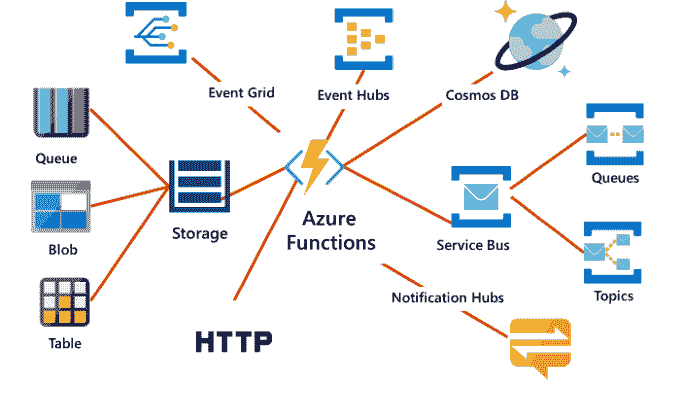

图 4.1 – 触发器和绑定

在下一节中，我们将定义 Azure Functions 中的更多触发器。

## 触发器

**触发器**定义了如何调用函数；它引发函数的运行。触发器可以包括以下内容：

- **Blob 存储**：当文件或文件夹在存储中上传或更改时，这将调用您的函数
- **HTTP**：以类似于 REST API 的方式调用您的函数
- **服务总线中的队列**：当队列中存在项目时，它会调用您的函数
- **计时器**：这将在计划间隔调用您的函数

在下一节中，我们将进一步定义 Azure Functions 中的绑定。

## 绑定

绑定到函数是声明性地将另一个资源连接到函数的方法。绑定可以作为输入绑定、输出绑定或两者连接。一些绑定示例包括以下内容：

- Cosmos DB：连接到数据库以便轻松加载或保存文件
- 表存储：这使用来自您的 functions 应用的键/值存储
- 队列存储：这从特定队列检索一个或多个项目，或将新项目放入队列

您可以通过混合或匹配不同的绑定来根据您的场景使用它们。

## 使用 Azure Functions 的订单处理场景

一家医疗保健公司部署优化解决方案，以改善患者获得医疗保健的机会。它为医生和医院提供多个应用程序（移动、网络和桌面应用程序）。它有一个名为 EparaMed 的网络和移动应用程序。这是一个在线药店，提供多种服务。客户登录以购买产品，这些产品可以发货或自取。

以下是使用 Azure Functions 的订单处理场景的工作流程：

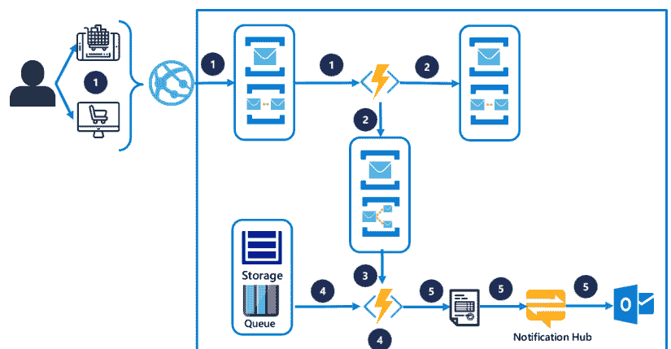

图 4.2 – 订单处理场景

上图展示了订单处理场景的工作流程。

让我们描述工作流程。我们有以下所有操作：

1. 当客户下新订单时，应用程序（网络或移动）将消息提交到 **服务总线队列**。消息包括订单详细信息。
2. Azure Functions 将为产品下单的订单分离出来提交到主题，其他订单发送到服务总线队列。
3. 产品订单将根据订单类别使用 **主题订阅规则**进一步分离。该主题按类别将订单过滤到两个订阅，使用 **订阅规则**。
4. Azure Functions 从存储表中检索订购产品的价格并计算订单价格。
5. 将根据价格创建发票，并使用 Microsoft Outlook 向客户发送通知——包括产品详细信息和发票。

此场景是与订单处理用例相关的示例，其实现可以在 GitHub 上找到：

```
https://github.com/PacktPublishing/A-Developer-s-Guide-to-Building-Resilient-Cloud-Applications-with-Azure/tree/main/Chapter4
```

为了加速应用程序开发，我们可以像之前的场景一样使用 Azure Functions。我们无需考虑基础设施挑战，并且有能力将开发人员从处理服务器——无论是虚拟还是物理——中抽象出来，因为 Azure Functions 服务基于无服务器架构。

## 开发 Azure Functions

在本节中，我们将讨论函数的关键组件和结构。我们将了解如何创建触发器和绑定，以及如何使用 Visual Studio Code 创建函数。我们还将使用 Azure Functions Core Tools 并将其连接到 Azure 服务。

### Azure Functions 的开发

一个函数由两个重要元素组成：

- **您的代码**：可以用任何语言编写
- **配置 JSON 文件**：`function.json`，它是从代码中的注释自动生成的

以下示例展示了 `function.json` 文件。我们定义了触发器、绑定以及更多所需的配置设置。每个函数仅包含一个触发器。为了确定要监视的事件或函数执行输入和输出中数据的工作流程，运行时使用此配置文件。

name 属性用于函数中绑定的数据。在以下示例中，名称为 AddAParamName：

```
"bindings": [
// Add your bindings here
{
"type": "YourBindingType",
"direction": "in",
"name": "AddAParamName",
// Add more depending on binding
}
] }
```

让我们现在讨论函数应用，它是一种组织和管理函数的方式。当我们创建函数时，我们需要在 Azure 中有一个执行上下文，我们创建的函数将在其中运行。函数应用由一个或多个单独的函数组成，这些函数一起管理、部署和扩展。在函数应用中创建的所有函数将共享相同的定价计划、部署方法和运行时版本。

使用 **Visual Studio**（2019 或 2022）或 **Visual Studio Code** 等代码编辑器，很容易在本地创建和测试您的函数。我们甚至可以将本地函数连接到实时 Azure 服务。

创建函数应用有三种方式：

- 在 Azure 门户中，编写脚本函数
- 使用 Azure CLI 创建必要的资源
- 使用您喜欢的 **集成开发环境（IDE）**，例如 Visual Studio 2022 或 Visual Studio Code，在本地构建函数并将它们发布到 Azure

在下一节中，我们将使用 Visual Studio 2022 创建一个 Azure Functions 实例。Visual Studio 提供了一个 Azure Functions 模板。

### 使用 Visual Studio 2022 创建 Azure Functions 实例

我们将创建一个简单的 C# 函数来响应 HTTP 请求。然后，在测试之后，我们将部署到 Azure Functions。

创建函数的先决条件如下：

- 一个 Azure 账户，您可以在其中创建任何 Azure 资源。您可以在 https://azure.com/free 注册免费试用。
- Visual Studio 2022 Community Edition，可免费使用。
- .NET Core 6，这是下一步的目标框架。

让我们使用 Visual Studio Azure Functions 模板创建一个新项目。


## 创建本地项目

在窗口底部选择 **Create a new project** 并在搜索框中使用 `function` 关键字进行搜索，如下所示：

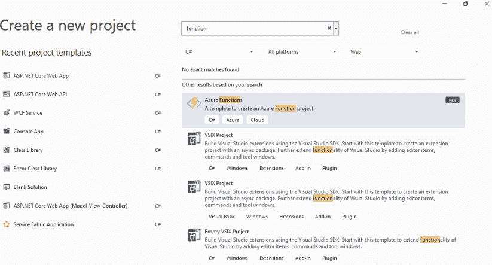

图 4.3 – 创建新的 Functions 应用

选择 **Azure Functions** 模板，然后选择 **New** 来配置项目。此模板创建了一个 C# 类库项目，您可以将其发布到 Azure 中的函数应用。我们将提供项目名称。选择位置然后选择 **Next**。您可以更改解决方案名称并勾选 **Place solution and project in the same directory**：

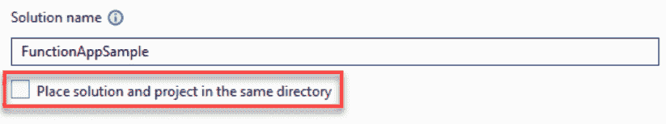

图 4.4 – Visual Studio 解决方案配置

接下来，我们将继续配置项目。我们需要选择 worker function 支持的最新框架。Azure Functions 根据您的场景提供了许多模板，如下所示：

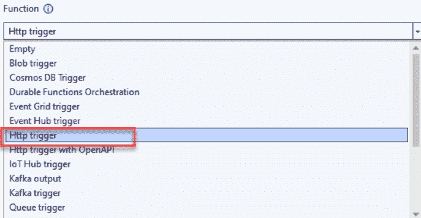

图 4.5 – 函数模板

默认情况下，我们有 Http trigger，但我们还有更多，包括以下内容：

- **Http trigger**：当代码通过使用 HTTP 请求触发时使用。
- **Timer trigger**：通过定义计划的计划来执行任何批处理任务以及清理任务时使用。
- **Cosmos DB Trigger**：当 NoSQL 数据库中的集合中添加或更新 Azure Cosmos DB 文档时用于处理。
- **Blob trigger**：用于图像调整大小或在将 Azure Storage blob 添加到容器时进行处理。
- **Queue trigger**：用于在将消息推送到 Azure Storage 队列时做出响应。
- **Event Grid trigger**：如果我们想要响应传递到 Azure 事件网格的一些事件，则用于构建基于事件的架构。
- **Event Hub trigger**：用于某些场景，例如用户体验、应用程序检测或工作流处理，以及 **Internet of Things (IoT)**，并对传递到 Azure 事件中心事件做出响应。
- **Service bus queue trigger**：通过侦听消息队列将您的代码连接到其他 Azure 服务或本地服务时使用。
- **Service bus topic trigger**：用于将您的代码连接到其他 Azure 服务或本地服务。为此，我们将订阅主题。

在我们的示例中，我们将使用 Http trigger。我们可以启用 Docker。

对于 Authorization level，我们可以选择 Function、Anonymous 或 Admin。在我们的例子中，我们将选择 Anonymous，这使任何人都可以调用您的函数端点。在默认级别——即 Function——我们必须在请求中提供 function key 才能访问我们的函数端点：

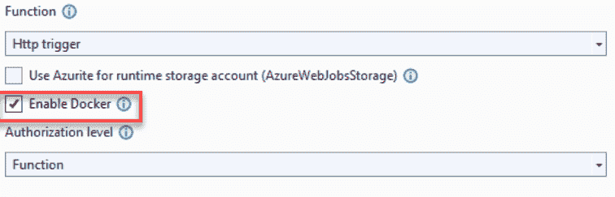

图 4.6 – 启用 Docker 并配置授权级别

函数应用需要一个存储帐户，可以在我们将项目发布到 Azure Functions 时分配或创建。如果我们选择 Http trigger，我们不需要 Azure Storage 帐户连接字符串。这就是为什么我们需要选择 Use Azurite for runtime storage account (AzureWebJobsStorage)。

我们选择 Create 按钮来创建函数项目和 Http trigger 函数：

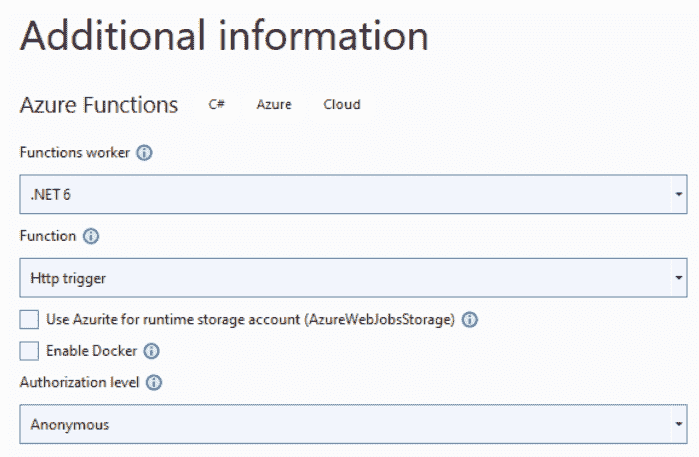

图 4.7 – 配置 functions app 项目

这是我们 functions app 的结构；我们有一个包含用于 Http trigger 函数类型的样板代码的类的项目。样板代码将发送包含来自请求正文或查询字符串的值的 HTTP 响应。HttpTrigger 属性将指定函数由 HTTP 请求触发。根项目文件夹包含函数应用的所有代码。我们有一个名为 host.json 的主机配置文件。

host.json 文件包含特定于运行时的配置：

```
FunctionsAppSample
| - bin
| - Function1
| | - function.json
| - host.json
| - local.settings.json
```

完整的代码示例可在 GitHub 上获得：

https://github.com/PacktPublishing/A-Developer-s-Guide-to-Building-Resilient-Cloud-Applications-with-Azure/tree/main/Chapter4

通过下图，我们可以在 Visual Studio 2022 中探索 Azure Functions 结构：

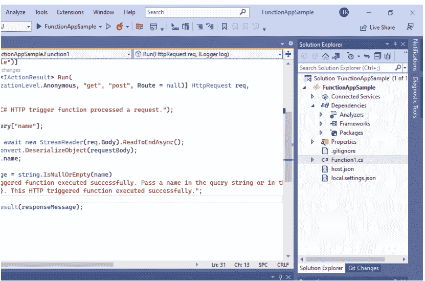

图 4.8 – Functions app 结构

创建应用程序后，我们在本地运行它。Visual Studio 集成 Azure Functions Core Tools，让您在将项目发布到 Azure 之前在本地开发计算机上运行此项目：

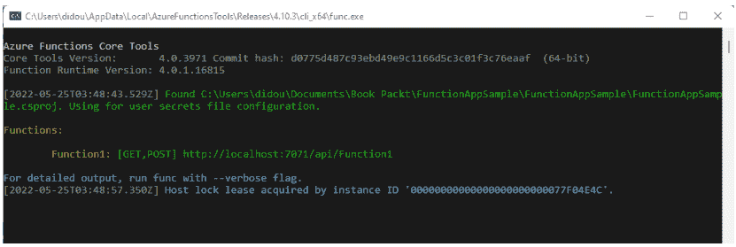

图 4.9 – 在本地运行 functions app

正如我们从上图中可以看到的，Function1 具有 GET 和 POST 方法，URL 为 http://localhost:7071/api/Function1。这就是您用来执行函数的 URL。因此，我们将从 Azure Functions 运行时输出中复制我们函数的 URL，并将 URL 粘贴到浏览器地址栏中用于 HTTP 请求。我们将通过添加函数名称来附加 URL，如下所示：localhost:7071/api/Function1?name=functions。您可以在此处看到输出：

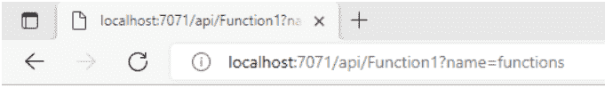

图 4.10 – 在本地运行函数

在创建和测试 Azure Functions 应用后，我们将将其发布到 Azure Functions。

## 将 Azure Functions 发布到 Azure

在 Visual Studio 项目中，右键单击项目名称并选择 Publish。

我们将看到一个 Publish 窗口；选择 Azure 并单击 Next。然后我们必须选择托管环境和操作系统（Linux 或 Windows）。如果我们选择了 Docker，我们将在 Azure Functions 应用容器中发布。在我们的例子中，我们将选择 Azure Function App (Windows)：

### Publish

您希望使用哪个 Azure 服务来托管您的应用程序？

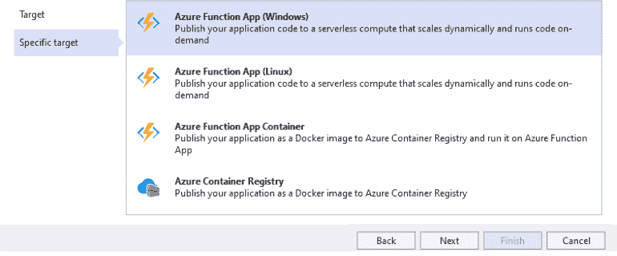

图 4.11 – 将 functions app 发布到 Azure Functions

之后，您可以选择现有的 Azure Functions 实例或从 Visual Studio 创建一个：

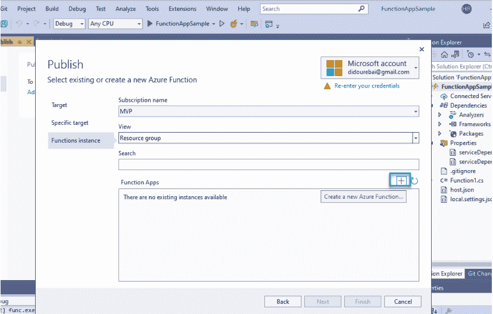

图 4.12 – 选择现有或创建新的 Azure Function 窗口

在上图中，我们可以看到 Select existing or create a new Azure Function 窗口。

在下图中，我们看到要创建新的函数，我们需要填写所有配置设置，例如名称和订阅名称。我们还将选择资源组、计划类型、位置和 Azure Storage 位置：

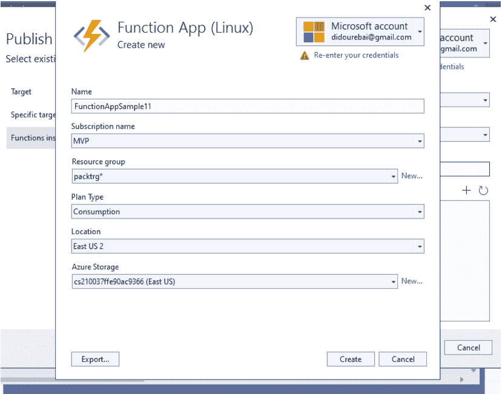

图 4.13 – 使用 Visual Studio 2022 创建 Azure Functions 实例

在上图中，我们使用 Visual Studio 2022 创建了 Azure Function 实例。

当我们单击 Create 时，资源将在 Azure 中创建，我们将得到下图中显示的窗口，确认创建：

图 4.14 – 选择现有的 Azure Function 实例

然后，我们将单击 Publish 以将我们的函数发布到 Azure Functions。不要忘记在发布到 Azure Functions 之前以 release 模式编译。

图 4.15 – 将 functions app 发布到 Azure Function App

在 Publish 选项卡中，我们将选择 Manage in Cloud Explorer。这将在 Cloud Explorer 中打开新的 functions app Azure 资源。

## 使用 Visual Studio Code 创建 Azure Functions 实例

在上一节中，我们在 Visual Studio 2022 中创建了 Azure Functions 实例并发布了它。

在本节中，我们将使用 Visual Studio Code 创建 Azure Functions 实例。

让我们从创建它的先决条件开始：

- 一个 Azure 帐户，我们能够在其中创建任何 Azure 资源。您可以在 `https://azure.com/free` 注册免费试用。
- Visual Studio Code。
- Azure Functions 扩展。
- .NET Core 6，这是下一步所需的目标框架；您可以从官方 Microsoft 网站下载 .NET 6 SDK：`https://dotnet.microsoft.com/en-us/download/visual-studio-sdks`。

在下图中，我们将在 Visual Studio Code 中启用 Azure Functions 扩展：

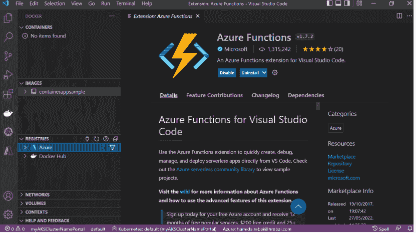

图 4.16 – Azure Functions 扩展


我们将在活动栏中选择 **Azure** 图标。接下来，在 **AZURE** 区域中，我们将选择 **Create new project**：

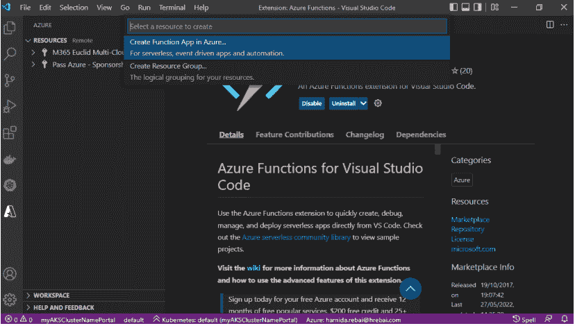

我们将在选择运行时堆栈后为新的函数应用输入一个唯一名称，我们的示例中为 .NET 6。之后，我们将选择位置然后选择资源组。

我们也可以创建一个本地项目并将其发布到 Azure。要做到这一点，我们使用相同的 **Azure** 图标并选择 **Create new project**。之后，我们需要提供在提示中要求的所有信息：

- **Select a language:** 选择 C#
- **Select a .NET runtime:** 选择 .NET 6
- **Select a template for your project’s first function:** 选择 **Http trigger**
- **Provide a function name:** 输入 `HttpExample1`
- **Provide a namespace:** 输入 `Functions1`
- **Authorization level:** 选择 **Anonymous**，这样任何人都可以调用你的函数端点
- **Select how you would like to open your project:** 选择 **Add to workspace**

如果我们需要执行该函数，我们将进入 AZURE 区域，并展开 Local Project | Functions。右键单击函数名称并选择 Execute Function Now...：

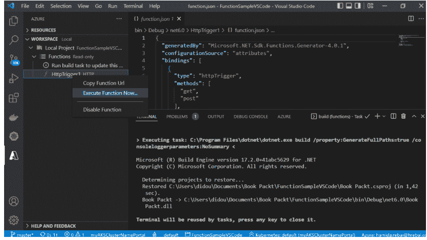

图 4.18 – 执行函数功能

之前，我们使用 Visual Studio 2022 和 Visual Studio Code 创建了 Azure Functions 应用，但我们也可以使用 Azure 门户创建 Azure 函数并添加和运行多个函数而无需实现应用程序。

## 在 Azure 门户中创建 Azure Functions 应用

我们可以使用不同的工具创建 Azure Functions 应用。在本节中，我们将使用 Azure 门户创建 Azure Functions 应用。

要创建 Azure Functions 应用，我们将打开 Azure 门户并选择与 Azure Functions 相关的资源。以下图展示了不同的配置设置：

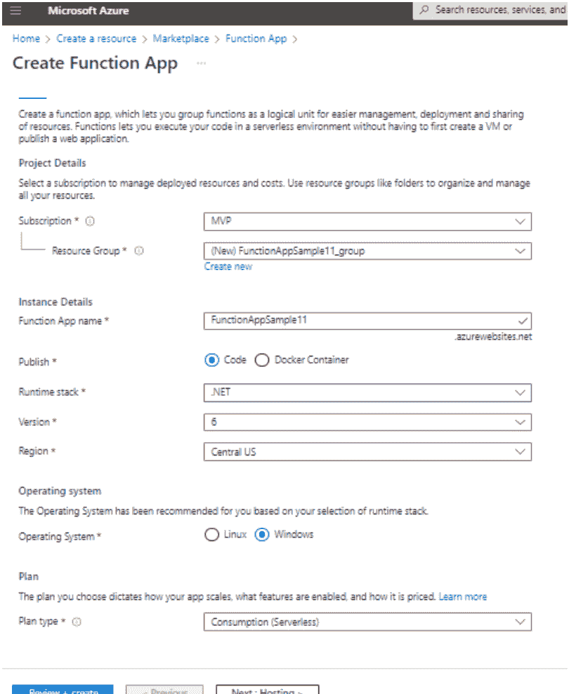

图 4.19 – 创建 Function App 窗口

我们将填写创建函数应用所需的所有信息，如下表所示（见图 4.18）：

| Setting | Description |
|---|---|
| Subscription | 用于创建新函数应用的订阅。 |
| Resource group | 可以创建新的资源组或选择现有资源组。 |
| Function app name | 用于标识函数应用的名称。可使用的字符为 a-z（不区分大小写）、0-9 和 -。 |
| Publish | 选择代码文件或 Docker 容器。 |
| Runtime stack | 选择将支持函数的运行时，例如 C# 类库、C# 脚本、JavaScript、PowerShell、Java 和 TypeScript。 |
| Version | 已安装的运行时版本。 |
| Region | 选择靠近你的区域或函数将访问的其他服务所在的区域。 |
| Plan type | 我们有三种计划：Consumption plan、Premium plan 和 Dedicated plan。如果需要有关这些计划的更多详细信息，可以查看此链接：`https://learn.microsoft.com/en-us/azure/azure-functions/functions-scale`。我们将使用 Consumption plan，仅为函数应用执行付费。 |

表 4.1 – 创建 Azure Functions 应用的设置和描述

当函数应用创建后，我们将检查资源组。以下资源被添加到资源组中：

- Application Insights
- Storage account
- Function app
- App Service plan

在下图中，我们将在 **Functions** 部分下选择 **Functions**：

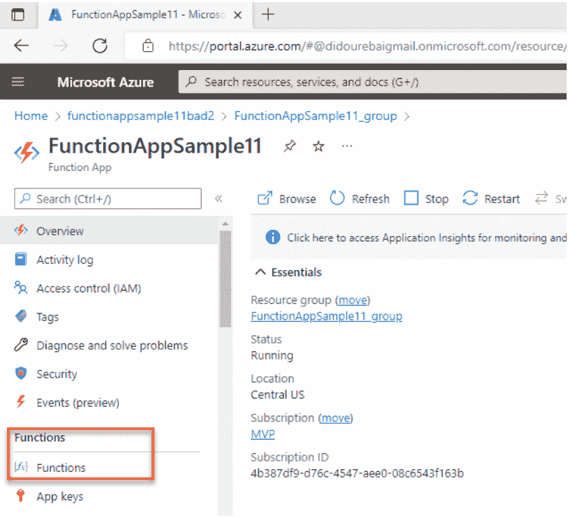

图 4.20 – Functions 设置

## 在 Azure 中创建和部署函数应用

我们将选择一个现有的函数应用，但我们可以添加更多函数：

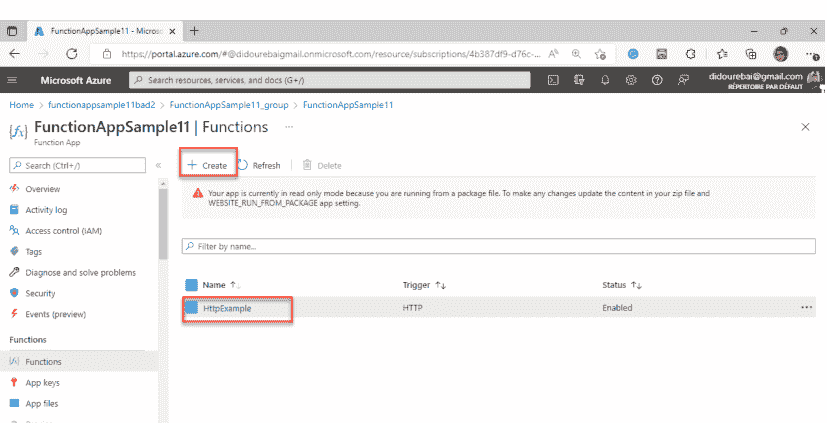

图 4.21 – 选择或创建函数

我们只能使用门户来配置 Azure Functions。我们可以在函数被触发时使用输出绑定通过 HTTP 请求创建一个队列中的消息：

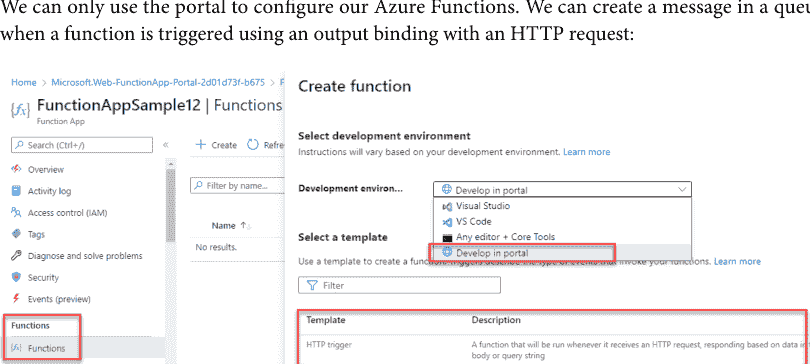

图 4.22 – 创建新函数

选择 Code + Test。我们有 function.json，要运行它，我们必须选择 Test/Run：

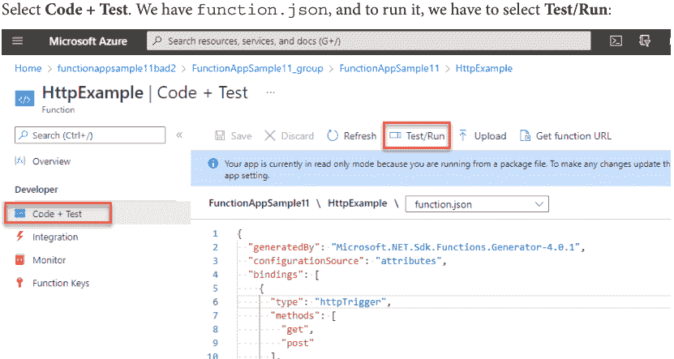

图 4.23 – 测试和运行函数应用

选择 Integration，然后选择 + Add output：

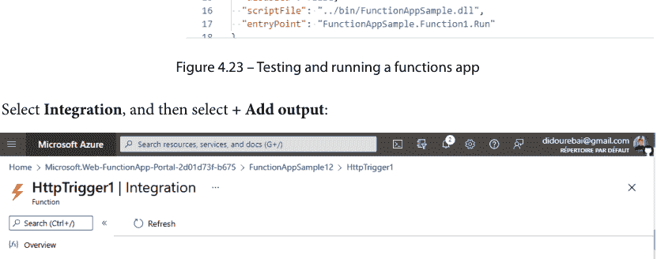

图 4.24 – Integration

我们可以通过选择 **Add input** 添加输入绑定。输入可以是 **Azure Blob Storage, Azure Cosmos DB, Azure Table Storage, Durable Client, Orchestration Client,** 或 **SignalR Connection Info**：

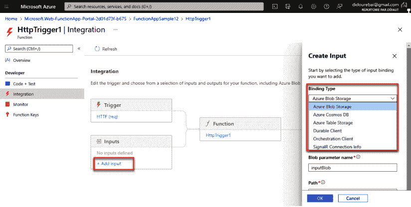

图 4.25 – 添加输入绑定

对于输出绑定，我们可以选择更多类型：**Azure Blob Storage, Azure Cosmos DB, Azure Event Hubs, Azure Queue Storage, Azure Service Bus, Azure Table Storage, HTTP, Kafka Output, SendGrid, SignalR,** 和 **Twilio SMS**。

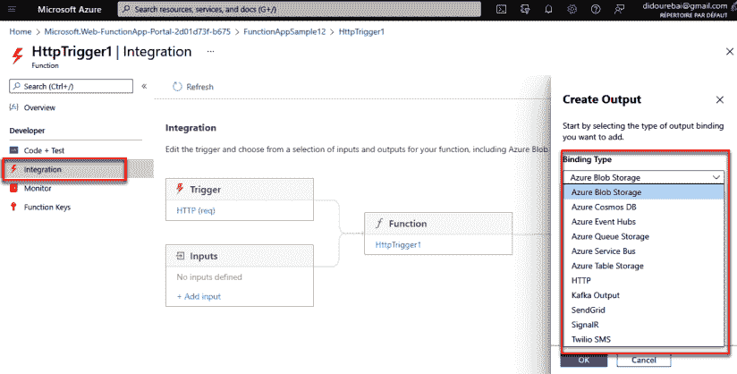

图 4.26 – 添加输出绑定

在本节中，我们在 Azure Functions 应用中添加了输入和输出绑定。

在常规函数和持久函数之间进行选择时，决策的关键因素之一是你的应用程序是否实现了顺序的多步骤工作流。如果你的应用中存在依赖于先前步骤或特定状态来触发下一步的功能，持久函数可以使这些工作流的多个棘手部分变得容易得多。那么，持久函数是什么，我们如何开发它们？

## 开发持久函数

在本节中，我们将描述用于持久函数的各种类型和模式，并将解释持久编排、计时器和事件的使用。Azure Durable Functions 是 Azure Functions 的扩展，用于编写有状态函数。Durable Functions 支持多种语言，如 C#、JavaScript、Python、F# 和 PowerShell。

本章后面我们将描述可以从持久函数中受益的常见应用程序模式：

- Function chaining
- Fan-out, fan-in
- Asynchronous HTTP APIs
- Monitor
- Human interaction

现在我们已经定义了持久函数并介绍了使用的不同模式，我们将更详细地描述持久函数以及需要其使用的不同场景。

## 持久函数简介

为了使用无服务器函数实现更复杂的场景，我们需要一种机制来允许我们在这些函数执行期间保存状态。

此函数扩展允许我们编写有状态函数并定义其他函数的编排。它自动处理状态、检查点和重启。使用 Azure Durable Functions 在我们的项目中有几个好处。

我们将首先构建一个有状态的工作流，以克服平台固有的无状态特性。接下来，作为编排器的已定义函数可以同步或异步调用其他函数。由编排器调用的函数的结果可以保存为局部变量。编排器和其余函数的全部进度都存储在本地。我们必须确保永远不会丢失状态。这是平台基本功能的一部分。当活动函数以粗体显示时，你可以指定自动重试策略。被视为编排器的函数可以是 Service Orchestration、Resource Orchestration 和 Lifecycle Orchestration。函数之间存在依赖关系和连续性。你还可以并行运行编排器函数的多个实例。编排器函数可以有多个状态，例如 Started、Consulted 或 Canceled。最后，Azure Durable Functions 扩展由本地 Azure 函数和你计算机上已有的 SDK 开发工具支持。

## 实现编排器函数

因此，在此 FunctionAppSample 项目中，我们将右键单击并选择 Add | New Azure Function... 选项并将其命名为 FunctionOrchestrator：

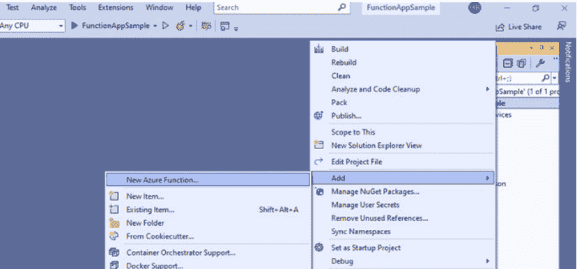

现在，我们将使用 Durable Functions Orchestration 模板，如以下屏幕截图所示：

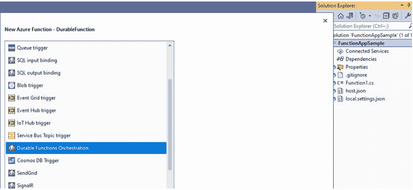


不要忘记添加 Microsoft.Azure.WebJobs.Extensions.DurableTask NuGet 包，如下面的屏幕截图所示：

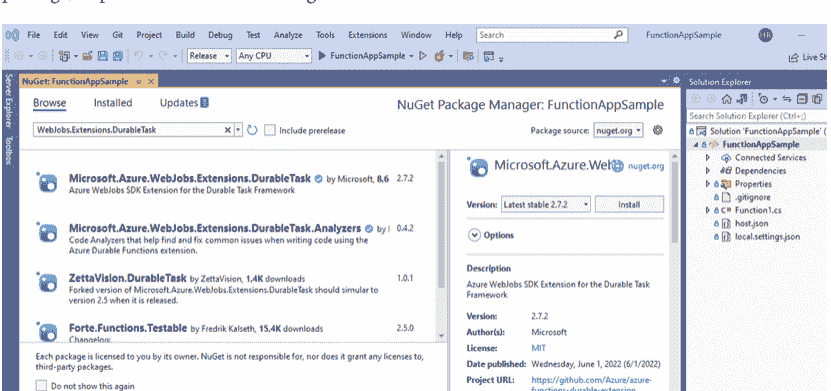

你可以根据自己的需求实现编排器函数，并添加或删除生成的方法。

我们可以使用 Azure 门户创建编排器函数。在 Azure Functions 中，我们将从左侧窗格中选择“函数”，然后从顶部菜单中选择“添加”。

在我们新函数页面的搜索字段中，我们可以使用 durable 关键字，然后选择“Durable Functions HTTP 启动器模板”。

系统要求我们提供一个函数名称。之后，我们可以单击“创建函数”。

我们使用 Visual Studio 2022 实现了一个编排器函数，但让我们回顾一下 Durable Functions 提供的一些编排模式。我们将从函数链模式开始。

## 函数链模式

函数链模式是指我们需要按照指定顺序执行一系列活动函数。编排器函数将跟踪我们在序列中的位置：

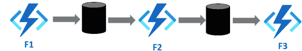

图 4.30 – 函数链模式

Durable Functions 使在代码中实现此模式变得很容易。下一节将介绍另一种模式：扇出/扇入。

## 扇出/扇入

扇出/扇入是一种并行运行多个活动函数，然后等待所有活动完成的模式。并行执行的结果可以聚合起来，用于计算最终结果。如果没有 Durable Functions 这样的框架，这种模式很难使用：

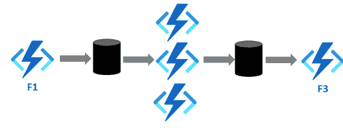

图 4.31 – 扇出/扇入模式

这种模式更具挑战性，但 Durable Functions 扩展可以用简单的代码来处理它。

## 异步 HTTP API

当你有一个需要反复轮询进度的 API 时，异步 HTTP API 非常有用。我们启动一个长时间运行的操作，然后编排器函数可以管理轮询，直到操作完成或超时：

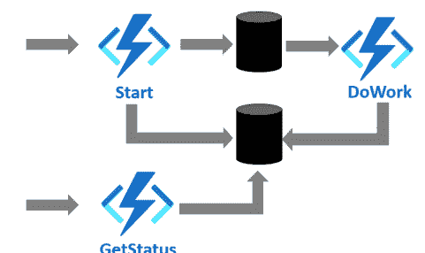

图 4.32 – 异步 HTTP API 模式

Durable Functions 运行时管理状态。我们不需要实现状态跟踪机制。下一节我们将探讨监视器模式。

## 监视器模式

监视器模式在工作流中实现一个周期性过程，用于查找状态变化。我们使用此模式反复调用一个活动函数，以检查是否满足某些条件：


图 4.33 – 监视器模式

要创建多个监视器以观察任意端点，我们只需几行代码即可使用 Durable Functions。我们将在下一节中看到最后一种模式：人机交互。

## 人机交互

人机交互在业务工作流中非常常见，用于需要手动审批的场景，工作流必须暂停，直到有人以某种方式进行交互。这种模式允许工作流等待某些事件被触发，然后在等待人机交互超时时，可以选择性地执行缓解操作：

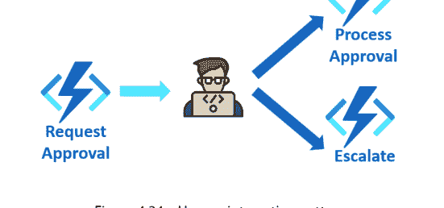

图 4.34 – 人机交互模式

编排器函数使用持久计时器来请求审批。如果发生超时，编排器将进行升级。但编排器会持续等待任何外部事件——例如，由人机交互生成的通知。

## 总结

在本章中，我们学习了 Azure Functions。我们开发了 Azure Functions 和持久函数，并学习了如何在 Azure Functions 中部署它们。我们探索了如何使用门户、Visual Studio 2022 和 Visual Studio Code 创建函数。

在下一章中，我们将学习 Azure Service Fabric 的主要优势，以及如何为云或本地构建 Service Fabric 应用程序。

## 问题

1. 我们需要为 Durable Functions 添加更多包吗？
2. Azure 中的持久函数是什么？
