## 开发 Azure Service Fabric 分布式应用程序

企业在迁往云端以及在通过考虑延迟、监控和治理问题来优化基于云的应用时，面临着挑战。

当我们构建一个复杂、可扩展的分布式应用，并希望使用一个可靠的平台来托管、构建和运行它，且要求高可用性和低延迟时，我们可以使用 Azure Service Fabric，因为它适合需要健壮性、可靠性、可扩展性和弹性的应用程序。

在本章中，你将了解 Azure Service Fabric 的基本概念、主要优势，以及如何为云或本地构建 Service Fabric 应用程序。我们将在 Azure Service Fabric 上部署我们的解决方案。

在本章中，我们将介绍以下主要主题：

-   探索 Azure Service Fabric
-   Azure Service Fabric 开发环境
-   练习 1 – 使用 Azure 门户创建 Service Fabric 集群
-   练习 2 – 使用 Azure CLI 创建 Service Fabric 集群
-   练习 3 – 扩展 Azure Service Fabric 集群
-   练习 4 – 创建 .NET Service Fabric 应用程序
-   练习 5 – 将应用部署到 Service Fabric 托管集群和容器

### 探索 Azure Service Fabric

我们可以考虑三类 Azure 服务来部署基于云的应用程序：

-   **平台即服务（PaaS）**：这提供了一个托管环境，用户可以在其中满足各种计算需求。用户能够在该平台上开发、管理和运行应用程序，而 PaaS 提供商负责管理基础设施。Azure 提供 **Service Fabric** 和 **Azure App Service** 等 PaaS 服务。
-   **容器即服务（CaaS）**：虚拟化的出现改变了 IT 行业，使人们能够在单台计算机上同时运行不同的操作系统。这提高了效率和性能。然而，虚拟化并非没有缺点。虚拟环境需要一个单独的操作系统才能运行，因此会占用大量磁盘空间。CaaS 作为一种卸载硬件资源的手段应运而生。CaaS 提供商让用户可以访问容器化应用或集群。Azure 提供 **Azure Service Fabric**、**Azure Container Instances**、**Azure Kubernetes Service**（一个包含易于管理的微服务的容器编排器）以及 **Azure Container Apps** 等 CaaS 服务。
-   **函数即服务（FaaS）**：FaaS 是一种云计算服务，允许代码在响应事件时执行，而无需对代码基础设施进行大规模更改。它推荐给只需要云为应用中的单个函数提供支持的用户。用户无需构建应用开发通常所需的基础设施。

下图展示了每种类型所使用的不同服务：PaaS、CaaS 和 FaaS。Azure Service Fabric 既可以用作 PaaS，也可以作为 CaaS 用于容器化应用。

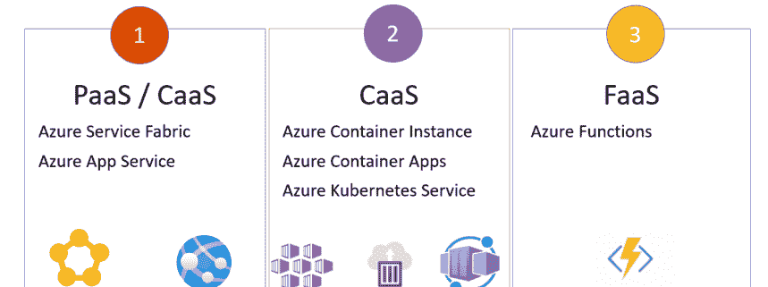

图 5.1 – Azure 容器服务

在本节中，我们讨论了用于构建和部署容器应用的不同 Azure 服务。在下一节中，我们将定义 Service Fabric 以及使用 Service Fabric 的不同服务。

### 定义

Azure Service Fabric 允许你创建现代、弹性和可扩展的软件解决方案，并提供构建健壮系统所需的功能，例如自动缩放、运行状况监视和容错。

Service Fabric 平台提供了一种编程模型，你可以使用它基于 Actor 模型创建可靠的服务或组件。对于容器化应用，Service Fabric 还支持 Docker 容器，因此你可以将该平台用作编排器。Azure Service Fabric 能够运行在任何操作系统（Windows 或 Linux）上。此外，它可以运行在任何环境中：作为私有云在本地运行，在公有云（如 Azure 或任何其他云提供商，如 AWS 或 Google Cloud Platform）中运行，或者在开发者的本地开发环境中运行。它提供了一整套开发工具和软件开发工具包（SDK），让你能够非常快速地开始在该平台上构建解决方案。这些工具可以用于开发环境或生产环境。云促进了分布式系统软件架构和开发平台的演进。Azure Service Fabric 并不是新事物。它是一个开源项目，被用于 Azure 基础设施中的许多服务以及其他 Microsoft 服务中。事实上，它自 Azure 诞生之初就已存在，当时它仍被称为 Windows Azure。在 Microsoft 内部，该平台具有战略性和基础性地位，因为许多云服务都在使用它，例如 Azure SQL Database、Azure Cosmos DB、Azure DevOps、Dynamics 365、Power BI 等等。下图描绘了使用 Service Fabric 的不同 Microsoft 服务和工具。

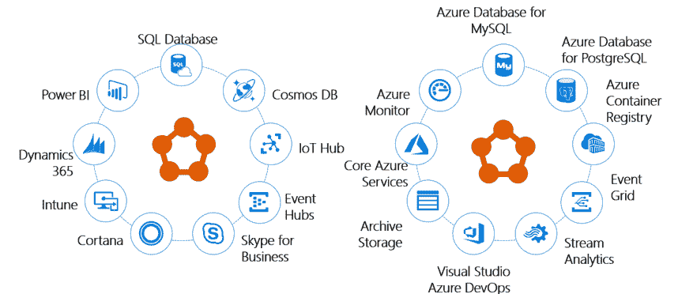

图 5.2 – 使用 Service Fabric 为 Azure 和 Microsoft 服务提供支持

但 Azure Service Fabric 是如何工作的呢？在下一节中，我们将介绍 Azure Service Fabric 的核心功能，它基于两个基本概念：集群和节点。


得益于冗余服务器，在这种情况下涌现出了三大特性：确保可用性、创建数据的多个副本，以及通过服务分区实现可靠性方面的进化。分区是可靠服务编程模型的关键特性。Service Fabric 无疑是托管和运行最关键软件解决方案的绝佳选择。

## Service Fabric 与 Kubernetes 的区别

容器用于云原生应用中。这项技术影响了软件开发行业，改变了系统的设计、操作、分发和监控方式。如果我们需要管理多个容器，就需要一个编排器，因此出现了各种容器编排器。编排器的主要特性之一是容器生命周期管理，例如容器预置、现有容器的缩放以及资源分配。Kubernetes 是业界使用最广泛的容器编排器之一。

Kubernetes 与 Service Fabric 的主要区别在于，Service Fabric 有三种部署和运行应用的机制：

- **一种专有编程模型，你可以选择在应用中使用**：该编程模型允许你构建有状态或无状态的可靠服务，以及可靠的执行组件。执行组件模型基于通过消息相互通信的分布式对象。
- **容器的使用**：支持 Linux 和 Windows 容器。
- **使用任何平台、任何语言构建的任何服务，且完全无需修改**：Kubernetes 支持 Linux 和 Windows 容器。同样，Microsoft Azure 包含 Azure Kubernetes Service，这是一个完全托管的 Kubernetes 平台。

## Azure Service Fabric 开发环境

我们有许多不同的选项来采用 Service Fabric。Service Fabric 是一个免费的开源项目，其源代码可在 GitHub 上获取。Service Fabric 支持三种不同的执行环境：

- **本地环境**：你可以在本地服务器或虚拟机上安装 Service Fabric。此场景适合工作负载的首次云迁移。
- **公有云**：Azure Service Fabric 允许创建集群。请注意，我们拥有与之前环境相同的 Service Fabric 功能，因为我们可以使用相同的运行时和 SDK。
- **其他提供商的公有云**：我们可以在任何使用任何操作系统的虚拟机上安装 Service Fabric。

我们还可以考虑另一种环境，将容器用作集群的节点。如前所述，Service Fabric 是开源的，因此是免费的。但是，如果你部署到云提供商，则需要为所预置的计算资源付费。

现在我们来谈谈开发环境和先决条件。我们将介绍用于构建和部署 .NET 应用的各种工具。Service Fabric SDK 还支持 Java 编程语言，并且能够托管任何可执行文件，无论用于构建该文件的是何种平台或语言。

为了能够配置开发环境以创建 Service Fabric 集群，我们必须满足以下先决条件：

- Windows 10 或 11（支持 Hyper-V）是安装 Docker 所必需的
- Visual Studio 2022 或 2019，或 Visual Studio Code
- .NET Core SDK
- Microsoft Service Fabric SDK
- Windows 版 Docker 工具
- Azure CLI

你可以从 https://visualstudio.microsoft.com/ 下载 Visual Studio。Community 版始终免费使用，并包含 Service Fabric 模板。你也可以使用其他版本。

要下载并安装 Service Fabric SDK，请使用此链接：https://www.microsoft.com/web/handlers/webpi.ashx?command=getinstallerredirect&appid=MicrosoftAzure-ServiceFabric-CoreSDK。

你可以从 Docker 官网下载 Windows 版 Docker。

使用此链接安装 Docker Desktop 并在 Docker Hub 中创建账户：https://www.docker.com/get-started/。

最后，我们将安装 Azure CLI 工具；你可以使用此链接为 Windows 安装它：https://aka.ms/installazurecliwindows。

现在，我们已经拥有了构建 Service Fabric 应用所需的所有软件。

现在让我们检查安装。我们将按“开始”并键入 fabric 以搜索 Service Fabric Local Cluster Manager。然后按 Enter 键设置本地集群，如下图所示：

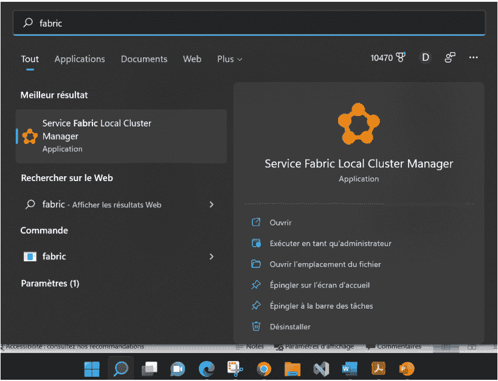

图 5.4 – Service Fabric 本地集群管理器

在系统托盘中，我们将右键单击 Service Fabric 图标，如以下屏幕截图所示。然后，我们将导航到“Setup Local Cluster”以选择节点数：对于 Windows 或 Linux 环境，我们有 1 节点或 5 节点选项。当我们选择要使用的节点数时，我们等待几秒钟，直到看到 Service Fabric Local Cluster Manager 设置成功完成的通知。

你可以使用 Visual Studio 2022 中的 Service Fabric 模板创建应用。选择任意应用类型，然后编译它，应用将被添加到“解决方案资源管理器”中。这是验证集群是否已配置的另一种方法。

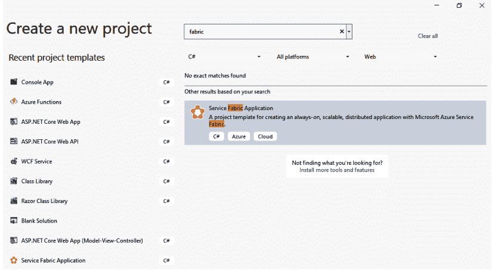

图 5.7 – Visual Studio 2022 中的 Service Fabric 模板

我们可以在本地部署任何应用，并且可以使用 Service Fabric Explorer 调试集群。Service Fabric Explorer 是开发人员使用的一种监控工具。我们还可以在 Azure Service Fabric 上远程部署集群。在下一节中，我们将了解如何创建 Azure Service Fabric 集群。

## 练习 1 – 使用 Azure 门户创建 Service Fabric 集群

在 Azure 中，我们将导航到 Azure 门户的主页。从那里，我们将选择“创建资源”按钮，然后搜索 Fabric。或者，直接选择窗口左侧的“容器”，最后我们会找到 Service Fabric Cluster，如下图所示。让我们选择 Service Fabric Cluster，然后点击“创建”按钮。

### 创建 Service Fabric 集群

主页 > 创建资源 >

### 项目详细信息

选择订阅以管理已部署的资源和成本。使用资源组（如文件夹）来组织和管理所有资源。

| 字段 | 值 |
|---|---|
| 订阅 * | MVP |
| 资源组 * | packtrg（新建） |

### 集群详细信息

| 字段 | 值 |
|---|---|
| 集群名称 * | hospitalmanagement.eastus2.cloudapp.azure.com |
| 位置 * | (US) East US 2 |
| 操作系统 * | Windows Server 2019 Datacenter with Containers |
| 用户名 * |  |
| 密码 * |  |
| 确认密码 * |  |

图 5.9 – 步骤 1 – 创建 Service Fabric 集群

现在，我们将完成与主节点相关的集群配置。我们将设置初始 VM 规模集容量，然后定义节点类型。节点类型允许你定义不同的硬件配置，也允许你指定不同的规模。在本例中，我们将选择默认值。

### 主节点类型详细信息

节点类型定义用于管理集群的规模集。一个 Service Fabric 集群可以由多个节点类型组成。在这种情况下，集群由一个主节点类型和一个或多个非主节点类型组成。在此处配置你的主节点类型。了解有关节点类型的详细信息。

| 字段 | 值 |
|---|---|
| 初始 VM 规模集容量 * |  |
| 节点类型 * | Standard D2s v3（选择 VM 大小） |

### 安全性

Service Fabric 需要一个主证书来验证集群中的节点并提供安全通信。此证书必须包含私钥，并且其使用者名称必须与用于访问集群的域相匹配。你现在可以创建新证书，也可以从 Azure Key Vault 中选择现有证书。该证书必须存储在与集群位于同一订阅和区域的 Azure Key Vault 中。了解有关 Service Fabric 安全性的详细信息。

| 字段 | 值 |
|---|---|
| 密钥保管库和主证书 * | 选择证书 |

图 5.10 – 步骤 2 – 创建 Service Fabric 集群

现在，在“安全性”边栏选项卡中，我们需要选择或创建一个用于存储证书的 Azure Key Vault 资源。因此，让我们点击此选项并创建一个新的密钥保管库。例如，我们将其命名为 servicefabrickeycert。我们将选择与为 Service Fabric 选择的资源组相同的资源组。之后，我们将点击“创建”按钮。现在，Azure 门户将部署此 Azure Key Vault 资源，因为需要它来创建证书并将其存储在那里。

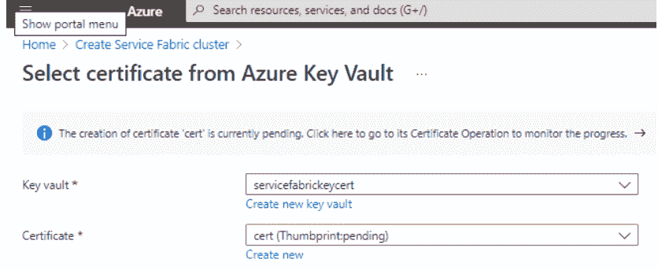

图 5.11 – 从 Azure Key Vault 选择证书

密钥保管库预配完成后，你将看到一条消息，提示其未为部署启用，因此我们需要点击“编辑访问策略”按钮。必须为部署启用密钥保管库。


要启用密钥保管库，我们需要通过选择高级访问策略部分中的启用对 Azure 虚拟机进行部署访问选项并单击保存，来编辑密钥保管库的访问策略。

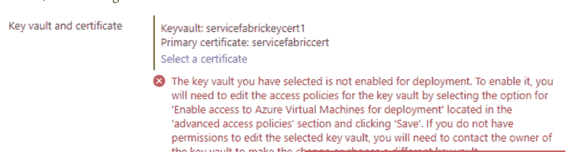

图 5.12 – 编辑密钥保管库的访问策略和证书

## 重要说明

证书必须存储在与集群相同订阅和区域的 Azure Key Vault 中。

在节点类型选项卡中，我们可以指定在规模集中想要多少台虚拟机。如你所见，这里我们使用的是 5 的值。此外，你还可以指定单节点集群。

## 创建 Service Fabric 集群

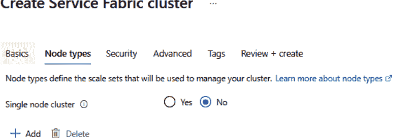

图 5.13 – 第 3 步 – 创建 Service Fabric 集群 – 节点类型选项卡

此过程需要几分钟才能完成。如果我们想使用交互模式简化 Service Fabric 集群的创建，我们将使用门户。但是，我们也可以使用 Azure CLI 创建它。我们将在下一节中介绍这一点。

## 练习 2 – 使用 Azure CLI 创建 Service Fabric 集群

我们可以使用 Azure CLI 工具来创建 Azure Service Fabric 集群的另一种选项。你可以打开已安装在机器上的 PowerShell，或使用此链接打开 Azure Cloud Shell：https://shell.azure.com/。

你可以通过以下链接在 GitHub 上找到完整的示例命令行：https://github.com/PacktPublishing/A-Developer-s-Guide-to-Building-Resilient-Cloud-Applications-with-Azure/tree/main/Chapter5。

我们将使用 PowerShell；我们将输入此命令行来创建新集群：

```
az sf cluster create -g packtrg -c hospitalmanagement -l estus --cluster-size 5 --vm-password Password#1234 --certificate-output-folder MyCertificates --certificate-subject-name hospitalmanagement
```

我们可以使用 Key Vault 证书和自定义模板按如下方式部署集群：

```
az sf cluster create -g packtrg -c hospitalmanagement -l estus --template-file template.json \ --parameter-file parameter.json --secret-identifier https://{KeyVault}.vault.azure.net:443/secrets/{MyCertificate}
```

要创建新的 Azure Service Fabric 集群，我们可以使用此处提到的一个或多个属性：

```
az sf cluster create --resource-group [--cert-out-folder] [--cert-subject-name] [--certificate-file] [--certificate-password] [--cluster-name] [--cluster-size] [--location] [--os {UbuntuServer1604, WindowsServer1709, WindowsServer1709withContainers, WindowsServer1803withContainers, WindowsServer1809withContainers, WindowsServer2012R2Datacenter, WindowsServer2016Datacenter,
WindowsServer2016DatacenterwithContainers,
WindowsServer2019Datacenter,
WindowsServer2019DatacenterwithContainers}]
    [--parameter-file]
    [--secret-identifier]
    [--template-file]
    [--vault-name]
    [--vault-rg]
    [--vm-password]
    [--vm-sku]
    [--vm-user-name]
```

创建后，你可以使用以下命令列出集群资源，或直接检查 Azure 门户：

```
az sf cluster list [--resource-group]
```

集群创建后，有时我们需要对其进行扩缩容。在下一节中，我们将学习如何扩缩容 Azure Service Fabric 集群。

## 练习 3 – 扩缩容 Azure Service Fabric 集群

有三种机制可以扩缩容 Service Fabric 集群。

### 手动扩缩容

第一个是手动指定想要的节点实例数量。因此，让我们导航到虚拟机规模集资源。我们需要选择包含 Service Fabric 实例的资源组。然后，如以下屏幕截图所示，选择虚拟机规模集作为类型。

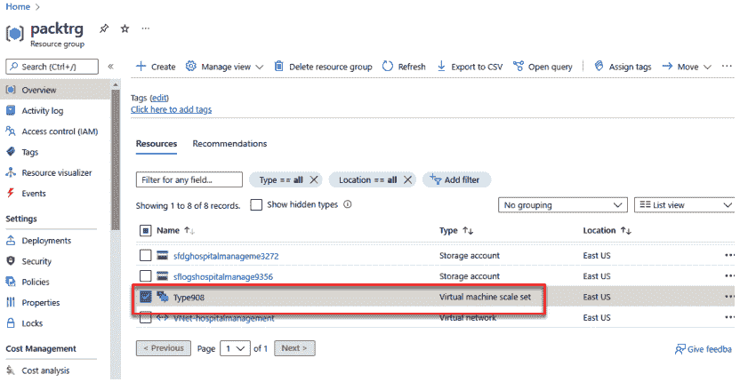

图 5.14 – 虚拟机规模集资源类型

我们将单击打开它。在 **设置** 部分，你会找到 **扩缩容** 选项。

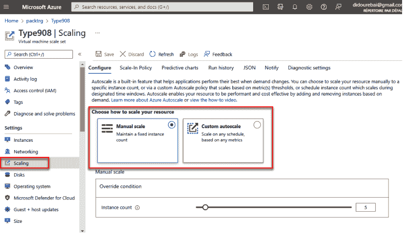

图 5.15 – 扩缩容设置

如前一屏幕截图所示，默认选项是 **手动扩缩容**，但你可以指定节点实例的数量。在图中，我们有 5 个节点实例，但我们可以将其设置为 20，例如。保存此选项后，虚拟机规模集将从 5 个实例增加到 20 个实例。

### 自定义自动扩缩容

第二个选项是使用自定义自动扩缩容。如果你选择此选项，你可以在 **自定义自动扩缩容** 窗口中指定扩缩容规则，如以下屏幕截图所示：

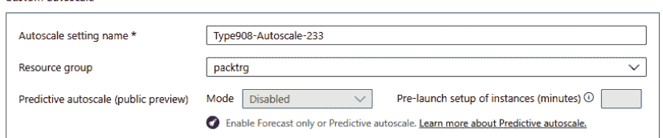

图 5.16 – 自定义自动扩缩容窗口

我们可以添加扩缩容条件。我们默认有一个自动创建的扩缩容条件，但我们可以组合多个条件以实现扩缩容自动化：

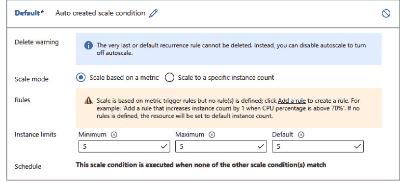

图 5.17 – 创建扩缩容条件

规则基于你选择的指标来确定集群是否需要扩容或缩容。例如，基于过去 5 分钟的 CPU 百分比值，如果大于 75，我们将计数增加 1。你可以在最后单击保存按钮保存。

### 编码你的扩缩容

第三个选项是编程扩缩容。换句话说，你创建代码来增加或减少集群中的实例数量。

在创建集群并配置扩缩容后，我们现在将学习如何创建 .NET Service Fabric 应用程序。

## 练习 4 – 创建 .NET Service Fabric 应用程序

Service Fabric 支持多种应用程序模型。它是一种灵活的技术，允许你托管和执行任何工作负载。安装 Service Fabric SDK 后，你将能够使用其可用的模板。

当我们运行 Visual Studio 2022 并选择 Service Fabric 模板时，会出现许多模型，如屏幕截图所示：

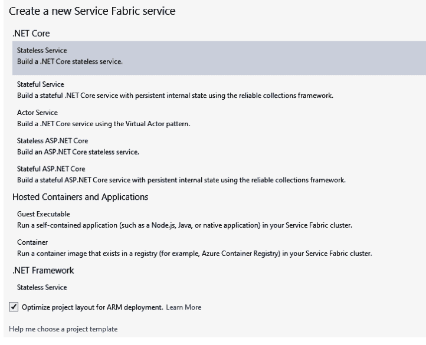

图 5.18 – Service Fabric 模板模型

我们将从一种被认为具有可靠服务的应用程序模型开始。这些服务使用 Service Fabric 的原生 API。我们有三种不同类型的可靠服务：无状态、有状态和参与者。无状态服务与有状态服务的区别在于，在无状态服务中，服务不维护任何状态，而对于有状态服务，状态会与服务一起存储。

此外，我们可以使用 .NET Core 和 .NET Framework 运行时来构建可靠服务。这就是为什么我们可以使用 Service Fabric 迁移旧应用程序的原因。参与者是一个依赖的计算单元，在单个线程上运行。参与者模型适用于并发或分布式系统，因为大量这些参与者可以同时且独立地运行，通过消息进行通信。

另一种应用程序模型是容器。Service Fabric 支持 Linux 和 Windows 容器。

还有来宾可执行模型。它允许我们将使用任何开发平台和任何编程语言构建的任何类型的可执行文件带到 Service Fabric。

有了这些应用程序模型，我们可以在任何需要高可用性、可靠性和用于部署和运行应用程序的强大平台的场景中使用 Service Fabric。

我们将基于 Service Fabric 的 **无状态可靠服务** 创建一个示例解决方案。该应用程序用于管理非洲和欧洲一些国家的医院。

## 创建 Service Fabric 应用程序

让我们回到 Visual Studio 2022。当我们选择 **创建新项目** 时，我们需要通过指定名称、位置、解决方案名称和框架来配置项目。之后，我们将单击 **创建** 按钮。

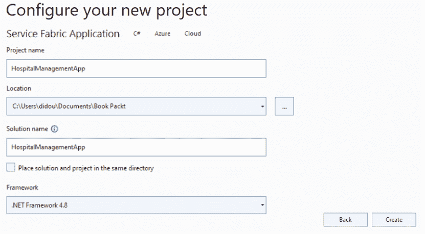

图 5.19 – 创建 Service Fabric 应用程序

之后，我们将选择 **无状态服务 ASP.NET Core**，它将使用 .NET Core 运行时。如以下图所示，我们将指定服务名称和位置（可选），然后单击 **创建**。

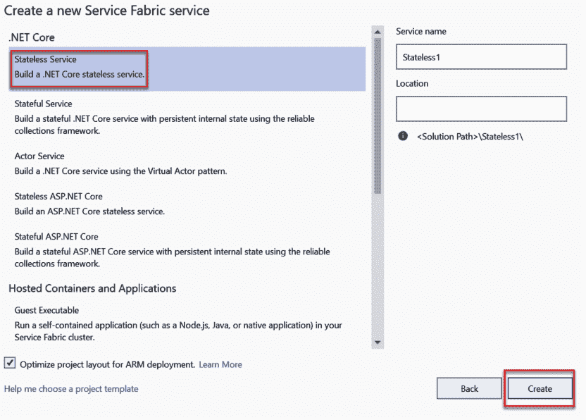

图 5.20 – Azure Service Fabric 上的无状态服务

在下一个窗口中，我们可以选择应用程序类型。我们将选择 **ASP.NET Core Web App (Model-View-Controller)**。


## 创建新的 ASP.NET Core Web 应用程序

ASP.NET Core 6.0

- **ASP.NET Core 空**
  用于创建 ASP.NET Core 应用程序的空项目模板。此模板中没有任何内容。
- **ASP.NET Core Web API**
  一个用于创建 ASP.NET Core 应用程序的项目模板，其中包含用于 RESTful HTTP 服务的示例控制器。此模板也可用于 ASP.NET Core MVC 视图和控制器。
- **ASP.NET Core Web 应用**
  一个用于创建 ASP.NET Core 应用程序的项目模板，其中包含示例 ASP.NET Razor Pages 内容。
- **ASP.NET Core Web 应用（模型-视图-控制器）**
  一个用于创建 ASP.NET Core 应用程序的项目模板，其中包含示例 ASP.NET Core MVC 视图和控制器。此模板也可用于 RESTful HTTP 服务。
- **ASP.NET Core 与 Angular**
  一个用于创建带有 Angular 的 ASP.NET Core 应用程序的项目模板
- **ASP.NET Core 与 React.js**
  一个用于创建带有 React.js 的 ASP.NET Core 应用程序的项目模板

身份验证
无

高级
配置 HTTPS
不使用顶级语句

获取其他项目模板

作者：Microsoft

返回 创建

图 5.21 – 使用 Service Fabric 创建新的 ASP.NET Core Web 应用程序

我们将探索解决方案树。我们有两个项目。第一个项目是应用程序本身，第二个是服务。

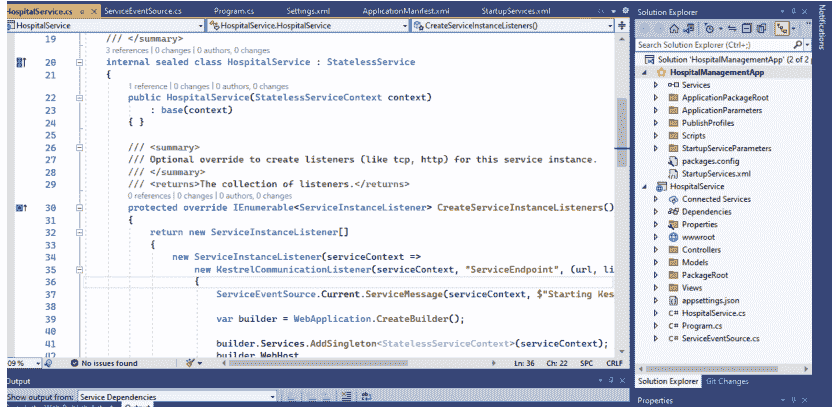

图 5.22 – 医院管理解决方案结构

在应用程序中，您会找到表示应用程序元数据的 .xml 文件。例如，在 ApplicationPackageRoot 中，我们会找到 ApplicationManifest.xml 文件，它代表整个应用程序，因为它包含了对构成应用程序的所有服务的引用。在 HospitalService 项目中的 PackageRoot 文件夹中，您会找到 ServiceManifest.xml 文件。每个服务都有自己的清单。ServiceManifest.xml 文件包含一个 ConfigPackage 元素。找到 Resources 元素以及此服务将侦听的终结点。在这种情况下，我们只有一个终结点。

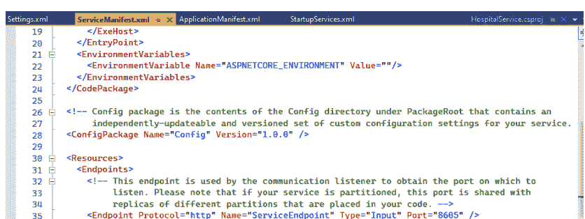

如果我们检查 ASP.NET Core 中的应用程序，在 Program.cs 中，服务使用以下代码行向 Service Fabric 注册自身：

```
ServiceRuntime.RegisterServiceAsync("HospitalServiceType",
    context => new HospitalService(context)).
GetAwaiter().GetResult();
```

HospitalService 类继承自 StatelessService，后者是 Service Fabric API 中的基类之一。我们有两个用于侦听器的方法。第一个是 CreateServiceInstanceListeners。它返回一个基于 Kestrel 的侦听器集合 ServiceInstanceListener。Kestrel 是 .NET Core 中包含的 Web 服务器。换句话说，此服务能够接收 HTTP 请求。

## 使用 Visual Studio 在本地群集中部署应用程序

要将应用程序部署到本地群集，我们将使用 Visual Studio 的 **发布** 工具。右键单击带有 **Service Fabric** 图标的应用程序，然后选择 **发布**。在目标文件中，我们将选择群集中配置的节点数。在这种情况下，我们在连接终结点中配置了单个节点。确保您的应用程序将发布到本地群集。最后，需要包含应用程序参数和启动服务参数的 .xml 文件才能完成发布过程。

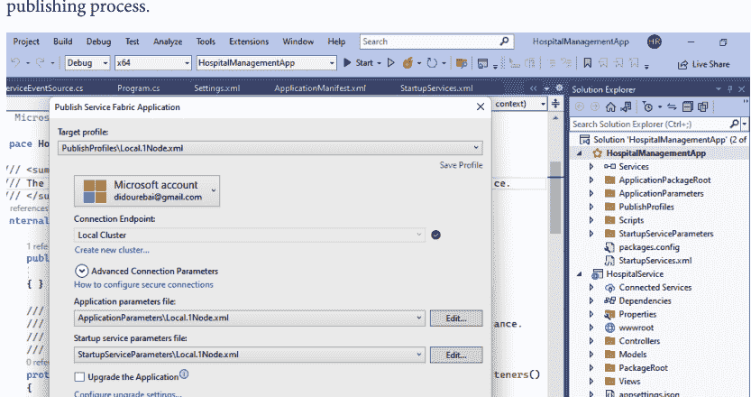

单击 **发布** 按钮，然后我们将在 Service Fabric Explorer 中检查应用程序。

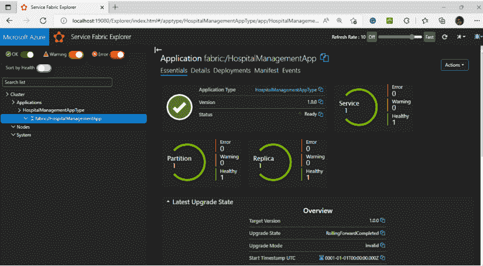

图 5.25 – Service Fabric Explorer – 应用程序部署

一个解决方案包含多个服务。为了充分利用 Service Fabric 平台，我们需要在服务之间进行通信。为此，例如，我们可以实现一个接口或 API。在这种情况下，该接口是所有想要调用医院功能的服务的公共 API。另一个服务（例如搜索服务）可以使用相同的接口。两个服务都将引用该接口。在微服务架构中，一个服务直接调用另一个服务是完全有效的。您可以通过 HTTP 协议以及从目标微服务公开 API 来实现这一点。

## 练习 5 – 将应用部署到 Service Fabric 托管群集和容器

当应用程序在本地测试并部署后，我们可以将其远程发布到之前创建的 Azure Service Fabric 实例。为此，我们将使用 Visual Studio 中相同的发布工具。

## 将 ASP.NET Core 应用程序部署到 Azure Service Fabric

右键单击应用程序，然后选择 **发布**。在目标配置文件中，我们将选择 `PublishProfiles\Cloud.xml`。我们将选择与 Azure 门户关联的帐户。在连接终结点中，我们可以选择已创建的 Azure Service Fabric 群集，也可以使用 Visual Studio 创建您的群集。为此，我们将单击 **添加自定义终结点**。

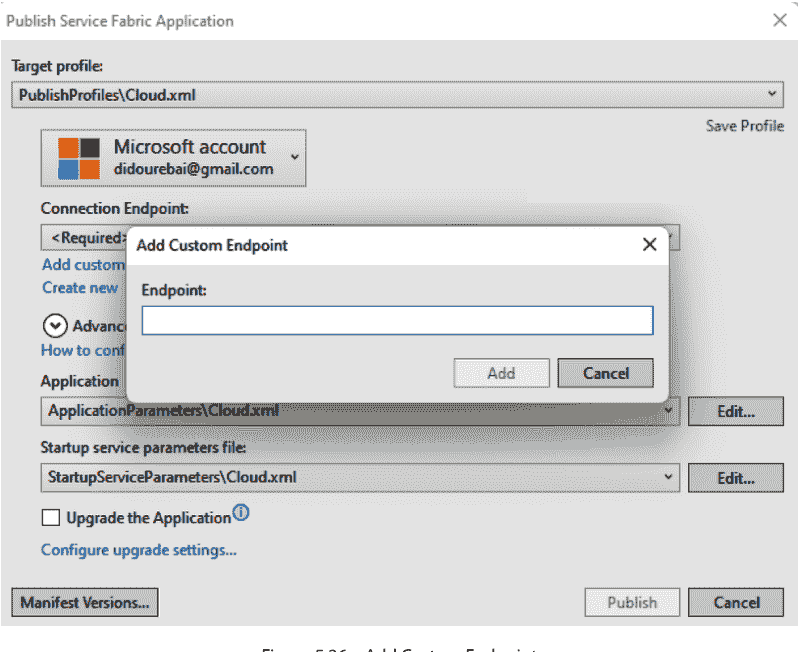

图 5.26 – 添加自定义终结点

接下来，我们将为终结点添加值。在按照之前的步骤创建群集后，我们将单击 **创建新群集**。下图显示了创建 Service Fabric 群集的窗口：

图 5.27 – 创建 Service Fabric 群集

我们需要定义群集名称，选择订阅和位置，定义节点数，并选择现有资源组或创建新资源组。我们需要填写每个选项卡的所有信息。对于“证书”选项卡，我们需要添加所需的证书信息。在“VM 详细信息”中，我们将配置群集使用的 VM。在“高级”中，我们需要添加端口。之后，我们将单击“创建”。

将创建一个新群集。在窗口底部，我们需要选择用于云环境的应用程序参数文件和启动服务参数文件，因此我们将选择 Cloud.xml。此配置确保每个服务都将部署到群集中的所有节点。之后，我们将单击“完成”。

## 在 Service Fabric 中构建和执行 Docker 容器

Service Fabric 支持的另一种应用程序模型是使用 Docker 容器。

容器是微服务架构的理想补充，因为它们既隔离又轻量级。

让我们创建一个新的 Service Fabric 应用程序。首先，我们需要选择容器模板，设置服务名称，并指定容器映像名称。映像必须是可访问的。容器映像可以是 Docker Hub 中的公共映像，例如，也可以是 Azure 容器注册表或任何私有注册表中的私有映像。在这种情况下，我们需要添加用户名和密码。您还可以指定要使用的主机端口和容器端口；例如，我们可以使用端口 80。然后，我们将单击 **创建**。

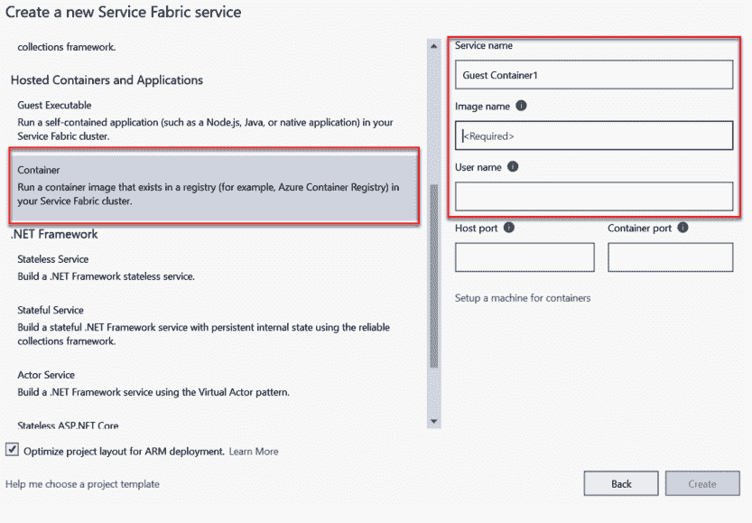

这种应用程序模型不会添加服务项目，因为您不会编写任何代码。这是因为所有代码都已经在容器内。如果我们展开包的服务清单，`ContainerHost` 元素包含映像名称。可选地，您还可以使用 `EnvironmentVariables` 元素在容器中设置环境变量。在本地，我们可以将此类型的应用程序部署到本地群集。在远程，您可以将应用程序部署到 Azure Service Fabric。

如果您需要了解如何创建容器，可以查阅这本书：Packt Publishing 出版的 *使用 Microsoft Azure 的云应用开发者指南*。

## 总结

在本章中，我们讨论了 Azure Service Fabric 平台。我们探索了 Service Fabric 的不同元素，例如群集和节点、Service Fabric 与 Kubernetes 之间的主要区别，并且我们准备了用于创建和部署应用程序的开发环境。

我们使用 Azure 门户和 Azure CLI 创建了 Service Fabric 应用程序，了解了如何缩放 Azure Service Fabric 群集，并进一步了解了 Visual Studio 2022 中 Service Fabric 模板的不同模型。我们还创建了一个 .NET Service Fabric 应用程序，并在 Service Fabric 中构建和执行了一个 Docker 容器。

为了将应用程序发布到 Azure Service Fabric，我们使用了 Visual Studio 中的 **发布** 工具。

应用程序使用数据库。在下一章中，我们将了解数据的不同分类，以及数据如何定义和存储。我们将识别关系数据和非关系数据的特征，以及用于数据库的不同 Azure 服务。

我们还将解释 Azure Storage、Azure SQL Database 和 Azure Cosmos DB 或其组合的用法，以确定数据的操作需求、延迟要求和事务要求。

## 问题

- 1. 什么是 Azure Service Fabric 群集？
- 2. Kubernetes 和 Service Fabric 有什么区别？
- 3. 我们如何在 Azure Service Fabric 上部署容器化应用程序？


