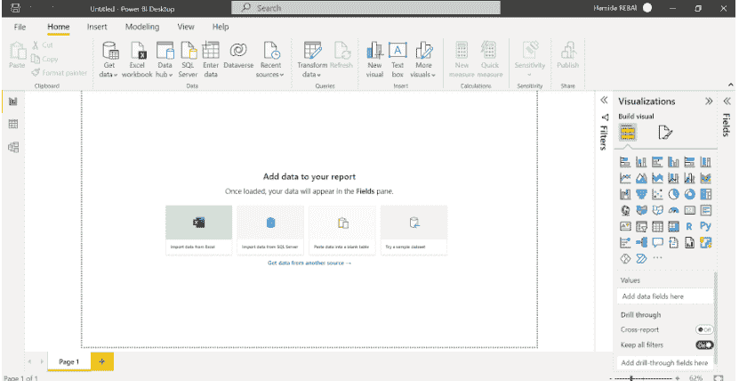

## 应用数据简介

我们收集和处理大量数据的能力随着多年的发展而增长，因为技术让我们作为人类能够以数字方式收集和汇编大量数据。这随后使我们能够分析来自更长时间段的大型数据集，并产生有意义的信息，这些信息可以改善或帮助解决一个问题并理解其原因。

在本章中，我们将介绍 Azure Storage、Azure SQL Database 和 Azure Cosmos DB 的使用，或它们的组合，以确定您的数据的运营需求、延迟要求和事务要求。我们将介绍一个微服务解决方案，其中包含一些 Web API，每个 API 都将使用不同的数据服务。

在本章中，我们将介绍以下主要主题：

- 数据分类和数据概念概述
- 在 Azure 中探索关系型数据概念
- 在 Azure 中探索非关系型数据概念
- 探索现代数据仓库分析
- 开始使用 Power BI 构建

## 数据分类和数据概念概述

在应用程序的设计和实施的某个阶段，开发人员或架构师需要确定要收集的数据的类型、格式和位置。

数据是一种战略性、宝贵的资产。对数据存储和数据处理采取整体方法并对新思想保持开放，可以带来将应用程序提升到新水平并确保数据库存稳定和有序的无限可能。

数据是一组收集的信息和事实，可以是数字、字符字符串和/或观察结果，以帮助我们做出决策。我们可以将数据分为两类，结构化和半结构化（非结构化）：

- **结构化数据：** 这是遵循模式的表格数据，这意味着所有数据都具有相同的属性，称为字段。结构化数据可以存储在数据库表中。为了在共享相同模式的表中搜索数据，我们有查询语言，例如 **结构化查询语言 (SQL)**。表由行和列组成。
- **非结构化数据：** 这也称为半结构化数据。它不适合表格、行和列，也不驻留在关系数据库中，但仍然具有一定的结构，因为它使用数据序列化语言。半结构化数据使用标签或键来组织并为数据库和图提供层次结构。我们也可以使用 **JavaScript 对象表示法 (JSON)** 格式。

> **重要说明**
> 半结构化数据也称为非关系型或仅限 SQL（NoSQL）数据。

## 在 Azure 中探索关系型数据概念

关系型数据库系统允许我们存储和管理世界各地各种规模组织的事务性和分析性数据。

在关系型数据库中，我们将现实世界中的实体集合建模为表。让我们以预约选定医生的解决方案为例。我们可能会为患者、医生和预约创建表。每个表都将包含行，每一行代表一个实体的单个实例。患者表中的每一行都包含单个患者的数据，医生表中的每一行定义单个医生，而预约表中的每一行代表一位预约了特定医生的患者。我们将获得有关预约时间和日期的更多信息。

SQL 用于表示和搜索关系型数据库中的数据。常用的 SQL 语句有 SELECT、INSERT、UPDATE、DELETE、CREATE 和 DROP，用于完成数据库中需要完成的多个任务。

Microsoft Azure 为关系型数据库提供了多个服务，让您能够在云中运行流行的关系型数据库管理系统，例如 SQL Server、PostgreSQL 和 MySQL。您可以选择最适合您需求的关系型数据库管理系统，并在云中存储关系型数据。

大多数 Azure 数据库服务都是完全托管的，这意味着我们无需管理数据库即可节省时间。它们具有企业级性能，具有内置高可用性，可让您快速扩展并实现全球分发，而无需担心昂贵的停机时间。开发人员

可以利用行业领先的创新，例如内置安全性和自动威胁检测和监控，可自动调整以提高性能。除了所有这些功能外，您还拥有保证的正常运行时间。

当您决定将数据库迁移到 Azure 或扩展本地 SQL Server 解决方案时，可以将其移至虚拟机。我们可以使用 SQL Server for Azure 虚拟机，例如。它允许您在云中运行完整的 SQL Server 实例，而无需管理本地硬件。然而，这种方法称为迁移或基础设施即服务，不建议使用，因为您必须管理数据库。Azure 提供 **平台即服务 (PaaS)**，其中包含由 Microsoft 在云中管理的 **数据库管理系统 (DBMS)** 系列。让我们来探索它们！

我们将从 **Azure SQL 托管实例** 开始。这是一个与本地 SQL Server 实例兼容的 **PaaS** 选项，同时抽象了底层硬件和操作系统。该服务包括软件更新、备份和其他维护任务的自动管理，从而降低了支持数据库服务器实例时的管理成本。

我们还拥有 **Azure SQL 数据库**，这是一种专为云设计的全托管数据库，是高度可扩展的 PaaS 数据库服务。您能够在云中创建托管数据库服务器，然后在此服务器上部署数据库。该服务包含本地 SQL Server 的核心数据库级功能，但不包含其所有功能。建议在构建新的面向云的应用程序时使用它。

Azure SQL 数据库有三种选项：

- 第一种是单个数据库，允许您设置和运行单个 SQL Server 数据库。
- 第二种是弹性池。这与单个实例类似——但是，默认情况下，多个数据库可以共享相同的资源，例如内存、处理能力和数据存储空间。
- 最后一种是托管实例，这是一种完全托管的数据库实例，专为本地 SQL 数据库的轻松迁移而设计。

这些部署有三个不同的服务层可供选择：

- **通用用途**：专为标准工作负载设计，这是默认层。
- **业务关键**：专为高吞吐量应用程序和 **联机事务处理 (OLTP)** 设计，该层提供高弹性，并具有低延迟的最佳性能。
- **超大规模**：这是业务关键层的扩展。该层专为大规模 OLTP 部署而设计，可对计算资源（如计算和存储）进行自动扩展。

现在我们已经介绍了 Azure 中关系型数据的不同概念，我们将继续讨论 **Azure SQL Edge**，这是一种针对需要处理流式时间序列数据的 **物联网 (IoT)** 场景而优化的 SQL 引擎。

## 在 Azure 中探索非关系型数据概念

当我们开始构建新应用程序时，我们需要考虑如何存储数据。这通常采用关系型数据库的形式，其中数据以链接表的形式组织，并使用 SQL 进行管理。然而，许多应用程序不需要关系型数据库的严格结构；我们可以使用非关系型存储（通常称为 NoSQL）。

让我们探索非关系型数据的一些特征。非关系型数据不遵循关系型数据的规则。在其原生形式中，数据可以快速加载。如果您有未知数据或查询，非关系型数据将比关系型数据更灵活、更好，但对于已知数据结构和已知查询则较差。

实体的结构高度可变。例如，在存储患者信息的医疗预约数据库中，患者可能拥有不止一个电话号码、固定电话和手机号码。他们可以添加多个电话号码，例如业务号码和另一个家庭电话号码。同样，患者的地址可能不总是遵循相同的格式。地址可能因州、地区、邮政编码和国家/地区而异。

让我们讨论另一个场景。如果您摄取数据，您希望捕获数据并将其保存的过程尽可能快。当您想要处理数据并在关系型数据库的多个表的一组行中操作它时，在此阶段，选择关系型数据库是不合适的，因为我们必须在将数据存储到数据库之前将非结构化数据转换为兼容格式，这可能会导致延迟；即使搜索信息也将难以管理。

实体将存储在一组集合或容器中，而不是像关系型数据库那样的表中——但如果我们有两个实体在同一个集合中，会发生什么？它们将具有不同的字段集，不像关系型表中的一组列。没有固定的模式会导致每个实体的描述。例如，非关系型患者实体集合可能如下所示：

```
## Patient 1
ID: 1
Name: Hamida Rebai
Telephone: [ Home: 1-444-9999999, Business: 1-555-5555555,
Mobile: 1-444-4444444 ]
Address: [ Home: 2110 Rue De la Cantatrice Quebec, G2C0L6,
Canada,
Business: Marly Quebec G1X2Z2]
## Patient 2
ID: 2
Title: Mr
Name: Rayen Trabelsi
Telephone: [ Home: 0044-1999-333333, Mobile: 0044-17545-444444]
Address: [ FR: 86 High Street, Town X, County Y, 15000, FR,
US: 333 7th Street, Another Town, City A, CA, 111111]
```


在前面的示例中，我们有以名称为前缀的字段。这些字段可以有一个或多个子字段，与名称的情况相同。括号已被用来标识字段的子字段。如果我们想要添加一个新患者，我们需要插入一个实体，其字段以有意义的方式进行标记。如果应用程序查询此数据，应用程序必须具有解析检索到的实体中信息的能力。

集合中的实体通常以键值格式存储。最简单的非关系型数据库类型允许应用程序指定一个唯一键或一组键作为查询条件。在患者示例中，数据库允许应用程序仅通过**身份（ID）**查询患者。

要基于其他字段过滤数据，你需要扫描整个实体集合并逐个分析每个实体，然后对每个实体应用任何查询条件以找到匹配项。按身份检索患者详细信息的查询可以快速识别整个实体。尝试查找所有具有 FR 地址的客户的查询必须遍历每个实体并逐个检查每个实体的每个字段。如果数据库包含 100 万个实体，此查询可能需要很长时间才能执行。

现在我们已经介绍了 Azure 中非关系型数据的不同概念，我们将继续讨论现代数据仓库分析。

## 探索现代数据仓库分析

在数据挖掘时代，大多数组织拥有多个数据存储，通常具有不同的结构和不同的格式，因为我们可能需要从多个资源收集数据。它们通常具有实时传入的数据流，例如物联网解决方案中的传感器数据，分析这些数据可能很昂贵。组织外部通常有大量有用的信息可用。这些信息可以与本地数据结合，以增加洞察力并丰富理解。通过将本地数据与有用的外部信息相结合，通常可以获得以前不可能获得的数据洞察。将所有本地数据源组合起来的过程称为**数据仓库**。分析流数据和互联网数据的过程称为**大数据分析**。Azure Synapse Analytics 将数据仓库与大数据分析相结合。

在本节中，我们将探索数据仓库的不同概念。我们将讨论用于现代数据仓库的 Azure 数据服务以及数据仓库架构和工作负载。

### 探索数据仓库概念

现代数据仓库可能包含关系型和非关系型数据的混合，包括文件、社交媒体流和物联网传感器数据。Azure 提供了一系列服务，可用于构建数据仓库解决方案，例如 **Azure Data Factory (ADF)**、Azure Databricks、Azure Synapse Analytics、Azure Data Lake Storage 和 Azure Analysis Services。你可以使用 Power BI 等工具分析并可视化数据，生成报告、图表和仪表板。

任何现代数据仓库解决方案都应能够提供对原始数据流的访问以及来自该数据的业务洞察。

### 用于现代数据仓库的 Azure 数据服务

在本节中，我们将进一步讨论 Azure 提供的各种数据服务。这些服务允许你从多个来源组合数据，将数据重新格式化为分析模型，并将这些模型保存以供以后查询、报告和可视化。

要使用 Azure 数据库服务实现现代数据仓库，我们将使用以下服务：

- **ADF** 是一种基于 Azure 云的数据集成 PaaS 解决方案，允许你编排和自动化数据移动和数据转换。数据集成是将来自多个来源的数据组合在一起并提供其集成视图的过程。
- **Azure Data Lake** 建立在 Azure Blob Storage 上，微软的云对象存储解决方案。该解决方案具有经济高效的分层存储和高可用性/灾难恢复功能。它与其他 Azure 服务集成，例如 ADF，用于创建和运行 **提取、转换、加载 (ETL)** 和 **提取、加载、转换 (ELT)** 流程的工具。
- **Azure Databricks** 是一个基于云的平台，利用 Spark 进行大数据处理，具有内置的 SQL 数据库语义和管理界面，用于丰富的数据分析和机器学习。它是 Databricks 平台的云集成版本。通过 Databricks，我们能够使用现有的 Databricks 和 Spark 技能创建分析数据存储。我们还可以使用 Azure Databricks 原生的笔记本支持，在易于使用的基于 Web 的界面中查询和可视化数据。
- **Azure Synapse Analytics** 是一个集成端到端的规模化数据分析解决方案。它包括多种技术和功能，可将可扩展、高性能的基于 SQL Server 的关系型数据仓库的数据完整性和可靠性与数据湖的灵活性和开源 Apache Spark 相结合。它还包含使用 Azure Synapse Data Explorer 池进行日志和遥测分析的原生支持，以及用于数据摄取和转换的内置数据管道。
- **Azure Analysis Services** 是一个完全托管的 PaaS。它提供面向云的企业级数据模型。在 Azure Analysis Services 中，我们可以使用高级 mashup 和建模功能，将来自多个数据源的数据组合成单个受信任的语义表格数据模型，定义指标并保护我们的数据。
- **Azure HDInsight** 是企业级、开源、托管的全谱系云分析服务。它是 Hadoop 组件的云发行版。通过 HDInsight，你可以在 Azure 环境中使用 Apache Spark、Apache Hive、LLAP、Apache Kafka 和 Hadoop 等开源框架。
- **Microsoft Purview** 是一种企业级数据治理和可发现性解决方案，具有创建数据地图并跟踪不同数据源和系统中的数据血缘等功能，以便你找到用于报告和分析的可靠数据。为了在整个组织中强制执行数据治理，我们可以使用 Microsoft Purview。Microsoft Purview 确保用于支持分析工作负载的数据的完整性。

### 开始使用 Power BI 构建

Microsoft Power BI 是一组软件服务、应用程序和连接器。它们协同工作，将不相关的各种数据源转换为连贯的信息，以视觉沉浸式且最重要的是交互式的方式，便于之后对数据的利用。

数据可能多种多样——例如 Microsoft Excel 数据工作簿或云端和本地混合数据仓库的集合。Power BI 使连接到这些数据源变得容易，查看（或利用）重要内容，并根据权限或公开分享给所有人。

Power BI 拥有一个名为 Power BI Desktop 的 Microsoft Windows 桌面应用程序，一个名为 Power BI 服务的在线软件即服务（SaaS）服务，但还有一个移动版本，可在任何设备上使用适用于 Windows、iOS 和 Android 应用的原生 BI 移动应用程序。

在下一节中，我们将了解如何安装和配置 Power BI Desktop。

### Power BI Desktop

要安装 Power BI Desktop，你可以按照此链接从 Windows Store 下载：https://aka.ms/pbidesktopstore。或者，你可以使用此链接下载：https://go.microsoft.com/fwlink/?LinkID=521662。你必须定期手动更新它：



图 6.1 – Power BI Desktop 界面

在登录 Power BI 之前，你需要创建一个账户。转到此链接并使用你的电子邮件地址：https://app.powerbi.com/。如果你需要有关 Power BI 服务的更多详细信息，可以按照此文档链接：https://learn.microsoft.com/en-us/power-bi/consumer/end-user-sign-in。


# 总结

在本章中，我们讨论了数据分类和不同的数据概念。我们探索了 Azure 中的关系型数据和非关系型数据概念。我们探讨了现代数据仓库分析，并在本章末尾了解了 Power BI。

在下一章中，我们将学习如何预配和部署 Azure SQL 数据库和 Azure SQL 托管实例。在执行迁移到 SQL PaaS 平台时，我们可以从多个选项中进行选择。
