## 使用 Azure SQL 数据库

在本章中，我们将学习如何预配和部署 Azure SQL 数据库和 Azure SQL 托管实例。我们还将学习在执行迁移到 SQL 平台即服务（PaaS）平台时，如何从多个选项中做出选择。一个 Web API 会将数据存储在 Azure SQL 数据库上。

在本章中，我们将涵盖以下主要主题：

- 探索在 Azure 中部署 SQL Server 的 PaaS 选项
- 练习 1 – 部署单一 SQL 数据库
- 练习 2 – 部署 Azure SQL 数据库弹性池
- 练习 3 – 部署 SQL 托管实例
- 练习 4 – 将 Azure SQL 数据库连接到 ASP.NET 应用

### 探索在 Azure 中部署 SQL Server 的 PaaS 选项

在本节中，我们将了解在 Azure 中部署 SQL Server 的不同 PaaS 选项。如果我们将 SQL Server 用作关系数据库管理系统（RDBMS），我们希望在不进行任何转换的情况下迁移数据库，并且无需考虑重新安装 SQL Server 并再次配置它。Azure 提供了一种 PaaS，它为面向云的应用程序提供了完整的开发和部署环境，易于使用。

Azure 中有多个 SQL Server 选项，例如 Azure 虚拟机上的 SQL Server 或 SQL 托管实例。

## Azure SQL 数据库

Azure SQL 数据库是 Azure 中的托管 SQL 数据库服务。它运行在 SQL Server 数据库引擎上。Azure SQL 数据库与传统 SQL 服务之间存在一些重要差异。但大多数使用 SQL Server 的数据库管理员都可以迁移到 Azure SQL 数据库。Azure SQL 数据库使扩展数据库变得极其容易。我们能够在全球其他一个或多个位置复制数据库，如果您的应用程序在全球范围内使用，这可以提高性能。

Azure SQL 数据库不仅可作为 PaaS 使用，也可作为无服务器服务使用。它们之间的区别在于，PaaS 选项要求您选择性能级别，并且您需要按小时支付固定费率来访问数据库。您可以通过在 Azure 门户中选择选项，轻松扩展到更大或更小的性能计划，而不会对应用程序或用户造成中断。无服务器选项允许您仅为使用量付费。实际上，当您不使用数据库时，数据库会关闭。这对于未充分利用的数据库来说非常理想，例如，如果您有一个仅开发人员使用的工具，它需要数据库来运行，但不需要全天候运行，并且可以立即投入使用。Azure 为 Azure SQL 数据库及其默认配置提供 99.99% 的可靠性。

Azure 为那些对业务而言是重要资源的数据库提供了高级层。这有时在数据库事务单位（DTU）定价模型中被称为高级层。业务关键型 SQL 数据库使用 SQL 数据库进程集群来响应数据库请求。拥有多个 SQL 引擎进程使您的数据库更加可靠，因为一个进程的故障不会直接影响您。

请注意，Azure SLA 在标准层和业务关键层之间不会增长，尽管在实际中您可以预期更高的可用性。但是，您可以通过添加区域冗余部署来进一步提高有保证的正常运行时间 SLA。您只能进行企业关键型区域冗余部署，这使您的可用性达到 99.995%。区域冗余部署涉及部署数据库的多个副本，这些副本在可用性区域中物理上彼此分离。

让我们在下一节中了解 Azure SQL 托管实例。

## Azure SQL 托管实例

我们可以使用两种不同的选项将 SQL Server 迁移到 Azure。基础设施即服务（IaaS）允许您创建 Azure SQL Server 虚拟机，而 PaaS 允许您创建完全托管的 Azure SQL 数据库。还有一个选项位于这两者之间，称为 SQL 托管实例。SQL 托管实例结合了这两种替代方案（PaaS 和 IaaS）的优势。与虚拟机一样，托管实例与本地 SQL Server 几乎 100% 兼容。这包括 SQL Server 代理支持、临时数据库访问、跨数据库查询、分布式事务和公共语言运行时。这些在完全托管的 Azure SQL 数据库中不可用。托管实例还支持在同一实例中最多 100 个独立数据库。但与虚拟机不同，托管实例还支持自动备份计划、自动修复和内置高可用性，就像 Azure SQL 数据库一样。

## 创建 Azure SQL 数据库实例

要创建新的 SQL 数据库或 SQL 托管实例，或者仅迁移到 SQL 虚拟机，我们将创建一个包含所有这些选项的 Azure SQL 实例。为此，请按照以下步骤操作：

1. 打开 Azure 门户，然后选择“创建新资源”。
2. 搜索 Azure SQL，然后单击“创建”，如下图所示：

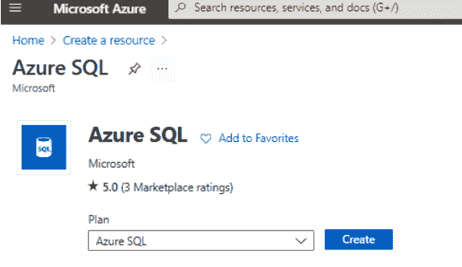

图 7.1 – Azure SQL 服务

或者，使用此链接 `https://portal.azure.com/#create/Microsoft.AzureSQL` 以显示“选择 SQL 部署选项”页面，如下图所示：

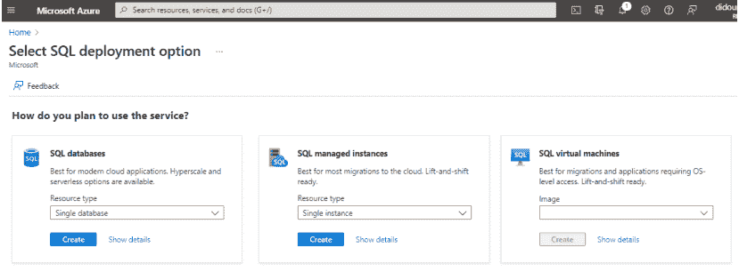

图 7.2 – “选择 SQL 部署选项”页面

每个服务都提供了两种不同的部署模型。我们可以为所有服务创建单一数据库，也可以选择其他选项。例如，对于 SQL 数据库服务，我们还可以选择弹性池或数据库服务器。对于 SQL 托管实例，我们在 Azure Arc 中有一个单一数据库；对于 SQL 虚拟机，我们可以选择 SQL Server 映像来安装它。

现在，让我们在下一节中了解如何创建和部署单一 SQL 数据库。

## 练习 1 – 部署单一 SQL 数据库

在单一数据库中，每个数据库都是隔离的；因此，每个数据库在范围、规模和数据大小方面都是独立计费和管理。我们有两种模型：第一种是基于 DTU 的购买模型，它提供一组价格与性能包，便于轻松配置；第二种是基于 vCore 的购买模型，它提供广泛的配置控制，还提供超大规模和无服务器选项，可根据您的需求和所需资源自动扩展数据库。在这两种模型中，每个数据库都拥有自己的专用资源和自己的服务层级，即使它们部署在同一逻辑服务器上也是如此。因此，它被认为是 Azure SQL 数据库的一种部署模型。

我们将从创建 SQL 数据库开始。我们将使用与图 7.2 中相同的页面，并将“资源类型”保留为“单一数据库”。然后，单击“创建”按钮。让我们从“基本信息”选项卡开始：

1. 在“项目详细信息”中，选择订阅和资源组（我们可以新建一个）。在下图中，我们可以看到“项目详细信息”部分：

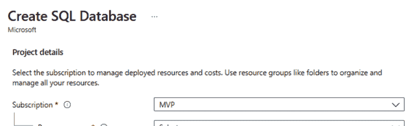

图 7.3 – 创建 SQL 数据库 – “项目详细信息”部分

2. 在“数据库详细信息”中，我们填写数据库所需的各种设置。我们需要选择一个现有的 SQL 数据库服务器，但我们可以在完成与数据库相关的不同设置之前创建它。在下图中，我们可以看到“数据库详细信息”部分：

## 数据库详细信息

输入此数据库所需的设置，包括选择逻辑服务器并配置计算和存储资源

数据库名称 *
输入数据库名称

服务器 *
选择服务器
创建新

图 7.4 – 创建 SQL 数据库 – 数据库详细信息部分

3. 如果你没有 SQL 数据库服务器，你将需要创建一个新服务器。按如下方式填写不同的设置：

- A. 服务器名称：此名称应唯一，不仅在订阅内唯一，而且在所有 Azure 服务器中都唯一。
- B. 位置：从下拉列表中选择一个位置。在下面的图中，我们可以看到第一部分，它与新 SQL 数据库服务器的详细信息相关：

Home > Select SQL deployment option > Create SQL Database >

## 创建 SQL 数据库服务器

Microsoft

## 服务器详细信息

输入此服务器所需的设置，包括提供名称和位置。此服务器将在与数据库相同的订阅和资源组中创建。

服务器名称 *
输入服务器名称
.database.windows.net

位置 *
(US) East US

图 7.5 – 创建 SQL 数据库服务器 – 服务器详细信息

C. 身份验证方法：我们有三个选项可供选择：

- 仅使用 Azure Active Directory (Azure AD) 身份验证
- 同时使用 SQL 和 Azure AD 身份验证
- 使用 SQL 身份验证

选择使用 SQL 身份验证。

- D. **服务器管理员登录**：这是服务器的管理员登录名。
- E. **密码**：密码应满足要求，我们需要在另一个字段中确认密码。点击确定以完成服务器的创建。

选择确定返回到上一页。

在下面的图中，我们可以看到创建 SQL 数据库服务器时 **身份验证** 部分：

## 身份验证

选择用于访问此服务器的首选身份验证方法。创建服务器管理员登录名和密码以使用 SQL 身份验证访问服务器，仅选择 Azure AD 身份验证 Learn more 使用现有的 Azure AD 用户、组或应用程序作为 Azure AD 管理员 Learn more，或同时选择 SQL 和 Azure AD 身份验证。

身份验证方法
○ 仅使用 Azure Active Directory (Azure AD) 身份验证
○ 同时使用 SQL 和 Azure AD 身份验证
○ 使用 SQL 身份验证

设置 Azure AD 管理员 *
未选择
设置管理员

图 7.6 – 创建 SQL 数据库服务器 – 身份验证部分

- 4. 对于问题是否要使用 SQL 弹性池？，选择否。
- 5. 对于 **工作负载环境**，在 **开发** 和 **生产** 之间进行选择。

这些选项在下面的图中显示：

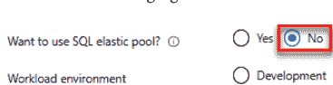

图 7.7 – 创建 SQL 数据库 – 禁用 SQL 弹性池和工作负载环境

- 6. 在 **计算 + 存储** 下，我们需要选择 **配置数据库**：

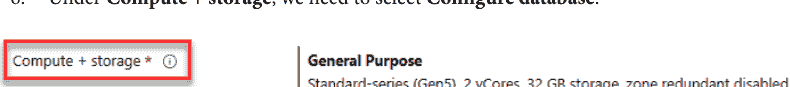

图 7.8 – 配置数据库

我们将看到以下图中显示的选项：

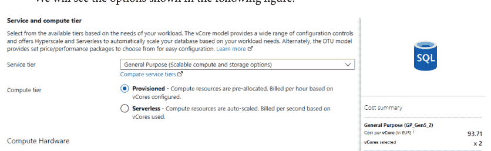

图 7.9 – 选择服务和计算层

在此窗口中，根据工作负载的需求选择可用的层。我们可以让服务层保持为通用用途，也可以选择其他选项，例如 Hyperscale 或业务关键型，它们与基于 vCore 的购买模式相关，或针对 DTU 基于购买模式的 Basic、Standard 或 Premium。

在计算层中，选择无服务器以确保计算资源的自动扩展，并且按秒计费。

如果我们移动到计算硬件，我们可以更改硬件配置的配置。默认情况下为 Gen5，但我们有更多选项。我们将保留默认配置。

接下来，更新 vCore 的最大值和最小值。默认情况下，最大值为 2，最小值为 0.5，如下图所示。我们有更多选项可供更新，例如自动暂停延迟，可用于在数据库在特定时间内不活跃时自动暂停数据库。

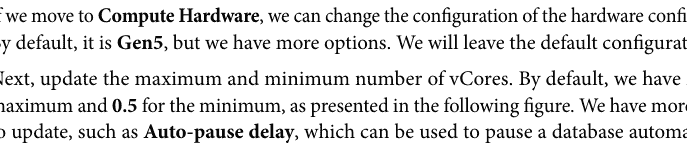

图 7.10 – 计算硬件的 vCore 最大值和最小值配置

最后，我们必须为数据库区域冗余选择是或否。之后，点击应用。

7. 选择备份存储冗余。我们有三个选项。选择 **本地冗余备份存储**。

8. 移动到 **网络** 选项卡。在此选项卡中，配置服务器的网络访问和连接性。对于 **连接方法**，选择 **公共端点**。对于 **防火墙规则**，将 **添加当前客户端 IP 地址** 设置为 **是**。将 **允许 Azure 服务和资源访问此服务器** 保留为 **是**，以便能够从本地计算机连接到数据库，如下图所示：

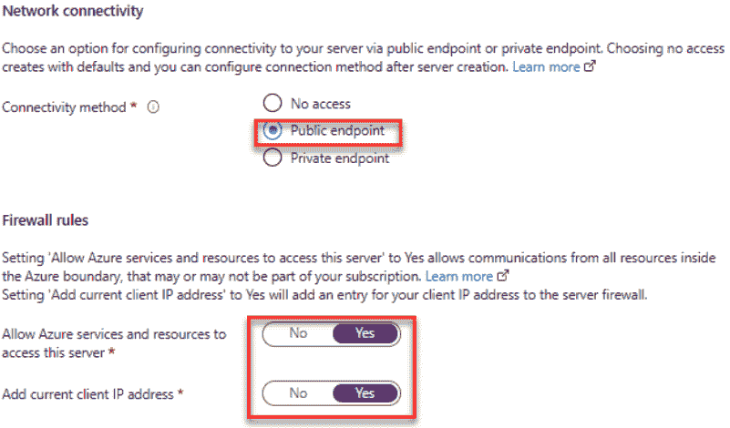

图 7.11 – 在网络选项卡中配置网络访问

9. 在 **连接策略** 下，我们将保留默认连接策略，并将 **最小 TLS 版本** 保留为默认的 TLS 1.2。

10. 在 **安全** 选项卡上，你可以选择开始免费试用 **Microsoft Defender for SQL**，以及根据需要配置 **分类账**、**托管标识** 和 **透明数据加密 (TDE)**。

11. 在 **其他设置 | 数据源 | 使用现有数据** 中，选择 **示例** 以开始测试服务，**备份** 以选择现有备份，或 **无** 如果你希望在配置后加载一个空数据库：

## 基础 网络 安全 其他设置 标签 查看 + 创建

自定义其他配置参数，包括排序规则和示例数据。

## 数据源

从空白数据库开始，从备份恢复或选择示例数据来填充你的新数据库。

使用现有数据 *
无 备份 示例

AdventureWorksLT 将作为示例数据库创建。

## 数据库排序规则

数据库排序规则定义排序和比较数据的规则，并在数据库创建后无法更改。默认数据库排序规则为 SQL_Latin1_General_CP1_CI_AS。Learn more

排序规则
SQL_Latin1_General_CP1_CI_AS

图 7.12 – 在 Azure SQL 数据库中配置其他设置选项卡

如果我们选择示例，这将创建一个 AdventureWorksLT 示例数据库，以便有一些表和数据供查询和实验。我们可以配置一个数据库集合，定义将排序和比较数据的不同规则。

- 12. 最后点击 查看 + 创建，并在查看后选择 创建。

数据库创建后，我们将点击 转到资源。

在概览中，我们有在创建期间设置的不同的配置。

选择 开始使用 以探索开始使用数据库的不同选项。我们可以配置对 SQL Server 的访问，使用连接字符串将应用程序连接到数据库，或使用 Azure Data Studio 开始开发，在其中我们可以管理数据库中的数据：

## 开始使用你的数据库

连接到你的数据库并通过几个简单步骤开始使用数据。Learn more

配置访问
配置对 SQL 服务器的网络访问。Learn more
配置

连接到应用程序
使用连接字符串从你的应用程序和喜爱的工具连接到你的 SQL 数据库。
查看连接字符串

开始开发
使用工具在你的数据库中添加、修改和查询数据。比较工具
打开 Azure Data Studio
在 Visual Studio 中打开

图 7.13 – 开始使用 Azure SQL 数据库

我们可以通过使用 **查询编辑器** 来测试数据库。我们已经有一个示例数据库。你可以在 **查询编辑器** 窗格中输入任何查询。

我们可以使用 Azure CLI 或 PowerShell 创建单个数据库。

有时，我们需要管理多个数据库。在这种情况下，我们将使用 Azure SQL 数据库弹性池。我们将在下一节中了解如何在 Azure 中部署它们。

## 练习 2 – 部署 Azure SQL 数据库弹性池

如果我们想要管理和扩展具有各种且不可预测的使用要求的多个数据库，我们将使用 Azure SQL 数据库弹性池。

池适用于具有特定使用模式的大量数据库。对于给定的数据库，该模式的特点是使用高峰不频繁且平均使用量低。否则，不要将多个数据库在同一弹性池中处于中等持续负载下。

池通过在弹性作业中运行脚本来简化管理任务。弹性作业消除了与大量数据库相关的繁琐工作。

池化数据库通常支持与单个数据库相同的业务连续性功能。

Azure SQL 数据库弹性池是一个简单且经济高效的解决方案。它是一个部署选项，这意味着我们购买 Azure 计算资源 (eDTUs) 和存储资源供所有包含的数据库共享。为什么？因为弹性池中的数据库驻留在单个服务器上并共享固定数量的资源以固定价格。**软件即服务 (SaaS)** 开发者可以通过利用 Azure SQL 数据库中的弹性池为每个数据库提供性能弹性，在一个明确定义的预算内优化一组数据库的价格性能。在弹性池中，我们能够将数据库添加到池中并根据我们的预算设置数据库的最大和最小资源 (DTU 或 vCore)。

我们将按照以下步骤创建 SQL 数据库弹性池：

- 1. 打开 Azure 门户，选择 **创建资源**，并搜索 `SQL Elastic database pool`。你将看到以下屏幕：

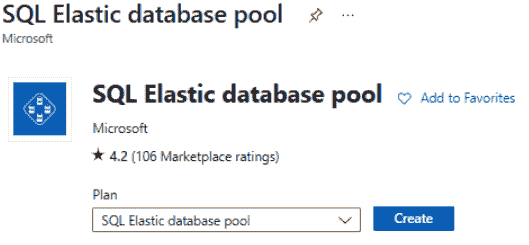

图 7.14 – 创建 SQL 弹性数据库池

2. 在 Basics 选项卡中，填写创建 SQL 弹性池所需的所有信息。在 Project details 下，选择订阅和资源组。在 Elastic pool details 下，我们将介绍此池的必需设置，选择一个逻辑服务器，然后配置计算和存储资源。我们有以下屏幕来添加弹性池名称和服务器：

## Elastic pool details

输入此池的必需设置，包括选择逻辑服务器和配置计算和存储资源。

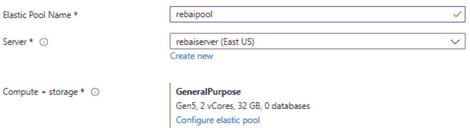

图 7.15 – SQL 弹性池中的弹性池详细信息

3. 在 Compute + storage 中，我们需要配置弹性池以选择多个数据库。点击 Configure elastic pool。我们有 Pool settings 选项卡，其中包含不同的设置，例如服务层、计算硬件和 vCore 数量。我们可以启用弹性池区域冗余。在 Databases 选项卡中，我们将添加数据库。点击 Add databases。另一个窗口将被显示，其中将包含所有单数据库。您可以选择一个或多个数据库添加到弹性池中。它们将共享相同的计算资源：

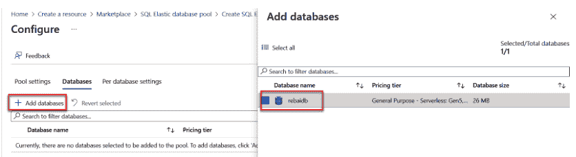

图 7.16 – 向弹性池添加数据库

4. 点击 Apply，然后选择 Review + create，然后点击 Create，弹性池将被创建。

5. 创建后，选择 Go to resource，在 Overview 中，我们可以检查资源消耗并识别哪个数据库消耗了最多的资源。这是一个监控工具，可帮助我们对每个数据库的性能问题进行诊断。我们还可以使用 Monitoring 功能，在 Database Resource Utilization 下，显示池中每个数据库的性能。

6. 我们也可以通过选择 Configure 来配置我们的弹性池：

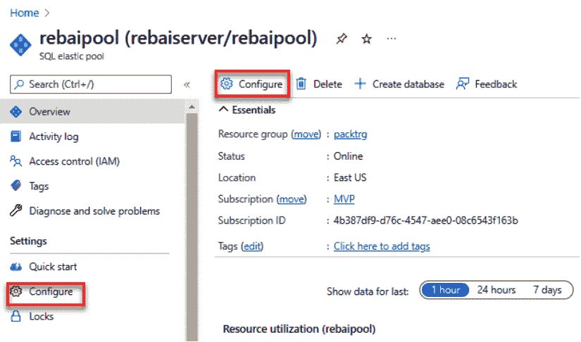

图 7.17 – 配置弹性池

7. 如果我们需要通过增加或减少分配的资源来更新弹性池配置，我们可以调整池大小、服务层或每个数据库的资源。我们可以添加或删除池内的数据库：

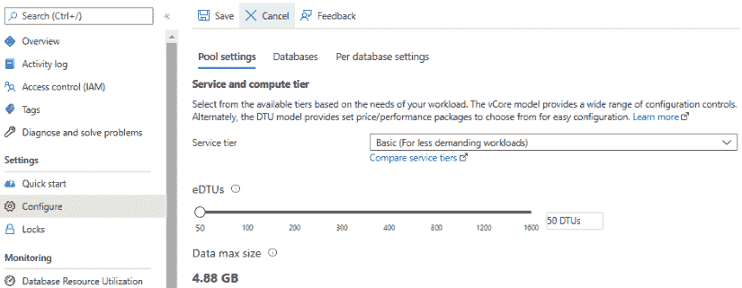

图 7.18 – 弹性池中的池设置

如果您有大量数据库需要使用特定模式迁移，Azure SQL Database 弹性池是最好的解决方案。在下一节中，我们将部署 SQL Managed Instance。

## Exercise 3 – deploying SQL Managed Instance

如果我们回到图 7.2 所示的 SQL 部署页面，我们现在可以選擇 **SQL managed instances**。将 **Resource type** 保留为 **Single instance** 并点击 **Create**：

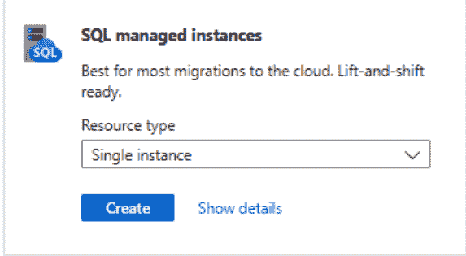

图 7.19 – 创建 SQL 托管实例

在 **Basics** 选项卡中，我们将介绍与项目详细信息、托管实例详细信息和身份验证相关的信息；它与 SQL 数据库类似。

在 **Networking** 选项卡中，我们将配置虚拟网络和公共端点。您可以保留默认配置；这取决于您的内部配置。

在 **Security** 选项卡中，我们需要启用 Microsoft Defender for SQL。我们可以配置系统分配和用户分配托管标识，以在该数据库与其他 Azure 资源之间启用集中访问管理。

我们还有更多选项卡，例如 **Additional settings**，用于自定义额外的配置参数，包括地理复制、时区和排序规则。

然后，我们点击 **Review + create** 按钮。

Azure SQL Managed Instance 用于轻松迁移，因为它与本地服务器兼容。它是一个完全托管的 PaaS，易于使用和配置现代数据库。

让我们探索如何将 Azure SQL Database 连接到 ASP.NET 应用程序。

图 7.21 – 连接对话框

我们将按照以下步骤配置数据库连接：

- 1. 在 **Connect** 对话框中，展开 **Azure** 节点。所有 Azure SQL Database 实例将被列出。
- 2. 我们将选择将与我们的应用程序一起使用的数据库。
- 3. 数据库相关的信息将在底部填写，但我们在点击 **Connect** 按钮后必须输入管理员密码。
- 4. **Create a new firewall rule** 对话框显示。要从 Azure 外部连接到数据库，您必须创建服务器级防火墙规则。防火墙规则允许本地计算机的公共 IP 地址。

6. 返回我们的应用程序。打开 appsettings.json 文件并添加连接字符串：

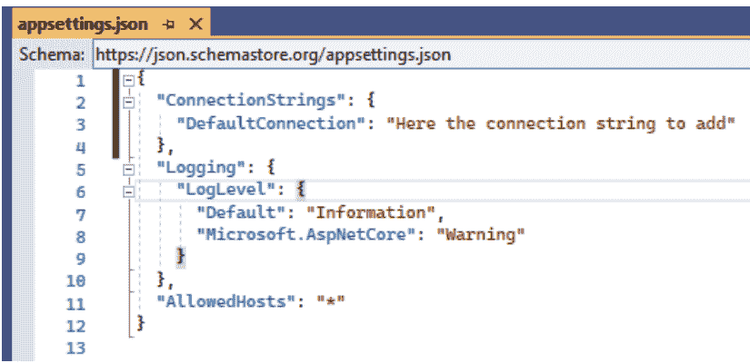

图 7.24 – Visual Studio 2022 中数据库的连接字符串

7. 我们可以使用 Database.Migrate() 调用帮助我们在 Azure SQL Database 中运行数据库。

如果您使用本地数据库进行开发并使用 Azure SQL Database 进行生产，您需要在 Program.cs 中配置每个环境。

## Summary

在本章中，我们探索了在 Azure 中部署 SQL Server 的不同服务。我们首先部署了单个 SQL 数据库。我们有多种选项，例如无服务器数据库选项，允许我们创建低成本数据库。无服务器是 Azure SQL Database 中单数据库的计算层，可根据工作负载需求自动扩展计算，并按每秒使用的计算量计费。在我们部署了包含无服务器选项的 Azure SQL Database 弹性池之后，我们部署了 SQL Managed Instance，最后将 Azure SQL 数据库连接到现有的 ASP.NET 应用程序。

在下一章中，我们将讨论 Azure Storage 服务中可用的不同存储选项，以及每种存储选项合适的场景。

## Further reading

如果您想了解有关 Azure 数据库服务的更多信息，可以查看以下链接：

- https://learn.microsoft.com/en-us/azure/azure-sql/database/sql-database-paas-overview?view=azuresql
- https://learn.microsoft.com/en-us/azure/azure-sql/database/?view=azuresql

## Questions

- 1. 什么是 Azure SQL Database？
- 2. 我们如何将 Azure SQL Database 连接到 ASP.NET 应用？
