## Working with Azure Storage

Azure Storage 是 Microsoft 的云存储解决方案，远不止数据存储。Azure Storage 为各种数据对象提供可扩展且安全的对象存储、云中的文件系统服务、相关的消息存储和 SQL 存储。

本章将介绍 Azure Storage 中可用的不同存储选项以及每种存储选项合适的场景。

在本章中，我们将涵盖以下主要主题：

- Azure Storage account
- Exploring Azure Table storage
- Exploring Azure Blob Storage
- Exploring Azure Disk Storage
- Exploring Azure Files

## Azure Storage account

在医疗保健解决方案中，我们有一个用于患者医疗记录的平台。它包括与患者相关的非结构化数据，例如文档、消息、笔记和图像，例如诊断文档、年度检查和疾病监测。所有这些文档都存储在虚拟机上，使用自定义解决方案来提取或加载非结构化数据。

Azure Storage 是一项服务，可用于存储文件、消息、表和其他类型的数据。它可扩展、安全、易于管理，并且可以从任何地方访问。Azure Storage 遵循两种云模型：通过使用虚拟机的基础设施即服务，以及通过使用原生云服务的平台即服务。Azure Storage 包括四个数据服务，可以通过存储帐户访问。

每种类型都支持不同的功能，并且具有唯一的 URL 地址以供访问。数据和您的 Azure Storage 帐户始终会复制以确保耐用性和高可用性。


要创建 Azure 中的 Azure Storage 账户，第一步是使用 Azure 门户、PowerShell 或 Azure **命令行界面 (CLI)**。

如果您使用 Azure 门户，请选择 **创建资源**，然后将 **存储** 作为类别，然后在 **存储账户** 下选择 **创建**：

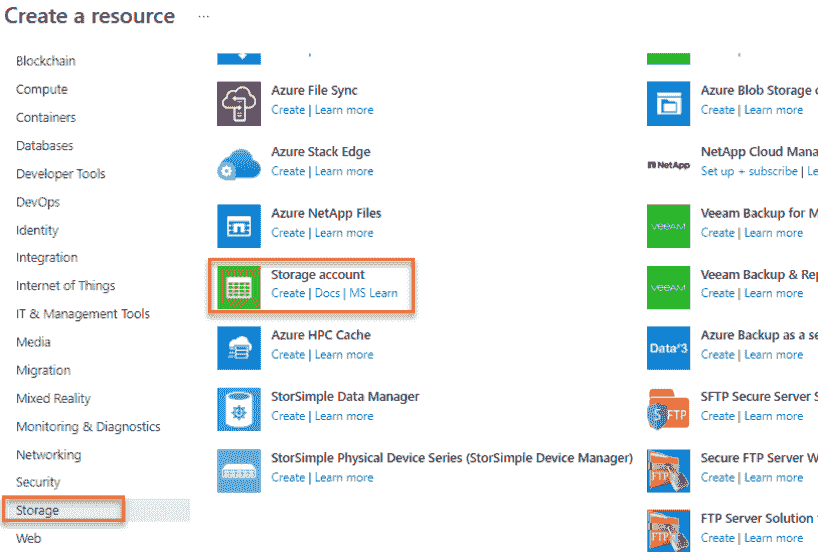

图 8.1 – Azure Storage 账户

在 **基础** 选项卡中，我们将介绍项目详细信息。此部分适用于所有 Azure 服务。 我们有实例详细信息，其中包括存储账户名称和位置。对于 **性能**，我们需要选择 **标准** 或 **高级**。以下屏幕截图显示了项目详细信息：

## 创建存储账户

基础   高级   网络   数据保护   加密   标签   查看

### 项目详细信息

选择要创建新存储账户的订阅。选择新的或现有的资源组，以便与其它资源一起组织和管理您的存储账户。

订阅 *
MVP

资源组 *
(新建) PacktRG
创建新的

图 8.2 – 创建存储账户 – 基础选项卡中的项目详细信息

在以下屏幕截图中，您可以看到我们如何配置实例详细信息：

### 实例详细信息

如果您需要创建传统存储账户类型，请点击此处。

存储账户名称 *

区域 *
(US) 美国东部

性能 *
标准：推荐用于大多数场景（通用 v2 账户）
高级：推荐用于需要低延迟的场景。

图 8.3 – 创建存储账户 – 基础选项卡中的实例详细信息

Azure 存储账户中的数据始终会复制以确保耐用性和高可用性。选择与您的耐用性要求相匹配的复制策略。从以下四个选项中选择：

- 本地冗余存储 (LRS)：这是成本最低的选项。它包含基本功能并可防止服务器机架和驱动器故障。如果您有简单的场景且不关键或用于测试，可以选择此选项。
- 地理冗余存储 (GRS)：这用于备份场景，因为它是一种具有另一个次要区域故障转移能力的中间选项。
- 区域冗余存储 (ZRS)：这也是一种中间选项，但它可防止数据中心级故障。它可用于高可用性场景。
- **地理区域冗余存储 (GZRS)**：这是关键数据场景的最佳选择，因为它提供了最佳的数据保护，包括 GRS 和 ZRS 的功能组合。

在下图中，您可以看到配置冗余的选项：

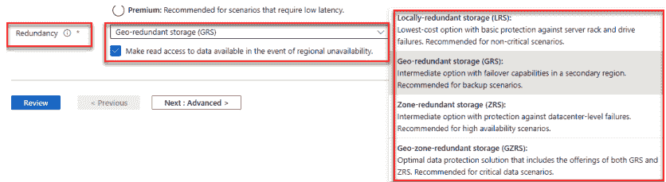

图 8.4 – 创建存储账户 – 冗余配置

这里，我们有经典的部署模型，但如果我们在 **实例详细信息** 中需要创建传统存储账户类型，我们将点击 **此处**，如以下图所示：


图 8.5 – 选择传统存储类型

将添加一条与存储账户相关的新行。如果您需要更多详细信息，可以按照此链接操作：https://docs.microsoft.com/en-ca/azure/storage/common/storage-account-create?tabs=azure-portal。这用于选择与您的存储需求相匹配的账户类型并优化您的成本。

存储账户包含所有 Azure Storage 数据对象，例如 blob、文件和磁盘。

在下一节中，我们将开始探索 Azure Table Storage。

## 探索 Azure Table Storage

Azure Table Storage 提供对结构化数据存储的支持。它实现了一个 NoSQL 键值模型，这意味着它没有任何关系、存储过程、二级索引或外键的概念。

Azure Table Storage 并不是您用于处理半结构化数据的唯一服务。那么，为什么使用此服务而不是其他选项？让我们先列出其优点：

- Azure Table Storage 可以以低成本存储 PB 级数据，这对于构建高度可扩展的应用程序非常重要，其中成千上万甚至数百万用户与其交互。
- Azure Table Storage 还支持灵活的数据模式，这对于灵活的数据集（如 Web 应用程序、用户数据、设备信息和元数据）非常出色。灵活的数据模式允许您修改应用程序数据模型，而无需遵循特定模式。
- 您还可以通过使用聚集索引快速查询数据。聚集索引定义了数据在表中物理存储的顺序，在性能方面非常出色。但除了 Azure Table Storage 中的聚集索引之外，还可以执行基于 Open Data 的查询（Odata 查询），并且通过使用这些查询，您可以直接从 URL 路径定义查询选项。
- 使用 Azure Table Storage 很简单，因为您可以从 Azure Storage Explorer 操作数据，也可以直接从 .NET 或 .NET Core 应用程序使用 Azure Tables 客户端库 for .NET 操作数据。您可以在此链接查看：https://github.com/Azure/azure-sdk-for-net/blob/main/sdk/tables/Azure.Data.Tables/README.md。

在下面的图表中，我们可以看到一个键，它是唯一的，用于标识存储的项目，以及一个值，它是一组字段：


图 8.6 – Azure Table Storage 中的键值

Azure Table Storage 内部是如何工作的？它将表拆分为一组分区，这有助于快速访问数据。此机制将具有公共属性或分区键的相关行分组在一起。共享相同分区键的行将存储在同一位置。

在这些 Azure Table Storage 账户内部，我们可以拥有表。表始终表示行集合或单行。没有要求为特定表定义模式，这意味着您可以在同一表中存储具有不同属性的数据。因此，我们说在存储账户内部，我们有表。现在，在表内部，我们有行，而行是一组具有单个属性或多个属性的数据。行类似于 SQL 数据库中的数据库行。

分区可以通过添加或删除行来更新。表包含任意数量的分区。

Azure Table Storage 表中的键包含两个元素：分区键和行键。分区键被视为已标识，行键在同一分区中是唯一的。

让我们创建一个新的 Azure Table Storage 表。

## 在 Azure 门户中创建 Azure Table Storage 中的表

我们之前创建了一个 Azure Storage 账户。是时候学习如何创建 Azure 表了。

Azure 表用于存储行，我们在其中存储数据。我们将学习创建 Azure 表的两种不同方法：

- 第一种是手动使用 Azure 门户
- 第二种方法是通过使用 ASP.NET Core 应用程序

要创建 Azure Storage 表，请按照以下步骤操作：

1. 打开您的 Azure Storage 账户并选择存储浏览器，然后点击表，如以下屏幕截图所示：

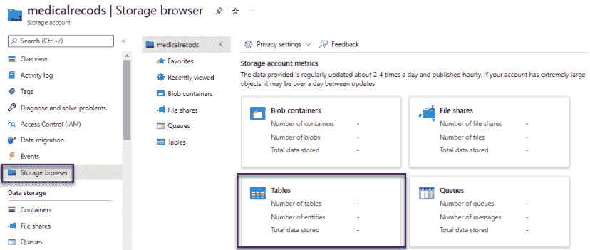

图 8.7 – Azure Storage 账户 – 表

5. 然后，点击插入按钮：

### 添加实体

| 属性名称 | 类型 | 值 |
|---|---|---|
| PartitionKey | String | Partition1 |
| RowKey | String | Row1 |
| Name | String | Hamida Rebai |
| Country | String | Tunisia |
|  | String | 输入值以保留属性 |
| 添加属性 |  |  |

图 8.10 – 添加 PartitionKey、RowKey 和属性

检查在点击插入后是否创建了新实体。实体应包含指定的值，包括一个包含实体创建日期和时间的 timestamp：

图 8.11 – 在 Azure Storage 表中显示实体

我们可以使用以下结构在 Azure Storage 账户中创建不同的元素：

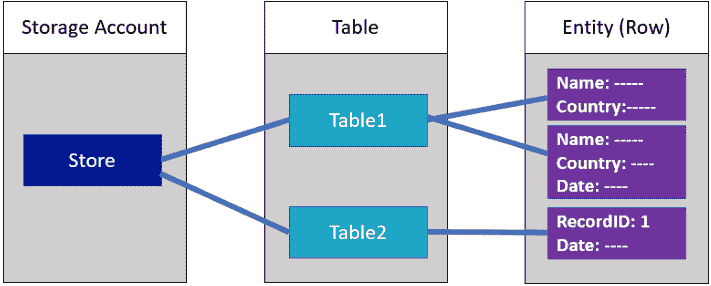

图 8.12 – Azure Table Storage 组件

我们在 Azure 中创建了一个 Azure Storage 账户。我们添加了一个新表，它是实体（行）的集合。对于每个表，我们可以创建一个包含一组属性的新实体。我们添加了分区键和行键。我们还可以添加一个以名称-值对形式呈现的属性。我们介绍了 Azure Table Storage 的不同组件，因此现在我们将继续探索 Azure Blob Storage。

## 探索 Azure Blob Storage

Azure Blob Storage 为非结构化数据提供大规模可扩展存储。非结构化数据是任何未以结构化数据库格式存储的数据。这可以是任何内容：二进制、文本文件、图像或视频。Microsoft Azure 虚拟机将磁盘映像存储在 Blob Storage 中。

Blob 是二进制大对象的缩写。


Azure 目前支持三种不同类型的 blob：

- **Block blobs**：块 blob 以一组块的形式管理。每个块的大小变化范围最高可达 100 MB。块 blob 最多可包含 50,000 个块。最大大小超过 4.7 TB。块是可作为一个单元读取或写入的最小数据量。块 blob 非常适合存储很少更改的独立大型二进制对象。
- **Page blobs**：页 blob 以固定大小为 512 字节的页集合组织。页 blob 针对随机读写操作进行了优化；如果需要，可以获取和存储单个页的数据。页 blob 最多可容纳 8 TB 数据。Azure 使用页 blob 为虚拟机实现虚拟磁盘存储。
- **Append blobs**：追加 blob 类似于块 blob，但更优化以支持一项新功能，即追加操作。只能向追加 blob 的末尾添加块。不支持更新或删除现有块。每个块的大小可不同，最高可达 4 MB。追加 blob 的最大大小略高于 195 GB。

Blob 存储在容器中，这使您可以根据业务需求组织 blob。

此图展示了 Azure Blob Storage 的结构以及我们如何使用 Azure 帐户、容器和 blob：

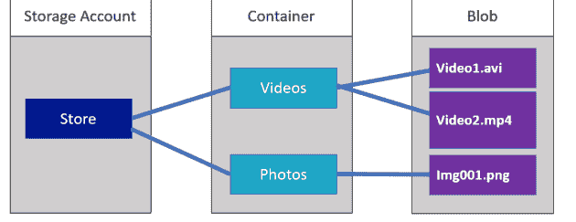

图 8.13 – 存储帐户 – 容器和 blob

现在，让我们配置 Blob Storage。我们将使用相同的 Azure 存储帐户：

- 1. 创建一个新容器。转到 **Storage browser**，选择 **Blob containers**，然后单击 **Add container**：

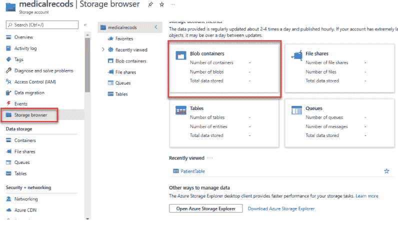

图 8.14 – Azure 存储帐户 – Blob 容器

- 2. 现在，您可以为容器提供名称，然后选择公共访问级别。您可以选择 **Private**、**Blob** 或 **Container**：

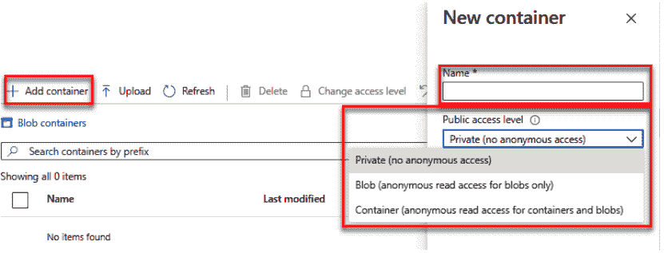

图 8.15 – 在 Azure Blob Storage 中添加新容器

- 3. 如果在 **Advanced** 部分选择 **Public access level**，您可以添加加密。之后，单击 **Create** 按钮。

容器现已创建。当我们选择一个容器时，我们可以对其进行操作。我们将打开刚刚创建的容器并通过选择 Upload 按钮上传一些文件。选择您的文件或文件：

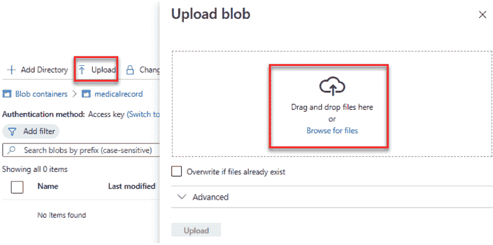

图 8.16 – 在容器中上传文件

要自定义您上传的文件或文件，您可以单击 Advanced，然后选择身份验证类型、blob 类型、blob 大小、层级和文件夹。我们将保留默认值。一旦文件或文件已上传，您就可以更改该文件的特定设置。

您可以查看或编辑文件、下载它、查看属性、生成共享访问签名、查看快照、创建快照以及如果需要更改层级。如果您需要对 blob 的读写操作进行锁定，则可以通过选择 Acquire lease 来租用 blob。您也可以在此处轻松删除文件：

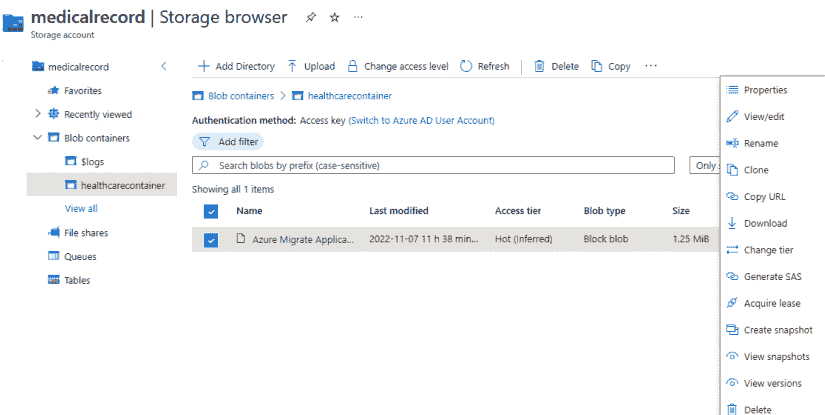

图 8.17 – 已上传文件设置

让我们返回并查看可与 Blob Storage 一起使用的其他一些选项。您可以将自定义域名映射到存储帐户。为此，使用您喜欢的注册商创建规范名称 CNAME，然后在 Azure 中注册该名称并添加它。

有两种选择可以执行此操作：

- 第一个选项包括设置自定义域名。
- 第二个选项包括使用子域名。当您的存储帐户迁移到自定义域名时，不会出现停机。

我们在创建存储帐户时谈到了软删除，但我们也可以在 blob 级别配置它。您可以通过选择 Data protection 来执行此操作。在这里，您可以启用软删除，然后指定如果 blob 被删除，将保留多少天。要利用 Azure 内容分发网络 CDN，您需要在 Azure CDN 下创建一个新的 CDN 配置文件。但是，这超出了本章的范围。

Azure Storage 的另一个功能是能够使用 Azure Cognitive Search 索引文档。您将在 Azure Search 中设置此功能，就像 CDN 一样。

最后，我们有生命周期管理。在这里，我们可以根据规则管理数据。

在 Azure Blob Storage 帐户主页上，选择 Data management 下的 Lifecycle management，您将看到以下屏幕截图中显示的屏幕，在其中选择 Add a rule：

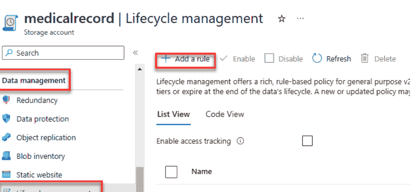

图 8.18 – 在 Azure 存储帐户中为生命周期管理添加规则

在下图中，我们说明了 Azure 存储帐户中的生命周期管理：

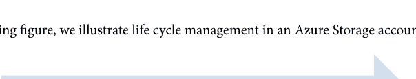

图 8.19 – Azure Blob Storage 生命周期管理

例如，我们可以创建一个规则，根据自上次修改以来的天数将 blob 移动到另一个访问层。我们将制定一个规则名称 RuleTest，如以下屏幕截图所示：

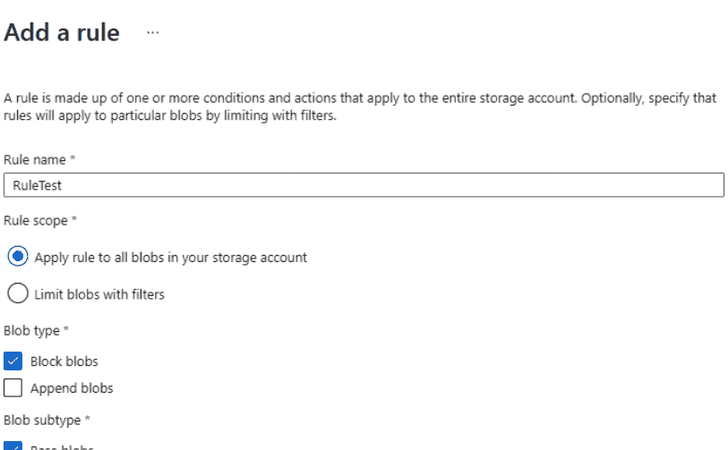

图 8.20 – 在 Azure 存储帐户中添加规则

在 Base blobs 选项卡中，选择第一个选项，并在自上次修改以来，假设 60 天后将 blob 移动到 cool 存储：

Add a rule ...
Details  2 Base blobs
Lifecycle management uses your rules to automatically move blobs to cooler tiers or to delete them. If you create multiple rules, the associated actions must be implemented in tier order (from hot to cool storage, then archive, then deletion).
If
Base blobs were *
• Last modified
• Created
More than (days ago) *
60
Then
Move to cool storage

图 8.21 – 在 Azure 存储帐户中添加规则 – Base blobs 选项卡

我们选择 Add conditions 以启用在未修改一段时间后将数据移动到归档存储。让我们将其更新为 90 天然后删除它。在下图中，我们展示了添加的不同规则：

图 8.22 – 在 Azure 存储帐户中添加新条件 – Base blobs 选项卡

我们有创建筛选器集的选项，这将限制规则适用于某些对象。最后，我们选择 Review and Add。现在，该 blob 将根据自修改以来的天数自动通过该生命周期移动。

## Azure Blob Storage 客户端库 for .NET

Blob 存储旨在存储大量非结构化数据，在本节中，我们将使用 .NET 的客户端库：Azure Blob Storage。

按照以下步骤安装包并为基本任务编写示例代码：

- 1. 使用 Visual Studio 2022 或 .NET CLI 创建 .NET 控制台应用。
- 2. 为了与 Azure Blob Storage 交互，我们需要使用 NuGet Package Manager 或 Package Manager Console 安装 .NET 的 Azure Blob Storage 客户端库，如以下屏幕截图所示：

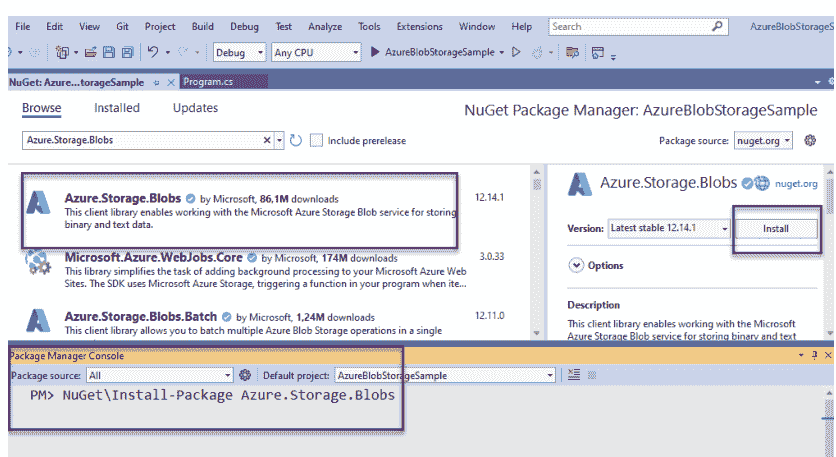

图 8.23 – Azure Blob Storage .NET 库

3. 在 Program.cs 中，我们将使用帐户的连接字符串使用 BlobServiceClient 构造函数。为了为容器创建唯一名称，我们将使用 CreateBlobContainerAsync 方法：

```
var blobServiceClient = new BlobServiceClient("<your-storage-account-connection-string>");
BlobContainerClient containerClient = await blobServiceClient.CreateBlobContainerAsync(containerName);
```

4. 我们将为上传和下载文件创建一个本地目录。我们将在文件中写入文本并使用 GetBlobClient 方法获取对 blob 的引用：

```
string localPath = "datarepo";
Directory.CreateDirectory(localPath);
string fileName = "file-" + Guid.NewGuid().ToString() + ".txt";
string localFilePath = Path.Combine(localPath, fileName);
BlobClient blobClient = containerClient.GetBlobClient(fileName);
```

5. 我们将使用 UploadAsync 方法从本地文件上传数据：

```
await blobClient.UploadAsync(localFilePath, true);
```


## 探索 Azure 文件

Azure Files 存储提供基于云的文件共享，可以从云或本地访问。

Azure Files 存储为使用行业标准的 **Server Message Block (SMB)** 协议和 **Network File System (NFS)** 协议的应用程序提供共享存储。Azure 虚拟机和云服务可以通过挂载的共享在应用程序组件之间共享文件数据。本地应用程序也可以在共享存储库下访问文件数据。这意味着多个虚拟机可以同时以读写权限共享相同的文件。您也可以使用 **Representational State Transfer (REST)** API 接口或存储客户端库读取文件。在 Azure 虚拟机、Windows、Linux 或其他云服务中运行的应用程序可以挂载文件存储共享以访问文件数据，就像应用程序挂载典型的 SMB 或 NFS 共享一样。任意数量的 Azure 虚拟机或角色可以同时挂载并访问文件存储共享。Azure Files SMB 文件共享可从 Windows、Linux 和 macOS 客户端访问。NFS 文件共享可从 Linux 和 macOS 客户端访问。

### 文件存储的常见用途

Azure Files 可用于完全替代传统的本地文件服务器或 **Network Attached Storage (NAS)** 设备。流行的操作系统，如 Windows、macOS 和 Linux，可以在任何位置直接挂载 Azure 文件共享。Azure Files 使将期望文件共享来存储文件应用程序或用户数据的应用程序轻松迁移到云变得简单。Azure 文件共享还可以通过 Azure File Sync 与本地或云上的 Windows 服务器进行复制。为了确保性能并在数据使用位置进行分布式缓存，共享应用程序设置例如存储在配置文件中，以及诊断数据如日志、指标和崩溃转储到共享位置。我们存储开发或管理 Azure 虚拟机或云服务所需的工具和实用程序。这涵盖了 Azure Files 文件存储的所有常见用例。

### 在 Azure 门户中添加 Azure Files

现在，我们将了解如何在 Azure 门户中添加 Azure Files：

1. 返回 **Storage browser** 并选择 **File shares**：

### 存储账户指标

提供的数据大约每天更新 2-4 次并每小时发布一次。如果您的账户有极大的对象，更新之间可能超过一天。

Figure 8.24 – Storage browser | File shares

2. 选择 Add file share 并添加名称。选择 Tier，然后选择 Transaction optimized 或 Hot 或 Cool：

   - **Transaction optimized** 用于启用事务繁重的负载。我们将其用于需要文件存储作为后端存储的应用程序。
   - **Hot** 是某些文件共享场景的优化选项；例如，如果团队共享文件，Azure Files 将同步它们。
   - **Cool** 用于归档存储场景。

创建后，我们可以探索不同的设置，如以下屏幕截图所示：

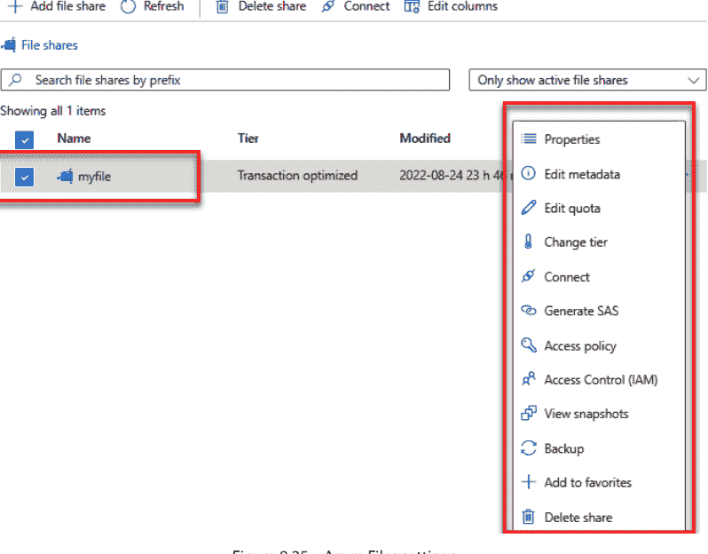

Figure 8.25 – Azure Files settings

3. 如果我们选择 **Connect**，我们可以配置从 Windows、Linux 或 macOS 连接到 Azure 文件共享的连接。为了保护连接，选择 **Active Directory** 或 **Storage account key** 用于 Windows。我们可以将 **Tier** 从 **Transaction optimized** 更改为 **Cold**，例如，或从 **Cold** 更改为 **Hot**。

有时，很难决定在解决方案中何时使用 Azure 文件共享而不是 blob 或磁盘共享。如果我们比较不同的功能，我们可以决定哪个解决方案合适。如果我们将 Azure Files 与 Azure Blob 并排比较，我们会看到 Azure Files 提供 SMB 和 NFS 接口、客户端库和 REST 接口，允许从任何地方访问以存储文件。Azure Blob 提供客户端库和 REST 接口，允许以扁平命名空间存储和访问无结构数据，并在 blob 中大规模访问。

### 何时使用 Azure 文件与 blob

您可以使用 Azure 文件将应用程序迁移到云，该应用程序已使用原生文件系统 API 在其与在 Azure 中运行的其他应用程序之间共享数据。您希望存储开发和调试工具，这些工具需要从许多虚拟机访问。另一方面，Azure blob 可用于如果您希望应用程序支持流式传输和随机访问场景，并且希望能够从任何地方访问应用程序数据。还有一些其他区分特性决定何时选择 Azure 文件而不是 Azure blob。Azure 文件是真正的目录对象，而 Azure blob 是扁平命名空间。Azure 文件可以通过文件共享访问。然而，Azure blob 通过容器访问。Azure 文件提供跨多个虚拟机的共享访问，而 Azure 磁盘专用于单个虚拟机。

在选择使用哪个存储功能时，您还应考虑定价并进行成本效益分析。

Azure Storage 可通过 REST API 访问，并为 Microsoft Azure 虚拟机设计，如下图所示：

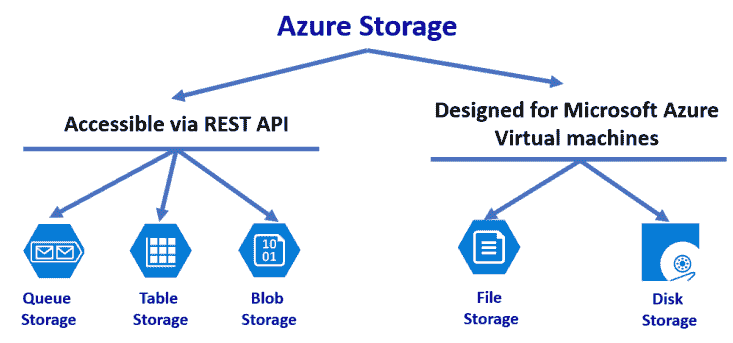

Figure 8.26 – Azure Storage

Microsoft Azure Storage 服务 REST API 通过存储模拟器提供对 blob、队列、表和文件服务的编程访问，位于您的 Azure 或开发环境中。您可以在此链接查看有关这些 API 的更多详细信息：https://learn.microsoft.com/en-us/rest/api/storageservices/。

### 总结

在本章中，我们介绍了 Azure Storage 服务中可用的不同存储选项。我们首先创建了一个 Azure 存储账户，其中包含不同类型的存储。我们探索了 Azure Table Storage、Azure Blob Storage、Azure Disk Storage，最后是 Azure Files。

在下一章中，我们将介绍使用 Microsoft Azure Cosmos DB 设计和实现云原生应用程序。

### 进一步阅读

如需更多信息，您可以查看此链接的 Microsoft 文档：https://learn.microsoft.com/en-us/azure/storage/。如果您需要使用 .NET 库通过示例使用 Azure Storage，请使用此链接：https://learn.microsoft.com/en-us/azure/storage/common/storage-samples-dotnet。

### 问题

1. 文件存储的常见用途是什么？
2. 何时使用 Azure 文件与 blob？
