## 使用 Azure Cosmos DB 管理数据库服务

如果我们使用关系数据库，我们将数据存储在关系表中。无结构数据可以存储在存储解决方案中，但有时关系数据库的结构可能过于僵化，通常在某些情况下导致性能不佳，需要实施特定的详细调优。有几种模型，称为 NoSQL 数据库，为某些场景提供解决方案，例如文档、图形、列族存储和键值存储。

NoSQL 数据库由多个特征定义：它们是非关系型，具有 JavaScript Object Notation (JSON) 模式，并设计用于扩展。

本章将介绍使用多模型 NoSQL 数据库管理系统 Microsoft Azure Cosmos DB 设计和实现云原生应用程序。

在本章中，我们将涵盖以下主要主题：

- NoSQL 数据库
- Exercise 1 – 使用 Azure 门户创建 Azure Cosmos DB 账户
- 探索 Azure Cosmos DB SQL API
- Exercise 2 – 创建 Azure Cosmos DB SQL API 账户
- Exercise 3 – 使用 SDK 连接到 Azure Cosmos DB SQL API

### NoSQL 数据库

组织现在处理的不只是结构化数据。NoSQL 数据库将无结构数据存储在文档中而不是关系表中，我们在其中存储结构化数据。因此，我们将它们归类为“不仅仅是 SQL”并将其分解为各种灵活的数据模型。NoSQL 数据库类型包括仅文档数据库、键值存储、宽列数据库和图数据库。


NoSQL 数据库从零开始构建，用于大规模存储和处理海量数据，支持不断增长的现代业务。

以下是最受欢迎的 NoSQL 数据库类型的定义：

- **Key-value store:** Key-value 存储将相关数据分组到集合中，以便可以通过唯一键轻松检索记录。Key-value 存储保留了 NoSQL 数据库结构的优势，同时具有足够的结构来反映关系数据库的值（与非关系数据库相反）。我们可以在下图中看到一个示例：

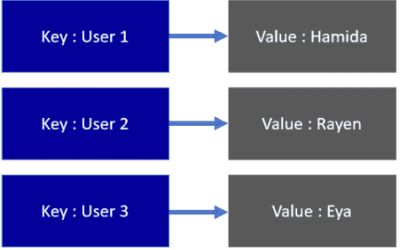

Figure 9.1 -- Key-value NoSQL database type

Microsoft Azure Table Storage 是这种类型 NoSQL 数据库的一个示例。

- **Document:** 纯文档数据库主要用于以文档形式存储以文档为中心的数据，例如 JSON 文档。这些系统也可以用于存储 XML 文档，例如 NoSQL 数据库。Azure Cosmos DB 是这种类型的示例。

- **Table style:** 这种类型是基于稀疏填充表的數據模型。它们也称为宽列数据库。它们使用关系数据库的表格格式，但同一表中每一行中数据的命名和格式可能大不相同。与 key-value 存储类似，宽列数据库具有基本的 NoSQL 结构，同时保留了高度的灵活性。

- **Graph:** 图类型通常以键-数据格式存储的记录。我们用它来定义存储数据点之间的关系。图数据库允许我们识别非结构化和半结构化信息中的模式。在下图中，我们可以看到不同的图组件：

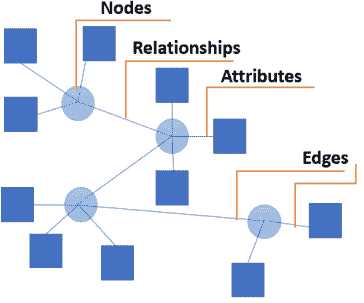

Figure 9.2 – Graph NoSQL database type

跨多个非关系型（NoSQL）数据存储的多语言持久性会增加显著的复杂性和开销。因此，Microsoft 提供了一个多模型、地理分布式的数据库 Azure Cosmos DB，其数据结构可用于原生存储键值对、JSON 层次结构和图。

Azure Cosmos DB 是一种完全托管的 PaaS 服务，其内部存储对不同用户是抽象的。

## Exercise 1 – creating an Azure Cosmos DB account using the Azure portal

Azure Cosmos DB 是一种分布式数据库引擎，无论如何使用数据库，都具有核心功能集。这些功能包括能够弹性地分发数据库，能够双向扩展存储和吞吐量，低延迟并提供财务支持的 SLA、各种一致性选项以及企业级安全功能。

Azure Cosmos DB 专为大多数现代云应用程序提供高响应性和始终在线的可用性而设计。Cosmos DB 被视为 NoSQL 数据库，主要使用四种数据模型（键值、文档、列族或表样式、图）。

Azure Cosmos DB 包括存储的数据文档，其中数据无模式且最有可能存储为 JSON 文档。许多文档数据库使用 JSON 来表示文档结构、以图为导向的模型，其中数据表示为节点和边的图表结构，以及最简单的形式的键值存储。数据库管理系统仅存储键值对，并具有宽列存储，可存储具有许多动态列的数据。Cosmos DB 对高可用性、地理分布和速度的关注提供了一些相当酷的优势。

Cosmos DB 将数据管理为一组分区的文档。文档由一组字段组成，每个字段由键标识。每个文档中的字段可能各不相同，并且一个字段可能包含子文档。在 Cosmos DB 数据库中，文档被组织到容器中，容器被分组到分区中。

一个文档最多可包含 2 MB 的数据，包括小型二进制对象。但如果需要存储与文档相关的更大 blob，则需要使用 Azure Blob Storage。然后，您可以在文档中添加对创建的 blob 的引用。

让我们开始使用 Azure 门户创建 Azure Cosmos DB 资源。我们将遵循以下步骤：

- 1. 在 Azure 门户的主页上，选择 **Create a resource**。您可以使用搜索输入并输入 Cosmos，或者您可以选择 **Databases** 类别。在 **Azure Cosmos DB** 下选择 **Create**：

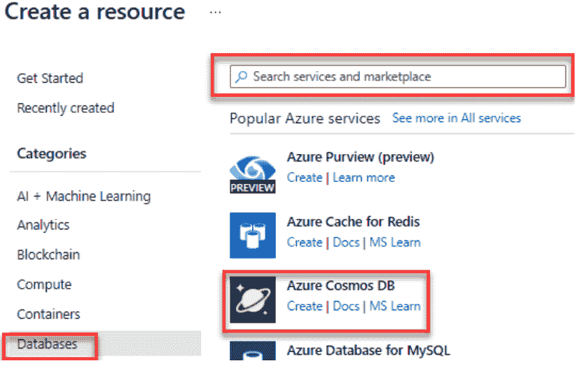

Figure 9.3 – Azure Cosmos DB | Create

2. 在 Select API 选项页面上，我们必须选择一个 API 来创建新帐户。请注意，帐户创建后我们无法更改它：

Select API option ...

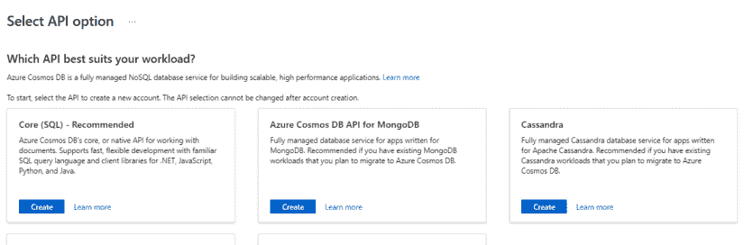

Figure 9.4 – The Select API option page in Cosmos DB

我们有以下 API 可供选择：

- Core (SQL) 推荐用于新应用程序。它是用于文档的原生 API。它是 Azure Cosmos DB 的核心。
- Azure Cosmos DB API for MongoDB 是一个原生 SQL API，具有 MongoDB 的 API。MongoDB 是一个文档数据库。如果您已有现有的 MongoDB 工作负载并希望将其迁移到 Azure，则推荐此 API，例如。
- Cassandra 是一个专用于 Apache Cassandra 应用的完全托管数据库服务。如果您已有现有的 Cassandra 工作负载，可以使用此 API 将其迁移到 Azure。Cassandra 是一个用于大数据管理的分布式 NoSQL 数据库管理系统。
- Azure Table 也是一个专用于 Azure Table Storage 应用的完全托管数据库服务。如果我们决定将现有的 Azure Table Storage 资源迁移到 Cosmos DB，可以使用此 API。
- Gremlin (Graph) 是 Apache TinkerPop 的图遍历语言。Gremlin 是一种函数式数据流语言，允许用户简洁地表达应用程序属性图的复杂遍历（或查询）。Cosmos DB 是一个使用 Gremlin 的完全托管图数据库服务。如果我们希望添加需要存储数据之间关系的新工作负载，则推荐此选项。

3. 选择任何 API 选项。我们将在 **Create Azure Cosmos DB Account - Core (SQL)** 页面上拥有相同的选项。从 **Basics** 选项卡开始：

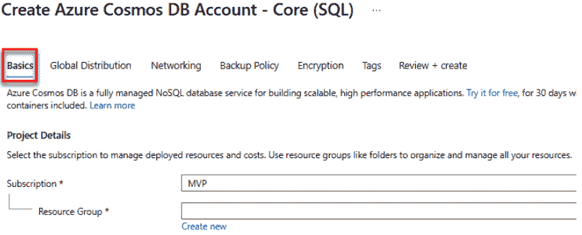

Figure 9.5 – Project Details on the Basics tab

在 **Basics** 选项卡上，我们有项目详细信息，其中包括与任何 Azure 服务相关的通用信息，例如 **Subscription** 和选择资源组。然后，我们可以添加实例详细信息所需的信息，例如 Cosmos DB 帐户名称、位置以及数据库操作的容量模式。我们有两种不同的容量模式可供选择：

- **Provisioned throughput:** 您可以配置数据库预期提供的吞吐量，但您需要规划应用程序需求的最佳性能级别。此模式以 **request units per second (RU/s)** 表示。有两种类型：*standard (manual)* 和 *autoscale*。Azure Cosmos DB SQL API 数据库是一个无模式的容器管理单元集合。每个容器都是吞吐量和存储的可扩展单元。吞吐量可以在数据库级别、容器级别或两者上进行预配。预配给数据库的吞吐量由数据库中的所有容器共享。所有容器共享吞吐量资源，因此我们可能无法为数据库中的某些容器获得可预测的性能。

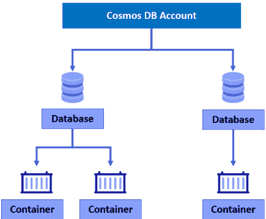

Figure 9.6 – Azure Cosmos DB components

- **Serverless**: 我们选择此选项以创建无服务器模式的帐户，这意味着我们可以在容器中运行数据库操作，而无需配置预先预配的容量。它是一种基于消耗的模型，其中每个请求消耗请求单位。消耗模型消除了预先预配吞吐量请求单位的需求：

> **Important note**
> 当我们使用 Azure Cosmos DB 时，我们通常以 RU/s 表示的成本来表达数据库选项。

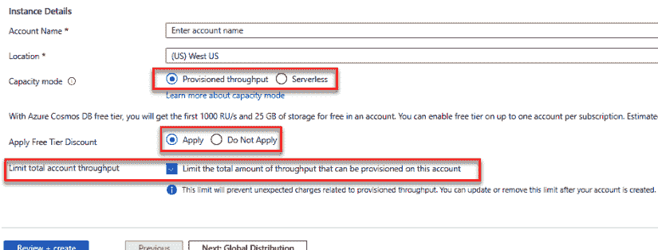

Figure 9.7 – Instance Details on the Basics tab


4. 我们将选择是否应用 Azure Cosmos DB 免费套餐折扣。创建此账户后，我们将免费获得前 1,000 RU/s 和 25 GB 的存储空间。

每个 Azure 订阅最多只能创建一个免费套餐的 Azure Cosmos DB 账户。如果我们已经在使用它，则在创建新的 Cosmos DB 账户时将不会显示此选项。

5. 建议选择 **限制在此账户上可配置的吞吐量总量**，以防止与配置吞吐量相关的任何意外费用。

6. 在 **Global Distribution** 选项卡中，我们可以启用地理冗余和多区域写入：

A. 地理冗余是指能够向您的账户添加更多区域的能力

B. **Georedundancy writes** 功能允许您将配置的吞吐量用于世界各地的数据库和容器

7. 在 **Networking** 选项卡中，选择连接方法以通过公共 IP 地址将 Cosmos DB 账户连接到公共端点、专用端点或所有网络。

8. 我们还有 **Backup Policy** 选项卡、**Encryption** 选项卡和 **Tags** 选项卡。您可以根据需要更新它们，也可以保持其默认设置。

9. 选择 **Create** 后，选择 **Review + create**。

部署完成后，您可以检查 Azure Cosmos DB 账户页面并开始探索使用它的不同元素。

至此，我们已使用 Azure 门户创建了一个 Azure Cosmos DB 账户。Azure Cosmos DB 包含多个 API。在下一节中，我们将开始探索 Cosmos DB SQL API。

## Exploring the Cosmos DB SQL API

Azure Cosmos DB 支持多种 API 模型，这使您可以为应用程序选择理想的 API。在本节中，我们将具体深入探讨此 SQL API。Cosmos DB SQL API 是默认的 Azure Cosmos DB API。您可以使用 JSON 文档来存储数据以表示您的数据。即使我们使用的是 SQL API，我们仍然可以利用 Cosmos DB 的所有核心功能，这些功能在所有 API 中都是通用的。

当您构建新解决方案时，推荐使用 Cosmos DB 的 Core API。此 API 使用 SQL 作为查询语言，并使用 JavaScript 作为其编程语言。这两种语言都非常通用且流行，使得您更有可能已经具备这两种语言的经验。

具体来说，谈到 SQL 查询语言，您可以使用与 Microsoft SQL Server 等产品相同的 SQL 语法来查询 Cosmos DB。即使您使用的是 SQL 查询语言，您也可以使用这些查询来查询 JSON 文档，因此您无需做任何特殊操作即可使查询与 JSON 兼容。您可以直接将 JSON 对象嵌入到查询中。如果您查看一些不寻常的场景，则需要塑造 JSON 文档并测试查询结果的特定模式。

JavaScript 是 Cosmos DB 用于服务器端编程的语言。存储过程、触发器和用户函数都使用 JavaScript 编写。由于 JavaScript 可以原生处理 JSON 对象，因此您会发现 JavaScript 非常适合在服务器端代码中操作属性和文档。

## Exercise 2 – creating an Azure Cosmos DB SQL API account

我们将通过遵循第一项练习中的相同步骤来创建一个 Azure Cosmos DB 账户，但我们将选择 Core (SQL) API 选项。

我们将通过添加一个新数据库和一个容器开始。之后，我们将向创建的数据库添加数据。我们将查询数据，最后使用 Cosmos DB 的 SDK 以 C# 作为编程语言连接到 Azure Cosmos DB SQL API。

### Adding a new database and a new container

让我们看一下步骤：

- 1. 选择 Data Explorer 以创建新容器，然后选择 New container：

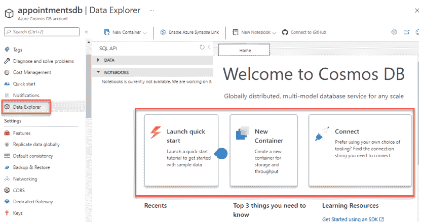

我们需要填写所需的所有信息：

- - **Database id** 是数据库的名称；我们可以添加任何唯一名称或使用现有名称。
- - 选中 **Share throughput across containers**。这允许您在数据库中的所有容器之间分配数据库的配置吞吐量。我们使用此选项来节省成本。
- - 关于 **Database throughput (400 - unlimited RU/s)**，我们可以选择 **Autoscale** 或 **Manual**。我们将吞吐量保持在所需的 **400** RU/s：

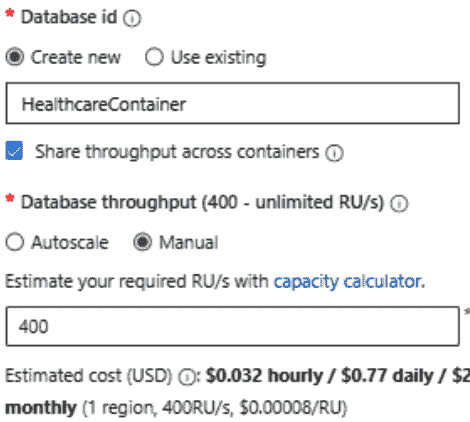

Figure 9.9 – Creating a new container – step 1

- 2. 第二步与容器和分区键相关。我们将添加以下信息：

### * Container id ①

appointments

### * Indexing

Automatic   Off

All properties in your documents will be indexed by default for flexible and efficient queries. Learn more

### * Partition key ①

For small workloads, the item ID is a suitable choice for the partition key.

/appointment

### * Unique keys ①

+ Add unique key

### * Analytical store ①

On   Off

Azure Synapse Link is required for creating an analytical store container. Enable Synapse Link for this Cosmos DB account.

Learn more

Enable

Figure 9.10 – Creating a new container – step 2

容器 ID 是容器的名称，分区键用于自动在分区之间分配数据以确保可扩展性。

3. 单击 OK 以确认创建新容器。创建后，Data Explorer 将显示它和新的数据库：

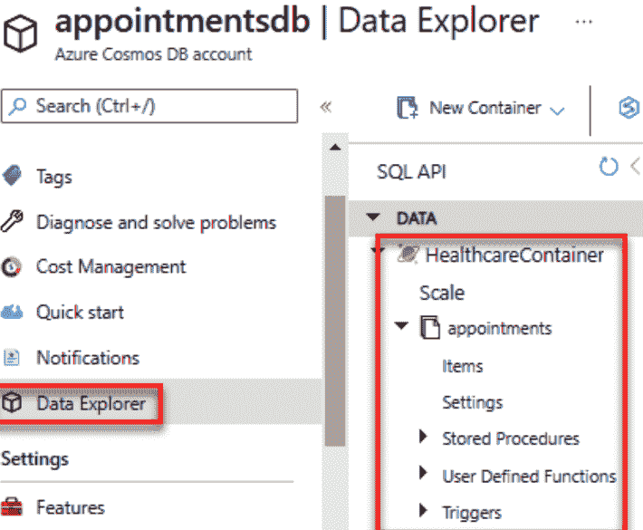

Figure 9.11 – New database and new container in Data Explorer

现在，我们将向数据库添加数据。为此，我们将使用 JSON 内容；我们将在下一节中看到如何操作。

### Adding data to a database

我们将选择 Items under appointments 并使用以下结构向文档添加数据：

```
{
  "id": "1",
  "appointment": "appointment with a dentist",
  "patientname": "Hamida Rebai",
  "doctorname": "Rayen Trabelsi",
}
```

```
"isConfirmed": false,
"date": "2023-03-09T22:18:26.625Z"
}
```

在 Documents 窗格的右侧，添加 JSON 内容并单击 Save。您可以通过单击 New Item 添加多个项目：

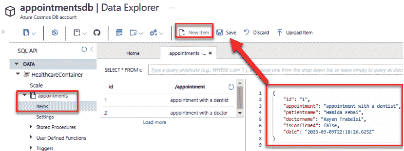

Figure 9.12 – Adding data to your database using JSON content

请注意，我们在 Azure Cosmos DB 中添加的数据没有模式。

我们已使用 JSON 内容向数据库添加了数据。现在我们可以查询数据。

### Querying data

我们将在 Data Explorer 中使用查询来根据特定标准搜索和过滤数据。

我们将选择顶部的 New SQL Query。我们可以添加默认选择以显示数据库中的所有数据：

```
SELECT * FROM c
```

在下图中，我们将选择 New SQL Query 以添加 SQL 命令并执行它，我们选择 Execute Query：

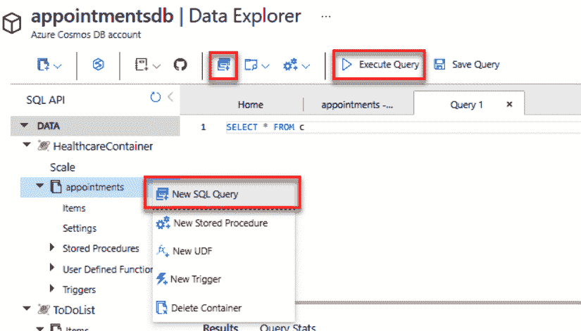

Figure 9.13 - Querying data from documents in Cosmos DB

我们可以添加更多过滤器来检索数据。例如，如果我们需要对结果进行排序，我们可以使用此查询：

```
SELECT * FROM c ORDER BY c.id DESC
```

Figure 9.14 – Filtering data by order – DESC

您可以使用任何 SQL 查询来搜索和检索数据。您还可以添加存储过程和触发器。

Data Explorer 是 Azure 门户中易于使用的工具，用于在 SQL 中添加查询。我们以 JSON 格式观察结果，并且我们可以使用 Query Stats 选项卡衡量 RU/s 方面的影响。

```
SELECT * FROM c ORDER BY c.id DESC
```

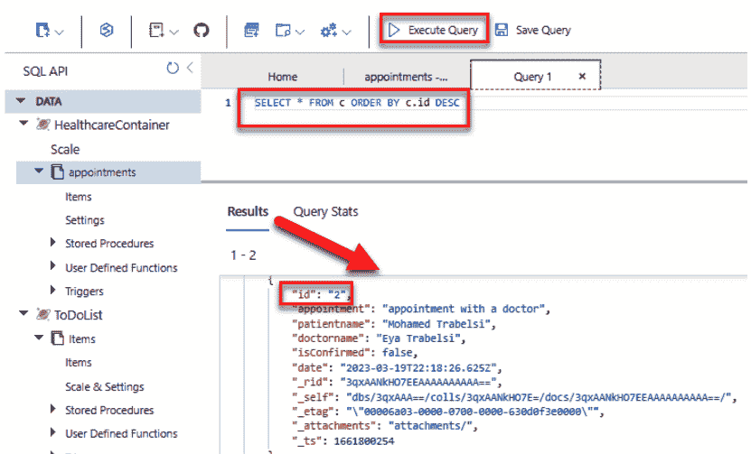

我们可以生成 CSV 文件中的指标：

```
SELECT * FROM c ORDER BY c.id DESC
```

Results
Query Stats

| METRIC | VALUE |
|---|---|
| Request Charge | 2.96 RUs |
| Showing Results | 1 - 2 |
| Retrieved document count | 2 |
| Retrieved document size | 757 bytes |
| ↓ Per-partition query metrics (CSV) | |

Figure 9.15 – Query Stats in Data Explorer

在本节中，我们创建了一个新的 Azure Cosmos DB 容器。我们使用了 SQL API，并添加了一个新数据库和一个新容器。我们向数据库添加了数据以测试 Data Explorer，并使用 SQL 语言检索了数据。

在下一节中，我们将学习有关 SDK 的知识，我们将使用它以 C# 作为编程语言连接到 Azure Cosmos DB SQL API。

## Exercise 3 – connecting to the Azure Cosmos DB SQL API with the SDK

在本节中，我们将探索用于 Azure Cosmos DB 的 Microsoft .NET SDL v3 并探索用于创建不同资源的不同方法和类。

将 .NET SDK 添加到解决方案非常简单。一旦我们使用 NuGet 通过添加 Microsoft.Azure.Cosmos 包将 SDK 添加到项目，我们将创建一个 CosmosClient。我们需要一个 Cosmos DB 账户的端点和主密钥，我们将检索并添加到 CosmosClient 构造函数中。现在 CosmosClient 类已配置好，我们只需在其上调用方法即可完成所需的操作。我们可以创建数据库和容器、查询文档并运行存储过程，这意味着我们可以执行在 Data Explorer 中可以执行的所有操作。


但它是如何工作的？SDK 会确定如何设置 HTTP 标头、发出 REST 调用，并将响应解析回 Cosmos DB。我们在表示文档时可以使用多种类型的对象。这些可以是典型的 C# 类或 Plain Old CLR Objects (POCOs) 或普通的 Common Language Runtime (CLR) 对象，或者我们可以使用没有预定义属性的动态类型，这与文档数据库中灵活的模式相契合。大多数操作都是异步执行的，在等待 Cosmos DB 对请求做出响应时，代码不会被阻塞。这就是 .NET 中 Task Parallel Library 的用武之地。

> **重要说明**
> 如果您更喜欢使用 Language-Integrated Query (LINQ) 而不是 SQL，SDK 还包含一个 LINQ 提供程序，可以将您在 C# 中编写的 LINQ 查询翻译成 Cosmos DB SQL 以供执行。

让我们开始使用 .NET Core 6 创建一个新的控制台应用程序。这将是一个简单的演示，只运行一个查询并显示一些结果：

1. 从 NuGet 获取 SDK，搜索 Microsoft.Azure.Cosmos 并安装它。添加 NuGet 包 Microsoft.Extensions.Configuration.Json，以便我们可以使用 JSON 配置文件来存储我们的 Cosmos DB 连接信息：

   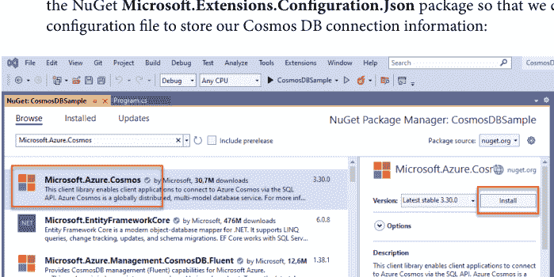

   图 9.16 – 添加 Microsoft.Azure.Cosmos

2. 我们将介绍将添加端点 URI 和主密钥的代码片段。我们将在 Program.cs 中替换与端点 URI 和主密钥相关的信息：

   ```
   private static readonly string EndpointUri = "Add your endpoint here";
   private static readonly string PrimaryKey = "add your primary key";
   ```

   此信息可以在 Azure Cosmos DB 帐户的 Settings 下的 Keys 中找到。这是一个示例：

   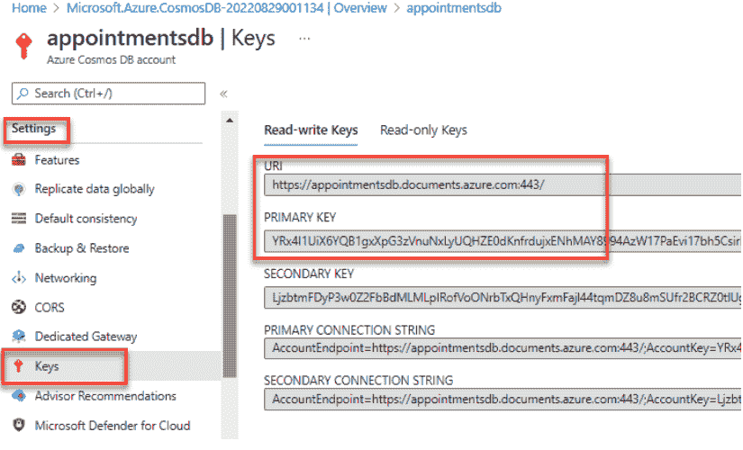

   图 9.17 – 从 Keys under Settings 获取端点 URI 和主密钥

3. 如果我们想创建一个新的数据库和一个新的容器，可以使用此代码片段：

   ```
   private CosmosClient cosmosClient;
   private Database database;
   private Container container;
   private string databaseId = "appointmentDB";
   private string containerId = "appointmentContainer";

   // Runs the CreateDatabaseAsync method
   await this.CreateDatabaseAsync();

   // Run the CreateContainerAsync method
   await this.CreateContainerAsync();

   private async Task CreateDatabaseAsync()
   {
       // Create a new database using the cosmosClient
       this.database = await this.cosmosClient.CreateDatabaseIfNotExistsAsync(databaseId);
   }

   private async Task CreateContainerAsync()
   {
       // Create a new container
       this.container = await this.database.CreateContainerIfNotExistsAsync(containerId, "/LastName");
   }
   ```

   我们可以添加一个新的 JSON 文件，其中包含不同的设置。我们将优化代码以在文档中执行查询。因此，我们将创建一个与以下图所示类似的新 JSON 文件：

   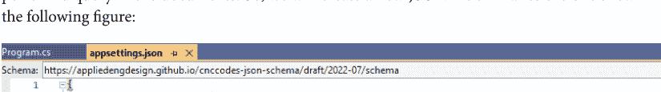

   图 9.18 – JSON 文件中的应用设置

   Program 类将类似于以下内容：

   ```
   using Microsoft.Azure.Cosmos;
   using Microsoft.Extensions.Configuration;

   var config = new ConfigurationBuilder().AddJsonFile("appsettings.json").Build();
   var endpointuri = config["EndpointURI"];
   var primarykey = config["PrimaryKey"];

   using (var client = new CosmosClient(endpointuri, primarykey))
   {
       var container = client.GetContainer("HealthcareContainer", "appointments");
       var mysqlquery = "SELECT * FROM c";

       var iterator = container.GetItemQueryIterator<dynamic>(mysqlquery);
       var page = await iterator.ReadNextAsync();

       foreach (var item in page)
       {
           Console.WriteLine(item);
       }
   }
   ```

   我们将调试解决方案以显示不同的项目。您可以在 foreach 中显示所需的信息：

   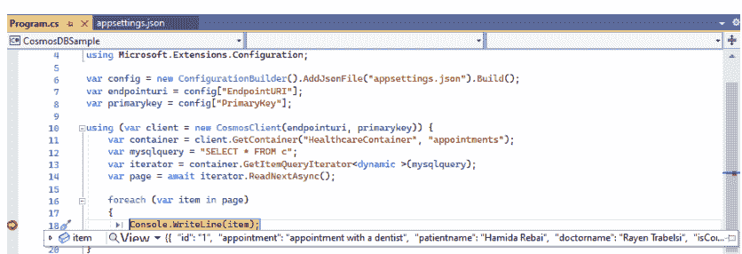

   图 9.19 – 使用 CosmosClient 和 SELECT 查询获取项目

   如果我们想使用 LINQ 而不是 SQL 查询，操作很简单：您需要添加一个包含对象的类。在我们的例子中，我添加了 Appointment 类；我们将用以下代码替换代码：

   ```
   using (var client = new CosmosClient(endpointuri, primarykey))
   {
       var container = client.GetContainer("HealthcareContainer", "appointments");
       var q = from d in container.GetItemLinqQueryable<Appointment>(allowSynchronousQueryExecution: true)
               select d;

       var documents = q.ToList();
       foreach (var document in documents)
       {
           var d = document as dynamic;
           Console.WriteLine(d);
       }
   }
   ```

Azure Cosmos DB 还提供 JavaScript 的语言集成事务执行，这使您可以编写存储过程或触发器、用户定义函数等等。

Azure Cosmos DB 是一种分布式数据库系统，旨在实现低延迟、弹性吞吐量可扩展性、数据一致性的明确语义以及高可用性。它使您可以从数据库的本地副本读取和写入数据。Azure Cosmos DB 跨与您的 Azure Cosmos DB 帐户关联的所有区域复制数据。

如果我们构建一个应用程序，要求在不同区域的任何地方都具有快速响应时间、具有无限弹性吞吐量和存储可扩展性以及高可用性，我们将使用 Azure Cosmos DB。

您必须将数据库配置为全局分布并在任何 Azure 区域可用，以实现 Azure Cosmos DB 的高可用性。Azure Cosmos DB 是一种托管的多租户服务。它透明地管理所有单个计算节点的细节。因此，用户不必担心修补和计划维护。我们还拥有副本中断，这是指部署在 Azure 区域中的 Azure Cosmos DB 集群中的单个节点故障。Azure Cosmos DB 通过保证每个帐户的每个 Azure 区域中的数据至少有三个副本，在四个副本的法定人数中，自动缓解副本故障。

在下一节中，我们将连接部署在 Azure App Service 上的应用程序的 ASP.NET Core Web API 与 Azure Cosmos DB 作为数据库。

## 练习 3 – 连接 Azure App Service 与 Azure Cosmos DB

在本节中，我们将连接 Azure App Service 与 Azure Cosmos DB 作为数据库。ASP.NET Web API 将连接到 Cosmos DB 数据库，以管理患者在发送到医生仪表板之前预订的预约。

我们将使用安装了 Azure 工作负载的 Visual Studio 2022。我们将按照以下步骤使用 **Connected Services** 连接到 Azure Cosmos DB：

1. 在解决方案资源管理器中，右键单击 **Connected Services** 节点，并从上下文菜单中选择 **Add Connected Service**：

   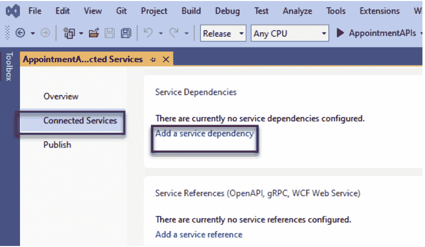

   图 9.20 – Connected Services

2. 在 **Connected Services** 中，选择 **Add a service dependency** 或 **Service Dependencies** 的 **+** 图标。

3. 在 **Add dependency** 页面，选择 **Azure Cosmos DB**：

   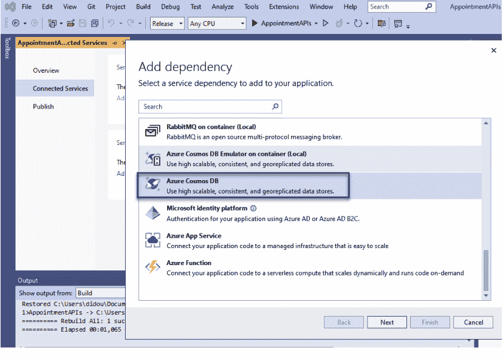

   图 9.21 – Add dependency – Azure Cosmos DB

4. 选择 **Next**。在 **Connect to Azure Cosmos DB** 页面，选择一个现有数据库，并选择 **Next**。我们可以通过选择 **+ Create new** 创建新的 Azure Cosmos DB 实例：

   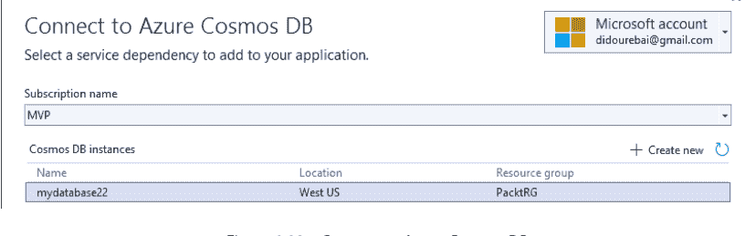

   图 9.22 – Connect to Azure Cosmos DB

5. 输入连接字符串名称，并选择存储在本地 secrets 文件或 Azure Key Vault 中的连接字符串：

   | Connect to Azure Cosmos DB | 提供连接字符串名称并指定如何保存它 |
   | --- | --- |
   | Connection string name | ConnectionStrings:ConnectToCosmosDB |
   | Connection string value | `******************************` |
   | Save connection string value in (Learn more) | Local user secrets file, Azure Key Vault, None |
   | Tip | Avoid pasting application secrets directly into your code. |

   图 9.23 – 为 Azure Cosmos DB 配置连接字符串

6. Summary of changes 屏幕显示将对项目进行的所有修改以完成该过程。如果更改看起来不错，请选择 Finish 开始依赖项配置过程：

   Summary of changes

   Project changes for dependencies being added or configured:
   - Azure Cosmos DB
     - NuGet packages: NuGet packages will be modified to ensure optimal operation of the new dependency
   - Secrets store
     - Application secrets used by the new dependency will be stored in the selected secrets store
     - Secrets.json (Local)

   图 9.24 – Visual Studio 2022 中的更改摘要


结果将与以下图所示类似，其中所有服务依赖项的状态均为已连接：

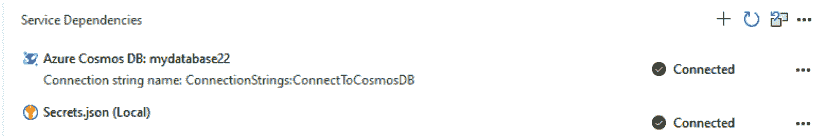

图 9.25 – 连接的服务选项卡上的服务依赖项

应用程序部署在 Azure App Service 上，所使用的数据库是 Cosmos DB，如下图所示：

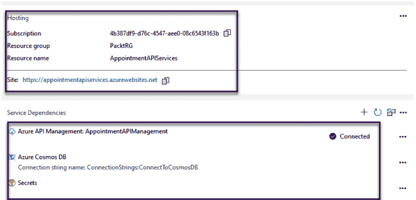

图 9.26 – 主机和服务依赖项

我们可以在此处使用 Microsoft.Azure.Cosmos 包和 CosmosClient 类。然而，如果你在数据层中使用 Entity Framework 作为对象关系映射器，则可以使用 Microsoft.EntityFrameworkCore.Cosmos 包。有关更多详细信息，你可以按照此链接操作：https://learn.microsoft.com/en-us/ef/core/providers/cosmos/?tabs=dotnet-core-cli。

## Summary

在本章中，我们学习了如何创建 Azure Cosmos DB 帐户，并使用数据资源管理器创建了数据库和容器。我们探索了不同的 API 模型，例如 Core（SQL），该模型推荐用于新应用程序、Azure Cosmos DB API for MongoDB、Cassandra、Azure Table Storage 和 Gremlin（Graph）。我们使用 Microsoft .NET SDK v3 创建了资源。我们使用端点和主密钥将应用程序连接到 Azure Cosmos DB 帐户。我们使用 CosmosClient 创建数据库、创建容器并从文档中检索数据。我们还将 Azure App Service 与 Azure Cosmos DB 连接起来。

在下一章中，我们将探索大数据存储。我们将定义 Azure Data Lake Storage 并学习如何创建更安全、高性能的数据分析框架。如果你需要有关 Cosmos DB 的更多信息，可以查看此链接：https://learn.microsoft.com/en-us/azure/cosmos-db/introduction。

## Questions

在创建容器之前，应首先创建哪个 Azure Cosmos DB SQL API 资源？

## Big Data Storage Overview

使用现代系统的公司会产生大量异构数据。这些数据必须被利用于营销目的或对产品进行内部改进。这种异构数据表明，单一数据存储通常不是最佳方法。

还建议将不同类型的数据存储在不同的数据存储中，以便每个数据存储针对特定的工作负载或使用模式。如果我们使用不同数据存储技术的组合，我们使用的是所谓的 polyglot persistence。了解 Azure 作为存储数据仓库的服务所提供的内容以及我们如何使用和分析所有这些数据非常重要。

在本章中，我们将探索大数据存储并定义 Azure Data Lake Storage 可扩展性、安全性和成本优化工作。你将学习如何创建更安全、高性能的数据分析框架。

在本章中，我们将涵盖以下主要主题：
- 探索 Azure Data Lake Storage
- 探索 Azure Data Factory
- 探索 Azure Databricks
- 探索 Azure Synapse Analytics
- 探索 Azure Analysis Services

### Exploring Azure Data Lake Storage

Azure Storage 包括五个 Azure 服务：
- Azure Blob Storage，即无结构数据的可扩展存储
- Azure Queue Storage，允许我们构建可靠的消息队列
- Azure Table Storage，提供对结构化数据存储的支持
- Azure Files Storage，用于基于云的文件共享
- Azure Disks Storage，提供虚拟机磁盘的托管存储

## Big Data Storage Overview

数据湖是一种文件存储形式，通常在分布式文件系统上以实现高性能数据访问。用于处理对存储文件的查询并返回用于报告和分析的数据的常用技术是 Spark 和 Hadoop。这些系统依赖于读取模式方法，该方法为半结构化数据文件定义了表格模式，其中数据在读取时被解析，而在保存时不施加限制。数据湖非常适合支持你想要分析的混合结构化、半结构化和非结构化数据，以避免在将数据写入存储时应用模式。

Azure Data Lake Gen2 技术是在 Azure Blob Storage 之上创建的，并支持大多数 Blob Storage 功能。与 Azure Data Lake 相关的更多好处，例如支持分层命名空间，这意味着我们可以以类似文件的方式存储数据。此好处提高了目录管理操作的性能，以提供对大规模分析引擎的更好支持。

在本节中，我们将开始探索 Azure Data Lake Storage。Azure Data Lake Storage 将高性能文件系统的强大功能与大规模存储平台相结合，让你能够快速洞察数据。

Azure Data Lake Storage Gen2 基于 Azure Blob Storage 功能构建，以优化它，特别是针对分析工作负载。如果你使用过 Hadoop 分布式文件系统，我们可以以相同的方式处理数据。借助此功能，你可以将数据存储在一个位置，并通过各种 Azure 计算服务（如 Azure Databricks、HDInsight 和 SQL Data Warehouse）访问它。Data Lake Storage Gen2 支持 ACL 和 POSIX 权限。我们可以为数据湖中存储的数据在目录或文件级别设置细粒度的权限级别。Azure Data Lake Storage 通过遵循目录和子目录的层次结构来组织存储的数据，如文件系统一样，便于导航，这提高了每个目录管理操作的性能。这种组织使我们能够为大规模分析引擎提供更好的支持，使用数据分区提高查询性能，并更好地进行文件和数据管理。

将数据存储在 Azure Data Lake Storage 中的成本与将数据存储在 Azure Blob Storage 中的成本相同。数据访问的交易成本略有增加，但在许多情况下，这些成本的增加必须与由于查询更高效而减少的交易需求相平衡。总体而言，Azure Data Lake Storage 允许你构建安全、可扩展的企业级数据湖。它在提供 Azure Blob Storage 的许多好处的同时，成本仅略有增加。

Blob 存储的一个良好用例是归档不经常使用的数据或存储网站资产，例如图像和媒体。Azure Data Lake Storage Gen2 在任何 Azure 数据架构中都发挥着基础作用。这些架构包括构建现代数据仓库、对大数据的先进分析以及实时分析解决方案。

对于所有架构而言，大数据解决方案的四个处理阶段是共同的：
1. 摄取阶段确定用于摄取源数据的技术和流程。此数据可以来自文件、日志和其他类型的非结构化数据，需要放置在 Data Lake Storage 中。
2. 存储阶段确定存储记录数据的地点。在本例中，我们使用 Azure Data Lake Storage Gen2。此阶段在下图中呈现：

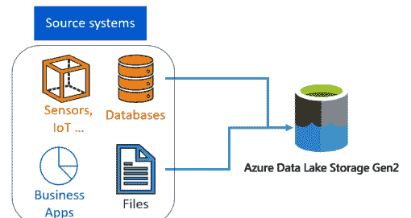

图 10.1 – 摄取阶段 – Azure Data Lake Storage Gen2
3. 准备和训练阶段确定用于进行、准备和建模数据科学解决方案的训练和后续评分的技术。此阶段常用的技术有 Azure Databricks、Azure HDInsight 和 Azure Machine Learning。
4. 最后，模型和部署阶段包括向用户展示数据的技术。这包括可视化工具，如 Power BI，以及数据存储，如 Azure Synapse Analytics、Azure Cosmos DB、Azure SQL Database 和 Azure Analysis Services。根据业务需求，通常会使用这些技术的组合。

Azure Data Lake 中通用存储的常见文件格式包括 Excel、XML、JSON、二进制、Avro、分隔符、Optimized Row Columnar（ORC）和 Parquet。

我们将在以下小节中使用 Azure 门户和 Azure CLI 创建新的 Azure Data Lake 解决方案。


## 使用 Azure 门户创建 Azure Data Lake 实例

Azure Data Lake Storage 建立在 Azure Storage 之上；因此，我们将创建一个新的存储帐户，并在 **Basics** 选项卡中输入所需的不同信息。

在 **Advanced** 选项卡中，在 **Data Lake Storage Gen2** 下勾选 **Enable hierarchical namespace**。此设置会将标准 Blob 存储帐户转换为 Azure Data Lake 存储帐户：

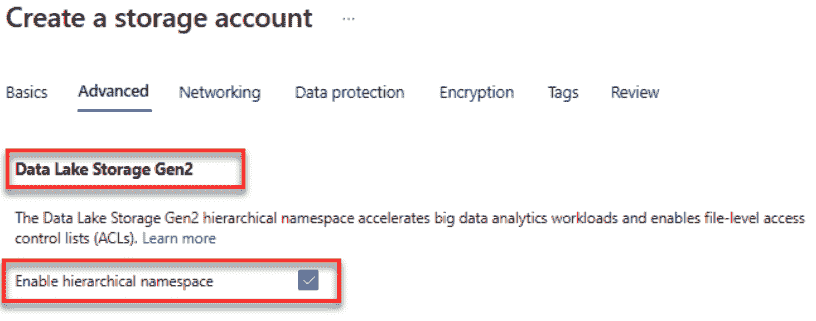

图 10.2 – 使用 Azure 门户创建 Azure Data Lake 实例

选择 **Review + Create** 以查看存储帐户设置并创建帐户。

要在现有帐户上启用 Data Lake Storage 功能，请打开您的存储帐户；然后，在 **Settings** 下选择 **Data Lake Gen2 upgrade**。将显示 **Upgrade to a storage account with Azure Data Lake Gen2 capabilities** 页面，其中包含三个步骤。第一步是在升级启动前查看帐户更改，第二步将验证不同无法与 Azure Data Lake Storage Gen2 兼容的功能。我们将得到一份差异列表。最后一步在验证成功后开始升级：

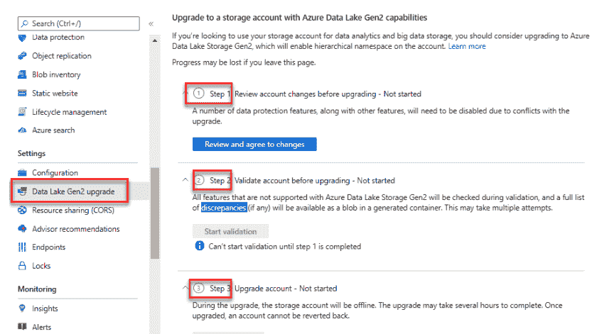

图 10.3 – 升级到具有 Azure Data Lake Gen2 功能的存储帐户

迁移成功后，我们将收到以下消息：This account has successfully been upgraded to an account with Azure Data Lake Gen2.

在下一节中，我们将使用 Azure CLI 创建 Azure Data Lake 实例。

## 使用 Azure CLI 创建 Azure Data Lake 实例

我们将运行 Azure Cloud Shell 浏览器工具来执行以下步骤：

1. 创建一个新的资源组来部署我们的 Azure Data Lake Storage，并添加名称和位置：

```
$ az group create --name healthcareRG --location eastus
```

在下图中，我们将执行之前的命令行以创建新的资源组：

```
hamida@Azure:~$ az group create --name healthcareRG --location eastus
{
  "id": "/subscriptions/
  b/resourceGroups/healthcareRG",
  "location": "eastus",
  "managedBy": null,
  "name": "healthcareRG",
  "properties": {
    "provisioningState": "Succeeded"
  },
  "tags": null,
  "type": "Microsoft.Resources/resourceGroups"
}
```

图 10.4 – 添加新资源组的结果

2. 创建托管标识：

```
$ az identity create -g healthcareRG -n user1
```

输出显示在以下屏幕截图中：

```
hamida@Azure:~$ az identity create -g healthcareRG -n user1
{
  "clientId": "40268d7a-7038-4037-97d3-5865ad988122",
  "id": "/subscriptions/",
  "location": "eastus",
  "name": "user1",
  "principalId": "64bd7ba9-7afe-424c-b08b-fc36178d74a4",
  "resourceGroup": "healthcareRG",
  "tags": {},
  "tenantId": "1800b09f-2b66-425c-b16c-3d7dde051282",
  "type": "Microsoft.ManagedIdentity/userAssignedIdentities"
}
```

图 10.5 – 创建托管标识的结果

3. 创建具有 Data Lake Storage Gen2 的新存储区域，但在那之前，先向 Azure CLI 添加一个扩展，以便它可以使用 Data Lake Storage Gen2 的不同功能：

```
$ az extension add --name storage-preview
$ az storage account create --name myhealthcarestorage1 \
  --resource-group healthcareRG \
  --location eastus --sku Standard_LRS \
  --kind StorageV2 --hns true
```

一旦部署完成，并且我们获得了 JSON 输出，我们就可以返回门户并进入我们的资源组。我们将看到新的资源组已被创建。在其中，我们有 Data Lake Storage 帐户和新用户：

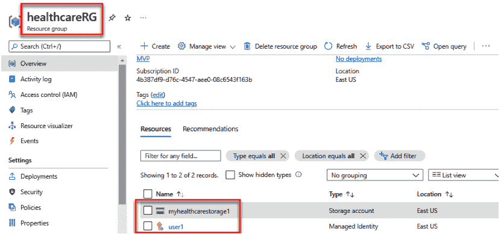

图 10.6 – 显示 Data Lake Storage Gen2 资源

我们可以将新的用户分配托管标识添加到存储帐户上的 Storage Blob Data Contributor 角色。

如果我们想使用 Azure CLI 将 Azure Blob Storage 升级为具有 Azure Data Lake Storage Gen2 功能，可以运行以下命令：

```
$ az storage account hns-migration start --type validation -n your-storage-account-name -g the-resource-group-name
```

在 Azure 中，您可以通过创建编排提取、转换和加载数据流程的管道来实现大规模数据摄取。此过程称为 ETL。基于协调所有源、目标和转换，以及多个数据库、文件格式和数据类型的大量工作通常是必需的，而这就是 Azure Data Factory（ADF）的任务。您可以使用 ADF 来构建和运行管道。我们将在下一节中探索此服务。

## 探索 Azure Data Factory

ADF 是一种基于 Azure 云的数据集成服务，一种平台即服务（PaaS）解决方案，允许您编排和自动化数据移动和数据转换。数据集成是将来自多个来源的数据组合起来并提供其集成视图的过程。

ADF 允许您定义和安排数据管道，以便传输和转换数据。您可以将管道与其他 Azure 服务集成，使您轻松集成来自云数据存储的数据。您还可以使用基于云的计算资源处理数据并将结果保存在另一个数据存储中。

ADF 是无服务器的，这意味着您只需为所使用的资源付费。

使用 ADF，我们可以将数据带入通用格式。我们可以通过将此数据分开保存而可能永远不会产生的新见解。

ADF 已准备好企业数据，因为它几乎有 90 个不同的数据连接器，我们无需使用服务器。它也是无代码转换功能，因为我们有映射数据流，它提供了一种不同的转换类型，允许我们修改数据。使用 ADF，我们可以在任何 Azure 计算实例上运行代码以进行任何动手数据转换。它包括多个可在 Azure 上运行的 SQL Server Integration Services（SSIS）包，可优化在 ADF 中重新托管本地数据库的能力。ADF 使用 Azure DevOps 和 GitHub 来管理数据管道操作。我们可以使用内置的多个活动来简化数据发布到任何数据仓库、数据库或 BI 分析引擎。ADF 通过允许自动配置简单模板来简化数据管道操作。它提供安全的数据集成，因为它使用虚拟网络管理器来防止数据外泄。

## ADF 组件

我们需要了解 ADF 中的关键术语和基本概念。有六个主要组件，我们将在本节中介绍，我们必须创建我们的项目：管道、活动、数据集、链接服务、数据流和集成运行时。然后，我们将探索控制流、管道运行、触发器、参数和变量：

- **Pipelines** 是执行单一工作单元的活动逻辑组。我们可以有多个活动管道。管道中一组活动执行一项任务。活动可以在管道中按序列安排（作为链运行）或独立运行（并行运行）。使用管道，我们可以在单个实体中管理相关活动。

- **Activities** 是管道中定义的先前定义的处理步骤。支持三种类型的活动：数据移动，以便我们可以将数据从存储（源）复制到另一个存储，即目标，数据转换和活动编排。

- **Datasets** 是数据结构，为我们提供对数据存储的选定视图，最好指向或引用用作特定活动输入和输出的数据。

- **Linked services** 是活动可以用来连接到外部服务的连接字符串，这意味着它们是 ADF 连接到外部资源所需的连接信息，通常指向数据管道（摄取）所需的数据源或计算资源（转换）。


+   - **映射数据流**创建并管理数据转换逻辑图，可用于转换任何大小的数据。我们可以构建一个可重用的数据转换例程库，以从管道中执行这些可扩展的过程。
+   - **集成运行时**是 ADF 使用的计算基础结构。它为转换和数据移动过程提供完全托管的数据流、用于路由服务的活动调度器，以及在数据管道内计算 SSIS 包执行任务的管理器。

以下是与 ADF 相关的其他术语：

+   - **管道运行或管道执行：** 我们通过将实参（值）传递给由活动管道定义的形参（占位符）来实例化管道。这些实参可以手动传递，也可以使用触发器传递。
+   - **触发器：** 这是一个处理单元，用于确定管道执行何时开始。我们有不同的触发器类型，用于不同的事件。
+   - **参数：** 这些是以只读模式使用的配置键值对。它们由运行时执行填充，并在管道中定义。数据集和链接服务是强类型、可引用且可重用的参数实体。
+   - **变量：** 它们在管道中用于存储临时值。状态与参数一起用于在活动、数据流和管道之间传递值。
+   - **控制流：** 这是编排管道活动的过程。它包含链式活动、定义参数、分支活动和自定义状态传递，并为按需运行或由触发器调用的管道传递实参。

现在，我们将使用 Azure 门户创建一个 ADF。

## 使用 Azure 门户创建 ADF

打开 Azure 门户，然后选择 **创建资源**。接下来，按照以下步骤创建 ADF：

+   1. 选择 **集成**，然后在 **数据工厂** 下单击 **创建**。
+   2. 在 **创建数据工厂** 页面的 **基础** 选项卡中，第一部分与项目详细信息相关，因此我们将选择订阅和资源组。对于实例详细信息，我们将输入 ADF 实例的名称（必须唯一）以及存储 ADF 元数据的区域。版本将为 V2：

## 创建数据工厂

基础   Git 配置  网络  高级  标记  查看 + 创建

## 项目详细信息

选择订阅以管理部署的资源和成本。使用资源组（如文件夹）来组织和管理所有资源。

订阅 *  MVP

资源组 *  healthcareRG  新建

## 实例详细信息

名称 *  healthcareDF

区域 *  美国东部

版本 *  V2

图 10.7 – 创建数据工厂 – 基础选项卡

3. 在 Azure DevOps 或 GitHub 中配置 Git 仓库。我们可以稍后配置 Git：

## 创建数据工厂

基础   Git 配置  网络  高级  标记  查看 + 创建

Azure 数据工厂允许你使用 Azure DevOps 或 GitHub 配置 Git 仓库。Git 是一种版本控制系统，可以更轻松地进行更改跟踪和协作。

了解有关 Azure 数据工厂中 Git 集成的更多信息

稍后配置 Git

仓库类型 *  Azure DevOps  GitHub

GitHub 账户 *

仓库名称 *

分支名称 *

根文件夹 *  /

图 10.8 – 创建数据工厂 – Git 配置选项卡

+   4. 对于 **网络** 选项卡，保持默认值不变。我们可以配置专用或公共终结点，并选择是否启用托管虚拟网络。在 **高级** 下，我们可以使用客户管理的密钥启用加密，以进一步保护我们的 ADF 实例。

+   5. 选择 **查看 + 创建**，然后在校验通过后选择 **创建**。

创建 ADF 资源后，我们必须导航到 ADF 页面并开始探索不同的设置。选择 **打开 Azure Data Factory Studio**；将在浏览器的新选项卡中加载一个新页面：

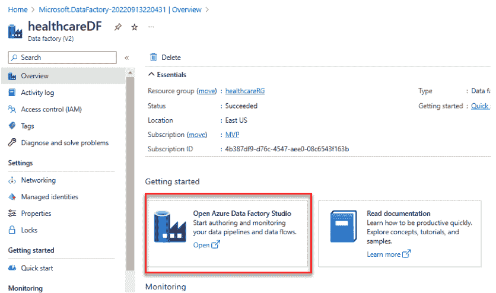

图 10.9 – 在 ADF 服务中打开 ADF Studio

开始使用 ADF 时，我们将创建链接服务、数据集和管道。

## 创建链接服务

我们需要遵循以下步骤：

+   1. 要创建链接服务以将数据存储链接到我们的 ADF 实例，我们可以选择任何外部存储或 Azure 存储，或数据库、文件或 NoSQL 数据库。从左窗格中选择 **管理** 选项卡，然后选择 **+ 新建**：

## 大数据存储概述

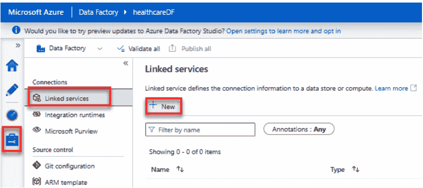

图 10.10 – 创建链接服务

+   2. 选择 Azure Data Lake Storage Gen2，然后选择 **继续**。

+   3. 填写名称、与订阅相关的信息，以及我们将用于存储数据的存储帐户名称：

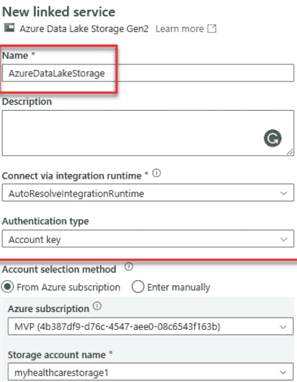

图 10.11 – 选择用于存储数据的 Azure 存储帐户

+   4. 选择 **测试连接** 以确认我们的 ADF 实例已连接到存储帐户（Data Lake Storage Gen2）。然后，选择 **创建** 以保存链接服务。

## 创建数据集

在本节中，我们将创建两个数据集：第一个作为输入，第二个作为输出。它们将是 Azure Data Lake Storage Gen2 类型：

+   1. 选择窗格左侧的 **创作** 图标。接下来，单击加号图标 (+) 并选择 **数据集**：

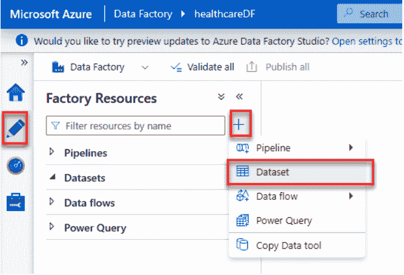

图 10.12 – 创建数据集

+   2. 在 **新建数据集** 页面上，选择 **Azure Data Lake Storage Gen2**。然后，选择 **继续**。
+   
+   3. 从 **Avro、二进制、分隔文本、Excel、JSON、ORC、Parquet** 或 **XML** 中选择数据的格式类型。为了在复制文件时不解析其内容，我们将选择 **二进制** 类型。
+   
+   4. 在 **设置属性** 页面上设置不同的属性，即名称和链接服务。我们将使用之前配置的 Data Lake Storage。选择文件路径：

## 设置属性

名称

InputDS

链接服务 *

AzureDataLakeStorage

文件路径

healthcareadf / input / inputfile.txt

图 10.13 – 输入数据集的设置属性页面

+   5. 按照与之前相同的步骤创建另一个数据集，但将其指定为输出。选择 **确定** 以确认：

## 设置属性

名称

OutputDS

链接服务 *

AzureDataLakeStorage

文件路径

healthcareadf / output / 文件名

图 10.14 – 输出数据集的设置属性页面

创建数据集后，我们将使用输入和输出数据集创建一个包含复制活动的管道。此复制活动会将我们的数据从输入数据集文件复制到输出数据集文件设置。

## 创建管道

要创建管道，我们将遵循以下步骤：

+   1. 再次选择加号 (+) 按钮，然后选择 **管道 | 管道**，如下图所示：

## 图 10.15 – 选择管道

或者，我们可以选择 **管道**，然后选择 **新建管道**，如下图所示，以创建新管道：

## 图 10.16 – 创建管道

+   2. 将我们的管道命名为 CopyPipeline。

+   3. 在 **活动** 工具箱中，展开 **移动和转换**。接下来，将 **复制数据** 活动拖到右侧的管道设计器图面上。我们将它重命名为 CopyFromDFToDF，如下所示：

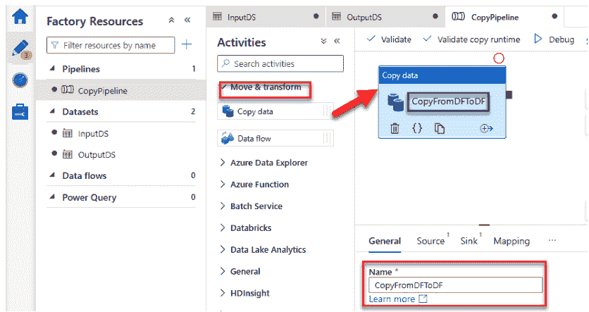

图 10.17 – 活动下的移动和转换

+   4. 在复制活动设置下切换到 **源** 选项卡，并为 **源数据集** 选择我们的输入数据集 (InputDS)。然后，切换到 **接收器** 选项卡以链接输出数据集 (OutputDS)。

在下图中，您可以看到在活动设置中配置的输入数据集：

图 10.18 – 在活动设置中配置输入数据集

6. 我们可以手动触发管道。为此，我们需要将实体发布到 ADF。因此，选择顶部的 **发布**。之后，在管道工具栏上选择 **添加触发器**，然后选择 **立即触发**。

7. 我们可以按计划自动执行触发器。在 **创作** 选项卡中，选择管道工具栏上的 **添加触发器**。接下来，选择 **新建/编辑**。在 **添加触发器** 页面上选择 **选择触发器**。之后，单击 **新建**。我们将在 **新建触发器** 页面上设置触发器。完成此配置后，我们需要 **全部发布** 以将更改应用到 ADF。

在本节中，我们使用 Azure 门户创建了 ADF，但我们也可以使用 Azure CLI、Azure PowerShell、REST API 或 .NET 应用程序。您可以在 Microsoft 文档中阅读有关这些选项的更多信息：https://docs.microsoft.com/en-us/azure/data-factory/。

数据工厂主要是一个数据编排和移动工具，它调用 Databricks 等其他服务来转换数据。我们将在下一节中了解有关 Azure Databricks 的更多信息。

## 探索 Azure Databricks

在本节中，我们将探索 Azure Databricks 的不同功能。但是，我们将从定义 Azure Synapse Analytics 开始。

## Azure Synapse Analytics

Databricks 是一家数据、分析和 AI 公司。这是其平台的链接：https://www.databricks.com/。他们是 Apache Spark、Delta Lake 和 MLflow 开源版本的首批创建者。他们使用了这些服务的一些架构组件来构建 Databricks。他们试图在数据科学和数据工程中统一流程创新。

Databricks 提供了一个交互式工作区，有助于自动化生产工作流。整个工作区完全托管，Azure 是 Databricks 用来交付可部署解决方案的渠道，无论底层基础结构（如服务器和虚拟机）如何。

## Azure Databricks 功能

Azure Databricks 提供多项功能：

+   - 利用 Spark 引擎，提供机器学习、SQL、DataFrame、低延迟流 API 以及图形 API 等功能，以帮助发现数据集中的关系
+   - Azure Databricks 中可以使用多种语言，例如 Scala、Python、Java、R 和 SQL。


- 无缝自动集成工作区与 Azure Active Directory
- 轻松连接 ADF 以创建数据管道
- 将 Databricks 工作区连接到 Azure 存储，以便将其用作文件系统，你可以在其中上传文件以供工作区使用
- 遵循 FedRAMP 和 PCI DSS 等行业安全标准与合规要求

接下来，我们将探讨 Azure Databricks 的不同组件。

## Azure Databricks 组件

当我们创建新的 Azure Databricks 资源时，必须创建一个新的 Databricks 工作区。这是第一个组件；工作区是一个用于探索和可视化数据的交互式工具。在工作区中，我们有 Apache Spark 集群，它们用作计算引擎，在 Azure Databricks 中运行工作负载。我们可以在一个工作区的用户之间共享集群。集群支持自动伸缩，这意味着我们可以根据运行作业的组件来分配资源。我们还可以在特定闲置时间后自动终止任何不活跃的集群。我们还有笔记本，它们是工作区的一部分，允许我们读取、写入、查询、可视化或探索数据集。我们可以将笔记本连接到集群以运行项目。笔记本中还有更多选项，例如在工作区中保存、共享、导入和导出笔记本。现在，我们将使用 Azure 门户创建一个新的 Databricks 工作区。

## 创建 Azure Databricks 工作区

在本节中，为了设置 Azure Databricks 环境，我们将创建一个 Azure Databricks 集群和笔记本，并逐步了解如何使用它们。

打开 Azure 门户；我们首先单击“创建资源”按钮。然后，在搜索框中输入 Azure Databricks。我们将单击“创建”按钮来创建资源。请按照以下步骤操作：

- 1. 在创建页面上，我们需要完成各个步骤。我们从“基本信息”选项卡开始。第一部分是所有资源共有的：填写订阅和资源组的信息。关于实例详细信息，我们将输入工作区名称，并选择区域和定价层。在“定价层”下，我们有三个选项：
  - 标准版，可以使用 Apache Spark 并集成 Azure Active Directory
  - 高级版，具有另一个涉及基于角色的访问控制的功能
  - 试用版，允许我们免费使用高级版 14 天

2. 在“**网络**”和“**高级**”选项卡中，我们可以使用默认值。选择“**查看 + 创建**”。验证通过后，单击“**创建**”按钮。

3. 资源创建完成后，我们将探索 Azure Databricks 服务页面。选择“**启动工作区**”：

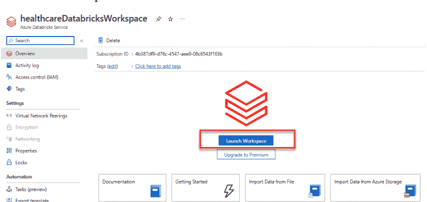

图 10.20 – 启动 Azure Databricks 工作区

我们将被重定向到浏览器中的另一个页面。

4. 在 Databricks 工作区的登陆页面上，系统会询问我们使用 Databricks 的原因。我们将选择“**构建数据管道（ETL、流式处理）**”。

5. 创建一个新集群，该集群将作为我们所编写代码的计算引擎。单击“**创建集群**”，然后选择“**创建集群**”按钮：

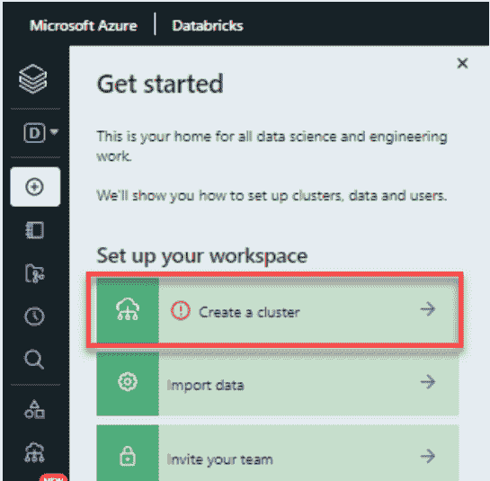

图 10.21 – 在 Databricks 工作区中创建集群

6. 让我们使用一些简单的配置来填写各个选项，如下面的截图所示，然后选择“**创建集群**”进行确认：

图 10.22 – 配置新集群

7. 创建一个新笔记本。我们将在左侧窗格中选择“创建”，然后选择“笔记本”，再输入名称。

8. 下一个选项是选择你想要使用的编码语言。我们将选择集群，即我们之前创建的集群。继续按“创建”来创建笔记本：

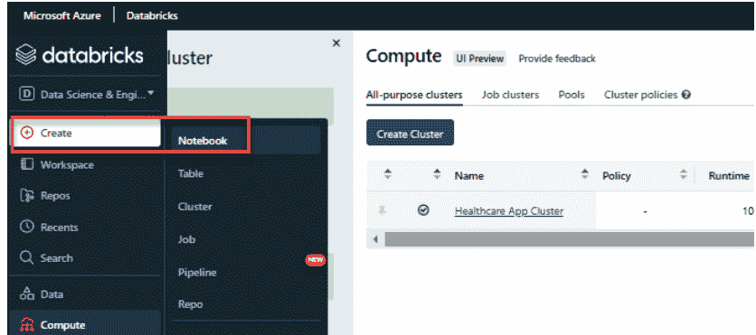

图 10.23 – 创建笔记本

我们可以使用 Python 将数据导入 Databricks 环境。我们将使用以下代码从保存在 GitHub 存储库（https://raw.githubusercontent.com/didoureba/developerGuideForCloudApps/main/data.csv）中的 CSV 文件中拉取数据到我们的 Databricks 环境中：

```
import pandas as pd ## this import is used for data analysis
casesdatacsv = pd.read_csv('https://raw.githubusercontent.com/didoureba/developerGuideForCloudApps/main/data.csv');
print ("First Databricks Table")
display(casesdatacsv)
```

这段代码的第一行是必需的。我们调用 pandas，这是一个用于数据分析的 Python 包。下一行将获取一个包含来自 GitHub 存储库数据的 CSV 文件。它将把这些数据保存为一个 DataFrame。我们将这个 DataFrame 称为 casesdatacsv。如果我们想为结果添加标题，可以使用带有消息的 print。然后，我们可以单击“运行单元格”或使用 Shift + Enter。结果如下：

# 图 10.24 – 将数据推送到 Databricks 环境的结果

如果显示的表中有很多行，我们可以展开结果。

Azure 还包含更多数据分析解决方案。在下一节中，我们将探索 Azure Synapse Analytics。

## 探索 Azure Synapse Analytics

Azure Synapse Analytics 是一个用于大规模数据分析的集成端到端解决方案。它结合了多种技术和功能，将基于可扩展、高性能 SQL Server 的关系型数据仓库的数据完整性和可靠性与数据湖和开源 Apache Spark 的灵活性相结合。它还通过使用 Azure Synapse Data Explorer 池和用于数据引入与转换的内置数据管道，原生支持日志和遥测分析。

所有 Azure Synapse Analytics 服务都可以通过一个名为 Azure Synapse Studio 的交互式用户界面进行管理。它允许你创建可组合 Spark 代码和 Markdown 内容的交互式笔记本。Synapse Analytics 非常适合在 Azure 上构建统一的分析解决方案。

## 探索 Azure Analysis Services

Azure Analysis Services 是一项完全托管的 PaaS 服务。它提供面向云的企业级数据模型。在 Azure Analysis Services 中，我们可以使用高级混合和建模功能，将来自更多数据源的数据组合到一个值得信赖的表格语义数据模型中。我们还可以定义指标并保护数据安全。

## 香港特别行政区政府 社会福利署

### 2024/25年度 关爱基金援助项目

- 为租住私人楼宇的综援受助人士提供津贴
- 为居住于不适切住房的综援受助人士提供津贴
- 为低收入家庭提供津贴

| 项目 | 津贴金额（港元） |
| --- | --- |
| 租金津贴 | 200 - 5,000 |
| 不适切住房津贴 | 300 - 1,200 |
| 低收入家庭津贴 | 1,000 / 个月 |

本计划旨在纾缓低收入家庭的经济压力，改善其生活质素。申请人必须通过入息及资产审查，并符合相关居住要求。

> 「关爱基金」为未能纳入安全网或虽已纳入安全网但仍有特定需要的人士提供支援。

申请方法：
1. 填妥申请表格；
2. 连同所需证明文件副本；
3. 递交至所属地区社会福利署办事处。


查询热线：2343 2255
办公时间：星期一至五 上午九时至下午六时
