## 第 1 章：强化学习简介

### 加入我们的 Discord 图书社区


[`packt.link/EarlyAccessCommunity`](https://packt.link/EarlyAccessCommunity)

本书旨在探讨如何使 AI 代理与人类意图保持一致。过去二十年间，AI 能力呈指数级增长，机器学习、计算机视觉、自然语言处理、深度学习和**强化学习**(`RL`)等学科的里程碑式进展在其中发挥了关键作用。这些能力和应用展示了 AI 扩展得有多好，以及它如何影响几乎所有事物。这使得 AI 的行为或采取的行动与人类意图保持一致变得至关重要，而这一必要性也是安全使用该技术的途径。在本书中，我们将深入探讨**基于人类反馈的强化学习**(`RLHF`)，它在生成式预训练模型的成功中发挥了关键作用，并将其推向主流技术应用。本书第一部分从总体角度介绍 `RLHF`，并帮助读者理解将 `RLHF` 应用于任何应用所需的核心技术组件。第二部分深入探讨将 `RLHF` 应用于语言建模，特别是大型语言建模。最后一部分为读者提供该技术的当前趋势和未来展望。在本章中，我们首先涵盖 `RL` 的基础知识和理解 `RL` 算法的关键概念，通过高层次解释其类别，向读者介绍 `RL`。然后我们介绍一个称为网格世界的特定简单经典环境，并展示如何实现 `Q-learning` 这一基本 `RL` 算法。利用基本实现进行比较和提供背景，我们随后详细说明如何设计奖励函数，以及如何实现迁移学习以加速 `RL` 训练。最后，我们展示**人类反馈**如何辅助基于 `RL` 的训练，并在同一示例上进行动手实现，以便读者能清晰地比较其相对于经典 `Q-learning` 实现的改进。这让读者了解 `RLHF` 在实践中如何运作，并为后续章节深入探讨更复杂的算法和架构奠定基础。本章将涵盖以下主要标题：

- 强化学习要点
- 理解 RL 算法
- 探索 RL 环境：网格世界环境
- 设计奖励函数与迁移学习
- 基于人类反馈的强化学习

### 技术要求

本章将所有实现相关的依赖保持最小化。所有实现均使用 `python`。具体版本建议和所需安装的最低库如下：

- `Python` 版本 >= 3.9
- `Numpy` == 1.26.4
- `Matplotlib` == 3.8.4

开始前，请克隆此 Git 仓库：[`https://github.com/PacktPublishing/A-Practical-Guide-to-Reinforcement-Learning-from-Human-Feedback`](https://github.com/PacktPublishing/A-Practical-Guide-to-Reinforcement-Learning-from-Human-Feedback)，并将目录切换到 `chapter1`。

### 强化学习要点


# 强化学习基础

强化学习是机器学习的一种范式，专注于智能体如何通过与环境的交互来学习做决策，以最大化特定的累积奖励。在人工智能的语境下，智能体是指任何能够感知环境并通过自主决策对环境施加作用的实体。智能体通过试错学习，根据其动作导致的到达或停留的状态，以奖励或惩罚的形式接收反馈。随着时间的推移，通过这一迭代过程，智能体磨练其决策能力以最大化累积奖励。

## 状态-动作-奖励框架

强化学习基于`state-action-reward framework`（状态-动作-奖励框架），智能体通过与环境交互来学习最优决策策略。环境的感知及其当前状态通过传感器传递给智能体，使其能够做出明智的决策。**状态**代表环境的各种属性，为决策提供关键信息。

例如，人类通过视觉等感官感知世界，而机器人可能使用摄像头。这些感知构成了状态的基础，涵盖了物体、位置和其他环境属性。然而，并非所有状态都可直接观测；隐藏物体构成当前状态的一部分，但保持未被观测。因此，观测值代表智能体用于决策的感知状态。为简洁起见，在我们的讨论中，我们将使用状态作为观测值，因为观测值预期包含决策所需的所有相关状态。

### 动作

考虑一个基于摄像头输入在环境中导航的机器人。它解析图像以决定**动作**，如向右、向左或直行。这些动作通过肢体或车轮等机制执行。智能体采用从简单规则到复杂机器学习算法的决策过程，根据其对环境的感知来选择动作。

### 奖励

在强化学习中，智能体旨在通过选择导致有利结果的动作来最大化累积**奖励**。奖励作为反馈，指导智能体的学习过程。通过反复交互，智能体完善其决策能力，利用状态-动作-奖励框架在多样化环境中实现最优性能。在*图 1.1*中，我们展示了使用状态-动作-奖励框架的**智能体-环境**交互。

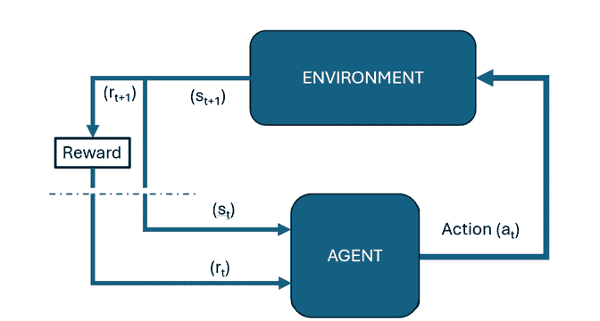

图 1.1 智能体-环境交互

## 核心概念

在给定的迭代或时刻，基于环境的**初始状态**，智能体采取动作改变环境，使其过渡到状态 `s[t+1]`。对于每次迭代，如果这种状态变化是期望的，则会分配一个较高的正奖励，激励智能体采取此类动作。导致智能体根据当前状态采取动作的决策策略称为**策略**，通常记作 `π(s)`。动作作为输入传递给环境，导致环境改变或过渡到下一个状态；过渡动态通常表示为 `*.*`。过渡动态由环境决定，不受我们或智能体控制。根据环境的不同，它可以是随机的或确定性的。

从初始状态开始，遵循特定策略后，在一系列状态上预期累积奖励的估计称为**价值函数**，通常定义为 `V(s)`，是状态的函数。当价值函数针对特定状态下采取的特定动作时，称为**动作价值函数**或 `Q` 函数。

# 理解强化学习算法

强化学习算法的主要任务是优化策略，使智能体采取导致期望状态的最优动作。为了优化动作，强化学习算法采用各种创新技术，但其核心在于利用智能体处于特定状态相关的奖励，驱动策略产生期望的动作。算法的差异主要在于如何使用、存储、处理和应用状态、动作和奖励以得出最优策略，以及智能体如何与环境交互以得出这些策略。强化学习算法可根据多个标准进行分类。一些常见的分类包括：

## 分类标准

### 基于模型 vs 无模型

**基于模型 VS 无模型**：基于模型的算法涉及学习环境模型并利用其规划动作。环境模型可以基于动态规划、蒙特卡洛方法或学习转移模型。相反，无模型算法不对环境建模，而是直接通过与环境交互来学习。无模型算法的例子有 `Q-learning`、`SARSA` 和 `Deep Q Networks` (`DQN`)。

### 基于价值 vs 基于策略

**基于价值 vs 基于策略**：基于价值的算法估计处于特定状态并采取特定动作的价值，旨在最大化价值函数。基于策略的算法直接对策略进行参数化，并使用梯度上升方法学习最优策略。一种结合价值和基于策略算法的混合方法称为 `actor-critic`（演员-评论家）算法。它维护一个演员（策略）和一个评论家（价值函数），并利用两者从经验中学习，平衡两者的优势。

### 时序差分 vs 蒙特卡洛 vs 动态规划

**时序差分 vs 蒙特卡洛 vs 动态规划**：在时序差分学习中，价值函数基于当前奖励与未来奖励的差异进行更新。相反，在**蒙特卡洛方法**中，价值是基于整个回合（单次运行中的状态序列）观测到的总回报来估计的，且每个回合仅更新一次价值。考虑到需要完成整个回合的轨迹才能更新价值，这是蒙特卡洛方法的一个已知弱点。动态规划涉及将问题分解为子问题，并迭代求解这些问题。虽然动态规划算法在构建算法方面是基础性的，且适用于已知领域和有限状态-动作空间，但其计算复杂度、时间和内存需求无法扩展到大规模状态-动作空间，也不适用于存在不确定性的环境。

### 同策略 vs 异策略

**同策略 vs 异策略算法**：同策略算法在策略被学习和更新时立即遵循该策略（采取动作）。对于异策略算法，学习一个目标策略，同时使用单独的策略（行为策略）来遵循策略（通过采取动作）。

### 单智能体 vs 多智能体

**单智能体 vs 多智能体算法**：单智能体算法涉及单个智能体在环境中交互以学习达成目标。多智能体算法涉及多个智能体在环境中相互交互，协作、竞争或独立地为一个目标或一组目标做出贡献。这些智能体之间存在协调和通信，有时它是多个单智能体的集成。

### 表格型强化学习 vs 函数近似强化学习

**表格型强化学习 vs 函数近似强化学习**：`Tabular RL` 显式地在表格中存储价值和策略，而在 `Function Approximation RL` 中，使用函数近似器或模型（如神经网络）来估计价值函数或策略，使其能高效处理大规模或连续的状态和动作空间。`Tabular RL` 通常适合开发强化学习算法或理解和获取直觉，但由于其表格存储的特性，仅限于较小的状态-动作空间。


# 批量 RL 与在线 RL

在 `Batch RL` 或 `Offline-RL` 中，智能体从离线收集的固定数据集中学习，经验来自过去的某些交互，但在学习过程中**不与环境交互**。`Online-RL` 是典型情况，智能体通过与环境交互并持续更新策略或价值函数（作为学习过程的一部分）来学习，因为观察值是在体验过程中收集的。

# 探索-利用策略

`RL` 算法还可以根据智能体在训练期间如何平衡探索和利用进行分类。当智能体尝试新动作、发现新场景，以及这些新动作如何影响状态演变和产生的奖励时，这被称为**探索**。当智能体试图最大化已知能产生高奖励的动作，而不冒尝试新动作的风险时，这被称为**利用**。示例包括 `epsilon-greedy`、`Boltzmann exploration`、`Upper Confidence Bound` 和 `Thompson Sampling`。

虽然 `RL` 算法的分类可以很详尽，但许多算法符合上述几个类别。为了 `RLHF` 的目的，我们将重点关注几个关键基础算法，例如本章中基于价值的算法方法 `Q-learning`，并在后续章节中介绍基于策略的方法。在讲解完整示例之前，理解价值函数的概念很重要。价值函数用于评估环境中状态或状态-动作对的质量。它们提供了一种量化方式，衡量处于特定状态或在每个状态 `s` 中采取特定动作并遵循给定策略所关联的预期回报或效用。这有助于了解该状态（以及在该状态下采取特定动作）从长远来看有多可取。定义价值函数有两种方式：

## 状态价值函数

它是从特定状态 `s` 开始并遵循给定策略的预期回报（累积折扣奖励）。数学上，折扣未来奖励的预期和可以表示为： 。

* `E` 是期望算子，表示对可能的未来轨迹的期望，`γ` 是折扣因子（在 0 和 1 之间），对未来奖励进行折扣以赋予即时奖励更大的权重， 是时间步 时接收到的奖励。

## 动作价值函数

它是从状态 `s` 开始，采取动作 `a`，然后遵循给定策略的预期回报。数学上，这个折扣未来奖励的预期和可以表示为：

* ，

* 符号与状态价值函数类似。

从基于 `RLHF` 的 AI 系统的系统级和架构视角来看，替换算法并将状态-动作视为与 AI 系统其余部分交互的输入-输出变量是很容易的。对于有兴趣深入研究这些算法的读者，有几本理论和实践性质的书籍（请参阅本章末尾的参考文献）。为了理解 AI 系统和智能体-世界交互，我们将使用经典的网格世界环境，并展示 `Q-learning` 算法如何工作。接下来，我们将展示奖励模型如何发挥作用，使学习过程更高效。

# 导航 RL 环境：网格世界环境

在 `RL` 中，智能体-环境交互是需要优化的场景。为了优化此场景，智能体采取导向理想状态的最优动作。导致最优状态的动作序列即为策略。训练智能体可以使用真实世界环境。但它们可能危险、昂贵，有时效率低下。训练智能体学习足够复杂的策略可能需要数百万次迭代。这就是真实世界环境模拟发挥作用的地方。虽然模拟可能无法完全捕捉真实世界，但仅捕捉导致真实世界相关状态转移的相关信息和环境属性，在许多工业和现实问题中已足够。在某些情况下，模拟场景与真实世界存在差距，并在真实世界实施期间构成困难，通常称为 `sim2real gap`。这在涉及物理和三维几何资产的仿真模型中更为显著，而对于文本、图像或应用而言问题较小，因为智能体部署后，最终环境仍是数字世界。在本章中，我们介绍真实世界的网格世界表示。简化的环境将帮助我们专注于学习 `RL` 相关概念，而无需复杂领域的认知开销。环境由网格单元组成。每个单元可以是可访问或不可访问的，形成世界的布局。智能体位于网格内的某个单元中。智能体可以采取动作从一个单元移动到另一个单元。使用状态-动作-奖励框架，我们在网格世界问题的背景下定义它们。

## 网格世界组件

### 状态
网格中的每个单元代表环境的一个状态。随着智能体在网格中移动，环境的状态会发生变化。

### 动作
智能体可以采取动作在网格中移动。通常，智能体可以向上、下、左、右移动。然而，根据问题的变体，由于障碍物或边界，某些动作可能不可用。

### 奖励
网格中的每个单元可能关联一个奖励。智能体的目标通常是最大化其随时间累积的总奖励。奖励可以是正、负或零。

### 终止状态
网格中的某些单元可能被指定为终止状态。当智能体进入终止状态时，回合结束，智能体可能接收最终奖励，也可能不接收，具体取决于问题设置。

### 策略
策略决定智能体在环境中的行为。它将状态映射到动作，指导智能体如何在不同状态下选择动作以实现其目标，通常是最大化累积奖励。

### 转移动力学
从一个状态移动到另一个状态并不总是确定性的。可能涉及随机性，例如风将智能体吹离航向，或智能体在冰面上滑倒。

## 构建 GridWorld 环境

要创建世界的网格世界表示，我们首先在 Python 中创建一个 `GridWorld` 类。以下是构建网格世界环境的步骤。

### 初始化环境

`__init__` 方法使用 `grid_size`、`obstacle_positions`、`start_position` 和 `goal_position` 等参数初始化网格世界环境。状态数量初始化为网格的大小。它还将每个状态-动作对的 `Q_values` 初始化为零。

```python
def __init__(self, grid_size, obstacle_positions):
    self.grid_size = grid_size
    self.start_position = (2, 2)
    self.goal_position = (5,5) #(grid_size[0] - 1, grid_size[1] - 1) for generalizing
    self.obstacle_positions = obstacle_positions
    self.actions = [(0, 1), (0, -1), (1, 0), (-1, 0)]  # right, left, down, up
    self.action_symbols = ['→', '←', '↓', '↑']  # Action symbols for visualization
    self.num_actions = len(self.actions)
    self.num_states = np.prod(self.grid_size)
    self.Q_values = np.zeros((self.num_states, self.num_actions))
```

### 构建模拟器的方法

然后，我们添加一个额外的方法来构建网格世界模拟器。以下是将 `state (i, j)` 转换为 `Q_values` 数组中对应索引的方法，反之亦然，给定 `Q_values` 数组中的索引转换为对应的 `state (i, j)`。

```python
def state_to_index(self, state):
    return state[0] * self.grid_size[1] + state[1]

def index_to_state(self, index):
    return (index // self.grid_size[1], index % self.grid_size[1])
```


# GridWorld 状态索引转换与 Q-Learning 实现

## 状态到索引的转换：`state_to_index(state)`

方法 `state_to_index(state)` 用于将状态（表示网格中位置的元组）转换为其在 Q 值数组中对应的索引。下面分解表达式 `state[0] * self.grid_size[1] + state[1]`：

*   `state[0]`：表示状态在网格中的行索引。
*   `self.grid_size[1]`：表示网格的列数。因为 `grid_size` 是元组 `(rows, columns)`，所以 `self.grid_size[1]` 给出列数。
*   `state[1]`：表示状态在网格中的列索引。

将 `state[0]` 乘以 `self.grid_size[1]`，本质上是将行索引转换为跨越所有行的线性索引。例如，若网格大小为 `(6, 6)` 且位置为 `(2, 3)`，计算为 `2 * 6 + 3 = 15`。这将行索引 2 转换为网格扁平化表示中的线性等价值。随后加上 `state[1]`（列索引），即可将二维坐标映射为一维数组中的单个索引，便于访问 Q 值数组元素。这种方法确保每个状态唯一映射到 Q 值数组的一个索引，从而在 Q-Learning 过程中高效存取 Q 值。

## 索引到状态的转换：`index_to_state(self, index)`

`GridWorld` 类中的方法 `index_to_state(self, index)` 负责将 Q 值数组中的索引转换回网格中的二维状态坐标 `(i, j)`。

表达式 `index // self.grid_size[1]` 计算状态的行索引：

*   `index // self.grid_size[1]` 通过整除求出索引之前完整的行数，即行索引。

表达式 `index % self.grid_size[1]` 计算状态的列索引：

*   `index % self.grid_size[1]` 计算索引除以列数（`self.grid_size[1]`）的余数，即列索引。

该方法返回 `tuple (row_index, column_index)`，表示网格中状态的二维坐标。例如：

*   假设 `index = 20`，网格大小为 `(6, 6)`。
*   `row_index = 20 // 6 = 3`（整除）
*   `column_index = 20 % 6 = 2`（取余）

对应的网格状态即为 `(3, 2)`。当你拥有 Q 值数组中的索引并需获取对应的网格坐标时，此方法可将线性索引映射回原始二维位置，便于 Q 值与策略的解读与可视化。

## 状态有效性检查：`is_valid_state`

考虑网格世界中的障碍物，智能体可存在的状态首先必须在网格边界内，且不与障碍物重合。为保证状态有效，新增方法 `is_valid_state`，检查状态是否在边界内且非障碍物。

```
def is_valid_state(self, state):
    return 0 <= state[0] < self.grid_size[0] and 0 <= state[1] < self.grid_size[1] \
           and state not in self.obstacle_positions
```

## 获取下一状态：`get_next_state`

为推进至下一状态，新增方法 `get_next_state()`：给定状态与动作，计算下一状态。若动作导致无效状态，则停留在当前状态。

*   表达式 `(state[0] + action[0], state[1] + action[1])` 通过将动作指定的变化量加到当前状态上，计算下一状态。
*   `state[0] + action[0]` 通过加上 `action[0]` 指定的行方向变化量，计算新行索引。
*   `state[1] + action[1]` 通过加上 `action[1]` 指定的列方向变化量，计算新列索引。

随后调用 `is_valid_state` 检查下一状态是否有效（在边界内且非障碍物）。若有效则返回下一状态，否则返回当前状态，表明智能体无法移动而需原地停留。

```
def get_next_state(self, state, action):
    next_state = (state[0] + action[0], state[1] + action[1])
    if self.is_valid_state(next_state):
        return next_state
    return state
```

该方法在 Q-Learning 算法中用于根据当前状态与智能体选择的动作确定下一状态，确保移动遵守网格边界并避开障碍物。

## Q-Learning 算法

上述方法定义了网格世界环境、状态、动作及状态更新机制，涵盖了环境部分及智能体交互的媒介。智能体利用状态生成策略以选取动作，`q_learning` 方法实现了 Q-Learning 算法。

首先，算法迭代多个回合以探索各种策略，开启循环。将状态初始化为起始位置，累计奖励与步数归零，开始回合循环。检查状态是否为目标状态，每个回合迭代智能体改变状态所经历的步骤。智能体每次迭代执行一步动作以改变状态。为学习环境，算法采用 epsilon-greedy 策略平衡探索与利用：以较小的 `epsilon` 概率随机选取动作，其余时间选择使 Q 值最大化的动作。每一步给予 `-1` 奖励；若下一步到达目标状态，给予 `10` 奖励；若 `next_step` 与障碍物重合，给予 `-5` 奖励以抑制此类移动。接着计算目标值 `Target = r + gamma * Qmax`，即即时奖励与下一状态最大 Q 值折扣和。此目标值用于更新当前状态-动作对的 Q 值。Q 值表示在状态 `s` 执行动作 `a` 的预期累计未来奖励，更新公式为 `Q_values = Q_t + learning_rate * (target – Q_t)`。每次迭代更新累计奖励、`next_state` 与步数，如 `q_learning` 函数所示。`Q_learning` 方法基于接收到的奖励更新 Q 值，迭代指定回合数，每回合包含状态转移直至到达目标状态。此处采用 epsilon-greedy 探索选择动作，故有时会采取次优动作，但 Q 值存储长期前景。下面代码展示用 Python 实现 Q-Learning 的步骤。

### 函数定义与初始化

此片段定义 `q_learning` 函数并初始化必要变量：`rewards` 存储每回合总奖励，`steps_per_episode` 存储每回合步数，`policy_progress` 在指定检查点记录策略。若未提供参数则设置默认值。

```
def q_learning(self, num_episodes=1000, learning_rate=0.1, discount_factor=0.9, epsilon=0.1, policy_checkpoints=None):
    rewards = []
    steps_per_episode = []
    policy_progress = []  # Store optimal policy at different checkpoints
    if policy_checkpoints is None:
        policy_checkpoints = [num_episodes // 1000, num_episodes // 100, num_episodes // 50, num_episodes - 1]
```

### 回合循环

此片段启动回合主循环。每回合将状态初始化为起始位置，总奖励与步数归零，并创建列表记录访问过的状态。


# Q-Learning 实现

## 主训练循环

### 回合初始化

```
for episode in range(1, num_episodes + 1):
    state = self.start_position
    total_reward = 0
    steps = 0
    visited_states = [state]
```

### 动作选择

此代码片段实现了使用 epsilon-greedy 策略（ε-贪婪策略）的动作选择机制。以概率 `epsilon` 选择随机动作（探索），以概率 `(1 - epsilon)` 选择已知最佳动作（利用）。

```
while state != self.goal_position:
    if np.random.rand() < epsilon:
        action = np.random.choice(self.num_actions)
    else:
        action = np.argmax(self.Q_values[self.state_to_index(state)])
```

### 状态转移与奖励分配

此片段根据当前状态和选择的动作计算下一个状态。它根据结果分配奖励：到达目标获得 `10` 的正奖励，撞到障碍物获得 `-5` 的负奖励，每走一步默认惩罚 `-1`。

```
next_state = self.get_next_state(state, self.actions[action])
reward = -1
if next_state == self.goal_position:
    reward = 10
elif next_state in self.obstacle_positions:
    reward = -5
```

### 更新 Q 值

这里我们使用 Q-learning 更新规则更新当前状态-动作对的 Q 值。目标值是奖励加上折扣后的最大未来奖励，Q 值被更新以减小目标值与当前估计值之间的差异。

```
target = reward + discount_factor * np.max(self.Q_values[self.state_to_index(next_state)])
self.Q_values[self.state_to_index(state), action] += learning_rate * (target - self.Q_values[self.state_to_index(state), action])
```

### 状态转移、更新与追踪

此片段更新当前回合的总奖励和步数，转移到下一个状态，并追踪访问过的状态。

```
total_reward += reward
state = next_state
steps += 1
visited_states.append(state)
```

### 追踪奖励与步数

下面的片段将当前回合的总奖励和步数分别添加到各自的列表中，以供后续分析。

```
rewards.append(total_reward)
steps_per_episode.append(steps)
```

### 策略检查点用于评估

此片段在指定的检查点存储当前策略。它使用 `get_optimal_policy` 方法进行评估。它还每 20 个回合打印一次进度信息，用于监控目的。

```
if episode in policy_checkpoints:
    policy_progress.append((self.get_optimal_policy(), visited_states, episode))
if episode % 20 == 0:
    print(f"Episode {episode}/{num_episodes}, Total Reward: {total_reward}, Steps: {steps}")
```

### 返回输出

一旦所有回合完成，下面的行返回收集到的奖励、每回合步数和策略进度。

```
return rewards, steps_per_episode, policy_progress
```

## 最优策略提取

### get_optimal_policy 方法

为了辅助记录和检查点策略，添加了 `get_optimal_policy` 方法。在这里，每个网格单元被分配 Q 值的 argmax 作为最优策略，对于目标位置或障碍物位置等状态下的无效动作设为 `-1`。该函数高效地计算基于网格的环境的最优策略，同时考虑目标和障碍物状态的约束。下面的片段定义了 `get_optimal_policy` 函数，并初始化了一个与网格维度相同的矩阵 `optimal_policy`。该矩阵填充零值，并将存储每个状态的最优动作。

```
def get_optimal_policy(self):
    optimal_policy = np.zeros(self.grid_size, dtype=int)
```

然后，函数遍历网格中的每个单元，将每个单元视为一个状态。嵌套循环确保处理网格中的每个状态。

```
for i in range(self.grid_size[0]):
    for j in range(self.grid_size[1]):
        state = (i, j)
```

然后它检查当前状态是否为目标状态或障碍物状态。如果是，它将 `optimal_policy` 中对应的条目设为 `-1`，表示这些状态没有适用的动作。

```
if state == self.goal_position:
    optimal_policy[i, j] = -1
elif state in self.obstacle_positions:
    optimal_policy[i, j] = -1
```

一旦通过目标或障碍物状态的检查，函数通过将有效动作存储在 `valid_actions` 列表中来收集它们。它遍历所有可能的动作，计算结果的下一个状态，并检查下一个状态是否有效。

```
else:
    valid_actions = []
    for action in range(self.num_actions):
        next_state = self.get_next_state(state, self.actions[action])
        if self.is_valid_state(next_state):
            valid_actions.append(action)
```

为了找到最优策略，它使用 Q 值来找到价值最高的动作。如果没有有效动作，它将条目设为 `-1`。然后返回最优策略。

```
if valid_actions:
    optimal_policy[i, j] = np.argmax([self.Q_values[self.state_to_index(state), a] for a in valid_actions])
else:
    optimal_policy[i, j] = -1  # No valid action
return optimal_policy
```

## 可视化与进度追踪

为了追踪和可视化学习进度，还添加了三个绘图方法，分别展示每回合奖励、智能体到达目标状态所需的每回合步数以及策略进度。

### 奖励与回合

下面的代码绘制奖励与回合的图表，展示 Q-learning 算法的性能。

```
def plot_rewards(self, rewards):
    plt.plot(rewards)
    plt.xlabel('Episode')
    plt.ylabel('Total Reward')
    plt.title('Q-learning Performance')
    plt.show()
```

下图 *Figure 1.2* 展示了所有执行训练回合中的 Q-learning 性能。横轴为回合，纵轴为总回合奖励。初期的急剧上升表明策略在约 50 个回合内收敛。

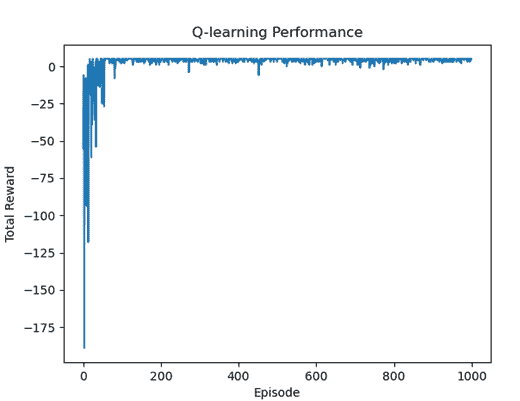

图 1.2 1000 个回合的总奖励，展示学习进度和性能

### 每回合步数

可以通过实现下面的代码绘制每回合到达目标所需的步数。此可视化用于追踪随着智能体学习，到达目标所需的迭代次数如何减少。

```
def plot_steps_per_episode(self, steps_per_episode):
    plt.plot(steps_per_episode)
    plt.xlabel('Episode')
    plt.ylabel('Steps')
    plt.title('Steps per Episode')
    plt.show()
    plt.tight_layout()
```

每个回合到达目标所需步数的可视化如下图 *Figure 1.3* 所示。最初智能体需要多达 200 步才能到达目标，但策略收敛后，所需步数也收敛到 <10 步。

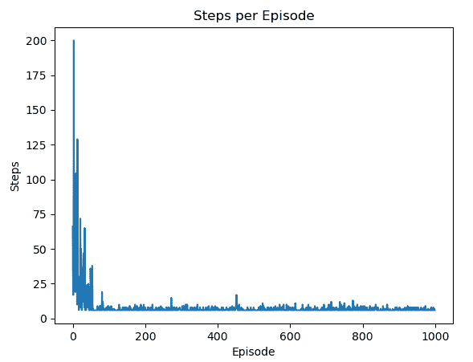

图 1.3 智能体在网格世界环境中到达目标所需步数与回合的关系。


# 可视化策略进度

为了清晰地可视化智能体朝目标迈进的轨迹，直到到达目标，我们实现了 `plot_policy_progress` 方法。在这里，网格世界被绘制出来，并标记了智能体走过的完整轨迹。这种轨迹可以为每个回合可视化。但只需少数几个回合的快照就足以展示进度。下面的函数定义和输入通过分配 `num_checkpoints`，设置了包含子图的图形，每个子图对应 `policy_progress` 列表中的一个检查点。

```
def plot_policy_progress(self, policy_progress):
    num_checkpoints = len(policy_progress)
    fig, axes = plt.subplots(1, num_checkpoints, figsize=(6*num_checkpoints, 6))
```

## 遍历检查点

然后，它开始一个循环来处理 `policy_progress` 中的每个检查点。它设置每个子图的标题以指示回合编号。

```
for i, (policy, visited_states, episode) in enumerate(policy_progress):
    ax = axes[i]
    ax.set_title(f'Policy at Episode {episode}')
```

## 状态的可视化表示

该函数接着遍历策略网格中的每个状态。它为目标位置、障碍物、起始位置和其他状态设置可视化表示，用适当的符号、颜色或样式标记它们。

```
for y in range(policy.shape[0]):
    for x in range(policy.shape[1]):
        state = (y, x)
        if state == self.goal_position:
            ax.text(x, self.grid_size[0] - y - 1, 'G', va='center', ha='center', fontsize=20)
            ax.add_patch(plt.Rectangle((x - 0.5, self.grid_size[0] - y - 1 - 0.5), 1, 1, color='lightgreen'))
        elif state in self.obstacle_positions:
            ax.text(x, self.grid_size[0] - y - 1, 'X', va='center', ha='center', fontsize=20)
            ax.add_patch(plt.Rectangle((x - 0.5, self.grid_size[0] - y - 1 - 0.5), 1, 1, color='lightgray'))
        elif state == self.start_position:
            ax.text(x, self.grid_size[0] - y - 1, 'S', va='center', ha='center', fontsize=20, color='red')
            ax.add_patch(plt.Rectangle((x - 0.5, self.grid_size[0] - y - 1 - 0.5), 1, 1, color='lightblue'))
        else:
            action = policy[y, x]
            ax.text(x, self.grid_size[0] - y - 1, self.action_symbols[action], va='center', ha='center', fontsize=20)
```

## 绘制智能体路径并配置网格

该函数接着为每个检查点绘制智能体走过的路径，用线条连接连续的状态。它还为子图配置网格线和标签，使绘图更易读。

```
for j in range(len(visited_states) - 1):
    x1, y1 = visited_states[j][1], self.grid_size[0] - visited_states[j][0] - 1
    x2, y2 = visited_states[j + 1][1], self.grid_size[0] - visited_states[j + 1][0] - 1
    ax.plot([x1, x2], [y1, y2], color='blue', linewidth=3)
    ax.set_xticks(np.arange(-0.5, policy.shape[1], 1))
    ax.set_yticks(np.arange(-0.5, policy.shape[0], 1))
    ax.grid(color='black', linestyle='-', linewidth=1)
    ax.set_xticklabels([])
    ax.set_yticklabels([])
    ax.set_xlabel('X')
    ax.set_ylabel('Y')
```

图 1.4 展示了策略进度，即智能体在逐步回合中采取的轨迹，执行 1000 个回合的训练后，记录了第 1、10、20 和 999 回合的快照。智能体必须游荡并重走一些路径，在第 1 回合中走更长的轨迹到达目标。到第 10 回合时已有一些进展，到第 20 回合时智能体采取的轨迹有显著改善。在第 999 回合时，智能体已走最优路径。作为练习，将 q-learning 的回合数修改为仅 200 或 500 个，并更改检查点的数量。

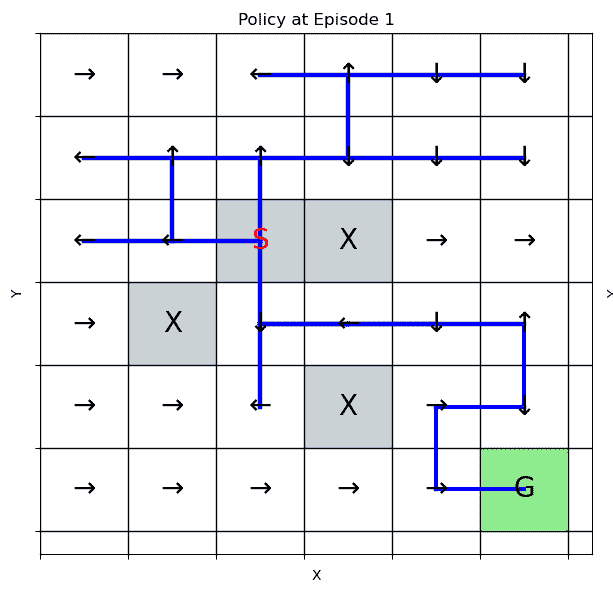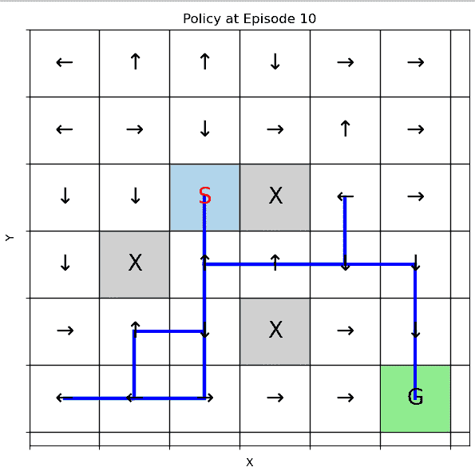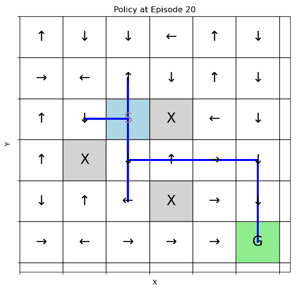

图 1.4. 训练期间四个代表性回合的策略进展。

实例化 `GridWorld` 类并运行 q-learning 训练的执行代码如下。

```
# 调整超参数以进行实验
obstacle_positions = [(2, 3), (3, 1), (4, 3)]
grid_world = GridWorld(grid_size=(6, 6), obstacle_positions=obstacle_positions)
rewards, steps_per_episode, policy_progress = grid_world.q_learning(num_episodes=1000, learning_rate=0.1, discount_factor=0.95, epsilon=0.1)
```

在上述 q-learning 实现中，智能体能够在有限的回合数内学会如何到达目标。所示的可视化方法有助于跟踪学习进度。本例中使用了三个障碍物和 6 x 6 的网格大小。该问题收敛所需的训练回合数约为 50，但对于更大的网格尺寸或更多障碍物，这个数字可能会增加。请注意，`GridWorld` 类允许参数化网格大小和障碍物位置，方便修改环境。我们将在后续章节中利用这种参数化来探索改进学习进度的策略。

## 设计奖励函数与迁移学习

为了让智能体学习到理想的策略，在前一节讨论的 Q-learning 算法中，对理想行为给予智能体正奖励，对非理想行为给予负奖励。在网格世界问题中，智能体每走一步都会获得 `-1` 的负奖励，这会阻止它走更多步骤。同样，智能体每走一步如果与障碍物重叠，会获得 `-5` 的较大负奖励。较大的负奖励有助于学习避开障碍物。最后，到达目标获得 `10` 的较大正奖励，鼓励到达目标状态。奖励分配本身就是奖励函数，重述如下：

```
reward = -1
if next_state == self.goal_position:
    reward = 10
elif next_state in self.obstacle_positions:
    reward = -5
```

请注意，奖励函数是离散的，且非常适合网格世界问题。在某些情况下，奖励函数可能需要是连续的。例如，如果网格有许多单元格，如 *1000 x 1000*，只有少数障碍物，随着智能体越来越接近目标，逐渐增加的连续奖励将有助于提供有意义的结果。如果除目标处外所有奖励都是 `-1`，智能体会游荡更久。在这种情况下，我们可以重新设计奖励分配。下面给出一个例子：

```
reward = -1 + np.exp(-0.1 * np.linalg.norm(np.array(state) - np.array(self.goal_position)))
if next_state in self.obstacle_positions:
    reward = reward - 5
```


`reward = -1 + np.exp(-0.1 * np.linalg.norm(np.array(state) - np.array(self.goal_position)))` 这行代码计算当前状态的奖励。它以 `-1` 作为基础奖励，然后根据当前状态与目标位置之间的距离调整该基础奖励。当前状态与目标位置之间的距离使用 NumPy 中的欧几里得距离公式实现计算：`np.linalg.norm(np.array(state) - np.array(self.goal_position))`。该距离随后乘以 `-0.1` 缩放因子，并通过指数函数 `np.exp` 处理。负缩放因子确保奖励随距离增加而减小，指数函数则确保这种减小是渐进的而非线性的。接着，如果下一状态（智能体执行动作后将转移到的状态）在障碍物位置列表 `self.obstacle_positions` 中，奖励将进一步减少 5。这种惩罚鼓励智能体避开障碍物，因为转移到障碍物状态会导致更大的负奖励。

## 迁移学习

**迁移学习**（**TL**）在强化学习语境下，指利用解决某一任务获得的知识，来提升在相关但不同任务上的学习效果或性能。为演示网格世界问题中的迁移学习，我们修改了上一节讨论的 `q_learning` 函数代码。以下是新增的类方法：

`q_learning_transfer` 方法用于迁移学习。它接收来自较小网格世界（如 **6x6**）的预训练 Q 值，并将其迁移至较大的网格世界（如 **8x8**）。迁移的 Q 值随后在新环境中通过 Q-learning 进行微调。

```python
def q_learning_transfer(self, pre_learned_Q_values, epsilon=0.01):
    # Initialize Q-values with pre-learned values
    self.Q_values[:pre_learned_Q_values.shape[0], :pre_learned_Q_values.shape[1]] = pre_learned_Q_values
    print(f"Q learning with Transferred Q-values")
    # Perform Q-learning in the new environment
    rewards_transfer, steps_per_episode, policy_progress = self.q_learning(epsilon=0.01)
    return rewards_transfer, steps_per_episode, policy_progress
```

`q_learning_scratch` 方法在新环境中从头开始执行 Q-learning，首先初始化 Q 值。

```python
def q_learning_scratch(self):
    self.Q_values = np.zeros((self.num_states, self.num_actions))  # Or initialize with other initial values if needed
    print(f"Q learning from Scratch")
    rewards_scratch, steps_per_episode, policy_progress = self.q_learning()
    return rewards_scratch, steps_per_episode, policy_progress
```

最后，在完成迁移学习与从头训练两个模型的训练后，可以对两者进行对比。下面的 `plot_rewards_comparison` 方法对比它们的性能，以总奖励为指标，并使用移动平均平滑后绘图。我们展示该方法的部分代码片段。

下面的代码定义了函数，并计算迁移学习与从头训练两种场景的收敛速度。它找到奖励达到各自场景最大奖励 90% 的第一个回合。

```python
def plot_rewards_comparison(self, rewards_transfer, rewards_scratch):
    convergence_speed_transfer = next((i for i, reward in enumerate(rewards_transfer) if reward >= 0.9 * max(rewards_transfer)), len(rewards_transfer))
    convergence_speed_scratch = next((i for i, reward in enumerate(rewards_scratch) if reward >= 0.9 * max(rewards_scratch)), len(rewards_scratch))
```

随后代码对每个回合的奖励求和，计算迁移学习与从头训练的总奖励。

```python
    total_reward_transfer = sum(rewards_transfer)
    total_reward_scratch = sum(rewards_scratch)
```

为获得更好的可视化效果，使用移动平均平滑奖励曲线。移动平均的窗口大小设为 10。

```python
    window_size = 10
    rewards_transfer_smoothed = np.convolve(rewards_transfer, np.ones(window_size)/window_size, mode='valid')
    rewards_scratch_smoothed = np.convolve(rewards_scratch, np.ones(window_size)/window_size, mode='valid')
```

下面的代码绘制两种场景的平滑奖励曲线，使用不同颜色和样式以便区分，并添加适当标签。你可以根据喜好修改颜色和样式。

```python
    plt.plot(np.arange(window_size//2, len(rewards_transfer_smoothed) + window_size//2), rewards_transfer_smoothed, label='Transfer Learning', linestyle='--', color='blue', alpha=0.7)
    plt.plot(np.arange(window_size//2, len(rewards_scratch_smoothed) + window_size//2), rewards_scratch_smoothed, label='Training from Scratch', linestyle='--', color='orange', alpha=0.7)
```

然后在图上用垂直线高亮显示与迁移学习相关的特定回合。

```python
    transfer_epochs = [episode for _, _, episode in policy_progress]
    for epoch in transfer_epochs:
        plt.axvline(x=epoch, color='gray', linestyle='--', linewidth=0.8)
```

为使图表更丰富，我们添加文本标注以显示两种场景的收敛速度和总奖励。

```python
    plt.text(0.5, 0.6, f"Convergence Speed (Transfer): {convergence_speed_transfer}", transform=plt.gca().transAxes)
    plt.text(0.5, 0.55, f"Total Reward (Transfer): {total_reward_transfer}", transform=plt.gca().transAxes)
    plt.text(0.5, 0.5, f"Convergence Speed (Scratch): {convergence_speed_scratch}", transform=plt.gca().transAxes)
    plt.text(0.5, 0.45, f"Total Reward (Scratch): {total_reward_scratch}", transform=plt.gca().transAxes)
```

`plot_rewards_comparison` 函数的最后片段设置图表的标签、标题和图例，并显示图表。

```python
    plt.xlabel('Episode')
    plt.ylabel('Total Reward')
    plt.title('Q-learning Performance Comparison')
    plt.legend()
    plt.show()
```

下面的 `plot_comparison_metrics` 方法对比带有迁移学习（预训练 Q 值迁移）的 Q-learning 与从头训练的 Q-learning 的奖励指标。

```python
def plot_comparison_metrics(self, rewards_transfer, rewards_scratch, steps_transfer, steps_scratch):
    fig, axes = plt.subplots(1, 2, figsize=(12, 6))
    ax1 = axes[0]
    ax1.plot(rewards_transfer, label='Transfer Learning')
    ax1.plot(rewards_scratch, label='Training from Scratch')
    ax1.set_xlabel('Episode')
    ax1.set_ylabel('Total Reward')
    ax1.set_title('Total Reward Comparison')
    ax1.legend()
    ax2 = axes[1]
    ax2.plot(steps_transfer, label='Transfer Learning')
    ax2.plot(steps_scratch, label='Training from Scratch')
    ax2.set_xlabel('Episode')
    ax2.set_ylabel('Steps per Episode')
    ax2.set_title('Steps per Episode Comparison')
    ax2.legend()
    plt.tight_layout()
    plt.show()
```

下面展示策略训练与迁移学习步骤的示例执行。为演示迁移学习的工作原理，我们首先实例化修改后的 `GridWorld` 类，创建一个包含三个障碍物的 **6x6** 网格世界以获得训练好的策略。运行 `q_learning()` 方法得出 **6x6** 环境的最优策略和 Q 值。我们将使用这些 Q 值进行迁移学习。代码如下：

```python
obstacle_positions = [(2, 3), (3, 1), (4, 3)]
grid_world = GridWorld(grid_size=(6, 6), obstacle_positions=obstacle_positions)
rewards, steps_per_episode_6x6, policy_progress_6x6 = grid_world.q_learning()
grid_world.plot_policy_progress(policy_progress_6x6)
```


# 策略进度可视化与迁移学习对比

上文已获得使用 Q-learning 训练的策略进度，记为 `policy_progress_6x6`，可按 *图 1.5* 进行可视化，其中绘制了智能体在三个代表性回合（第 6、20 和 100 回合）中的轨迹。在第 6 和 20 回合中，智能体仍在学习策略，但到第 100 回合时，智能体已学会到达目标的最优路径。


**图 1.5** 显示了 6 x 6 网格中智能体为到达目标所采取的轨迹，在不同回合中的学习进度。

## 迁移学习至 8x8 网格

对于迁移学习（TL），将 **6x6** 环境中的 Q 值迁移到一个更复杂但相似的环境中，该环境包含 **8 x 8** 个单元格和 **5** 个障碍物（而非 3 个）。此处我们通过对比策略进度，比较从头训练智能体与使用迁移 Q 值训练智能体的效果。注意，我们不将 TL 的策略进度与 **6x6** 环境下从头开始的 Q-learning 进行比较，而是再次使用 `q_learning_scratch` 方法训练包含 **5** 个障碍物的 **8 x 8** 环境。执行代码如下：

```
obstacle_positions_5 = [(2, 3), (3, 1), (4, 3), (5, 2), (2, 5)]
new_grid_world = GridWorld(grid_size=(8,8), obstacle_positions=obstacle_positions_5)
rewards_transfer, steps_per_episode_transfer, policy_progress_transfer = new_grid_world.q_learning_transfer(grid_world.Q_values)
new_grid_world.plot_policy_progress(policy_progress_transfer)
rewards_scratch, steps_per_episode, policy_progress = new_grid_world.q_learning_scratch()
new_grid_world.plot_policy_progress(policy_progress)
```

基于 TL 的智能体训练策略进度使用 `plot_policy_progress` 方法绘制。如下所示的 *图 1.6* 中，你可以看到当 Q 值从包含 3 个障碍物的 6 x 6 网格训练中迁移而来时，8 x 8 网格中智能体为到达目标所采取的轨迹，在不同回合中的学习进度。在第 6 回合，智能体仍在学习策略；但到第 20 回合，智能体已学会到达目标的最优路径；在第 100 回合，它只是探索另一条最优路径。


**图 1.6** 当 Q 值从包含 3 个障碍物的 6 x 6 网格训练中迁移而来时，8 x 8 网格中智能体在不同回合的轨迹。

同样，在 *图 1.7* 中绘制了智能体从头开始在包含 **5** 个障碍物的 **8x8** 网格环境中训练的策略进度。对比两种情况下的第 6、20 和 100 回合。在第 6 回合，智能体仍在学习策略；在第 20 回合，情况有所改善；但直到第 100 回合，智能体才学会到达目标的最优路径。

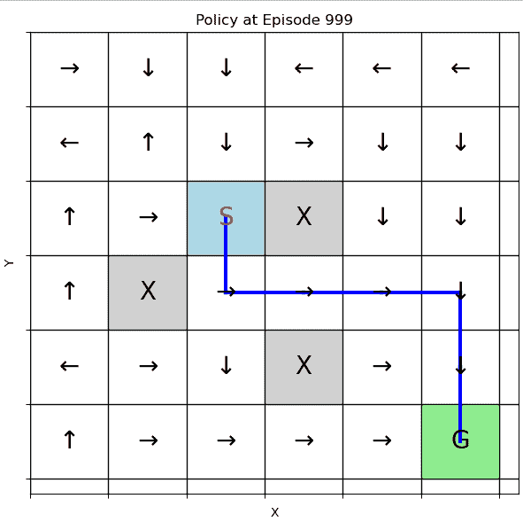

**图 1.7** 8 x 8 网格中智能体在不同回合的轨迹。

## 对比指标

为进一步对比基于迁移学习的训练进度与从头训练的进度，我们执行对比指标函数，如下所示：

```
grid_world.plot_rewards_comparison(rewards_transfer, rewards_scratch)
grid_world.plot_comparison_metrics(rewards_transfer, rewards_scratch, steps_per_episode_transfer, steps_per_episode)
```

在 *图 1.8* 中，通过绘制总奖励（在 10 个回合的窗口上平均/平滑）随回合变化的曲线，对比了在 8x8 网格上使用迁移 Q 值训练的智能体与从头训练的智能体的 Q-learning 性能，结果显示迁移学习加速了训练收敛。使用 TL 训练的奖励收敛在 **7** 个回合内完成，而从头训练需要 **45** 个回合。总奖励也更高（109 > -1446）。注意，第 0 回合的初始策略未绘制，且智能体此处仍遵循探索与利用策略（epsilon-greedy 方法）。

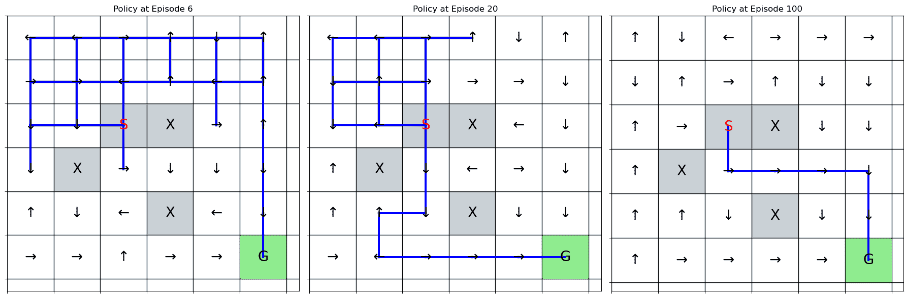

**图 1.8** 每回合平均总奖励，对比 TL（蓝色/深色）与从头训练。

我们通过查看原始回合与总回合奖励的收敛情况，以及对比智能体在每个回合中到达目标所需的步数（每回合步数），进一步分析此问题，如 *图 1.9* 所示。该图显示迁移学习收敛更快，且在训练过程中更早以更少步数到达目标。

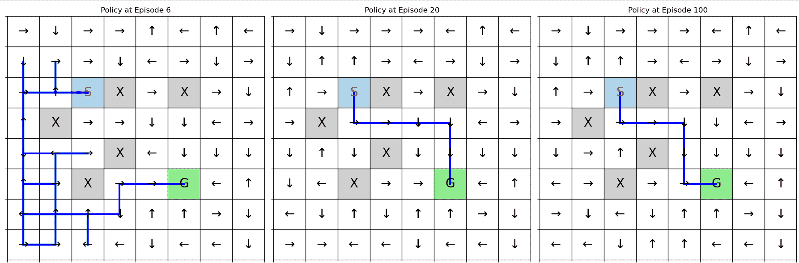

**图 1.9** 迁移学习与从头开始的 Q-learning 对比：原始每回合总奖励（左）和智能体每回合到达目标所走步数（右）。

### 示例输出

运行执行代码后，这些指标每 5 步打印一次。下面显示了示例输出。此处为简洁起见，使用 `...` 表示省略的行。

```
Q learning from Scratch
Episode 5/200, Total Reward: -116, Steps: 127...
Episode 15/200, Total Reward: -142, Steps: 153
Episode 20/200, Total Reward: 0, Steps: 11
Episode 100/200, Total Reward: 5, Steps: 6
Q learning with Transferred Q-values
Episode 5/200, Total Reward: -66, Steps: 77
Episode 10/200, Total Reward: 5, Steps: 6
Episode 15/200, Total Reward: 1, Steps: 10
Episode 20/200, Total Reward: 5, Steps: 6
```

从记录的示例输出中也可以看出，使用迁移 Q 值训练的智能体在 10 个回合内即达到正奖励，而从头训练需要超过双倍的回合数才能达到正奖励。在看到迁移学习带来的显著改进后，我们对使用人类反馈也持乐观态度，这将在下一节中实现。

# 基于人类反馈的强化学习

在前一节中，我们看到，通过将在源环境（**6 x 6** 网格含 **3** 个障碍物）上预训练的 Q 值迁移至目标环境（**8 x 8** 网格含 **5** 个障碍物）来训练智能体，能有效加快学习进度。这里有一个重要的注意事项：环境应具有合理的相似性，才能从迁移的策略中受益。如果环境差异显著，甚至目标（或到达目标的奖励激励）相互冲突，迁移学习可能会失效。我建议你尝试使用与获取待迁移策略 Q 值时截然不同的障碍物和目标进行实验。在这种情况下如何加速训练？一种方法是将人类反馈纳入策略训练中。人类反馈可以采取多种形式，例如显式奖励、评估或期望行为的演示。

- **显式奖励：** 人类反馈根据智能体的动作提供显式的奖励或惩罚。例如，在 `gridworld` 场景中，人类可能会为朝目标移动分配正奖励，为撞击障碍物分配负奖励。

- **评估：** 人类评估智能体的动作或策略，并根据其表现提供反馈。例如，他们可能会给出“这是个好动作”或“你本该向左而不是向右”的反馈，客观的点赞或点踩，“是”或“否”。

- **演示：** 人类通过展示智能体如何在环境中解决任务来演示期望行为。这可以是通向成功结果的轨迹或动作序列形式。


# Q 学习中的人类反馈

智能体利用人类反馈来改进其决策过程。这可能涉及各种专门设计用于有效整合人类反馈的学习算法。在网格世界示例中，如果智能体采取一个动作，人类可能会为好的动作提供正向反馈（奖励），为坏的动作提供负向反馈（惩罚）。智能体不再通过探索环境来学习该策略，而是利用人类提供的反馈来更新其策略。正向反馈鼓励智能体在类似情况下重复类似动作，而负向反馈则引导智能体避免这些动作。随着时间的推移，通过从人类反馈中迭代学习，智能体优化其策略，从而在网格世界中做出更好的决策。

为了演示人类反馈如何加速学习，我们继续使用网格世界问题。我们向 `GridWorld` 类添加了一个名为 `q_learning_with_human_feedback()` 的新方法，这是对 `q_learning()` 方法的修改。额外的输入 `human_feedback` 提供了一个字典，包含人类针对从当前状态到下一状态的特定场景变化所分配的奖励。例如，如果智能体处于当前状态 `(2,2)` 而下一状态是 `(2,3)`，这更接近目标 `(5,5)`，人类会给予 `+1` 的奖励。相反，如果当前状态是 `(3,4)` 而智能体移动到下一状态 `(2,4)`，这离目标 `(5,5)` 更远，人类会给予 `-1` 的奖励。这种基于人类反馈的奖励会被加到 Q 学习算法中分配的奖励上。

## 函数定义与初始化

我们首先定义函数并初始化必要的变量。请注意，它与 `q_learning()` 方法相似，但具有下面代码片段中所示的额外输入 `human_feedback`。

```
def q_learning_with_human_feedback(self, num_episodes=1000, learning_rate=0.1, discount_factor=0.9, epsilon=0.1, policy_checkpoints=None, human_feedback=None):
```

由于该方法是对前一方法的修改且有大量重叠，请参阅前面讨论的 *Q-learning* 章节和代码片段。以下是具体的代码片段及其解释：
1. **函数定义与初始化** （此处修改）
2. **回合循环**
3. **动作选择**
4. **状态转移与奖励分配**

## 融入人类反馈

在完成前面代码片段中讨论的奖励分配后，在第 4 步 **状态转移与奖励分配** 中，我们到了通过融入人类反馈来更新奖励的环节。首先，代码检查是否提供了人类反馈。如果当前状态到下一状态的转移有可用的反馈，则相应地更新奖励。

```
if human_feedback is not None:
    if state in human_feedback and next_state in human_feedback[state]:
        reward += human_feedback[state][next_state]
```

这里，我们只是简单地将人类反馈加到奖励上，但融入人类反馈的方法有很多种，我们将在下一章中看到。更新奖励后，我们继续执行其余代码，这与 `q_learning()` 类似，直到方法结束并返回输出。

## 对比执行代码

为了对比 Q 学习和带有人类反馈的 Q 学习，TL 章节中使用的绘图方法 `plot_reward_comparison()` 和 `plot_comparison_metrics()` 被复用并添加到了 `GridWorld` 类中。标签和图例也相应更新。实例化并运行修改后的类、对比基于人类反馈的训练与仅使用 Q 学习从头训练的执行代码如下。在本例中，我们在一个字典中收集人类反馈，键为状态元组，值为映射下一状态到反馈值的字典。

```
obstacle_positions = [(2, 3), (3, 1), (4, 3)]
grid_world = GridWorld(grid_size=(6, 6), obstacle_positions=obstacle_positions)
rewards, steps_per_episode, policy_progress = grid_world.q_learning(num_episodes=200, learning_rate=0.1, discount_factor=0.95, epsilon=0.1)
grid_world.plot_policy_progress(policy_progress)
human_feedback = {
    (2, 2): {(2, 3): 1},  # 从 (2, 2) 转移到 (2, 3) 的正向反馈
    (2, 3): {(2, 4): 1},  # 从 (2, 3) 转移到 (2, 4) 的正向反馈
    (2, 4): {(2, 5): 1},  # 从 (2, 4) 转移到 (2, 5) 的正向反馈
    (3, 4): {(2, 4): -1},  # 从 (3, 4) 转移到 (2, 4) 的负向反馈
    (4, 4): {(3, 4): -1},  # 从 (4, 4) 转移到 (3, 4) 的负向反馈
    (4, 5): {(5, 5): 1},  # 从 (4, 5) 转移到 (5, 5) 的正向反馈
}
rewards_hf, steps_per_episode_hf, policy_progress_hf = grid_world.q_learning_with_human_feedback(num_episodes=200, learning_rate=0.1, discount_factor=0.95, epsilon=0.1, human_feedback=human_feedback)
grid_world.plot_policy_progress(policy_progress)
grid_world.plot_rewards_comparison(rewards_hf, rewards)
grid_world.plot_comparison_metrics(rewards_hf, rewards, steps_per_episode_hf, steps_per_episode)
```

## 结果与图表

**图 1.10** 展示了智能体在导航 6×6 网格时特定回合的轨迹。策略在学习中不断进步，但在第 2 回合和第 20 回合，智能体仍在学习策略。在第 100 回合，我们看到了智能体遵循的最优路径，表明学习已发生。

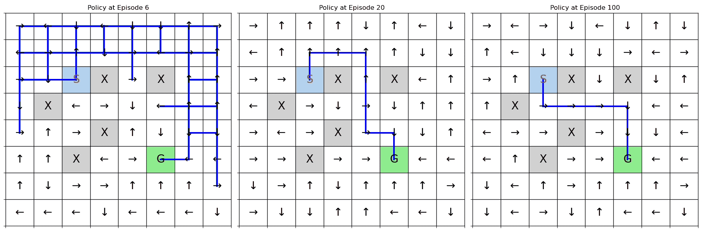

*图 1.10 Q 学习在 6 × 6 网格中不同时期的智能体轨迹。*

通过网格上的策略进度对比 Q 学习与 Q 学习 + 人类反馈，**图 1.10** 和 **图 1.11** 显示，有了人类反馈，智能体已经采取了最优策略。

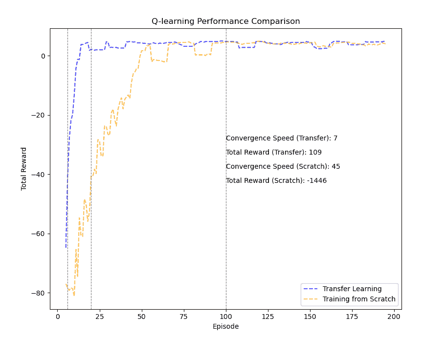

*图 1.11 带有人类反馈的 Q 学习在 6 × 6 网格中不同时期的智能体轨迹。*

为了更清晰地看到这一点，**图 1.12** 展示了各回合总奖励性能的对比。虽然仅用 Q 学习只需合理数量的回合即可达到可实现的奖励并收敛（橙色曲线），但加上 **人类反馈** 后，总奖励仅在第 *2* 回合就已收敛。请注意，在 **图 1.12** 中，总奖励经过平滑（滤波），以每 10 次迭代的平均值呈现。

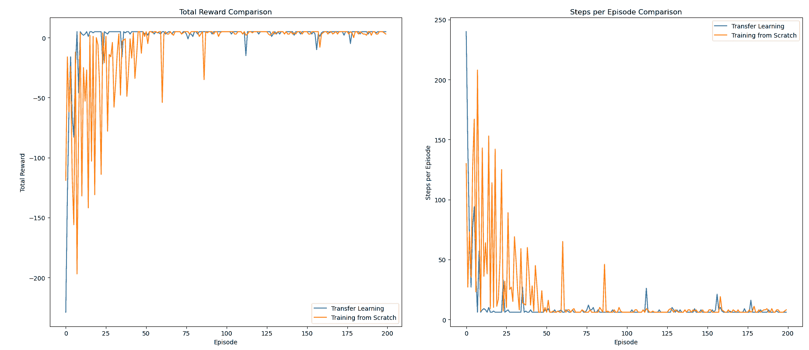

*图 1.12 各回合平均总奖励，对比使用人类反馈训练的智能体（深色线）与从头开始的 Q 学习。*

下图对比了窗口大小为 10 个回合平滑后的每回合总奖励，对比使用人类反馈训练的智能体（深色线）与从头开始的 Q 学习。图表显示，带有人类反馈的基于 Q 学习的训练收敛更快：2 个回合对比 18 个回合。总训练奖励也更好：1022（有人类反馈）> -549（无人类反馈）。请注意，第 **0** 回合的初始策略未绘制。有人类反馈情况下的奖励是 Q 学习奖励与人类分配奖励（+1 或 -1）之和，智能体此处仍遵循探索与利用策略（epsilon-greedy 方法）。

在 **图 1.13** 的左图中，我们对比原始每回合总奖励，而右图显示智能体每回合到达目标所需的步数。

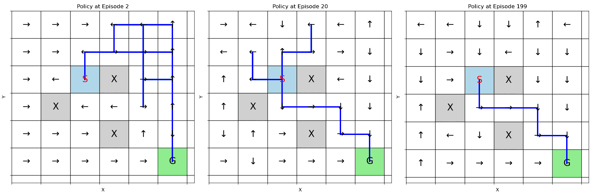


图 1.13 人类反馈 + `Q-learning`（蓝色/深色平线）与仅 `Q-learning` 的对比，通过每回合原始总奖励（左）和智能体每回合到达目标所需步数（右）展示。

在这种情况下，人类反馈 + `Q-learning`（蓝色/深色平线）显示出学习效率的提升，能够几乎瞬间学会用更少步数到达目标状态。蓝色平坦曲线中的少数峰值和谷值表明存在一些遗忘或探索-利用策略在起作用，但平均而言，带有人类反馈的学习获得的奖励更高，到达目标所需的步数更少。

## 摘要

在本章中，我们向您介绍了 `RL` 的主要概念，提供了一个简单的网格世界示例，利用基本算法 `Q-learning` 来帮助理解关键概念，然后演示了迁移学习和人类反馈如何帮助加速学习。虽然这适合入门，但也存在更复杂的示例，其中 `Q-values` 可能无法存储在表格中，而需要神经网络或类似的函数逼近器。当扩展到连续状态-动作空间时，`Q-learning` 可能变得不稳定，因此将需要其他策略学习算法。我们将在后续章节中介绍其中一些情况。还请注意，虽然我们利用人类的显性奖励反馈实现了学习加速，但在大规模应用中这可能成本高昂，因此可能需要适当的工具来收集人类反馈。后续章节将详细讨论这一点，但在讨论之前，我们将在下一章从总体角度开始了解人类反馈在 `RL` 中的作用。

### 参考文献

下面列出了有助于读者深入了解该主题的强化学习书籍、课程、论文和链接：

*   Sutton & Barto 著《强化学习导论》（incompleteideas.net）：[`http://incompleteideas.net/book/the-book-2nd.xhtml`](http://incompleteideas.net/book/the-book-2nd.xhtml)

*   教学 - David Silver：[`https://www.davidsilver.uk/teaching/`](https://www.davidsilver.uk/teaching/)

*   CS 285 (berkeley.edu)：[`https://rail.eecs.berkeley.edu/deeprlcourse/`](https://rail.eecs.berkeley.edu/deeprlcourse/)

*   简介 — Spinning Up 文档 (openai.com)：[`https://spinningup.openai.com/en/latest/user/introduction.xhtml`](https://spinningup.openai.com/en/latest/user/introduction.xhtml)

本章代码示例中使用的库的库文档和代码文档列表如下。读者可以利用这些了解更多关于代码实现和可视化方法的信息：

*   Matplotlib 文档 — Matplotlib 3.8.4 文档：`https://matplotlib.org/stable/index.xhtml`

*   [`https://numpy.org/devdocs/user/index.xhtml`](https://numpy.org/devdocs/user/index.xhtml)
