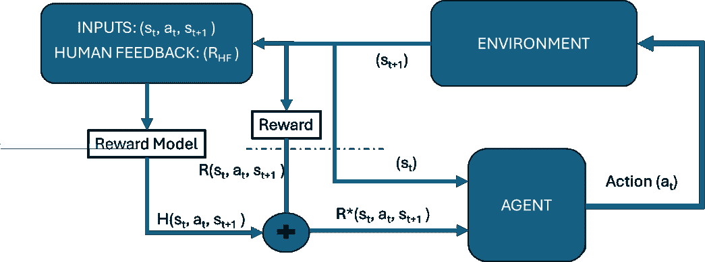

## 第 2 章：人类反馈在强化学习中的作用

### 加入我们的 Discord 图书社区


[`https://packt.link/EarlyAccessCommunity`](https://packt.link/EarlyAccessCommunity)

在本章中，我们的重点转向人类反馈在强化学习中的作用，从更宏观的角度进行探讨。在上一章中，我们展示了 `RL with human feedback` (`RLHF`) 如何相比传统的强化学习方法（如 `Q-learning`）显著改进并加速策略训练。人类反馈在强化学习中的融合已在实际应用和研究文献的各个领域不断发展，近年来人气飙升，尤其是在大语言模型方面。虽然我们目前的关注点依然宽泛，但我们暂不会深入探讨人类反馈在大语言建模中的具体应用。相反，我们的目标是在强化学习的更广泛背景下探讨其总体意义和影响。为了方便有兴趣深入研究的读者，我们也提供了一些相关参考资料。在传统的 `RL` 方法论中，正如上一章所讨论的，采用了状态-动作-奖励框架，这需要设计奖励函数来定义具体目标。该函数激励智能体通过其行为最大化这些目标。虽然为特定任务设计此类函数是可行的，但这种能力仅限于定义明确的任务。随着需求和目标范围的扩大，准确定义奖励函数变得越来越具有挑战性。这些函数中的不准确性或分布偏移场景可能导致不良的智能体行为，即智能体不顾后果地优先实现目标，或采取导致未见场景中出现意外结果的行动。此类副作用或意外后果可能带来成本，并潜在地导致安全隐患。人类干预和模型对齐在应对这些挑战中发挥着关键作用。训练期间的人类反馈有助于开发出对训练数据分布偏移具有鲁棒性的策略，并减轻奖励函数不准确性的后果。本章涵盖以下主题：

*   利用 `RL` 中的人类反馈提高学习效率

*   融合人类专业知识

*   `RL` 中的人类反馈类型

*   将人类偏好融入 `RL`

*   偏见及其他挑战

## 利用 RL 中的人类反馈提高学习效率


# 基于人类反馈的强化学习

在训练强化学习智能体以实现特定目标时，智能体必须经历大量迭代，直到收敛到高奖励。这涉及经历多个试错的状态-动作序列或轨迹，这些序列或轨迹并非最优。如果智能体必须在复杂环境中导航，此类轨迹的数量可能非常高。收集低奖励轨迹的经验可能代价高昂。

强化学习智能体面临的挑战，例如在复杂环境中导航和经历大量试错迭代，凸显了对更高效学习策略的需求。引入人类反馈提供了一种增强学习效率的有前景的解决方案。例如，在训练自动驾驶汽车时，人类反馈可以帮助智能体快速学习交通规则、安全驾驶行为，并对各种路况做出适当反应，而无需经历每一种需要避免这些场景的状况。

人类反馈还可以帮助克服探索-利用权衡。通过为有前景的动作或状态提供提示或引导，人类可以指导智能体更高效地探索，专注于状态-动作空间中更有可能产生有价值信息的区域。

融入人类反馈使强化学习智能体能够从专家演示或偏好中学习，从而做出更明智的决策。例如，在医疗环境中，强化学习算法可以通过融入医疗专业人员关于不同干预措施有效性和安全性的反馈来学习治疗策略。因此，与其花费多个训练周期来摸索有价值的轨迹，不如直接指定人类偏好或意图，利用人类专家指导来节省时间。

在模拟器或模型对现实世界表征不完美的场景中，人类反馈可以帮助弥合仿真与现实之间的差距，从而实现更快的收敛和更好的泛化能力。

## 网格世界示例

让我们重温一下强化学习问题：智能体需要学习在网格世界中导航以到达目标状态，同时避开障碍物。在上一章的示例中，智能体到达目标状态时获得 `+10` 奖励，撞到障碍物时获得 `-5` 奖励，每走一步获得 `-1` 奖励，以惩罚到达目标耗时过长。目标是学习一个随时间最大化累积奖励的策略。

在网格空间中对这些奖励的具体分配属于奖励设计，而非一种人类反馈形式，因为在训练期间未提供人类输入。没有人类反馈时，智能体可能会使用像 `epsilon-greedy` 这样的探索策略随机探索网格世界，通过试错逐渐学习哪些动作能带来更高奖励。对于较小的状态空间，这可能似乎不是问题；然而，在大型状态空间中，这种方法可能缓慢且低效。

现在，让我们将人类反馈融入学习过程。人类监督者可以观察智能体的动作，并以偏好或对智能体行为的评价形式提供反馈。在上一章的网格世界示例中，人类进行评估或提供二元反馈，指示智能体采取的每个动作是好（`+1`）还是坏（`-1`）。这针对一系列网格单元进行记录，基于其当前状态以及采取动作后产生的下一状态。这种类型的人类反馈是**评价性反馈**，因为目标明确且客观，可以直接给予反馈。

## 数学公式

如果我们将强化学习问题建模为马尔可夫决策过程，其中当前状态 `s` 和采取的动作 `a` 导致下一状态 `s'`，使得下一状态的转移概率仅取决于当前状态和采取的动作 `P(s'|s,a)`，并且为这些序列中的每一个分配奖励 `R(s,a,s')`。智能体的目标是最大化累积回报，即动作价值函数 `Q(s,a)`。如果 `rt` 是时间 `t` 的奖励，则由 `γ` 对未来奖励进行折扣的累积奖励或总回报为：

```
Gt = Σ γ^k * r_{t+k+1}
```

我们融入基于人类反馈奖励的方式是将人类反馈添加到环境奖励中。增广奖励函数可定义为 `R*(s,a,s') = R(s,a,s') + H(s,a,s')`，其中 `H(s,a,s')` 表示在状态 `s` 下采取动作 `a` 导致下一状态 `s'` 时的人类反馈。该反馈可用于指导智能体的学习过程，通过强化导致积极结果的动作、抑制导致消极结果的动作，最终加速学习过程并提高智能体的决策能力。



**图 2.1** - RLHF 示意图，展示奖励模型与环境-智能体系统的集成

在*第 1 章*的最后一节中，我们使用了将奖励映射到当前状态和下一状态的人类反馈，因此该反馈针对所采取的动作及其在下一状态中的后果。然后我们通过实验对比了从头训练智能体与使用人类反馈进行训练，并证明使用人类反馈能显著加速训练。

## 人类反馈的类型

根据场景不同，还有其他一些整合人类反馈的方式：

*   **状态-动作反馈** `H(s,a)`：这种形式的反馈直接提供当前状态下动作质量的信息。它不考虑动作导致的具体结果或下一状态。当动作质量无需观察其后果即可评估时，这很有用。

*   **状态反馈** `H(s)`：人类反馈也可以在状态层面提供，指示当前状态的期望程度或适宜性。这种形式的反馈可以通过引导智能体朝更可能导致期望结果的状态移动来指导探索。

*   **累积反馈** `H(τ)`：在某些情况下，人类反馈可能针对整个轨迹（`τ`）提供，捕捉智能体在一系列动作和状态中的整体行为质量。这种反馈对于评估长期表现、鼓励一致性或向期望行为收敛很有用。当环境复杂且我们希望将人类反馈限制在轨迹层面，而非在庞大的状态-动作空间中请求显式反馈时，这尤其有帮助。

*   **偏好反馈** `H(a1>a2)`：人类反馈可以不提供显式奖励或评价，而是以动作对之间的偏好或比较形式呈现。这种反馈在基于偏好的强化学习中很常见，智能体通过专家演示或动作之间的比较进行学习。

因此，上一章实现和讨论的人类反馈方法只是将人类反馈整合到强化学习训练中以加速学习过程的众多方式之一。接下来我们将讨论更多关于如何融入人类专业知识的内容。

## 融入人类专业知识


# 在强化学习中利用领域知识

在 `reinforcement learning` (`RL`) 中利用领域知识，可以通过为理解问题空间和指导学习过程提供结构化框架，显著提升性能和决策能力。领域知识是指特定于问题领域的专业知识和见解，其来源可以多种多样，例如领域专家、前人研究或实践经验。

## 问题建模

领域知识通过识别相关的状态、动作和奖励，有助于构建 `RL` 问题，从而缩小搜索空间，使学习过程更加高效。例如，在机器人领域，理解环境动力学和机器人的物理约束，有助于设计更有效的状态表示和动作空间。下面的列表解释了领域知识如何帮助定义 `RL` 框架中的各个组件。

*   **定义状态**：将重要状态作为智能体观测的一部分，对智能体的训练效率至关重要。过多不必要的状态会增加噪声和开销，并使函数逼近器（如神经网络）产生不必要的更高容量需求，从而拖慢训练速度，甚至导致学习到一些不必要的相关性。相反，缺失某些重要状态可能导致智能体不得不学习并建模本可简单指定的状态间额外关系。以机器人（如机械臂或移动机器人）为例，若不提供速度信息，仅提供位置信息，会导致学习效率低下。

*   **定义动作**：领域专业知识有助于定义有哪些可用动作及其约束方式。例如，机械臂可能只能在特定角度范围内运动，领域专家对动作约束的了解即定义了动作空间。

*   **定义奖励**：在复杂的工业场景中，期望和非期望的状态-动作空间区域对外行可能并不明显，领域专家可以帮助指定这些区域，并更准确地塑造奖励函数。

*   **回合长度和终止条件**：人类专业知识还可以帮助判断何时应终止特定轨迹并结束回合，以便智能体能中止在不安全区域内导航的轨迹。这能避免探索无助于学习的区域，从而提高训练效率。

请注意，上述所有人类专业知识的融入方式在传统 `RL` 应用中均很有用。在 `RLHF` 中，除了定义来自环境的原始奖励外，还可以融入专家提供的评价性反馈奖励。`RLHF` 利用人类反馈训练 AI 系统，使其表现得更像人类。在 `RLHF` 中，人类反馈用于评估智能体响应或动作的质量，并指导学习过程。`RLHF` 的目标是使 AI 系统的响应更准确、更拟人化。这两种方法的关键区别在于人类专业知识的角色。在 `RL` 中融入人类专业知识时，专业知识用于定义问题和指导学习过程；而在 `RLHF` 中，人类反馈用于评估和改进智能体性能。换句话说，`RL` 中融入人类专业知识是关于定义问题和设定目标，而 `RLHF` 是关于提供反馈以达成这些目标。

为了说明这一区别，请看一个机器人示例。在 `RL` 中融入人类专业知识时，领域专家可能会为机械臂定义状态、动作和奖励，如关节角度、电机转速和到目标的距离。在 `RLHF` 中，人类可能会对机器人动作的质量提供反馈，如对机械臂运动的平滑度或准确性进行评分，该反馈将用于更新奖励函数并改进机器人性能。在实践中，两种方法可以结合。以机械臂为例，专家可以定义状态、动作和奖励，并收集机器人运动轨迹，供人类反馈进行评分或打分。基于对机器人轨迹质量的反馈，通过构建奖励模型来优化智能体训练。为了应对动态环境和变化，可在设计和算法中融入人类专业知识，通过训练自适应 `RL` 系统来应对不断变化的环境因素。人类反馈可进一步帮助优化环境中出现的不可预见场景或实时情况中的策略决策。接下来我们将讨论 `RL` 中使用的人类反馈类型，以进一步加深理解。

## `RL` 中的人类反馈类型

将人类反馈融入 `RL` 的想法过去已以多种方式尝试过，近几年尤其受到关注，特别是随着大语言模型和基础模型训练的出现。利用人类信号训练智能体有多种形式。广义上，人类演示和人类反馈被归类为利用人类信号训练智能体的不同类别。在 `RL` 中，奖励函数的设计和工程实现具有主观性，要做对很棘手。利用人类演示定义奖励函数是在 `inverse RL`（逆向强化学习）子领域中研究和实践的。同样，利用人类演示进行监督学习，并根据演示建立从状态到动作的直接映射，称为 `behavioral cloning`（行为克隆），当即使对于专家定义奖励函数也很困难时（如复杂环境），这一方法很有益。`inverse RL` 和 `behavioral cloning` 均属于 `learning from demonstration` (`LfD`，从演示中学习) 这一类方法。`Imitation learning`（模仿学习）类似于 `LfD`，包含 `behavioral cloning` 和 `inverse RL`，但也可扩展到从任何形式的专家行为中学习，无论是通过演示显式提供，还是通过交互隐式提供。虽然 `LfD` 主要关注直接演示，但也可结合从动作后果中学习以优化习得行为。因此，`LfD` 和 `IL` 都可涉及从动作后果中学习，二者的区别更多在于其范围和方法，而非所用反馈的类型。

对 `inverse RL` 感兴趣的读者可参阅：

*   *A Survey of Inverse Reinforcement Learning: Challenges, Methods and Progress*: [`arxiv.org/abs/1806.06877`](https://arxiv.org/abs/1806.06877)
*   *Guided Cost Learning: Deep Inverse Optimal Control via Policy Optimization*: [`arxiv.org/pdf/1603.00448`](https://arxiv.org/pdf/1603.00448)
*   *Generative Adversarial Imitation Learning*: [`arxiv.org/pdf/1606.03476`](https://arxiv.org/pdf/1606.03476)

关于 `behavioral cloning` 和 `imitation learning` 的总体内容，请参阅：

*   *An Algorithmic Perspective on Imitation Learning*: [`arxiv.org/pdf/1811.06711`](https://arxiv.org/pdf/1811.06711)
*   *CS 285* (berkeley.edu): [`rail.eecs.berkeley.edu/deeprlcourse/`](https://rail.eecs.berkeley.edu/deeprlcourse/)

这引出了融入人类反馈这一话题，其旨在最小化奖励设计和工程中的主观性与工作量。强化学习中的人类反馈方法在过去二十年间不断演进。目前 `reinforcement learning from human feedback` 的用法涵盖多种方法，大致可分为以下几类：

*   **Learning from Human Reward or Evaluative Reinforcement**（从人类奖励或评价性强化中学习）：直接影响智能体奖励的评价性反馈。

*   **Preference-Based RL**（基于偏好的 RL）：以动作或结果间的偏好形式提供反馈，以指导策略开发。

*   **Human Feedback for Defining Reward Models**（用于定义奖励模型的人类反馈）：利用人类反馈构建或优化奖励模型。

*   **Semi-Supervised RL with Absolute Feedback on a Subset of Experiences**（针对经验子集具有绝对反馈的半监督 RL）：通过特定经验上的反馈，将监督学习与 `RL` 相结合。


### 从人类奖励或评价式强化学习中学习

此类别涉及直接的人类评价反馈影响智能体的奖励或学习过程。它包括标量奖励；人类根据智能体的动作或表现提供标量反馈（正向或负向奖励）。这种直接反馈有助于随时间塑造智能体的行为。反馈通常是二元的；即简化的评价反馈，人类指示某个动作或结果是好是坏，通常表示为 +1（正向）或 -1（负向）。读者已在上一章的最后一节中了解到这种方法。一些供进一步阅读的论文和资源包括：从人类生成的奖励中学习：https://repositories.lib.utexas.edu/items/20b9e8a1-a78d-4844-816f-3c0b0a4c848a，以及 TAMER：通过评价式强化手动训练智能体 | IEEE 会议出版物 | IEEE Xplore：https://ieeexplore.ieee.org/document/4640845。

### 基于偏好的强化学习

此类别关注以偏好形式而非绝对奖励形式提供的人类反馈。人类指示他们对不同动作或结果的偏好，从而指导智能体的策略开发。它通常需要：

*   **成对偏好：** 人类通过比较成对的轨迹或结果提供反馈，指示他们更偏好哪一个。智能体利用此偏好信息来学习与人类偏好一致的奖励函数或策略。给定两条到达终点目标的机器人运动轨迹，其中一条轨迹可能比另一条更安全或不那么别扭。人类对此的偏好比在奖励函数中提供复杂特征要容易学习得多。同样，询问用户对电影 A 和 B 的偏好反馈，比从使用记录中推断偏好要容易得多。

*   **排序：** 将成对偏好扩展为对多条轨迹或结果进行排序，为智能体提供更详细的偏好信息以供学习。基于人类反馈对机器人轨迹进行排序，比提取复杂特征并从中推断更容易纳入。同样，以用户评分和排序形式的直接反馈简化了目标，并减少了因开发容纳所有可能轨迹或结果的复杂奖励函数而导致错误的可能性。

基于偏好的强化学习通常涉及使用偏好直接优化策略，如 *Reward-rational (implicit) choice: A unifying formalism for reward learning*：[`proceedings.neurips.cc/paper/2020/hash/2f10c1578a0706e06b6d7db6f0b4a6af-Abstract.xhtml`](https://proceedings.neurips.cc/paper/2020/hash/2f10c1578a0706e06b6d7db6f0b4a6af-Abstract.xhtml) 和 *A Survey of Preference-Based Reinforcement Learning Methods* (jmlr.org)：https://jmlr.org/papers/v18/16-634.xhtml，但有时也涉及奖励函数修改，如 Deep Reinforcement Learning from Human Preferences：https://proceedings.neurips.cc/paper/2017/hash/d5e2c0adad503c91f91df240d0cd4e49-Abstract.xhtml 所示。

### 用于定义奖励模型的人类反馈

在此类别中，人类反馈用于构建或完善强化学习智能体旨在优化的奖励模型，详见 A Survey of Reinforcement Learning from Human Feedback：[`arxiv.org/abs/2312.14925`](https://arxiv.org/abs/2312.14925)。它需要：

*   **奖励模型训练：** 人类对结果或轨迹的质量提供反馈，用于训练奖励模型。该模型随后指导智能体的学习过程。在训练自动驾驶汽车时，人类专家可能会审查并评估不同的驾驶场景，如变道或刹车决策。他们对这些场景的反馈有助于构建奖励模型，从而指导汽车的驾驶策略以确保安全并遵守交通法规。

*   **交互式奖励规范：** 人类迭代地提供反馈以完善奖励模型，确保其与期望的目标和价值观一致。这可以包括基于观察到的智能体行为进行的修正或调整。在开发视频游戏 AI 时，开发者可能最初会基于通用目标（如赢得关卡或获得高分）设置奖励模型。随着 AI 玩游戏，人类反馈有助于调整奖励模型，以更好地捕捉战略性游戏或玩家乐趣等细微差别，确保 AI 的行为符合预期的游戏体验。

*   **直接奖励反馈：** 人类就智能体在期望结果方面的表现提供明确反馈，并利用此反馈构建奖励模型。在训练聊天机器人时，人类评估员可能会审查交互并就机器人处理客户查询的效果提供反馈。该反馈直接影响奖励模型，帮助机器人学会更有效地回复并提供令人满意的客户服务。

这种反馈类型和方法更具可扩展性，我们将重点关注此类方法。

### 经验子集绝对反馈的半监督强化学习

这种方法结合了监督学习与强化学习的要素，详见 Semi-supervised reinforcement learning | by Paul Christiano | AI Alignment (ai-alignment.com)：https://ai-alignment.com/semi-supervised-reinforcement-learning-cf7d5375197f，其中人类对智能体经验的一个子集提供绝对反馈：

*   **标注经验：** 人类用绝对反馈标注特定经验（状态-动作对），如正确或错误的动作，智能体利用这些信息更高效地学习。对于训练将物体分类到不同箱子的机械臂，人类可以审查机械臂分类动作的一个子集（例如将物体放入箱子），并根据物体是否被分类到正确的箱子中将其标记为正确或错误。

*   **利用部分监督进行自举：** 智能体在其经验的一个子集上接收详细反馈，并利用此信息通过强化学习算法对未标注经验进行自举学习。在算法交易中，强化学习智能体可能会收到关于特定交易动作的详细反馈（例如某笔交易是否盈利）。这种反馈帮助智能体理解各种策略的影响，并对未明确标注的交易进行自举学习。

*   **混合方法：** 将绝对反馈与其他形式的人类反馈（如评价奖励或偏好）相结合，以提高学习效率和有效性。自动驾驶汽车可能会收到关于特定驾驶场景的绝对反馈（例如“此次变道是安全的”）以及评价反馈（例如“整体驾驶行为激进”）。结合这些类型的反馈有助于车辆更全面地改进其驾驶策略。

在下一节中，我们将重点关注如何将人类偏好纳入强化学习策略。

## 将人类偏好纳入强化学习


## 将人类偏好纳入 RL 训练

将人类偏好和信号纳入 RL 训练过程或架构涉及多个步骤，如*图 2.2*所示。第一步是如何收集人类偏好——是按步骤还是按智能体训练的回合收集二元输入，还是收集智能体轨迹序列的一个片段？人类是使用多个动作的选择、结果状态，还是状态轨迹？下一步是决定如何利用人类偏好来指导智能体策略的开发。是直接更新策略还是更新价值函数？是否根据人类偏好修改奖励函数？或者，是构建并训练奖励模型，然后用于训练智能体？纳入人类偏好的第三个也是最后一步与伦理考量和安全性有关。需要构建并集成到训练流程中的过程包括：减轻偏见、提高公平性、保持透明度，以及确保 AI 与人类需求的长期对齐。我们将在以下小节中分析每一步。


图 2.2 - RLHF 流程及纳入人类反馈的考量因素。

### 收集人类偏好

收集人类信号或偏好涉及人类可以从中选择的隐式选项集合，以及一个将人类做出的这些选择映射到智能体行为的函数或模型。如果给定一个基础函数，人类反馈或选择的类型被称为**奖励理性隐式选择**，它可以被建模为一种最大化奖励的选择，详见 Reward-rational (implicit) choice: A unifying formalism for reward learning : `https://proceedings.neurips.cc/paper/2020/hash/2f10c1578a0706e06b6d7db6f0b4a6af-Abstract.xhtml`。人类反馈的形式可以有多种：比较、演示、纠正、改进、纠正、改进、关闭、代理奖励、奖励与惩罚（类似于上一章使用的内容）、初始状态和信用分配。选择取决于反馈类型，例如在比较期间，所选反馈输入的标识就足够了，而在代理奖励期间，使用奖励输出的值，而在奖励和惩罚类型的反馈中，则使用正向或负向分配。

### 利用人类偏好

收集到的人类偏好可以通过某些效用、映射或基础函数来指导策略。基础函数或模型不仅取决于所做的选择，还取决于领域和场景。基础函数不仅取决于所做的选择，还取决于领域和场景。它可以简单地是类似于上一章所做的 +1 或 -1 奖励分配，也可以是代理奖励，即简单地在提供给用户的选项中进行选择（前提是每个选项都分配了唯一标识）。

### 评估和审计人类偏好

在 RL 系统中评估和审计人类偏好对于确保系统准确反映用户价值观并公平有效地运行至关重要。评估 RL 系统纳入人类偏好的程度并识别潜在的改进领域，涉及通过记录人类偏好及其在训练过程中的使用方式来确保 RL 系统的准确性。跟踪性能指标对于评估 RL 系统的有效性至关重要。关键指标包括：

*   **对齐指标**：这些指标衡量 RL 系统的决策与用户偏好的对齐程度。可以通过以下方式评估：
    *   偏好满意度得分
    *   用户满意度评分
    *   对陈述偏好的遵循度
*   **多样性指标**：这些指标评估系统适应的偏好范围。确保多样性对于处理广泛的用户价值观很重要，可以通过检查以下方面来衡量：
    *   满足的用户偏好的多样性
    *   系统满足不同用户价值观的能力

除了跟踪指标外，还可以对生产环境中的系统进行定期审计。这可以包括通过自动检查和人工监督进行定期审查。聘请独立第三方对系统进行无偏见审计可以提供外部视角并增强可信度。反馈机制（如持续的用户反馈）可以帮助识别其偏好、系统行为以及用于训练的输入（例如奖励模型）之间的任何差异。这可能涉及开发交互式平台，用户可以在其中交互式地报告问题、提出改进建议，并对系统的决策提供直接反馈。

在本节中，我们讨论了将人类偏好纳入 RL 系统所需的内容，具体包括收集人类偏好、利用基础函数或模型利用人类偏好，以及评估和审计人类偏好以确保与实际意图正确对齐和覆盖这些重要步骤。虽然这些步骤为收集质量、利用质量和时间差异提供了保证，但人类反馈数据仍然存在一些挑战。接下来我们将讨论人类反馈的偏见和其他挑战。

## 偏见和其他挑战

人类反馈虽然在 RLHF（基于人类反馈的强化学习）中很有价值，但可能会引入各种挑战、不准确性和偏见。这些可以大致分为技术和伦理挑战，并可以通过技术和法律手段来处理。人类偏好本质上是主观的，因人而异。一个人高度重视的东西，另一个人可能认为不重要。即使对于同一个人，偏好也会随时间变化，受新经历、变化的环境和不断演变的需求影响。因此，有必要对人类偏好进行彻底评估，并在考虑人类信号这些不完美之处的基础上进行整合。处理人类偏好多样性的一些方法包括：

*   使用共识方法（如多数投票、平均排名或加权评分）聚合多个偏好，以汇总来自多个用户的偏好，旨在找到反映更广泛共识的平衡点。
*   将具有相似偏好的用户分组聚类，并为每个群体创建定制的 RL 策略。
*   设计能在各种可能的偏好场景下表现良好的 RL 算法，通过创建不过度敏感于特定偏好变化的策略来实现。
*   应用正则化技术以防止过拟合特定偏好。这有助于创建更能适应不同偏好的泛化策略。例如，在 `[2301.11774]` Reinforcement Learning from Diverse Human Preferences: `https://arxiv.org/abs/2301.11774` 中，通过正则化以及在奖励模型输入映射的潜在空间中修正预测来稳定奖励学习，应用强分布约束以抑制偏好的不一致性。
*   实施通过持续反馈循环不断学习并适应不断变化的偏好的系统。这确保了即使用户偏好发生变化，RL 系统仍与之保持对齐。一个例子是创建用户界面和遥测数据收集流程，允许收集匿名的用户活动和反馈，以更新用于奖励建模的数据。如果用户偏好发生变化，这将有助于针对分布外数据重新训练或微调奖励模型。
*   使用能够根据新输入动态更新的模型，使 RL 系统保持灵活并能响应用户偏好的变化。

可能出现的其他问题，那些与训练策略或过程没有直接关系的，是伦理考量，例如：


*   **匿名化**：确保人类反馈去除了人类身份信息
*   **赋能反馈提供者**：提供工具，赋予提供反馈的人类足够的控制权以修改其偏好
*   **数据使用透明度**：需将数据用途的透明度纳入并展示给人类反馈提供者，并建立适当的日志记录和数据溯源机制，覆盖从获取、处理到使用人类信息的全过程
*   **人类偏好中的偏见与不公平**，如果数据不够多样化

## 匿名化

人类反馈的匿名化是一个关键过程，确保提供反馈的个人的隐私和机密性。其目的是通过移除任何可能直接或间接识别个人身份的信息，将个人数据转化为非个人数据。虽然假名化仅解决数据带来的直接风险，但匿名化同时考虑直接和间接风险。匿名化旨在最小化再识别风险，保护个人身份。挑战在于在效用（数据的有用性）与隐私之间取得平衡。**匿名化决策框架 (ADF)** 确保在不损害隐私的前提下共享或分析此类反馈。ADF 涉及以下考量因素：

*   **技术**：如何在保留效用的同时转换数据
*   **法律**：遵守数据保护法规（如 GDPR）
*   **伦理**：平衡隐私与效用
*   **策略**：与组织政策和指南保持一致

ADF 解决了一些挑战：

*   **效用与隐私**：取得恰当平衡
*   **上下文依赖性**：匿名化效果因上下文而异
*   **新兴风险**：再识别技术的进步要求持续保持警惕

以下是一些匿名化技术的示例：

*   **聚合**：对数据分组以降低粒度
*   **泛化**：用范围替换具体值（如年龄段）
*   **随机化**：引入噪声或扰动
*   **掩码**：隐藏特定属性（如图像中的人脸模糊处理）

总之，匿名化是一个多方面的过程，涉及技术、法律、伦理和策略考量。它确保反馈提供者在保护隐私的前提下能坦诚贡献。寻求更多深度和指导的读者可参考此处的数据专用参考资料：[`theodi.github.io/ukan-course/assets/odi-data-anonymization.pdf`](https://theodi.github.io/ukan-course/assets/odi-data-anonymization.pdf)。

## 赋能反馈提供者

给予反馈提供者更多控制权可提升其满意度、信任度和参与度，进而有助于提高反馈质量。在反馈提供者为 AI 产品最终用户的情况下，这也有助于提升产品满意度评分和信任度。人类反馈提供者控制的示例类似于我们日常使用的在线产品提供的用户控制：偏好设置（用户可调整通知偏好、语言设置或隐私选项）、退出机制（用户可选择不参与特定功能，如数据收集、调查）、自定义（允许用户个性化体验，如主题、布局），以及增加反馈信号的颗粒度。给予反馈提供者的某些控制示例不一定是提供者直接的主动控制，而是基于组织策略或安全的控制。例如，安全控制可能涉及授权（用户应拥有修改设置的适当权限）、认证（确认用户身份可防止未经授权的更改）和访问控制（限制谁可以修改偏好）。

## 数据使用透明度

除了通过主动设计用户控制机制来赋能人类反馈提供者外，提供关于数据将如何使用的信息，将使与 AI 交互的人类拥有足够信息以做出正确决策来协助 RL 训练，同时让他们无隐私顾虑地行动。可通过在 UI 设计中考虑以下功能来实现透明度：

*   **清晰通知**：显著展示数据收集通知（如弹窗、横幅）
*   **设置**：提供专门的隐私设置板块
*   **同意流程**：获取特定数据用途的明确同意

某些地区对数据用途有特定的合规要求，且强制要求透明度。例如通用数据保护条例 (GDPR) 和加州消费者隐私法案 (CCPA)。

## 偏见与不公平

虽然人类在提供反馈时可能存在偏见，但收集过程或收集、预处理和利用反馈数据的整个过程都需要偏见预防机制。

### 数据收集中消除偏见的技术

数据收集过程可能成为偏见来源，具体取决于数据如何收集。例如，如果数据仅从类似类型的有限来源收集，即使数据量很大也会存在偏见。以下列表列出了一些有助于消除偏见的技术：

*   **数据来源多样性**：偏好数据的收集应来自不同人口统计特征、背景、一天中不同时间、一周中不同日子或一年中不同时间、以及不同经历的人类个体，并在多样化场景下进行。这有助于确保偏好反映更广泛的人群，并减少任何单一群体偏见的影响。
*   **平衡采样**：主动采样数据以确保代表性不足群体的代表性，有助于减少偏见。这可能涉及在数据收集期间设定配额或采用加权技术。
*   **盲法技术**：通过让人类反馈提供者对已知会导致决策偏见的信号“盲视”，实施盲法数据收集方法可能很有效。例如，在已知这些因素会产生偏见的用例中，最小化种族、性别或年龄等因素对偏好选择的影响。例如，让人类在无识别信息的情况下评估选项。

### 数据预处理技术

虽然改进数据收集过程有助于避免和最小化偏见数据来源，但偏见仍可能被引入或预先存在，例如在历史数据中。为应对此类情况，对收集的数据进行预处理以识别和缓解偏见可能很有效。以下是一些用于处理偏见的数据预处理技术。

*   **检测偏见**：使用统计检验或公平性指标识别收集数据中的潜在偏见。异常检测或检查偏好与人口统计特征间的相关性等技术有助于发现偏见。一旦识别，可考虑移除有偏数据点或调整其权重。
*   **数据增强**：人工生成额外的偏好数据，以解决特定类别中的不平衡或代表性不足问题。这可能涉及数据镜像（翻转现有数据点）或基于现有偏好生成合成数据等技术。这也可以在奖励模型构建阶段进行。更多详情请参阅 *Aligning Large Multimodel Models with Factually Augmented RLHF*：[`arxiv.org/pdf/2309.14525`](https://arxiv.org/pdf/2309.14525)。

### 算法技术

除了在预处理阶段处理偏见外，还可以在训练阶段使用算法和学习框架来处理偏见。在智能体的学习过程中，某些算法技术有助于最小化偏见。


## 去偏算法

某些算法可用于在学习过程中减轻偏好数据中的偏差。这些算法可能会降低潜在偏见偏好的影响力，或调整奖励函数以抵消偏差。奖励模型倾向于更长的输出；为了使训练与人类意图对齐，论文 [2310.05199] Loose lips sink ships: Mitigating Length Bias in Reinforcement Learning from Human Feedback（<https://arxiv.org/abs/2310.05199>）采用了一种名为 `Product-of-Experts` 的集成方法，以改进对长度偏差的识别和缓解。

## 公平感知学习框架

可以实现将公平性约束纳入学习过程的框架（2401.15270 SimFair: Physics-Guided Fairness-Aware Learning with Simulation Models：<https://arxiv.org/pdf/2401.15270>）。这些框架可能会惩罚模型做出偏向特定群体的决策，或确保模型输出在不同人口统计群体中具有统计公平性。

## 人类反馈校准

虽然偏差可能在数据收集、预处理和算法阶段产生，但也可能源于人类的顺从性或认知偏差。为了抵消这种源于人类输入、固有经验和行为的偏差，校准可能是必要的。

### 校准标注

训练标注员了解常见的认知偏差，并提供指导方针以最小化其对偏好选择的影响。这可能涉及标准化培训程序或提供明确的评估标准。

### 主动学习

交互式地查询标注员，针对模型最不确定或可能存在潜在偏差的特定数据点获取偏好。这有助于将人类反馈集中在能最大程度减少偏差的领域。

上述挑战以及处理数据和人类偏差的缓解技术，遵守数据监管要求的必要性，只是一些必要的指导方针和示例。除此之外，可能还有当地要求和特定应用的自定义数据及人类要求，这些可以通过与领域专家合作来处理。

### 总结

在本章中，我们介绍了 RLHF 的作用及其如何提高学习效率。我们还了解了将人类专业知识融入 RL 训练的含义及其操作方法。此外，我们讨论了 RL 中各种类型的人类反馈、将人类偏好融入 RL 所涉及的过程细节，以及 RLHF 应用中的现实挑战。有了这些理解，在下一章中，我们将讨论基于人类反馈数据的奖励建模。

### 参考文献

强化学习书籍、课程、论文和链接

*   A Survey of Inverse Reinforcement Learning: Challenges, Methods and Progress：<https://arxiv.org/abs/1806.06877>
*   An Algorithmic Perspective on Imitation Learning：<https://arxiv.org/pdf/1811.06711>
*   CS 285：<https://rail.eecs.berkeley.edu/deeprlcourse/>
*   Learning from human-generated reward：<https://repositories.lib.utexas.edu/items/20b9e8a1-a78d-4844-816f-3c0b0a4c848a>
*   TAMER: Training an Agent Manually via Evaluative Reinforcement | IEEE Conference Publication | IEEE Xplore：<https://ieeexplore.ieee.org/document/4640845>
*   A General Language Assistant as a Laboratory for Alignment：<https://arxiv.org/abs/2112.00861>
*   Reward-rational (implicit) choice: A unifying formalism for reward learning：<https://proceedings.neurips.cc/paper/2020/hash/2f10c1578a0706e06b6d7db6f0b4a6af-Abstract.xhtml>
*   A Survey of Preference-Based Reinforcement Learning Methods：<https://jmlr.org/papers/v18/16-634.xhtml>
*   Deep Reinforcement Learning from Human Preferences：<https://proceedings.neurips.cc/paper/2017/hash/d5e2c0adad503c91f91df240d0cd4e49-Abstract.xhtml>
*   [2312.14925] A Survey of Reinforcement Learning from Human Feedback：<https://arxiv.org/abs/2312.14925>
*   Semi-supervised reinforcement learning | by Paul Christiano | AI Alignment：<https://ai-alignment.com/semi-supervised-reinforcement-learning-cf7d5375197f>
*   [2301.11774] Reinforcement Learning from Diverse Human Preferences：<https://arxiv.org/abs/2301.11774>
*   A Best Practice Approach to Anonymization | SpringerLink：<https://link.springer.com/referenceworkentry/10.1007/978-3-030-16759-2_14>
*   The Impact of Implicit Bias on Data Diversity | SpringerLink：<https://link.springer.com/chapter/10.1007/978-3-031-48262-5_4>
*   2401.15270 SimFair: Physics-Guided Fairness-Aware Learning with Simulation Models：<https://arxiv.org/pdf/2401.15270>
*   2309.14525 Aligning Large Multimodel Models with Factually Augmented RLHF：<https://arxiv.org/pdf/2309.14525>
*   [2310.05199] Loose lips sink ships: Mitigating Length Bias in Reinforcement Learning from Human Feedback：<https://arxiv.org/abs/2310.05199>
*   <https://theodi.github.io/ukan-course/assets/odi-data-anonymization.pdf>
*   Guided Cost Learning: Deep Inverse Optimal Control via Policy Optimization：<https://arxiv.org/pdf/1603.00448>
*   Generative Adversarial Imitation Learning：<https://arxiv.org/pdf/1606.03476>
