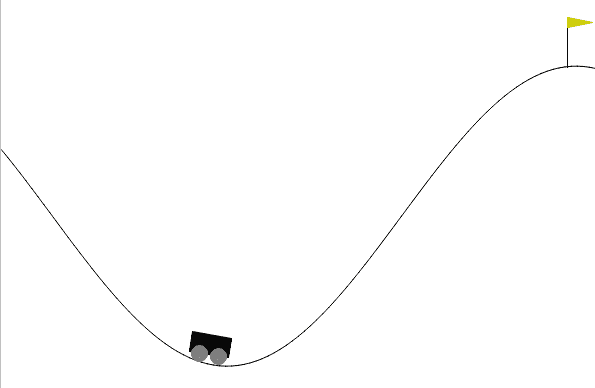
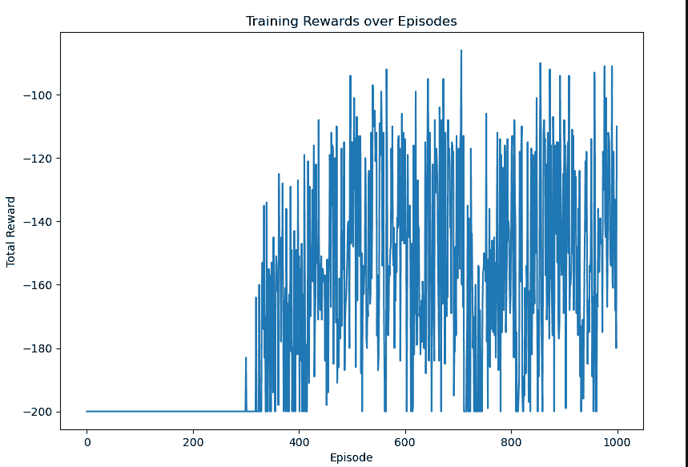
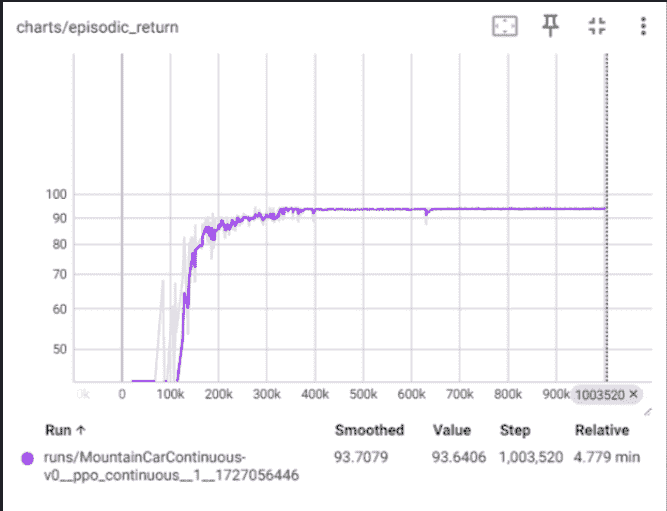
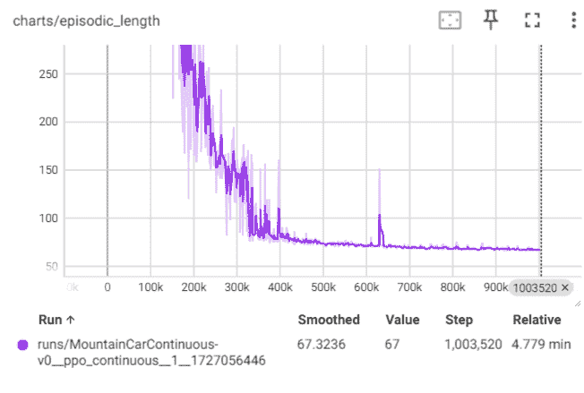

## 第 4 章：基于奖励模型的策略训练

## 加入我们的 Discord 图书社区


[`packt.link/EarlyAccessCommunity`](https://packt.link/EarlyAccessCommunity)

在本章中，我们将在第 1 章和第 3 章的基础上更详细地探讨策略训练。我们将介绍克服强化学习典型挑战的系统设计算法改进，并回顾强化学习中用于策略训练的最常用算法，包括最先进算法的实现，如 `Deep Q Networks (DQN)`，它扩展了 Q-Learning 的能力，使其在实践中更有用。此外，我们还将探讨支持连续状态和动作控制的算法如何应用于解决更复杂和大规模的问题，通过讨论 `Policy Gradients`、`Actor-Critic` 和 `Proximal Policy Optimization (PPO)` 等算法。除了强化学习策略训练，我们还将介绍 `behavioral cloning` 以改进策略并指导策略训练，用于在良好场景零星且难以在没有刻意引导的情况下体验的具有挑战性的问题中。我们将在本章中涵盖以下主要主题：

*   策略训练
*   策略训练方法：策略梯度和 Actor-Critic
*   近端策略优化的应用
*   基于人类反馈行为克隆的初始化

### 技术要求

对于本章，我们将所有与实现相关的依赖项保持最小化。具体的版本建议和所需的最小库如下：

*   `Python` 版本 >= `3.9`
*   `Numpy` == `1.26.4`
*   `Matplotlib` == `3.8.4`
*   `pytorch` == `2.3.0`
*   `gymnasium` == `0.29.1`
*   `pygame` == `2.6.0`

要开始，请克隆此 git 仓库 [`github.com/PacktPublishing/A-Practical-Guide-to-Reinforcement-Learning-from-Human-Feedback`](https://github.com/PacktPublishing/A-Practical-Guide-to-Reinforcement-Learning-from-Human-Feedback)，并将目录切换到 `chapter4`。

```bash
git clone https://github.com/PacktPublishing/A-Practical-Guide-to-Reinforcement-Learning-from-Human-Feedback
cd chapter4
```

## 策略训练


# 策略训练

策略训练是改进或学习策略的过程——策略是智能体用来根据环境中的状态决定动作的策略。策略是从环境状态到动作的映射。这种映射、模型或函数可以是确定性的，即每个状态每次都返回或指向特定的动作；也可以是随机的，可能包含一些噪声和随机性，但某些动作值的概率很高。策略训练涉及确定一个策略，使智能体随时间获得的累积奖励最大化。该奖励可以由奖励模型给出（在*第 3 章*中讨论）。在训练过程中，智能体将搜索各种空间，并通过尝试新动作和获得相应奖励来探索新场景。这种探索新场景的过程称为探索。智能体也会以一定概率选择之前获得较高奖励的动作。这称为高奖励动作的利用。奖励模型在各种状态-动作轨迹的人类反馈数据上训练，为策略产生的轨迹生成奖励。训练的主要目标是`policy optimization`——调整策略以最大化奖励模型预测的期望奖励。这涉及根据反馈诱导的奖励信号来优化策略。

## Q-learning 的局限性

在前几章中，我们一直使用`Q-learning`进行策略优化，因为它足以解决网格世界导航等问题。然而，该算法存在几个局限性。`Q-learning`算法的一些局限性包括：

*   **大规模或连续状态空间的可扩展性**：在具有大规模或连续状态空间的环境中（例如机器人控制、自动驾驶），`Q-table`因其规模而变得不可行。该算法将需要过多的内存和计算能力来存储和更新`Q-values`。

*   **复杂环境中缺乏泛化能力**：`Q-learning`对`Q-values`使用离散查找表，这意味着它无法在相似状态间泛化。每个状态都被独立处理，即使状态相似或共享通用特征且可泛化，例如视频游戏中的基于图像的输入。这种缺乏泛化能力限制了算法在相似状态可被相似处理的环境中高效学习的能力。需要更先进的方法，如使用函数逼近的`deep Q-networks (DQN)`。

*   **函数逼近带来的不稳定性**：当与函数逼近结合时（例如使用神经网络），`Q-learning`可能因`Q-values`的相关更新而变得不稳定甚至发散。在使用`Q-table`不切实际的大型或复杂环境中，这尤其成问题。

*   **非确定性或随机环境中难以收敛**：在因随机动力学导致动作可能产生不同结果的环境中，`Q-learning`可能难以收敛到最优策略。`Q-values`的更新可能变得嘈杂，算法可能无法准确学习每个状态-动作对的价值。

我们现在将演示如何克服这些局限性，以连续状态空间示例作为问题案例，并使用`deep q networks`（`DQN`）算法。然后，我们将继续介绍连续动作版本，以进一步展示更适合连续动作环境的算法的必要性和实现。

## 山车环境

为了实现对`Q-learning`的改进，我们必须使用一个`Q-learning`难以求解的仿真环境。山车环境是研究中使用的经典控制基准环境之一，可在 gymnasium 库中获取：<https://gymnasium.farama.org/api/env/>。Gymnasium 提供各种仿真环境，但为了最小化领域开销并专注于算法方面，本章我们只关注山车。Gym 中的环境是标准化的，并提供一致的接口用于与它们交互。这将允许您轻松切换到其他环境进行实验。山车环境模拟了一辆位于两山之间一维山谷中的汽车。主要挑战是积累足够的动量到达右侧山顶，这需要熟练操控汽车的速度和位置。



图 4.1：山车可视化，显示了一维山谷中两山之间汽车的模拟实例。

我们现在开始在状态-动作-奖励框架中构建环境。首先，状态空间是连续的，提供汽车位置和速度的实值测量。因此，第一个观测值是汽车在 x 轴上的位置（范围：-1.2 到 0.6 米），第二个观测值是汽车的速度（范围：-0.07 到 0.07 米/秒）。连续空间在 gym 中用`Box`类型表示，其中空间的每个维度可以取一系列实值。空间定义为`Box([-1.2, -0.07], [0.6, 0.07], (2,), float32)`。这意味着：

*   **下界**：`[-1.2, -0.07]`（分别对应位置和速度）
*   **上界**：`[0.6, 0.07]`（分别对应位置和速度）
*   **形状**：`(2,)`表示有两个连续维度（位置和速度）。

对于默认的山车示例，动作是离散且确定性的，意味着每个动作根据定义的转移动力学导致系统状态的固定变化。动作空间定义为`Discrete(3)`。这意味着：

*   **动作数量**：3 个离散选项（0, 1, 2）
*   **0**：向左加速
*   **1**：不加速
*   **2**：向右加速

对于任何动作，山车状态按以下动力学转移：

```
velocity(t+1) = velocity(t) + (action - 1) * force - cos(3 * position(t)) * gravity
position(t+1) = position(t) + velocity(t+1)
```

其中`force = 0.001 and gravity = 0.0025`。两端的碰撞是非弹性的，撞墙时速度设为 0。位置被裁剪到范围`[-1.2, 0.6]`，速度被裁剪到范围`[-0.07, 0.07]`。注意，在状态转移中，采样时间`t`使得每个时间步为 1 个单位。现在我们了解了山车如何建模、如何计算状态，以及仿真使用的状态和动作范围是什么，我们将继续讨论算法，从深度 Q 网络开始。

## 深度 Q 网络

为克服`Q-learning`的局限性，深度 Q 网络（`DQN`）作为强化学习的一项重大进展被引入。`DQN`将`Q-learning`的优势与深度神经网络强大的函数逼近能力相结合，使其能够扩展到传统方法难以处理的复杂环境。

### 函数逼近

`DQN`不使用`Q-table`，而是依靠深度神经网络模型来逼近`Q-value`函数。网络模型的输入是当前状态，输出是所有可能动作的`Q-values`。这种方法利用神经网络的泛化能力，使`DQN`能够处理大规模和连续状态空间。

### 经验回放


# 深度 Q 网络 (DQN)

## 关键创新

### 经验回放

`DQN` 的关键创新之一是使用**经验回放**。智能体不再在每次经历后立即更新 `Q-network`，而是在收集经验时将其存储起来，特别是状态、动作、奖励和下一时间步的状态。该过程涉及从记忆缓冲区中随机采样收集这些经验数据的批次。这打破了连续经验迭代之间的对称性和相关性，使学习过程更加平滑，从而实现更稳定的训练。

### 目标网络

`DQN` 还引入了**目标网络**，它是 `Q-network` 的一个副本，会定期更新。目标网络用于在训练期间计算 `target Q-values`，提供了一个更稳定的目标，降低了发散的风险。通过将 `target Q-values` 与正在学习的 `Q-network` 解耦，`DQN` 缓解了可能导致传统 `Q-learning` 不稳定的反馈循环。

### 可扩展性与性能

通过结合这些技术，`DQN` 能有效扩展到复杂的高维环境。它已成功应用于广泛的任务，包括直接从像素输入玩 Atari 游戏，在该任务中达到了人类水平的表现，详见：[`arxiv.org/pdf/1312.5602`](https://arxiv.org/pdf/1312.5602)。我们将在下一节讨论实现 `DQN` 算法的步骤。

## DQN 实现步骤

下面的代码是一个 `Deep Q-Network (DQN)` 的实现，用于训练智能体解决山车攀登问题，使用的是上一节讨论的 `Gymnasium` 库中的 `MountainCar-v0` 环境。目标是让智能体在具有大规模或连续状态空间的环境中，为每个状态-动作对近似 `Q-values`。我们在下面解释实现的每个关键步骤。

### 步骤 1 – 环境设置

代码导入必要的库，例如用于环境的 `Gymnasium`、用于神经网络实现的 `PyTorch`，以及用于处理数据、绘图和参数解析的其他工具。

```
import gymnasium as gym
import numpy as np
import torch
import torch.nn as nn
import torch.optim as optim
import random
from collections import deque
import matplotlib.pyplot as plt
import argparse
```

使用的环境是 `MountainCar-v0`，目标是通过来回移动积累动量，驱动小车冲上山顶。`gym.make` 方法有助于创建一个山车环境的实例。标识符 `MountainCar-v0` 代表具有连续状态和离散动作的环境版本。

```
# 设置环境
env = gym.make('MountainCar-v0', render_mode="human")
```

### 步骤 2 – 参数解析

代码使用 `argparse` 处理用于训练或测试模型的命令行参数。这允许以训练模式或测试/推理模式灵活运行代码。

```
parser = argparse.ArgumentParser()
parser.add_argument("--train", action="store_true")
parser.add_argument("--test", action="store_true")
args = parser.parse_args()
//
```

### 步骤 3 – Q 网络定义

`QNetwork` 类通常由你定义（或使用库中的默认值）。`QNetwork` 包含网络的架构和层。在这里，该类定义了一个具有三个全连接层的简单前馈神经网络。该网络根据当前状态近似每个动作的 `Q-values`。`input_dim` 和 `output_dim` 被传递给 `QNetwork` 以配置其输入和输出层：

*   网络的输入层将有 `input_dim` 个单元，对应状态表示的大小。
*   输出层将有 `output_dim` 个单元，对应可能动作的数量，每个单元预测每个动作的 `Q-value`。

```
class QNetwork(nn.Module):
    def __init__(self, input_dim, output_dim):
        super(QNetwork, self).__init__()
        self.fc1 = nn.Linear(input_dim, 128)
        self.fc2 = nn.Linear(128, 128)
        self.fc3 = nn.Linear(128, output_dim)
        self.relu = nn.ReLU()
    def forward(self, x):
        x = self.relu(self.fc1(x))
        x = self.relu(self.fc2(x))
        x = self.fc3(x)
        return x
```

### 步骤 4 – 网络初始化

`Q-network` 使用山车环境的观测空间和动作空间的维度进行实例化。`shape[0]` 提取状态空间的大小 (`observation_space`)。对于山车环境，状态表示为具有两个特征的向量——小车的位置和速度，因此 `shape[0]` 为 2。该维度表示 `Q-Network` 将处理的输入特征数量。

```
# 实例化 Q-network
input_dim = env.observation_space.shape[0]
output_dim = env.action_space.n
q_net = QNetwork(input_dim, output_dim)
```

`env.action_space` 指环境的动作空间，详述智能体可以采取的动作。`n` 给出环境中可用离散动作的数量。动作空间 n 为 `Discrete(3)`，代表我们在前面章节讨论的三种可能动作。该维度对 `Q-Network` 的输出层至关重要，输出层需要为每个可能的动作输出 `Q-values`。

### 步骤 5 – 目标网络

在 `DQN` 代码中实现目标网络涉及维护一个单独的网络（`Q-network` 的副本），并定期更新它以匹配 `Q-network`。实现目标网络有以下好处：

*   **稳定性：** 如果使用当前网络的预测来更新 `Q-values`。更新会导致 `Q-values` 变得不稳定并发散，因为网络在不断追逐一个移动的目标。目标网络通过为计算目标提供一组固定的 `Q-values` 来稳定训练，从而降低 `Q-values` 振荡或发散的可能性。
*   **避免相关性问题：** 直接使用同一个网络进行动作选择和目标计算会引入有害的相关性，导致收敛不良。目标网络通过将当前的 `Q-value` 估计与用于学习的目标解耦来缓解此问题。

虽然我们不会使用与 `Q-network` 相同的网络实例，但我们将为目标网络使用相同的架构，并用相同的权重进行初始化。

```
target_net = QNetwork(input_dim, output_dim)
# 用相同权重初始化目标网络
target_net.load_state_dict(q_net.state_dict())
target_net.eval()
```

### 步骤 6 – 优化器与损失函数

在训练神经网络时，特别是在像 `DQN` 这样的强化学习背景下，两个关键组件是优化器和损失函数。优化器是一种根据反向传播期间计算的梯度来更新神经网络权重的方法。目标是最小化损失函数，该函数衡量预测值 (`Q-values`) 与目标值之间的差异。`Adam` (Adaptive Moment Estimation，自适应矩估计) 优化器是深度学习任务的热门选择，因为它结合了其他两种方法的优势：`AdaGrad` (Adaptive Gradient Algorithm，自适应梯度算法，可为每个参数调整学习率) 和 `RMSProp` (Root Mean Square propagation，均方根传播，通过近期梯度幅度的移动平均来缩放学习率)。`Adam` 为每个参数维护两个移动平均值：

*   **一阶矩 (均值)：** 跟踪梯度的均值。
*   **二阶矩 (非中心方差)：** 跟踪梯度的方差。


# DQN 训练实现

## 优化器与损失函数

这两个矩用于为每个参数自适应调整学习率，使得 `Adam` 非常适合处理稀疏梯度、噪声数据和大型数据集。根据学习率，模型权重会相对于梯度进行更新。较小的学习率（如 `0.001`）确保模型缓慢收敛，从而减少越过损失函数最小值的可能性。我们使用学习率 `0.001` 初始化 `Adam` 优化器，并将其应用于 Q 网络（`q_net`）的参数，如下所示：

`optimizer = optim.Adam(q_net.parameters(), lr=0.001)`

通常，衡量模型训练质量的指标是损失函数，即目标值与模型预测值之间的差异。在 DQN 算法的背景下，特别是在这里，损失函数是均方误差损失，即 Q 网络预测的 Q 值与贝尔曼方程计算的目标值之间的均方误差 (MSE)。我们按如下方式初始化 `MSELoss` 函数：

`loss_fn = nn.MSELoss()`

## 步骤 7：经验回放池

实现了一个 `ReplayMemory` 类来存储和管理智能体遇到的经验（转移）。该内存允许智能体在训练期间采样和重用过去的经验，这有助于打破连续经验之间的相关性并稳定学习过程。

```
class ReplayMemory:
    def __init__(self, capacity):
        self.memory = deque(maxlen=capacity)
    def push(self, transition):
        self.memory.append(transition)
    def sample(self, batch_size):
        return random.sample(self.memory, batch_size)
    def __len__(self):
        return len(self.memory)
```

内存实现为一个具有固定容量的 `deque`（双端队列）。`push(transition)` 函数向内存添加新经验。`sample(batch_size)` 函数随机采样一批经验用于训练，`__len__` 方法返回内存的当前大小。

## 步骤 8：环境重置

在每个回合开始时，我们重置环境，初始化状态、总奖励和完成标志。根据训练策略，状态可以是随机的，也可以具有一些逐渐变化的值。

```
def initialize_environment(env):
    state, _ = env.reset()
    total_reward = 0
    done = False
    return state, total_reward, done
```

## 步骤 9：选择动作

在前几章中，我们讨论了使用探索-利用策略的重要性。我们将继续使用 epsilon-greedy 策略（ε-贪婪策略），即以较小的概率在允许范围内随机选择一个动作，其余情况下选择具有最大 Q 值的动作。`select_action` 函数的实现如下。

```
def select_action(q_net, state, epsilon, env):
    if random.random() > epsilon:
        with torch.no_grad():
            action = q_net(state).max(1)[1].item()
    else:
        action = env.action_space.sample()
    return action
```

## 步骤 10：存储经验

在基于 DQN 算法的训练过程中，我们将经验存储到经验回放缓冲区中，并从那里采样一个批次用于更新 Q 网络。`store_experience` 函数在每次迭代中将数据一致地存储到经验回放缓冲区。

```
def store_experience(memory, state, action, reward, next_state, done):
    memory.push((state, action, reward, next_state, done))
```

## 步骤 11：更新 Q 网络

该函数从经验回放池中采样一批经验，并计算当前 Q 值与期望 Q 值之间的损失。`current_q_values` 是所采取动作的预测 Q 值。`max_next_q_values` 是目标网络针对下一状态预测的最大 Q 值，而 `expected_q_values` 则是使用贝尔曼方程计算得出的。损失会被反向传播以更新 Q 网络的权重。

```
def update_q_network(q_net, target_net, memory, optimizer, loss_fn, gamma, batch_size):
    if len(memory) < batch_size:
        return
    transitions = memory.sample(batch_size)
    batch_state, batch_action, batch_reward, batch_next_state, batch_done = zip(*transitions)
    batch_state_tensor = torch.FloatTensor(batch_state)
    batch_action_tensor = torch.LongTensor(batch_action).unsqueeze(1)
    batch_reward_tensor = torch.FloatTensor(batch_reward)
    batch_next_state_tensor = torch.FloatTensor(batch_next_state)
    batch_done_tensor = torch.FloatTensor(batch_done)
    current_q_values = q_net(batch_state_tensor).gather(1, batch_action_tensor)
    max_next_q_values = target_net(batch_next_state_tensor).max(1)[0].detach()
    expected_q_values = batch_reward_tensor + (gamma * max_next_q_values * (1 - batch_done_tensor))
    loss = loss_fn(current_q_values.squeeze(), expected_q_values)
    optimizer.zero_grad()
    loss.backward()
    optimizer.step()
```

如果经验回放池积累了足够的转移（至少 `batch_size` 个），则从内存中采样一批经验。然后通过以下步骤更新 Q 网络：

- 计算当前状态和动作的预测 Q 值。
- 根据 `q_net` 的预测当前 Q 值和 `target_net` 针对下一状态的预测 Q 值，计算期望 Q 值。
- 使用指定的损失函数计算预测 Q 值与目标 Q 值之间的损失。
- 反向传播损失并使用优化器更新 Q 网络的权重。

## 步骤 12：更新目标网络

为了跟上预测网络的进度，目标网络需要定期更新。我们也为目标网络实现了一个更新函数。

```
def update_target_network(q_net, target_net):
    target_net.load_state_dict(q_net.state_dict())
```

注意，这里的更新仅指更新网络的权重。

## 步骤 13：衰减 Epsilon

随着网络根据训练回合积累经验并在策略上取得进展，我们计划减少探索，让智能体进行更多的利用。`decay_epsilon` 函数会随时间衰减 epsilon 的值，以便在智能体对其动作更有信心时减少探索。

```
def decay_epsilon(epsilon, epsilon_end, epsilon_start, episode, epsilon_decay):
    return max(epsilon_end, epsilon_start - episode / epsilon_decay)
```

现在我们已经将所有模块化步骤编写为函数，可以在训练循环中使用它们了。下一节将讨论主训练循环。

## 训练循环

DQN 算法中的主训练循环是实际学习发生的地方。该循环迭代地与环境交互、收集经验，并利用这些经验更新 Q 网络。以下是使用上述函数和类的训练循环步骤：

1. **输入与配置**：我们首先将所有训练配置参数赋值或输入给函数。

```
def train_dqn(q_net, target_net, env, optimizer, loss_fn, num_episodes=1000, gamma=0.99,
              epsilon_start=1.0, epsilon_end=0.1, epsilon_decay=500, batch_size=32, target_update_freq=10):
```

2. **初始化经验回放池和 Epsilon**：初始化一个 `ReplayMemory` 实例，用于存储智能体在与环境交互时收集的经验 `(state, action, reward, next_state, done)`。`epsilon_start` 设置 epsilon 的初始值，它控制探索与利用的权衡。较高的 epsilon 意味着更多探索（随机动作），而较低的 epsilon 则导致更多利用（基于 Q 网络知识的动作）。

```
    memory = ReplayMemory(capacity=10000)
    epsilon = epsilon_start
    rewards = []
```


## DQN 训练循环

1.  **循环遍历回合**：循环运行 `num_episodes` 次，每个回合都是智能体尝试解决任务或环境的一次尝试（例如，在 MountainCar-v0 环境中将小车移至山顶）。

```python
for episode in range(num_episodes):
```

1.  **初始化环境并开始回合循环**：在每个回合开始时，通过使用 `env.reset()` 重置到初始状态来初始化环境，并将智能体在该回合的总奖励设为 0。`done` 标志初始化为 `False`，表示回合正在进行中。回合在 `while` 循环中运行，直到满足条件，即 `done = True`。来自 gym 环境初始化的状态输出被转换为张量类型。

```python
state, total_reward, done = initialize_environment(env)
while not done:
    state_tensor = torch.FloatTensor(state).unsqueeze(0)
```

1.  **动作选择与赋值**：智能体根据当前状态选择一个动作。该决策使用 epsilon-greedy（ε-贪婪）策略做出：以概率 `epsilon`，智能体通过选择随机动作进行探索。在其余概率 `1-epsilon` 的情况下，智能体利用已学到的知识，选择使 `q_net` 对当前状态预测的 Q 值最大化的动作。

```python
action = select_action(q_net, state_tensor, epsilon, env)
```

1.  **执行动作并观察状态**：所选动作使用 `env.step(action)` 在环境中执行，返回：

    *   `next_state`：环境转移到的状态。
    *   `reward`：执行动作获得的奖励。
    *   `done`：指示回合是否结束的布尔标志。
    *   `trunc`：回合截断标志（可视为 done）。
    *   `info`：环境提供的附加信息（通常被忽略）。

```python
next_state, reward, done, trunc, info = env.step(action)
done = done or trunc
```

1.  **在经验回放池中存储转移**：转移 `(state, action, reward, next_state, done)` 被存储在经验回放池中。这些经验稍后将用于训练 Q 网络。

```python
store_experience(memory, state, action, reward, next_state, done)
```

1.  **优化与更新**：状态首先用下一状态更新，同样总奖励也被更新，然后对 q 网络进行优化和更新。

```python
state = next_state
total_reward += reward
update_q_network(q_net, target_net, memory, optimizer, loss_fn, gamma, batch_size)
```

1.  **更新目标网络**：每当回合数按目标更新频率 `target_update_freq` 周期性增加时，`q_net` 的权重会被复制到 `target_net`。这一步通过将用于估计未来奖励的网络与正在更新的网络解耦，确保了学习的稳定性。

```python
if episode % target_update_freq == 0:
    update_target_network(q_net, target_net)
```

1.  **衰减 Epsilon**：每个回合结束后 `epsilon` 会衰减，以逐渐将智能体的行为从探索转向利用。这种衰减对于让智能体从经验中学习并随着性能提升更多地依赖 Q 网络至关重要：

```python
epsilon = decay_epsilon(epsilon, epsilon_end, epsilon_start, episode, epsilon_decay)
```

1.  **记录并存储结果**：每个回合的总奖励存储在 `rewards` 列表中。此外，每 100 个回合记录一次进度，显示回合编号、总奖励和当前 `epsilon` 值。

```python
rewards.append(total_reward)
if episode % 100 == 0:
    print(f'Episode {episode}, Total Reward: {total_reward}, Epsilon: {epsilon:.2f}')
```

此时将 rewards 作为输出返回：

```python
return rewards
```

## 附加模型训练工具

除了训练函数外，还需要一些函数来复用训练好的模型。对于复杂环境，训练可能是一个耗时的过程，可能需要保存模型、绘制训练进度和记录输出。同样，在部署训练好的模型之前，可能需要加载训练好的模型并在其上运行推理。接下来我们将介绍这些附加函数。

### 保存模型

`save_model` 函数用于将训练好的模型参数（权重和偏置）保存到文件中。这允许你在训练后保存模型的状态，以便稍后加载而无需从头重新训练。`model.state_dict()` 方法返回一个包含模型参数的字典。状态字典包括模型层的所有可学习参数（例如权重和偏置）。

```python
def save_model(model, path):
    torch.save(model.state_dict(), path)
```

`torch.save` 函数接收状态字典并将其保存到 `path` 指定的文件中。该文件通常以 `.pth` 或 `.pt` 扩展名保存，这是 PyTorch 中的常见约定。

### 加载模型

`load_model` 函数用于从文件加载模型参数，将模型恢复到先前保存的状态，以供进一步使用，例如推理或额外训练。`torch.load(path)` 从 `path` 指定的文件加载状态字典（即模型参数）。

```python
def load_model(model, path):
    model.load_state_dict(torch.load(path))
    model.eval()
```

`model.load_state_dict(...)` 方法将状态字典加载到模型中，将模型参数设置为保存时的值。`model.eval()` 方法将模型设置为评估模式。在评估模式下，某些层（如 dropout 和 batch normalization）的行为与训练模式不同，确保模型在进行预测时正确运行。

### 绘制奖励

`plot_rewards` 函数用于可视化智能体在训练期间各回合累积的总奖励。该图有助于评估智能体的学习进度。

```python
def plot_rewards(rewards):
    plt.plot(range(len(rewards)), rewards)
    plt.xlabel('Episode')
    plt.ylabel('Total Reward')
    plt.title('Training Rewards over Episodes')
    plt.show()
```

### 日志记录

为了跟踪模型质量和进度，除了绘制奖励进度外，某种类型的分析和可视化可能很有用。为此，我们添加了一个日志记录函数。

```python
import logging

def log_training_info(episode, action, reward, state, next_state, done, trunc):
    logging.info(f"Episode: {episode}, Action: {action}, Reward: {reward}, "
                 f"State: {state}, Next State: {next_state}, Done: {done}, Trunc: {trunc}")
```

该日志记录函数可以添加在训练循环中 `env.step()` 方法之后。这些工具通过提供管理和分析模型的有效工具，增强了整体工作流。使用如下执行代码运行 DQN 脚本 `python torch_dqn.py --train` 将训练智能体并保存 q 网络模型：

```python
if __name__ == "__main__":
    print(args.train)
    if args.train:
        rewards = train_dqn(q_net, target_net, env, optimizer, loss_fn)
        # # Saving the model
        save_model(q_net, 'q_network_tgt_test.pth')
        # # Plotting training rewards
        plot_rewards(rewards)
    else:
        load_model(q_net, 'q_network_tgt_test.pth')
        inference(env, q_net, episodes=10)
```


# 策略训练方法：策略梯度与 Actor-Critic 方法

训练过程中每个回合累积总奖励与回合数的关系图应类似于下图：



图 4.2：每回合总奖励，显示直到约 300 个回合后才有进展，表明奖励的稀疏性。

该图显示总奖励直到约 300 个回合才开始进展。这表明 OpenAI Gym 分配给汽车爬山并到达旗帜的奖励是稀疏的，且仅在回合结束时发生。在迭代过程中，智能体在爬山并到达目标之前不会获得高奖励。经验回放缓冲区收集经验，这些经验有助于从具有高奖励的良好经验中学习。我们可以通过奖励塑形来改进训练，但如果不深入理解问题，这并非对每个问题都可行。这就是人类领域专业知识发挥作用的地方。既然本章我们专注于 RL 的算法层面，本书总体上关注人类奖励模型，我们将依赖 OpenAI Gym 的奖励。具有连续状态和离散动作的山车示例展示了深度神经网络如何使基于价值的学习能够扩展到更复杂或大状态空间的问题。`DQN` 算法不直接训练策略，而是通过先训练 `Q` 网络来间接实现。此处考虑的算法首先使用存储在经验回放缓冲区中的数据训练价值函数或动作价值函数（`Q` 网络），然后单独更新目标网络，而不是直接使用当前策略的数据，因此属于离线策略算法。请注意，动作输出仍然是离散的，`DQN` 虽然允许大或连续的状态空间，但不支持连续动作。存在一些修改后的算法可训练价值函数并用于输出连续动作。其中包括深度确定性策略梯度（`DDPG`）和更具可扩展性的分布式分布式深度确定性策略梯度（`D4PG`）。如果您有兴趣深入了解，请参考 [`https://spinningup.openai.com/en/latest/user/algorithms.xhtml`](https://spinningup.openai.com/en/latest/user/algorithms.xhtml) 以从可靠性和样本效率的角度理解核心算法，并参考 [`https://arxiv.org/pdf/2006.00979`](https://arxiv.org/pdf/2006.00979) 了解关于分布和扩展的更多细节。虽然这些算法在样本效率方面表现卓越（训练所需样本较少）并能解决问题，但它们可能面临三个突出问题：

*   从 `Q` 网络更新到目标网络时的稳定性问题，
*   由于更新规则中的 `max` 算子（在 `Q` 函数的情况下）导致价值函数高估预期回报，
*   用于收集数据的策略与正在更新的策略之间的分布不匹配。

我们的总体重点在于 `RLHF` 和基于奖励建模的方法，且正如论文《Deep Reinforcement Learning from Human Preferences》[`https://arxiv.org/pdf/1706.03741`](https://arxiv.org/pdf/1706.03741) 所讨论的，奖励的平稳性无法保证。对于这种非平稳奖励的情况，算法的不稳定性可能成为一个问题。离线策略算法中源自奖励模型的不稳定性问题，通过在每次奖励模型更新时重新标记智能体所有的过去经验，在一定程度上得到了缓解，相关论文包括 `PEBBLE` [`https://arxiv.org/pdf/2106.05091`](https://arxiv.org/pdf/2106.05091) 和 [`https://arxiv.org/pdf/1811.06521`](https://arxiv.org/pdf/1811.06521)。然而，对复杂环境的可扩展性考量、无监督预训练的开销以及重新标记的质量不容忽视。在线策略算法相对更稳定，在过往工作（如生成对抗模仿学习 `GAIL`：[`https://arxiv.org/pdf/1606.03476`](https://arxiv.org/pdf/1606.03476)）中展现出更大潜力，并在实践中被证明有效，例如 `ChatGPT` 和其他多个产品将其 `PPO` 实现确立为 `RLHF` 中的最先进水平。在下一节中，我们将介绍一些支持使用连续动作的在线策略算法。如果您对更多 `RL` 实现感兴趣，请查看 OpenAI Baselines [`https://github.com/openai/baselines/tree/master`](https://github.com/openai/baselines/tree/master) 和 Stable Baselines3 [`https://stable-baselines3.readthedocs.io/en/master/`](https://stable-baselines3.readthedocs.io/en/master/) 等代码库以获取高质量、广度结构化的实现，以及 CleanRL [`https://docs.cleanrl.dev/`](https://docs.cleanrl.dev/) 以获取单文件实现，其结构旨在帮助读者深入了解实现细节。

## 策略梯度方法

在策略梯度方法中，算法直接基于预期奖励相对于定义策略的参数的梯度估计来优化策略。这意味着策略是参数化的，而不是像 `Q` 学习那样从价值函数生成策略。如果 `π` 表示策略，如前几章所示，我们将其表示为 `π_θ`，其中 `θ` 对策略进行参数化。核心思想是朝着最大化预期累积奖励的方向调整策略参数。策略通常使用神经网络进行参数化。策略表示在参数 `θ` 下，给定状态 `s` 采取动作 `a` 的概率。目标函数为 `J(θ)`，其中 `R` 是遵循策略 `π_θ` 获得的累积奖励，目标是最大化预期奖励。为了更好地理解，目标函数可以更显式地写为所有可能状态和动作的总和，按其概率和获得的奖励加权。此处 `P(s,a)` 是处于状态 `s` 并采取动作 `a` 的联合概率，`R` 是整个轨迹或回合中累积的总奖励。为了最大化 `J(θ)`，我们需要计算其相对于策略参数 `θ` 的梯度。似然比方法有助于推导该梯度。目标函数相对于 `θ` 的梯度可表示为：

```
∇_θ J(θ) = E[∇_θ log π_θ(a|s) * R]
```

请注意，此类目标函数的梯度可能不易处理，我们必须使用一些数学技巧，如对数似然。

### 对数似然法

根据微积分，我们知道 `∇_θ log f(θ) = ∇_θ f(θ) / f(θ)`。概率函数的对数将概率的乘积转化为求和，这更易于处理。因此，我们将梯度替换为 `∇_θ log π_θ(a|s)`。这之所以有帮助，另一个原因是当小概率的梯度导致数值不稳定时，对数可以防止下溢，仅产生负数。它还使导数计算更容易。

### 策略更新规则

计算出的策略梯度用于通过梯度上升更新策略参数。更新后的策略函数可以是神经网络权重的更新，以及连续动作分布的输出。这适用于连续动作问题。


# 优势演员-评论家：使用基线减法进行方差缩减

原始策略梯度使用总回报（折扣奖励之和）来估计策略的梯度。由于环境的随机性和智能体动作的随机性，该回报可能具有高度的变异性。梯度估计中的高方差可能导致训练不稳定，即策略更新可能剧烈波动。这种不稳定性会使算法难以收敛到最优策略。由于更新具有噪声且可靠性较低，学习过程可能会很慢。

为了解决这个问题，不再对每个动作使用总折扣奖励，而是减去一个基线以减小方差。基线通常是预期回报的估计（例如价值函数），奖励与基线之间的差值称为优势。我们希望鼓励那些优于平均水平的动作。使用优势函数通过减小具有平均或预期奖励的动作的策略更新幅度来降低方差。进行基线减法的一种简单方法是将优势函数定义为：

为了估计价值函数，我们添加一个预测价值的网络，该网络可用于计算优势。价值函数是平均预期回报，将其作为基线从总回报中减去，可确保考虑那些带来高于平均回报的动作。这个新网络被称为 `Critic network`（评论家网络），而策略网络被称为 `Actor network`（演员网络）。

将使用优势函数 `A(s,a)=R−V(s)` 的基线减法技巧纳入原始策略梯度算法中，可减小策略梯度估计的方差，从而实现更稳定、更高效的学习。价值网络（评论家）的加入使算法能更好地逼近每个状态的预期回报，从而产生更准确的策略更新。

使用 `Q(s,a)` 代替 R 能让我们更精确地捕捉优势，因为它直接反映了在该策略下，某个动作在该状态下比平均动作好或差多少。因此，更准确的优势函数应该是：

在后一种情况下，`Q` 和 `V` 都会被学习以计算优势。

# 广义优势估计

`Generalized Advantage Estimation`（`GAE`，广义优势估计）是一种用于提高强化学习算法稳定性和效率的技术。它在策略梯度方法和演员-评论家算法中特别有用。GAE 的主要目标是在保持偏差相对较低的同时，减小策略梯度估计的方差。它使用了强化学习的两个基本概念：

1.  优势函数 `A(s,a)` 确定在状态 s 下采取动作 a 比在该状态下采取平均动作好或差多少。准确的公式是 。
2.  时序差分（`TD`）误差：TD 误差用于在演员-评论家方法中更新价值函数。它是预测价值与实际回报之间的差值： 。

GAE 引入了一种使用参数 `λ` 来控制偏差和方差权衡的 TD 误差组合，以更通用的方式计算优势函数。GAE 优势估计由以下公式给出：

GAE 涉及对优势演员-评论家（`A2C`）算法的修改，是其升级版。它不计算折扣奖励、价值和最终的优势，而是使用一个计算 GAE 估计的函数。

这些概念是同策略 `RL` 算法的基础构建模块。请注意，从 `VPG` 到 `A2C` 再到 `GAE` 的发展历程是一个持续改进的过程，但这些早期的算法和概念不足以解决更具挑战性的问题，因为它们仍未完全解决稳定性问题。此外，它们需要大量的训练和超参数实验。

除了论文 *High-Dimensional Continuous Control Using Generalized Advantage Estimation* 中介绍的广义优势估计器外，过去几年中还出现了更复杂的想法，例如 Trust Region Policy Optimization（`TRPO`，信任区域策略优化）：[`arxiv.org/abs/1502.05477`](https://arxiv.org/abs/1502.05477) 和 Proximal Policy Optimization（`PPO`，近端策略优化）算法：[`arxiv.org/abs/1707.06347`](https://arxiv.org/abs/1707.06347)，它们有助于提高稳定性和降低对超参数调整的敏感度，且后两者（`TRPO` 和 `PPO`）还能保证单调收敛。通过讨论 `DQN`、`VPG`、`A2C`、`GAE`，我们已经涵盖了 `RL` 中各类变体算法最关键的基础构建模块，并已准备好理解更高级的 `PPO` 算法。我们将讨论 PPO 的应用，因为它在基于 `RLHF` 的模型微调最先进方法论中扮演着重要角色。

# 近端策略优化的应用

从 `RLHF` 的角度来看，`PPO` 是一个重要的算法。在本节中，我们将讨论在之前讨论的原始策略梯度、优势演员-评论家和广义优势估计基础上开发 PPO 所使用的关键升级，随后介绍 PPO 在连续山车问题上的应用。由于我们之前讨论的所有算法都是 PPO 的子集，我们将直接考虑其实现。我们将首先介绍连续山车模拟环境，然后实现 PPO。

## 连续山车模拟环境介绍


# 连续山地车与 PPO

在离散动作山地车环境中，智能体拥有一组有限的预定义动作（例如：向左移动、向右移动、不做任何事）。然而，在连续版本中，智能体可以从广泛的动作范围中进行选择，这对于许多现实世界的问题更为真实。这里，我们将使用山地车模拟器的连续版本。区别在于动作可以是 -1 和 1 之间的任意数字。关于模拟器详情的更多细节记录在 [`gymnasium.farama.org/environments/classic_control/mountain_car_continuous/`](https://gymnasium.farama.org/environments/classic_control/mountain_car_continuous/)，但为了完整性，我们将讨论相关的系统动力学和奖励。

在离散动作山地车的情况下，每个时间步都会获得 -1 的负奖励，直到小车爬上山顶到达旗帜位置从而结束回合。这是一个稀疏奖励场景，但激励智能体保持回合简短。对于连续动作山地车，每个时间步会获得 `\-0.1 x action²` 的负奖励，以惩罚采取大幅度的动作。如果山地车到达目标，则会在该时间步的负奖励基础上增加 +100 的正奖励。由于大幅度动作也能产生动量并有助于攀爬和到达目标，这使得信用分配变得更加困难。在现实场景中，分配奖励可能很困难，因此我们将继续使用 `gymnasium` 库中的奖励，以便专注于算法本身，而不是进行奖励塑形。

在前面的章节中，我们了解到 DQN 对于离散动作空间是有效的，但不能直接应用于连续动作空间，因为 DQN 需要将动作空间离散化，这对于具有大量或无限可能动作的环境并不理想。相反，策略梯度方法是连续动作空间的自然解决方案，因为它们允许智能体学习一个参数化策略，通过建模动作概率分布从连续范围中产生动作。原始策略梯度算法使用随机策略将状态映射到动作，利用环境奖励优化该策略。然而，它需要减去基线以减小方差，正如优势演员-评论家算法中所讨论的，并通过广义优势估计 (GAE) 进一步改进了学习的稳定性。为了进一步提高学习稳定性和单调改进，我们在 GAE 基础上增加了进一步的改进，即使用 PPO 算法，其关键更新之一是一种防止策略大幅更新的裁剪机制。

连续控制山地车可以拥有更宽广的状态和动作探索区域，导致学习更加复杂，并需要更长的模拟和训练时间。因此，我们需要应用一些加速训练的技术。常见的方法之一是使用向量化环境来并行化训练，我们将在下一节中讨论这一点。

## 使用向量化环境加速训练

为了加速训练，在强化学习实践中使用向量化环境非常普遍。向量化涉及一种设置，即同时运行同一环境的多个独立实例。智能体不再一次只与单个环境交互，而是并行地与多个环境交互。每个环境独立运行，可能处于不同的状态。由于这些环境并行运行，无论是在单独的 CPU 核心上还是使用高效的多进程技术，等待环境反馈（即下一个观测值和奖励）的时间显著减少。此外，智能体可以在更短的时间内收集更大批量的经验。Gymnasium 库通过 `gym.vector` 模块为向量化环境提供了内置支持。

下面的代码片段展示了一个为连续动作山地车问题实现向量化环境并使用随机动作采样的简单代码示例。这段代码首先导入 gymnasium 库，并创建一个包含 4 个 MountainCar 环境副本的向量化环境，具体版本为 `MountainCarContinuous-v0`。通过重置向量化环境来收集所有环境的观测值。为了演示目的，我们运行向量化环境的 100 次迭代或步数，在每次迭代中，首先使用 `action_space.sample` 方法为每个环境随机采样动作，然后使用 `step` 方法让每个环境前进一步。接着，我们根据 `dones` 变量是否为 True 来处理每个环境的回合，并打印结束的回合及其对应的奖励。在完整实现中，你可以记录并绘制这些数据以监控回合并在需要时调试训练。最后使用 `close` 方法关闭环境。

```
import gymnasium as gym
env = gym.vector.make('MountainCarContinuous-v0', num_envs=4)
observations = env.reset()
for _ in range(100):
    actions = env.action_space.sample()
    observations, rewards, dones, infos = env.step(actions)
    for i in range(4):
        if dones[i]:
            print(f"Episode {i} finished with reward {rewards[i]}")
# Close the environments
env.close()
```

我们将使用向量化环境配合 PPO 算法训练智能体，正如你将在 `PPO Implementation Details` 部分看到的那样。首先，我们将了解在实践中实现 PPO 所需的所有关键更新。

## 实现 PPO 的关键更新

与离散动作空间相比，连续动作空间的训练相对更加困难，因为它拥有大得多的动作空间。因此，连续动作环境的训练时间比离散动作环境长得多。为了加速训练、提高训练稳定性以及其他训练相关的改进，PPO 算法实现了多种技术。我们将逐一介绍：

*   **裁剪目标函数（代理损失）：** 引入 `clipped objective` 以防止对策略进行大幅更新，这可能导致不稳定。新策略概率与旧策略概率的比率被裁剪在一定范围内，确保更新幅度小且可控。

*   **每批次多轮训练：** 允许在同一批数据上进行 `multiple epochs` 的优化，从而提高样本效率。策略使用相同数据更新多次，从每个收集的批次中提取更多信息。

*   **价值函数损失：** 通过允许策略（演员）和价值函数（评论家）使用 `separate learning rates`，增加了更多灵活性。这允许对每个组件的学习进行微调，从而实现更好的收敛。（PPO 还可选择性地包含 `clipped value function loss`，类似于策略目标裁剪，以避免价值函数过拟合当前策略。）

*   **熵正则化：** 通过鼓励策略保持一定程度的随机性来维持探索，防止其变得过于确定性。

*   **小批量更新：** 使用 `mini-batch` 更新，进一步提高样本效率并稳定学习。较小的小批量允许更多的梯度更新，使策略随时间更平滑地变化。

## PPO 实现细节

由于 PPO 算法有大量的实现细节，我们将把它构建为一个项目，具有以下文件结构：


# PPO 项目实现

## 项目结构

```text
/ppo /
    ├── agent.py           # 包含 Agent 类
    ├── training.py        # 包含训练逻辑
    ├── utils.py           # 包含工具函数（保存/加载模型）
    ├── env_setup.py       # 包含环境设置逻辑
    ├── args.yaml          # 包含训练参数
    ├── main.py            # 运行训练的主脚本
├── inference.py            # 运行训练的主脚本
```

所有必需的文件均可在本章开头链接的 GitHub 仓库中获取。但我们将在此处介绍项目文件的重要方面。我们采用了 `cleanRL` 的项目实现，因为它是最透明的实现，且对于在最细致的层面上进行理解、学习或实验而言更为清晰。理解此代码结构将帮助你掌握 PPO 的所有概念，并允许你以透明的方式进行修改和实验。我们现在将讨论代码结构中所有重要的实现方面。

## Agent 类 (`agent.py`)

`Agent` 类结合了两个主要组件：一个 `actor`（策略网络）和一个 `critic`（价值网络）。`actor` 根据环境的当前状态建议采取的动作，而 `critic` 评估这些动作的优劣，提供反馈以改进未来的决策。我们将逐一介绍 `Agent` 类中的所有方法，如下所示。

### 初始化 (`__init__` 方法)

构造函数接受一个向量化环境 (`envs`) 作为输入。这使得代理能够在单个环境或多个环境中同时运行。此方法检查环境是否为向量化环境，并提取观测空间和动作空间的形状。代理判断动作空间是离散的（例如，从有限动作集中选择）还是连续的（例如，生成一系列值）。这种区别影响动作的采样和评估方式。以下代码片段展示了初始化方法。

```python
def __init__(self, envs):
    super().__init__()
    if isinstance(envs, vector.VectorEnv):
        # 多环境情况
        env_shape = envs.single_observation_space.shape
        env_action_shape = envs.single_action_space.shape
    else:
        # 单环境情况
        env_shape = envs.observation_space.shape
        env_action_shape = envs.action_space.shape
    # 判断动作空间是离散还是连续
    if len(env_action_shape) == 1 and env_action_shape[0] > 1:
        # 离散动作空间
        self.is_discrete = True
        self.num_actions = env_action_shape[0]
    elif len(env_action_shape) == 1 and env_action_shape[0] == 1:
        # 单动作情况；可视为连续
        self.is_discrete = False
    else:
        # 假设为连续动作空间
        self.is_discrete = False
```

### Critic 网络

`critic` 定义为一个神经网络，接收状态作为输入并输出单个值，代表该状态的估计价值。该网络包含两个隐藏层，每层有 64 个单元，并使用 `Tanh` 激活函数。最后一层输出单个值，标准差初始化为 1.0 以控制输出的方差。较大的标准差允许价值输出具有更大的变异性，这对于以下方面至关重要：

*   **价值估计的灵活性**：它赋予 critic 学习更广泛价值估计范围的能力。这在可能状态价值范围相当大的环境中尤为重要，例如连续山车环境，或 gymnasium 库中的任何连续控制环境。
*   **防止过早收敛**：通过允许初始较高的方差，critic 能更好地适应代理的学习动态，这有助于在训练期间更有效地区分好坏动作。

```python
# 定义 critic 网络
self.critic = nn.Sequential(
    self.layer_init(nn.Linear(np.prod(env_shape), 64)),
    nn.Tanh(),
    self.layer_init(nn.Linear(64, 64)),
    nn.Tanh(),
    self.layer_init(nn.Linear(64, 1), std=1.0),
)
```

### Actor 网络

结构与 critic 类似，但输出动作的均值。最后一层使用较小的标准差初始化；较小的值意味着从 actor 输出采样的动作将非常接近均值动作。从实际角度来看，代理将产生紧密聚集在此均值周围的动作，从而导致一致且变异性较小的动作。

```python
# 定义 actor 网络
self.actor_mean = nn.Sequential(
    self.layer_init(nn.Linear(np.prod(env_shape), 64)),
    nn.Tanh(),
    self.layer_init(nn.Linear(64, 64)),
    nn.Tanh(),
    self.layer_init(nn.Linear(64, np.prod(env_action_shape)), std=0.01),
)
# 针对连续动作空间
if not self.is_discrete:
    self.actor_logstd = nn.Parameter(torch.zeros(1, np.prod(env_action_shape)))
```

在实践中，`actor` 和 `critic` 这两个标准差的组合支持这样一个训练过程：代理开始时探索更广泛的动作范围，然后逐渐稳定在有效动作周围，同时仍能接收到关于不同状态价值的多样化反馈。

### 处理连续动作

对于连续动作，会创建一个动作标准差的额外参数。这使得代理能够对连续动作中的不确定性建模，这对于从动作分布中有效采样非常重要。

```python
# 针对连续动作空间
if not self.is_discrete:
    self.actor_logstd = nn.Parameter(torch.zeros(1, np.prod(env_action_shape)))
```

Actor 维护一个对数标准差参数，而不是直接使用标准差，这既保证了**数值稳定性**（对数值在计算概率时不太可能导致数值下溢），又提供了**灵活性**（可在训练期间调整，允许代理在必要时学习探索更多）。

### 方法

`get_value` 方法接收状态作为输入，并从 critic 网络返回其估计价值。

```python
def get_value(self, x):
    """返回输入状态的价值。"""
    return self.critic(x)
```

`get_action_and_value` 方法根据当前状态计算要采取的动作，并返回所选动作（可为采样得到用于探索，或为给定用于评估）、该动作的对数概率（可用于计算训练时的损失）、动作分布的熵（通过鼓励代理采取多样化动作来促进探索），以及来自 critic 的输入状态价值（提供关于该状态对代理有多有利的反馈）。


# PPO 智能体实现与训练

## get_action_and_value 方法

```
def get_action_and_value(self, x, action=None):
    action_mean = self.actor_mean(x)
    if self.is_discrete:
        # For discrete action spaces, use a softmax layer
        action_probs = nn.functional.softmax(action_mean, dim=-1)
        if action is None:
            action = action_probs.multinomial(num_samples=1).squeeze(1)
        log_prob = action_probs.log()[range(action.size(0)), action]
        entropy = -(action_probs * action_probs.log()).sum(dim=-1)
    else:
        # For continuous action spaces
        action_logstd = self.actor_logstd.expand_as(action_mean)
        action_std = torch.exp(action_logstd)
        probs = Normal(action_mean, action_std)
        if action is None:
            action = probs.sample()
        log_prob = probs.log_prob(action).sum(1)
        entropy = probs.entropy().sum(1)
    return action, log_prob, entropy, self.critic(x)
```

对于离散动作，`Softmax Layer`（Softmax 层）计算每个动作的概率，动作采样会采样一个动作或使用提供的动作，然后计算用于训练的 `log_prob` 和 `entropy`。对于连续动作，正态分布使用 `action_mean` 和 `action_std` 来定义动作的高斯分布，如果未提供动作，则从此分布中采样，然后计算 `log_prob` 和 `entropy`。

## layer_init 方法

```
@staticmethod
def layer_init(layer, std=np.sqrt(2), bias_const=0.0):
    nn.init.orthogonal_(layer.weight, std)
    nn.init.constant_(layer.bias, bias_const)
    return layer
```

`Layer Initialization`（层初始化，即 `layer_init` 方法）使用特定配置初始化神经网络层。它对权重使用正交初始化以稳定训练，并为偏置设置常数值，确保层已准备好进行有效学习。

## Agent 类概览

`Agent` 类有效地结合了 Actor-Critic 方法，适应离散和连续动作空间。每个组件——从初始化到动作选择——都在智能体如何学习和与环境交互中发挥着关键作用。这种结构化方法使智能体能够通过强化学习高效地学习最大化奖励的策略。请注意，此处我们采用的是 `cleanRL` 架构，而非尝试新架构。但是，对于稀疏奖励的连续山车问题等任务，涉及记忆的模型架构（如 `LSTM`（长短期记忆）或 `GRU`（门控循环单元））有助于保留回合早期状态的知识。目前，我们将继续使用库中采用的标准架构。

## 训练参数 (args.yaml)

PPO 算法有多个训练参数，范围从与环境相关的 `env_id` 和 `num_envs`，到训练步数 `num_steps`，再到学习率 `learning_rate`。所有这些都被添加在一个名为 `args.yaml` 的单独配置文件中。这有助于组织代码，并可用于实验调整。这里我们使用的是从 `cleanRL` 仓库采用且已调优的参数。

## PPO 训练 (training.py)

详细的训练循环在 GitHub 仓库的 `training.py` 文件中提供。这里我们解释 PPO 训练循环的关键算法步骤。

### 训练设置与初始化

PPO 训练需要准备训练进度的参数。考虑到我们使用向量化环境，这涉及定义以下参数：

*   `Batch Size`（批次大小），跨所有环境收集的总时间步数。
*   `Minibatch Size`（小批次大小），每次网络更新时，从收集的批次中采样的小批次大小。
*   `Iterations`（迭代次数），总迭代次数取决于我们计划在整个训练过程中采取多少时间步。

```
batch_size = int(args['num_envs'] * args['num_steps'])
minibatch_size = batch_size // args['num_minibatches']
num_iterations = args['total_timesteps'] // batch_size
```

目标是准备优化器并定义训练如何进行。

### 检查点保存与恢复

对于长时间的训练会话，通常可能需要停止训练、使用推理进行评估，然后继续训练或从停止处恢复。这避免了从头开始重新训练。

```
latest_checkpoint = get_latest_checkpoint(checkpoint_dir)
if latest_checkpoint:
    checkpoint = load_model(agent, latest_checkpoint)
    global_step = checkpoint.get('global_step', 0)
    start_iteration = checkpoint.get('start_iteration', 0)
else:
    global_step = 0
    start_iteration = 0
```

模型的检查点会定期保存，以便保存训练进度，并可从最后保存的模型（检查点）继续训练。

### 学习率退火

既然我们的目标是实现稳定学习，在训练后期降低学习率通常是有益的。

```
if args['anneal_lr']:
    frac = 1.0 - (iteration - 1.0) / num_iterations
    optimizer.param_groups[0]["lr"] = frac * args['learning_rate']
```

学习率随时间逐渐降低，鼓励稳定收敛。这在 PPO 中很典型，旨在避免训练后期过度探索。

### 收集 Rollouts

Rollouts 涉及让环境运行若干步骤，生成数据（`obs`、`actions`、`logprobs`、`rewards`、`values`），这些数据可被收集用于训练。

```
for step in range(args['num_steps']):
    with torch.no_grad():
        action, logprob, _, value = agent.get_action_and_value(next_obs)
    next_obs, reward, terminations, truncations, infos = envs.step(action.cpu().numpy())
    rewards[step] = torch.tensor(reward).to(device).view(-1)
```

请注意，`torch.no_grad()` 确保我们在此处不计算梯度，因为我们只是在收集数据。另一点值得注意的是，某些环境可能比其他环境更早终止。例如，某些成功的回合可能爬上山顶并到达旗帜而终止。由于我们使用向量化环境，环境的训练不会结束。但我们会记录 `terminations` 和 `truncations` 的日志，并在计算优势函数和回报时使用它们。

### 计算优势函数与回报

正如上一节所讨论的，为了学习的稳定性，我们需要计算优势函数和回报。这里，`GAE` 通过减少奖励信号的方差来计算更稳定的优势函数。

```
next_value = agent.get_value(next_obs).reshape(1, -1)
advantages, returns = compute_advantages_and_returns(rewards, values, next_value, next_done, dones, args)
```


# GAE 实现与 PPO 更新

## GAE 计算

以下是 GAE 实现计算优势和回报的方式。在进行适当的设备选择和优势初始化后，一个变量被初始化为一个填充零的张量，其形状与 `rewards` 张量相同。该张量将存储每个时间步计算出的优势值。随后是最后一个 GAE lambda 的初始化。该变量用于跟踪在下一时间步计算出的优势（沿轨迹向后移动）。它从最后一步的 0 开始。

```
device = torch.device("cuda" if torch.cuda.is_available() and args['cuda'] else "cpu")
advantages = torch.zeros_like(rewards).to(device)
lastgaelam = 0
```

然后，一个循环从 `args['num_steps'] - 1`（最后一步）向下迭代到 0，逆序遍历时间步。这种逆序遍历是 GAE 所必需的，因为 GAE 将信息从未来的奖励向后传播。在此循环中，我们传递所有环境变量并计算优势和回报。如前所述，在向量化环境中，某些回合可能提前终止，妥善处理它们非常重要。处理终止回合的关键在于使用 `dones` 张量，它指示某个时间步回合是否已结束。在终止的回合中，环境提供一个 done 信号。这影响未来奖励的传播方式，特别是通过确保终止后未来奖励的价值被切断，从而防止未来奖励跨越回合边界传播。

我们创建一个名为 `nextnonterminal` 的新变量，当回合未终止时其值为 `1.0`，当回合终止时其值为 `0.0`。如果 `dones[t+1]`（或最后一步的 `next_done`）为 `True`（意味着回合已终止），`nextnonterminal` 变为 `0.0`，切断任何未来奖励并防止进一步的价值传播。该机制确保一旦回合终止，未来的奖励和价值不会被错误地加到当前步骤的优势中。因此，我们检查该步骤是否为回合的最后一步，并相应地分配 `nextnonterminal`。

```
for t in reversed(range(args['num_steps'])):
    if t == args['num_steps'] - 1:
        nextnonterminal = 1.0 - next_done
        nextvalues = next_value
    else:
        nextnonterminal = 1.0 - dones[t + 1]
        nextvalues = values[t + 1]
```

在上述代码片段中，当 `t` 与回合或轨迹的最后一步相同时，`nextvalues` 被设置为 `next_value`。`next_value` 是下一状态的价值估计，作为输入传递给函数 `compute_advantages_and_returns`。对于所有其他步骤，它被设置为下一时间步（`t+1`）的价值估计。

在循环中，我们使用以下公式计算 TD（时序差分）残差 `delta`：

- `rewards[t]`：当前步骤的即时奖励，
- `args['gamma'] * nextvalues * nextnonterminal`：考虑回合是否继续（`nextnonterminal`）的下一步折扣价值，
- `values[t]`：当前步骤的价值估计。

即时奖励与折扣未来价值之和与当前价值估计之间的差值给出了 TD 误差（`delta`）。

```
delta = rewards[t] + args['gamma'] * nextvalues * nextnonterminal - values[t]
```

当 `nextnonterminal` 因终止而为 `0.0` 时，项 `args['gamma'] * nextvalues * nextnonterminal` 变为 `0.0`。这意味着时间步 `t` 的奖励仅考虑即时奖励 `rewards[t]`，而不考虑来自下一时间步的未来价值 `nextvalues`。

第 `t` 步的优势使用 GAE 进行更新，GAE 结合了 TD 误差（`delta`）和下一时间步的优势（`lastgaelam`），并通过 `gamma` 折扣和 `gae_lambda` 加权。同时，`lastgaelam` 递归地用这个新的优势值更新，以便在循环的下一次迭代（向后移动）中使用。

```
advantages[t] = lastgaelam = delta + args['gamma'] * args['gae_lambda'] * nextnonterminal * lastgaelam
returns = advantages + values
return advantages, returns
```

当回合终止时，`nextnonterminal` 为 `0.0`，意味着 `lastgaelam`（它承载来自未来时间步的优势）不再贡献。时间步 `t` 的优势仅取决于即时 TD 残差（`delta`），而不依赖任何未来优势。这确保了 GAE 不会跨越回合边界传播优势，从而保持轨迹的完整性。

然后通过将估计价值加到计算出的优势上来计算回报。这给出了每个时间步的总预期回报（奖励 + 未来价值）。该函数返回优势和回报，可用于损失计算。

## 小批量采样与 PPO 更新

在 PPO 中，训练通常重复多个 epoch。为了实现这一点，收集的批次被打乱并拆分为每个 epoch 的小批量。

```
for epoch in range(args['update_epochs']):
    np.random.shuffle(b_inds)
    for start in range(0, batch_size, minibatch_size):
        mb_inds = b_inds[start:end]
        _, newlogprob, entropy, newvalue = agent.get_action_and_value(b_obs[mb_inds], b_actions[mb_inds])
        ratio = (newlogprob - b_logprobs[mb_inds]).exp()
        pg_loss1 = -mb_advantages * ratio
```

### 策略梯度损失

策略梯度损失是核心 PPO 更新，在更新智能体策略中起核心作用。其表述方式旨在修改策略，以增加产生更高奖励的动作的概率，基于收集的经验。它使用裁剪目标来防止大幅度的策略更新并保持稳定性。

`ratio` 衡量旧策略（`logprob`）和新策略（`newlogprob`）针对特定动作的变化，其中旧 `logprob` 是更新前策略下动作的对数概率（来自上一次迭代），新 `logprob`（`newlogprob`）是当前策略（更新后）下动作的对数概率。`ratio` 使我们能够衡量新策略针对同一动作与旧策略的差异程度，通过使用该比率，PPO 控制每一步策略可以改变的幅度。

PPO 引入裁剪以防止策略过度大幅度更新，这可能导致训练不稳定：

```
pg_loss2 = -mb_advantages * torch.clamp(ratio, 1 - args['clip_coef'], 1 + args['clip_coef'])
pg_loss = torch.max(pg_loss1, pg_loss2).mean()
```

裁剪确保比率保持在合理范围内：`[1 - clip_coef, 1 + clip_coef]`，其中 `clip_coef` 是一个较小的值，通常在 0.1 到 0.3 之间。这防止策略过于激进地更新（偏离旧策略太远）。

两个损失项：
- `pg_loss1` 是标准的策略梯度，未受任何约束修改。
- `pg_loss2` 应用裁剪。如果比率超出界限，优势被限制，防止过度更新。

通过取 `pg_loss1` 和 `pg_loss2` 的最大值，PPO 确保如果策略更新过大，则会受到限制，从而保持稳定性。

## 价值函数与熵损失

PPO 是一种基于策略的方法，但它也使用价值函数来估计给定状态的预期回报。这两个组件协同工作，策略决定动作，价值函数预测状态（或状态-动作对）有多好。

```
v_loss = 0.5 * ((newvalue - b_returns[mb_inds]) ** 2).mean()
entropy_loss = entropy.mean()
```


# PPO 损失函数与训练细节

## 价值损失

价值损失衡量预测值（`newvalue`）与实际回报（根据优势估计计算）之间的差异，公式为 `Value Loss =`。这是预测值与观测回报之间的标准均方误差（MSE）。它帮助智能体学习更好地预测未来奖励，提高价值估计的准确性。

## 熵损失

熵损失通过防止策略变得过于确定性来鼓励探索。当智能体的策略给少数动作分配极高概率、给其他动作分配接近零的概率时，它会变得过度自信，面临泛化能力差的风险。通过在损失函数中添加熵奖励，策略被鼓励保持动作概率更分散，从而促进探索。熵损失可表示为以下方程：`Entropy Loss =`。动作概率越均匀，熵越高。高熵确保智能体持续探索各种动作，尤其是在训练早期阶段。

## 组合损失

最终损失结合了策略损失、价值损失和熵损失：

```
loss = pg_loss - args['ent_coef'] * entropy_loss + v_loss * args['vf_coef']
```

`pg_loss` 项被最大化以基于观测优势改进智能体策略，`v_loss` 惩罚价值函数预测中的误差，`entropy_loss` 添加正则化项以确保充分探索。系数 `args['vf_coef']` 和 `args['ent_coef']` 是控制价值损失和熵损失在总损失函数中相对重要性的超参数。

## 梯度裁剪

应用梯度裁剪步骤可防止梯度爆炸，确保梯度不会变得过大，从而避免训练不稳定。这是标准的深度学习训练实践。

```
torch.nn.utils.clip_grad_norm_(agent.parameters(), args['max_grad_norm'])
```

## KL 散度检查

KL 散度（Kullback-Leibler Divergence）衡量一个概率分布与另一个概率分布的差异。该项本质上衡量更新后的策略偏离原始策略的程度。较大的 KL 散度表示变化较大，而较小的 KL 散度意味着策略非常相似。

```
if args['target_kl'] is not None:
    with torch.no_grad():
        approx_kl = ((ratio - 1) - logratio).mean()
        clipfracs.append(((ratio - 1.0).abs() > args['clip_coef']).float().mean().item())
    if approx_kl > args['target_kl']:
        kl_exceed_count += 1
        print(f"KL Divergence exceeded in iteration {iteration}, epoch {epoch}")
        break  # 如果 KL 超过阈值则跳出循环
```

PPO 算法引入裁剪直接限制策略更新的大小。然而，裁剪是一种隐式控制机制。KL 散度监控提供显式控制，以检测策略更新是否过于激进。这有两个好处：

*   **大幅策略偏移**：如果新策略变化过大（即新动作概率与旧概率显著不同），可能导致**过拟合**短期经验和训练**不稳定**。监控 KL 散度有助于捕捉此问题。
*   **安全更新**：通过监控 KL 散度，PPO 确保新策略仅与旧策略略有不同，将更新保持在“安全范围”内。如果策略偏移超过预定义阈值，PPO 可采取纠正措施，如**早停**、降低学习率或暂时停止更新。

虽然裁剪侧重于限制对策略的单个更新，但 KL 散度监控跟踪整个分布上策略的整体变化。这两种机制相辅相成：
- 裁剪确保单个动作的更新不偏离太远。
- KL 散度监控确保整体策略在聚合层面不偏移太远。

## 日志记录与模型保存

我们使用 PyTorch 的工具方法配合 TensorBoard 记录重要指标（如回合回报和回合长度）到日志中，用于监控和可视化。



图 4.3 山地连续训练的回合回报，收敛于 93 左右。



图 4.4 山地训练过程中的回合长度，显示小车爬坡到达旗帜前所需迭代次数的减少。

此外，训练期间必须定期保存模型，确保进度可检查点恢复。模型保存计算开销较大，因此我们将保存条件设定为训练后半段进行。

```
if iteration % 2 == 0 or iteration == num_iterations:
    save_model(agent, f'checkpoints/ppo_checkpoint_{iteration}.pth', global_step, iteration)
```

至此，我们已涵盖所有 PPO 训练相关的函数、方法和实现更新。接下来将介绍如何使用 `main.py` 文件实现训练运行的执行代码。

## Main.py

整体训练执行从 `main.py` 运行。以下是展示步骤的代码片段：

```
if __name__ == "__main__":
    # 从 YAML 加载配置
    with open("args.yaml", "r") as f:
        args = yaml.safe_load(f)
    run_name = f"{args['env_id']}__{args['exp_name']}__{args['seed']}__{int(time.time())}"
    envs = gym.vector.SyncVectorEnv([make_env(args['env_id'], i, args['capture_video'], run_name, args['gamma']) for i in range(args['num_envs'])])
    # 初始化智能体
    agent = Agent(envs)
    # 开始训练
    writer = SummaryWriter(f"runs/{run_name}")
    train(agent, envs, writer, args)
    envs.close()
    writer.close()
```

运行 PPO 训练，我们看到它将收敛到约 90 的高回合回报。但需注意可能需要长时间训练，我们处理的是稀疏奖励场景，高奖励仅在回合结束时可用。直接基于梯度优化策略的特性，使 PPO 在处理稀疏反馈时比 DQN 等基于价值的方法更有效。此外，裁剪目标函数有助于保持稳定性，降低灾难性策略更新的风险，这在反馈不一致时很有益。尽管有这些优势，在稀疏奖励设置下，算法可能变得样本低效（即需要大量训练样本或回合）。如果智能体探索不足或探索导致糟糕的初始策略，学习可能停滞。由于算法基于采样轨迹优化，如果奖励非常稀疏，可能需要更多回合才能学到有意义的更新。

# 稀疏奖励与探索


### 熵正则化

在上述 PPO 实现中，我们使用了熵正则化来辅助探索。其思路是最大化策略分布的熵，这意味着鼓励智能体维持一组多样化的动作，而不是过快收敛到确定性策略。这种方法基于当前策略分布，在整个训练过程中动态地促进探索。熵正则化通过防止过早收敛到次优策略来稳定学习，使智能体能够探索更多样化的动作。熵项的权重需要仔细调整。过度的正则化会导致过度探索，而过少则可能导致智能体利用次优动作。与 ε-贪婪策略不同，后者有保证的探索率，如果策略收敛过快，熵正则化可能会导致次优探索期。与 ε-贪婪策略的对比显示了这两种方法的优缺点，详见表 4.1。

| 标准 | ε-贪婪策略 | 熵正则化 |
| --- | --- | --- |
| 探索机制 | 以 ϵ 概率随机选择动作 | 鼓励多样化的动作分布 |
| 简易性 | 易于实现 | 因需调参而更复杂 |
| 探索保证 | 固定的探索概率 | 基于策略的自适应探索 |
| 效率 | 可能导致低效探索 | 可能带来更明智的探索 |
| 调参 | ε 衰减计划 | 熵项权重 |

表 4.1 对比 ε-贪婪策略和熵正则化探索策略。

虽然探索策略在一定程度上有帮助，但有时奖励稀疏性很严重，此时更直接的方法（如提供人类引导，或使用良好且多样化的策略集进行初始化）可以改善探索。在下一节中，我们将讨论如何以行为克隆的形式结合 PPO 融入人类引导，并用于模型初始化。

### 使用人类引导

在上一节中，我们探讨了各种策略训练技术，并在连续动作山地车问题上实现了 PPO 算法。训练需要大量的回合才能获得高回报。主要原因之一是奖励结构带来了巨大挑战：目标是攀登并到达旗帜以获得 +100 的奖励，但这与限制动作幅度（`-0.1 * action²`）的必要性相冲突。较大动作产生的动量有助于到达旗帜，但我们需要保持较小的动作幅度。此外，产生动量需要持续攀登，这需要通过许多回合积累大量经验。作为人类，我们天生理解希望汽车如何表现，但定义准确的奖励函数可能很困难。就像人类决策通常需要评估整个回合一样，智能体也受益于理解特定场景（如爬山）中期望的行为。为了有效的奖励建模，我们通常收集多个人类评估者的偏好来指导奖励函数。然而，单步层面的单个动作和状态通常信息不足。因此，可能需要调整训练设置，以在回合层面考虑动作序列。另一种方法是基于人类专家轨迹，使用预训练的行为克隆来初始化智能体的策略。在这种情况下，我们将收集一组人类演示并综合这些数据以增强训练集。然后，我们将使用与近端策略优化 (PPO) 相同的智能体架构采用行为克隆来复现演示行为。此过程将为 PPO 训练初始化智能体，使其能够微调性能并泛化到初始演示中未遇到的场景。我们将在行为克隆一节中讨论使用行为克隆进行 PPO 策略初始化的每个步骤。您可以参考 GitHub 仓库中的 `guided_ppo` 子目录，其中除了之前的 PPO 文件外，还包含行为克隆相关脚本。

```
guided_ppo/
    ├── agent.py           # Contains the Agent class
    ├── training.py        # Contains training logic
    ├── utils.py           # Contains utility functions (save/load models)
    ├── env_setup.py       # Contains environment setup logic
    ├── args.yaml          # Contains training parameters
    ├── main.py            # Main script to run the training
    ├── inference.py       # Main script to run inference
    ├── human_feedback_keyboard.py # enables human demonstrations
    ├── augment_expert_data.py # augment expert data by perturbing actions
    ├── expert_behavior_cloning.py # train and inference behavioral clone of human expert
    ├── expert_trajectories.json # collected human trajectories
    ├── perturbed_expert_trajectories.json  # augmented data
```

#### 数据收集过程

我们将利用山地车问题的 Gym 环境，采用 Pygame 库通过键盘输入来促进交互。这使得人类动作能直接影响汽车运动的幅度和方向。通过收集这些人类演示轨迹，我们旨在增强 PPO 训练的奖励结构。数据收集过程必须具有策略性；每个动作都会招致一个小的负奖励，而只有动作序列才能带来最终 +100 的奖励。随机动作对此任务而言是低效的。鉴于山地车环境的平衡状态位于山谷底部，许多动作会导致汽车下降而非上升。与其开发启发式方法帮助汽车爬坡，不如重新设计环境以实现直接的人机交互，允许用户生成有效的动作和策略。在本节中，我们将使用 Pygame 和 Gym 实现一个交互式环境，以收集用于训练奖励模型的人类演示数据，重点关注促进此过程的关键代码片段。用于收集人类演示的 `human_feedback_keyboard.py` 脚本可在 GitHub 仓库中找到：

1. 导入相关库后，我们初始化 pygame，创建 gym 环境并将其重置为初始状态：

```
pygame.init()
env = gym.make('MountainCarContinuous-v0', render_mode="human")
state, _ = env.reset()
```

2. 我们编写一个文档字符串并打印用户如何与游戏环境交互的说明，如下所示：

```
instructions = """
Press 'a' to accelerate left,
'd' to accelerate right,
's' to stop,
'q' to quit.
"""
```

3. 然后，我们设置主循环以保持 Pygame 窗口响应并检查退出事件。

```
running = True
while running:
    for event in pygame.event.get():
        if event.type == pygame.QUIT:
            running = False
```

4. 然后，我们使用以下事件条件处理按键：

```
keys = pygame.key.get_pressed()
if keys[pygame.K_a]:
    action = action_space.low[0] * np.random.uniform(0.2, 0.5)  # Accelerate left
elif keys[pygame.K_d]:
    action = action_space.high[0] * np.random.uniform(0.2, 0.5)  # Accelerate right
elif keys[pygame.K_s]:
    action = 0.0  # No acceleration (stop)
elif keys[pygame.K_q]:
    print("Quitting...")
    running = False  # Exit loop
```

注意，加速度被设置为在一个小的低幅度范围内随机化的动作值，以便使用更少的能量。这符合 `-0.1 * action²` 的奖励目标。

5. 使用这些人类选择的动作，我们遍历环境循环，直到 `done=True`。对于每一步，我们记录 `state`、`action`、`next_state`、`reward` 和 `done`。


```
next_state, reward, done, _, _ = env.step([action])
episode.append({
    'state': state.tolist(),
    'action': action,
    'next_state': next_state.tolist(),
    'reward': reward,
    'done': done
})
```

1. 运行中的程序会检查 `done` 条件，并将记录的轨迹保存到 JSON 文件中以供后续分析。由于我们仅收集少量轨迹，JSON 格式已足够。它也是人类可读的，因此有助于理解和使用。

```
if done:
    state, _ = env.reset()
    trajectories.append(episode.copy())
else:
    state = next_state
with open('expert_trajectories.json', 'w') as f:
    json.dump(trajectories, f)
print(f"Demonstrated trajectories saved to 'expert_trajectories.json'.")
```

1. 收集完轨迹后，会话通过清理资源和关闭环境来结束。

```
env.close()
pygame.quit()
```

现在数据收集过程已完成，我们可以在下一节讨论如何增强合成数据。相同的过程也可用于真实收集的数据。

### 增强合成数据

在实践中，可能会出现人类演示数据昂贵的情况。在我们的山地车案例中，虽然成本不高，但可能很繁琐。无论哪种原因，用合成数据增强专家人类演示都是常见做法。对于训练机器学习模型，大规模且多样化的数据集是有益的。上一节收集并保存的专家轨迹可以通过合成数据进行增强。GitHub 仓库中的脚本 `augment_expert_data.py` 提供了多种生成合成轨迹的函数。可以通过扰动动作，利用人类轨迹创建相似的轨迹。这可以通过向人类动作添加随机正态分布噪声、遍历环境循环并收集生成的状态-动作轨迹来实现，就像之前一样。

```
def perturb_expert_actions(env, expert_data, noise_level=0.1, num_episodes=100):
    augmented_episodes = []
    for _ in range(num_episodes):
        state, _ = env.reset()  # Start from the initial state of the environment
        new_episode = []
        # Iterate over expert data and perturb actions
        for entry in expert_data:
            # Perturb the action with noise
            perturbed_action = entry['action'] + np.random.normal(0, noise_level)
            perturbed_action = np.clip(perturbed_action, -1.0, 1.0)  # Ensure within action bounds
            # Step the environment with the perturbed action to get the next state
            next_state, reward, done, _, _ = env.step([perturbed_action])
            # Create a new entry for the new episode
            new_entry = {
                'state': state.tolist(),
                'action': float(perturbed_action),
                'next_state': next_state.tolist(),
                'reward': reward,
                'done': done
            }
            new_episode.append(new_entry)
            # Update state for the next iteration
            state = next_state
            if done:
                break
        # Append the new episode to the list of augmented episodes
        augmented_episodes.append(new_episode)
    return augmented_episodes
```

请注意，噪声水平可以变化以生成更多样化的动作，但应注意不要引入过多噪声。在下一节中，我们将使用这些生成的数据来训练基于行为克隆的模型。

### 行为克隆

有几种方法可以在训练中融入人类专家演示以提高 PPO 训练性能。收集专家动作与智能体动作之间的相似度分数并将其添加到环境奖励中，实际上是重塑了奖励，这可以提供即时奖励反馈，而不是在回合结束时获得延迟奖励。虽然这通常是一种有效的方法，但对于稀疏奖励或延迟奖励问题，智能体可能无法遇到良好的动作序列以获得高相似度分数。一种更稳健的方法是根据专家演示训练智能体学习人类行为策略，并在基于其他探索性样本进行训练之前，用学习到的行为策略初始化智能体策略。这确保了智能体拥有良好回合的经验。这是一种直接策略初始化方法，也可能存在一些间接方法，例如将人类专家回合纳入经验回放缓冲区，并将其作为 PPO 轨迹回合的一部分持续使用。虽然我们在上一节收集了包含多个变量的回合，但行为克隆仅需要状态和动作。行为克隆模型的训练和推理在脚本 `expert_behavioral_cloning.py` 中提供。这是一个完整的可运行代码，但我们仍将在此介绍重要片段。首先，我们创建行为克隆函数，这需要输入所有训练变量并设置训练。请注意，设备选择、智能体分配和优化器设置首先执行。然后将专家轨迹解压以获取状态和动作，并将它们转换为张量。

```
def train_behavior_cloning(agent, expert_trajectories, num_epochs=10, batch_size=64, lr=0.001):
    device = torch.device("cuda" if torch.cuda.is_available() and args['cuda'] else "cpu")
    agent = agent.to(device)
    optimizer = optim.Adam(agent.parameters(), lr=lr, eps=1e-5)
    # Prepare data
    states, actions = zip(*expert_trajectories)  # Unzip into states and actions
    states = torch.tensor(states, dtype=torch.float32)
    actions = torch.tensor(actions, dtype=torch.float32).unsqueeze(1)
```

然后为预定的轮数和步数启动训练循环。在随机选择索引后，对状态和动作进行批处理。

```
# Training loop
for epoch in range(num_epochs):
    perm = torch.randperm(states.size(0))
    for i in range(0, states.size(0), batch_size):
        indices = perm[i:i + batch_size]
        batch_states = states[indices]
        batch_actions = actions[indices]
```

随后进行智能体模型的前向传播。请注意，我们不强调更改智能体模型的任何内容。我们仅更新计算动作和对数概率的方式。

```
# Forward pass
action_means = agent.actor_mean(batch_states)
if agent.is_discrete:
    action_probs = nn.functional.softmax(action_means, dim=-1)
    log_probs = action_probs.log()[range(batch_actions.size(0)), batch_actions]
else:
    action_logstd = agent.actor_logstd.expand_as(action_means)
    action_std = torch.exp(action_logstd)
    # Calculate the log probabilities for continuous actions
    dist = Normal(action_means, action_std)
    log_probs = dist.log_prob(batch_actions).sum(dim=1)
```

然后计算损失。这里使用负对数概率计算损失，这是标准做法。随后进行反向传播和优化。请注意，我们添加了梯度归一化以稳定训练。

```
# Compute loss (negative log likelihood)
loss = -log_probs.mean()
# loss = nn.functional.mse_loss(action_means, batch_actions)
# Backward pass and optimization
optimizer.zero_grad()
loss.backward()
nn.utils.clip_grad_norm_(agent.parameters(), max_norm=1.0)
optimizer.step()
```

我们添加脚本以允许测试训练好的模型并使用 gym 环境进行推理，就像之前的 PPO 实现一样。以下是训练和推理的执行代码。


```
if __name__ == '__main__':
    # Load config from YAML
    with open("args.yaml", "r") as f:
        args = yaml.safe_load(f)
    # Check if running inference
    run_inference = True
    # Setup environment
    device = torch.device("cuda" if torch.cuda.is_available() and args.cuda else "cpu")
    run_name = f"{args['env_id']}__{args['exp_name']}__{args['seed']}__{int(time.time())}"
    # Save the model
    checkpoint_path = f'checkpoints/bc_checkpoint_{1}.pth'
    if not run_inference:
        envs = gym.vector.SyncVectorEnv([make_env(args['env_id'], i, args['capture_video'], run_name, args['gamma']) for i in range(args['num_envs'])])
        # Initialize agent
        agent = Agent(envs).to(device)
        with open('perturbed_expert_trajectories.json', 'r') as f:
            expert_episodes = json.load(f)
        states, actions = extract_expert_data(expert_episodes)
        train_behavior_cloning(agent, list(zip(states, actions)), num_epochs=50, batch_size=64, lr=1e-5)
        save_model(agent, checkpoint_path)
        envs.close()
    else:
        # Test on a small subset of expert trajectories
        test_behavior_cloning(agent, expert_episodes[:5])  # Testing on the first 5 expert trajectories
        # Run inference
        env = gym.make(args['env_id'], render_mode="human")
        # Initialize agent
        agent = Agent(env).to(device)
        # Load the model from checkpoint
        load_model(agent, checkpoint_path)
        print("Starting Inference...")
        inference(env, agent, device, episodes=20, render=True)
        env.close()
```

既然我们已经介绍了行为克隆，接下来将把它与 `PPO` 集成，并用于模型初始化以改善探索。

## 与 PPO 集成及模型初始化

你会发现，基于人类专家轨迹训练的行为克隆模型在推理中表现成功。对于山车这类问题，除了仿真设置中引入的随机性外，状态本身的随机性有限，因此这是意料之中的。由于 `Agent` 模型与 `PPO` 所用的模型完全相同，我们在开始 `PPO` 训练前初始化智能体。这使模型拥有一个良好的初始策略作为起点。这也使得 `PPO` 训练更多地成为在基于行为克隆的训练策略基础上的微调。我们只需在之前的 `PPO` 训练脚本中做一处更改：加载用于基于行为克隆训练的检查点，并添加一个条件语句：

```
if args['bc_init']:
    load_model(agent, checkpoint_dir + f'/bc_checkpoint_{1}.pth')
    print("Behavioral Cloning Initialized")
    global_step = 0
    start_iteration = 0
else:
    # Load the latest checkpoint if it exists
    latest_checkpoint = get_latest_checkpoint(checkpoint_dir)
    …
```

然后，我们再次运行 `PPO` 训练。训练图表显示，回合长度和回报已经很高。因此，`PPO` 获得了一个良好的开端。但对于山车问题，我们可能看不到性能的进一步提升，因为我们已经获得了很高的期望回报：


图 4.5 基于行为克隆初始化的 `PPO` 训练在 tensorboard 中捕获的回合长度和回报图表。

在现实世界的问题中，人类演示本身往往是次优的，添加行为克隆初始化提供了一个良好的起点，而 `PPO` 训练则在此初始策略基础上进一步改进。利用人类演示进行策略初始化还能防止 `PPO` 训练采取潜在危险或不必要的动作，并使策略至少保持在与人类性能水平相当的状态。

### 总结

在本章中，我们讨论了与策略训练相关的几个概念。我们首先讨论了策略训练的内容，以及 Q-learning 在涉及连续系统场景时的局限性。然后我们展示了如何通过使用深度 Q 网络（`DQN`）克服 Q-learning 的一些局限性，并在具有离散动作的山车 gym 环境中演示了其用法。我们讨论了 `DQN` 的局限性，例如不适用于连续动作系统以及稳定性问题。随后，我们重点关注策略梯度算法，以及它们如何从原始策略梯度演变为优势演员-评论家，再到广义优势估计算法，以及如何通过从回报中减去价值函数来缓解变异性问题。然后我们讨论了近端策略优化的概念，以及基于 `KL 散度` 等指标的裁剪机制和将策略步长限制在阈值内的关键思想。接着，我们讨论了连续山车问题的实现，这是一个高度稀疏奖励的问题，需要大量的探索。然后，我们讨论了如何利用人类反馈（以人类演示的形式）来改善 `PPO` 训练时间。为此，我们收集了一小部分人类演示，用合成数据对其进行增强，并用于训练行为克隆模型。该模型随即初始化 `PPO` 训练，这本质上充当了行为克隆模型的微调机制。在本章中，我们专注于策略训练算法、其类型、局限性及其演变为最先进水平的过程。通过研究连续山车和稀疏奖励问题，我们了解到奖励建模可能是不够的，因为智能体只有在大量训练后才会零星地看到良好的奖励。对于此类情况，基于人类演示的行为克隆以及使用 `PPO` 等 RL 算法初始化策略进行训练可能更有益。我们还展示了使用预训练的行为克隆模型初始化 `PPO` 智能体模型的机制。有了对 `RL` 和人类反馈方法的基本理解，你现在已准备好探讨 `RL` 的应用，例如使用 `RLHF` 微调语言模型，这将是本书下一部分的内容。

### 参考文献

1.  Playing Atari with Deep Reinforcement Learning: <https://arxiv.org/pdf/1312.5602>
2.  Acme: A Research Framework for Distributed Reinforcement Learning: <https://arxiv.org/pdf/2006.00979>
3.  <https://spinningup.openai.com/en/latest/user/algorithms.xhtml>
4.  Deep Reinforcement Learning from Human Preferences: <https://arxiv.org/pdf/1706.03741>
5.  Generative Adversarial Imitation Learning: <https://arxiv.org/pdf/1606.03476>
6.  PEBBLE: Feedback-Efficient Interactive Reinforcement Learning via Relabeling Experience and Unsupervised Pre-training: <https://arxiv.org/pdf/2106.05091>
7.  Reward learning from human preferences and demonstrations in Atari: <https://arxiv.org/pdf/1811.06521>
8.  OpenAI Baselines: <https://github.com/openai/baselines/tree/master>
9.  CleanRL: <https://docs.cleanrl.dev/>
10. Stable Baselines3: <https://stable-baselines3.readthedocs.io/en/master/>
11. Continuous Mountain Car: Mountain Car Continuous - Gymnasium Documentation (farama.org)
12. Generalized Advantage Estimators: <https://arxiv.org/pdf/1506.02438>
13. Trust Region Policy Optimization: <https://arxiv.org/abs/1502.05477>
14. Proximal Policy Optimization: <https://arxiv.org/abs/1707.06347>


