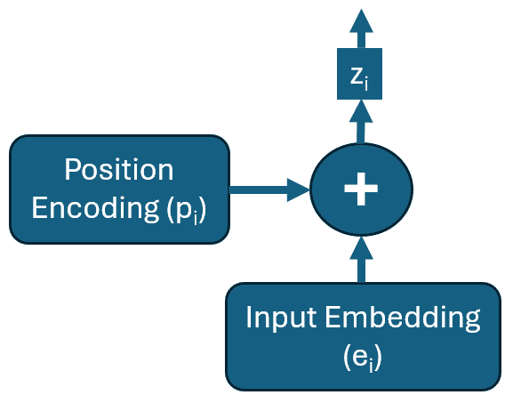
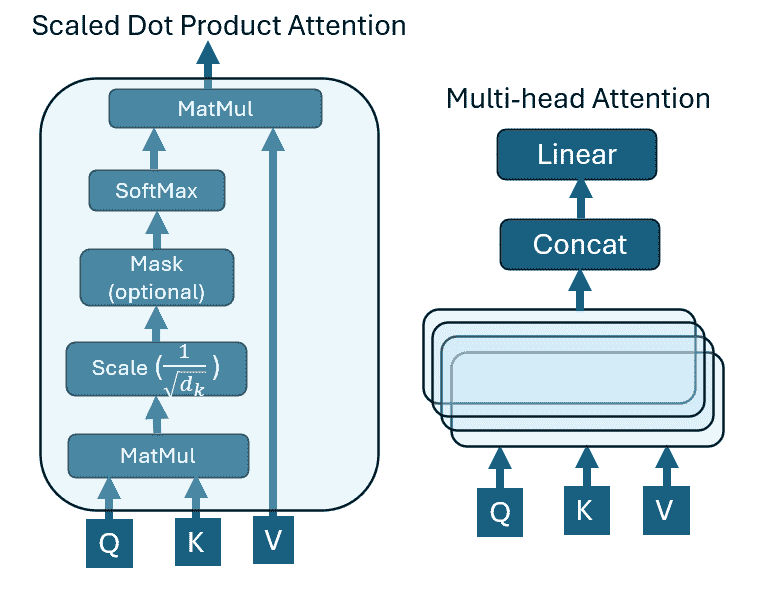
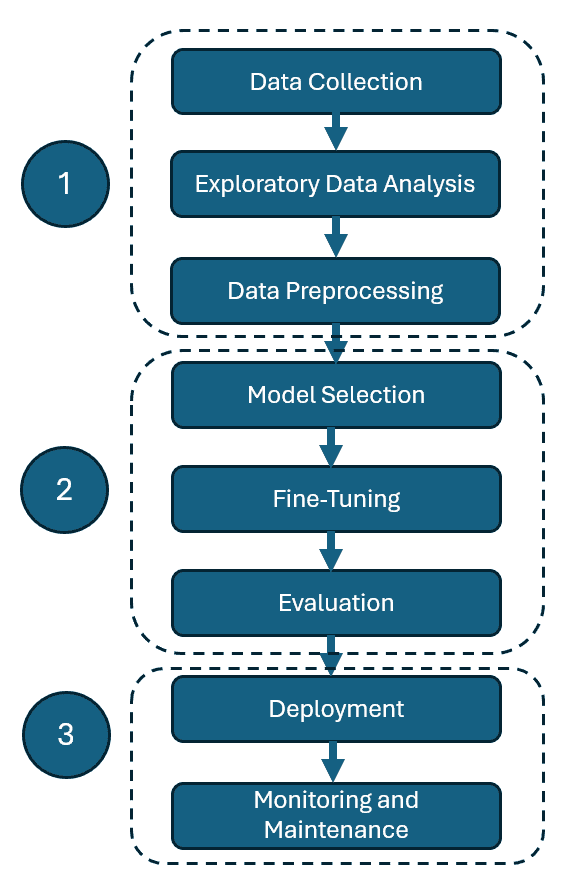

## 第 5 章：语言模型与微调简介

### 参考文献

15. 通过在真实机器人上评估深度强化学习算法进行可复现性调查：[`arxiv.org/pdf/1909.03772`](https://arxiv.org/pdf/1909.03772)

16. 策略上强化学习中什么很重要？一项大规模实证研究：[`arxiv.org/pdf/2006.05990`](https://arxiv.org/pdf/2006.05990)

17. 实现细节在深度策略梯度中很重要：基于 PPO 和 TRPO 的案例研究：[`arxiv.org/pdf/2005.12729`](https://arxiv.org/pdf/2005.12729)

18. RLlib：工业级强化学习：[`docs.ray.io/en/latest/rllib/index.xhtml`](https://docs.ray.io/en/latest/rllib/index.xhtml)

19. TorchRL：[`pytorch.org/rl/stable/tutorials/torchrl_demo.xhtml`](https://pytorch.org/rl/stable/tutorials/torchrl_demo.xhtml)

## 库与代码文档

本章代码示例中使用的库与代码文档如下。您可以利用这些资源深入了解代码实现与可视化方法：

*   [Matplotlib 文档 — Matplotlib 3.8.4 文档](https://Matplotlib)
*   [`numpy.org/devdocs/user/index.xhtml`](https://numpy.org/devdocs/user/index.xhtml)
*   [`pytorch.org/docs/stable/index.xhtml`](https://pytorch.org/docs/stable/index.xhtml)
*   [`gymnasium.farama.org/api/env/`](https://gymnasium.farama.org/api/env/)

### 加入我们的 Discord 图书社区


[`packt.link/EarlyAccessCommunity`](https://packt.link/EarlyAccessCommunity)

随着我们过渡到这一章关于语言建模与微调的内容，我们将探讨理解自然语言处理（NLP）中**大语言模型（LLMs）**至关重要的高级概念。虽然前几章涵盖了**强化学习（RL）**、基于人类反馈的强化学习（RLHF）、奖励建模与策略优化的基础知识，包括基本的深度神经网络，但本章将进阶到更复杂的架构，包括 Transformer。本章包含以下主题：

*   语言模型简介
*   Transformer 架构
*   语言模型微调
*   微调中的 RLHF
*   使用 RLHF 进行微调的评估与挑战

您将深入了解语言模型的基础与历史，学习 Transformer 的变革性影响，并发现如何针对特定任务微调预训练模型。我们还将讨论 RLHF 如何使模型与人类意图对齐，并涵盖使用 RLHF 进行微调的评估方法与伦理考量，为该领域的未来发展奠定基础。

### 技术要求

本章将所有实现相关的依赖项保持在最低限度。所有实现均采用 `python`。具体版本建议及所需安装的最低库如下：

*   `Python 版本 >= 3.9`
*   `numpy == 1.26.4`
*   `matplotlib == 3.8.4`
*   `transformers == 4.42.4`
*   `datasets == 3.0.1`
*   `ipython == 8.27.0`
*   `ipywidgets == 8.1.5`

除了上述库和安装外，我们还将使用 `google colab` 进行基于 GPU 的微调（详见微调一节）。要开始使用，请克隆此 `git` 仓库：[`github.com/PacktPublishing/A-Practical-Guide-to-Reinforcement-Learning-from-Human-Feedback`](https://github.com/PacktPublishing/A-Practical-Guide-to-Reinforcement-Learning-from-Human-Feedback)，并将目录切换到 `chapter 5`。

## 语言模型简介

传统上，**语言模型（LM）** 是概率模型，旨在根据句子中可用的前序输入词预测最可能的下一个词。预测文本中的下一个词在文本生成、翻译、摘要和情感分析等多种应用中非常有用。从更广泛的角度来看，它预测一个词序列的可能性，可用于估算给定句子的概率，或根据提示生成连贯的文本。

### 早期语言模型：N-gram

最早的语言模型依赖 **N-gram** 方法，根据前面的 n-1 个词计算一个词的概率。例如，bigram 模型（n=2）会查看给定前一个词的情况下某词的概率。虽然简单且易于实现，但 N-gram 存在显著局限性：

*   **稀疏性**：随着 n 的增大，可能的词组合数量呈指数级增长，导致数据稀疏问题。
*   **上下文局限**：它们只能考虑有限的上下文（最近的 n-1 个词），这往往导致长文本中有意义的关系丢失。
*   `<>`

### 统计语言模型与神经语言模型

为解决 N-gram 的局限性，研究者转向**统计语言模型**，采用**隐马尔可夫模型（HMM）**和**潜在狄利克雷分布（LDA）**等技术捕捉文本中更复杂的关系。然而，这些模型仍受限于对手工特征的依赖和对语言结构的假设。**神经网络**的引入标志着一个重要的转折点。早期的神经语言模型，如采用前馈架构的模型，开始引入嵌入（如 `Word2Vec`）将词表示为连续空间中的稠密向量。这种方法能够捕捉词之间的语义关系（例如，“king” - “man” + “woman” = “queen”）。

### 循环神经网络（RNN）

**RNN** 及其进阶版本**长短期记忆（LSTM）**网络的开发旨在更好地处理序列数据。它们能维护隐藏状态以记住前序词汇，从而实现更具上下文感知的预测。然而，RNN 因梯度消失等问题，难以处理长距离依赖。

### Transformer 的出现

2017 年 **Transformer 架构**的引入，正如 Vaswani 等人在论文 *Attention is All You Need* 中详述：[`arxiv.org/abs/1706.03762`](https://arxiv.org/abs/1706.03762)，彻底改变了语言建模。Transformer 使用*自注意力机制*来衡量序列中不同词的重要性，无论它们之间的距离如何。这使它们能有效捕捉长距离依赖并并行化训练，显著加快了训练过程。

### 大语言模型（LLMs）

基于 Transformer，`BERT`、`GPT-3` 等大语言模型应运而生。这些模型的特点在于：

*   **规模**：它们在海量文本数据（通常达数百 GB）上训练，包含数十亿参数，能够学习语言中的复杂模式。
*   **迁移学习**：许多 LLMs 在大量任务上预训练，再针对特定应用微调，使其能在各类 NLP 任务中良好泛化。
*   **通用性**：它们能执行零样本或少样本学习，仅需极少示例即可适应新任务。

鉴于 Transformer 模型是最先进的模型，并引领了 NLP 研究与实践的革命，我们将仅聚焦于此模型。在下一节中，我们将介绍 Transformer 架构及其组件，并展示实现片段。

## Transformer 架构


# Transformer 架构：嵌入、位置编码与注意力机制

## 简介

Transformer 的出现源于处理序列数据中长距离依赖的需求，传统的**循环神经网络**（**RNN**）在这方面表现吃力，尤其是在**自然语言处理**（**NLP**）领域。Vaswani 等人（2017 年）发表的里程碑式论文《*Attention is All You Need*》（前文已提及）介绍了 Transformer 架构，该架构用注意力机制取代了循环层。这一转变使得训练过程中的并行化更加高效，并提升了涉及大规模数据集任务的性能。Transformer 是一种旨在理解和生成数据序列（如句子）的模型。它不再按顺序逐个处理单词，而是一次性查看所有单词。其核心思想是*自注意力*，这使得模型能够根据句子各部分之间的相关性，聚焦于句子的不同部分。

## 嵌入输入

当 Transformer 处理文本时，它首先将单词转换为模型能理解的数字（向量）。这一步称为**嵌入**。例如，假设我们有一个单词序列：，其中每个`x_i`代表序列中的一个单词。由于单词被表示为独热向量（充满零的大向量，仅有一个 1 表示该单词），我们使用**嵌入矩阵** `W_e` 将这些独热向量转换为稠密、有意义的向量。顺便提一下，出于实际考虑，每个 `x_i` 可以是一个 token（单词的一种定义好的分割方式）。但为了便于理解，我们这里将每个单词视为一个 token。数学上，如果 `W_e \in \mathbb{R}^{V \times d_model}`，其中 `V` 是词汇表大小，`d_model` 是模型的隐藏维度，则每个单词嵌入为：`z_i = W_e^T x_i`。结果是一个嵌入序列：`Z = (z_1, ..., z_n)`，其中每个 `z_i` 是一个大小为 `d_model` 的稠密向量。**直观理解**：可以将嵌入视为一种捕捉单词含义的表示方式。含义相近的单词将拥有相似的嵌入，这有助于模型理解单词之间的关系。


图 5.1 嵌入输入涉及使用嵌入模型将文本单词或 token 转换为数值向量。

## 位置编码

Transformer 并行处理整个序列，但这带来了一个挑战：模型如何知道句子中单词的顺序？例如，"The sun rises from the east"（太阳从东方升起）在含义和语义上与 "The east rises from the sun"（东方从太阳升起）截然不同，尽管单词完全相同。为了解决这个问题，Transformer 向每个单词嵌入添加了所谓的*位置编码*。这种编码注入了序列中每个单词位置的信息。每个位置 `t` 的位置编码在数学上定义为：`PE(t, 2i) = sin(t / 10000^{2i/d_model})`，`PE(t, 2i+1) = cos(t / 10000^{2i/d_model})`。这为每个单词的位置创建了一个唯一的位置向量 `p_t`。模型随后将该向量加到单词嵌入上：`z_i' = z_i + p_i`。这个新序列现在成为 Transformer 编码器-解码器架构的输入，从自注意力层开始。架构的一个简单组件如下所示：



图 5.2 向输入嵌入添加位置编码，输出一个新序列 Z，该序列考虑了单词或 token 相对于其他单词/token 的位置。

位置编码帮助模型知晓单词的顺序。如果没有它，模型会将 "The sun rises from the east" 和 "The east rises from the sun" 视为相同。使用 PyTorch 可以按下面的代码片段所示实现：

```python
import torch
from torch import nn

class PositionalEncoding(nn.Module):
    def __init__(self, d_model, dropout=0.1, max_len=5000):
        super(PositionalEncoding, self).__init__()
        self.dropout = nn.Dropout(p=dropout)
        pe = torch.zeros(max_len, d_model)
        position = torch.arange(0, max_len, dtype=torch.float).unsqueeze(1)
        div_term = torch.exp(torch.arange(0, d_model, 2).float() * -(torch.log(torch.tensor(10000.0)) / d_model))
        pe[:, 0::2] = torch.sin(position * div_term)
        pe[:, 1::2] = torch.cos(position * div_term)
        pe = pe.unsqueeze(0)  # Shape (1, max_len, d_model)
        self.register_buffer('pe', pe)

    def forward(self, x):
        x = x + self.pe[:, :x.size(1), :]
        return self.dropout(x)
```

在上述片段中，我们创建了一个形状为 `(max_len, d_model)` 的零矩阵，以确保 `pe` 具有适当的维度。`d_model` 维度容纳了正弦和余弦两个分量，因此它是其参数 `position * div_term` 中项乘积的两倍。由于正弦和余弦分量内的参数都使用 `position` 作为第一项，其形状为 `(max_len, 1)`。同样，第二个 `div_term` 形状为 `(d_model/2)`，加起来为 `d_model`，一半用于正弦，一半用于余弦。在 `d_model` 中，正弦和余弦分别应用于偶数和奇数索引，正如 `pe[:, 0::2]` 和 `pe[:, 1::2]` 的实现方式所示。我们在 `PositionalEncoding` 类的 `__init__` 方法中添加所有这些内容。`forward` 方法将位置编码加到输入张量上，并在应用 `dropout` 进行正则化以防止过拟合后返回。现在我们了解了如何将位置编码添加到输入嵌入中，并融入了单词位置的重要性，接下来我们将探讨将单词关系学习联系在一起的自注意力机制。

## 自注意力：学习单词关系

**自注意力**机制是 Transformer 的核心。它允许模型在处理每个单词时，聚焦于句子中的不同单词。例如，在句子 "The sun rises from the east" 中，当模型处理 "rises" 时，它应同时关注 "sun"（主语）和 "east"（宾语）以理解含义。对于每个单词，模型创建三个向量：

*   一个**查询** `Q`，
*   一个**键** `K`，
*   一个**值** `V`。

这些向量通过将输入 `Z` 与学习到的权重矩阵相乘来计算：`Q = Z W_Q`，`K = Z W_K`，`V = Z W_V`。为了确定每个单词应给予其他单词多少注意力，模型计算一个单词的查询与所有单词的键之间的相似度分数。这通过点积和缩放完成：`scores = (Q K^T) / sqrt(d_k)`。`softmax` 函数确保分数之和为 1，将其转换为概率。这给出了值向量的加权组合，更重要的单词获得更大的权重。自注意力让每个单词"审视"句子中的其他单词，并聚焦于对理解含义最重要的那些。这就像为句子的每个部分高亮显示最重要的单词。



图 5.3 展示自注意力（缩放点积）和多头注意力的示意图。

## 多头注意力：从多视角观察


# Transformer 多头注意力实现

## 多头注意力

Transformer 不仅仅使用一种注意力机制，而是使用多个 `attention heads` 来捕捉词与词之间关系的不同方面。这被称为 `multi-head attention`。每个头使用不同的学习权重矩阵计算自己的自注意力。然后将所有头的输出拼接并投影回单个矩阵，作为 `multi-head attention` 层的最终输出。每个头可能关注不同的关系，例如一个头关注词序关系，另一个关注同义词或语法角色。这有助于模型从多个角度理解词与词之间的关系。可以将 `multi-head attention` 想象为通过不同的透镜观察一个句子。每个透镜可能关注不同的关系，例如一个头关注主谓宾关系，而另一个关注形容词等修饰语。`multi-head attention` 的输出被组合并传递给 `feed-forward network`。下面给出了读者可以如何实现这一点的代码片段。`MultiHeadAttention` 类继承自 `torch.nn.Module`，后者是 PyTorch 中所有神经网络模块的基类。构造函数使用输入大小（`d_model`）和注意力头的数量（`num_heads`）初始化注意力机制。`dense` 是每个头的维度，计算为 `d_model // num_heads`。这将整体嵌入大小分割成更小的部分，供每个注意力头使用。

### MultiHeadAttention 类

```
import torch
import torch.nn as nn
class MultiHeadAttention(nn.Module):
    def __init__(self, d_model, num_heads):
        super(MultiHeadAttention, self).__init__()
        self.num_heads = num_heads
        self.d_model = d_model
        self.depth = d_model // num_heads
        self.wq = nn.Linear(d_model, d_model)
        self.wk = nn.Linear(d_model, d_model)
        self.wv = nn.Linear(d_model, d_model)
        self.dense = nn.Linear(d_model, d_model)
```

### 分头函数

`split_heads` 函数将输入张量重塑为多个头。它首先将嵌入维度（`d_model`）分割为大小为 `depth` 的多个头，以便进行并行注意力计算。然后，它置换维度以重新组织张量形状以进行多头处理：`(batch_size, seq_len, d_model)` → `(batch_size, num_heads, seq_len, depth)`。实现 `split_heads` 函数的片段如下。

```
    def split_heads(self, x, batch_size):
        # Split the embedding into multiple heads
        x = x.view(batch_size, -1, self.num_heads, self.depth)
        return x.permute(0, 2, 1, 3)  # (batch_size, num_heads, seq_len, depth)
```

### 前向方法

`forward` 方法处理输入查询（`q`）、键（`k`）和值（`v`）。它还接受一个 `mask`，通常用于防止模型关注某些位置（例如序列中的填充标记）。它执行以下步骤：应用线性投影（`wq`、`wk`、`wv`）以计算查询、键和值。使用 `split_heads` 将结果分割为多个头。执行 `scaled dot-product attention`（详见下文）。使用 `view` 和 `dense` 将头组合回单个张量。

```
    def forward(self, q, k, v, mask):
        batch_size = q.size(0)
        # Linear projections
        q = self.wq(q)
        k = self.wk(k)
        v = self.wv(v)
        # Split heads
        q = self.split_heads(q, batch_size)
        k = self.split_heads(k, batch_size)
        v = self.split_heads(v, batch_size)
        # Scaled dot-product attention
        scaled_attention, _ = self.scaled_dot_product_attention(q, k, v, mask)
        scaled_attention = scaled_attention.permute(0, 2, 1, 3).contiguous()
        concat_attention = scaled_attention.view(batch_size, -1, self.d_model)
        return self.dense(concat_attention)
```

### 缩放点积注意力

上述调用的 `scaled_dot_product_attention` 方法构建如下。查询（`q`）与键的转置（`k.transpose(-2, -1)`）相乘，得到查询和键之间的相似度分数。这生成一个形状为 `(batch_size, num_heads, seq_len, seq_len)` 的张量。相似度分数按 `dk`（键的维度）的平方根进行缩放，这有助于防止极大的值并稳定梯度。如果提供了 `mask`，则注意力 logits 中不应被关注的位置（如填充标记）会被分配一个非常大的负值，确保其 `softmax` 值接近零。`softmax` 函数沿最后一个维度（序列长度）应用于注意力 logits，将分数转换为总和为 1 的概率。最后，注意力权重用于加权值（`v`），产生注意力机制的输出。

```
    def scaled_dot_product_attention(self, q, k, v, mask):
        matmul_qk = torch.matmul(q, k.transpose(-2, -1))  # (batch_size, num_heads, seq_len, seq_len)
        dk = k.size(-1)
        scaled_attention_logits = matmul_qk / torch.sqrt(torch.tensor(dk, dtype=torch.float32))
        if mask is not None:
            scaled_attention_logits += (mask * -1e9)
        attention_weights = nn.functional.softmax(scaled_attention_logits, dim=-1)
        output = torch.matmul(attention_weights, v) 
        return output, attention_weights
```

`scaled_dot_product_attention` 的输出为 `output` 和 `attention_weights`，其中 output 的维度为 `(batch_size, num_heads, seq_len, depth)`。

## 前馈网络

在注意力之后，模型对每个词的表示独立地应用一个 `feed-forward network`。该网络由两个线性变换组成，中间夹着一个 `ReLU` 激活函数。`FFN` 独立地作用于每个词，但有助于捕捉每个词来自注意力机制的更新表示中更复杂的交互。来自 `FFN` 的输出被传回 `multi-head attention` 层进行额外的迭代。多层注意力和 `FFN` 堆叠在一起，以加深模型的理解。

## 残差连接和层归一化

为了帮助模型更有效地学习，Transformer 使用了 `residual connections` 和 `layer normalization`。这些机制确保模型在每一步保留原始信息，并有助于稳定学习。为了帮助模型有效学习，Transformer 在注意力层和 `feed-forward` 层周围添加了 `residual connections`。这意味着每一层的输入被加到该层的输出上。每当数据通过 `self-attention` 或 `feed-forward network` 时，输入都会被加回到输出中（`residual connection`），并对结果进行归一化。这保持了信息在网络中的流动，并有助于训练稳定性。`Residual connections` 被添加在 `self-attention` 和 `feed-forward` 层周围以维护数据完整性。这些归一化后的输出在堆叠的每一层之间移动。带有 `feed-forward network` 和 `layer normalization` 的组合多头注意力可以按下面的片段类似地实现，其中 `self.fnn` 是 `feed-forward network`，`self.layernorm1` 和 `self.layernorm2` 分别是注意力输出和前馈网络输出上的层归一化。


## 编码器-解码器结构

### 编码器

编码器处理输入句子，执行多层多头注意力和前馈网络，将输入转换为丰富的表示。

### 解码器

解码器通过利用输出序列中之前的词以及编码器对输入的表示来生成输出句子（如翻译）。每个解码器层执行**自注意力**以关注迄今为止生成的输出序列，并执行**编码器-解码器注意力**以关注输入序列的编码。解码器持续这一过程，直到生成完整的输出序列。

通常，在输入传递给编码器层之前会应用位置编码。编码器类可以如下所示编写，集成了位置编码和 Transformer 编码器层：

```python
class TransformerEncoderLayer(nn.Module):
    def __init__(self, d_model, num_heads, d_ff, dropout_rate=0.1):
        super(TransformerEncoderLayer, self).__init__()
        self.attention = MultiHeadAttention(d_model, num_heads)
        self.ffn = nn.Sequential(
            nn.Linear(d_model, d_ff),
            nn.ReLU(),
            nn.Linear(d_ff, d_model)
        )
        self.layernorm1 = nn.LayerNorm(d_model)
        self.layernorm2 = nn.LayerNorm(d_model)
        self.dropout1 = nn.Dropout(dropout_rate)
        self.dropout2 = nn.Dropout(dropout_rate)

    def forward(self, x, mask):
        attn_output = self.attention(x, x, x, mask)
        out1 = self.layernorm1(x + self.dropout1(attn_output))  # 残差连接
        ffn_output = self.ffn(out1)
        return self.layernorm2(out1 + self.dropout2(ffn_output))  # 残差连接
```

```python
class TransformerEncoder(nn.Module):
    def __init__(self, d_model, num_heads, d_ff, num_layers, dropout_rate=0.1):
        super(TransformerEncoder, self).__init__()
        self.positional_encoding = PositionalEncoding(d_model, dropout_rate)
        self.enc_layers = nn.ModuleList([TransformerEncoderLayer(d_model, num_heads, d_ff, dropout_rate) for _ in range(num_layers)])

    def forward(self, x, mask):
        x = self.positional_encoding(x)
        for layer in self.enc_layers:
            x = layer(x, mask)
        return x
```

以上代码片段仅旨在帮助读者了解如果仅使用 `PyTorch` 从头构建 Transformer，我们该如何实现 Transformer 编码器。我们已提供构建编码器的所有片段，并添加到了 GitHub 仓库中，位于 `chapter5` 目录下，文件名为 `transformer_encoder.py`。上述片段将帮助读者自行验证理解；下面的测试片段将帮助读者验证组件是否正常工作。

```python
def test_transformer_components():
    pos_encoding = PositionalEncoding(d_model=64)
    sample_input = torch.randn(10, 50, 64)  # (batch_size, seq_len, d_model)
    pos_encoded_output = pos_encoding(sample_input)
    assert pos_encoded_output.shape == sample_input.shape, "Positional encoding test failed!"
    self_attn = MultiHeadAttention(d_model=64, num_heads=8)
    attn_output, _ = self_attn(sample_input, sample_input, sample_input)
    assert attn_output.shape == sample_input.shape, "Multi-head attention test failed!"
    enc_layer = TransformerEncoderLayer(d_model=64, num_heads=8, d_ff=256)
    encoder_output = enc_layer(sample_input, None)
    assert encoder_output.shape == sample_input.shape, "Encoder layer test failed!"
    print("All tests passed!")

test_transformer_components()
```

对于文本生成等任务，解码器层负责按顺序生成 Token。它使用掩码自注意力以确保未来的 Token 对模型不可见，从而保持自回归行为。解码器在结构上与编码器相似，但有关键区别：

*   **`掩码多头注意力`**：这确保了在预测下一个 Token 时，解码器只关注迄今为止生成的 Token，而不关注未来的 Token。这种掩码对于自回归任务至关重要，在该任务中你希望逐步生成序列。
*   **`交叉注意力层`**：除了自注意力（类似于编码器）外，解码器还有一个额外的注意力层，用于关注来自编码器的输出。这使得解码器在生成输出时能够关注输入序列的相关部分。

在实践中，Transformer 实现使用分布式训练框架来提高训练效率，且实现可能非常复杂。然而，有几个库提供了 Transformer 实现，例如 `PyTorch`、`HuggingFace` 和 `TensorFlow` 都有 Transformer 实现。在本章中，我们已在上文展示编码器和表示学习片段。解码器方面对于序列生成是必要的，我们将从现在开始使用 Transformer 库来简化实现，并更多地关注使用预训练模型进行微调，而不是从头训练语言模型。关于从头训练 Transformer 和生成式预训练 Transformer (`GPT`) 模型的良好参考资料可在此阅读：https://mng.bz/M96o。虽然我们在本节讨论了 Transformer 如何构建及其架构组件，但我们现在将重点放在后续章节中通过实战示例将它们作为微调语言模型来使用。

## 微调语言模型

在本节中，我们将首先了解如何加载预训练语言模型，然后逐步讲解微调过程。预训练语言模型是具有 Transformer 架构的模型，它们已经在大量数据（本例中为文本数据）上进行过训练。当我们试图解决可以利用先前学习到的技能或表示的类似问题时，这能显著节省时间。在预训练模型上进行微调还有助于减少碳足迹，因为训练大型模型需要大量能源。

我们现在将探索 `HuggingFace` Transformer 库，它为各种自然语言处理 (`NLP`) 任务（如文本分类、翻译和摘要）提供了多种预训练模型和工具。它是一个用于处理最先进 Transformer 模型的流行库。此外，它还支持跨多种模态（如文本、视觉和音频）执行任务。除了 Transformer 库，我们还将使用 `Hugging Face` 的 `datasets` 库，它提供了对大量数据集的便捷访问以及用于数据处理的实用工具。使用 `datasets` 库简化了加载、转换和预处理数据集等任务，这些是训练机器学习模型工作流中的常见环节。这种简化将使我们能够专注于使用这些数据集从预训练模型进行推理，随后用特定数据对其进行微调。

与传统机器学习工作流不同，微调模型工作流涉及模型选择、微调和评估阶段，而不是训练和评估阶段。就数据准备阶段而言，它与 `ML` 工作流存在一些相似之处。在图 4 中，我们可以看到工作流可分为三个阶段：1) 数据准备，包括收集、探索性分析和预处理，2) 模型选择、调优模型和评估，3) 部署、监控和维护。第一和第三阶段与传统机器学习工作负载相似，因此我们将主要依赖 `datasets` 库完成第一阶段，该库拥有各种数据集。



图 5. 4 显示各个阶段的微调工作流。


## 设置

具有合理规模的 Transformer 模型需要配备图形处理单元（GPU）的硬件，才能在合理的时间内完成训练。虽然微调能减少训练时间，但它同样需要 GPU 来加速训练。对于本章的练习，我们将使用它们来减少训练时间开销。有几种使用 GPU 设置训练工作流的选项：

*   获取一台配备 GPU 硬件的本地机器（台式机或笔记本电脑）并启用 GPU 访问。要查看 NVIDIA GPU 详细信息，可以在命令行界面中运行此命令，具体取决于你使用的是 Windows 还是 Mac 操作系统：`nvidia-smi`。
*   购买提供 GPU 的云资源，如虚拟机 (VM) 或容器；主要的有 Azure、AWS 和 Google Cloud。
*   Google Colab Pro、Lambda Labs、Azure ML 服务和 Amazon SageMaker 等服务也是一种选择。

认真投入开发工作流的读者可以尝试上述任何选项，并查阅相应的文档。对于学习和自我教育而言，使用任何云资源和/或服务的免费层级是一个很好的起点。为了本章的目的，我们将坚持采用一个最包容的选项；这意味着使用免费层级或低成本选项微调轻量级语言模型，以便学生和仅想尝试、自学的读者能够负担得起。其中一个选项是使用免费的 Google Colab 笔记本，或在需要时订阅月度会员。我们还将使用一些 Hugging Face `datasets` 库以及来自 `transformers` 库的预训练模型。请注意，Google Colab 会预装一些基本的机器学习库，但像 `datasets` 这样的某些库需要使用类似 `!pip install datasets` 的命令进行安装。在笔记本中，我们将首先安装和/或导入所有必需的库，如下所示。

```
# Import libraries
from transformers import AutoTokenizer, AutoModelForSequenceClassification, TrainingArguments, Trainer
from datasets import load_dataset
import torch
import numpy as np
from sklearn.metrics import accuracy_score, f1_score
```

### 数据集

让我们了解一下使用 `datasets` 库进行数据准备的步骤。使用 `datasets` 库，我们可以轻松加载数据，从而简化数据收集步骤。为了在本章中演示如何微调以及它如何改进推理，我们将仅加载数据集的一个子集。我们现在将加载 "imdb" 数据集的一个子集（约 1000 个样本），它是来自流行的互联网电影数据库 (IMDB) 来源的 Hugging Face `datasets` 库的一部分。然后，使用 `train_test_split` 方法将数据拆分为 80% 的训练数据和 20% 的测试数据。

```
# Load dataset
dataset = load_dataset("imdb", split="train[:1000]")  # Sample a subset to keep it lightweight
dataset = dataset.train_test_split(test_size=0.2)  # Split into train and test
train_dataset, test_dataset = dataset['train'], dataset['test']
```

Hugging Face 的 `datasets` 库主要以 `Dataset` 对象的形式加载数据。当你加载数据集时，它会将多个分割（如 'train'、'validation'、'test'）组织成一个类字典结构，其中每个键对应一个特定的分割，值为 `Dataset` 对象。`DatasetDict` 是一个包含数据集分割的专用字典。`DatasetDict` 中的每个条目都是一个 `Dataset` 对象，它提供对数据的高效访问，并具有映射、过滤和处理等功能。我们使用训练分割及其中的 1000 个样本，以保持训练的轻量级。接下来，我们将检查一些样本，并查看训练和测试数据集的大小。

```
# EDA - Check some samples
print("Sample Data: ", train_dataset[0])
print("Training Data Size:", len(train_dataset))
print("Testing Data Size:", len(test_dataset))
# Distribution of labels
print("Label Distribution: ", train_dataset.features['label'].names)
```

我们可以看到电影评论的样本文本、数据大小以及基于情感的标签分布：

```
Sample Data: {'text': "Holy freaking God all-freaking-mighty. This movie was so bad, I thought I was on drugs. In a bad way... The character acting is the poorest thing I've seen in quite some time. This movie was more akin to Lord of the G-Strings, IMHO(it's a real movie). Most of the movie appeared to be done on a horrible green screen. My favorite part was when they are in the carriage, and you can tell there's no horse. They're fleeing from alien monsters, and going about the same speed as a swift jog. Then it switches to a far-shot with a ridiculous CG horse. And the CG in general seems to be sub-par to 1992's Beyond the Mind's Eye. I mean, Come on, really. It felt like a horrible episode of Hercules, only without Kevin Sorbo there to save the day. Worst. Movie. Ever.", 'label': 0}
```

```
Training Data Size: 800
Testing Data Size: 200
Label Distribution:  ['neg', 'pos']
```

如果你在单个单元格中加载数据集且不进行拆分，你将看到数据加载进度和以 `.parquet` 格式存储的文件。这种选择是为了其高效的列式存储，可加快数据加载速度并通过压缩减小文件大小。它们还支持模式演进，并能与大数据工具良好集成，从而提升整体性能和灵活性。

### 分词

分词过程涉及使用特定的分词器类（如 `BertTokenizer` 或 `GPT2Tokenizer`），它们实现了诸如子词分词（例如 `WordPiece` 或 `Byte Pair Encoding`）等策略，以处理未知词汇并减小词表大小。分词器还会插入特殊标记（如用于分类的 `[CLS]`），并将文本转换为对应模型词表中标记的数字标识符。它们生成注意力掩码以指示应处理哪些标记，并生成片段标识符以区分输入片段。此外，分词器可以填充或截断序列以保持一致的输入长度，使从原始文本到模型就绪输入的转换对于各种 NLP 任务来说既高效又有效。在这里，我们将使用来自 `transformers` 库的一个特定分词类——`AutoTokenizer` 类，它允许你为指定模型加载分词器。对于这种特定情况，我们指定加载 `DistilBERT` 模型的分词器，这是 `BERT` 的一个更小、更快的版本，且为 uncased（即不区分大小写字母）。下面的代码片段展示了如何加载分词模型并将其应用于数据分词。

```
# Load tokenizer
tokenizer = AutoTokenizer.from_pretrained("distilbert-base-uncased")
# Tokenize the datasets
def tokenize_data(example):
    return tokenizer(example['text'], padding="max_length", truncation=True)
train_dataset = train_dataset.map(tokenize_data, batched=True)
test_dataset = test_dataset.map(tokenize_data, batched=True)
# Set format for PyTorch
train_dataset = train_dataset.rename_column("label", "labels").with_format("torch")
test_dataset = test_dataset.rename_column("label", "labels").with_format("torch")
```

`tokenize_data` 函数使用加载的分词器，查找 `text` 字段中的文本值。参数 `padding="max_length"` 和 `truncation=True` 确保所有分词输出长度一致，将较短序列填充至最大长度并截断较长序列。`dataset.map` 方法以批处理方式将 `tokenize_data` 函数应用于整个数据集，意味着它一次处理多个示例。这很高效，并能加快分词过程。

### 模型推理


## 模型选择与基线评估

在将数据预处理为标记化数据集后，下一步涉及模型选择，并使用它进行推理和测试。我们将使用来自 `transformers` 库的 `AutoModelForSequenceClassification` 类。该类允许您根据提供的模型名称（例如 `distilbert-base-uncased`）自动加载适合序列分类的模型。这提供了灵活性，可以轻松在不同模型之间切换，而无需担心底层架构。它还会自动获取与该模型关联的配置，其中包含输出类别数量等详细信息，并与相应的分词器无缝协作。模型的输出包括 `logits`，可以使用 `softmax` 函数将其转换为概率。这对于确定给定输入的预测类别概率很有用。模型加载主要是指定模型并使用 `AutoModel` 方法。

```
# Load the pretrained model
model = AutoModelForSequenceClassification.from_pretrained("distilbert-base-uncased", num_labels=2)
```

为了评估模型，我们编写一个函数来计算一些指标。这里我们将使用 `accuracy_score` 将预测输出与电影评论情感得分的 `labels` 进行核对，然后我们还使用加权平均 `f1_score` 来比较 `labels` 和 `predictions`：

```
# Evaluation function
def compute_metrics(pred):
    logits, labels = pred
    predictions = np.argmax(logits, axis=-1)
    accuracy = accuracy_score(labels, predictions)
    f1 = f1_score(labels, predictions, average="weighted")
    return {"accuracy": accuracy, "f1": f1}
```

在下面的代码片段中，我们对加载的 20% 测试集数据 `test_dataset` 进行推理。由于模型是预训练的，我们将仅使用基础模型进行推理，并将此评估视为基线评估，以便稍后与微调进行比较。从 `transformers` 库导入的 `TrainingArguments` 和 `Trainer` 方法用于指定预测参数。注意，我们禁用了向 `Weights & Biases`（一个实验跟踪框架）记录日志。但是，读者可以移除 `report_to = 'none'` 这一行以启用默认的 Weights and Biases 实验框架。使用实验框架将需要订阅密钥。还有其他开源版本，如 `Mlflow`，读者可以稍后探索。通常这在实际项目中很有帮助，您可能想跟踪实验进度，因为这涉及基于权重、 `batch size`、 `tokenization` 以及 `GPT` 类实验中的 prompts 进行 `hyperparameter tuning`。目前我们不需要它。

```
# Trainer for evaluation
training_args = TrainingArguments(
    output_dir="./results",
    per_device_eval_batch_size=8,
    report_to='none')                # Disable logging to W&B)
trainer = Trainer(model=model, args=training_args, eval_dataset=test_dataset, compute_metrics=compute_metrics)
# Baseline evaluation
baseline_results = trainer.evaluate()
print("Baseline Results:", baseline_results)
```

运行推理后，输出可能会包含一条消息，指示某些权重未从模型检查点初始化。目前可以忽略它。这主要用于从精确权重恢复训练的模型，但这不是我们这里的目标。输出将如下所示： `DistilBertForSequenceClassification` 的某些权重未从 `distilbert-base-uncased` 的模型检查点初始化，而是新初始化的： `['classifier.bias', 'classifier.weight', 'pre_classifier.bias', 'pre_classifier.weight']`。您可能应该在下游任务上 `TRAIN` 该模型，以便将其用于预测和推理。推理的输出 `baseline_results` 将显示如下内容：

```
Baseline Results: {'eval_loss': 0.6827018857002258, 'eval_model_preparation_time': 0.0025, 'eval_accuracy': 0.765, 'eval_f1': 0.8668555240793201, 'eval_runtime': 3.0755, 'eval_samples_per_second': 65.03, 'eval_steps_per_second': 8.129}
```

我们稍后将使用这些结果，在使用训练数据微调模型后进行比较。

### 微调

现在，我们在特定数据集上训练预训练的 Transformer 模型（本例中为前几节讨论的 `DistilBERT`），以提高其在目标任务上的性能，例如对来自 `IMDB` 的电影数据集进行情感分类。我们首先定义 `training arguments`，指定关键超参数，如 `learning rate`（模型更新的速度）、 `batch size`（每个训练步骤处理的样本数）、 `epochs` 数量（完整遍历数据集的次数）和 `weight decay`（防止过拟合）。接下来，我们初始化一个 `Trainer` 对象，它通过组合模型、训练参数、数据集和计算评估指标的函数来自动化微调过程。当我们调用 `trainer.train()` 时，它会以批次为单位遍历训练数据，使用 `loss function` 在每个批次上调整模型参数，逐步调整模型权重以更好地预测任务的标签。在此微调过程中，模型学习数据集特有的模式，这增强了其对同一类别中新样本进行分类的能力，并且预期该调整后的模型将比基线预训练版本表现更好。

```
# Fine-tuning arguments
training_args = TrainingArguments(
    output_dir="./results",
    evaluation_strategy="epoch",
    learning_rate=2e-5,
    per_device_train_batch_size=8,
    per_device_eval_batch_size=8,
    num_train_epochs=3,
    weight_decay=0.01,
    report_to='none'
)
# Trainer for fine-tuning
trainer = Trainer(
    model=model,
    args=training_args,
    train_dataset=train_dataset,
    eval_dataset=test_dataset,
    compute_metrics=compute_metrics,
)
# Fine-tuning
trainer.train()
```

该单元格的训练输出将如下所示：

| Epoch | Training Loss | Validation Loss | Accuracy | F1 |
| --- | --- | --- | --- | --- |
| 1 | No log | 0.001113 | 1.000000 | 1.000000 |
| 2 | No log | 0.000520 | 1.000000 | 1.000000 |
| 3 | No log | 0.000415 | 1.000000 | 1.000000 |

```
TrainOutput(global_step=300, training_loss=0.01779682795206706, metrics={'train_runtime': 134.3684, 'train_samples_per_second': 17.861, 'train_steps_per_second': 2.233, 'total_flos': 317921756774400.0, 'train_loss': 0.01779682795206706, 'epoch': 3.0})
```

### 评估

评估训练好的模型是机器学习中必不可少的一步。微调模型也是如此。过程相似，但稍后我们将讨论一些大语言模型微调特有的挑战。对于上述微调模型的评估，我们使用刚才用于微调的 `trainer` 类的 `evaluate` 方法，并与 `baseline` 进行比较。

```
# Evaluation after fine-tuning
fine_tuned_results = trainer.evaluate()
print("Results after Fine-Tuning:", fine_tuned_results)
# Compare baseline and fine-tuned results
print("Improvement in Accuracy:", fine_tuned_results['eval_accuracy'] - baseline_results['eval_accuracy'])
print("Improvement in F1 Score:", fine_tuned_results['eval_f1'] - baseline_results['eval_f1'])
```

微调结果输出以及微调模型与基线之间的准确率和 F1 分数差异如下所示：

```
Results after Fine-Tuning: {'eval_loss': 0.00041467114351689816, 'eval_accuracy': 1.0, 'eval_f1': 1.0, 'eval_runtime': 3.3424, 'eval_samples_per_second': 59.837, 'eval_steps_per_second': 7.48, 'epoch': 3.0}
Improvement in Accuracy: 0.235
Improvement in F1 Score: 0.1331444759206799
```

注意，仅查看正向提升表明微调确实有帮助，但我们将查看百分比提升以了解微调的相对影响。


# 微调中的 RLHF

```python
# Calculate percentage improvement for accuracy and F1 score
accuracy_improvement = ((fine_tuned_results['eval_accuracy'] - baseline_results['eval_accuracy']) / baseline_results['eval_accuracy']) * 100
f1_improvement = ((fine_tuned_results['eval_f1'] - baseline_results['eval_f1']) / baseline_results['eval_f1']) * 100
print(f"Percentage Improvement in Accuracy: {accuracy_improvement:.2f}%")
print(f"Percentage Improvement in F1 Score: {f1_improvement:.2f}%")
```

微调后的模型将 `accuracy` 提升了 %，将 `F1 score` 提升了 %。请注意，对于随机选取的数据子集，这些数字会略有不同，读者可以通过实验调整训练参数来改进结果或观察进一步的变化。

```
Percentage Improvement in Accuracy: 30.72%
Percentage Improvement in F1 Score: 15.36%
```

这里要记住的一个重要点是，`Accuracy` 和 `F1 Score` 是改进和优化训练的良好指标，或者用来了解训练是否存在明显错误，例如评估数据集不正确、数据不平衡，或微调训练数据不足。传统上用于 NLP 任务的其他指标，例如用于衡量模型输出中 n-gram 精确度的 `BLEU (Bilingual Evaluation Understudy)`，以及用于比较 n-gram、词序列和词对重叠度的 `ROUGE (Recall-Oriented Understudy for Gisting Evaluation)`，传统上用于机器翻译和其他任务。当我们必须考虑与词语位置相关的语义时，这些指标可能会产生误导，而其他方法——即实际文本输出可以由领域专家评估、通过人工检查评估，或由更复杂的 AI 模型裁判评估——可能更有效。这是当前研究以及新兴实践的主题。微调演示笔记本也可在 GitHub 仓库的 chapter5 下找到。在了解了微调如何提供帮助后，我们现在将讨论将 `RLHF` 与微调相结合的各种方式。

将 `RLHF`（`Reinforcement Learning from Human Feedback`，基于人类反馈的强化学习）集成到微调过程中，可以改善微调模型与人类对输出期望的一致性。对于上述使用 `transformers` 库进行微调的过程，这将涉及调整微调流程，以纳入人类反馈作为模型输出优化的额外指导。虽然 Hugging Face 的 `Trainer` 类抽象了微调的大部分细节，但 `RLHF` 通常需要更多定制，特别是为了管理反馈循环并应用强化学习技术，而不是（或除了）我们在上一节中使用特定数据集尝试的标准监督微调方法。以下是 `RLHF` 在概念上如何引入：

1.  `Feedback Collection`（反馈收集）：首先，收集人类对模型输出的反馈，例如基于相关性或质量对模型输出进行评分或二元偏好选择。例如，您可以向人工评审员展示模型的回复，请他们对每个回复的正确性或质量进行评分。
2.  `Reward Modeling`（奖励建模）：利用这些反馈训练一个*奖励模型*，它将作为一个函数来估算给定输出的质量。该奖励模型成为基于学习到的人类偏好来“评估”每个输出期望程度的额外工具。
3.  `Policy Optimization`（策略优化）：集成强化学习技术，如 `Proximal Policy Optimization (PPO)`（近端策略优化），利用奖励模型的分数来优化模型的策略（其生成输出的行为）。在训练期间，模型的权重会被调整以最大化来自奖励模型的预期奖励，而不仅仅是最小化交叉熵损失。这可以通过创建一个循环来实现：模型生成输出，通过奖励模型接收反馈，然后更新权重以倾向于预测奖励较高的输出。
4.  `Training with Trainer or Custom Loop`（使用 Trainer 或自定义循环进行训练）：Hugging Face 的 `Trainer` 类可能需要进行定制，或替换为更灵活的强化学习循环。使用定制版的 `Trainer` 或特定的 RL 库（如 `CleanRL` 或 `Stable Baselines3`），训练循环将涉及在生成输出、使用奖励模型评估输出、以及基于接收到的奖励信号进行反向传播之间交替进行，从而强化更符合人类偏好的行为。

将 `RLHF` 与 Hugging Face 的 `Trainer` 类集成需要大量定制，因为 `Trainer` 主要是为监督学习设计的。然而，有一些专门的框架和库通过提供定制的强化学习组件（包括对奖励建模和策略优化的支持），使 `RLHF` 的实现更易于管理。以下是选项概述，包括对 `Trainer` 的定制和替代库：

## 使用 Hugging Face TRL 库中的 TRLX

`TRL (Transformer Reinforcement Learning)` 是由 Hugging Face 开发的库，专门设计用于促进针对 Transformer 的 `RLHF`。`trlX` 库扩展了 Hugging Face 模型，并集成了 RL 算法，如 `Proximal Policy Optimization (PPO)`（在上一章中进行了大量讨论），该算法常用于 `RLHF` 设置中。

*   `Advantages`（优势）：`trlX` 专门构建用于处理 Transformer 的 `RLHF`，使得在 Hugging Face 模型之上直接实现基于奖励的优化和策略训练变得更简单。
*   `Features`（特性）：包含优化的基于奖励的训练循环、奖励模型，并支持流行的 RL 算法（如 `PPO`）。它可以利用相同的 Hugging Face Transformers 模型，保持与预训练检查点的兼容性，并允许集成 Hugging Face 数据集。

`trlX` 是一个有力的选择，因为它专为语言模型和其他基于 Transformer 的架构设计，减少了对自定义代码的需求，并在 Hugging Face 模型生态系统上实现了高效的 RL 训练。

## 使用奖励驱动损失定制 Trainer

如果您想为 `RLHF` 扩展 `Trainer`，则需要进行定制以实现涉及奖励建模和基于强化学习的优化的反馈循环：

*   `Reward Modeling`（奖励建模）：使用人类反馈数据训练一个单独的奖励模型，根据与人类偏好的一致性对输出进行评分。
*   `Loss Adjustment`（损失调整）：修改损失函数以同时包含监督损失和奖励驱动组件。在训练期间，模型的权重会被调整以最大化来自奖励模型的预期奖励，而不仅仅是最小化交叉熵损失或其他监督损失。这可以通过创建一个循环来实现：模型生成输出，通过奖励模型接收反馈，然后更新权重以倾向于预测奖励较高的输出。

这种方法灵活但可能复杂且计算成本高昂。您可能还需要构建额外的定制来处理轨迹生成和采样，特别是如果您需要使用 `PPO` 或其他 RL 算法进行稳定训练时。

## 使用强化学习库

像 `CleanRL` 和 `Stable Baselines3` 这样的库提供强化学习算法和训练工具，如果您需要更高级的 `RLHF` 设置或想超越基于文本的模型，这些库会很有帮助：

*   `Integration Approach`（集成方法）：将这些库与 Hugging Face Transformer 模型结合，模型生成输出动作，反馈被转化为通过 `CleanRL` 或 `Stable Baselines3` 的 `PPO` 实现处理的奖励。
*   `Advantages`（优势）：这些库针对 RL 任务进行了高度优化，支持使用 `PPO`、`A2C` 和 `DDPG` 等算法进行稳定训练。它们还提供用于监控和调试 RL 训练的额外工具。


**局限性**：与 `TRLX` 相比，集成更为复杂，因为这些库并非专门为 Transformer 或语言模型设计，因此需要一些手动配置和 API 集成。

## 使用 OpenAI 的 `spinningup` 或自定义 `PPO` 实现

自定义 `PPO` 实现或使用某些库（如 OpenAI 的 `spinningup`）仅需最少量的 `PPO` 或其他 `RL` 算法实现，即可提供对 `RL` 训练过程各个方面的完全控制，从而实现彻底的定制以满足 `RLHF` 需求。这需要更多的编码和调试，因为每一步——从模型推演到奖励处理再到梯度更新——都需要手动实现。在上一章中，我们介绍了如何通过模块化和改造 `CleanRL` 的 `PPO` 实现，来实现更灵活的集成和定制，以及提供对 `RL` 组件的可见性。这有利于深入理解，然而，我们使用的是相对易于管理的策略架构，引入 Transformer 架构将给代码库带来进一步的复杂性。计划开发、维护和演进自己代码库的读者可以采用并选择此方案。然而，既然我们在这里依赖 `transformers` 库，我们将使用诸如 `trl` 和 `trlX` 之类的库来帮助加快学习和实验，同时减少代码管理开销。这也将使我们能够专注于提高 `RLHF` 流程的有效性、简化和优化。虽然我们讨论了将 `RLHF` 与微调集成的各种方式，但在这一节中，我们将在第 8 章更详细地讨论 `RLHF` 实现。在下一节中，我们将继续讨论微调中的评估以及微调中涉及的、使实施 `RLHF` 成为必要的挑战。

## 微调中的评估与挑战

在之前的微调部分，我们使用准确率得分和 F1 得分作为评估指标来评估微调效果。通过将基线模型的推理结果与微调模型的推理结果进行比较，我们能够比较微调模型带来的进步。我们将在第 11 章更详细地讨论评估指标和方法。在本节中，我们将讨论微调模型评估中的常见挑战，`RLHF` 如何帮助解决其中一些挑战，以及仍需由 `RLHF` 解决的挑战。

*   **指标选择：** 选择合适的评估指标很复杂。准确率和 F1 得分等传统指标可能无法充分捕捉语言生成的细微差别，如连贯性、相关性或创造性。例如，上一节中用于情感评分的准确率和 F1 得分可以提供一些见解，但它们可能不足以在复杂的文本生成和理解场景中进行全面评估。`RLHF` 可以通过将人类反馈直接纳入训练过程来增强指标选择，使模型能够针对人类认为有价值的特质进行优化。这可以产生更细致的指标，更好地反映与人类用户交互时的真实性能。

*   **指标间的权衡：** 有时优化模型性能的一个方面（如流畅度）会对另一个方面（如事实准确性）产生负面影响，这使得平衡相互竞争的目标变得困难。`RLHF` 可以通过允许人类评估者根据预期用例优先考虑某些特质，来帮助找到更有利的平衡，从而实现更量身定制的性能调整。

*   **可解释性：** 理解模型表现好或差的原因可能具有挑战性，这使得评估过程和改进模型的工作都变得复杂。`RLHF` 可以通过使决策过程更透明来增强可解释性，因为模型从关于什么被认为是好或坏表现的明确人类反馈中学习。

*   **上下文敏感性：** 模型输出的有效性会因上下文而大相径庭，这使得孤立的评估信息量较小。如果收集了此类反馈，`RLHF` 可以通过提供强调情境相关性和适当性的反馈，帮助模型变得更具上下文感知能力。

除了这些挑战之外，微调模型在不同领域（如医疗与日常对话）通常表现出不同的性能水平，这使得泛化能力的评估变得复杂。这被称为领域变异性。`RLHF` 可以通过利用与这些语境相关的人类反馈，帮助针对特定领域定制模型，从而可能提高目标领域内的性能和泛化能力。然而，它可能无法完全解决跨多样化、未预见领域的性能变异性，因为模型的训练数据和反馈本质上局限于已知语境。

### 概要

本章向您介绍了语言模型，从语言模型的历史演变讲起，从早期模型到基于神经网络的模型，再到基于 Transformer 的模型的出现。然后，深入讨论了 Transformer 架构，重点关注编码器架构，以帮助读者理解 Transformer 的内部工作原理，并配合一些 `transformers` 库的实操使用。接着讨论了语言模型微调。讨论了微调工作流，随后演示了一个使用 `transformers` 库、`datasets` 库、分词、模型推理和微调的示例用例，针对电影数据库的评论及其人工提供的情感评分进行评估，帮助用户获得实操体验并认识到微调如何改进模型预测。随后讨论了如何将 `RLHF` 融入微调以及使用 `RLHF` 的可能可行方案。这里还讨论了使用微调评估指标的一些注意事项和挑战，以及 `RLHF` 如何弥补这些不足。在下一章中，我们将讨论与参数高效微调相关的具体微调技术。

### 参考文献

以下是本章使用的参考资料链接。

*   \[1706.03762\] 注意力就是你所需要的一切 (arxiv.org)

*   [`mng.bz/M96o`](https://mng.bz/M96o)
