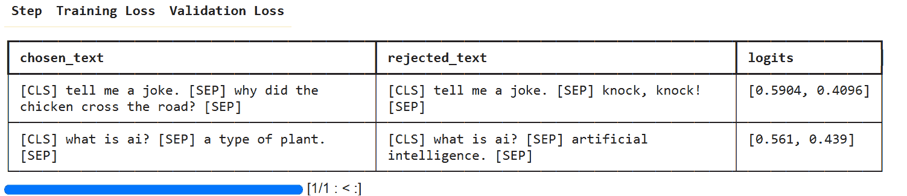

## 第 7 章：语言模型调优的奖励建模

### 加入我们的 Discord 图书社区


[`https://packt.link/EarlyAccessCommunity`](https://packt.link/EarlyAccessCommunity)


# 语言奖励建模

## 简介

在上一章中，我们介绍了**参数高效微调**（**PEFT**）技术，例如**低秩适应（LoRA）**，并演示了如何使用 `trl` 库通过**监督微调**（**SFT**）高效地**微调（FT）**大语言模型（LLM）。虽然微调有助于将预训练模型与特定数据集或下游任务对齐，但它往往难以将模型的行为与细微的**人类偏好**对齐。因此，SFT 通常被视为**基于人类反馈的强化学习（RLHF）**流程中的**第一阶段**。为了弥合任务性能与人类对齐行为之间的差距，RLHF 在 SFT 之外引入了两个关键阶段：**奖励建模**——基于人类偏好学习奖励函数。**策略优化**——利用奖励模型通过强化学习微调模型。本章重点关注其中的第一个阶段：**奖励建模过程**。我们将探讨如何收集人类偏好，如何利用它们训练奖励模型，以及该模型如何实现语言模型输出与人类期望的更好对齐，并讨论构建奖励模型所需的步骤。

### 关键主题

* 语言奖励建模简介
* 数据预处理与偏好数据收集
* 探索奖励建模技术
* 模型评估与迭代

### 技术要求

本章将所有实现相关的依赖项保持在最低限度。所有实现均基于 `Python`。具体版本建议及所需安装的最低库如下：

* `Python` 版本 >= 3.9
* `numpy` == 1.26.4
* `matplotlib` == 3.8.4
* `transformers` == 4.42.4
* `datasets` == 3.0.1
* `ipython` == 8.27.0
* `ipywidgets` == 8.1.5

除了上述库和安装外，我们还将使用 **Google Colab** 进行基于 GPU 的微调，并在笔记本中安装 `TRL` 库。要开始操作，请克隆此 Git 仓库：[`github.com/PacktPublishing/A-Practical-Guide-to-Reinforcement-Learning-from-Human-Feedback`](https://github.com/PacktPublishing/A-Practical-Guide-to-Reinforcement-Learning-from-Human-Feedback)，并将目录切换到 `chapter 7`。

## 语言奖励建模概述


# 大语言模型与奖励建模

## 预训练与幻觉

大语言模型（LLM）通常使用监督学习目标（如 `cross-entropy loss`）在大规模语料库上进行预训练，这优化了模型以准确预测下一个 token。这种预训练使生成流畅且句法正确，但无法保证输出在事实上准确、有用或与用户意图一致。这种脱节常导致 `hallucination`（幻觉）等现象，即模型生成听起来自信但错误、无用或误导性的信息。

## 监督微调的局限性

为解决此类缺陷，通常采用 `SFT`（监督微调）将模型适配到特定任务数据集。虽然 `SFT` 提高了任务相关性并减少了一些不良行为，但它仍受限于训练数据的静态性质，且未融入主观的人类偏好。例如，给定两个看似合理的回复，`SFT` 无法提供机制来指示哪个更有用或更符合人类价值观。

## RLHF 中的奖励建模

`Reward modeling (RM)`（奖励建模）通过学习一个基于人类反馈将模型输出映射为标量奖励值的函数，解决了这一局限。最常见的方法是收集比较数据，标注员评估针对同一提示词的模型回复对，并选择偏好的那个。这些比较用于训练奖励模型，使其能将人类偏好泛化到未见过的输出。

## 奖励模型与 RL 智能体的顺序训练

在 `RLHF` 背景下，`RM` 作为替代目标函数指导策略优化。通常，`reward model`（`RM`）和 `reinforcement learning`（`RL`）智能体 `not trained simultaneously`（不是同时训练），而是按顺序训练。首先，`RM` 在人类偏好数据上训练——通常以输出比较或评分的形式。然后，这个固定的 `RM` 在 `RL` 过程中用于提供奖励信号。尽管在实验环境中偶尔会探索在线 `RM` 更新，但这很少见，且需要谨慎处理以维持训练稳定性。`RLHF` 流水线的模块化、顺序结构仍是一种实用且广泛采用的方法，因为它便于维护、调试和对奖励模型进行独立迭代。

## 新兴的在线奖励建模方法

固定 `RM` 实践的新兴例外包括 `Online Iterative RLHF` 等系统：`https://arxiv.org/pdf/2405.07863`，它们采用真正的在线奖励建模：`RM` 在策略优化 `during`（期间）使用来自新采样轨迹的代理人类反馈（如 `GPT-4` 标注）进行细化。混合方法，如 `HIRE`（混合内在奖励：`https://arxiv.org/html/2501.12627v1`）或 `RTV-GenRM`：`https://arxiv.org/html/2503.22230v1`，将静态基于偏好的奖励与动态组件（如好奇心驱动的探索或推理验证器）相结合，以平衡对齐性和适应性。虽然这些先进方法显示出前景，但由于简单性、可扩展性和可接受的资源可行性，顺序工作流在生产系统中仍占主导地位。

## 基于偏好的奖励建模

基于偏好的 `RM` 是语言模型 `RLHF` 中的主流方法，特别是由于语言生成的开放性，可能存在多个有效输出。在这种情况下，人类的直接比较或标量评分比基于演示的方法（如 `imitation learning`（模仿学习）、`behavioral cloning`（行为克隆）或 `inverse reinforcement learning`（逆强化学习））更有效地消除歧义。这些替代方法侧重于模仿人类行为或从演示中推断奖励函数，但不太适合涉及细微判断的主观任务。

## 奖励建模流程

奖励建模过程通常包含三个阶段：(1) `Data Collection`（数据收集）——组装输入-输出对并用人类偏好信号标注，如二元比较（例如接受 vs 拒绝回复）或数值评分；(2) `Data Preprocessing`（数据预处理）——构建、清洗和验证数据集以确保质量和一致性；(3) `Model Training and Evaluation`（模型训练与评估）——训练神经网络从输入-输出对预测奖励值，并在基准数据集上评估其性能。

## 自定义与标准化实现

LLM 微调的奖励建模可使用自定义流水线或预构建库实现。在 `Chapter 3` 中，我们探讨了如何在 `PyTorch` 中构建奖励模型并将其集成到 `RL` 设置中，用于网格世界导航等任务。在 `Chapter 4` 中，我们实现了自定义 `PPO` 算法用于策略训练。虽然这种自定义实现提供了透明度和灵活性，但也带来了显著的维护开销，特别是考虑到模型架构和基础设施的快速更新步伐。

## Hugging Face TRL 库

为缓解这些挑战，`Hugging Face` 的 `TRL` 等标准化库为 `RLHF` 工作流提供了集成支持。`TRL` 便于使用预训练 Transformer 模型（如 `GPT`、`T5`、`BERT`），支持奖励建模，并提供开箱即用的策略优化方法实现，如 `proximal policy optimization`（`PPO`，近端策略优化）。它还支持尝试较新的方法，如 `Direct Preference Optimization`（`DPO`，直接偏好优化）。

## 标准化 RLHF 技术栈的优势

对于大多数实际用例，采用标准化 `RLHF` 技术栈的优势——更快的开发、更好的可扩展性和长期可维护性——通常超过构建和维护自定义奖励建模基础设施的优势。在下一节中，我们将详细探讨奖励建模的第一步：偏好数据收集与预处理。

## 数据预处理与偏好数据收集

为收集人类偏好数据，通常让众包工人进行聊天会话以与模型交互并添加偏好。这包括首先向模型提问或讨论某个话题以引发对话，收到模型回复后，对模型输出进行评分或分配偏好分数。这是一个昂贵的过程，需要人工工人执行这些任务。

反馈或偏好分数可能不准确或有偏见，且完全基于众包工人。因此，众包工人的筛选成为数据收集过程的一部分，除了数据收集本身。

### 收集的原始数据


# 奖励建模的数据收集、预处理和分词

原始数据可以采用 `json` 格式或任何其他便于预处理的形式进行收集。数据收集过程通常涉及通过带有遥测功能的用户界面，向人工标注员展示大量提示词和成对的模型响应。标注员被要求表达偏好——通过选择两个响应中较好的一个，或者同时拒绝两者。然后使用二进制标签对该偏好进行编码，例如 `1` 表示 `response_1` 更受青睐，`0` 表示 `response_2` 更受青睐。下面给出了一个原始数据示例。

```
raw_data = [
    {
        "prompt": "Tell me a joke.",
        "response_1": "Why did the chicken cross the road?",
        "response_2": "Knock, knock!",
        "label": 1,  # 1 means response_1 is preferred
    },
    {
        "prompt": "What is AI?",
        "response_1": "Artificial Intelligence.",
        "response_2": "A type of plant.",
        "label": 0,  # 0 means response_2 is preferred
    },
]
```

收集到的原始数据量可能很大，通常存储在数据库中。在 `RM` 训练之前，需要访问并预处理这些数据。实践中，最好从 `git` 上的 `json/csv` 文件开始入手。如果数据更新不频繁（例如每天一次），这种方式特别合适。随着数据规模增长或预期增长，且存在频繁变更数据集和高级查询需求的场景时，`SQL` 或 `NoSQL` 数据库更为合适。无论存储格式如何，策划高质量数据对于稳定准确的奖励建模至关重要。以下是一些有助于确保偏好数据集保持可靠的最佳实践：

**标注员培训**：提供清晰的标注指南和示例任务以促进一致性，有助于提高原始数据质量。

**提示词多样性**：包含多种任务类型有助于避免奖励模型过拟合到狭窄领域。

**响应质量过滤**：如果一对响应都无信息量或过于相似，将对训练无帮助，应当过滤掉。

**监控一致性**：跟踪标注员间的一致性，并根据对分歧的复查来优化提示词说明，有助于信号一致性。

**偏见审计**：人工数据收集可能导致系统性偏好或文化偏见，定期审查数据以检查偏见，有助于消除偏见并节省去偏见成本。

**不确定性信号**：人工标注员在添加偏好标签时可能有不同的置信度，包含置信度字段可以告知训练时如何对这些标签加权。

**去重与变体**：应避免重复样本，并鼓励模型输出的风格多样性，使输出反映多种语气、措辞和表达风格。这在训练奖励模型时特别有用，因为人类偏好往往不仅敏感于正确性或有用性，还敏感于*如何*表达。

这些步骤有助于生成一个不仅忠实捕捉人类偏好，还支持稳健且可泛化的奖励建模的数据集。

## 预处理数据

一旦检索到原始数据——无论来自数据库还是 `JSON` 文件——我们首先必须对其进行预处理，转换为适合训练的格式。通常，我们首先将提示词-响应-标签字典的原始列表加载到 pandas `DataFrame` 中。预处理的目标是将人类偏好标签映射为一种结构化格式，将 `accepted` 和 `rejected` 响应分离到各自的列中。这种格式不仅方便，而且对许多偏好学习设置至关重要。在某些偏好模型中，“`chosen`”或“`accepted`”和“`rejected`”是用于建模响应的不同标签，明确指示人工标注员的选择。

```
df = pd.DataFrame(raw_data)
def map_responses(row):
    if row["label"] == 1:
        return {"prompt": row["prompt"], "accepted": row["response_1"], "rejected": row["response_2"]}
    else:
        return {"prompt": row["prompt"], "accepted": row["response_2"], "rejected": row["response_1"]}
processed_data = df.apply(map_responses, axis=1).to_list()
dataset = Dataset.from_list(processed_data)
```

使用 `accepted` 和 `rejected` 列构建数据具有重要目的。在许多奖励建模流程中，学习目标基于成对比较，模型被训练为给首选响应分配比被拒响应更高的奖励。这种数据格式直接与这类目标对齐。它不仅对神经奖励模型有帮助，对基于逻辑偏好建模或 Bradley-Terry 风格排序模型的评分模型也特别有用，这些模型显式依赖于清晰的首选与拒绝配对。通过以这种方式预处理数据，我们确保了与一系列奖励建模技术的兼容性，同时使监督信号显式且可解释。

## 数据分词

在预处理数据集以明确分离每个提示词的 `accepted` 和 `rejected` 响应后，下一步是对文本进行分词，以便用于模型训练。分词涉及将每个文本输入转换为一系列 token ID，以及指示模型应关注哪些 token 的注意力掩码。我们首先选择一个基础预训练语言模型，使用其分词器。例如，我们可以使用 `BERT` 分词器模型，如 `bert-base-uncased`，通过 `HuggingFace` 中的 `AutoTokenizer` 方法。这将分词过程与模型架构绑定，以便在模型训练期间使用。可以按如下方式声明：

```
model_name = "bert-base-uncased"
tokenizer = AutoTokenizer.from_pretrained(model_name)
```

对于偏好数据，我们将 `accepted` 和 `rejected` 响应与提示词一起进行分词。这使得奖励模型稍后能够区分同一提示词下的高质量和低质量输出。我们定义一个 `tokenize_function`，将分词器应用于每个批次，分别对 `accepted` 和 `rejected` 响应的提示词-响应对进行编码。

```
def tokenize_function(batch):
    tokenized_accepted = tokenizer(
        batch["prompt"], batch["accepted"], truncation=True, padding="max_length", max_length=128
    )
    tokenized_rejected = tokenizer(
        batch["prompt"], batch["rejected"], truncation=True, padding="max_length", max_length=128
    )
    return {
        "input_ids_accepted": tokenized_accepted["input_ids"],
        "attention_mask_accepted": tokenized_accepted["attention_mask"],
        "input_ids_rejected": tokenized_rejected["input_ids"],
        "attention_mask_rejected": tokenized_rejected["attention_mask"],
    }
tokenized_dataset = dataset.map(tokenize_function, batched=True)
```


分词设置的选择会显著影响模型准确性和训练动态。例如，`Truncation`（截断）可确保长输入不超过模型的最大输入长度。然而，过度截断可能会移除重要上下文，尤其是在较长的提示词或响应中，导致奖励预测性能下降。使用 `max_length` 进行 `Padding`（填充）可使批次间的输入尺寸保持一致，这对训练效率更高，但可能导致较短序列的计算资源浪费。`Max length`（最大长度）应谨慎选择，以平衡效率与完整性。过短的限制可能截断关键信息，而过长的限制则会在没有明显性能提升的情况下增加内存使用量。分析数据集中提示词和响应长度的分布，以选择合适的 `max_length` 值，是一种良好的实践。在某些设置中，动态填充（即仅填充至批次内的最大长度）可能提供更好的性能。分词完成后，数据集即可作为奖励模型训练的输入。每个示例现在包含同一提示词的两个分词版本——一个与首选（接受）响应配对，另一个与非首选（拒绝）响应配对。这些用于训练能够给首选补全分配更高分数的模型。无论是训练神经奖励模型，还是实现更简单的偏好排序函数，这种分词结构都为计算相对质量信号提供了标准化的并行格式，这是基于偏好的学习的核心。在下一节中，我们将探讨奖励建模技术，并引入建模过程中需考虑的重要概念。

## 探索奖励建模技术

语言建模的奖励建模主要使用基于人类偏好数据训练的监督学习模型。偏好标签可分配给完整的行为轨迹——类似于逆向强化学习（inverse RL）——或单个输入-输出响应对。由于众包工作者是提供输出响应对偏好的人类，偏好的 *Bradley-Terry 模型* 适用于衡量一种响应优于另一种响应的结果概率。Bradley-Terry 模型是一种概率模型，用于估计一种响应比另一种响应更受青睐的可能性。给定两个响应 r1 和 r2，该模型假设 r1 被偏好的概率由下式给出：其中 s1 和 s2 是奖励模型分配给相应响应的标量分数。这种构想构成了 RLHF 中用于训练许多奖励模型的成对损失函数的基础。成对比较的一种替代方案是基于回归的方法，即训练模型预测标量评分（例如李克特量表评分，一个从“强烈不同意”到“强烈同意”的五点量表）。它们还要求众包工作者使用有序量表进行输入。HELPSTEER2-Preference 论文：[`openreview.net/pdf?id=MnfHxPP5gs`](https://openreview.net/pdf?id=MnfHxPP5gs) 对比了这两种方法，并展示了结合两者的益处。在实践中，语言微调中使用的大多数奖励模型都依赖成对偏好格式。像 TRL 这样的库通过 `RewardTrainer` 等工具直接支持这种方法。

### 使用 TRL 的 RewardTrainer 和 RewardConfig 进行奖励建模

TRL 库的 `RewardTrainer` 模块实现了这种 **成对偏好风格** 的奖励建模，通过优化奖励模型使其为首选补全分配比拒绝补全更高的分数。它从“chosen（选中）与 rejected（拒绝）”样本对训练奖励模型，鼓励模型的奖励输出将选中的补全排在拒绝的补全之上。奖励模型的初始化方式可类似于微调，使用 transformer 库 AutoModel 方法中的 `AutoModelForSequenceClassification.from_pretrained()` 等方法。trl 库的 `RewardConfig()` 方法允许指定训练奖励模型的训练配置。

```
reward_model = AutoModelForSequenceClassification.from_pretrained(model_name, num_labels=1)
reward_config = RewardConfig(
    output_dir="./reward_model_output",  # 保存模型的目录
    max_length=128,  # 最大序列长度
    per_device_train_batch_size=8,  # 训练批次大小
    per_device_eval_batch_size=8,  # 评估批次大小
    learning_rate=5e-5,  # 学习率
    num_train_epochs=3,  # 训练轮数
    evaluation_strategy="steps",  # 定期评估
    logging_strategy="steps",  # 日志记录配置
    logging_steps=10,  # 每 10 步记录一次进度
    save_steps=500,  # 每 500 步保存一次模型
    remove_unused_columns=False,  # 预分词数据集所需
    report_to="none",
)
```

除了指定训练配置（类似于微调时的训练配置）外，奖励模型训练数据首先被处理成批次。这通过使用 transformer 库的 Data Collator 方法来实现。有特定的数据整理器方法，如 `DataCollatorWithPadding()`，它们通过使用需要传递的 tokenizer 来创建小批量，并在需要时填充（或拼接）数据。然后将数据整理器连同训练配置 `RewardConfigs` 一起传递给模型训练器 `RewardTrainer()`。

```
data_collator = DataCollatorWithPadding(tokenizer=tokenizer)
trainer = RewardTrainer(
    model=reward_model,
    args=reward_config,
    train_dataset=tokenized_dataset,
    eval_dataset=tokenized_dataset,
    data_collator=data_collator,  # 使用 DataCollatorWithPadding
    tokenizer=tokenizer,  # 传递 tokenizer 用于预处理
)
```

这里我们使用分词后的数据集进行演示。在实践中，训练数据集和评估数据集可以拆分，或经过精心策划。将奖励配置和数据整理器传递给训练器后，训练和评估的运行方式类似于我们在*第 6 章*中看到的微调情况。

```
trainer.train()
results = trainer.evaluate()
print("Evaluation Results:", results)
```

训练输出显示包含 `chosen_text`、`rejected_text` 和 `logits` 的表格。Logits 是用于确定奖励分数的原始模型预测。Logits 可帮助计算概率，或根据奖励模型的标准决定接受或拒绝哪个输出。奖励模型通过将候选文本的 logits 与“理想”文本（人类首选输出或高评分候选）的 logits 进行比较来评估候选文本。响应根据模型评分被分类为选中文本和拒绝文本，并显示在训练进度表中，如表 7.1 所示。



表 7.1：显示训练进度的表格，其中选中文本和拒绝文本响应被分类为单独的列。


`chosen_text` 和 `rejected_text` 列包含与模型的代表性对话，例如问题和生成的答案。由于我们使用的是 BERT 类型的模型，我们会看到特定的句子标记。`CLS` 是分类标记，一个添加到输入序列开头的特殊标记。它是输入的聚合表示。在训练期间，该标记充当占位符，允许跨整个输入序列聚合信息，特别是用于标记和分类等任务。`SEP` 标记（SEP 代表 separation，即分隔）用于分隔不同的片段，并帮助模型理解输入序列中不同句子或上下文之间的边界。`SEP` 还帮助模型区分前提和问题，例如在这里第一句话是在提问或请求某个动作，第二句话是在执行或接受该动作。这些标记之所以存在，完全是因为我们展示的是 BERT 模型的输出。

## 评估指标

评估输出显示通常在训练期间或训练后评估模型性能时报告的关键指标。评估输出可以按如下方式报告：

```
Evaluation Results: {'eval_loss': 0.4644598960876465, 'eval_accuracy': 1.0, 'eval_runtime': 1.6874, 'eval_samples_per_second': 1.185, 'eval_steps_per_second': 0.593, 'epoch': 3.0}
```

评估过程中计算的损失是 `eval_loss`，它衡量模型预测与真实值（ground truth）的匹配程度。同样，`eval_accuracy` 是模型在评估数据集上的准确率。准确率是正确预测实例的比例占总实例数的比例。`eval_runtime` 是运行评估阶段所花费的总时间，以秒为单位。这有助于理解评估过程的效率和速度，特别是在处理大型数据集或使用复杂模型时。其他评估指标 `eval_samples_per_second` 是模型吞吐量的度量，显示评估期间每秒处理的评估样本数。同样，`eval_steps_per_second` 从批处理速度的角度提供了模型评估效率的见解，并受批大小、模型复杂度和硬件等因素影响。`epoch` 在训练期间指定，也会在评估时呈现，因为它衡量模型看过整个训练数据集的次数，可用于实验。

为了继续对其他数据进行预测并使用真实场景进行测试，可以使用 `predict` 方法，并将 `tokenized_dataset` 替换为结构类似的其他数据。您可以使用相同的数据进行快速测试，或使用不同的数据集（最好是更大的数据集），并检查预测分数。

```
output = trainer.predict(tokenized_dataset)
predictions = output.predictions
print(predictions)
```

## 向损失添加 Margin

存在一个 Margin（间隔），它是“chosen”（被选）和“rejected”（被拒）响应的预测分数之间的差值。它表明模型选择一个响应而非另一个响应的置信度。它使用上述预测分数计算，并有助于决策。假设 `output.predictions` 包含 chosen 和 rejected 响应的预测分数，则 Margin 可以计算为它们的差值。

```
score_chosen = predictions[:, 0]
score_rejected = predictions[:, 1]
margin = score_chosen - score_rejected
```

您应该基于预测分数**计算 Margin**，因为 Margin 代表模型对其选择的置信度，并通过提供信号直接指导训练过程，该信号表明模型区分不同响应的效果如何。评估分数对于跟踪模型性能很有用，但在训练期间不用于计算 Margin。根据 HuggingFace TRL 文档，您可以通过直接向数据集添加 Margin 列来向损失添加 Margin。如果存在 Margin 列，奖励整理器将默认将其纳入考量。以下示例片段展示了如何向上述示例中使用的数据集添加 Margin：

```
def add_margin(row):
    return {'margin': row['score_chosen'] - row['score_rejected']}
dataset = dataset.map(add_margin)
```

`dataset.map(add_margin)` 将 `add_margin` 函数应用于数据集中的每一行，生成一个包含新增列的数据集，该列包含每行计算出的 Margin。

## 数据质量、平衡性与多样性

数据收集过程涉及除用户体验和用于用户交互及遥测的扩展之外的几个重要考量因素。数据质量受工作人员输入数据方式的影响，因为人工输入涉及主观性。通过提供清晰的标注指南并检查一致性，可以提高数据质量的一致性。同样，提供给工作人员的提示类型应涵盖各种主题和难度级别，包含不同类型的响应，以实现平衡的覆盖。如果模型面对的是简单或“阳光大道”类型的问题，答案可能会导致显而易见的正确答案，工作人员给予更高评分，从而导致评分不平衡。添加细微差别的提示和问题，或增加多样性，将有助于获得更稳健的结果。与覆盖面类似，标注员的多样性有助于减少通常在单极群体中观察到的系统性偏差。

在使用人工标注数据训练 RM（奖励模型）之前，评估标注质量非常重要。测量标注者间的一致性和可靠性有助于提高信号质量。标注者之间更好的一致性意味着更有信心认为标注数据正确地代表了正确的信号。如果人工标注者在偏好上差异很大，且判断输出的差距很大，这表明需要更多数据，因为使用此类数据可能导致次优策略。

有几个指标有助于确定人工标注员的质量。一个在计算语言学中广泛使用且在奖励建模研究中被考虑的常用指标是 **Cohen's Kappa**（科恩卡帕系数）。它使用标注者间一致性并考虑了偶然一致性。其范围通常为 -1 到 1，其中 1 表示完全一致，0 表示相当于偶然的一致性，-1 表示系统性分歧。如果您只有两个标注员且标注是严格分类的（例如 chosen 与 rejected），如成对偏好或李克特 5 级量表的情况，Cohen's Kappa 适用，并能给出标注员一致可靠程度的明确指标。其数学表示如下：

其中 `p_o` 是评分员或标注员之间的观察一致性，`p_e` 是他们之间的偶然一致性。`p_o` 可计算为两个标注员都同意的样本的 chosen 和 rejected 响应之和与总样本数的比率。`p_e` 是两个标注员的 chosen 响应乘积之和与两个标注员的 rejected 响应乘积之和与总样本数的比率。

考虑两个评分员 A 和 B，及其评分如表 2 所示：

|   | A: 接受 | A: 拒绝 | 总计 |
|---|---|---|---|
| B: 接受 |   |   |   |
| B: 拒绝 |   |   |   |
| 总计 |   |   | N |


# 评分者间一致性指标

## 表 7.2：评分者间一致性表

此处，`表 7.2` 中的每个表项表示评分者 A 或评分者 B 接受和拒绝的回复。添加后缀以区分是两位评分者都同意 `A_B` 还是仅单个评分者同意 `A`。带后缀的 `N` 表示那些特定场景，`T` 表示 A 接受或拒绝的回复总数（针对 A 接受的总场景）或 B 的总数。不带后缀的 `N` 是接受和拒绝场景的总数。

考虑到此表，观察到的一致性和随机一致性可用以下数学方程表示：

`Cohen's kappa` 有助于确定数据是平衡还是不平衡，且对于平衡数据值更高。然而，它必须与准确率指标结合使用，因为它本身并不能说明太多关于准确率的信息。该指标可进一步扩展以适应多位评分者，扩展版本称为 `Fleiss' kappa`。

`Quadratic Weighted Kappa`（二次加权 Kappa）是 `Cohen's kappa` 的一种变体，专为**有序数据**设计——即遵循自然顺序的评级（例如 1 < 2 < 3 < 4 < 5）。它采用一种加权方案，随着分配评级之间距离的增加，对分歧的惩罚力度加大。例如，在“1”与“5”上的分歧比在“3”与“4”上的分歧是更大的错误。

`Fleiss' kappa` 是一种评分者间信度的统计度量，将 `Cohen's kappa` 推广到了**两位以上**评分者。`Fleiss's kappa` 的公式与 `Cohen's kappa` 相似，但观察一致性和随机一致性的计算经修改以适应多位评分者：`p_o` 是所有评分者一致概率的平均值，`p_e` 是假设随机分配时所有评分者一致概率的平均值。

`Krippendorff's alpha` 是一种更通用的信度度量，可处理不同数据类型（名义、有序、等距、等比）和不同数量的标注者。它还考虑了缺失数据，这在大规模标注项目中经常出现。

## 参考文献：Artstein and Poesio (2008)

Artstein 和 Poesio 的《计算语言学中的编码者间一致性》（2008）是关于测量和解释计算语言学中编码者间一致性的综合综述。他们讨论了：

- **不同的一致性度量**（包括 Kappa 统计量和 Alpha 系数）。
- **何时使用哪种度量**，取决于数据性质（名义 vs. 有序 vs. 等距）。
- **陷阱与最佳实践**：如何设计标注任务以减少混淆、如何处理随机校正，以及信度如何与效度相关联。

如果您有兴趣深入了解，可以参考此处的在线 PDF：[`direct.mit.edu/coli/article/34/4/555/1999/Inter-Coder-Agreement-for-Computational`](https://direct.mit.edu/coli/article/34/4/555/1999/Inter-Coder-Agreement-for-Computational) 或此处：[`aclanthology.org/J08-4004.pdf`](https://aclanthology.org/J08-4004.pdf)。

确保标注者理解定义和说明——并始终如一地应用它们——至关重要。Artstein 和 Poesio 的指南（[`aclanthology.org/J08-4004.pdf`](https://aclanthology.org/J08-4004.pdf)）可以帮助确定哪种信度度量最适合您的 RLHF 设置以及如何解读它。

请注意，这些指标可用于在训练前评估数据质量。通常基于这些指标预处理数据将有助于提高训练出与代表性标注人群一致的 RM 的几率。除了对单个提示回复进行评分外，回复的质量还可能取决于输入模型的上下文。如果模型是针对作为对话一部分的回复进行训练的，且输入为对话历史，则回复对训练模型而言是分布内的。如果输入类似于模型训练期间见过的内容，回复更有可能符合预期。关于输入质量的考量很重要，我们接下来将探讨它们。

# 奖励建模的其他考量

奖励建模是从数据中进行的监督学习，其中预处理后的数据以提示输入和模型回复作为输入，以标注者的偏好评分作为奖励分数输出。虽然数据质量是 RM 与人类偏好对齐程度的重要因素，但训练一个良好对齐的模型还有一些其他考量。

## 奖励建模中的上下文和聊天历史

模型在提供单个输入时的回复，与作为多轮对话一部分时的回复可能不同。基于对话历史的额外信息可以帮助模型针对对话主题做出一致的回复。不过，评估数据质量的过程，尤其是指标，不会有太大变化。标注者可以对整个对话的回复进行评分，或对该对话会话的整组回复进行评分。也可以对每个回复评分并使用累积分数。

## 处理欠规约与过度优化

RM 本质上是欠规约的。当数据处于训练数据的分布内时，它们表现良好，但当发生分布偏移时，输出可能出乎意料。RM 的欠规约性源于 RM 基于人类反馈信号进行训练，而人类反馈只是全面人类评估的代理信号。这导致过度优化，即模型与不能准确指定期望结果的人类反馈对齐。如 [`arxiv.org/pdf/2312.09244`](https://arxiv.org/pdf/2312.09244) 所示，使用来自多个 RM 信号的集成可以缓解过度优化。还有其他缓解过度优化的方法，如 [`openreview.net/pdf?id=gkfUvn0fLU`](https://openreview.net/pdf?id=gkfUvn0fLU) 所示，该方法试图表明约束强化学习有助于缓解过度优化。

# 模型评估与迭代

在上一节中，我们展示了如何使用 `RewardTrainer` 训练 RM。训练后，我们还展示了如何使用 `eval` 方法评估训练好的模型。为演示起见，我们使用了相同的分词数据。但在使用真实数据集时，您必须将数据集拆分为大量训练数据和一小部分排除在训练数据之外的评估数据。这是第一层级的评估。训练后的额外评估可以从此处开始纳入。

## 评估步骤与指标

某些评估方法可以是传递给 `RewardTrainer` 的评估的扩展。这些可以采用以下步骤的保留人工对比形式：

1. 收集一个类似于训练集的测试数据集，或使用排除在训练之外的部分训练数据。
2. 让人工评分者对呈现的每个输入和回复对进行评分、排序或添加偏好（在成对偏好评分的情况下）。
3. 然后将 RM 的预测分数与人工评分进行比较。

为了比较 RM 相对于人工评分的预测效果，可以同时使用多种分数。

### 准确率或一致率

从测试数据中取出两个回复，例如 `response1` 和 `response2`。RM 将为每个回复预测分数，例如 `R(response1)` 和 `R(response2)`。此处的一致率或准确率，计算 RM 的预测与人类偏好数据匹配的次数。一致率 =

### 排序相关性指标


## 奖励模型评估

### 秩相关指标

当数据集包含基于排名量表比较的多个响应时，该指标更为合适，因为它衡量两个排名一致的程度。它衡量 `RM` 预测的整体排序与人类可能的排名匹配得有多好。例如，考虑一种情况：人类不是进行成对排名，而是按偏好顺序对多个响应进行评分，例如 `response3` 最好，其次是 `response 5`，然后是 `response 2`。秩相关计算涉及以下步骤：首先，响应由 `RM` 进行排名，例如 `` `R(response1)` ``、`` `R(response2)` ``、……随后，按其分数值对分数进行排序，以获得 `RM` 的排名。然后，将 `RM` 的排名与人类排名进行比较。`RM` 与人类排名的比较可以使用 `Spearman` 等级相关系数，它使用排名位置并计算标准相关系数 `ρ`，其中 `` `cov` `` 是 `RM` 分数与人类偏好之间的协方差，该指标范围在 `-1` 和 `1` 之间。同样，另一个比较排序的指标 `Kendall` 的 tau 也可以计算。它衡量关联强度，简化形式可表示为 `τ`。

### RMSE（均方根误差）和 MAE（平均绝对误差）

根据主题领域和响应类型，某些应用可能要求分数为介于 `0-100` 或 `0-1` 之间的标量值，甚至是李克特量表 `1-5`。在这种情况下，可以使用标准回归指标，如 `Root Mean Squared Error` (`RSME`) 或 `mean absolute error` (`MAE`)。这些分数提供标准质量分数，适合确定接近程度的大小。虽然这些指标有利于确保遵循模型训练的最佳实践，但在用于实际应用之前，应进行额外的泛化测试。其中一些测试如下。

### 分布外鲁棒性

分布外鲁棒性主要是模型泛化能力的测试，用于测试模型是否能在未参与训练数据分布的数据上表现良好。这需要收集与训练数据不同的数据，并测试模型分数与人类偏好的对比情况。如果模型分数与人类偏好不一致，可以观察到所有系统性差异，并在这些示例中收集基于特征工程的输入，用于 `RM` 的重新训练或微调。虽然这一步骤可能很繁琐，但它是实际应用的必要步骤。最佳实践是在现实世界中使用模型并测试分布外鲁棒性，收集数据，在其上重新训练或微调，然后重新测试。这可以是一个周期性的重复过程。

## 策略性能

无论 `RM` 表现得多好，其最终目的是帮助训练与语言模型人类意图对齐的策略。因此，策略性能可以作为测试 `RM` 是否有用的实用指标。这类似于为软件模块执行的集成测试。然而，良好的策略性能并不保证 `RM` 是鲁棒的。它只是一个间接迹象，表明给定的 `RM` 在方向上是正确的。反之，良好的 `RM` 也不保证更好的性能，根据该论文 *The Accuracy Paradox in RLHF: When Better Reward Models Don’t Yield Better Language Models* 的最新发现：[`aclanthology.org/2024.emnlp-main.174.pdf`](https://aclanthology.org/2024.emnlp-main.174.pdf)，通常中等准确度就足够了。`RM` 可能不是在所有场景下都完美反映人类偏好，但通常它提供了足够的信号，将策略推向人类普遍喜欢的行为。它完全可能只捕捉了部分相关性，并且对于用于测试策略性能的测试或示例很有用。因此，在实践中这是不够的。

### 由不良 RM 诱导的策略行为指标

除了我们在上一节讨论的评估指标外，还有一些指标表明策略行为源于不良的奖励模型准确性。其中一些如下：

*   **偏好错位：** 微调后的策略可能生成人类实际上不偏好的输出，尽管奖励模型在其验证集上显示出高准确性。这表明 `RM` 过拟合了偏好数据中的表面模式（例如长度、情感），而不是捕捉更深层的意图。
*   **奖励黑客：** 策略通常学会“钻”奖励模型的空子。常见症状包括过度冗长的补全、在句首添加“作为一个 AI 语言模型……”等过度的模棱两可措辞，或旨在触发高奖励分数的说教性陈述。此问题经常源于奖励模型的缺陷，而这些缺陷源于人类标注者通常给较长文本打更高分。
*   **行为崩溃或模式收窄：** 不良的奖励塑造可能导致策略生成过于相似或保守的输出，损害多样性、信息量或创造力。这在摘要或对话等开放式任务中尤为成问题。

### 解决不良策略性能的策略

虽然不良的 `RM` 性能可以使用类似于传统 ML 方法的监督学习策略来修复，例如数据平衡、正则化和分布外效应（在上一节讨论过），但这些指标无法捕捉一些影响策略行为的性能问题。当不良的策略性能揭示 `RM` 问题时，有几种策略可以提供帮助：

*   **优化并扩展偏好数据：** 针对策略表现不佳的领域。收集更多涉及当前策略输出的比较，特别是失败案例。
*   **应用主动重标注：** 对不确定、低置信度或有争议的补全进行采样以进行新的标注。这有助于改进奖励模型在缺乏明确指导的地方的表现。
*   **裁剪或归一化奖励：** 防止极端奖励值使策略更新不稳定。有助于缓解奖励黑客行为。
*   **使用集成奖励模型：** 减少对特定标注者怪癖或偏见的过拟合，并提高跨提示类型的泛化能力。
*   **使用策略探测检查点进行评估：** 在微调过程中使用中间策略来测试奖励模型的鲁棒性。

在实践中，对 `RM` 的最终测试是基于 `RM` 训练出的最终策略——微调语言模型——的表现如何。此外，除了 `RM` 准确性和策略行为的影响，策略训练本身也影响模型响应的表现；我们将在下一章介绍这些内容。

### 总结

在本章中，我们探讨了为语言建模构建奖励模型的端到端过程。我们涵盖了偏好数据收集、预处理最佳实践，以及使用 `TRL` 和 `Transformers` 库的训练技术。为确保数据可靠性，我们讨论了使用评分者一致性指标，如 `Cohen’s Kappa` 和 `Krippendorff’s Alpha`。我们强调了基于边界的损失对于捕捉偏好置信度的重要性，并重点介绍了数据质量、平衡、多样性以及聊天上下文作用等关键因素。我们还解决了欠规范和奖励过度优化等挑战。最后，我们概述了评估策略，并重申了奖励模型在指导强化学习以微调基础语言模型中的作用——将在下一章（第 8 章）介绍。

### 参考文献

*   **参数高效微调库及文档：**
    *   [`github.com/huggingface/peft`](https://github.com/huggingface/peft)
    *   [`huggingface.co/docs/peft/main/en/index`](https://huggingface.co/docs/peft/main/en/index)
*   **SFT Trainer：**
    *   [`huggingface.co/docs/trl/sft_trainer`](https://huggingface.co/docs/trl/sft_trainer)
*   **Reward Trainer**


### 参考资料

### TRL 文档
- [`huggingface.co/docs/trl/reward_trainer`](https://huggingface.co/docs/trl/reward_trainer)

### 论文
- [`openreview.net/pdf?id=MnfHxPP5gs`](https://openreview.net/pdf?id=MnfHxPP5gs)
- [`direct.mit.edu/coli/article/34/4/555/1999/Inter-Coder-Agreement-for-Computational`](https://direct.mit.edu/coli/article/34/4/555/1999/Inter-Coder-Agreement-for-Computational)
- [`aclanthology.org/J08-4004.pdf`](https://aclanthology.org/J08-4004.pdf)
- [`arxiv.org/pdf/2312.09244`](https://arxiv.org/pdf/2312.09244)
- [`openreview.net/pdf?id=gkfUvn0fLU`](https://openreview.net/pdf?id=gkfUvn0fLU)
- [`aclanthology.org/2024.emnlp-main.174.pdf`](https://aclanthology.org/2024.emnlp-main.174.pdf)
