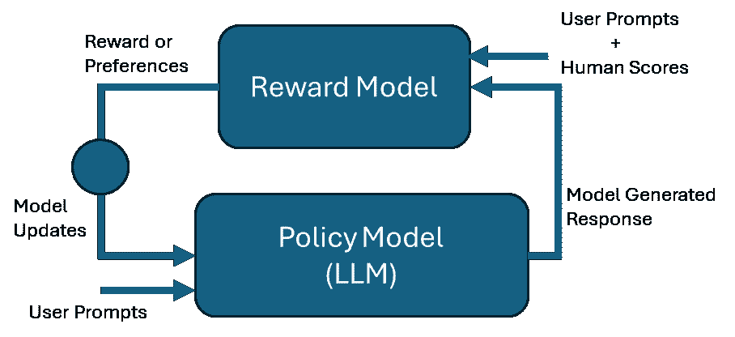

## 第 8 章：用于调优语言模型的强化学习

### 加入我们的图书社区


[`packt.link/EarlyAccessCommunity`](https://packt.link/EarlyAccessCommunity)

本章的目标是提供对强化学习如何利用基于人类偏好数据训练的奖励模型来微调预训练语言模型的实践性和概念性理解。该阶段通过将偏好信号转化为优化目标，完成了基于人类反馈的强化学习（`RLHF`）流水线，使得能够使用稳定的强化学习技术（如近端策略优化 `PPO`）实现可衡量且对齐的模型行为。您将学习如何将训练好的奖励模型集成到强化学习循环中，利用该奖励信号微调策略模型，并使用 Transformer Reinforcement Learning（`TRL`）库等工具实现此流水线。本章直接建立在监督微调（第 6 章）和奖励建模（第 7 章）的基础之上，重点在于闭环并使生成行为与人类期望对齐。`RLHF` 的这一最终阶段至关重要，因为它将隐性的人类反馈转化为显性的优化。没有它，模型仅部分对齐；有了它，模型才能响应现实部署中重要的价值观、目标和安全约束。掌握这一步对于构建不仅强大，而且值得信赖且对齐的语言模型至关重要。

### 关键主题

- 奖励模型与强化学习的集成
- 用于 `RLHF` 的 `PPO` 算法
- 使用 Transformer Reinforcement Learning（`TRL`）库中的 `PPO` Trainer 进行微调
- `PPO` 微调中需跟踪的指标
- 评估微调后的模型

### 技术要求

本章我们将使用 `Python`，并将所有实现相关的依赖保持最小化。具体的版本建议和所需安装的最小库如下：

1. `Python` 版本 >= 3.9
2. `numpy` == 1.26.4
3. `matplotlib` == 3.8.4
4. `transformers` == 4.42.4
5. `datasets` == 3.0.1
6. `ipython` == 8.27.0
7. `ipywidgets` == 8.1.5
8. `trl` == 0.10.1

除了这些库和安装要求外，我们将使用 `Google Colab` 利用 `GPU` 微调预训练语言模型。要开始，请克隆此 git 仓库并切换目录到 `chapter 8`：

```
git clone https://github.com/PacktPublishing/A-Practical-Guide-to-Reinforcement-Learning-from-Human-Feedback
cd chapter 8
```

## 奖励模型与强化学习的集成

奖励模型（第 7 章详细讨论）可用于模拟人类在面对示例选择时如何评分或给出偏好。训练好的奖励模型可用于改进策略优化，并使语言模型与人类偏好对齐。奖励模型如何与 `RLHF` 的其他组件连接的高级示意图如 *图 8.1* 所示。奖励模型针对给定的用户提示，输出生成的模型响应的信号（奖励）或分数。在训练期间，它利用人工标注的分数或偏好来比较其预测以改进模型。一旦训练完成，模型会为输入文本输出奖励或分数。该奖励用于计算策略模型如何更新。



*图 8.1 RLHF 中作为优化策略模型一部分的奖励模型*

在实际的 `RLHF` 设置中，提供给奖励模型作为输入的状态-动作对通常是 **用户提示** 及其 **模型生成的响应**。用户提示可以是问题、聊天消息、图像或任何其他形式的数据，模型可能被要求生成文本响应，可以是聊天消息或回复、图像、代码，或简单的问答对。奖励模型的输出（奖励）用于更新策略模型权重，更新过程基于强化学习。奖励模型已经在大量相关的用户提示和带有人类评分的示例响应样本上训练完成。

与标准 RL 中奖励函数基于观察计算奖励或观察的奖励分配显式映射不同，`RLHF` 依赖于奖励模型的 **预测**。该模型通常基于神经网络或偏好模型（如 **Bradley-Terry 模型**）。这意味着预测奖励是基于人类反馈对状态-动作对的期望程度或质量的估计，而不是显式的奖励分配。在标准 RL 中，计算出的奖励决定了策略模型权重需要更新多少。在这种情况下，我们改用奖励模型推理来更新策略模型。对于涉及自然语言等应用，显式奖励分配不可行，奖励模型是一种实用的替代方案。

奖励模型基于使用人工标注的状态-动作对进行训练，这些数据可能不一致、主观、嘈杂且依赖于上下文。将奖励推理泛化到新场景是一种要求，在实践中也常被期望。幸运的是，学习到的奖励中的不确定性和泛化能力可以用类似处理任何监督学习模型的方式来处理。

来自奖励模型的预测奖励通常会被归一化，以确保它们在工作范围内。这通常基于实验，以便最小化策略优化中的不稳定性。奖励模型的输出（奖励信号）可用于训练策略模型。策略优化可以尝试任何 RL 算法；然而，由于在线算法（特别是 `PPO`）训练相对稳定，因此更受青睐。在下一节中，我们将更多地讨论 `PPO` 算法。

## 用于 RLHF 的 PPO 算法

我们在第 4 章深入介绍了 `PPO` 算法。在本节中，我们将从 `RLHF` 标准算法选择的角度进行讨论，因为 `PPO` 在训练稳定性和样本效率方面提供了良好的平衡。在在线算法中，它具有更简单的裁剪机制实现，该机制可减弱来自前一次迭代的策略更新，从而提高稳定性。虽然离线算法可以具有样本效率，但 `PPO` 通过重用收集的数据进行多次更新来提高样本效率，使其比其他策略梯度算法更具样本效率。由于其在稳定性和效率之间的平衡，以及在各种环境中经过验证的有效性，它是包括 `RLHF` 在内的 RL 应用中的默认选择。其广泛采用也归因于其在训练中的相对稳定性和可靠性，这对于管理具有不确定性的大型系统训练至关重要。

### 使用奖励模型的 PPO 策略更新


# PPO 在 RLHF 中的应用：基于学习奖励的策略优化

在标准 PPO 中，策略是使用由奖励函数计算或基于环境观察分配的奖励信号进行训练的。然而，在 RLHF 中，奖励函数是从人类偏好中学习得来的，这带来了独特的挑战，并需要必要的修改。代替来自环境的静态奖励，学习到的奖励函数 `r_θ`（其中 `θ` 代表奖励模型的参数）有助于更新 PPO 策略 `π_φ`。优化目标或多或少与标准 PPO 相同，但现在结合了基于奖励模型 `r_θ` 的学习奖励：

因此，PPO 的通用关键策略更新步骤如下：

1.  **收集轨迹**：收集策略 `π_φ` 的轨迹。
2.  **推理奖励模型**：在收集到的状态-动作对上推理奖励模型，以获得预测奖励。
3.  **计算优势估计** `A_t`，它指示采取的动作比时间 `t` 的平均动作好多少，使用广义优势估计（`GAE`）。
4.  **计算 PPO 目标**（完整实现见第 4 章），使用：
5.  **更新梯度**：使用随机梯度上升。

## 使 PPO 适配 RLHF 所需的修改

虽然 PPO 是进行 RLHF 策略优化时首选的默认算法，但存在一些挑战：

*   **解决分布偏移**：由于奖励模型是在过去的策略轨迹或人工标注数据上训练的，随着策略的演进，它可能会遇到分布偏移。这需要使用从最新策略采样的最新轨迹，定期对奖励模型进行重新训练或微调，以保持与人类意图的一致性。奖励模型集成或不确定性估计等技术也可以缓解对过时偏好的过拟合。

*   **正则化与安全约束**：为防止非预期的策略行为，可以在优化过程中引入约束。其中一些已作为 PPO 实现的一部分被考虑在内。例如：
    *   `熵正则化` 鼓励探索以防止过早收敛。
    *   `KL 散度约束` 确保策略更新不会偏离先前策略太远，以保持稳定性。
    *   `奖励模型不确定性处理`：通过惩罚高不确定性的奖励预测，避免过度依赖不可靠信号，这也会有所帮助。

*   **评估与迭代优化**：对使用推理奖励训练的策略进行评估是一个重要步骤。这些评估涉及监控奖励累积和成功率等定量指标。同样，也可以纳入人工评估和偏好比较等定性评估。基于这些评估，对奖励模型或微调步骤进行调整可以增强一致性和稳定性。

通过将推理奖励集成到策略优化中，RLHF 使策略能够更好地与人类偏好对齐，从而促进更具可解释性和有效性的强化学习结果。

## 面向自然语言应用的 RLHF

上一节讨论的 PPO 算法步骤需要收集 roll-out 轨迹。在聊天和对话生成等自然语言应用中，轨迹的概念被调整以适应自然语言交互。在此语境下，`roll-out`（展开/生成序列）指的是响应提示或用户消息而生成的序列——通常是模型响应。不同于经典强化学习中典型的状态和动作序列，“轨迹”对应于结构化对话或提示-响应对，其中每个 token 都可视为策略采取的一个动作。根据模型交互场景，有两种可能的方式来界定“轨迹”一词：

### 将完整对话作为轨迹

在某些实现中，整个对话线程（例如，多轮用户查询和模型响应）被视为一条轨迹。模型按顺序生成多个响应，形成一条轨迹，随后由奖励模型或人工反馈进行评估。

### 将单个问答 (QA) 对作为轨迹

在一种更简化的版本中，每个单独的问答对被视为一个独立的“回合”，并根据其质量分配奖励。

两者的选择取决于反馈的粒度以及奖励模型的训练方式。接下来，我们将探讨如何为这些轨迹考虑奖励和反馈。

### 奖励与反馈

来自人类偏好的奖励和反馈的数据结构在奖励模型训练期间确定。在多轮对话中，如果每个响应单独评估，则可以**按轮次**收集奖励。一些方法涉及为整个对话分配单一奖励，这可以考虑跨轮次的连贯性、帮助性和一致性等指标。更常见的是使用基于偏好的奖励，即根据人类偏好（例如对多个响应进行排序）训练奖励模型。该模型随后在 RL 训练期间为响应分配分数。

### 训练过程

训练过程涉及特定步骤。首先，语言模型生成完整对话或问答 (QA) 对形式的响应。这些响应根据结合了人类偏好的学习奖励模型分配奖励。然后，PPO 算法使用此奖励通过以下步骤优化基础模型：

1.  **收集轨迹**（完整对话或 QA 对）：模型通过从其当前策略中采样来生成输出。每个输出被视为一条轨迹，对应完整的多轮交互或单个 QA 对，具体取决于所用的框架。这些样本作为奖励评估和学习的基础。

2.  **使用基线估计优势函数**：每条轨迹由奖励模型评分，反映人类偏好数据。为了确定模型应在多大程度上强化或抑制给定输出，我们计算 `advantage`（优势）——即实际奖励与基线（通常是价值函数）之间的差值。这有助于将学习重点放在优于预期的输出上，同时减轻策略梯度中的方差。

3.  **在 KL 约束下执行策略更新**：使用 PPO 目标更新策略，以增加高奖励输出的概率。关键在于，PPO 包含 `KL 散度` 惩罚，限制更新后的策略偏离参考策略（通常是监督微调模型）的程度。该约束在保留早期微调阶段学到的流畅性和连贯性的同时，鼓励与人类偏好对齐。

### PPO 在聊天应用中的挑战

奖励模型的一致性是一个挑战，因为对话质量是主观的，收集到的人类偏好也是如此。因此，收集过程应遵循最佳实践（如第 7 章所述），且由于技术尚处于起步阶段，这些实践仍在不断演进。聊天对话可能会变得很长，较长的对话会给训练带来不稳定性，这使得在某些情况下按轮次给予奖励更切合实际。与游戏和模拟等常规 RL 环境不同，从人类对话数据中探索多样化响应并保持质量颇具挑战性。因此，通常在实践中，聊天模型通常使用基于偏好排序的问答对，而不是完整的多轮对话，以稳定训练并使奖励建模更易处理。

## 在 TRL 中使用 `PPOTrainer` 进行微调


截至 2025 年，已涌现出多个用于 RLHF 的开源库，使开发者和研究人员能够更有效地微调大型语言模型。在主要的 RLHF 开源库中，知名的库有 `Transformer Reinforcement Learning (TRL)` 库，以及一个从其派生的高级分布式版本 `TRLx`，后者旨在适应拥有数十亿参数的大型模型的分布式微调。`Reinforcement Learning for Language Models (RL4LMs)` 是一个多功能库，提供多种在线策略 RL 算法的实现，并基于 `PPO` 引入了一种新颖的优化方法 `natural language policy optimization (NLPO)`。由于 `TRL` 是采用最广泛的库，且常作为 `TRLx` 等其他库的基础，我们将重点关注该实现。`TRL` 也是微调的良好入门。在上一章中，我们使用了 `RewardTrainer` 类来训练奖励模型。在本节中，我们将演示如何将训练好的奖励模型——或一个合适的预训练替代品——纳入 RLHF 流程。为了便于说明，我们使用 **Reward Model Setup** 部分讨论的预训练奖励模型。为了利用这一奖励信号微调策略模型（正在被优化的语言模型），我们使用 `PPOTrainer` 类。在开始使用 `PPOTrainer` 微调语言之前，建立一个适合 RLHF 训练的环境非常重要。以下步骤将指导你使用 Colab Pro 准备一个启用 GPU 的设置，并附带关于如何将其适配到 AWS、Azure 或本地机器等其他环境的说明。

## 基于 RLHF 的微调库与资源

虽然 RLHF 微调流程可以在各种环境中运行——包括配备 CUDA GPU 的**本地机器**，或 **AWS**、**Azure**、**Lambda Labs**、**Paperspace** 等云服务商——但本节重点介绍使用 **Google Colab Pro**。Colab Pro 在易用性、GPU 可用性和性价比之间取得了平衡，非常适合运行小规模 RLHF 实验和演示。**注意：** 以下步骤专为 Colab 设计，但可轻松适配到其他环境，包括企业级云部署。

### 在 Colab 中启用并验证 GPU 访问

导航至：`Runtime → Change runtime type → Hardware accelerator: GPU`  
然后验证 GPU 访问：打开 `Runtime → Manage sessions`，查看 **“Type”** 列下的信息（例如 T4、A100）。  
也可通过编程方式完成，如下所示：

```
import torch
print("CUDA available:", torch.cuda.is_available())
if torch.cuda.is_available():
    print("Using GPU:", torch.cuda.get_device_name(0))
```

### 步骤 2：安装所需库

我们将需要一些资源来使用 RLHF 微调语言模型：最新版本的 `pytorch`、`huggingface` 库：`datasets`、`transformers`、`peft`，以及 `TRL` 的稳定版本 `trl==0.10.1`。这些库可直接通过 Colab 笔记本单元格使用 pip 安装，命令如下：

`!pip install torch datasets transformers peft trl==0.10.1`

你可以搭建一个包含所有库和必要包的环境。一个包含所有必要依赖、导入及分步设置的完整可运行笔记本可在以下地址获取：[`github.com/PacktPublishing/A-Practical-Guide-to-Reinforcement-Learning-from-Human-Feedback`](https://github.com/PacktPublishing/A-Practical-Guide-to-Reinforcement-Learning-from-Human-Feedback)/Chapter8.

### 步骤 3：使用轻量级语言模型

为了适应 Colab Pro 的内存预算，我们将使用 Hugging Face Transformers 库中的紧凑型模型（如 `gpt2`、`distilgpt2`（因果 LM））来演示 RLHF。RLHF 的原理和流程结构同样适用于更大的模型，但运行这些模型通常需要专用硬件。

### 步骤 4：针对内存效率进行优化

即使是小型语言模型，使用 RLHF 训练也可能给内存带来压力。为缓解此问题，请应用以下节省内存的策略：

*   **使用混合精度训练** (`fp16` 或 `bf16`)（如果支持），通过 `accelerate` 或 trainer 配置启用。
*   **启用梯度检查点**，通过在反向传播期间重新计算中间激活值，以计算换取内存。
*   **调整批次大小** 和 **序列长度** 以适应可用内存。
*   使用 `!nvidia-smi` 主动监控内存使用情况。

### 适配其他环境

相同的设置适用于其他平台，只需微调：

#### 本地 CUDA 环境

*   使用 `conda` 或 `venv` 进行环境管理。
*   安装匹配的 `PyTorch` 和 `CUDA` 工具包版本。
*   确保正确安装 NVIDIA 驱动。

#### 云平台

*   **AWS EC2**（例如 `g5`、`p3` 实例）：
    *   使用预装 `CUDA` 的 `DLAMIs` 或自定义 `AMIs`。
*   **Azure**（例如 `Standard_NC6`、`Standard_ND40rs_v2`）：
    *   使用 Azure Machine Learning 或带 GPU 的 VM 实例。
    *   `AzureML SDK` 有助于自动化预配和模型训练工作流。
*   **Lambda Labs / Paperspace**：
    *   提供按需付费的 GPU 笔记本或 VM。配置方式同本地 `CUDA` 机器。

## 内存优化与可复现性的设置与配置

对于运行笔记本实验，能够复现实验并迭代改进至关重要。保持笔记本结果相对可复现的最佳实践之一是为随机化设置种子。用于启用可复现性的种子设置代码片段如下：

```
SEED = 42
torch.manual_seed(SEED)
np.random.seed(SEED)
set_seed(SEED)
```

这里我们使用轻量级模型 `gpt2` 以减少内存占用。除了这一选择外，我们还使用了一些参数裁剪。对于本示例，我们将通过设置 `MAX_NEW_TOKENS = 32` 限制生成文本长度，设置小批次大小 `BATCH_SIZE = 2 or 4` 以提高内存效率，截断序列长度 `MAX_SEQ_LENGTH = 32`，使用少量训练样本 `NUM_SAMPLES = 4000`，以及 `NUM_EPOCHS = 2`。为确保训练稳定和高效内存使用，我们采用梯度检查点和混合精度等优化（针对大模型设为 true）。

```
# Configuration - Memory-optimized settings
MODEL_NAME = "gpt2" 
MAX_NEW_TOKENS = 32 
BATCH_SIZE = 4 
MAX_SEQ_LENGTH = 32 
LR = 1.5e-5
NUM_EPOCHS = 2 
NUM_SAMPLES = 4000 
OPTIMIZE_MEMORY = True
if OPTIMIZE_MEMORY:
    # Enable gradient checkpointing (trades computation for memory)
    os.environ["PYTORCH_CUDA_ALLOC_CONF"] = "expandable_segments:True"
    MIXED_PRECISION = False
```

为优化训练期间的内存使用，特别是在处理大模型或批处理时，定义一个实用函数来清理未使用的内存资源非常有用。函数 `clear_memory()` 调用 Python 的垃圾回收器并清空 CUDA 缓存，同时重置峰值内存统计。务必**仅在训练批次或迭代之间**调用此函数，以避免干扰活跃计算。在训练循环的适当位置加入 `clear_memory()` 有助于缓解显存不足错误并保持高效的 GPU 内存利用率：

```
def clear_memory():
    import gc
    gc.collect()
    if torch.cuda.is_available():
        torch.cuda.empty_cache()
        torch.cuda.reset_peak_memory_stats()
```

在完成内存优化和需求的配置设置后，我们将数据准备作为下一步。

## 数据准备

为演示目的，我们将使用 Hugging Face 上的一个小型数据集，但你可以将相同的方法应用于真实世界的数据集。我们可以加载 **Anthropic Helpful-Harmless (HH-RLHF)** 数据集的一个小子集，使用 HuggingFace `datasets` 库的方法 `load_dataset("Anthropic/hh-rlhf")`。要限制数据规模，可使用 `NUM_SAMPLES` 分割训练数据。

```
dataset = load_dataset("Anthropic/hh-rlhf", split=f"train[:{NUM_SAMPLES}]")
```


## 数据集准备

它包含人工编写的提示词，以及标记为 `chosen`（首选）和 `rejected`（非首选）的助手回复。为了高效微调，我们通过提取提示词及其相应的 `chosen` 和 `rejected` 回复来预处理数据集。此外，我们为了内存效率过滤掉过长的提示词，并处理潜在的格式不一致问题。提示词和回复被分词并格式化，以用于 `RLHF` 训练循环。一个预处理数据集的示例函数如下所示：

```python
def prepare_dataset(dataset):
    data_dict = {'prompt': [], 'chosen': [], 'rejected': []}
    for item in dataset:
        try:
            prompt = item['chosen'].split('Human:')[-1].split('Assistant:')[0].strip()
            chosen = item['chosen'].split('Assistant:')[-1].strip()
            rejected = item['rejected'].split('Assistant:')[-1].strip()
            if len(prompt.split()) < 100:
                data_dict['prompt'].append(prompt)
                data_dict['chosen'].append(chosen)
                data_dict['rejected'].append(rejected)
        except:
            continue
    return pd.DataFrame(data_dict)prepare dataset
```

为了高效微调 `RLHF` 模型，我们定义了一个处理 `Helpful-Harmless` 数据集的自定义数据集类。预处理后的数据集包含提示词，以及标记为 `chosen` 和 `rejected` 的助手回复。为了优化内存使用，该类预先对提示词进行分词，并将它们作为内存高效的张量存储。然后将分词后的数据直接送入 `PPOTrainer`，用于微调策略网络。这避免了训练期间冗余的分词调用。数据集类还确保输入序列被正确截断为固定长度，以保证模型训练的一致性。虽然你可以在笔记本中查看带有注释的完整类实现，该实现扩展了用于获取额外属性的方法，但下面展示了一个精简的示例版本。

```python
class RLHFDataset(Dataset):
    def __init__(self, data, tokenizer, max_length=MAX_SEQ_LENGTH):
        self.tokenizer = tokenizer
        self.prompts = data['prompt'].tolist()
        self.max_length = max_length
        self.input_ids = []
        self.attention_masks = []
        self.preprocess()
    def preprocess(self):
        for prompt in self.prompts:
            encodings = self.tokenizer(
                prompt,
                truncation=True,
                max_length=self.max_length,
                padding="max_length",
                return_tensors="pt"
        )     
        self.input_ids.append(encodings['input_ids'].squeeze())
        self.attention_masks.append(encodings['attention_mask'].squeeze())
```

## 奖励模型设置

`TRL` 库中的 `RewardTrainer` 方法实现了一种 `pairwise preference–style reward modeling`（成对偏好风格奖励建模）方法。它使用 `chosen vs. rejected`（首选对非首选）回复对来训练奖励模型 —— 正如我们在第 7 章深入探讨的那样。在本章中，我们不从头训练，而是演示如何使用 `pretrained reward model`（预训练奖励模型）。一个有力的选择是 `OpenAssistant/reward-model-deberta-v3-base`，它基于人类偏好数据训练，适用于真实的 `RLHF` 微调：

```python
reward_tokenizer = AutoTokenizer.from_pretrained("OpenAssistant/reward-model-deberta-v3-base")
reward_model = AutoModelForSequenceClassification.from_pretrained(
    "OpenAssistant/reward-model-deberta-v3-base"
).to(DEVICE)
```

在早期原型设计阶段，你可以考虑使用来自情感分类器或毒性检测器等模型的代理奖励信号，它们提供快速推理和简单集成。例如：`distilbert-base-uncased-finetuned-sst-2-english` 基于情感（积极或消极）提供分数。`unitary/toxic-bert` 输出毒性可能性，以帮助惩罚不安全或有害的语言。这些模型是标准分类器，**并未基于人类偏好数据训练**，因此它们的分数可能无法完全捕捉有用性、事实准确性或整体对齐等细微行为。尽管如此，它们对于快速实验或特定任务目标（如降低毒性）仍然很有用。在本章中，我们使用 `OpenAssistant/reward-model-deberta-v3-base`，一个专门基于偏好数据训练的奖励模型，来演示一个建立在人类对齐奖励信号基础上的完整且真实的 `RLHF` 训练流程。在 `RLHF` 中，策略模型生成由奖励模型评估的回复，奖励模型分配一个反映人类偏好对齐程度的标量奖励分数。为了高效计算多个回复的奖励，我们以小批次处理文本，对它们进行分词，并通过奖励模型运行推理。生成的分数被收集并作为奖励张量列表返回，随后用于指导 `PPOTrainer` 中的策略优化。奖励计算函数 `compute_reward` 的示例实现如下所示。

```python
def compute_reward(texts):
    batch_size = 4
    all_scores = []
    for i in range(0, len(texts), batch_size):
        batch_texts = texts[i:i + batch_size]
        inputs = reward_tokenizer(
            batch_texts,
            return_tensors="pt",
            padding=True,
            truncation=True,
            max_length=512,
        ).to(DEVICE)
        with torch.no_grad():
            outputs = reward_model(**inputs)
            scores = outputs.logits.squeeze(-1)
            all_scores.extend(scores.cpu().tolist())
    return [torch.tensor(score) for score in all_scores]
```

## 使用 LoRA 进行高效微调

微调大型语言模型可能非常消耗内存。为了解决这个问题，我们使用 `LoRA`（低秩适应）——一种在第 6 章讨论的 `PEFT` 方法。`LoRA` 将可训练的低秩矩阵引入注意力层和前馈层，在保持基础模型冻结的同时，大幅减少可训练参数的数量。我们定义一个 `LoRA` 配置，并通过 `peft_config` 参数将其传入模型：

```python
from peft import LoraConfig, TaskType
lora_config = LoraConfig(
    r=8,
    lora_alpha=16,
    target_modules=["c_attn", "c_proj", "c_fc"],
    lora_dropout=0.05,
    bias="none",
    task_type=TaskType.CAUSAL_LM
)
```

## 模型初始化

为了在使用 `RLHF` 微调语言模型时高效管理内存，我们仔细安排模型、分词器和数据集的加载顺序。在初始化任何组件之前，我们调用工具函数 `clear_memory()` 以释放未使用的内存资源，防止不必要的峰值分配。我们微调的主要语言模型是 `gpt2`（你也可以使用 `distilgpt2`，一个更轻量的蒸馏版本），我们使用 `AutoModelForCausalLMWithValueHead` 来加载它。来自 `trl` 库的这个包装器允许集成用于基于 `PPO` 的 `RLHF` 训练的标量价值头。我们启用**梯度检查点**以减少反向传播期间的内存消耗，以此换取一些额外的计算量。然后单独加载参考模型 (`ref_model`) 以避免 GPU 内存峰值。它是策略模型的冻结副本，在基于奖励的优化过程中充当比较基准。它在 `PPO` 训练期间用于计算当前模型输出与原始模型输出之间的 `KL divergence`（KL 散度）。

```python
clear_memory()
model = AutoModelForCausalLMWithValueHead.from_pretrained(
    MODEL_NAME,  # e.g., "gpt2"
    peft_config=lora_config,
    use_cache=not OPTIMIZE_MEMORY
)
# Optionally enable gradient checkpointing
# model.gradient_checkpointing_enable()
# torch.compile(model)  # Optional with PyTorch 2.x
clear_memory()
ref_model = AutoModelForCausalLMWithValueHead.from_pretrained(
    MODEL_NAME,
    peft_config=lora_config,
    use_cache=not OPTIMIZE_MEMORY
)
```


# RLHF 训练循环

模型初始化后，我们加载分词器和数据集。数据集通过 `RLHFDataset` 类进行处理，该类为训练构建数据结构。这种分阶段初始化确保内存增量分配，从而提高稳定性和可扩展性。

```
tokenizer = AutoTokenizer.from_pretrained(MODEL_NAME)
tokenizer.pad_token = tokenizer.eos_token  # Ensure compatibility with padding
rlhf_dataset = RLHFDataset(prepared_data, tokenizer)
```

虽然与近期的模型相比 GPT-2 并不算特别大，但它仍占用大量 GPU 显存。在加载数据集之前先加载模型，可确保最消耗内存的组件优先分配，从而避免内存溢出错误。此外，分词器通常与模型架构绑定，必须使用相同的模型名称进行初始化。之后再创建数据集，可确保在设置过程中内存得到增量且可预测地使用，这对于在有限硬件上进行稳定的 RLHF 训练至关重要。

现在模型已初始化，数据集已准备并加载完毕，我们可以开始讨论 RLHF 训练循环了。

## 构建数据与 PPOTrainer 实例化

在模型训练开始前，必须高效地构建数据集，以符合基于 PPO 的优化需求。**数据整理器** 于此发挥核心作用。**数据整理器** 负责将多个样本收集成一个批次，同时确保所有输入格式正确。与监督学习中批次由固定长度的标记序列组成不同，RLHF 需要灵活的数据结构，包括：

*   来自数据集的**原始提示词**。
*   **被选与被拒回复**，用于计算奖励和策略更新。
*   **标记化序列**，必须统一填充和格式化。

数据整理器将所有相关字段收集到一个结构化批次中，确保**每个训练步骤高效处理多个示例**，且无不必要的内存开销。以下代码片段展示了一个实现示例。

```
def collator(data):
    return {key: [d[key] for d in data] for key in data[0].keys()}
```

在实例化 `PPOTrainer` 之前，我们必须定义一个 `PPOConfig`——一个控制训练过程关键超参数的配置对象。这包括学习率、批次大小、KL 散度惩罚类型和内存优化标志等设置。定义此配置对象至关重要，因为 `PPOTrainer` 在内部使用它来调度学习更新、控制与参考模型的偏差，并在训练期间优化内存使用。

以下是一个为资源受限训练设计的 PPO 配置示例：

```
# PPO Configuration with memory-optimized settings
config = PPOConfig(
    model_name=MODEL_NAME,
    learning_rate=LR,
    batch_size=BATCH_SIZE,
    mini_batch_size=2,
    reward_model="OpenAssistant/reward-model-deberta-v3-base",
    query_dataset="Anthropic/hh-rlhf",
    kl_penalty="kl",
    optimize_cuda_cache=True,
    log_with=None
)
```

配置定义后，我们即可实例化 `PPOTrainer`。`PPOTrainer` 由 `trl` 库实现，协调微调过程。它接收以下几个组件：

*   一个**策略模型**（正在微调的模型），`model`。
*   一个**参考模型**（原始模型的冻结副本，用于防止过度优化），`ref_model`。
*   一个**奖励模型**（根据人类反馈对生成的回复进行评分），`reward_model`。
*   一个**数据集**（包含提示词、偏好回复和拒绝回复），`dataset`。
*   分词器和数据整理器，`collator`。

此处给出一个 `PPOTrainer` 实例化示例：

```
ppo_trainer = PPOTrainer(
    config=config,
    model=model,
    ref_model=ref_model,
    tokenizer=tokenizer,
    dataset=rlhf_dataset,
    data_collator=collator
)
```

这种构建顺序——从配置开始，接着实例化训练器——对于保持模块化、可复现性和代码清晰度至关重要。它还确保了针对训练的特定优化（如内存处理和批次调度）在 PPO 更新期间得到一致应用。

> **提示：理解高级 PPOConfig 参数**
>
> `PPOConfig` 提供多个可调字段以控制训练动态，包括：
>
> *   `init_kl_coef`、`target_kl` 和 `adap_kl_ctrl` 用于自适应 KL 正则化。
> *   `cliprange` 和 `cliprange_value` 用于防止不稳定更新。
> *   `optimize_cuda_cache` 用于减少 GPU 上的内存碎片。
> *   `log_with` 用于灵活集成 wandb 或 tensorboard 等跟踪工具。
>
> 这些参数允许你在奖励最大化、稳定性和内存效率之间取得平衡——这对资源受限硬件上的 RLHF 微调至关重要。

`PPOTrainer` 方法设置 PPO 训练；根据 PPO 算法的预期目标，它通过约束更新以防止剧烈变化，从而**平衡奖励最大化与稳定性**，确保模型行为稳步改进。

在 RLHF 微调期间，**生成参数**控制语言模型如何生成输出，必须在进入训练循环前指定。妥善调整这些参数可确保模型保持流畅连贯，同时平衡创造性与对学习行为的遵循。这些参数在训练循环中作为 `generation_kwargs` 传递。关键参数包括：

*   **`top_p`（核采样）**：将采样池限制在概率最高的标记中，控制多样性。较高值（如 0.9）允许输出更多样。较低值（如 0.3）使回复更具确定性。
*   **`do_sample`（采样激活）**：启用标记选择的随机性，而非总是选择概率最高的标记。
*   **`max_new_tokens`（回复长度控制）**：限制生成的标记数量，防止回复过长或过短。

示例代码片段如下：

```
generation_kwargs = {
    "top_p": 0.9,
    "do_sample": True,
    "max_new_tokens": 32
}
```

这些设置直接影响回复的多样性、连贯性和质量，并将在训练循环中传递给 `ppo_trainer` 以生成回复。

## 设置训练循环


# 使用 PPO 训练循环进行 RLHF 微调

## 训练循环概述

一旦设置好 PPO 训练参数并为批量训练构建好数据，RLHF 微调过程将遵循一个迭代训练循环：模型生成回复，以奖励的形式接收反馈，并使用 PPO 更新其策略。每个训练步骤包含以下关键阶段：

**1. 生成模型回复：** 模型接收提示词作为输入，并使用预定义的采样参数（`generation_kwargs`）生成回复。

**2. 计算奖励：** 奖励模型对生成的回复进行评估，根据输出与人类反馈的契合程度进行打分。

**3. 更新策略：** `PPOTrainer` 实例利用计算出的奖励来优化模型的策略，从而改进未来的回复。KL 散度约束有助于保持稳定性，防止行为发生剧烈变化。

**4. 内存优化：** 由于训练大型语言模型可能消耗大量内存，我们应用了批量大小限制、清理 CUDA 缓存和减少序列长度等优化，以便在资源受限的硬件上进行训练。

虽然完整实现可在示例笔记本中找到，但我们将逐步讲解代码的关键部分，以便更好地理解特定设计和实现选择背后的推理。训练循环的核心方面如下代码片段所示。

## 代码实现

```
for epoch in range(NUM_EPOCHS):
    for batch_idx, batch in enumerate(ppo_trainer.dataloader):
        if batch_idx >= 30:  # Limit batches for demo
            break
        query_tensors = batch["input_ids"]
        response_tensors = []
        for i, query in enumerate(query_tensors):
            generation_kwargs["attention_mask"] = batch["attention_mask"][i].unsqueeze(0)
            response = ppo_trainer.generate(query, **generation_kwargs)
            response_tensors.append(response.squeeze()[len(query):])  # Remove prompt tokens
        batch["response"] = [tokenizer.decode(r, skip_special_tokens=True) for r in response_tensors]
        texts = [p + " " + r for p, r in zip(batch["prompt"], batch["response"])]
        rewards_tensor = compute_reward(texts)
        reward_history.append(rewards_tensor.mean().item() if isinstance(rewards_tensor, torch.Tensor) else float(rewards_tensor))
        stats = ppo_trainer.step(query_tensors, response_tensors, rewards_tensor)
        kl_div = stats.get('ppo/policy/approxkl') or stats.get('ppo/policy/policykl') or stats.get('objective/kl')
        kl_divs.append(kl_div)
        if batch_idx % 20 == 0:
            print(f"Batch {batch_idx} Reward: {reward_history[-1]:.4f} KL: {kl_div:.4f}")
```

## 代码解释

训练循环遍历 `NUM_EPOCHS` 和 `ppo_trainer.dataloader`，后者在训练期间提供数据批次。每个批次包含 `batch["input_ids"]`，其结构为张量并被赋值为 `query_tensors`。此时，批次**尚不**包含模型生成的回复——回复生成被推迟到训练循环内部进行，以优化内存使用。

每个批次还包含 `attention_masks`，存储在 `RLHFDataset` 中，它们被追加到 `generation_kwargs` 中，并在调用 `ppo_trainer.generate(query, **generation_kwargs)` 生成模型回复时按查询传递。这些回复被收集到 `response_tensors` 中，连同 `query_tensors` 一起作为 PPO 更新所需的输入。

奖励计算使用 `compute_reward` 方法，该方法接收由解码后的批次提示词和生成的回复组合而成的文本输入。获得奖励后，通过 `ppo_trainer.step(query_tensors, response_tensors, rewards)` 执行 PPO 步骤以优化策略。正如核心训练循环所示，模型按查询生成回复，使用 `compute_reward()` 方法计算相应奖励，并通过 `ppo_trainer.step()` 应用 PPO 更新。

每次更新后，在本例中，您可以通过使用 `clear_memory()` 清理内存来进行内存管理。

通过这一迭代 RLHF 过程，策略模型根据接收到的奖励逐步改进其回复。早期的输出可能与人类偏好不符，但连续的 PPO 更新会鼓励模型优化朝向符合偏好、连贯且多样化的回复。KL 散度惩罚充当正则化项，确保更新平滑且模型不会严重偏离其原始行为。

## 预期改进

> **微调前：**
>
> **提示词：** "How should I respond to a rude customer?"
>
> **模型输出：** "Just ignore them. If they keep bothering you, be rude back."
>
> **经过 PPO 更新微调后：**
>
> **提示词：** "How should I respond to a rude customer?"
>
> **模型输出：** "Stay professional and polite. If necessary, calmly explain company policies."

## 需跟踪的指标

在 RLHF 框架下使用 PPO（近端策略优化）微调语言模型涉及多个动态组件。跟踪正确的指标不仅对于调试和收敛监控至关重要，而且对于确保模型在不偏离其基础能力太远的情况下与人类偏好对齐也至关重要。以下是在 PPO 训练过程中应监控的关键指标：

### KL 散度

KL 散度监控微调后的策略偏离原始参考模型的程度。它是基于 PPO 的 RLHF 中最重要的信号之一。它反映了策略偏离参考分布（通常是基础预训练模型）的距离。过高的 KL 散度表明模型正在为奖励函数变得过度专业化或过拟合，可能会丧失通用性或语言流畅性。另一方面，非常低或负的 KL 值可能表明训练不足、学习信号差，甚至数值稳定性问题。在实践中，KL 散度通常使用系数（`kl_coef`）在 PPO 损失函数中进行正则化，训练期间可能需要调整该系数。

### 奖励分数

奖励分数根据学习到的奖励模型衡量生成回复的质量。奖励模型在 RLHF 中起核心作用，通过量化模型输出与人类偏好的契合程度。在 PPO 训练期间，每个新回复都由该模型打分，其平均奖励提供了代理改进程度的洞察。假设奖励模型准确且校准良好，奖励呈上升趋势通常反映对齐进度。然而，如果没有与之匹配的人类感知质量提升，持续的高奖励可能表明存在奖励黑客行为——即模型针对奖励模型中的虚假模式进行优化，而非真正的对齐。

### 熵

熵指示模型输出分布的多样性或确定性。它衡量模型策略的随机性——熵越高，行为越具探索性。在语言生成中，这转化为产生更广泛的回复范围。训练期间保持健康的熵有助于防止过早收敛到过于狭窄或重复的输出。随着训练进行，策略变得更自信，熵通常会下降。然而，保持适度的熵对于维持多样性和防止重复或通用的输出很重要。如果熵下降过快，模型可能变得过于确定性，降低创造力并可能过拟合到训练分布。

### 回合长度或 Token 计数


回合长度是在推演过程中每个样本生成的 token 数量。监控生成回复的长度（以 token 计）有助于检测模型行为中非预期的变化。例如，如果微调后的模型开始产生比预期短得多或长得多的输出，这可能反映了采样行为的不稳定性或奖励条件设定的缺陷。这也可能表明模型对停止条件或特殊 token 的理解发生了偏移，特别是在训练中涉及特殊停止 token 的情况下。

## 损失值

损失值包括 `policy loss`（策略损失）、`value loss`（价值损失）和 `total PPO loss`（总 PPO 损失），它们共同指示学习动态。虽然 RLHF 关注人类对齐目标，但底层的 PPO 优化仍然是梯度驱动的。监控损失值有助于评估训练过程是否稳定。`policy loss` 反映了模型根据优势估计进行更新的幅度。`value loss` 表明评论家（价值函数）预测未来奖励的效果如何。这些值的突然飙升或崩塌可能需要调整学习率、裁剪系数或奖励归一化策略。

在 TRL 框架中，使用 `ppo_trainer.step()` 进行每个训练步骤后，会返回一个名为 `stats` 的指标字典。该 `stats` 字典包含重要指标，如 KL 散度（例如键 `'ppo/policy/approxkl'` 或 `'ppo/policy/policykl'` 下的值）、`policy loss`、`value loss`、`entropy`（熵）和 `average reward`（平均奖励）。这些指标可以被记录、打印或存储以供分析，从而更容易监控训练动态并在必要时进行干预。通过在每次迭代中检查 `stats` 输出，你可以了解 PPO 训练的进展情况，以及是否需要调整任何超参数（如 KL 系数或学习率）。这些指标共同作为诊断工具，确保 PPO 训练顺利进行。通过观察奖励趋势、KL 散度、策略损失和熵，你可以在训练期间做出明智的调整，避免不稳定，并更好地解释微调结果。

## 评估微调后的模型

RLHF 微调后，训练好的模型可以被保存并在真实提示词上进行评估。为了评估改进，我们将原始（预训练）模型的回复与微调后模型的回复进行比较。回复的质量使用奖励模型来衡量，奖励模型会给符合人类偏好的回复分配更高的分数。这个过程使我们能够评估 RLHF 是否成功改进了模型的行为。

微调后，可以通过使用 `eval()` 方法将模型切换到评估模式来进行评估。使用一些 `input_text` 进行测试，并使用分词器函数对其进行分词。请注意，如果未显式提供注意力掩码和 pad token ID，可能会收到警告。在推理期间，你需要在输入 ID 之外显式提供 `attention_mask`。此外，你应该为文本生成显式设置 `pad_token_id`。`generate()` 方法用于微调后的模型和参考模型。生成模型回复的示例代码片段如下：

```
with torch.no_grad():
    model.eval()
    ft_output = model.generate(
        input_ids,
        max_new_tokens=MAX_NEW_TOKENS,
        do_sample=True,
        top_p=0.9
    )
```

一旦生成了模型和参考模型的输出回复，我们可以重用 `compute_reward()` 函数来评估微调模型生成的输出相对于未改变的参考模型的奖励改进。

```
# Calculate scores
original_score = compute_reward([prompt + " " + ref_response])[0].item()
finetuned_score = compute_reward([prompt + " " + ft_response])[0].item()
print(f"Original reward: {original_score:.4f}")
print(f"Fine-tuned reward: {finetuned_score:.4f}")
```

请注意，使用奖励模型进行微调是 RLHF 过程的典型部分，并且几个实验性训练方面（如 `generation_kwargs`、模型配置参数和训练参数）必须根据模型大小、数据集训练大小、token 大小和奖励模型进行更新。这里我们使用了一个预训练奖励模型，这对于演示目的已足够。在实践中，预训练奖励模型可以在用于基于 RLHF 的对齐之前进行微调。在本章中，我们提供了一个用于对齐微调模型的起点。对于生产情况，可能需要更多的训练迭代，并且一些训练参数的实验可能变得必不可少。有时在训练过程中，KL 散度可能变为负值，这应该避免，因为该值通常应在 0 到 10 之间。TRL 文档中讨论了一些训练调试实践和建议，[`huggingface.co/docs/trl/en/how_to_train`](https://huggingface.co/docs/trl/en/how_to_train)，这可能会有所帮助。如果你有兴趣开发生产级的 RLHF 策略优化和模型对齐，你可以将该方法扩展到更大的基础模型，例如 `gpt3.5` 而不是 `gpt2`，或者使用更小的模型但通过更多迭代进行训练并监控奖励改进。

### 总结

在本章中，我们讨论了如何将奖励模型集成到 RLHF 流水线中，并用它来微调基础语言模型。我们回顾了用于策略优化的 PPO 算法，并讨论了如何为 RLHF 修改 PPO。然后，我们了解了 TRL 库，以及准备数据集、配置和设置模型及训练参数如何帮助集成预训练语言模型、预训练奖励模型和数据集以进行训练微调模型。我们还看到了奖励计算函数如何帮助在训练期间使用奖励模型信号，并作为评估指标来评估微调进度以对齐人类偏好。人类反馈收集成本高昂，我们使用预训练奖励模型来减轻部分工作。但在实践中，必须建立一个奖励收集机制，以获取人类标注者的自定义反馈。我们将在下一节讨论克服获取人类反馈挑战的各种方法。

### 参考资料

参数高效微调库和文档：

*   [PEFT GitHub 仓库](https://github.com/huggingface/peft)
*   [PEFT 官方文档](https://huggingface.co/docs/peft/main/en/index)
*   SFT 训练器
*   [SFT Trainer 文档](https://huggingface.co/docs/trl/sft_trainer)
*   TRL 库
*   [TRL 库文档 v0.10.1](https://huggingface.co/docs/trl/v0.10.1/en/index)
