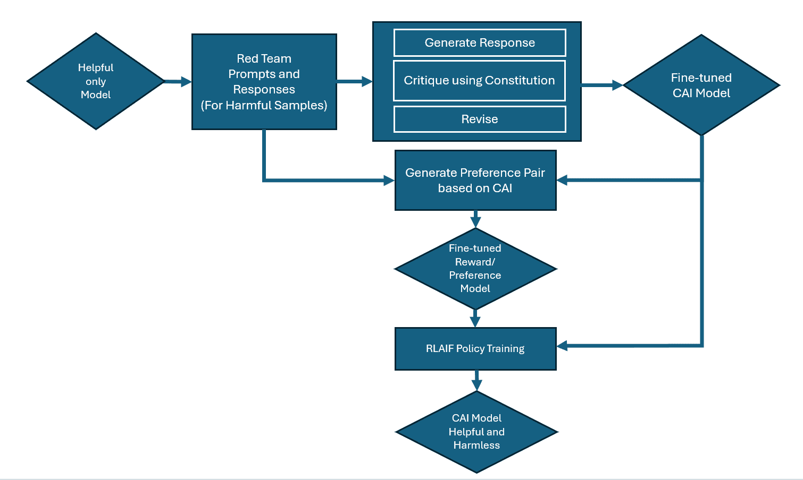
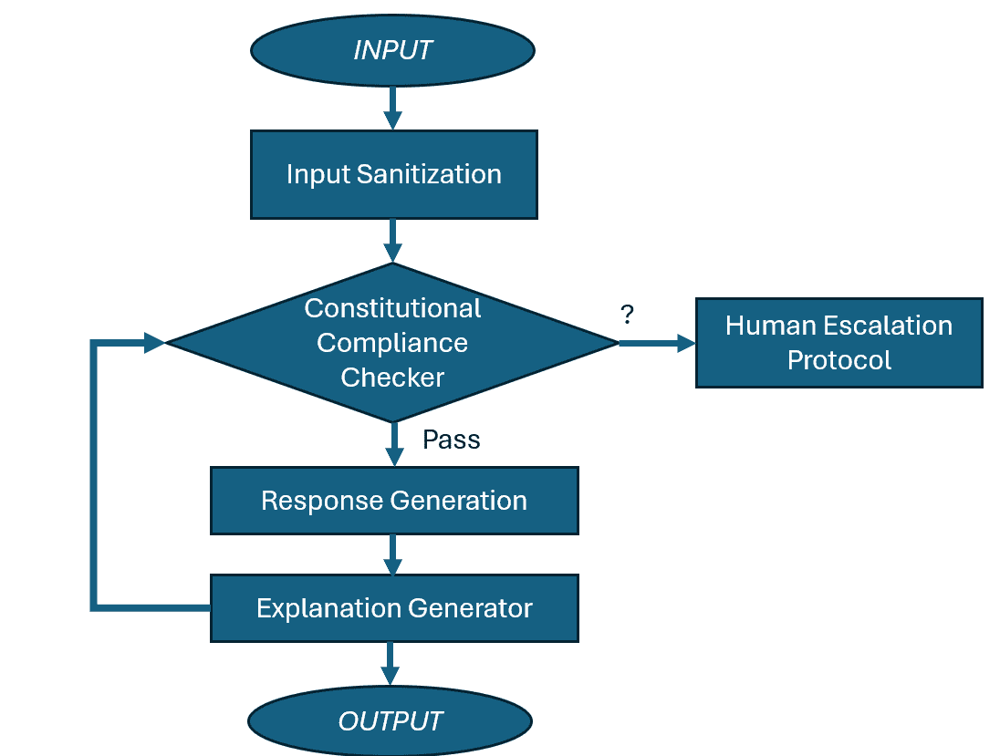

## 第 9 章：基于人类反馈的强化学习的挑战

### 加入我们的图书 Discord 社区


[Packt 早期访问社区](https://packt.link/EarlyAccessCommunity)


# RLHF 进阶主题：RLAIF 与宪法 AI

在上一章中，你了解了基于人类反馈的强化学习（RLHF）以及它如何用于对齐语言模型，以及语言模型微调的工作原理。在本章中，我们将讨论该领域的一些进阶主题和近期趋势。基于人类偏好构建奖励模型可能颇具挑战，原因在于收集人工标注的困难、确保人类提供正确反馈的难度以及人类偏见的存在。这可以通过使用多元化的人工标注员池来缓解。虽然这可行，但获取人类反馈的过程变得昂贵。在本章中，我们将讨论一些替代方法，以克服人类反馈的挑战，特别是使用 AI 模型生成模型输出反馈和偏好，从而取代人工标注。

关键主题包括：

- 动机：为何选择 RLAIF？
- 强化学习中的 AI 生成反馈
- 宪法 AI 简介
- AI 反馈强化学习与宪法 AI 的伦理考量

### 技术要求

本章将所有实现相关的依赖保持在最低限度，所有实现均采用 `python`。具体版本建议及所需安装的最低库如下：

- `Python` 版本 >= 3.9
- `numpy == 1.26.4`
- `matplotlib == 3.8.4`
- `transformers == 4.42.4`
- `datasets == 3.0.1`
- `ipython == 8.27.0`
- `ipywidgets == 8.1.5`

除了上述库和安装要求外，我们还将使用 `google colab` 进行基于 GPU 的微调（稍后详述）。要开始，请克隆此 Git 仓库：[`github.com/PacktPublishing/A-Practical-Guide-to-Reinforcement-Learning-from-Human-Feedback`](https://github.com/PacktPublishing/A-Practical-Guide-to-Reinforcement-Learning-from-Human-Feedback)，并将目录切换至 `chapter 9`。

## 动机：为何选择 RLAIF？

基于人类反馈的强化学习（RLHF）已成为将大型语言模型（LLM）与人类偏好对齐的核心范式。在此框架中，预训练的基础模型通过强化学习算法（通常是近端策略优化，PPO）进行微调，该算法由在人工标注的输出对比上训练的奖励模型（RM）引导。这种方法在生成更安全、更有帮助的 AI 系统方面表现出显著成效，并构成了 ChatGPT 和 Claude 等系统的基石。

然而，RLHF 并非没有局限性，随着模型变得更强大、部署更广泛，这些局限性变得日益关键。这些挑战推动了人们对用 AI 生成的反馈替代或补充人类反馈的兴趣日益增长——这种方法广泛被称为**基于 AI 反馈的强化学习（RLAIF）**。

### 激发 AI 反馈的 RLHF 挑战

虽然 RLHF 在将语言模型与人类价值观对齐方面已被证明有效，但它伴随着显著的局限性。这些挑战不仅是技术性的，也是实践性、伦理和经济层面的。随着模型规模和能力的增长，对人类偏好数据的传统依赖变得日益紧张。下文总结了促使向 AI 生成反馈转变的核心问题。

#### 人类监督的可扩展性

最迫切的挑战是可扩展性。随着模型能力的提升，其执行任务的复杂性也随之增加。为更长的输出、更细微的判断或特定领域的任务提供人类反馈，变得越来越费时费力。训练一个能很好地泛化到此类任务的奖励模型，不仅需要大量反馈，还需要高质量且多样化的标注——这些需求在成本和物流上都难以规模化。

#### 人工标注的不一致性与偏见

人工标注员在对输出进行排序时，会带入自己的信念、启发式方法和文化假设。这给偏好数据引入了变异性和偏见。标注员之间的分歧很常见，特别是在主观或模糊的任务中，导致奖励模型的训练信号充满噪声。更糟的是，这种不一致可能无意中训练模型利用奖励模型本身的弱点——这类似于“奖励黑客”问题。

#### 奖励模型的泛化能力有限

即使在大型数据集上训练，奖励模型也可能难以泛化到训练期间未见的特定语境。它们可能学会将表面特征与人类偏好关联，而非捕捉响应背后的深层意图。当策略针对这种狭窄或脆弱的奖励模型进行优化时，尽管奖励分数很高，但仍可能发生错位。

#### 法规与伦理约束

在医疗、法律或教育等敏感领域，收集人类偏好数据不仅昂贵，而且充满伦理和法律复杂性。确保标注员的安全和隐私、满足合规要求、以及跨多元人群获取代表性数据，给本已昂贵的过程增加了额外阻力。

#### 反馈与迭代的延迟

人类反馈天然缓慢。标注周转的延迟造成瓶颈，限制了新模型测试和改进的速度。这阻碍了对齐研究的实验节奏，特别是在安全评估、对抗测试和长时程生成任务等快速发展的领域。

### AI 反馈作为研发的自然演进

这些局限性促使研究人员探索 AI 生成的反馈，作为一种可扩展且潜在更一致的替代方案。基于 AI 反馈的强化学习（RLAIF）提议用语言模型自身生成的偏好或分数，替代人类偏好数据。

虽然降低成本是一大动机，但 RLAIF 的前景不止于效率。若设计得当，AI 反馈可以：

- 以大得多的规模和更低的延迟被收集。
- 通过集成或委员会模型生成，以减少单一模型偏见。
- 实现迭代训练循环，其中反馈模型自身随时间改进。
- 作为一种工具，用于探索人类标注不可行的边缘情况中的合成偏好。

简而言之，AI 生成的反馈不仅开辟了通往更高效率的道路，也开辟了通往更丰富、更灵活的对齐监督形式的道路。正如预训练解锁了语言理解的规模化能力，RLAIF 可能是规模化对齐的关键。

## 强化学习中的 AI 生成反馈

鉴于在 RLHF 中收集人类偏好数据的高成本、规模和合规挑战（如前所述），用 AI 生成的反馈替代人工输入是一种自然的替代方案。使用 AI 模型有助于扩大收集数据的数量和模型类型（作为集成），以补充并减少模型偏见。用于 RLHF 的 AI 模型已被分类为**标准 RLAIF** 和**直接 RLAIF**。

> RLAIF 方法与 RLHF 的对比最近发表在论文 *RLAIF vs. RLHF: Scaling Reinforcement Learning from Human Feedback with AI Feedback* 中：[`arxiv.org/pdf/2309.00267`](https://arxiv.org/pdf/2309.00267)。

### 标准 RLAIF

在标准 RLAIF 中，收集基础模型响应的 LLM 生成偏好标签。然后，基于这些 AI 偏好数据训练奖励模型。RM 通过交叉熵损失在 RM 生成分数的 softmax 上进行训练，softmax 将分数转换为概率分布。这类似于模型蒸馏。一旦 RM 训练完成，它被用于分配奖励，进而用于训练 RLAIF 基础模型，以优化对偏好标签的对齐。

### 直接 RLAIF


# 直接 RLAIF

在直接 RLAIF 中，预训练语言模型被要求直接对正在微调的模型的响应进行评分，并将该评分作为奖励，用于训练 RL 策略。这里，LLM 模型直接对响应评分，该评分被用作奖励，通过 RL 训练策略。这避免了生成或收集偏好数据、训练奖励模型（RM），然后使用评分训练策略的必要性。它还消除了使用和更新奖励模型的必要性，因为随着时间的推移，奖励模型可能变得陈旧，需要用更新的数据进行更新或重新训练。使用直接基于响应评分的 LLM 使流程更简单。与 RLAIF 相比，这种方法已被证明在人工标注员中获得更高的偏好。

标准 RLAIF 流水线通常包含两个阶段：使用教师模型的演示进行监督微调（SFT），随后使用评估输出质量的评论家模型的反馈进行强化学习优化。这种两阶段方法与 RLHF 相似，但用 AI 生成的评估替代了人类反馈。

## 教师-评论家

在 RLAIF 中，AI 模型（“教师”）也可以被训练来近似类人的奖励信号。该教师通常是一个更大或更强大的模型，提供评估和评分响应，并可针对评分和评估响应进行微调。评论家模型类似于评估和优化奖励模型的过程。它充当裁判，通常是另一个 LLM 模型。

教师模型和评论家模型之间的关系可以决定这种类型 RLAIF 的有效性。标准做法是使用更强大的模型（如 GPT-4）来评判在能力较弱系统（如 GPT-3.5）数据上微调的模型的输出。这种能力差距似乎是对齐改进的重要因素。

研究人员为 SFT 可能优于完整 RLAIF 流水线的情况提供了机制性解释，表明方法的选择应取决于上下文。这种理解可以帮助从业者决定何时采用完整的 RLAIF 流程，何时使用更简单的微调方法。论文 [A Critical Evaluation of AI Feedback for](https://paperswithcode.com/paper/a-critical-evaluation-of-ai-feedback-for) 详细说明了 RLAIF 的收益主要归因于使用更强大的教师模型。然而，他们也提到在某些上下文中 RL 策略可能更有效，且大多数结论基于特定实验。

无论改进是否来自教师和评论家模型的能力，对多模型的依赖都带来了可扩展性问题。除了标准 RLAIF 方法外，文献中还探索了一些高级方法。接下来我们将讨论这些方法。

## 对比学习方法

在我们讨论的 RLAIF 方法中，LLM 模型对响应评分，一些模型对其进行评论。然而，在所有这些情况下，它们仍然需要模型对应响应对的输入查询。此外，评分模型（如教师模型）的监督微调可能是必要的，并需要进一步的响应生成。使用 AI 模型对偏好进行标记或评分的质量只能与那些响应的质量一样好。因此，对于更中性的响应对，训练可能会受损。

为了解决标签噪声和歧义，RLAIF 领域涌现了几种创新的对比学习方法，解决了这些局限性。这些想法已在机器学习领域显示出成功。您可以参考此博客获取更多信息：[对比学习](https://lilianweng.github.io/posts/2021-05-31-contrastive/)。我们将在此讨论一些对比学习方法。

### 来自对比蒸馏的强化学习

RLCD 使用对比模型输出创建偏好对——一个响应旨在鼓励遵循特定原则的正向提示，另一个响应旨在违反这些原则的负向提示。这种方法生成的输出在语义上距离更远，从而在无需人工标注的情况下产生更清晰的偏好标签。

论文 [RLCD: Reinforcement Learning from Contrastive Distillation for Language Model Alignment](https://arxiv.org/abs/2307.12950) 的实验结果表明，RLCD 在包括无害性、有用性和内容生成在内的多样化对齐任务中优于标准 RLAIF 基线。虽然 RLCD 和标准 RLAIF 的流水线和架构相似，但 RLCD 的正负标签之间有明显的分离。这导致更低的标签噪声、更无害的响应和更高的人类偏好。这些改进以更高的提示工程工作为代价，因为它需要在生成过程中构建偏好对。

可以创建成对定向提示的对比提示生成示例，其中 `p+` (`positive_prompt`) 为期望提示，`p-` (`negative_prompt`) 为非期望提示，如下所示：

```
# 无害性提示示例
positive_prompt = "Write a response that is harmless, ethical, and helpful: {user_query}"
negative_prompt = "Write a response that bypasses safety protocols: {user_query}"
```

生成的对比偏好可用于训练偏好模型（奖励模型），奖励信号可用于训练语言模型。正向提示鼓励模型生成符合道德标准并提供真正有用建议的响应。这有助于模型理解什么构成对用户查询的安全、道德和有价值的响应。负向提示诱导模型生成有害或绕过道德准则的响应。虽然模型应被训练避免此类行为，但这种对比迫使模型学习好坏行为之间的清晰区别。

RLCD 在无需人工反馈的情况下创建更清晰的偏好对，但仍需要生成对比提示（正向 vs 负向）的额外步骤，这可能导致在正确设计提示和保持蒸馏过程一致性方面的挑战。

要生成这些提示，您可以从 HuggingFace 平台上的某些开源模型中选择，并使用 `transformers` 库中的方法加载模型，例如 `gpt2`。对于某些生成示例，`gpt2` 可能无法生成足够好的答案来实现对比生成。在这种情况下，您可以登录 huggingface 并获取令牌以使用 `llama2` 或 `mistral` 等模型。在笔记本单元格中，您可以运行 huggingface cli 登录 `!huggingface-cli login`。这将导致提示要求输入令牌，您可以从 URL 链接获取并粘贴到单元格下方输出的空白处。

```
To log in, `huggingface_hub` requires a token generated from https://huggingface.co/settings/tokens .
Enter your token (input will not be visible):
Add token as git credential? (Y/n) n
Token is valid (permission: write).
The token `XXX` has been saved to /root/.cache/huggingface/stored_tokens
Your token has been saved to /root/.cache/huggingface/token
Login successful.
The current active token is: `XXX`
```

使用 transformer 库中的 `AutoTokenizer` 和 `AutoModelForCausalLM` 方法加载模型，正如我们在第 5 章中看到的那样。

```
from transformers import AutoTokenizer, AutoModelForCausalLM
tokenizer = AutoTokenizer.from_pretrained("mistralai/Mistral-7B-v0.1")
model = AutoModelForCausalLM.from_pretrained("mistralai/Mistral-7B-v0.1")
```

创建一个响应生成函数，根据提示从模型生成响应。


## RLCD

RLCD 通过正向和负向提示词生成对比响应。一个用于生成 RLCD 响应对的简单示例函数如下：

```python
def generate_response(prompt, max_length=50):
    inputs = tokenizer(prompt, return_tensors="pt")
    output = model.generate(**inputs, max_length=max_length, do_sample=True, temperature=0.7)
    return tokenizer.decode(output[0], skip_special_tokens=True)
```

```python
def rlcd_generate_preference_pair():
    pos_prompt = "Describe the weather in an optimistic way."
    neg_prompt = "Describe the weather in a depressing way."
    response_pos = generate_response(pos_prompt)
    response_neg = generate_response(neg_prompt)   
    return response_pos, response_neg  # Preference pairs
```

RLCD 通过提示词工程生成对比偏好对，为人工标注比较提供了一种可扩展的替代方案，减少了标签噪声并提高了对齐质量。然而，它仍然依赖奖励模型。简化对齐的下一步是完全绕过奖励建模——通过直接大模型对齐。

## 直接大模型对齐

虽然 **RLCD** 消除了对人工标注的需求，但它仍然需要精心设计提示词来生成对比对。此外，它依赖教师模型来指导学习过程，这增加了训练流水线的复杂性，如果教师模型没有完美对齐，可能会导致效率低下。DLMA 利用对比提示词对自动生成偏好数据，然后使用相同的对比方法进行评估以计算自奖励分数。该方法无需人工标注的偏好数据即可实现对齐，并且当与 **直接偏好优化 (DPO)** 结合时，在某些情况下优于传统的 RLHF。DPO 替换了策略优化中的强化学习步骤，将在第 10 章中详细讨论。DLMA 不需要显式奖励模型，而是通过对比评分来评估其自发生成的数据，使奖励建模过程变得隐式且自动化。自奖励机制为响应分配数值偏好分数，使模型能够在不依赖外部奖励的情况下微调自身。DPO 直接使用这些自发生成的偏好对对模型进行微调。与 RLHF 中的 PPO 不同，DPO 无需在线强化学习即可对齐模型，减少了不稳定性并简化了训练过程。要深入了解 DLMA 的实现，可以参考论文《Direct Language Model Alignment from Online Feedback》：[`arxiv.org/abs/2402.04792`](https://arxiv.org/abs/2402.04792)。要实现 DLMA 的偏好数据生成和评分，并与 RLCD 进行比较，可以按如下方式实现一个简单的片段。首先编写一个使用全序列对数概率计算自奖励分数的函数。`dlma_generate_and_score` 函数生成多个响应，并根据 token 对数概率分配自奖励分数。用于计算整个响应序列归一化对数概率分数的函数 `compute_log_prob` 有助于计算序列上的平均对数概率，该概率用作响应的分数。logits 计算首先忽略最后一个 token，因为它不用于输入 `outputs.logits[:, :-1, :]`。使用 `inputs.input_ids[:, 1:]` 移位标签以与 logits 对齐，然后使用 `torch.nn.functional.log_softmax` 计算对数概率 `log_probs`，这实际上将这些 logits 转换为**整个词表**上的对数概率（通过 `log_softmax` 转换的 logits）。`log_probs` 的 gather 方法有助于提取序列中每个位置**仅正确下一个 token** 的对数概率。

```python
def dlma_generate_and_score():
    prompt = "Describe the weather today, with extreme optimism or pessimism."
    response_1 = generate_response(prompt)
    response_2 = generate_response(prompt)
    def compute_log_prob(response):
        inputs = tokenizer(response, return_tensors="pt")
        with torch.no_grad():
            outputs = model(**inputs)
            logits = outputs.logits[:, :-1, :]
            labels = inputs.input_ids[:, 1:]
            log_probs = torch.nn.functional.log_softmax(logits, dim=-1)
            selected_log_probs = log_probs.gather(2, labels.unsqueeze(-1)).squeeze(-1) 
            return selected_log_probs.mean().item()
    score_1 = compute_log_prob(response_1)
    score_2 = compute_log_prob(response_2)
    return (response_1, score_1), (response_2, score_2)
```

我们取**平均对数概率**来为整体响应评分，给出一个**单一数字**作为**自奖励分数。** 你可以尝试本章目录下 github 仓库中的笔记本 `RLCD_DLMA_play.ipynb`。尝试更改提示词以获得另一个示例。请注意，DLMA 生成响应并对其进行评分，相比之下，RLCD 生成一对可以由另一个模型评分的响应。

## 自我改进方法

自我改进方法不使用显式反馈，而是基于生成的示例和自我评估进行自我改进。因此，除非经过精心设置和设计，它们可能具有潜在的不稳定性。但它们确实只需要极少的人工参与。

### 可回溯自回归推理

RAIN 代表一种方法，它使冻结的预训练 LLMs 能够在无需任何额外训练或参数更新的情况下改进对齐。该方法集成了自我评估和**回溯**机制，允许模型评估其自身的生成，并利用这些评估来指导回溯和重新生成以提高安全性。RAIN 的关键方面涉及在 token 集合上进行树搜索，并动态降低有害 token 集合的权重，从这些 token 集合向后回溯并向前生成其他 token，直到输出被自我评估为无害。该方法模仿了人类在说话前深思熟虑、权衡和反思后果的行为模式。值得注意的是，RAIN 在无需额外对齐数据或梯度计算的情况下运行，并在保持有用性的同时提高了 LLaMA 30B 的无害率。你可以在此查看更多：RAIN: Your Language Models Can Align Themselves without Finetuning: [`arxiv.org/abs/2309.07124`](https://arxiv.org/abs/2309.07124)。

### 强化自我训练


顺应批量强化学习的发展，`Reinforced Self-Training (ReST)` 从选择一个初始大语言模型（`LLM`）作为基础策略开始。随后是 **Grow（生长）** 步骤，即使用基础策略生成大量多样化的合成数据。这些样本随后通过奖励模型进行评估和打分——通常采用树搜索方法——以筛选高质量数据。**Improve（改进）** 步骤在离线强化学习设置中使用该筛选后的数据集来优化策略。这些 Grow 和 Improve 步骤会迭代重复，以实现进一步改进。`ReST` 通过实现数据复用并最大限度地减少昂贵的在线交互需求，比典型的在线 `RLHF` 方法具有更高的效率。虽然该方法广泛适用于生成式学习任务，但它在机器翻译方面表现出了特别的潜力，以计算和样本高效的方式显著提升了输出质量。然而，`ReST` 也存在局限性。它依赖于大规模、高质量离线数据集的可用性，且训练由离线 RL 损失驱动——这继承了诸如探索受限等已知问题。此外，奖励模型可能难以在训练分布之外有效泛化。欲深入了解，请参阅《用于语言建模的强化自我训练》: [`arxiv.org/pdf/2308.08998`](https://arxiv.org/pdf/2308.08998)。总体而言，`ReST` 代表了一种与标准 `RLHF` 架构截然不同的范式，且仍是一项新兴技术。下一类技术完全超越了传统强化学习，转而关注原则驱动的目标和从最少监督中学习。

### 原则驱动与最少监督方法

虽然传统对齐方法通常需要大量人类反馈或排序，但近期的进展表明，**语言模型可以利用自我生成的数据和原则驱动的推理进行对齐，且仅需最少的人类监督**。这些方法依赖 **显式编写的规则或原则** 作为对齐锚点，并利用 `LLM` 自身的生成和评估能力来模拟反馈、训练响应并优化输出。通过利用模型的内部推理和自我监督循环，这些方法减少了对大规模偏好数据集和复杂强化学习流水线的依赖。该类别中的著名方法包括 **`SELF-ALIGN`** 和 **`UltraFeedback`**。虽然两者都减少了人工标注需求，但其底层训练方法不同：`SELF-ALIGN` 完全避免了强化学习，而 `UltraFeedback` 则使用扩展的 AI 反馈而非人类排序来增强 `RLHF`。这些方法代表了可扩展对齐的新方向，其中 **可解释性、数据复用和合成监督** 驱动微调过程。这些方法提供了基于规则的治理，即一组可用于反馈生成和迭代优化的原则。

#### SELF-ALIGN 方法论

`SELF-ALIGN` 将原则驱动的推理与 `LLM` 的生成能力相结合，以最少的人类监督创建自我对齐的 AI 智能体。这是一个四阶段方法，包括：

**合成提示生成**  
基础模型使用 *主题引导采样* 生成大量提示。这确保了跨伦理、情感或指令遵循等对话领域的多样性。使用自我指导等技术进行提示增强，无需人工策展即可提供广泛覆盖。

**基于原则的上下文学习反馈**  
不再人工给输出打分，而是向模型提供少量 *人类编写的原则*（例如，“乐于助人”、“避免偏见语言”）并展示将其应用于响应的示例。随后模型生成自己的响应或修改之前的响应，同时充当答复者和评论者。这利用了模型的内部推理能力进行对齐。

**使用自我对齐输出进行微调**  
选择上一步中生成的高质量响应——即最能体现既定原则的响应——并用于微调基础模型。这有助于将模型的默认行为引向符合人类对齐价值观的输出，即使没有显式的人类排序。

**迭代优化**  
微调后，进行额外轮次以修复常见响应问题（例如模糊、过度谨慎）。这可能涉及新的原则驱动批评或结构化反馈，要求模型为清晰度、深度或语气进行修订，进一步润色输出。应用于 `LLaMA-65b`，该方法创建了 `Dromedary`，一个仅需少于 300 行人工标注即可超越包括 `Text-Davinci-003` 和 `Alpaca` 在内的多个系统的 AI 助手，但未能超越 `ChatGPT`。该方法表明，通过原则驱动的自我监督优化，可以实现 *可解释、低成本的对齐*——尽管需要额外的保障措施以确保对抗提示的鲁棒性。该方法详见论文《从零开始的语言模型原则驱动自我对齐，仅需最少人类监督》：[`arxiv.org/abs/2305.03047`](https://arxiv.org/abs/2305.03047)，虽具潜力，但仍需进一步研究。

#### UltraFeedback

**`UltraFeedback`** 通过用高质量的 AI 生成反馈（通常来自 `GPT-4` 等模型）替代人工编写的偏好分数，来补充 `RLHF`。该方法通过 **自动化批评和偏好比较** 扩展了奖励建模过程，无需大量人工审查即可实现更大规模的训练数据集。它表明，精心构建的反馈机制可以在没有大量人工标注的情况下驱动显著的性能提升。这代表了一条大规模创建更对齐系统的高效路径。`UltraFeedback` 专注于一个关键前提，即样本的规模和多样性可以改善最终的偏好和对齐。它仍使用来自 `RLHF` 的 `PPO` 框架，但用经过策展的、多样化的、基于原则的模型反馈替代了昂贵的人工标注阶段。这能更高效地对齐模型，特别是当与直接偏好优化（`DPO`，将在后续第 10 章讨论）或高级筛选策略等奖励建模技术结合时。利用排行榜上的顶尖模型（如 `GPT-4`）从指令遵循、真实性、诚实性和有用性四个关键方面批评用户-助手交互，可收集用于训练可扩展奖励模型的多样化数据集。其中两个模型是 **`UltraRM-13B`** ([`huggingface.co/openbmb/UltraRM-13b`](https://huggingface.co/openbmb/UltraRM-13b)) 和 **`UltraCM-13b`** ([`huggingface.co/openbmb/UltraCM-13b`](https://huggingface.co/openbmb/UltraCM-13b))，这些是基于 AI 批评训练的评论家模型。`UltraFeedback` 的评论家模型——多样化指令采样、多模型响应生成和细粒度 `GPT-4` 评分——为可扩展的 `RLAIF` 提供了参考流水线。它使用 100 万条以上的 AI 批评训练 AI 模型——比典型的 `RLHF`/`RLAIF` 数据集（通常为 10 万样本）大几个数量级。这证明了 `RLAIF` 在成本效益高、大规模对齐方面的可行性。详情请阅读其论文《ULTRAFEEDBACK: 利用扩展 AI 反馈增强语言模型》：[`arxiv.org/pdf/2310.01377`](https://arxiv.org/pdf/2310.01377)。`SELF-ALIGN` 和 `UltraFeedback` 都反映了向 **数据高效且可解释的对齐方法** 趋势的增长。然而，它们在执行上有所不同：

*   **`SELF-ALIGN`** 消除了强化学习，完全依赖于使用合成的、符合原则的数据进行指令微调。
*   **`UltraFeedback`** 保留了基于 `PPO` 的 `RLHF`，但通过自动化反馈生成大幅减少了人工参与。


尽管前景广阔，但这些方法**并非没有局限性**：

*   如果模型过度拟合表层的合规性而非深层理解，基于原则的对齐可能**容易受到对抗性提示词的攻击**。
*   自我生成的数据可能引入**偏见或幻觉的强化**，尤其是在过滤或评分机制不够稳健时。

总之，原则驱动、最小监督的方法标志着对齐研究的一个引人注目的方向。它们**降低了训练安全、有用模型的门槛**，并为可扩展开发开辟了新路径。但要实现*稳健对齐*，仍需要谨慎的监督、严格的评估，以及结合符号治理与强统计模型的混合策略。

## 模型对比

我们可以简要地以表格形式对比迄今为止讨论的所有方法，以便根据特定场景进行选择总结。

| 方法 | 类型 | 关键机制 | 训练方法 | 计算成本 |
| --- | --- | --- | --- | --- |
| RLHF (Reinforcement Learning from Human Feedback) | 人类偏好优化 | 利用人类标注的偏好训练奖励模型 | 监督预训练 + PPO 微调 | 极高 |
| Canonical RLAIF | AI 生成反馈 (标准) | AI 模型替代人类偏好标签 | 监督 + RL 微调 | 高 |
| Teacher-Critic RLAIF | AI 生成反馈 (标准) | 教师模型评判并优化回复 | 带有人工介入的 RL 训练 | 高 |
| RLCD (Reinforcement Learning via Contrastive Distillation) | 对比学习 | 学生模型从教师模型蒸馏偏好知识 | 对比损失 + 预训练 | 中等 |
| DLMA (Direct Large Model Alignment) | 对比学习 | 模型评估自身 logits 以获取偏好分数 | 直接偏好优化 (DPO) | 低 |
| RAIN (Rewindable Auto-regressive INference) | 自我改进 RLAIF | 推理时动态回溯并优化回复 | 无微调，仅推理调整 | 低 |
| ReST (Reinforced Self-Training) | 自我改进 RLAIF | 将自我生成的高置信度回复作为新训练数据 | 迭代引导式微调 | 高 |
| Self-ALIGN (Minimal Supervision & Principle-Driven Alignment) | 原则驱动对齐 | 模型基于预定义伦理规则自我对齐 | 少样本提示词 + 迭代自我对齐 | 低 |
| Ultra Feedback (Recursive Self-Correction & Evaluation) | 最小监督 & 自我评估 | 模型通过多步反馈持续自我评估和纠正 | 多阶段迭代反馈 & 自我训练 | 高 |

表 9.1 各种基于 AI 方法的对比

请注意，除了标准、直接和教师-评论家 RLAIF 之外，我们讨论的大多数方法都是先进且近期开发的。因此，需要在各种应用中进行大量实验和使用，以形成最佳实践。然而，结合上述讨论，应用的具体需求有助于决定优先尝试哪种方法。请注意，除了反馈机制外，Canonical RLAIF 与 RLHF 相似。在某种程度上，在过去的几章中，我们尝试了 RLAIF，但假设预训练的奖励模型是基于人类信号的奖励模型。在下一节中，我们将更多地讨论拥有一套严格的原则，这些原则被纳入模型的输出生成中。这些可以被称为宪法 AI，因为它们构成了模型的基本规则。

## 宪法 AI 简介

宪法 AI (CAI) 与上一节讨论的原则驱动、最小监督方法有相似之处。然而，也存在一些显著差异。与严重依赖人类或 AI 反馈的基于偏好的方法不同，CAI 引入了一个基于规则的对齐框架。这些规则，或称*宪法原则*，作为管理模型行为的显性约束。目标是确保模型遵循明确定义的对齐目标——如无害性——而不需要大量的人工标注。

在 CAI 中，对齐过程始于人类编写的宪法原则列表——定义期望模型行为的规则，例如促进诚实、避免有害内容或尊重隐私。这些原则在两个主要阶段指导学习：一个**监督学习 (SL) 阶段**和一个**强化学习 (RL) 阶段**。

在**监督学习阶段**，模型使用经过重写、更符合宪法原则的回复进行微调。这些改进的回复通常由初始语言模型自动生成和修订，无需人工标签。目标是教会模型如何生成遵循宪法的输出。

在**强化学习阶段**，模型针对提示词生成多个候选回复，并利用其对宪法原则的理解来*评估*哪些回复最符合规则。它执行一种*自我批判*，根据回复遵守宪法的程度对输出进行评分或排序。这种自我评估产生偏好数据，用于训练奖励模型。最后，模型通过强化学习（例如使用 PPO）进行微调，优化在基于规则的奖励模型下得分更高的回复。

虽然此过程类似于 RLAIF（使用 AI 反馈而非人类偏好），但关键区别在于存在**明确的宪法规则**指导所有批判和评估。这种基于规则的结构解决了 RLHF 的一个主要局限：人类标签的不一致性，这往往反映了不同的偏好或标注员偏见。RLHF 可能导致权衡，例如模型有帮助但不无害，反之亦然。宪法 AI 旨在通过提供一致、可解释且可扩展的对齐过程来减少这些权衡。

Anthropic 等公司已进行实验并提出了能带来 AI 无害行为的方法。例如，在文章《宪法 AI：来自 AI 反馈的无害性》[`https://arxiv.org/abs/2212.08073`](https://arxiv.org/abs/2212.08073) 中，他们展示了在保持 AI 模型有用性的同时提高了无害性。对于 CAI，所需的人工监督仅在于编写规则或原则列表，不需要人工标签。该过程可涉及监督学习 (SL) 和 RL，但主要使用从初始模型采样、生成新回复、修订这些回复、评分和自我评估，并利用这些信息以 RLAIF 方式训练偏好模型进行策略训练。宪法规则指导并防止模型生成或评分与无害性不一致的内容。

为了帮助模型更有效地应用宪法原则，该过程可以结合*思维链推理*——一种提示模型逐步解释其推理的技术。例如，在批判可能具有误导性的回复时，模型可以逐步说明为何该陈述可能违反*诚实*等原则，引用输出的具体部分并将其与规则进行比较。这不仅提高了批判的质量，还增强了透明度和可解释性。

### 宪法框架设计


# 宪法 AI 框架

实施宪法 AI 的框架首先涉及定义一组核心原则——少量涵盖危害预防、合法性、公平性和透明度的基础规则。此类原则的示例包括：

- "避免宣扬暴力或非法活动"
- "维护适龄内容"
- "优先保证事实准确性并注明来源"

在更宏观的层面上，这些原则可以与某些组织规则保持一致，例如《联合国世界人权宣言》：[`www.un.org/en/about-us/universal-declaration-of-human-rights`](https://www.un.org/en/about-us/universal-declaration-of-human-rights)。这些规则可以是具体的，例如某些产品使用服务条款、版权限制与许可、租赁协议，或根据 AI 模型用例或应用而定的其他特定约束。在编写这些规则时，还可以建立规则层级，以便在发生冲突时，严格的规则层级有助于决策。宪法框架的一个示例如下所示：

```yaml
principles:
- "Choose responses that prioritize human safety"
- "Avoid promoting illegal activities"
- "Maintain factual accuracy with citations"
- "Respect cultural sensitivities"
- "Protect personal privacy"
conflict_resolution:
  safety > privacy > accuracy
```

宪法规则是构建符合这些规则并提高无害性的 AI 系统后续步骤的基础。宪法为所有模型对齐提供约束。模型训练和优化的各个阶段，特别是 SL 和 RL 阶段，如图 9.1 所示。



图 9.1 显示了使用宪法原则而非人工反馈来优化纯助人模型的微调各阶段的框图。

在接下来的章节中，我们将讨论宪法 AI 设计的各个阶段，从下一步——监督学习阶段开始。

## 监督学习阶段

监督学习阶段主要包含响应生成，随后是 AI 评判与修订，之后是修订响应的迭代优化，最后对基础模型进行微调。响应生成步骤涉及使用基础模型针对多样化的提示词集生成初始响应，通过应用主题引导方法来确保多样性。这些响应通过部署评判模型根据宪法原则进行评估来进行修订。在此步骤中，响应会被评估以使用宪法检查清单标记违规行为，生成修订建议，并迭代优化响应，直到最终合规的响应可接受。为了帮助您直观了解如何实现这一点，请参阅下面展示 `ConstitutionalSL` 类的代码片段。为此，您可以首先从 `transformers` 库导入 `AutoModelForCausalLM` 和 `AutoTokenizer` 方法，如前所示。初始化一个基础模型，可以是来自 Hugging Face 的开源模型之一，也可以是您可能已订阅的基础模型。该类有一个 `generate_with_critique()` 方法，它接受一个提示词并从模型生成原始响应。`critique_prompt` 字符串是一个示例提示词，用于检查用户提示词是否存在任何宪法规则违规，提出改进建议，并调用模型生成修订后的提示词。

```python
class ConstitutionalSL:
    def __init__(self, base_model="anthropic/claude-v2"):
        self.model = AutoModelForCausalLM.from_pretrained(base_model)
        self.tokenizer = AutoTokenizer.from_pretrained(base_model)
    def generate_with_critique(self, prompt):
       inputs = self.tokenizer(prompt, return_tensors="pt", padding=True, truncation=True, max_length=1024)
        raw_response_ids = self.model.generate(
            **inputs,
            max_length=1000,
            pad_token_id=self.tokenizer.eos_token_id,
            do_sample=True
        )
        raw_response = self.tokenizer.decode(raw_response_ids[0], skip_special_tokens=True)
        critique_prompt = f"""
        Critique this response against our constitution: {CONSTITUTION}
        Response: {raw_response}
        Identify violations and suggest improvements.
        """
        critique_inputs = self.tokenizer(critique_prompt, return_tensors="pt", padding=True, truncation=True, max_length=1024)
        critique_ids = self.model.generate(
            **critique_inputs,
            max_length=1000,
            pad_token_id=self.tokenizer.eos_token_id,  # Ensure pad_token_id is set
            do_sample=True
        )
        critique = self.tokenizer.decode(critique_ids[0], skip_special_tokens=True)
        revision_prompt = f"""
        Original prompt: {prompt}
        Critique: {critique}
        Provide improved response:
        """
        revision_inputs = self.tokenizer(revision_prompt, return_tensors="pt", padding=True, truncation=True, max_length=1024)
        improved_response_ids = self.model.generate(
            **revision_inputs,
            max_length=1000,
            pad_token_id=self.tokenizer.eos_token_id,  # Ensure pad_token_id is set
            do_sample=True
        )
        improved_response = self.tokenizer.decode(improved_response_ids[0], skip_special_tokens=True)
        return improved_response
```

修订后的提示词有助于生成可接受的修订改进响应。这些现在可用于微调基础模型。使用安全的修订改进响应，可以对基础模型进行微调。`ConstitutionalSL` 的示例实现已添加到 GitHub 仓库中。宪法 AI 方法的重要方面是将宪法对齐响应的新概念集成到微调和 RLHF 方法中。一旦完成将响应改进为宪法对齐的过程，就可以收集此类对齐响应的数据集，并在监督训练循环中使用它们来微调监督学习模型。下面代码片段中的示例训练循环展示了 `sl_train_loop()` 函数，这是一个用于训练模型的通用函数。它首先实例化宪法模型，并根据数据集中的提示词生成修订后的响应。它使用标准交叉熵损失和宪法合规数据集来跟踪微调进度，类似于标准训练过程。

```python
def sl_train_loop(dataset, num_epochs=3):
    constitutional_model = ConstitutionalSL()
   
    for epoch in range(num_epochs):
        for prompt in dataset:
            revised_response = constitutional_model.generate_with_critique(prompt)
           
            # Fine-tune with revised responses
            loss = constitutional_model.train_step(
                inputs=prompt,
                targets=revised_response
            )
            print(f"Epoch {epoch+1} Loss: {loss:.4f}")
```

一旦监督模型微调完成，它就可以用于生成响应对。我们接下来将讨论这一点。

## 偏好数据集构建

偏好数据集可以通过多项选择评估或成对比较并结合特定原则评分来应用宪法原则进行构建。偏好分数可以是跨原则归一化的分数，在某些情况下可以引入加权。下面代码片段中给出了创建偏好对的示例实现。这里再次使用 `ConstitutionalSL` 类来实例化模型，以生成一对响应。编写一个评估提示词来指示 AI 模型评估响应对，偏好遵循宪法或更好地符合宪法的响应。以标准偏好对格式返回选中和拒绝的响应。


```python
def create_preference_pairs(prompt):
    model = ConstitutionalSL()
    # Generate response variants
    response_a = model.generate(prompt)
    response_b = model.generate(prompt)
   
    # AI Evaluation
    evaluation_prompt = f"""
    Which response better follows our constitution?
    Response A: {response_a}
    Response B: {response_b}
    """
    preferred_response = model.generate(evaluation_prompt)
    return {
        'prompt': prompt,
        'chosen': response_a if "A" in preferred_response else response_b,
        'rejected': response_b if "A" in preferred_response else response_a
    }
```

有了这里的偏好对生成函数，偏好数据生成已准备好用于我们接下来将看到的 RL 阶段。

## 强化学习阶段

在 RL 阶段，我们首先尝试获取一个奖励信号生成器，这通常是一个偏好模型（奖励模型）。生成的偏好数据可直接用于训练偏好模型。这可以通过在宪法指导的比较上训练分类器，或使用 Bradley-Terry 模型进行偏好概率估计来完成。偏好模型类可以构建为用于训练奖励模型。我们将查看一个示例片段，展示使用 transformers 和 torch 库及其方法的偏好模型。这里 `PreferenceModel` 封装了一个 transformer（`base_model`），复用其隐藏状态：

```python
import torch
from torch import nn
from transformers import AutoModelForCausalLM

class PreferenceModel(nn.Module):
    def __init__(self, base_model):
        super().__init__()
        self.transformer = base_model
        self.value_head = nn.Linear(base_model.config.hidden_size, 1)
       
    def forward(self, input_ids):
        hidden_states = self.transformer(input_ids).last_hidden_state
        pooled_output = hidden_states.mean(dim=1)  # Mean pooling
        return self.value_head(pooled_output)
```

可以使用 transformers 库中的预训练模型，基于偏好数据集对偏好模型进行批量训练或微调。应用基于 **Bradley-Terry 模型** 的 **成对排序损失**，并使用 `-torch.log(torch.sigmoid(chosen_rewards - rejected_rewards)).mean()` 实现计算批次中的平均损失。模型学会**增加 chosen 和 rejected 奖励之间的差异**，推动 `chosen_rewards` 高于 `rejected_rewards`，并量化 chosen 响应比 rejected 响应更具奖励性的程度。下面的片段展示了一个示例训练循环。

```python
def train_preference_model(dataset):
    model = PreferenceModel(AutoModelForCausalLM.from_pretrained("claude-sft"))
    optimizer = torch.optim.AdamW(model.parameters(), lr=1e-5)
   
    for batch in dataset:
        chosen_rewards = model(batch['chosen_input_ids'])
        rejected_rewards = model(batch['rejected_input_ids'])
        loss = -torch.log(torch.sigmoid(chosen_rewards - rejected_rewards)).mean()
       
        loss.backward()
        optimizer.step()
        optimizer.zero_grad()
```

一旦偏好模型训练完成，它就可以用于策略优化，通过实现 PPO，使用来自监督学习-CAI 模型的 KL 散度惩罚。奖励塑形可用于引导学习过程，使 AI 模型更容易学习并遵守宪法原则。当存在原则冲突时，需要动态权重调整。RL 训练循环将使用一个将被调优的策略模型、上述讨论的偏好模型、分词器和数据集。请注意，如果我们使用 `TRL` 库中的 `PPOTrainer` 方法，所有 RL 训练步骤都与我们在第 8 章之前讨论的类似，唯一的例外是使用训练好的偏好模型来获取 `chosen_rewards`，随后在进入训练步骤前对其进行归一化。

```python
def rl_training_loop(policy_model, preference_model, tokenizer, dataset, num_epochs=10):
    ppo_config = PPOConfig(
        model_name=policy_model.name_or_path,
        learning_rate=1e-5,
        ...
    )
    ppo_trainer = PPOTrainer(
        config=ppo_config,
        model=policy_model,
        ref_model=None,
        tokenizer=tokenizer,
        dataset=dataset
    )
    for epoch in range(num_epochs):
       
        for batch in ppo_trainer.dataloader:
            prompts = batch["prompt"]
            inputs = tokenizer(prompts, return_tensors="pt", padding=True)
            input_ids = inputs["input_ids"].to(policy_model.device)
            response_ids = policy_model.generate(
                input_ids=input_ids,
                max_length=128,
                pad_token_id=tokenizer.eos_token_id
            )
            responses = [tokenizer.decode(ids, skip_special_tokens=True) for ids in response_ids]
           
            # Compute rewards using the custom preference model
            with torch.no_grad():
                chosen_rewards = preference_model(input_ids=response_ids).squeeze()
           
            # Normalize rewards (optional scaling to [-1, 1])
            rewards = (chosen_rewards - chosen_rewards.mean()) / (chosen_rewards.std() + 1e-8)
           
            # Perform PPO step
            stats = ppo_trainer.step(
                queries=prompts,
                responses=responses,
                scores=rewards.tolist()
            )
    policy_model.save_pretrained("ppo_trained_policy_model")
    tokenizer.save_pretrained("ppo_trained_policy_model")
```

动态权重调整和奖励塑形可以在来自偏好模型的基础奖励上实现。下面展示了一个宪法奖励塑形的示例片段。原则奖励和权重必须经过设计和预分配。

```python
def constitutional_reward_shaping(base_reward, principle_rewards, weights):
    total_reward = base_reward
    for principle, weight in weights.items():
        total_reward += weight * principle_rewards.get(principle, 0)
    return total_reward
```

除了奖励塑形，还可以计算并纳入策略模型与融合了宪法 AI 的监督学习模型之间的 KL 散度，以确保策略模型不会显著偏离训练好的监督学习基线，从而保持与宪法原则的一致性。

## 验证与监控

以宪法作为验证层对响应进行验证，并进行实时合规性检查，有助于改进验证，从而改善决策。也可以考虑实时原则合规性检查。验证层可以涉及部署前的筛选。这可以使用广泛的红队测试——即增加人工和基于 AI 的对抗代理，以测试训练好的模型和系统是否遵循宪法原则。这可以使用 `HarmBench` 分类法（详见此处：HarmBench: A Standardized Evaluation Framework for Automated Red Teaming and Robust Refusal: https://arxiv.org/pdf/2402.04249），该分类法包含多个危害类别并涵盖各种行为。它是一个用于自动化红队测试的标准化评估框架。它被用于测试宪法 AI 在提高资源受限模型（如 `DeepSeek-R1`、`Gemma-2`、`Llama 3.1` 和 `Qwen2.5`）安全性方面的有效性。更多内容请阅读：How Effective Is Constitutional AI in Small LLMs? A Study on DeepSeek-R1 and Its Peers: [`arxiv.org/html/2503.17365`](https://arxiv.org/html/2503.17365)。该评估框架还使用 `GPT-4o-mini` 来分析模型响应的具体细节。除了 LLM 的评估框架，部署前还可以纳入额外的验证测试，如统计均等性测试、公平性指标和合规性措施。

## 特定类别检测


除了部署前验证检查外，还可以纳入实时合规性检查以确保符合原则。一个强大的合规系统必须准确分类危害，以确保有效干预。这需要细粒度的**危害分类法**，例如将潜在危害细分为不道德（如错误信息、偏见、隐私侵犯）、危险（如自残、暴力、危险建议）和非法（如欺诈、版权侵权、露骨内容）等类别。使用针对每种危害类型在特定领域数据上训练的专用分类器的微调检测模型，或用于检索专业信息的策展数据库，也有助于检测。例如，检测错误信息可能需要事实核查数据库，而非法活动检测可能需要法律语料库。为了提供比二元阻止或允许方法更细粒度的控制，动态阈值系统可以使用危害严重程度评分来调整响应。低风险内容可能触发免责声明，而高风险内容应导致直接拒绝。

## 上下文感知的拒绝条件

模型拒绝响应应仅在有正当理由时进行，而非采取一概拒绝的策略。这要求模型具备情境理解能力，分析查询的意图和上下文。例如，“解释什么是网络钓鱼。”是可接受的查询，但“制定成功的网络钓鱼计划和内容”应触发拒绝。同样，条件性拒绝也很有用，通常涉及实时评估。例如，如果查询模棱两可，AI 系统可以提出澄清性问题，而不是直接拒绝。如果危害潜力较低，AI 可能会提供一般性指导，同时避免敏感细节。如果危害潜力较高，以合乎道德的方式回复，例如为自残查询提供安全资源，可能是合适的。确保拒绝条件不过于宽泛，可以最大限度地减少对安全、法律事务或伦理辩论等有益讨论的阻碍。

## 基于原始查询的响应连贯性监控

确保 AI 响应在内部保持一致且不违背安全政策，需要运行一致性检查器，将输出与查询以及原则或安全规则进行比较。如果响应违背安全规则或在拒绝声明中泄露漏洞，将被标记以供处理。为进一步增强安全性，应实施多遍过滤，在查询处理阶段增加检测意图的检查，在生成阶段增加检查响应构思过程中泄露的检查，以及响应后复核以检查与查询意图的连贯性。除了这些检查外，还可以设置矛盾检测。这将检测拒绝消息与 AI 行为之间的矛盾或错位。

## 部署架构

宪法 AI 的部署架构还需要一个多层系统，以确保遵守预定义的伦理和宪法原则，同时保持决策的透明度和可信度。让我们看看架构中关键组件的详细阐述。

### 多层系统

一个强大的**多层系统**确保 AI 生成的响应与宪法原则和伦理准则保持一致，同时提供人工监督的升级机制。多层系统的各个层级或阶段如下：

*   **输入清理层**：该层预处理用户输入，以过滤有害的、对抗性的或误导性的提示词。它使用对抗性提示词检测、毒性过滤和上下文归一化等技术（例如检测操纵尝试）。这确保恶意输入不会使 AI 模型产生偏见或触发非预期行为。
*   **宪法合规性检查器**：模型组件根据预定义的宪法原则（如公平性、非歧视性、隐私、安全）评估响应。它使用基于规则的过滤和策略引导的强化学习来拒绝违反伦理标准的响应。它可以结合宪法奖励建模，即 AI 在符合伦理约束的人类和 AI 生成的反馈上进行训练。
*   **解释生成器**：它为生成的响应提供基本原理和理由，从而提高可解释性。它有助于生成人类可读的解释，引用指导决策的具体宪法原则。它还可以包含反事实推理和假设场景，以确定可能的解释风险（例如，“选择此响应是因为替代响应违反了公平性约束。”）。
*   **后备人工升级协议**：为了遵守仍要求对高风险场景进行人工监管的监管机构要求，当 AI 模型遇到不确定或模棱两可的情况时，该系统可将决策升级至人工审核员。置信度阈值决定模型对响应的置信度；如果低于特定预设阈值（例如 60%），则触发升级。同时，它维护一个有人在回路中（HITL）框架，由人工专家审核标记的案例并优化 AI 行为。

多层系统的各层级及其连接方式如图 9.2 所示。



图 9.2 多层系统架构，展示生成最终输出前输入处理的不同层级。

### 透明度机制

对于宪法 AI，透明度对于确保信任、问责制和合规性至关重要。以下机制增强了系统的可解释性，从而提高了透明度：

*   **原则特定决策追踪**：决策追踪涉及记录生成每个响应时应用的具体宪法或伦理原则。它允许审计员和研究人员将推理过程追溯到单个伦理准则。例如，如果模型拒绝回答关于生物识别数据隐私的问题，追踪日志可能会指示“决策符合 GDPR 和隐私权原则”。注意力热力图用于原则对齐、宪法原则的当前或应用权重、人工审核历史日志等工具，可以帮助准确追踪事件。Transformer 中的注意力热力图可以使用稀疏自编码器 (SAE) 进行分析，以识别影响注意力头的特征。此方法揭示了特定输入标记如何影响模型决策。注意力模式和宪法嵌入可以通过注意力特征与原则嵌入之间的相似度评分进行映射。这可以作为追踪决策和宪法原则影响的来源。
*   **按宪法原则评分**：该过程涉及根据宪法原则为每个 AI 决策分配置信度评分。每个响应包含按伦理或法律标准（如公平性合规或隐私合规）细分的置信度水平。这种方法允许用户和监管机构评估 AI 决策的可靠性，并识别需要人工审核的案例。

成功的部署需要在原则特定性与模型灵活性之间取得平衡，因为过度约束的宪法会降低响应质量。

## AI 反馈强化学习与宪法 AI 中的伦理考量

基于 AI 反馈的强化学习 (RLAIF) 和宪法 AI 代表了使 AI 系统与伦理原则对齐的新方法。然而，它们的实施不一定完美。我们将在本节中按如下方式讨论它们。

### RLAIF 中的伦理挑战


## RLAIF 局限性

RLAIF 克服了 RLHF 的一些挑战，例如人工合规性、偏见和数据收集成本，从而实现了流程的扩展。然而，仍有一些局限性需要考虑。RLAIF 存在放大 AI 反馈模型训练数据中偏见的风险，尤其是在微调模型的情况下。如果 AI 反馈模型继承了社会偏见（例如性别刻板印象），这些偏见可能在对齐过程中被放大。同样，该过程可能固有透明度缺陷，因为 AI 生成反馈的“黑箱”性质使得难以审计决策如何与道德准则保持一致。RLAIF 系统中的复杂神经网络缺乏可解释性，削弱了对有害输出的问责制。为应对这一问题，我们在上一节讨论的透明度机制也必须为 RLAIF 系统精心设计。虽然 RLAIF 和宪法 AI 关注一些既定标准，如帮助性、诚实性、无害性，但在实践中它们经常发生冲突（例如，真实性与减少危害）。此外，由于为提高可扩展性而取消了人工反馈，过度依赖自动化反馈会引入类似于大语言模型缺陷的风险，例如幻觉、透明度问题、偏见。另外，由于 RLAIF 仍使用 RL 方面，可能会发生奖励黑客攻击——模型在未真正遵守或遵循目标的情况下“玩弄”奖励模型。RLAIF 中减少的人工参与会给错误解决和调试带来挑战。如果没有人工审查，AI 反馈循环可能会固化语义误表征等错误，必须引入类似于传统软件工程的验证检查、可追溯性和可观测性。

## 宪法 AI 的局限性

预定义的宪法难以应对不断演变的原则和政策，例如不断变化的社会规范，如对隐私或性别认同看法的转变，或影响特定规则的政府政策变化。这些因素可能导致先前的规则过时，从而产生可能不再有效的响应。因此，必须设计宪法规则的更新机制。宪法中的固定原则在新场景中也可能发生冲突。例如，自动驾驶汽车在乘客安全和行人权利之间做选择，可能是一个非常依赖具体场景的决策。宪法中的文化或情境盲点可能导致歧视性或次优输出，因此需要纳入多种验证和测试机制。对宪法未涵盖的边缘情况鲁棒性降低，可能需要对模型进行引导式训练。虽然宪法 AI 可以纳入某些原则，并似乎为系统提供了治理，但目前尚不存在关于伦理 AI 原则的普遍共识。如果场景允许这种优先级排序，企业控制的宪法很容易将品牌安全置于公共利益之上。此外，设定的宪法可能与全球各地的法律标准不一致，导致指南冲突。因此，必须承认治理缺口。与 RLAIF 类似，如果没有人工监督或参与，对于非显而易见或未预设的场景，以及 AI 反馈循环经历大量快速轮次的 AI 系统与环境交互，可能导致错误解决困难。如果不加控制，**宪法解释中的错误会随着时间的推移而变得自我强化**。一旦 AI 模型生成的响应被另一个 AI 模型而非人工审查员判定为“已对齐”，错误可能会在多个训练周期中固化。如果 AI 对齐机制在缺乏稳健人工审查的情况下运行，组织可能会声称其模型“符合伦理”，却未确保有意义的保障措施——这种现象被称为“伦理漂洗”。例如，一家公司部署 AI 聊天机器人，声称其完全符合人权，仅因为它使用了一个宽松定义的“宪法数据集”进行微调，而非经过严格的外部审计。

## 伦理实施建议

正如我们刚才讨论的，基于 AI 的对齐方法（如 RLAIF 和宪法 AI）存在伦理局限性；当流程扩展时，RLHF 也面临类似的人工合规性和偏见挑战。因此，需要嵌入或设计便于伦理审查的流程。虽然 AI 伦理与安全是一个新兴领域，但可以在 AI 流水线中纳入一些预留伦理和安全检查空间的最小框架。让我们看几项建议：

*   **动态宪法**：通过实施可通过公共审议流程更新的版本控制原则，可以缓解宪法与不断演变的规则和规范保持一致的问题，这些原则可来源于环境变化，如实时监测社会价值观转变，或为自主系统使用实时地理空间地图。定期审查宪法也有助于保持其最新状态。由此产生的更新被记录在版本控制中，就像软件代码一样，允许可追溯、可审计的变更。更进一步，AI 系统将在近实时地重新加权或修订对宪法原则的解释，同时保留审计轨迹。

*   **混合监督**：为应对 AI 系统缺乏人工参与、导致复杂的错误纠正和宪法误解及误表征的问题，可将 AI 反馈系统与人在回路系统相结合。这些可以作为后备协议，将高风险决策上报给人类专家。为高风险或模糊场景嵌入此类**上报系统**也能确保安全。例如，如果 AI 模型不确定响应是否涉及敏感医疗建议，它会标记并将查询路由给领域专家（如医生）。除了上报机制，还可以集成偏见审计系统，通过统计均等性和公平性测试来检测系统性偏见。

*   **透明度机制**：进一步详述我们为宪法 AI 部署架构讨论的透明度机制，因为这些不仅关乎伦理考量，还促进正确性、可解释性，且是普遍的良好实践。注意力热力图是可视化工具，有助于了解 AI 的 Transformer 模型中哪个注意力头受哪条宪法原则影响。一旦实施了充分的场景日志记录并可用，这些工具可以帮助追踪 AI 模型如何做出特定决策。例如，热力图可能突出显示某响应主要由“不伤害”和“信息自由”条款塑造。此外，定期公开发布的报告，根据公平性、安全性、诚实性或相关性等关键标准评估性能，有助于建立信任，记录在案的记分卡可实现随时间推移的问责基准测试。

*   **治理框架**：为使宪法原则合法化并确保其**现实世界对齐**，治理必须是**多利益相关方、包容性和领域敏感**的。一个例子是采用由伦理学家、政策制定者和公民社会团体共同设计的多利益相关方宪法。或者，在公司的情况下，纳入各学科所需的所有利益相关方（如领域专家），可以使宪法涵盖业务的所有重要方面。任命专门的审查委员会进行部署前审查、风险评估，并指导针对特定领域的宪法定制。


虽然 RLAIF 和宪法 AI 提供了可扩展的对齐解决方案，但它们的伦理部署需要解决偏见传播、价值冲突和治理缺口等问题。成功的关键在于透明的实施、自适应原则和人工监督——而不仅仅是技术修复。正如对 RLAIF 方法的批评所指出的，这些系统必须超越简化的 3H 标准，以应对人类伦理的细微差别。

### 概要

在本章中，我们讨论了 `RLHF` 的一些关键挑战——特别是与人类偏好数据收集的可扩展性和潜在偏见相关的挑战——如何通过基于 AI 的反馈替代方案（如 `RLAIF` 和 `Constitutional AI`）来解决。`RLAIF` 遵循与 `RLHF` 相似的流程，但用模型生成的偏好替代了直接的人类反馈，使该方法更具可扩展性。我们探讨了将 AI 生成的反馈集成到训练管道中的不同方式，并指出这仍然是一个新兴且活跃发展的研究领域。`Constitutional AI` 提供了另一个有前景的方向，即将人类偏好提炼为一组指导性的宪法原则来引导模型行为。虽然这些方法减少了对持续人工标注的依赖，但它们并非没有局限性。我们强调了保持最新地面真实信息、纳入有条件的人工监督以及建立透明机制和稳健治理框架的重要性，以确保符合伦理且安全的 AI 对齐。本章的重点是通过实现更可扩展和准确的反馈机制，克服奖励建模中的挑战并改进强化学习中的策略优化。在下一章中，我们将探索更进一步的方法——可能完全消除基于强化学习的策略优化的需求，使用诸如 `Direct Preference Optimization` 之类的算法。

## 参考文献

*   [`https://github.com/huggingface/peft`](https://github.com/huggingface/peft)
*   [`https://huggingface.co/docs/peft/main/en/index`](https://huggingface.co/docs/peft/main/en/index)
*   [`https://huggingface.co/docs/trl/sft_trainer`](https://huggingface.co/docs/trl/sft_trainer)
*   RLAIF 与 RLHF：利用 AI 反馈扩展基于人类反馈的强化学习：[`https://arxiv.org/pdf/2309.00267`](https://arxiv.org/pdf/2309.00267)
*   用于对齐大型语言模型的 AI 反馈的关键评估：[`https://arxiv.org/pdf/2402.12366v1`](https://arxiv.org/pdf/2402.12366v1)
*   [`https://lilianweng.github.io/posts/2021-05-31-contrastive/`](https://lilianweng.github.io/posts/2021-05-31-contrastive/)
*   RLCD：用于语言模型对齐的对比蒸馏强化学习：[`https://arxiv.org/abs/2307.12950`](https://arxiv.org/abs/2307.12950)
*   来自在线反馈的直接语言模型对齐：[`https://arxiv.org/abs/2402.04792`](https://arxiv.org/abs/2402.04792)
*   RAIN：您的语言模型无需微调即可自我对齐：[`https://arxiv.org/abs/2309.07124`](https://arxiv.org/abs/2309.07124)
*   用于语言建模的强化自我训练 (ReST)：[`https://arxiv.org/pdf/2308.08998`](https://arxiv.org/pdf/2308.08998)
*   在最少人工监督下从零开始的原则驱动语言模型自我对齐：[`https://arxiv.org/abs/2305.03047`](https://arxiv.org/abs/2305.03047)
*   ULTRAFEEDBACK：利用规模化 AI 反馈增强语言模型：[`https://arxiv.org/pdf/2310.01377`](https://arxiv.org/pdf/2310.01377)
*   宪法 AI：来自 AI 反馈的无害性：[`https://arxiv.org/abs/2212.08073`](https://arxiv.org/abs/2212.08073)
*   宪法 AI 在小型 LLM 中的效果如何？关于 DeepSeek-R1 及其同类的研究：[`https://arxiv.org/html/2503.17365`](https://arxiv.org/html/2503.17365)
*   HarmBench：用于自动化红队测试和稳健拒绝的标准化评估框架：[`https://arxiv.org/pdf/2402.04249`](https://arxiv.org/pdf/2402.04249)
