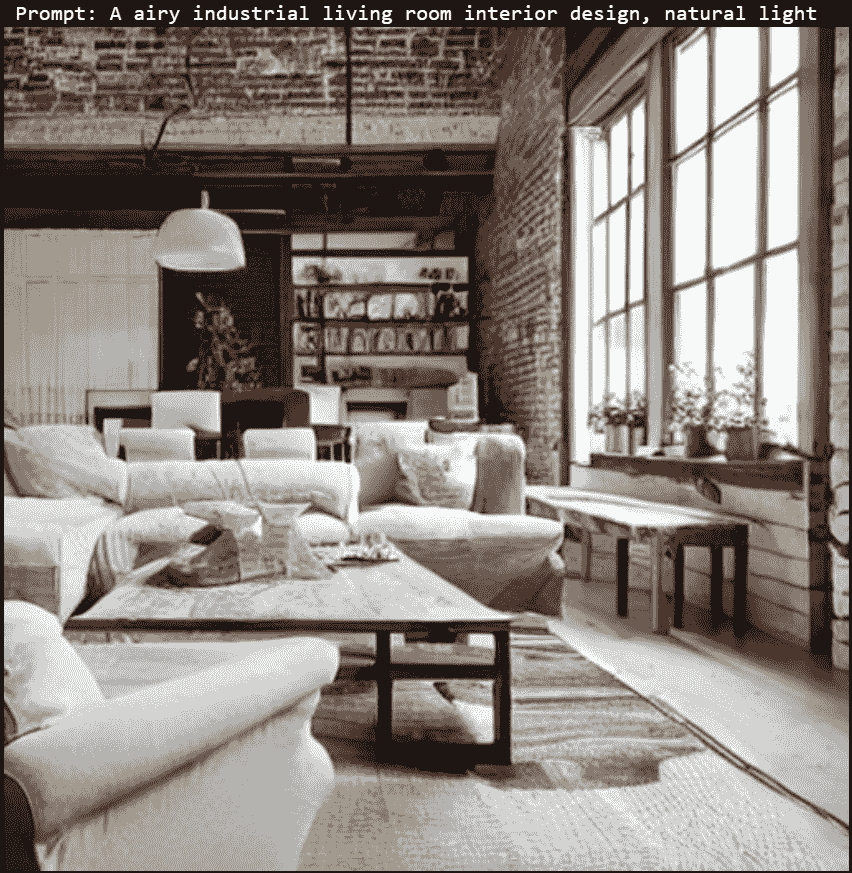
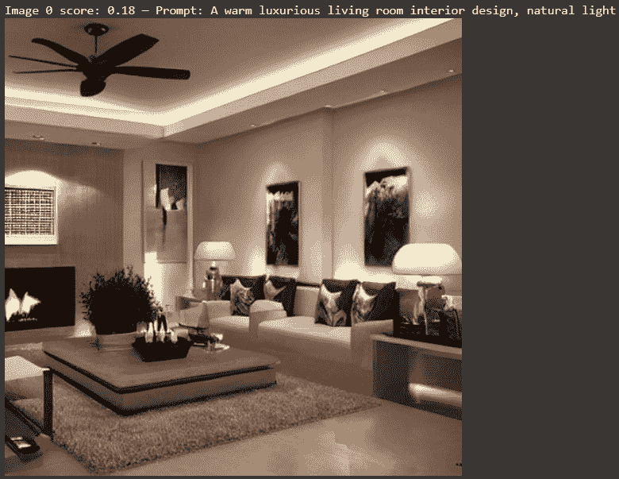
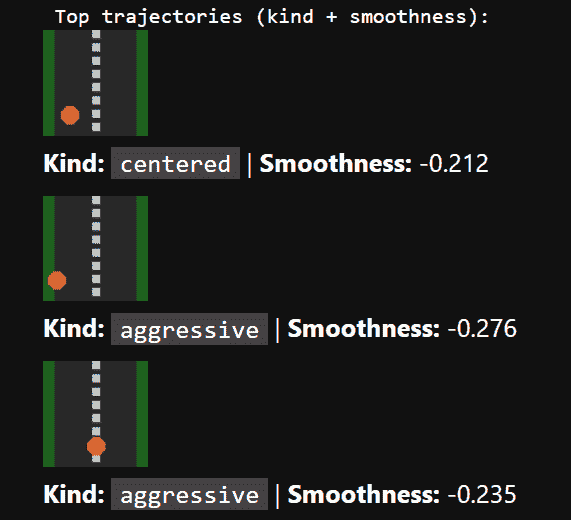

## 第 12 章：其他应用

### 加入我们的 Discord 图书社区


<https://packt.link/EarlyAccessCommunity>

贯穿全书，我们探讨了**基于人类反馈的强化学习（RLHF）**以及利用人类反馈作为将语言模型与人类意图和偏好对齐的关键框架的新兴 AI 方法。从奖励建模到策略微调，我们的讨论聚焦于文本 — 一个错位在每个句子和词汇中都可见的领域。人类与世界的互动不止于语言：我们以复杂、细微的方式感知和重视图像、听觉信号和音乐、动作及其组合。驱动文本领域 RLHF 的同一核心思想 — 从显性或隐性人类信号中迭代学习 — 同样可以对齐这些其他领域的模型。

在本章中，我们探讨：人类反馈如何指导 AI 系统完成那些对齐更加主观、创造性或涉及物理实体的任务？我们将探索涵盖图像、音频、机器人和多模态智能体的示例。通过超越文本，我们发掘 RLHF 作为人机对齐通用框架的全部潜力。

我们将涵盖以下主要章节。

*   从文字到像素 — 图像与视觉生成
*   教会机器移动 — 机器人、自主系统与仿真
*   谐和声音 — 音频与音乐生成

### 技术要求

*   本章实现通过章节内的代码片段指导（如适用）。本章的代码示例和样例笔记本可在配套的 GitHub 仓库中获取：<https://github.com/PacktPublishing/A-Practical-Guide-to-Reinforcement-Learning-from-Human-Feedback>，切换目录至 `chapter 12` 后即可访问。

## 从文字到像素：图像与视觉生成


# 具有可解释偏好的美学图像生成

正如本书中所讨论的，`RLHF` 和其他人类反馈系统使我们能够将语言模型与人类偏好对齐。但这些对齐技术在视觉领域同样强大。图像生成模型，如基于扩散的系统和大规模 Transformer，能够生成极其多样的视觉内容。然而，“质量”和“美学”具有高度的主观性和上下文依赖性。`RLHF` 通过显式评分或成对比较，为捕捉和建模人类视觉偏好提供了一个系统框架，并用于优化图像生成策略以反映这些偏好。在实际实现中，这通常涉及使用基于人类或模拟偏好数据训练的奖励模型，对基于扩散或 Transformer 的图像生成器进行微调。在本节中，我们通过一个美学图像生成的详细示例来演示这一点，展示模拟人类评分如何引导模型生成更令人愉悦或更符合品牌调性的视觉输出。

正如我们在前几章所见，`RLHF` 极大地提升了文本生成模型与人类期望的对齐程度。视觉生成领域正在发生类似的革命。生成式图像模型如 `Stable Diffusion`、`DALL·E` 和 `Midjourney` 能够生成几乎任何风格的图像，但什么构成“好”或“美”的图像却是深度主观且依赖语境的。将美学或风格偏好显式编码进奖励函数几乎是不可能的，但人类判断可以填补这一空白。

现在让我们从概念概述转向实际演示。我们通过一个具体的工作示例来演示这一点：**具有可解释偏好的美学图像生成**。在该示例中，“极简”、“舒适”或“温暖”等偏好被转化为可解释的评分函数，我们将展示构建、训练和应用奖励模型以引导图像输出的每一步。

读者关键点：

*   理解图像的成对或比较偏好数据。
*   了解如何训练捕捉主观判断的奖励模型。
*   学习如何将人类反馈集成到图像生成流程中。

除了静态图像，这些原则还可扩展到视频生成和场景编辑，其中持续反馈可以以更丰富的方式引导风格、叙事流程或构图。

## 视觉偏好对齐简介

要开始实现上述美学图像对齐示例，我们首先需要了解如何以视觉形式表达人类偏好。在语言任务中，我们通常依赖人工标注的偏好或成对比较来引导模型输出。同样的思路也适用于图像——如果我们能模拟或收集关于视觉特征的人类偏好，就可以学习一个奖励模型来表示这些判断，并训练模型针对它们进行优化。这一模拟标注步骤与前文讨论的文本响应偏好数据收集过程平行，只是应用于视觉属性。

在本示例中，我们定义了可解释的美学维度，例如：

*   **色彩温度**（暖色调 vs. 冷色调）
*   **视觉简洁度**（极简 vs. 杂乱）
*   **亮度与曝光**

这些视觉特征易于向人类解释，且可使用简单的图像特征进行测量。通过基于这些特征创建模拟标签，我们生成成对偏好数据，用于训练奖励模型。我们现在将逐步演示完整流程。（完整的导入和数据加载代码见配套的 Colab 笔记本。此处仅展示概念核心以保持清晰。）

## 环境准备：安装依赖与加载模型

要在 Colab 环境或全新环境中运行此示例，请先安装所需库：

```
!pip install diffusers transformers accelerate
!pip install torch torchvision
!pip install matplotlib pillow tqdm
```

安装并导入后，我们加载预训练的 `Stable Diffusion` 模型作为图像生成器：

```
pipe = StableDiffusionPipeline.from_pretrained("CompVis/stable-diffusion-v1-4")
pipe = pipe.to("cuda")
```

## 生成提示词图像

我们首先为客厅内部设计一小组风格丰富的提示词：

```
prompts = [
    "A cozy minimalist living room",
    "A cluttered bohemian living room",
    "A modern luxurious living room",
    "A warm rustic living room"
]
```

每个提示词传递给扩散管道以生成并可视化图像：

```
images = []
for p in prompts:
    img = pipe(p).images[0]
    img.save(f"{p.replace(' ', '_')}.png")
    display(img)
    images.append(img)
```

为丰富数据集，我们通过混合风格和情感形容词合成 50 个额外提示词：

```
styles = ["minimalist", "modern", "rustic", "bohemian", "luxurious", "industrial"]
feelings = ["cozy", "spacious", "bright", "warm", "inviting", "airy"]
elements = ["living room", "bedroom", "office", "kitchen"]
prompts = []
for _ in range(50):
    style = random.choice(styles)
    feeling = random.choice(feelings)
    element = random.choice(elements)
    prompt = f"A {feeling} {style} {element} interior design, natural light"
    prompts.append(prompt)
```

然后为每个提示词生成图像并保存，如下所示：

```
os.makedirs("images", exist_ok=True)
for i, p in enumerate(tqdm(prompts)):
    img = pipe(p).images[0]
    img_path = f"images/image_{i}.png"
    img.save(img_path)
    if i < 3:  # 显示前几个示例
        print(f"\nPrompt: {p}")
        display(img)
```



**图 12.1** 使用 `Stable Diffusion` 模型和生成提示词生成的图像示例。

在图 12.1 中，你可以看到一个生成的图像示例及其提示词。在笔记本中，我们显示一小部分图像以检查生成过程。生成图像后，我们将接下来模拟人类偏好以对其进行标注。

## 使用可解释评分函数模拟偏好

为以可复现的方式引入人类反馈，我们定义一个简单的**可解释偏好函数**来模拟“人类美学评分”。该评分基于常见设计原则分配，详见*表 12.1*。在真实的对齐流水线中，这些评分将来自实际人工评估；此处我们使用透明的基于规则的函数来复现人类偏好数据的结构。

| **关键词** | **评分影响** | **解释** |
| --- | --- | --- |


## 表 12.1：基于关键词效果的模拟人类审美评分

| 关键词      | 评分 | 描述                      |
|-------------|------|---------------------------|
| minimalist  | +2   | 简洁、简单、整洁          |
| cozy        | +2   | 令人向往、温暖、舒适      |
| cluttered   | –3   | 杂乱、令人不知所措        |
| warm        | +1   | 令人感到欢迎的氛围        |
| luxurious   | +1   | 高级、优雅的感觉          |

为了模拟人类的审美判断，我们定义了一个简单的评分函数，根据关键词分配分数：

```python
def interpretable_aesthetic_score(prompt):
    score = 0
    explanation = []
    if "minimalist" in prompt:
        score += 2
        explanation.append("minimalist: +2 (clean, simple)")
    if "cozy" in prompt:
        score += 2
        explanation.append("cozy: +2 (inviting)")
    if "cluttered" in prompt:
        score -= 3
        explanation.append("cluttered: –3 (messy)")
    if "warm" in prompt:
        score += 1
        explanation.append("warm: +1 (welcoming)")
    if "luxurious" in prompt:
        score += 1
        explanation.append("luxurious: +1 (premium)")
    return score, explanation
```

## 创建用于训练的成对偏好数据集

正如前几章关于 RLHF 和 DPO 所述，区分好坏示例的偏好对在此也很有用。我们使用评分函数来模拟图像对之间的人类偏好：

```python
pairs = []
num_pairs = 100
for _ in range(num_pairs):
    idx_a, idx_b = random.sample(range(len(prompts)), 2)
    score_a, explanation_a = interpretable_aesthetic_score(prompts[idx_a])
    score_b, explanation_b = interpretable_aesthetic_score(prompts[idx_b])
    preferred = idx_a if score_a >= score_b else idx_b
    if random.random() < 0.05:
        print(f"\nPrompt A: {prompts[idx_a]}\nScore: {score_a}\n{', '.join(explanation_a)}")
        print(f"Prompt B: {prompts[idx_b]}\nScore: {score_b}\n{', '.join(explanation_b)}")
        print(f"Preferred: {'A' if preferred == idx_a else 'B'}")
    pairs.append((idx_a, idx_b, preferred))
```

这些成对数据代表用于训练奖励模型的偏好标签。随后我们定义了一个自定义的 PyTorch 数据集类，用于加载图像对及其偏好标签：

```python
transform = transforms.Compose([
    transforms.Resize((224, 224)),
    transforms.ToTensor(),
])

class PreferenceDataset(Dataset):
    def __init__(self, pairs, prompts, transform):
        self.pairs = pairs
        self.prompts = prompts
        self.transform = transform

    def __len__(self):
        return len(self.pairs)

    def __getitem__(self, idx):
        idx_a, idx_b, preferred_idx = self.pairs[idx]
        img_a = Image.open(f"images/image_{idx_a}.png").convert("RGB")
        img_b = Image.open(f"images/image_{idx_b}.png").convert("RGB")
        img_a = self.transform(img_a)
        img_b = self.transform(img_b)
        label = 1 if preferred_idx == idx_a else 0
        return img_a, img_b, label
```

偏好对、提示词和变换可以轻松加载到数据集中，`torch` dataloader 允许按批次加载它们。

```python
dataset = PreferenceDataset(pairs, prompts, transform)
dataloader = DataLoader(dataset, batch_size=4, shuffle=True)
```

## 奖励模型设置与架构

对于奖励模型的设置和训练架构，我们首先利用预训练的 `ResNet-18` 作为图像编码器。通过将其最后的全连接分类层替换为恒等函数，我们保留了其倒数第二层丰富的 512 维特征表示。

```python
feature_extractor = models.resnet18(pretrained=True)
feature_extractor.fc = nn.Identity()
```

与传统的特征提取不同，我们允许对完整模型进行微调 —— 使我们的奖励模型能更直接地适应审美信号，甚至包括更早期的卷积层。

```python
for param in feature_extractor.parameters():
    param.requires_grad = True
```

接下来，我们定义一个小型的 `reward head`（奖励头），将 512 维的图像嵌入映射为单一的标量奖励：

```python
reward_head = nn.Sequential(
    nn.Linear(512, 128),
    nn.ReLU(),
    nn.Linear(128, 1)
)
```

完整的奖励模型可以如 `RewardModel` 类所示实例化。我们随后堆叠一个小型 MLP 以输出标量奖励。

```python
class RewardModel(nn.Module):
    def __init__(self, backbone, head):
        super().__init__()
        self.backbone = backbone
        self.head = head

    def forward(self, x):
        features = self.backbone(x)
        return self.head(features)

reward_model = RewardModel(feature_extractor, reward_head).cuda()
```

## 从成对偏好中学习

奖励模型使用成对偏好损失进行训练。对于每一对带标签的图像（A 优于 B 或反之），我们计算它们各自的分数，如果不那么受偏好的图像获得更高分数，则惩罚模型。

```python
optimizer = optim.Adam(reward_model.parameters(), lr=1e-4)
epochs = 10
for epoch in range(epochs):
    running_loss = 0.0
    for img_a, img_b, label in dataloader:
        img_a = img_a.cuda()
        img_b = img_b.cuda()
        label = label.cuda().float()
        score_a = reward_model(img_a).squeeze()
        score_b = reward_model(img_b).squeeze()
        pref_diff = score_a - score_b
        loss = torch.mean(torch.relu(1.0 - (pref_diff * (2 * label - 1))))
        optimizer.zero_grad()
        loss.backward()
        optimizer.step()
        running_loss += loss.item()
    print(f"Epoch [{epoch+1}/{epochs}], Loss: {running_loss/len(dataloader):.4f}")
```

这种公式使奖励模型能够逼近人类标注者隐式使用的底层审美函数。一经训练，奖励模型即可评估未见图像的审美质量。

```python
for i in range(3):
    img = Image.open(f"images/image_{i}.png").convert("RGB")
    img_tensor = transform(img).unsqueeze(0).cuda()
    score = reward_model(img_tensor).item()
    print(f"Image {i} score: {score:.2f} — Prompt: {prompts[i]}")
    display(img)
```

较高的分数对应更符合学习到的审美偏好的图像，反映了模型内化的奖励函数。`图 12.2` 展示了基于训练奖励模型评分的示例：



**图 12.2：** 基于奖励模型评分的生成房间图像。左侧展示豪华客厅，右侧展示乡村风格卧室。

这种体现了可解释性和模块化。一旦我们拥有了基于偏好训练的奖励函数，就可以将其接入下游图像生成管线 —— 用于对输出进行排序、筛选结果，甚至利用 RL 或优化算法引导生成器的潜在空间遍历。

## 超越静态图像

我们讨论的示例演示了人类偏好如何训练奖励模型来评估图像美学并相应地引导生成。虽然我们专注于静态视觉输出，但这些原则可推广到单张图像之外。反馈引导的生成自然地扩展到动态领域。例如，偏好模型可以对整个输出序列进行排序或优化 —— 使其适用于视频生成，其中时间连贯性和视觉吸引力随时间演变；或适用于机器人运动，其中平滑度和意图一致性贯穿动作序列。在下一节中，我们将探讨偏好建模和学习到的奖励函数如何支持具身智能体中的运动生成与对齐 —— 将 RLHF 从视觉领域推向运动、行为与控制的领域。

## 教会机器运动


# 机器人与自主系统中的 RLHF：让机器与人类偏好对齐

与文本生成不同，后者中“优质回复”可部分由相关性或正确性定义，机器人和自主系统在复杂的物理环境中运行，其中期望行为通常涉及定性的、主观的标准。我们如何为自动驾驶汽车编码“安全舒适的驾驶”？我们如何教会机器人**轻柔自然地**抓取物体，而不仅仅是成功抓取？我们如何在无人机飞行路径中平衡能效、安全性和人类舒适度？如何用数值编码“舒适驾驶”、“轻柔操作”或“自然步态”？

## 传统强化学习的局限性

传统强化学习面临诸多挑战，但其中一些关键挑战源于物理领域中奖励设计的难以处理性。

**稀疏奖励：** 许多任务仅提供终端信号（例如，“到达目标”），对学习中间行为几乎没有指导作用。

**手工设计奖励：** 设计详细的奖励函数劳心劳力，且容易出现“奖励黑客”现象，即智能体优化指标而非预期行为。手工设计的奖励往往忽略定性偏好（如平滑度、自然度）。

**多目标冲突：** 使用固定奖励权重来平衡相互竞争的目标（如速度与安全、效率与舒适）很困难。

`RLHF` 和人类对齐方法通过让人类通过排序或演示表达主观或多目标偏好（如平滑度、安全性、美感）来解决这些挑战。这些判断被提炼为一个学习到的奖励模型，该模型增强或替代手工设计的奖励，使智能体的行为与人类期望对齐。

## 现实世界案例

在物理领域，定义能够捕捉人类关于安全、风格和自然性概念的奖励函数以难著称。`RLHF` 和基于偏好的方法通过将人类视为终极奖励工程师，收集对机器人行为的判断并塑造策略以与我们的主观标准对齐，从而解决这一问题。本节调查了操作、语言驱动控制、自动驾驶仿真以及机器人及相关系统中人机界面研究的具体实现。

### 基于偏好的灵巧操作

鲁棒、类人的操作不仅需要任务成功；还要求运动质量、适应性和轻柔交互。两个领先框架展示了成对排序如何产生丰富的奖励替代品：

**Rank-Game（微软，2023）** 将少量脚本化的开门和转笔演示与人类对演示视频的成对比较相结合，从而在专家演示之外利用偏好数据。标注员只需选择“哪个看起来更稳定或自然”。神经奖励模型学习预测这些偏好，并引导策略搜索朝向流畅、与人类对齐的运动。

**RAPL（表征对齐偏好学习，Tian 等人，2024）** 使用对抓取执行的稀疏人类排序训练 `Franka Panda` 抓取策略。`RAPL` 不使用密集标签，而是将内部视觉编码器特征与人类判断对齐，生成一个密集奖励预测器，其性能可与监督 `RLHF` 媲美，但所需标注少得多。

### 自然语言驱动的对齐

语言为指定定性需求提供了直观界面，例如“靠近易碎部位时要轻柔”或“重新抓取前减速”。已有一些早期工作致力于将自由形式的指令映射为奖励信号。

**PromptCraft-Robotics & ChatGPT for Robotics（Vemprala 等人，2023）** 利用大语言模型（`LLM`）将用户提示解析为结构化偏好标签。这些标签监督一个代理奖励模型，随后用于低层控制器的 `RL` 微调，以遵守速度、力量和轨迹风格。

更近期的 **LLM-Personalize（COLING，2025）** 在专家演示上引导家庭机器人规划器，然后迭代生成计划，收集对整体计划质量的人类排序，并微调 `LLM`，与基线规划器相比，在多房间重排任务上实现了 30% 的成功率提升。

### 仿真中的自动驾驶

仿真器支持自动驾驶策略的快速迭代，但真实感取决于与人类对自然交通行为和舒适度判断的匹配程度。

**TrafficRLHF（NVIDIA，2024）** 使用对模拟车辆轨迹的人类成对排序来评估真实感。他们训练一个奖励模型，指导交通智能体策略在 `nuScenes` 等基准测试（大型自动驾驶公开数据集）上产生逼真的流，增强下游 `AV` 模块评估。

**多模态驾驶 RLHF（罗格斯大学，2025）** 在人在回路仿真中收集转向、踏板输入、`VR` 头部朝向和生理信号。`LLM` 将这些信号融合为偏好标签，在上路部署前训练 `AV` 智能体优化安全指标和乘客舒适度。

**Aurora Driver** 采用受 `RLHF` 原则启发的提议者-排序器架构。该系统“提议”多条轨迹候选，并使用基于专家驾驶员演示和针对性人类偏好标签（如舒适性、可预测性）训练的学习奖励模型对其进行“排序”。这种逆向 `RL` 与偏好排序的结合，产生的行为既在设计上受安全约束，又与人类风格对齐。博客 [`aurora.tech/newsroom/ai-alignment-ensuring-the-aurora-driver-is-safe-and-human-like`](https://aurora.tech/newsroom/ai-alignment-ensuring-the-aurora-driver-is-safe-and-human-like) 在更高层面解释了这一点及朝着人类对齐的努力，专利 [`patents.google.com/patent/US11561548`](https://patents.google.com/patent/US11561548) 中有更多细节。

### 人机界面与不确定性感知学习

如何收集反馈可能与收集什么同样关键。最近两项工作强调了界面设计和不确定性建模：

**UUPL（不确定性统一偏好学习，Peng 等人，2025）** 引入了一个概率奖励推理框架，联合建模标注员置信度和传感器噪声。当人类排序不一致时，通过缓和更新，它在模糊环境中产生更稳定的策略。

**界面影响研究（de Heuvel 等人，2025）** 对比 2D 屏幕与 `VR` 头显对机器人导航演示的标注，发现 `VR` 更丰富的空间线索显著提高了人类排序的一致性，从而产生更平滑、更可预测的学习路径。

### 行业实践与采用挑战

虽然学术原型展示了端到端的 `RLHF` 循环，但大多数商业机器人和自主系统供应商仍将人类反馈嵌入上游：

- 仓库机器人（Covariant、Berkshire Grey）中的抓取质量标签和汽车装配臂（宝马、丰田）中的离线奖励调优，很可能仍是批处理流程，而非持续的 `RLHF` 管道。
- 安全认证、标注成本和集成复杂性延缓了生产系统中即时偏好循环的应用。

随着监管框架和工具的演进，我们应期待更多实际的 `RLHF` 部署，操作员对实时机器人行为进行排序，策略就地适应，让我们更接近无缝对齐、值得信赖的自主机器。

## 基于 RLHF 的自动驾驶轨迹平滑度（实操演示）


本节详细介绍了一个实用的、动手演示，它在一个相关的机器人场景中生动地说明了 RLHF 的原理。自动驾驶因其直观性、广泛认知度，以及存在难以用传统奖励量化的主观人类偏好（如舒适性、平滑性、社会接受度），而成为理想的说明性示例。为了使这些想法具体化，我们提供了一个使用 Jupyter Notebook 的动手示例，请参阅补充的 GitHub 仓库：`https://github.com/PacktPublishing/A-Practical-Guide-to-Reinforcement-Learning-from-Human-Feedback/blob/main/chapter12/CARLA_trajectory_tuning.ipynb`。该 Notebook 逐步演示了在模拟驾驶环境中将 DPO 应用于轨迹优化的完整流程。为了保持对概念的关注并降低安装复杂度，我们使用了一个更简单的变道场景。我们不会直接使用模拟环境，但以此示例为起点，你可以将其适配到其他模拟环境，例如 `CARLA`，即开源的 `Car Learning to Act` 模拟器的项目名称。接下来，我们将重点介绍并讨论关键步骤，并为清晰起见包含了选定的代码和输出。

## 概述与动机

我们首先阐述使用 DPO 进行轨迹对齐的动机，并概述流程。有关 DPO 的完整介绍和通用流程，请参阅第 10 章。对于轨迹平滑，流程包含以下步骤。

1.  生成具有不同行为模式（平滑、抖动、激进、居中）的合成驾驶轨迹
2.  基于轨迹平滑度和车道居中创建偏好对
3.  使用 DPO 训练神经网络策略，以学习人类对平滑、居中驾驶的偏好
4.  在轨迹质量指标上评估学习到的策略

## 合成数据生成

为了支持快速实验，Notebook 生成模仿 `CARLA` 前置摄像头视角的合成驾驶场景。这包括不同的驾驶行为（平滑、抖动、激进、居中），并提供了帧渲染和轨迹生成的代码。帧渲染是一个简单的合成道路帧：道路、车道分隔线，以及一辆由 `x_offset` 和 `y_offset` 偏移中心的车。

```
def render_synthetic_frame(x_offset, y_offset, speed=1.0, img_h=IMG_H, img_w=IMG_W):
    img = Image.new("RGB", (img_w, img_h), (100, 120, 120))
    draw = ImageDraw.Draw(img)
    # road rectangle
    draw.rectangle([int(img_w*0.1), 0, int(img_w*0.9), img_h], fill=(40,40,40))
    # lane center line (dashed)
    for i in range(0, img_h, 8):
        draw.rectangle([img_w//2-2, i, img_w//2+2, i+4], fill=(200,200,200))
    # add roadside color
    draw.rectangle([0,0,int(img_w*0.1),img_h], fill=(30,100,30))
    draw.rectangle([int(img_w*0.9),0,img_w,img_h], fill=(30,100,30))
    # draw ego-car marker near bottom, offset by x_offset,y_offset
    cx = img_w//2 + int(x_offset)
    cy = int(img_h*0.8 + y_offset)
    draw.ellipse([cx-5, cy-5, cx+5, cy+5], fill=(255,60,60))
    # Add a debug print to verify x_offset is actually changing
    if abs(x_offset) > 0.1:
        print(f"Car at x_offset={x_offset:.1f}, cx={cx}")
    return np.array(img)

def gen_synth_traj(kind="smooth", traj_len=TRAJ_LEN):
    x = 0.0
    y = 0.0
    frames = []
    actions = []
    for t in range(traj_len):
        if kind == "smooth":
            dx = np.clip(np.random.randn()*0.8, -2,2)  # gentle drift
        elif kind == "jittery":
            dx = np.random.randint(-25, 26)  # large jumps
        elif kind == "aggressive":
            dx = np.random.choice([-8, 8])
        elif kind == "centered":
            dx = int((0 - x)*0.2) + np.random.randint(-1,2)
        else:
            dx = np.random.randint(-4, 5)
        x = float(x + dx)
        action = 0 if dx < -0.5 else 2 if dx > 0.5 else 1
        actions.append(int(action))
        frames.append(render_synthetic_frame(x_offset=x, y_offset=y))
    return frames, np.array(actions, dtype=np.int64)
```

## 可视化轨迹

可视化对于理解智能体行为至关重要。Notebook 提供了将生成的轨迹显示为 GIF 的工具，使不同驾驶风格的效果立竿见影。让我们生成并可视化不同驾驶行为的示例，以了解我们的合成数据。下面的函数 `show_gif_inline` 将帮助可视化由 `gen_synth_traj` 函数生成的轨迹。它将内存中的 RGB 帧列表作为内联 GIF 显示。

```
def show_gif_inline(frames, fps=6):
    # Ensure uint8 frames
    frames_uint8 = [(f if f.dtype == np.uint8 else (f*255).astype(np.uint8)) for f in frames]
    gif_bytes = imageio.mimsave('<bytes>', frames_uint8, fps=fps, format='GIF', loop=0, return_bytes=True)
    display(IPyImage(data=gif_bytes))
```

你可以通过在 Notebook 单元格中调用这些工具函数来生成并显示一条平滑轨迹。

```
frames_smooth, _ = gen_synth_traj(kind="smooth")
show_gif_inline(frames_smooth)
```

## 偏好评分

基于偏好的 RL 中的关键步骤是定义什么使一条轨迹比另一条更优。在这里，评分函数结合了平滑度和车道居中度，使用鲁棒的红色像素检测来定位车辆标记。

### 偏好评分：定义“良好”驾驶

我们需要定义什么使一条轨迹优于另一条。我们的评分函数结合了：

*   **平滑度评分（70% 权重）**，衡量车辆横向位置在各帧间的一致性，并惩罚逐帧的大幅移动。平滑度评分越高意味着驾驶越平滑。
*   **居中度评分（30% 权重）** 衡量车辆保持在车道中心的程度，并惩罚偏离道路中线的行为。评分越高意味着车道保持越好。

这些是从自动驾驶角度出发的现实指标。对于本用例的范围，我们将仅使用这些指标，并应用**红色像素检测**来可靠地找到车辆标记。颜色像素检测比基于亮度的检测更鲁棒，后者可能会将车道线与车辆混淆。

## 神经网络架构

我们使用一个轻量级 CNN 作为帧编码器和一个简单的策略网络，首先通过行为克隆（监督学习）训练，然后用 DPO 微调。我们的系统包含一个帧编码器 `frame_encoder`，一个将 64×64 RGB 帧转换为特征嵌入的小型 CNN，以及一个将这些嵌入映射为动作概率（左/直/右）的策略网络 `policy_ref`。

```
class SmallFrameEncoder(nn.Module):
    def __init__(self, out_dim=64):
        super().__init__()
        self.net = nn.Sequential(
            nn.Conv2d(3, 16, 5, stride=2, padding=2), nn.ReLU(),
            nn.Conv2d(16, 32, 5, stride=2, padding=2), nn.ReLU(),
            nn.AdaptiveAvgPool2d((4,4)),
            nn.Flatten(),
            nn.Linear(32*4*4, out_dim), nn.ReLU()
        )
    def forward(self, x):
        return self.net(x)

frame_encoder = SmallFrameEncoder(out_dim=128).to(DEVICE)

# Policy model (reference policy)
class SimplePolicy(nn.Module):
    def __init__(self, emb_dim=128, num_actions=3):
        super().__init__()
        self.model = nn.Sequential(
            nn.Linear(emb_dim, 64), nn.ReLU(),
            nn.Linear(64, num_actions)
        )
    def forward(self, emb):
        return self.model(emb)  # logits

policy_ref = SimplePolicy(emb_dim=128, num_actions=3).to(DEVICE)
```

确定网络架构后，我们将首先在合成动作数据上使用行为克隆训练这些网络。

## 行为克隆（监督预训练）


# DPO 之前：预训练

在 DPO 之前，网络会经过预训练以模仿合成动作数据，从而提供强有力的初始化。我们将使用监督学习训练帧编码器和策略网络，以预测每一帧的正确转向动作。这为我们提供了：

* 用于 DPO 训练的**参考策略**——一个强基线。
* 理解基本驾驶模式的预训练网络。

## 行为克隆预训练

以下代码片段展示了基于行为克隆的初始化预训练。

```
# Train encoder + policy_ref on frame->action supervised data (behavior cloning)
bc_epochs = 3
bc_batch = 64
dataset = torch.utils.data.TensorDataset(frames_all, actions_all)
loader = DataLoader(dataset, batch_size=bc_batch, shuffle=True)
opt = optim.Adam(list(frame_encoder.parameters()) + list(policy_ref.parameters()), lr=3e-4)
for ep in range(bc_epochs):
    total_loss = 0.0
    for xb, yb in loader:
        xb = xb.to(DEVICE); yb = yb.to(DEVICE)
        emb = frame_encoder(xb)
        logits = policy_ref(emb)
        loss = F.cross_entropy(logits, yb)
        opt.zero_grad(); loss.backward(); opt.step()
        total_loss += loss.item() * xb.size(0)
    print(f"BC epoch {ep+1}/{bc_epochs} loss: {total_loss/len(dataset):.4f}")
# Save a copy of reference policy logits function (we'll use it for KL)
policy_ref.eval()
frame_encoder.eval()
```

在实践中，您将拥有更复杂的训练流程，并可能使用现有的网络架构和预训练模型。这里我们训练是为了捕捉一些轨迹模式。您可以更改训练轮数和批次大小以延长训练时间。输出应显示收敛趋势，类似于以下行为克隆训练的示例输出：

```
BC epoch 1/3 loss: 1.0846
BC epoch 2/3 loss: 1.0531
BC epoch 3/3 loss: 0.9862
SmallFrameEncoder(
  (net): Sequential(
    (0): Conv2d(3, 16, kernel_size=(5, 5), stride=(2, 2), padding=(2, 2))
    (1): ReLU()
    (2): Conv2d(16, 32, kernel_size=(5, 5), stride=(2, 2), padding=(2, 2))
    (3): ReLU()
    (4): AdaptiveAvgPool2d(output_size=(4, 4))
    (5): Flatten(start_dim=1, end_dim=-1)
    (6): Linear(in_features=512, out_features=128, bias=True)
    (7): ReLU()
  )
)
```

一旦网络使用基本驾驶模式预训练完成，并且您观察到一定程度的收敛，我们就进入下一步。

# 直接偏好优化 (DPO) 训练

**直接偏好优化 (DPO)** 使用带有偏好标签的轨迹对来微调策略。与依赖显式奖励模型的 RLHF 方法不同，DPO 直接优化策略以使其与人类偏好对齐。我们在*第 10 章*中深入介绍了这一点。这里，我们将其应用于运动控制应用。

我们设置中的一些重要实体如下：

* **参考策略**：**行为克隆 (BC)** 模型，作为上一节讨论的基线。
* **偏好来源**：基于平滑度分数的轨迹比较。
* **损失函数**：偏好一条轨迹胜过另一条轨迹的概率上的二元交叉熵。
* **正则化**：KL 惩罚，防止微调后的策略偏离参考策略过远。

训练过程遵循以下步骤：

1. 从数据集中采样轨迹对。
2. 使用偏好函数为每条轨迹评分。
3. 优化策略以增加偏好轨迹的可能性。
4. 使用朝向参考策略的 KL 项进行正则化。

我们现在演示实现过程，将其分解为关键阶段。

## 步骤 1 — 初始化策略和超参数

我们从参考策略（基于 BC 的模型）的副本开始，并准备优化器和 DPO 超参数。

```
policy_theta = SimplePolicy(emb_dim=128, num_actions=3).to(DEVICE)
policy_theta.load_state_dict(policy_ref.state_dict())
dpo_epochs = 6
dpo_lr = 1e-3
kl_coef = 0.02 # KL penalty towards reference
temp = 1.0 # temperature scaling
opt_theta = optim.Adam(policy_theta.parameters(), lr=dpo_lr)
```

### 冻结参考策略

为了在微调期间保持参考策略固定，我们将 `requires_grad` 设置为 `False`。

```
for param in policy_ref.parameters():
    param.requires_grad = False
```

接下来，我们定义 DPO 训练中使用的两个辅助函数。

## 步骤 2 — 工具函数

计算给定策略下的轨迹对数概率，以及可训练策略与参考策略之间的 KL 散度。

```
def batch_traj_logprobs(policy, frames, actions):
    B,T,C,H,W = frames.shape
    emb = frame_encoder(frames.view(B*T,C,H,W).to(DEVICE))
    logits = policy(emb).view(B, T, -1)
    logp = F.log_softmax(logits, dim=-1)
    sel = logp.gather(2, actions.unsqueeze(-1).to(DEVICE)).squeeze(-1)
    return sel.sum(dim=1) # per-trajectory

def batch_kl_policy(p_theta, p_ref, frames):
    B,T,C,H,W = frames.shape
    emb = frame_encoder(frames.view(B*T,C,H,W).to(DEVICE))
    logp_theta = F.log_softmax(p_theta(emb).view(B,T,-1), dim=-1)
    p_ref_probs = F.softmax(p_ref(emb).view(B,T,-1).detach(), dim=-1)
    return F.kl_div(logp_theta, p_ref_probs, reduction='batchmean')
```

## 步骤 3 — 训练循环

每个批次包含成对的轨迹 (A, B) 和一个标签（0 = 偏好 A，1 = 偏好 B）。我们计算 DPO 损失并可选择性地应用 KL 惩罚。

```
for ep in range(dpo_epochs):
    total_loss = 0.0
    for idx in torch.randperm(len(pairs)).split(BATCH):
        batch = [(pairs[i], labels[i]) for i in idx]
      
        def prep(frames_actions):
            frames, acts = zip(*frames_actions)
            f = torch.stack([torch.tensor(fr/255.0).permute(0,3,1,2) for fr in frames])
            a = torch.stack([torch.tensor(ac, dtype=torch.long) for ac in acts])
            return f.to(DEVICE), a.to(DEVICE)
        A_frames, A_actions = prep([clips[ia] for (ia, ib), _ in batch])
        B_frames, B_actions = prep([clips[ib] for (ia, ib), _ in batch])
        logp_A = batch_traj_logprobs(policy_theta, A_frames, A_actions)
        logp_B = batch_traj_logprobs(policy_theta, B_frames, B_actions)
        logp_A_ref = batch_traj_logprobs(policy_ref, A_frames, A_actions)
        logp_B_ref = batch_traj_logprobs(policy_ref, B_frames, B_actions)
        targets = torch.tensor([1.0 if lab==0 else 0.0 for _, lab in batch], device=DEVICE)
        logits = ((logp_A - logp_A_ref) - (logp_B - logp_B_ref)) / temp
        loss_pref = F.binary_cross_entropy_with_logits(logits, targets)
        if kl_coef > 0:
            loss = loss_pref + kl_coef * 0.5 * (
                batch_kl_policy(policy_theta, policy_ref, A_frames) +
                batch_kl_policy(policy_theta, policy_ref, B_frames)
            )
        else:
            loss = loss_pref
        opt_theta.zero_grad()
        loss.backward()
        opt_theta.step()
        total_loss += loss.item() * len(batch)
    print(f"DPO Epoch {ep+1}/{dpo_epochs}, loss {total_loss/len(pairs):.4f}")
```

# 评估与结果

模型完成训练循环并收敛后，可以保存并进行评估。

## 评估微调后的策略

DPO 训练后，可以从**定量**（损失、偏好准确率）和**定性**（轨迹的视觉平滑度）两方面评估策略。视觉检查对于确认学习到的行为反映了预期的特质（如平滑度），而非过拟合训练数据中的伪影，特别有用。*图 12.3* 展示了根据我们的平滑度指标排名**靠前**和**靠后**的轨迹，以及元数据。




图 12.3 变道行为快照：代表车辆的红点标记显示居中与激进行为，以及顶部轨迹与底部轨迹平滑移动程度的平滑度评分。（您也可以通过运行笔记本并查看运动轨迹来实现这一点。）

动画 GIF 使得轻松发现运动平滑度的定性差异成为可能。这些可视化包含在本节开头引用的 GitHub 笔记本中。首先，我们通过保存顶部和底部 GIF 来捕获一些运动轨迹。为了更好地可视化并查看与标签和偏好评分的相关性，我们添加了带标题的 GIF 并将其显示。相关代码可在以下链接获取：[`github.com/PacktPublishing/A-Practical-Guide-to-Reinforcement-Learning-from-Human-Feedback/blob/main/chapter12/CARLA_trajectory_tuning.ipynb`](https://github.com/PacktPublishing/A-Practical-Guide-to-Reinforcement-Learning-from-Human-Feedback/blob/main/chapter12/CARLA_trajectory_tuning.ipynb)，并展示了那些选定的动画 GIF。对于定量评估，使用由 `policy_pref_score` 函数计算的策略偏好评分，我们可以评估策略偏好哪条轨迹，并与真实偏好标签进行对比。

```
def policy_pref_score(policy, frames):
    # log-prob sequence for actions for visual-only clips
    # argmax of policy probabilities at each frame
    t = torch.tensor(
        np.transpose(np.stack(frames).astype(np.float32) / 255.0, (0, 3, 1, 2))
    ).unsqueeze(0).to(DEVICE)  # (1,T,C,H,W)
    with torch.no_grad():
        B, T, C, H, W = t.shape
        frames_ = t.view(B * T, C, H, W)
        emb = frame_encoder(frames_)
        logits = policy(emb).view(B, T, -1)
        probs = F.softmax(logits, dim=-1)
        # compute sum of max action log-probs as proxy score
        maxp, _ = probs.max(dim=2)  # (B,T)
        score = torch.log(maxp + 1e-9).sum().item()
    return score
```

可以通过与真实标签进行比较，计算样本轨迹及其相对于真实情况的偏好匹配准确率。

```
# Evaluate on some sample pairs
n_eval = min(40, len(pairs))
correct = 0
for idx in range(n_eval):
    ia, ib = pairs[idx]
    label = labels[idx]
    fa, aa = clips[ia]
    fb, ab = clips[ib]
    # If action logs, use sequence logprob else use proxy
    if aa is not None and ab is not None:
        sA = trajectory_logprob(policy_theta, fa, aa)
        sB = trajectory_logprob(policy_theta, fb, ab)
        preferA = (sA.item() > sB.item())
    else:
        sA = policy_pref_score(policy_theta, fa)
        sB = policy_pref_score(policy_theta, fb)
        preferA = (sA > sB)
    truthA = (label == 0)
    if preferA == truthA:
        correct += 1
acc = correct / n_eval
print(f"Preference-match accuracy over {n_eval} pairs: {acc:.3f}")
```

`n_eval` 对的偏好匹配准确率可能还不够，但可以改进。接下来，我们列出可能的改进方法。

## 实验与改进

为了提高偏好匹配准确率，尤其是在实践中，请考虑以下策略。

*   **增加训练数据**：生成更多合成轨迹和偏好对。更多样化和更多数量的示例有助于策略更好地泛化到偏好函数。
*   **增强偏好评分**：优化 `traj_smoothness_score` 以更好地捕捉类人偏好。考虑添加更细微的特征（例如，惩罚偏离车道、奖励平滑修正，或包含速度一致性）。
*   **调整 DPO 超参数**：尝试不同的 DPO 训练参数。
    *   增加 DPO 的训练轮数。
    *   调整 KL 惩罚项（`kl_coef`）以平衡模仿学习和偏好学习。
    *   在 DPO 损失中尝试不同的温度（`temp`）以获得更清晰的偏好区分。
    *   使用更低的学习率以实现更稳定的收敛。
*   **提升模型容量**：为帧编码器使用更深或更宽的 `CNN`，或尝试预训练模型（如 `ResNet18`）以获得更好的视觉特征提取。增加策略网络的规模。
*   **数据增强**
    *   对帧应用随机变换（如亮度、对比度、微小平移）以使策略更鲁棒。
*   **课程学习**：从简单的偏好对（分差大）开始训练，然后逐渐引入困难的偏好对（差异细微）。
*   **更好的动作监督**：如果可能，为行为克隆使用更准确或更多样的动作标签，以提供更强的初始化。
*   **正则化**：添加 Dropout 或权重衰减以防止过拟合，特别是在数据集较小时。
*   **评估与调试**：可视化策略与偏好函数不一致的失败案例，以识别系统性错误（例如在特定视觉场景下的混淆）。

通过迭代应用这些改进并监控偏好匹配准确率，您应该能看到策略与偏好函数之间对齐程度的可衡量提升。请注意，这些做法大多与监督学习的实践相似。

## 更广泛的意义与未来方向

在见证了偏好引导的微调如何改进驾驶轨迹后，我们可以将这些原则推广到其他具身系统。自动驾驶中演示的原则适用于广泛的物理 AI 系统，包括无人机飞行路径优化（用于配送或摄影的平滑度）、仓储物流（优化人机共享空间中机器人路径的效率与安全）、手术机器人（提升精度与柔和度）以及辅助机器人（符合个体用户的舒适度与偏好）。

*   **与其他对齐技术的融合**：RLHF 正日益与可解释性、安全约束、因果推理等其他方法相结合，以构建更稳健、更可信、更以人为中心的自主系统。
*   **RLHF 作为对齐物理 AI 的基石**：RLHF 对于弥合客观任务完成与真实机器人任务中人类期望的主观、定性细微差别之间的鸿沟至关重要。
*   **从“能不能做？”到“做得好不好、合不合心意？”**：该框架将关注点从单纯的功能性能力转移到确保自主系统以安全、舒适、高效的方式执行动作，并最终与人类意图和价值观保持一致。

这个简化的自动驾驶示例展示了如何利用对好坏轨迹的人类反馈进行对齐，从而帮助改进汽车的运动轨迹，变道或车辆在交通中行驶及其相对于车道的行为只是众多行为场景中的一个。在下一节中，我们将讨论如何改进另一种模态：音频生成。

# 协奏声音：音频与音乐生成

虽然 RLHF 已彻底改变了基于文本的 AI 对齐，但其原理强有力地延伸到了其他模态——最著名的是音频和音乐生成。在本节中，我们将探讨人类反馈如何引导生成模型产生更符合人类偏好的声音和音乐。

## 基于人类反馈的音频生成

为了演示音频领域的 RLHF，我们利用 Hugging Face 的 `MusicGen` 模型进行文本到音频的生成，并配合 `librosa` 和 `soundfile` 进行特征提取。请确保已安装 `transformers`>=4.36 和 `librosa`；这些示例假设为 `MusicGen` 提供 GPU 运行时。这使我们能够从文本提示生成音频片段并分析其属性：


```python
import torch, numpy as np, librosa, soundfile as sf
from transformers import pipeline
from IPython.display import Audio, display
# Load once
generator = pipeline("text-to-audio", model="facebook/musicgen-small")
def generate_audio(prompt: str, seed: int | None = None):
    # MusicGen pipeline doesn't take `seed`; seed the RNG directly.
    if seed is not None:
        torch.manual_seed(seed)
        if torch.cuda.is_available():
            torch.cuda.manual_seed_all(seed)
    out = generator(prompt)  # returns dict or list[dict]
    item = out[0] if isinstance(out, list) else out
    audio = item["audio"]
    sr = item.get("sampling_rate", 32000)
    return audio.astype(np.float32), sr
def extract_features(audio: np.ndarray, sr: int) -> np.ndarray:
    # Simple, transparent proxies for calm vs energetic
    centroid = float(librosa.feature.spectral_centroid(y=audio, sr=sr).mean())
    zcr      = float(librosa.feature.zero_crossing_rate(y=audio).mean())
    return np.array([centroid, zcr], dtype=np.float32)
```

在这里，我们根据提示词生成音频，并提取可解释的特征——频谱质心（亮度）和过零率（能量）——作为“平静”或“充满活力”等音乐特质的代理指标。

### 建模偏好：Bradley-Terry 方法

为了模拟 RLHF，我们收集音频片段之间的成对偏好，并使用 **Bradley-Terry 模型** 来学习最能解释这些偏好的特征权重：

```python
import numpy as np
from scipy.optimize import minimize
# comparisons: list of (i, j, y) where y=1 if i preferred over j, else 0
def bt_negloglik(w: np.ndarray, X: np.ndarray, comparisons: list[tuple[int,int,int]]) -> float:
    scores = X @ w  # latent score per item
    loss = 0.0
    for i, j, y in comparisons:
        si, sj = scores[i], scores[j]
        diff = si - sj
        # P(i > j) = sigmoid(si - sj)
        p = 1 / (1 + np.exp(-diff))
        loss -= y * np.log(p + 1e-9) + (1 - y) * np.log(1 - p + 1e-9)
    return loss
def train_bt(X: np.ndarray, comparisons: list[tuple[int,int,int]]) -> np.ndarray:
    w0 = np.zeros(X.shape[1], dtype=np.float64)
    res = minimize(bt_negloglik, w0, args=(X, comparisons), method="BFGS")
    return res.x  # learned feature weights
def preference_score(features: np.ndarray, w: np.ndarray) -> float:
    return float(features @ w)
```

这种方法使我们能够根据学习到的类人标准对未来的生成结果进行排序，使输出与期望的属性保持一致。

### 候选生成与排序

我们为一个提示词生成多个候选音频片段，提取它们的特征，并模拟成对偏好。然后使用学习到的偏好模型对候选片段进行排序：

```python
# --- Create pipeline once (outside loops) ---
gen_pipe = pipeline("text-to-audio", model="facebook/musicgen-small")
def generate_candidates(prompt, n=3):
    outs = gen_pipe([prompt] * n, forward_params={"do_sample": True, "max_new_tokens": 256})
    clips = []
    for i, out in enumerate(outs):
        audio = out["audio"]
        sr = out["sampling_rate"]
        feats = extract_features(audio, sr)
        clips.append((audio, sr, feats, i))
    return clips
# Example pool
candidates = generate_candidates("a calm piano melody", n=3)
# Build feature matrix for BT training
X = np.array([c[2] for c in candidates])
# Synthetic pairwise prefs: prefer lower centroid
comparisons = []
for i in range(len(candidates)):
    for j in range(i+1, len(candidates)):
        yi = 1 if candidates[i][2][0] < candidates[j][2][0] else 0
        comparisons.append((i, j, yi))
# Train BT weights
w_bt = train_bt(X, comparisons)
print("Learned BT weights:", np.round(w_bt, 4))
# Rank candidates (use learned BT model consistently)
ranked = sorted(
    [(audio, sr, feats, preference_score(feats, w_bt), idx)
     for audio, sr, feats, idx in candidates],
    key=lambda x: -x[3]
)
```

这一过程演示了 RLHF 如何在非语言领域引导生成模型，利用人类反馈来塑造输出。

### 可视化偏好分数

为了直观展示 RLHF 的影响，我们可视化分配给每个候选片段的偏好分数，展示学习到的模型如何区分不同的音频输出：

```python
import matplotlib.pyplot as plt
# --- Generate pre-RLHF candidates ---
pre_clips = generate_candidates("a calm piano melody", n=5)
pre_X = np.array([c[2] for c in pre_clips])
pre_scores = np.array([preference_score(feats, w_bt) for _, _, feats, idx in pre_clips])
# --- Rank post-RLHF candidates (simulated by preference model) ---
ranked_post = sorted(
    [(audio, sr, feats, score, idx)
     for (audio, sr, feats, idx), score in zip(pre_clips, pre_scores)],
    key=lambda x: -x[3]
)
# --- Display scores comparison ---
plt.figure(figsize=(6,4))
plt.bar(range(len(pre_scores)), pre_scores, color='skyblue')
plt.xlabel("Clip index")
plt.ylabel("Preference score (BT)")
plt.title("Preference Scores from Simulated Human Feedback (Bradley–Terry Model)")
plt.show()
```

该可视化突出了人类反馈的有效性——即使是模拟的反馈——在使生成模型与人类价值观对齐方面的作用。这个例子表明，RLHF 和人类反馈方法不局限于文本。通过收集偏好并训练简单的模型，我们可以在音频和音乐领域对齐生成输出。这种方法为跨模态的 AI 对齐开辟了新的可能性，确保生成的声音和音乐反映人类价值观和期望属性。正如文本对齐确保连贯的对话一样，音频对齐促进了情感和感知上的连贯性，使 RLHF 成为将多模态智能与人类意图对齐的统一框架。

## 总结

在本章中，我们探讨了 RLHF 和相关方法如何跨多种模态将生成模型与人类偏好对齐，扩展到文本之外的图像、运动轨迹以及音频或音乐。通过收集人类（或模拟）偏好分数并训练对齐模型，我们展示了生成输出如何能更好地反映人类价值观和期望品质。通过可视化和完整的实操示例，您深入理解了反馈驱动训练如何增强模型对齐。这些例子凸显了人类反馈在塑造 AI 行为方面的力量，并突显了这些技术在构建多模态、人类对齐系统方面的广阔潜力。

### 参考文献

*   AdvBench: Benchmarking Robustness to Adversarial Prompts in LLMs: <https://arxiv.org/abs/2312.06607>
*   JailbreakEval: A Benchmark for Jailbreak Robustness of Aligned Language Models: <https://arxiv.org/abs/2311.14852>
*   TruthfulQA: Measuring How Models Mimic Human Falsehoods: <https://arxiv.org/abs/2109.07958>
*   Ranking Game for Imitation Learning: <https://www.microsoft.com/en-us/research/publication/a-ranking-game-for-imitation-learning/>
*   RAPL (Representation-Aligned Preference Learning, Tian et al., 2024): <https://arxiv.org/pdf/2412.04835>
*   PromptCraft-Robotics & ChatGPT for Robotics (Vemprala et al., 2023): <https://www.microsoft.com/en-us/research/articles/chatgpt-for-robotics/>
*   LLM-Personalize (COLING, 2025): <https://arxiv.org/abs/2404.14285>
*   TrafficRLHF (NVIDIA, 2024): <https://arxiv.org/abs/2309.00709>
*   nuScenes: <https://www.nuscenes.org/>
*   Multimodal Driving RLHF (Rutgers University, 2025): <https://dl.acm.org/doi/10.1145/3675094.3677588>


### 参考文献

- `https://aurora.tech/newsroom/ai-alignment-ensuring-the-aurora-driver-is-safe-and-human-like`

- `https://patents.google.com/patent/US11561548`

- **UUPL** (不确定性统一偏好学习, Peng 等人, 2025): `https://www.roboticsproceedings.org/rss21/p091.pdf`

- **界面影响研究** (de Heuvel 等人, 2025): `https://arxiv.org/abs/2503.16500`
