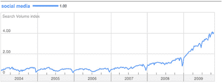

# 第 2 章：PBL 的谬误

### 一个关于社交媒体的故事

要想明白为什么游戏化机制本身最终并不能带来有效的设计，就必须在历史背景下审视游戏化发展的格局。让我们先从社交媒体⁶开始看起。

**Google Trends 对“Social Media”的搜索**

由于博客、Facebook 和 Twitter 的普及，多功能的术语“social media”在 2007 年超越了“social networking”，成为一个新的流行词。当某个行业的兴趣和热情达到临界质量时，总会有人和机构自称专家，以利用流行的热度。流行词到底是什么其实并不重要——SEO、SaaS、云计算、大数据，你可以随便说——这些术语太新了，以至于没人能真正成为专家，但每个人都在争取被视为专家。

于是这些“专家”把“social media”平台和服务的增长视为技术、商业和文化新时代的曙光。他们通过病毒式增长模型来证明其影响的重要性，并收集案例研究，展示公司因擅长社交媒体而取得巨大成功。“人人都是出版商”成了口号，公司如何利用这一现象成为焦点。推销听起来非常鼓舞人心且合乎逻辑。

不幸的是，仅凭“专家”身份远远不够。当公司真正聘请这些社交媒体服务来运营营销活动时，他们发现这些“专家”能做的全部就是创建 Twitter 账号和 Facebook 粉丝页（我甚至见过只为创建这些账号就收取数千美元的服务）。

然而，真正的问题不是如何发布，而是发布什么。在社交媒体革命的早期，内容策略仍然是个谜。对于内容，“专家”只是简单地要求公司提供值得发布的更新。偶尔他们甚至会用公司的 Twitter 账号提供一些客户支持，或在 Facebook 粉丝页上分享图片。但总体而言，行业对这种新“时尚”感到有点幻灭，因为他们期待的投资回报率奇迹并没有实现。

当时大多数人没有认识到，社交媒体远不止拥有和在个人资料上发布内容。那只是其影响力和作用的外壳。今天我们知道，优秀的社交媒体活动关注的是如何通过分享富有洞察力且引人入胜的信息、具有个人声音、与每个潜在客户进行互动和真诚交流等方式为受众创造价值，等等。实质上，社交媒体的美妙之处在于你如何设计和实施活动，而不是你使用了哪些花哨的功能。它是你与社区进行的非正式和正式对话，最终触及了平台独特的可能性。

了解良好的社交媒体原则并不一定意味着有人能正确执行它们。以受欢迎为例。大多数人都知道成为“受欢迎”的人的原则——外向、幽默、自信，在某些情况下富有同情心等。但当你环顾自己的社区或网络时，你会发现真正“受欢迎”的人仍然寥寥无几，而有些人甚至在尝试时显得油腻。帮助品牌变得受欢迎，正是真正的社交媒体专家在原则和执行一致时应该做的事情。

幸运的是，社交媒体确实有让公司取得巨大成功的力量，而且这一趋势得以延续。（每月仍有数十个成功的社交媒体案例研究出现。）今天，大多数公司现在都认同“如果你的公司没有社交策略，它将变得无关紧要”的信念。

这与游戏化有什么联系？我们很快就会看到，社交媒体的早期几乎完全映射了今天的游戏化行业。

## 对苦差事的痴迷

正如我在上一章提到的，游戏有令人惊叹的能力，能让人们长时间保持参与，构建玩家之间的关系和社区，并培养他们的创造潜力。人们仍然常问：“游戏真的有激励人们的力量吗？”请考虑这一点：许多人认为今天的孩子没有强烈的职业道德。他们抱怨现在的孩子没有纪律、容易分心、在遇到挑战时缺乏坚持。

但当谈到玩游戏时，这些孩子展现出大多数人认为惊人的职业道德。许多孩子会在父母背后偷偷在凌晨 3 点醒来，只为玩游戏并提升他们虚构角色的等级。

背后的动机是什么？如果你以前玩过 RPG（角色扮演游戏），你就会知道“升级”通常需要一遍又一遍地在同一关卡击败相同的怪物，持续数小时。即使是像 Candy Crush 或 Angry Birds 这样的手机游戏，也需要数周或数月重复相同的动作（投掷鸟、匹配宝石）才能升级和进展。在游戏世界中，这被恰当地称为“刷怪”，对儿童和成人来说都很有趣且上瘾。

在现实世界中，这通常被定义为“苦差事”。一般来说，没人喜欢做苦差事，完成它需要强烈的职业道德和意志力。但孩子们——再次被认为没有纪律或职业道德——却在为乐趣牺牲睡眠并冒着受罚的风险去完成看似毫无意义的苦差事。

为什么？因为他们对提升角色等级感到兴奋。他们想要获得额外的 +5 力量并获得新的游戏技能，以击败他们在达到足够高等级之前无法击败的挑战性 Boss。他们之所以这样做，是因为他们看到了大局，他们知道自己为什么要做这件事。他们喜欢那种成就感，以及在开发和优化某些策略时运用创造力的感觉。他们如此渴望这些感受，以至于任何阻碍，无论是苦差事还是其他，都值得去做，而且要尽快完成。

现在，想象一个世界，不再存在你需要做的事情和你想做的事情之间的分歧。所有事情都充满乐趣和吸引力，你每天早上醒来都渴望迎接眼前的挑战。当被理解为强大激励因素的结果时，苦差事就有了新的含义。这是优秀游戏化设计可以创造的承诺和愿景。

## 二手寿司制作

尽管关于游戏化有很多案例研究展示了其在世界中产生巨大影响的潜力和承诺，但仍然有更多糟糕实践、失败尝试和误解的例子。当我于 2003 年开始我的游戏化职业生涯时，这是一个没人真正理解或相信的话题。人们认为我只是在为玩电子游戏找借口

快进十二年，游戏化现在已成为全球各行各业领先的设计方法。虽然看到我曾经孤独的热情变得主流让我感到非常高兴，但它也让我困扰，因为从事游戏化工作的专家似乎并不太了解游戏。是的，他们可能玩过一点 Candy Crush，甚至 Angry Birds 和 Fruit Ninja。但如果你问他们在长时间里完全沉浸并痴迷于哪些游戏，你得到的答案会非常简短。

与社交媒体一样，一旦游戏化成为流行词，就吸引了许多看到其作为新兴行业机会的人。我坚信你应该沉浸在一种体验中才能最好地理解它。是的，你可以通过密切观察来获得洞察

谁正在经历这种体验。但这就像看着别人吃寿司然后让他们做一份调查，而不是自己吃寿司。你不会得到同样的发现，如果你仅仅基于调查来复制这种体验，你就会给自己设计的产品赋予一种“肤浅的寿司味道”。

因此，许多游戏化专业人士只专注于开发游戏的表层。我称之为游戏体验的外壳。这最常以我们所说的 PBL 的形式表现出来：积分、徽章和排行榜。许多游戏化专业人士似乎认为，如果你在无聊的东西上加上积分，添加一些徽章，并提供一个竞争性的排行榜，那个曾经无聊的产品就会自动变得令人兴奋。

当然，这也是许多游戏化平台所擅长的：以可扩展的方式将 PBL 添加到各种产品中。结果，许多对游戏化感到好奇但信息不足的人开始相信，游戏化的方法论和哲学的总和仅仅是将积分、徽章和排行榜添加到产品中的过程。理所当然地，这让他们相信游戏化只是一个肤浅的潮流，影响不大。

这也引发了游戏开发社区的反弹，他们声称游戏化是对优秀游戏固有本质的篡改。谁能责怪他们呢？Foursquare 看起来不过是基于去某个地方的积分、徽章和排行榜，而 Nike+ 看起来也是基于跑步的同样的东西。游戏化就这么深吗？

当然，积分、徽章和排行榜在游戏设计中确实有一席之地。这就是为什么你在许多不同的游戏中都能看到它们。它们有能力激励行为并推动人们采取某些行动。但游戏化远不止 PBL。许多游戏化专业人士只熟悉如何实施 PBL 机制，即使这些机制确实创造了价值，但其中大多数完全忽略了吸引用户的要点。用户因肤浅的外壳机制而感到被冒犯的情况并不少见。

如果你问任何游戏玩家是什么让游戏变得有趣，他们不会告诉你是因为 PBL。他们玩它是因为其中有策略元素，有很好的方式与朋友共度时光，或者他们想挑战自己克服困难的障碍。积分和徽章通常只是一个不错的附加奖励，具体取决于上下文。这就是外在动机与内在动机的区别，外在动机是你因为目标或奖励而投入，而内在动机是活动本身就很有趣、很令人兴奋，有奖励也好，没有奖励也好。我们将在第 13 章《左脑与右脑动机》中更深入地探讨这些区别。

## 没有希腊士兵的特洛伊木马

通用游戏机制和构造不良的游戏元素，如等级、Boss 战或任务，往往也会落入与 PBL 相同的陷阱。简单地说，在没有深入研究用户动机之前，应用流行游戏玩法中无处不在的传统“游戏元素”会导致用户体验肤浅：全是噱头，没有实质。一个几乎令人发笑的例子是，当我遇到的人称某物为“任务”而不是“任务”时，他们认为这会自动使相同的原始操作变得有趣和引人入胜。当然，保持一种好玩的态度会带来很大不同，但它只能做到一定程度，尤其是当你的客户和员工可能已经不信任你的动机时。

**真相是，仅仅融入游戏机制和游戏元素并不会让游戏变得有趣。**

游戏也不一定因为高质量的图形或华丽的动画而变得有趣。有很多不受欢迎、销量不佳的游戏拥有最先进的 3D 高分辨率图形。也有图形非常基础的游戏，如 Minecraft，甚至没有图形，如纯文本的多用户地牢游戏（MUDs），却拥有大量沉迷其中的玩家社区。很明显，游戏远不止“表面所见”。

不幸的是，很多从事游戏化工作的人错误地认为，应用积分、徽章和排行榜等游戏机制——这些元素你也可以在无聊和不成功的游戏中找到——会自动使产品或体验变得有趣和引人入胜。

不幸的是，不仅仅是你放入了什么游戏元素——而是这些游戏元素如何、何时出现，最重要的是，为什么出现。

如果一名现代军队指挥官说：“嘿！希腊人给特洛伊人送了一个大木马并赢得了战争。让我们也给敌人送一个大木马吧！”那就太愚蠢了。在这种情况下，他显然不了解特洛伊木马背后的真正设计，但他只复制了它的外壳。相反，如果他创建一个伪装成正常文件的病毒来破坏敌方电脑会更有效。学习设计；不要复制外壳。

## 游戏化的威胁与机遇

尽管游戏化已在主流中得到接受，但设计不良的应用威胁着其长期可行性和影响力发展。我真诚地担心，几年后，公司会看着游戏化说：“嘿，我们试过积分的东西，没起作用。我想游戏化只是一个短期潮流。”

*那将是世界的巨大损失。*

基于我多年的游戏化研究、观察和设计，我百分之百确定，优秀的游戏化设计可以释放巨大的潜力，并在过程中改善许多人的生活。也有数百个案例研究说明了这一点。因此，这就是我的工作——也希望有一天是你的工作——继续保护和创新游戏化的核心本质和承诺。

从长远来看，“游戏化”这个词可能会逐渐淡出并最终消失。目前，没有人会描述一个网站的设计为“如此 Web 2.0！”游戏化可能只是我们设计、实施和与周围世界互动的正常方式。我希望优化人类动机的原则能成为各方面良好设计的标准。

幸运的是，有足够多的优秀游戏化案例继续展示深思熟虑的设计如何改善核心业务指标并激发新的思考和执行方式。除了我在网站上列出的 90 多个游戏化案例研究外，如上一章所述，有趣的是，一些最好的历史游戏化例子，如 eBay 或 Woot.com，并未被行业大多数人归类为游戏化。有数十家，甚至数百家公司之所以极其成功，是因为无论它叫什么，他们都将出色的游戏机制和游戏玩法动态应用于其流程。其中一些例子将在以下章节中说明。

由于这些成功案例，我相信游戏化将继续发展并满足实际需求，如果从业者和游戏化社区也能在对其原则和实践的理解上不断发展。

那么如果“游戏机制”本身并不是游戏如此吸引人甚至上瘾的真正原因，那么是什么呢？

## 好设计师与坏设计师的故事

要理解优秀游戏化设计的核心，让我们从一个坏游戏设计师可能会如何设计游戏的例子开始。

在设计游戏时，坏设计师可能会开始思考：“好吧，我应该使用哪些流行的游戏机制和游戏元素？当然我们需要在游戏中加入怪物。我们还需要剑，那应该放在哪里？朋友可以施肥的农作物怎么样？一些态度十足的鸟怎么样？我相信人们会喜欢的！”

正如上面夸张的描述所示，一款游戏可能拥有所有“正确的游戏元素”，但如果不首先关注用户的动机，仍然会非常无聊或愚蠢。值得记住的是，市场上的每一款游戏都有我们所说的游戏机制和游戏元素。然而，其中大多数仍然很无聊并且是财务上的失败者。只有少数设计良好的游戏变得引人入胜甚至上瘾。你是在设计失败的游戏还是成功的游戏？又如何知道呢？

那么让我们看看好游戏设计师可能会如何处理这个问题。与其从使用什么游戏元素和游戏机制开始，好游戏设计师可能会先思考：“好吧，我希望我的

用户去*感受*？我想让他们感受到启发吗？我想让他们感到自豪吗？他们应该感到害怕吗？焦虑吗？我对他们预期体验的目标是什么？

一旦设计师明白了她希望用户有怎样的感受，她就会开始思考：“好吧，什么样的游戏元素和机制能帮助我实现让玩家产生这种感受的目标？”解决方案可能在于剑、植物，甚至是字谜游戏，但这里的重点是，游戏元素只是达到目的的手段，而非目的本身。游戏元素的存在只是为了推拉用户的行为核心驱动力。

因此，为了进一步探索、系统化并扩展将游戏机制与我们的动机核心驱动力相结合的方法，2012年，我决定将名为Octalysis的原创游戏化设计框架分享给世界。Octalysis框架凝聚了我毕生的心血，本书的大部分内容将围绕如何使用Octalysis来设计有趣、引人入胜且有回报的体验展开。
