# 第3章：Octalysis框架

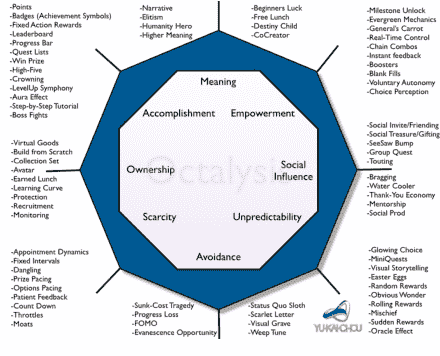

### 适用于所有人的游戏化设计框架

由于上一章讨论的问题，过去十年我一直致力于创建一个完整的框架，用以分析和构建围绕各种让游戏引人入胜的系统制定策略。我发现几乎每一款成功的游戏都会触动我们内心的某些核心驱动力，激励我们做出各种决策和活动。我还注意到，不同类型的游戏技巧以不同方式推动我们前进；有些通过启发和赋能，有些通过操控和迷恋。我深入探究，找出一种动机与另一种动机之间的区别。最终成果是名为*Octalysis*的游戏化设计框架，它得名于一个八边形形状，八个核心驱动力分别代表八条边。

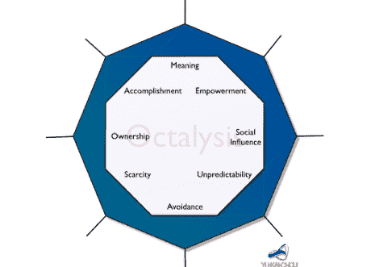

### 仅呈现8个核心驱动力的Octalysis

在过去的十年里，我得到的恩赐远超我的预期。我在游戏化方面的孤独热情，变成了各行各业都关注的事物。我也可能轻易地陷入一种终生都无人问津的热情。同样，当我在博客Yukaichou.com上发表Octalysis框架时，它也受到了业界的热烈欢迎。许多杰出的作品在创作者一生的大部分时间里都无人问津或不被赏识，更不用说我只是发布在个人博客上的一个设计框架了。令我高兴的是，一年之内Octalysis框架就被自发翻译成了超过十四种语言——我不得不逐一发现它们。我很快获得了许多在全球演讲、教学和咨询的机会。

经过多年的实验和调整，我意识到我们所做的一切都基于Octalysis中的8个核心驱动力中的一个或多个。这一点很重要，需要牢记，因为这也意味着，如果一个期望行为背后没有任何这些核心驱动力，那么就不存在动机，行为也就不会发生。

让我们快速审视一下这8个核心驱动力是什么。

### 游戏化的8个核心驱动力

#### 核心驱动力1：史诗意义与使命感

史诗意义与使命感是一种核心驱动力，当一个人相信自己正在从事一项比自己更伟大的事业，和/或相信自己被“选中”去做这件事时，这种驱动力就会发挥作用。一个例子是，玩家投入大量时间为维基百科等项目做贡献。众所周知，人们并不是为了赚钱而贡献维基百科，甚至也不是为了给简历增色。人们贡献维基百科是因为他们相信自己正在保护人类的知识——一件比他们自身宏大得多的事情。当某人拥有“新手好运”时，这种驱动力也会发挥作用——这是一种效应，人们相信自己拥有别人没有的某种天赋，或者相信自己很“幸运”，在游戏一开始就得到了那把神奇的剑。

#### 核心驱动力2：进步与成就感

进步与成就感是我们内在的驱动力，促使我们取得进步、发展技能、掌握精通，并最终克服挑战。这里的“挑战”一词非常重要，因为没有挑战的徽章或奖杯毫无意义。这也是最容易设计的核心驱动力，而且巧合的是，大多数PBL（积分、徽章、排行榜）都主要聚焦于此。

#### 核心驱动力3：创造力与反馈的赋能

创造力与反馈的赋能体现在用户参与一个创造性过程时，他们不断发现新事物并尝试不同的组合。人们不仅需要表达创造力的方式，还需要看到创造力的成果、获得反馈，并随之调整。这就是为什么玩乐高积木和创作艺术本身就有趣。如果这些技巧被合理设计和整合，以赋予用户创造力，它们往往会成为“常青机制”：游戏设计师不再需要不断添加额外内容来保持活动的新鲜感和吸引力。大脑自己就能自娱自乐。

#### 核心驱动力7：不可预测性与好奇心

不可预测性是一种核心驱动力，让人持续投入，因为你不知道接下来会发生什么。当某事不符合你惯常的模式识别循环时，你的大脑会高速运转，关注意外之事。这显然是赌博成瘾背后的主要核心驱动力，但也存在于公司举办的每一次抽奖或彩票活动中。在更轻松的层面上，许多人看电影或读小说也是因为这种核心驱动力。备受争议的斯金纳箱实验中，动物由于不可预测的结果而非理性地频繁按压杠杆，这完全指向不可预测性与好奇心这一核心驱动力——尽管许多人将其误解为积分、徽章和排行榜机制背后的驱动力。[^7]

#### 核心驱动力8：失去与避免

这个核心驱动力应该不会让人意外——它是避免负面事情发生的动机。从小的方面说，它可能是避免失去之前的工作成果，或避免改变自己的行为。从大的方面说，它可能是避免承认自己迄今所做的一切都毫无用处，因为你现在要放弃了。此外，正在消逝的机会也会强烈利用这一核心驱动力，因为人们觉得如果不立即行动，就会永远失去行动的机会（例如：“仅限限时特惠！”）

### 左脑（外在倾向）与右脑（内在倾向）驱动力

在本书中我会多次重复：因为你所做的一切都基于这8个核心驱动力中的一个或多个，当一个期望行为背后没有任何这8个核心驱动力时，就*没有*动机，也不会发生行为。此外，这8个核心驱动力各自具有不同的*本质*。有些让用户感到强大，但不会产生紧迫感；有些则产生紧迫感、痴迷甚至上瘾，但让用户感觉糟糕。有些更偏向短期的外在动机，有些则更偏向长期的内在动机。因此，这8个核心驱动力被绘制在八边形上，不仅仅是为了美观，而是因为位置决定了动机的*本质*。

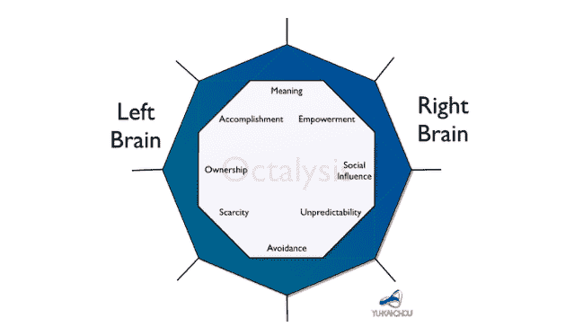

左脑与右脑核心驱动力

Octalysis框架的排列方式是，关注创造力、自我表达和社会动态的核心驱动力被组织在八边形的右侧。在我的框架中，我称它们为右脑核心驱动力。最常与逻辑、分析思维和所有权相关联的核心驱动力则被绘制在八边形的左侧，被称为左脑核心驱动力。

值得注意的是（尤其是对那些现在正在摇头的“科学派”读者），左脑和右脑的提法并不是指实际大脑区域的字面含义，而仅仅是大脑两种不同功能之间的象征性区分。

有趣的是，左脑核心驱动力往往依赖外在动机——你被激励是因为你想获得某样东西，无论是一个目标、一件商品，还是任何你无法获得的东西。另一方面，右脑核心驱动力大多与内在动机相关——你不需要目标或奖励来发挥创造力、与朋友相处，或感受不可预测性的悬念——活动本身就有其回报。

这很重要，因为许多公司强调为外在激励因素而设计，例如在用户完成任务时提供奖励。然而，许多研究表明，外在动机会损害

内在动机。为什么？因为一旦公司停止提供外在激励因素，用户动机往往会骤降至比最初引入外在激励因素时低得多的水平。我们将在第13章探讨这种被称为*过度理由效应*的趋势。

对公司而言，更好的做法是设计能够激发右脑核心驱动力的体验，让事情本身就充满乐趣和回报，从而使用户能够持续享受并参与活动。当动机持久时，效果往往更好。

## 白帽与黑帽游戏化

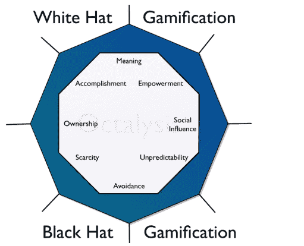

白帽与黑帽核心驱动力

在Octalysis框架中，另一个需要注意的因素是，八边形中上方的核心驱动力被认为是积极的动机，而下方的核心驱动力则被认为更消极。我将大量使用上方核心驱动力的技术称为“白帽游戏化”，而利用下方核心驱动力的技术则称为“黑帽游戏化”。

如果某件事之所以吸引人，是因为它能让你表达自己的创造力，通过掌握技能让你感到成功，并赋予你更高的意义感，那么它会让你感觉非常好且强大。另一方面，如果你总是因为不知道接下来会发生什么而去做某事，总是害怕失去什么，或者因为你正在努力获取无法拥有的东西，那么这种体验往往会让你口中留下糟糕的滋味——即使你一直有动力去采取这些行动。

从Octalysis的角度来看，Zynga游戏（历来）的问题在于，它们在实施许多黑帽游戏技术方面非常成功。当然，他们并没有框架来将其理解为“黑帽”，而是称之为“数据驱动设计”。⁸ 由于黑帽动机，在很长一段时间内，他们的游戏在留存率、成瘾性和变现能力方面从每个用户身上都获得了巨大的数字。然而，由于大多数Zynga游戏在玩的时候并不能让用户感觉良好，当用户最终能够摆脱这个系统时，他们就会离开。

这类似于赌博成瘾的情况——他们感觉自己无法控制自己，而当他们戒掉时，实际上会感到自己有了力量。近年来，Zynga通过对一系列赌博游戏“加倍下注”，进一步验证了我基于Octalysis的理论，例如老虎机游戏《奥林匹斯宝藏》，这进一步使他们的设计方法论偏离了白帽核心驱动力。⁹

需要注意的是，某件事被称为黑帽并不一定意味着它是坏的。这些只是驱动力，它们也可以被用于富有成效和健康的结果。许多人自愿接受黑帽游戏化，以便更频繁地去健身房、吃得更健康，或者避免每天早上按下闹钟的贪睡按钮。我们将在第14章讨论伦理和积极的黑帽游戏化设计。

基于Octalysis框架，一位优秀的游戏化实践者应该考虑所有8种核心驱动力，以促进积极且富有成效的活动，从而让每个人事后都变得更快乐、更健康。

## 隐藏的第九核心驱动力：感官体验

除了本书将深入探讨的8种核心驱动力之外，实际上还有一个隐藏的第九核心驱动力，称为“感官体验”，它是人们从某个行动中获得的生理愉悦。人们吸毒、按摩或做爱（希望同时还伴随着许多其他核心驱动力）是因为*感官体验*这一核心驱动力。如果你选择一种食物而不是另一种，通常只是因为它更好吃，这主要是*感官体验*。与其他核心驱动力相比，这里的关键区别在于，*感官体验*涉及的是给我们触觉、听觉、视觉、嗅觉甚至味觉带来愉悦的生理感受。其他核心驱动力则通过心理方式给我们带来愉悦——即我们所看到、听到或品尝到的事物背后的意义和情境。

我之所以没有将它纳入框架的主要部分，是因为Octalysis框架主要关注心理激励因素，而非生理激励因素。例如，在*大多数*情况下，我无法设计一种互动体验，让用户获得乘坐过山车时身体加速的感觉。按摩可以被设计为Octalysis策略仪表板（将在第16章讨论）中的奖励或*反馈机制*，但这些行为通常是通过诸如稀缺、成就和拥有感等核心驱动力来激励的。

尽管我们没有将感官体验纳入Octalysis的8种核心驱动力之中，但我们承认它的存在，并理解某些行为是如何由它驱动的。然而，*感官体验*本身如果没有8种核心驱动力相伴，也有其局限性。即使是像性这样令人愉悦的活动，如果缺乏*好奇心、关联性、创造力*和*稀缺性*，也可能变得相当乏味。

## 如何将一级Octalysis应用于实际系统

既然我们已经列出了Octalysis框架，下一步就是确定如何利用它。由于一个人所做的每件事都基于一种或多种核心驱动力，通常任何吸引人的产品或系统至少会包含上述核心驱动力之一。如果一个系统中不存在任何核心驱动力，那么就没有动机，用户就会流失。

Octalysis的第一个应用是用于分析各种产品和体验在动机方面的优势与劣势。这里的关键是开始思考该产品或体验如何利用这8种核心驱动力，并识别出所有用于激活它们的游戏机制和技术。

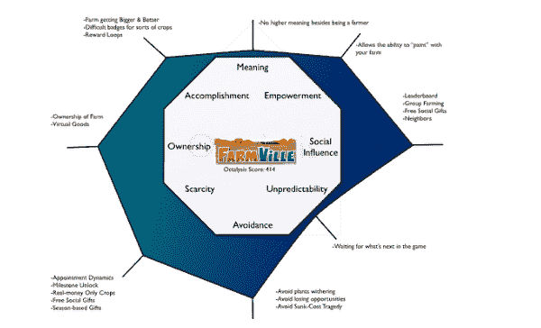

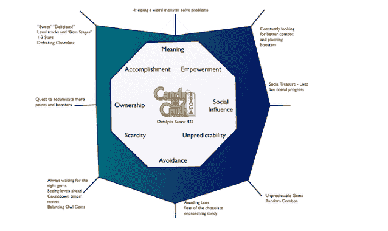

这里我们看到几个相互对比的游戏示例。

与Facebook一样，《Farmville》和《Candy Crush》也缺乏核心驱动力1：史诗意义与使命感，但《Farmville》还缺乏核心驱动力7：不可预测性与好奇心——游戏中没有太多惊喜。你回到《Farmville》仅仅是为了收获几小时前种下的庄稼。《Candy Crush》则稍微平衡一些，但有点偏向于右脑核心驱动力。

以前，我都是手动在Keynote上绘制每个Octalysis图形。幸运的是，一位Octalysis的粉丝，来自以色列的Ron Bentata，慷慨地提出为大家构建一个更简单的Octalysis工具。

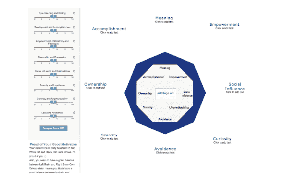

（访问自 www.yukaichou.com/octalysis-tool）

借助Octalysis工具，让我们再看几个Octalysis示例。

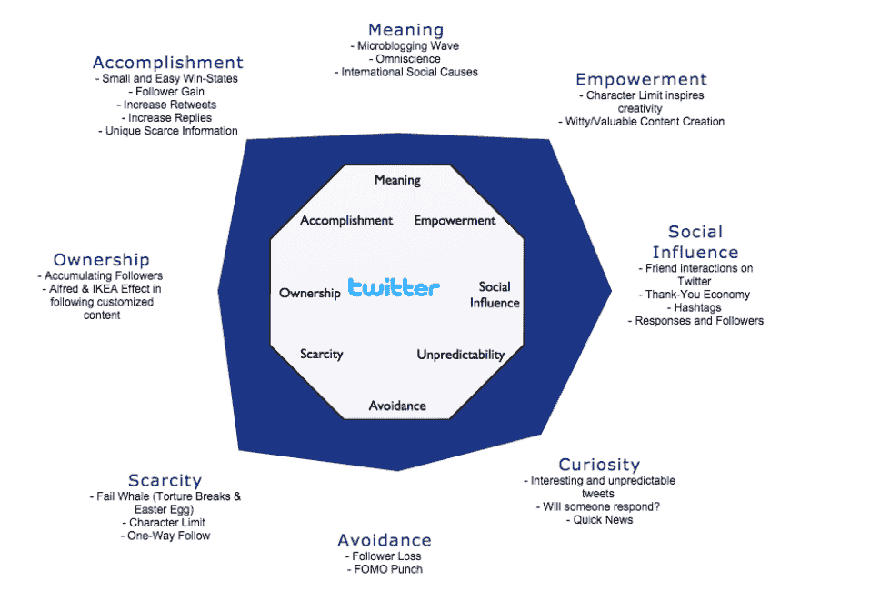

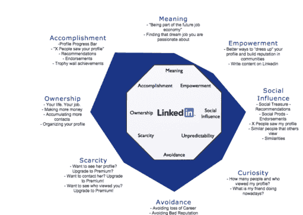

在这里我们可以看到，Twitter也相当平衡，但更偏向于右脑核心驱动力。相比之下，LinkedIn则主要聚焦于左脑核心驱动力，并以白帽为重点。这很合理，因为LinkedIn完全关乎你的职业生涯、你的生活、你的成就。这些都是非常外在的目标，因此每个人都觉得他们需要一个LinkedIn账户。然而，由于它缺乏右脑（内在倾向）核心驱动力，LinkedIn上没有太多令人愉快的活动。这也是他们多年来一直面临的挑战。用户创建自己的个人资料，然后在LinkedIn上就无事可做了。账户就那样闲置在那里。

在过去几年里，LinkedIn一直在努力增加网站上的参与度，尤其是在核心驱动力5：社会影响力与关联性方面，通过诸如社交刺激和社交珍宝等游戏技术——我们将在第9章讨论LinkedIn如何使用这些游戏技术。然而，通过Octalysis框架，我们可以看到，如果LinkedIn在核心驱动力3：创造力的赋能与反馈，以及核心驱动力7：不可预测性与好奇心方面投入更多精力，它将受益匪浅。

## 二级Octalysis及更高层次快速入门

十年的游戏化研究和实践造就了一个相当稳健的框架，它可以转化为实际行动，以推动更好的动机和指标。正如你所见，创造一个丰富的游戏化体验

远不止简单地将各种游戏机制套用到现有产品上。它是一门需要大量分析、思考、测试和调整的技艺。

当你在Octalysis上的造诣超越本书内容后，你将开始学习更高层次的Octalysis设计（最高可达*五个层次*。世界上只有少数人知道第四级及以上层次是什么）。这些高级层次包含了更为复杂的设计原则和深入分析。

一旦你掌握了一级Octalysis，就可以将其应用于二级Octalysis，在此我们会尝试在整个玩家/用户旅程的四个阶段中优化体验。这些阶段分别是：*发现*（人们为何想要尝试该体验）、*上手*（用户学习游戏规则和工具的阶段）、*搭建*（朝着目标重复行动的常规过程）以及*终局*（如何留住你的资深用户）。

## 二级Octalysis
为所有4个阶段设计

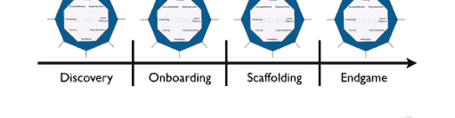

## 二级Octalysis：纳入玩家旅程的4个阶段

大多数人将产品视为一种单一的体验，这似乎合理。但就动机而言，我认为这是个错误，因为你在第1天使用某个产品的原因通常与第100天截然不同。既然你所做的一切都是因为这8种核心驱动力之一（除了第9种隐藏的核心驱动力——感知），如果在任何阶段这8种核心驱动力都不存在，用户就没有理由进入下一阶段，便会直接流失。

## 二级Octalysis
为所有4个阶段设计

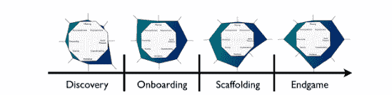

感知玩家在整个旅程中的感受脉搏

在上面的插图中，你可以评估不同的核心驱动力如何在玩家旅程的每个体验阶段中更为突出——无论是*不可预测性*、*成就感*还是*社会影响*。例如，大多数人*发现*一个产品是因为核心驱动力7：不可预测性与好奇心——他们从新闻上读到或听别人谈论。

在*上手*阶段，他们可能受到核心驱动力2：发展与成就的激励——在早期阶段感到自己聪明和有能力。在*搭建*阶段，他们可能因社交动态（核心驱动力5）以及尝试追求尚未达成的目标（核心驱动力6：稀缺与急躁）而受到激励。在*终局*阶段，他们可能继续参与，因为不想失去自己的地位和成就（核心驱动力8：损失与逃避）。

你如何通过8个核心驱动力为所有四个体验阶段设计，将极大地展示你作为Octalysis游戏化设计师的能力。当然，永远不要忘记为核心驱动力设计合适的*性质*，理解何时需要更多的黑帽，何时需要更多的白帽，以及何时使用外在/内在动机。

一旦你掌握了二级Octalysis，你就可以继续推进到三级，将不同的玩家类型纳入考量。这将让你看到不同类型的人在体验的不同阶段是如何被激励的。

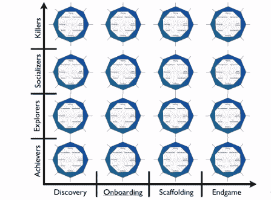

进一步升级：结合巴特尔玩家类型的三级Octalysis

在上面的图表中，我将理查德·巴特尔的四种玩家类型（成就者、社交者、探索者和杀手）应用于三级Octalysis，主要是因为它是最受认可的游戏设计模型。然而，三级Octalysis并不一定需要使用巴特尔的玩家类型¹⁰。事实上，理查德·巴特尔本人声称他的四种玩家类型可能不适用于游戏化环境¹¹。它可以是销售与营销人员、男性与女性、忠诚顾客、冷漠顾客与新顾客等等。这里的要点是，不同类型的人受到的激励不同，因此三级Octalysis让设计师能够理解和设计每个人在不同阶段的感受。我们将在第15章中结合Octalysis详细探讨理查德·巴特尔的四种玩家类型。

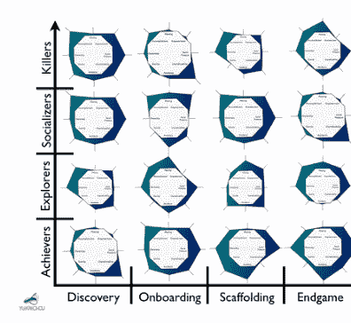

## 感知每种玩家类型在每个体验阶段是如何被激励的

设计出让每个人都满意的东西非常困难。但通过这个框架，你可以开始识别系统中的弱点，并在各个节点上努力改善激励。一旦你熟悉了三级Octalysis，你几乎能感觉到激励如何在系统中流动，并识别出哪里缺乏激励，或者系统中是否有过多的黑帽或外在激励。

例如，通过三级Octalysis，人们可以得出这样的结论：“看起来成就者在发现阶段起步良好，上手阶段也没问题，但在搭建阶段他们失去动力并退出。探索者会因为核心驱动力7：不可预测性与好奇心而尝试产品，但在上手阶段感到困惑并离开。社交者甚至不会尝试该体验，因为产品中没有宣传核心驱动力5：社会影响与关联性。最后，在这种情况下，杀手似乎是那些会跨越发现、上手、搭建和终局阶段的人——可能会向新玩家炫耀。”

虽然Octalysis总共有五个层级，但对于大多数想要理解为何产品无法吸引用户的公司来说，一级通常就足够了。更高级的Octalysis流程对于那些真正致力于确保将指标推向正确方向并延长游戏化系统寿命的组织非常有用。许多游戏只流行三到八个月，但拥有无可挑剔的终局设计的热门游戏可以持续数十年——甚至几个世纪。

本书将探讨8种核心驱动力，如何为它们进行设计，以及它们如何共同为任何用户创造非凡的体验。如果以上内容至今没有引起你的兴趣，那么放下这本书去做更有意义的事是明智的。但如果以上内容让你感到兴奋，并且你选择继续，我向你保证，前方将是一段令人振奋的发现、赋能和觉醒之旅。光是想想我就已经感到兴奋了。

## 为了充分利用本书，请从以下选项中选择一项立即执行：

- **简单：** 想一个你玩了很久的游戏。你能识别出其中存在哪8种核心驱动力？
- **中等：** 想一想你为什么在读这本书。是哪些核心驱动力让你选择了这本书而不是其他活动？

**在Twitter或你偏爱的社交网络上分享你的想法，使用标签#OctalysisBook，看看其他人有什么见解。**
